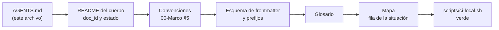

# AGENTS.md — Lab-Documentos

Instrucciones para agentes de código que trabajan en este repositorio. Este archivo es un **puntero**: no repite las
reglas, dice dónde están y en qué orden leerlas. Si algo de acá no coincide con el documento al que apunta, vale el
documento.

## Índice

1. [Definiciones](#1-definiciones)
2. [Qué es este repositorio](#2-qué-es-este-repositorio)
3. [Ruta de lectura del agente](#3-ruta-de-lectura-del-agente)
4. [Cómo validar antes de proponer](#4-cómo-validar-antes-de-proponer)
5. [Qué puede y qué no puede cambiar un agente](#5-qué-puede-y-qué-no-puede-cambiar-un-agente)
6. [Anexos de referencia](#6-anexos-de-referencia)
7. [Un ejemplo: agregar una página al cuerpo](#7-un-ejemplo-agregar-una-página-al-cuerpo)
8. [Cómo cambia este archivo](#8-cómo-cambia-este-archivo)

## 1. Definiciones

| Término | Significado en este repositorio |
| --- | --- |
| Cuerpo | Carpeta cuyo `README.md` declara `corpus_id` en el frontmatter. Hoy hay uno: `SDEI`, la guía del sistema documentador |
| `docs-guard` | La compuerta de documentación: corre en cada pull request y en local con `scripts/ci-local.sh` |
| Clase D / P / H | Quién puede cerrar un cambio: D lo produce un generador; P lo propone un agente o una persona; H sólo una persona |
| Ruta «agente» | Una de las tres rutas de lectura del cuerpo; empieza en este archivo |

Las definiciones completas están en el [glosario](Guides/Documentacion-Tecnica/Sistema-De-Documentacion-E-Integracion/99-Anexos/Glosario.md).

## 2. Qué es este repositorio

Guías de estudio y conceptos para el desarrollo de software, escritas en Markdown y leídas en GitHub, sin sitio
publicado. La portada humana es el [README](README.md). Las carpetas que importan a un agente:

| Carpeta o archivo | Qué hay | Cuándo leerlo |
| --- | --- | --- |
| [Cuerpo `SDEI`](Guides/Documentacion-Tecnica/Sistema-De-Documentacion-E-Integracion/README.md) | La guía del sistema documentador: marco, mapa, temas y anexos | Siempre que el cambio toque documentación |
| [`Guides/`](Guides/README.md) | Las demás guías, por categoría; son anteriores al cuerpo y la compuerta las trata como heredadas | Si el cambio cae ahí |
| [`tools/docs-guard/`](tools/docs-guard/README.md) | Los controles de la compuerta, sus datos y sus fixtures | Si un control da rojo y no se entiende por qué |
| [`scripts/ci-local.sh`](scripts/ci-local.sh) | La compuerta en local, con los mismos pasos que la CI | Antes de proponer cualquier cambio |
| [`CHANGELOG.md`](CHANGELOG.md) | Cambios del repositorio y la delegación del merge vigente | Antes de abrir o fusionar un pull request |

## 3. Ruta de lectura del agente

Leé en este orden; cada paso dice qué sacar de él.

1. **Este archivo**: qué es el repositorio y qué se puede cambiar.
2. [README del cuerpo](Guides/Documentacion-Tecnica/Sistema-De-Documentacion-E-Integracion/README.md): la tabla de
   contenido con el `doc_id` de cada documento y su estado.
3. [Convenciones del Marco](Guides/Documentacion-Tecnica/Sistema-De-Documentacion-E-Integracion/00-Marco.md#5-convenciones):
   frontmatter, identificadores, trazas, enlaces, citación, diagramas, ejemplos, estados, repositorios privados e idioma.
4. [Esquema de frontmatter y prefijos](Guides/Documentacion-Tecnica/Sistema-De-Documentacion-E-Integracion/99-Anexos/Esquema-Frontmatter-Y-Prefijos.md):
   los diez campos más `description`, el vocabulario cerrado y el registro de prefijos.
5. [Glosario](Guides/Documentacion-Tecnica/Sistema-De-Documentacion-E-Integracion/99-Anexos/Glosario.md): el término
   exacto antes de escribir uno nuevo.
6. [Mapa](Guides/Documentacion-Tecnica/Sistema-De-Documentacion-E-Integracion/01-Mapa.md), sólo la fila de la situación
   que toca resolver.



*Diagrama: la ruta «agente», de este archivo a una página que pasa la compuerta.*

## 4. Cómo validar antes de proponer

Desde la raíz del repositorio:

```bash
scripts/ci-local.sh          # todos los grupos sobre el cuerpo SDEI, con agregador
scripts/ci-local.sh ai       # un grupo solo
```

El cambio está listo para un pull request cuando la última línea dice `== docs-guard: verde`. La compuerta también
revisa este archivo (enlaces, anti-inyección y estructura). Qué hace cada grupo, qué bloquea y qué sólo avisa está en
el [README de `docs-guard`](tools/docs-guard/README.md#5-qué-bloquea-y-qué-avisa).

## 5. Qué puede y qué no puede cambiar un agente

La regla completa está en [Cómo decidir, «Quién decide»](Guides/Documentacion-Tecnica/Sistema-De-Documentacion-E-Integracion/99-Anexos/Como-Decidir.md#6-quién-decide).
En resumen:

| Puede proponer (clase P) | No puede cerrar solo (clase H) |
| --- | --- |
| Páginas nuevas en `borrador`, correcciones, fichas, ejemplos | Pasar un documento a `vigente` |
| Un prefijo nuevo en el registro, con su motivo | Cambiar este archivo o `tools/docs-guard/excepciones.txt` |
| Entradas del `CHANGELOG.md` que describen su cambio | Agregar un dominio a `tools/docs-guard/dominios.txt` o un workflow nuevo |
| Una decisión consecuente cuando lo aditivo choca con una decisión propia | Etiquetar, publicar o fijar la versión del cuerpo |

Dos reglas que la compuerta no ve y que no se negocian: en lo versionado no van rutas de una máquina, direcciones IP,
hosts ni usuarios; y un repositorio privado se nombra sólo por su alias (el servicio push privado es **SDD-B**).

## 6. Anexos de referencia

Material de consulta del cuerpo, para buscar, no para leer de corrido.

| Anexo | Para qué lo usa un agente |
| --- | --- |
| [Esquema de frontmatter y prefijos](Guides/Documentacion-Tecnica/Sistema-De-Documentacion-E-Integracion/99-Anexos/Esquema-Frontmatter-Y-Prefijos.md) | Escribir un frontmatter válido y elegir un prefijo registrado |
| [Glosario](Guides/Documentacion-Tecnica/Sistema-De-Documentacion-E-Integracion/99-Anexos/Glosario.md) | Usar el término y la sigla que ya existen |
| [Referencias](Guides/Documentacion-Tecnica/Sistema-De-Documentacion-E-Integracion/99-Anexos/Referencias.md) | Citar en APA 7 con fecha de consulta y ancla `ref-…` |
| [Criterios de calidad](Guides/Documentacion-Tecnica/Sistema-De-Documentacion-E-Integracion/99-Anexos/Criterios-De-Calidad.md) | Saber qué criterio automatiza la compuerta y cuál se revisa a mano |
| [Patrones de ejemplos](Guides/Documentacion-Tecnica/Sistema-De-Documentacion-E-Integracion/99-Anexos/Patrones-De-Ejemplos.md) | Rotular la procedencia de cada fragmento de código |
| [Lista de verificación, cara agente](Guides/Documentacion-Tecnica/Sistema-De-Documentacion-E-Integracion/99-Anexos/Lista-De-Verificacion.md#8-cara-agente) | Los ítems `VER-A01` a `VER-A07` que tiene que cumplir una página |
| [Cómo decidir](Guides/Documentacion-Tecnica/Sistema-De-Documentacion-E-Integracion/99-Anexos/Como-Decidir.md) | Elegir entre alternativas con la escala anclada y saber si la decisión es firme |

## 7. Un ejemplo: agregar una página al cuerpo

`[Fragmento ilustrativo: recorrido de la ruta «agente» para un anexo nuevo; los nombres son de ejemplo]`

1. En el README del cuerpo se ve que no existe el anexo y qué `doc_id` usan los otros (`ANX-SDEI-…`).
2. En el registro de prefijos, `ANX` existe: no hace falta registrar uno nuevo.
3. Se escribe la página con los diez campos más `description`, `status: borrador` y `traces` a documentos que existen.
4. Se la enlaza desde el Mapa y desde la tabla de contenido del README.
5. `scripts/ci-local.sh` da verde; si `esquema` o `trazas` dan rojo, el mensaje nombra el campo o el ID que falla.
6. Se abre el pull request con la entrada del `CHANGELOG.md`.

## 8. Cómo cambia este archivo

Cambiar `AGENTS.md` es clase H. La compuerta lo excluye del aviso AI-3 (frases dirigidas al agente) por una excepción
con huella en [`tools/docs-guard/excepciones.txt`](tools/docs-guard/excepciones.txt): la excepción vale para el
SHA-256 exacto del archivo. Si el archivo cambia y la huella no se renueva en el mismo pull request, AI-3 vuelve a
mirarlo y avisa. Renovar la huella es parte del cambio y lo aprueba una persona.
