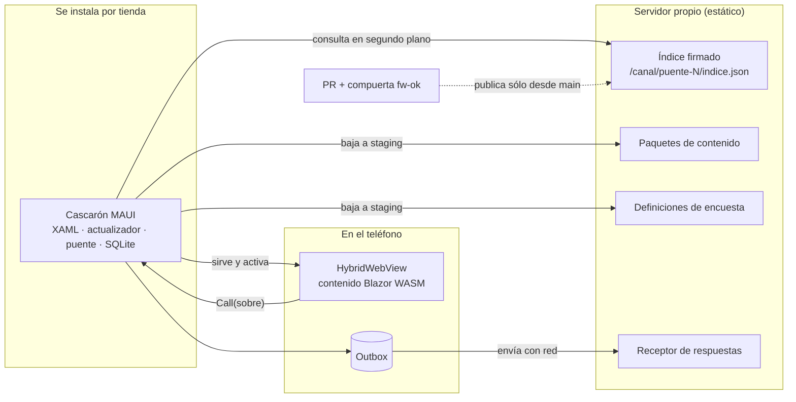

# Marco de referencia — escenarios, contextos y actores del framework

## Índice

1. [Para qué sirve este documento](#1-para-qué-sirve-este-documento)
2. [Vocabulario mínimo](#2-vocabulario-mínimo)
3. [Escenarios](#3-escenarios)
4. [Contextos](#4-contextos)
5. [Actores](#5-actores)
6. [Mapa conceptual: «estoy acá → qué aplico»](#6-mapa-conceptual-estoy-acá--qué-aplico)
7. [Observaciones](#7-observaciones)
8. [Referencias](#8-referencias)

## 1. Para qué sirve este documento

Todos los documentos de la guía hablan de las mismas situaciones (escenarios), de los entornos donde la respuesta
cambia (contextos) y de las personas o sistemas que deciden algo (actores). Acá se definen **una sola vez**, con un
identificador estable (`ESC-n`, `CTX-n`, `ACT-nn`); el resto de la guía los cita por ese identificador. Los siete
escenarios son los que fijó el dictamen de la mesa para la guía (P10 del folio 035 del expediente 0001).

El hilo conductor es la demo de
[`Demo/`](/LAB/Lab-Documentos/Lab-Documentos/Concepts/Framework-Concept/Demo/README.md): una app Android que se instala
una vez y cuyas pantallas y encuestas se actualizan desde un servidor propio. Cuando un escenario no se ejecutó en la
demo, se dice.

## 2. Vocabulario mínimo

Para leer el marco alcanzan cinco palabras.

Cada término lleva texto, operación («Cómo se aplica») y escena («Un caso»), con escenas distintas.

**Cascarón.** La app MAUI que se instala por tienda: pantallas propias en XAML, actualizador, puente y base local. No
contiene pantallas de negocio.

**Cómo se aplica.** Ante un cambio, preguntá si necesita un permiso nuevo, código nativo o una API del teléfono que el
catálogo no tiene: si sí, es del cascarón y viaja por tienda; si no, es contenido.

**Un caso.** Agregar la cámara a la encuesta pide un permiso en el AndroidManifest: es un cambio del cascarón, con
versión nueva en la tienda (`FC-TEM-02`, P12).

**Contenido.** Las pantallas de negocio: páginas Razor compiladas a Blazor WebAssembly, empaquetadas, firmadas y
bajadas por el cascarón.

**Cómo se aplica.** Se publica con `scripts/guion.sh publicar`, se firma el índice y el teléfono lo activa en el próximo
arranque en frío.

**Un caso.** En E02, la versión 1.1.0 cambió la cabecera a azul y agregó «Novedades» sin pasar por la tienda (`FC-TEM-01`).

**Definición.** Una encuesta escrita como datos JSON (`encuestaId` + `version`) que dibujan las páginas genéricas del
contenido.

**Cómo se aplica.** Cambiar una pregunta publicada exige subir `version`; la compuerta lo controla frente a la base del
PR (r07).

**Un caso.** La v2 de `encuesta-movilidad` agrega una pregunta de texto libre; una respuesta tomada con la v1 sin red
se envía después con `versionDefinicion: 1` ([`definiciones/encuesta-movilidad/`](/LAB/Lab-Documentos/Lab-Documentos/Concepts/Framework-Concept/Demo/definiciones/encuesta-movilidad/v1.json), E02 §4.2).

**Canal.** Una carpeta estática del servidor con un índice firmado por canal (`dev`, `beta`, `prod`) y por mayor del
puente.

**Cómo se aplica.** El cascarón lee sólo el índice de su canal y de su mayor de puente, y lo descarta si la firma no
verifica o si venció.

**Un caso.** `scripts/guion.sh firma-invalida` altera `salida/canal/dev/puente-1/indice.json`; el siguiente
`verificar` responde «RECHAZADO — FirmaInvalida» (`Developer-Guide` §6, ejercicio 6).

**Compuerta.** Las pruebas que un PR tiene que pasar para poder fusionarse; en este repositorio se resumen en el check
`fw-ok`.

**Cómo se aplica.** Se corre en local con `scripts/ci-local.sh` y en el PR con el workflow; un rojo bloquea el merge.

**Un caso.** El parche `etapas/M-13-codigo-postal-cinco-digitos.patch` deja `Core.Tests` con 6 fallas y `rc=1`
(`Developer-Guide` §6, ejercicio 3).

El resto del vocabulario está en el glosario
([`FC-ANEXO-99` §1](/LAB/Lab-Documentos/Lab-Documentos/Concepts/Framework-Concept/99-Anexos.md#1-glosario)), que es de **orientación**: una línea por término, sin operación ni
escena; la operación y la escena de cada uno están en el tema que la cita.

## 3. Escenarios

### `ESC-1` Primer arranque

**Qué pasa.** La persona instala el APK y lo abre por primera vez. El cascarón no tiene nada bajado: instala la
**semilla** (contenido y definición que el APK trae embebidos, firmados igual que el canal) y la muestra. Al mismo
tiempo, en segundo plano, consulta el canal.

**En la demo.** Paso 1 del recorrido: «activada la semilla 1.0.0+5d5c2b4» y `Listo(1.0.0)`
([E02, §4.2](/LAB/Lab-Documentos/Lab-Documentos.Documentacion/PROMPTs/Concepts/01-Framework-Concept/OUTPUTs/Ensayos/E02-Demo-Integracion/INFORME.md)).

### `ESC-2` Actualización con fallo y rollback

**Qué pasa.** Se publica una versión nueva del contenido. Se baja a `staging/` sin interrumpir; se activa en el
**próximo arranque en frío**, antes de mostrar. Si la versión nueva no avisa `Listo`, después de dos cargas fallidas el
cascarón vuelve a `previous` y anota la versión como fallida.

**En la demo.** Pasos 3, 4 y 7 del recorrido (1.0.0 → 1.1.0; 1.2.0 «sin Listo» vuelve a 1.1.0) y paso 6 (índice con
firma inválida rechazado).

### `ESC-3` Contenido incompatible o capacidad faltante

**Qué pasa.** Un paquete pide un puente que el cascarón no implementa, una capacidad del dispositivo que el catálogo no
tiene, o un WebView más viejo que 94. El actualizador no lo activa y dice por qué.

**En la demo.** Lo prueba la suite `Update.Tests` (`PredicadoTests.cs`) y el contenido en el navegador con el puente
simulado (capturas «capacidades faltantes», «puente incompatible», «sin puente» de E02). En el dispositivo, sólo la
pantalla «WebView viejo» existe en el cascarón; no se provocó en el emulador.

### `ESC-4` Sin red: la encuesta tomada con una versión cuando llega otra

**Qué pasa.** La persona toma una encuesta sin red. La respuesta queda en el **outbox** con la versión de la definición
con que se tomó. Mientras tanto se publica la definición v2. Al volver la red, la respuesta v1 se envía y el servidor
la acepta como v1; la próxima encuesta ya usa v2.

**En la demo.** Pasos 2, 3 y 5 del recorrido (`versionDefinicion: 1` aceptada después de llegar v2), y los pasos `d`,
`e`, `f` de E03 (aviso «Sin conexión», reconexión automática).

### `ESC-5` PR y release

**Qué pasa.** Alguien cambia el código y abre un PR contra `main`. El workflow corre la compuerta en el runner
`[self-hosted, i7infra-dev]`; si `fw-ok` está en rojo, el PR no se debería poder fusionar. Después del merge, lo que
cambió se publica (contenido, definición o cascarón por tienda) según su línea de versión.

**En la demo.** `scripts/ci-local.sh` reproduce la compuerta en local; los parches de `etapas/` provocan los rojos. La
corrida en el runner y la protección de `main` quedan para el tramo A5 del plan (folio 037).

### `ESC-6` Actualizar al iniciar sesión

**Qué pasa.** Una persona ingresa con su cuenta. Ese ingreso es uno de los tres disparadores de la consulta del canal
(arranque en frío, ingreso exitoso y reanudación tras 15 minutos). El pedido nace de una app híbrida de referencia de
la organización (folio 004 del expediente).

**En la demo.** El ingreso con cuenta existe desde el incremento de red y autenticación (folio 038, ensayo E03). Que el
ingreso dispare la consulta del canal **no se ejecutó en la demo** como paso observado: NO VERIFICADO — ningún
registro de E03 muestra una consulta disparada por el ingreso.

### `ESC-7` Actualización obligatoria

**Qué pasa.** Un contenido marcado `mandatory` se activa con la regla general: en el próximo arranque en frío después
de quedar verificado. Nunca sin red ni descartando pendientes. Si el cascarón es más viejo que el mínimo soportado,
aparece la pantalla «actualizá la app» en el próximo arranque en frío o ingreso.

**En la demo.** Diseño (folio 006, P2). **No ejecutado en la demo**: la demo no publica un `mandatory` en su
recorrido. `ParametrosDeProducto.ArranquesHastaAplicarUnaObligatoria = 1` fija la cota.

## 4. Contextos

| Id | Contexto | Qué cambia en las respuestas | Estado |
| --- | --- | --- | --- |
| `CTX-1` | **Android con WebView ≥ 94** | Todo el recorrido funciona; es el contexto de referencia | Verificado en el emulador `fc-android-emu-hpdev` (Android 13, WebView 155). En teléfono físico (moto g42): contenido descargado y servido en E01, y un intento anterior de E02 con mediciones de TPR (E02 §4.3); sin recorrido completo |
| `CTX-2` | **Android con WebView < 94** | El contenido Blazor no arranca: el cascarón muestra su pantalla «WebView viejo» | Medido en E01 (WebView 83 no arranca el runtime de .NET 10) |
| `CTX-3` | **iOS** | Mismo diseño, otras API (Keychain, `app://`), otras reglas de tienda | Diseño sin ensayo, NO VERIFICADO — no hay Mac ni cuenta de Apple Developer (folio 023) |
| `CTX-4` | **Modo Dispositivo** (APK sin emisor OIDC) | No hay cuenta: el dueño del outbox es el id de instalación | Verificado en E02 |
| `CTX-5` | **Modo con cuenta** (APK con `FC_OIDC_EMISOR`) | Primer ingreso por navegador, desbloqueo con la seguridad del teléfono, outbox con dueño | Verificado en E03 en el emulador |
| `CTX-6` | **Estado de la red**: `EnLinea`, `EnLineaMedida`, `RedSinServidor`, `SinRed` | Qué acciones se permiten, cuáles quedan pendientes y cuáles se bloquean | Verificado en E03 salvo `EnLineaMedida` (el emulador no tiene datos móviles) |

## 5. Actores

Los tres primeros los nombra el dictamen (P10); los demás son **criterio de esta guía**, para ubicar al desarrollador.

| Id | Actor | Qué decide | Qué no decide |
| --- | --- | --- | --- |
| `ACT-01` | **Encuestador** (usuario de la app) | Qué carga y cuándo; si activa el desbloqueo con la seguridad del teléfono | Qué versión corre: la elige el cascarón |
| `ACT-02` | **Coordinador que publica** | Cuándo publicar un contenido o una definición, y en qué canal; retirar versiones | El código: sólo publica lo que pasó por `main` |
| `ACT-03` | **Servidor** (canal estático + receptor) | Sirve el índice firmado y los paquetes; acepta respuestas de versiones publicadas no retiradas | No decide qué se activa en el teléfono |
| `ACT-04` | **Desarrollador del contenido** | Páginas Razor, renderizado de encuestas, qué capacidades pide (`requires`/`optional`) | El catálogo de capacidades ni el esquema de la base: son del cascarón |
| `ACT-05` | **Desarrollador del cascarón** | Puente, catálogo, actualizador, base local, versión del cascarón | El contenido que corre arriba |
| `ACT-06` | **Revisor del PR** | Si un PR se fusiona; responde los campos de tienda y de datos de la plantilla | Saltar `fw-ok`: la protección lo impide |
| `ACT-07` | **Compuerta** (workflow + runner) | Si el PR está en verde o en rojo | Nada fuera de lo que prueba |

## 6. Mapa conceptual: «estoy acá → qué aplico»

### 6.1 Por escenario

| Estoy en… | Leo primero | Y la parte de la demo |
| --- | --- | --- |
| `ESC-1` | [`FC-TEM-01`](/LAB/Lab-Documentos/Lab-Documentos/Concepts/Framework-Concept/01-Actualizacion-Sin-Tienda.md) | `semilla/`, `scripts/guion.sh semilla` |
| `ESC-2` | [`FC-TEM-01`](/LAB/Lab-Documentos/Lab-Documentos/Concepts/Framework-Concept/01-Actualizacion-Sin-Tienda.md) | `src/FrameworkConcept.Core/Update/Actualizador.cs` |
| `ESC-3` | [`FC-TEM-02`](/LAB/Lab-Documentos/Lab-Documentos/Concepts/Framework-Concept/02-Cascaron-Puente-Y-Capacidades.md) | `src/FrameworkConcept.Core/Update/PredicadoDeCompatibilidad.cs` |
| `ESC-4` | [`FC-TEM-02`](/LAB/Lab-Documentos/Lab-Documentos/Concepts/Framework-Concept/02-Cascaron-Puente-Y-Capacidades.md), [`FC-TEM-07`](/LAB/Lab-Documentos/Lab-Documentos/Concepts/Framework-Concept/07-Red-Y-Autenticacion.md) | `definiciones/encuesta-movilidad/`, `Shell/Sync/` |
| `ESC-5` | [`FC-TEM-03`](/LAB/Lab-Documentos/Lab-Documentos/Concepts/Framework-Concept/03-Integracion-Y-Versionado.md), [`FC-TEM-04`](/LAB/Lab-Documentos/Lab-Documentos/Concepts/Framework-Concept/04-Estrategia-De-Pruebas.md), [`FC-TEM-06`](/LAB/Lab-Documentos/Lab-Documentos/Concepts/Framework-Concept/06-Procedimientos-PR-Integracion-Versionado.md) | `scripts/ci-local.sh`, `etapas/` |
| `ESC-6` | [`FC-TEM-07`](/LAB/Lab-Documentos/Lab-Documentos/Concepts/Framework-Concept/07-Red-Y-Autenticacion.md) | `Shell/Auth/`, `infra/keycloak/` |
| `ESC-7` | [`FC-TEM-01`](/LAB/Lab-Documentos/Lab-Documentos/Concepts/Framework-Concept/01-Actualizacion-Sin-Tienda.md) | `Contracts/ParametrosDeProducto.cs` |

### 6.2 Por contexto

| Contexto | Qué aplico |
| --- | --- |
| `CTX-1` | Todo el recorrido del [Developer-Guide](/LAB/Lab-Documentos/Lab-Documentos/Concepts/Framework-Concept/Developer-Guide.md) |
| `CTX-2` | `scripts/guion.sh dispositivo` antes de instalar; si da < 94, actualizar el WebView del sistema |
| `CTX-3` | Leer las limitaciones de iOS en [`FC-TEM-02`](/LAB/Lab-Documentos/Lab-Documentos/Concepts/Framework-Concept/02-Cascaron-Puente-Y-Capacidades.md); nada se compila |
| `CTX-4` | Recorrido v1 → v2 del [Developer-Guide](/LAB/Lab-Documentos/Lab-Documentos/Concepts/Framework-Concept/Developer-Guide.md) |
| `CTX-5` | [`FC-TEM-07`](/LAB/Lab-Documentos/Lab-Documentos/Concepts/Framework-Concept/07-Red-Y-Autenticacion.md), con el emisor de ensayo |
| `CTX-6` | La política de acciones de [`FC-TEM-07`](/LAB/Lab-Documentos/Lab-Documentos/Concepts/Framework-Concept/07-Red-Y-Autenticacion.md) |

### 6.3 Por artefacto

| Voy a tocar… | Línea de versión que sube | Documento |
| --- | --- | --- |
| Una página Razor | Contenido (`versionado/contenido.json`) | [`FC-TEM-01`](/LAB/Lab-Documentos/Lab-Documentos/Concepts/Framework-Concept/01-Actualizacion-Sin-Tienda.md) |
| Una pregunta de la encuesta | Definición (`version` del JSON) | [`FC-TEM-02`](/LAB/Lab-Documentos/Lab-Documentos/Concepts/Framework-Concept/02-Cascaron-Puente-Y-Capacidades.md) |
| Un método del puente | Puente (`versionado/puente.json` y `contrato.json`) | [`FC-TEM-02`](/LAB/Lab-Documentos/Lab-Documentos/Concepts/Framework-Concept/02-Cascaron-Puente-Y-Capacidades.md) |
| El cascarón (permisos, XAML, SDK) | Cascarón (`versionado/version-cascaron.props`), por tienda | [`FC-TEM-06`](/LAB/Lab-Documentos/Lab-Documentos/Concepts/Framework-Concept/06-Procedimientos-PR-Integracion-Versionado.md) |
| El workflow o una prueba | Ninguna; lo cuida `fw-ok` | [`FC-TEM-04`](/LAB/Lab-Documentos/Lab-Documentos/Concepts/Framework-Concept/04-Estrategia-De-Pruebas.md) |

## 7. Observaciones

- **Hecho.** Los siete escenarios salen de P10 del folio 035; `ESC-6` y `ESC-7` nacen de los folios 004 y 006.
- **Hecho.** Las cifras del emulador (TPR de 29 a 36 s, E02 §4.3) no sirven para juzgar el umbral de arranque del
  teléfono de medida.
- **Interpretación (criterio de esta guía).** Los actores `ACT-04` a `ACT-07` separan roles que en un equipo chico
  puede cumplir la misma persona; se separan para que quede claro qué decide cada pieza.

## 8. Referencias

- Dictamen P1–P13: [folio 035](/LAB/Lab-Documentos/Lab-Documentos.Documentacion/PROMPTs/Concepts/01-Framework-Concept/OUTPUTs/Expedientes/0001-Framework-Concept-Maui-Autoactualizable/actuaciones/035-informe-r2-jurado-veredicto.md) (consultado el 2026-10-26).
- Plan de aplicación: [folio 037](/LAB/Lab-Documentos/Lab-Documentos.Documentacion/PROMPTs/Concepts/01-Framework-Concept/OUTPUTs/Expedientes/0001-Framework-Concept-Maui-Autoactualizable/actuaciones/037-resolucion-plan-de-aplicacion-y-cierre-de-la-mesa.md).
- Incremento de red y autenticación: [folio 038](/LAB/Lab-Documentos/Lab-Documentos.Documentacion/PROMPTs/Concepts/01-Framework-Concept/OUTPUTs/Expedientes/0001-Framework-Concept-Maui-Autoactualizable/actuaciones/038-providencia-autenticacion-del-so-y-manejo-de-red-en-la-demo.md).
- Ensayos: [E01](/LAB/Lab-Documentos/Lab-Documentos.Documentacion/PROMPTs/Concepts/01-Framework-Concept/OUTPUTs/Ensayos/E01-WASM-Descargado-En-WebView/INFORME.md), [E02](/LAB/Lab-Documentos/Lab-Documentos.Documentacion/PROMPTs/Concepts/01-Framework-Concept/OUTPUTs/Ensayos/E02-Demo-Integracion/INFORME.md), [E03](/LAB/Lab-Documentos/Lab-Documentos.Documentacion/PROMPTs/Concepts/01-Framework-Concept/OUTPUTs/Ensayos/E03-Red-Y-Autenticacion/INFORME.md).
