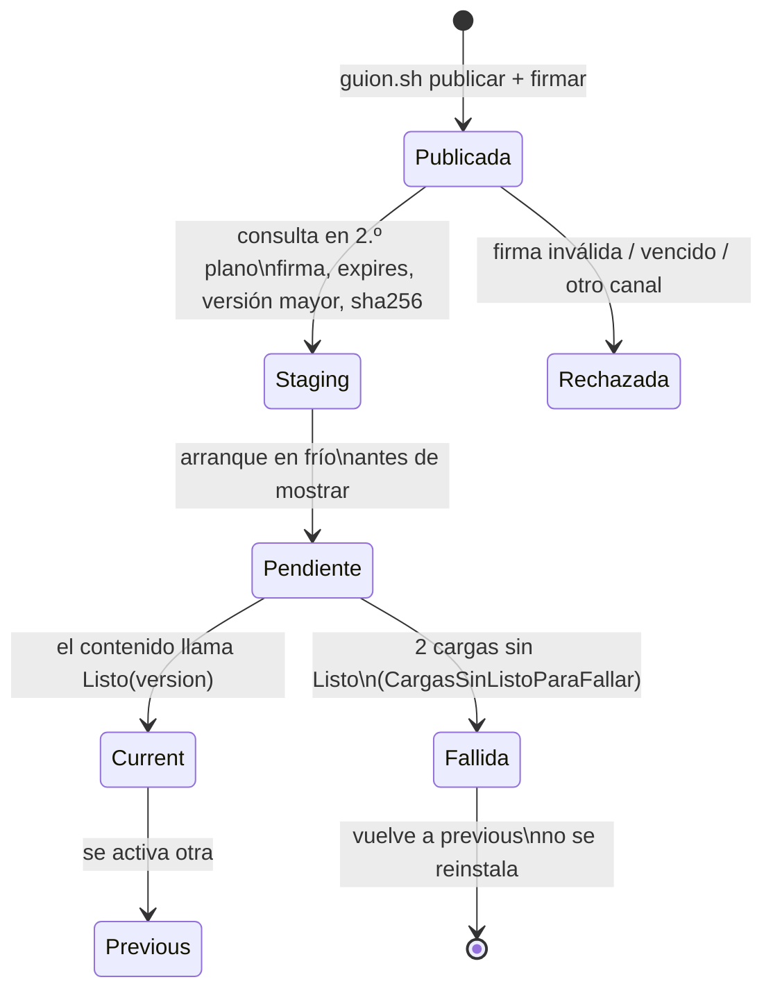

# Actualización dinámica sin tienda — contenido descargable, canal firmado y rollback

## Índice

1. [Resumen ejecutivo](#1-resumen-ejecutivo)
2. [Definición](#2-definición)
3. [Aplicación por escenario](#3-aplicación-por-escenario)
4. [Ejemplos concretos](#4-ejemplos-concretos)
5. [Preguntas guía](#5-preguntas-guía)
6. [Criterios de calidad](#6-criterios-de-calidad)
7. [Anexo — Plantilla comentada](#7-anexo--plantilla-comentada)
8. [Observaciones](#8-observaciones)
9. [Referencias](#9-referencias)

Viene de: [`MARCO-REFERENCIA`](/LAB/Lab-Documentos/Lab-Documentos/Concepts/Framework-Concept/00-Marco.md) · Sigue en:
[`TEM-02`](/LAB/Lab-Documentos/Lab-Documentos/Concepts/Framework-Concept/02-Cascaron-Puente-Y-Capacidades.md)

## 1. Resumen ejecutivo

Una app de tienda no puede reemplazarse a sí misma por otro camino que la tienda. Lo que sí se puede es separarla en
dos capas: un **cascarón** que se instala por tienda y cambia poco, y un **contenido** que corre dentro de un WebView y
se baja de un servidor propio. Este documento explica qué se baja (pantallas Blazor WebAssembly sin AOT y encuestas
como datos), cómo se confía en lo que se baja (un índice firmado con ECDSA P-256, con vencimiento), cuándo se activa
(en el próximo arranque en frío, antes de mostrar) y cómo se vuelve atrás si sale mal (rollback por marca). Le sirve a
quien escribe el contenido, a quien publica y a quien mantiene el actualizador del cascarón.

## 2. Definición

### 2.1 Qué es

**Actualización sin tienda** es el mecanismo por el cual el cascarón consulta un canal, baja un paquete de contenido o
una definición, verifica su firma y su hash, lo guarda aparte y lo activa en un momento seguro, sin reinstalar el APK.

**Cómo se aplica.** Publicás una versión nueva con `scripts/guion.sh publicar v2` y `firmar`; el teléfono la baja en
segundo plano y la muestra en el arranque en frío siguiente.

**Un caso.** En E02 se publicó el contenido 1.1.0 con la app instalada en 1.0.0: el primer arranque siguió mostrando
1.0.0 y dejó 1.1.0 en `staging/`; el segundo arranque mostró la cabecera azul y «Novedades de esta versión».

### 2.2 Qué problema resuelve

El borrador del PO lo dice así: «Si cambio esas pantallas, la app **se autoactualiza al arrancar**, sin pasar por la
tienda» (`Framework-APP.md` §1, insumo del PO fuera del conjunto: ver [`ANEXO-99` §8](/LAB/Lab-Documentos/Lab-Documentos/Concepts/Framework-Concept/99-Anexos.md#8-insumos-fuera-del-conjunto-y-apartamientos-declarados)). El
ciclo de revisión de una tienda tarda; una corrección de texto en una encuesta no debería esperar ese ciclo.

### 2.3 Qué NO es

| Se confunde con | Por qué no es lo mismo |
| --- | --- |
| **Blazor Hybrid de Microsoft** (`BlazorWebView`) | Ahí los componentes Razor se compilan dentro de la DLL de la app: no se pueden bajar. Acá el contenido es Blazor WebAssembly servido por `HybridWebView` |
| **Un sitio web dentro de la app** | Un sitio remoto en vivo no funciona sin red. Acá el contenido se guarda en el teléfono y corre sin red (opción D descartada en el borrador, §2) |
| **Actualizar el cascarón** | El cascarón (permisos, código nativo, SDK) sólo cambia por tienda |
| **Rollback remoto** | No existe como «bajar» de versión: se corrige hacia adelante con una versión mayor o se **retira** la mala (P2) |

### 2.4 Lo que permiten las tiendas: dos citas y lo que implican

Google Play, política *Device and Network Abuse* (consultada el 2026-10-25, N1 §4.2):

> «An app distributed via Google Play may not modify, replace, or update itself using any method other than Google
> Play's update mechanism. […] This restriction does not apply to code that runs in a virtual machine or an
> interpreter where either provides indirect access to Android APIs (such as JavaScript in a webview or browser).»

**Qué implica.** El contenido tiene que correr *dentro* del WebView y llegar a Android sólo **indirectamente**, por el
puente. La misma página da como violación un WebView con interfaz JavaScript que carga contenido no confiable: por eso
todo lo que se baja va firmado y se sirve desde un origen local.

Apple, *App Review Guidelines* 2.5.2 (versión del 16 de octubre de 2026, N1 §4.1):

> «[Apps may not] download, install, or execute code which introduces or changes features or functionality of the
> app […]»

**Qué implica.** Un contenido que cambie el propósito declarado en la ficha de la tienda tiene que salir también por
tienda. En este repositorio esa pregunta es un campo obligatorio de la plantilla de PR (ver
[`TEM-06`](/LAB/Lab-Documentos/Lab-Documentos/Concepts/Framework-Concept/06-Procedimientos-PR-Integracion-Versionado.md)).
Ninguna de las dos políticas nombra WebAssembly: si un `.wasm` interpretado cuenta como «código interpretado» es
**NO VERIFICADO** ante Apple y ante Play (P1, folio 035).

El código que materializa esas dos lecturas está en el proyecto del contenido, que fija la compilación sin AOT:

```xml
    <!-- P1 — SIN AOT. Con AOT el código descargado deja de ser IL interpretado y cambia de clase ante las
         tiendas: habilitarlo es una decisión con su propia revisión, no una optimización. El empaquetador lo
         comprueba y la compuerta lo prueba con un rojo provocado (P8). -->
    <RunAOTCompilation>false</RunAOTCompilation>
```

*Fuente: [`Demo/src/FrameworkConcept.Content/FrameworkConcept.Content.csproj`](/LAB/Lab-Documentos/Lab-Documentos/Concepts/Framework-Concept/Demo/src/FrameworkConcept.Content/FrameworkConcept.Content.csproj) L15–L18, árbol de trabajo del 2026-10-26 sin commit; versión fijada por `sha256` e6fae0db58a1 del archivo (`sha256sum` de la ruta, primeros 12 dígitos).*

### 2.5 Las piezas del canal

| Pieza | Decisión (P2) | En la demo |
| --- | --- | --- |
| Servidor | Estático; un índice por canal y por mayor del puente en `/{canal}/puente-{mayor}/indice.json` | `salida/canal/dev/puente-1/indice.json`, servido por el receptor didáctico |
| Firma | ECDSA P-256 con SHA-256, sobre los bytes del índice; claves con `keyId` | `indice.json.sig`, `claves/publica-demo.pem`; la privada no se versiona |
| Vigencia | `expires` = emisión + 30 días | `guion.sh firmar` la renueva |
| Entradas | `contenido` (código) y `definicion` (datos), con `size` y `sha256` | `Contracts/Canal/IndiceDelCanal.cs` |
| Retiradas | Lista firmada de versiones de contenido que no se deben usar | `guion.sh retirar` y luego `firmar` |
| Activación | Próximo arranque en frío, antes de mostrar; nunca en caliente | `Core/Update/Actualizador.cs` |
| Retención | Teléfono: `current` + `previous`. Servidor: 3 o más paquetes | `ParametrosDeProducto.cs` |
| Semilla | Versión completa embebida en el APK, firmada igual; no es destino de rollback | `semilla/` |

El orden en que el teléfono verifica un índice está escrito como función pura, para que cada paso tenga su prueba:

```csharp
///   1. firma y clave (conocida, no revocada)   — sobre los BYTES recibidos, antes de leer el JSON
///   2. el keyId de adentro coincide con el de la firma
///   3. formato conocido
///   4. expires                                 — un índice vencido no vale aunque la firma sea buena (C08, «freeze»)
///   5. canal y mayor del puente                — un índice de otro canal u otro mayor no es para este cascarón
```

*Fuente: [`Demo/src/FrameworkConcept.Core/Update/VerificacionDelIndice.cs`](/LAB/Lab-Documentos/Lab-Documentos/Concepts/Framework-Concept/Demo/src/FrameworkConcept.Core/Update/VerificacionDelIndice.cs) L18–L22, árbol de trabajo del 2026-10-26 sin commit; versión fijada por `sha256` c4222327cef3 del archivo (`sha256sum` de la ruta, primeros 12 dígitos).*

La consecuencia didáctica está en la línea 50 del mismo archivo: «nada de lo que dice un índice sin firma válida se
usa». Primero se verifica, después se lee.

### 2.6 Ciclo de vida de una versión en el teléfono



## 3. Aplicación por escenario

| Escenario | Qué aporta este tema | Qué cambia según el contexto |
| --- | --- | --- |
| `ESC-1` Primer arranque | La semilla da contenido sin red desde el primer segundo | `CTX-2`: con WebView < 94 la semilla tampoco arranca; aparece «WebView viejo» |
| `ESC-2` Fallo y rollback | Marca pendiente + `Listo` + lista de fallidas | Igual en `CTX-4` y `CTX-5` |
| `ESC-3` Incompatible | El predicado se evalúa **antes** de activar (detalle en [`TEM-02`](/LAB/Lab-Documentos/Lab-Documentos/Concepts/Framework-Concept/02-Cascaron-Puente-Y-Capacidades.md)) | `CTX-3`: en iOS el motor mínimo es 16.4, diseño sin ensayo |
| `ESC-4` Sin red | No aplica a la activación: sin red no se baja nada y se sigue con lo instalado | `CTX-6`: la consulta da `SinRed` sin bloquear |
| `ESC-5` PR y release | Sólo se publica lo construido desde una etiqueta alcanzable desde `main` (P6.7) | Producción: diseño, no implantado |
| `ESC-6` Al iniciar sesión | El ingreso con cuenta es uno de los tres disparadores de la consulta | `CTX-4`: no hay ingreso; quedan arranque en frío y reanudación |
| `ESC-7` Obligatoria | Se activa con la misma regla, un arranque en frío después de verificada; nunca sin red ni descartando pendientes | No ejecutado en la demo |

## 4. Ejemplos concretos

### 4.1 Del 1.0.0 al 1.1.0 (corrida real)

**Qué demuestra.** Que bajar no es aplicar: la versión nueva se ve recién en el segundo arranque.
**Precondición.** App con la semilla 1.0.0; canal con `publicar v2`, `definicion v2`, `firmar`.
**Resultado.** Paso 3 de E02: «Se ve 1.0.0 (N = 0)… Consulta `Preparado`: 1.1.0 queda en staging». Paso 4: «`activada
1.1.0+5d5c2b4 (desde staging)` antes de mostrar».

### 4.2 Índice con firma inválida (corrida real)

**Qué demuestra.** Que un índice alterado no se usa aunque el servidor sea el correcto.
**Precondición.** `scripts/guion.sh firma-invalida` (altera el índice sin volver a firmarlo).
**Resultado.** E02 paso 6: «`Rechazado FirmaInvalida — firma rechazada (keyId «demo-2026»)`. Sigue 1.1.0».

### 4.3 Contenido que no avisa «Listo» (corrida real)

**Qué demuestra.** El rollback por marca, y que un arranque cortado antes de cargar no cuenta como falla.
**Precondición.** `scripts/guion.sh publicar sin-listo` (1.2.0, defectuoso a propósito) y `firmar`.
**Resultado.** E02 pasos 7a–7c: 1.2.0 se baja, se activa sin `puente Listo`, y luego «rollback: 1.2.0 no confirmó
Listo; queda como fallida», «vuelve a previous 1.1.0». El fragmento que lo decide:

```csharp
        if (puntero.Pendiente is { } pendiente)
        {
            if (puntero.CargasSinListo >= CargasSinListoParaFallar)
            {
                await almacen.AgregarFallidaAsync(pendiente, ct);
                fallidas.Add(pendiente);
                notas.Add($"rollback: {pendiente} empezó a cargar {puntero.CargasSinListo} veces sin confirmar Listo; queda como fallida");
                puntero = puntero with { Pendiente = null, CargasSinListo = 0 };
                await almacen.ReemplazarPunteroAsync(puntero, ct);
            }
```

*Fuente: [`Demo/src/FrameworkConcept.Core/Update/Actualizador.cs`](/LAB/Lab-Documentos/Lab-Documentos/Concepts/Framework-Concept/Demo/src/FrameworkConcept.Core/Update/Actualizador.cs) L97–L106, árbol de trabajo del 2026-10-26 sin commit; versión fijada por `sha256` fc9cc0056217 del archivo (`sha256sum` de la ruta, primeros 12 dígitos).*

`CargasSinListoParaFallar = 2` (línea 39) es criterio de la demo, no un valor de producto (README de la demo,
«Cuándo una versión cuenta como fallida»).

### 4.4 Retención después de un rollback

E02 H-C: tras el rollback de 1.2.0 queda `current 1.1.0 / previous —`. La 1.0.0 se borró al activar 1.2.0 y la 1.2.0
al fallar. Una falla siguiente de 1.1.0 llevaría al **estado terminal** («no hay contenido sano»), que nunca vuelve a la
semilla y nunca toca los pendientes (P2).

## 5. Preguntas guía

1. ¿Lo que voy a cambiar es contenido, definición o cascarón? ¿Por qué canal sale?
2. ¿El cambio altera el propósito que declara la ficha de la tienda? Si sí, ¿sale también por tienda?
3. ¿La versión nueva es estrictamente mayor que la publicada en ese canal?
4. ¿El paquete está compilado sin AOT y en archivos planos (sin `.br` ni `.gz`)?
5. ¿El índice está firmado, vigente y en el canal y el mayor del puente correctos?
6. ¿Mi contenido llama `Listo(version)` cuando arrancó bien? ¿Qué pasa si no lo hace?
7. Si la versión sale mala, ¿la retiro o publico una mayor que la corrija?

## 6. Criterios de calidad

| Una implementación buena… | Una pobre… |
| --- | --- |
| Verifica la firma sobre los bytes antes de leer el JSON | Lee el índice y después «valida» |
| Activa sólo en arranque en frío, antes de mostrar | Cambia el contenido en caliente, con la persona usando la app |
| Cuenta como falla sólo una carga empezada sin `Listo` | Toma cualquier cierre de la app como falla |
| Corrige hacia adelante o retira | Intenta «bajar» de versión en el servidor |
| Nunca toca los pendientes del outbox al actualizar | Vacía o migra el outbox para poder actualizar |
| Declara su costo: ~9,13 MB por versión retenida y WebView ≥ 94 (E01) | Promete «actualización instantánea» sin decir qué cuesta |

**Antipatrón documentado.** Volver a la semilla como estado terminal: la semilla puede no leer los datos nuevos, y
para ellos es irreversible (P2, «Qué se descartó»).

## 7. Anexo — Plantilla comentada

Plantilla para registrar una publicación de contenido (criterio de esta guía):

```markdown
## Publicación de contenido <versión>   <!-- ¿Es SemVer sin pre-release y mayor que la vigente en el canal? -->
- Canal: dev | beta | prod                <!-- ¿Se promueve el MISMO artefacto o se reconstruyó? -->
- Commit de origen: <sha corto>           <!-- ¿Es alcanzable desde main (P6.7)? -->
- compatibleConPuente: >=1.1.0 <2.0.0     <!-- ¿Tiene techo? ¿Lo revalidó alguna prueba? -->
- requires / optional:                    <!-- ¿Cada requires existe en el catálogo del cascarón publicado? -->
- ¿Cambia el propósito de la ficha?: No   <!-- Si es Sí, también sale por tienda -->
- Retiradas en este índice:               <!-- ¿Hay alguna versión mala que retirar con esta firma? -->
- Verificación: guion.sh verificar → OK   <!-- Comprobación como lo haría el teléfono -->
```

## 8. Observaciones

- **Hecho.** El TPR medido en el moto g42 en un intento anterior fue de 8 176 a 8 741 ms con la semilla instalada
  (E02 §4.3), por encima del umbral de 5 000 ms de P1. Después de sacar la semilla del camino crítico, el TPR en el g42
  **no se volvió a medir** (teléfono reservado para otra sesión). Ver el anexo de pendientes.
- **Hecho.** El paquete de contenido pesa 3,39 MB comprimido y 9,13 MB plano (E01 §7).
- **Interpretación.** Si el TPR medido supera el umbral, la condición de revisión (2) de P1 abre la evaluación de la
  alternativa «C-min» (renderizador compilado en el cascarón más encuestas como datos).

## 9. Referencias

- Apple, *App Review Guidelines*, 2.5.2 (2026-10-16): https://developer.apple.com/app-store/review/guidelines/ (consultada el 2026-10-25, N1).
- Google, *Device and Network Abuse*: https://support.google.com/googleplay/android-developer/answer/9888379?hl=en (consultada el 2026-10-25, N1).
- Microsoft, *ASP.NET Core Blazor WebAssembly build tools and AOT compilation*: https://learn.microsoft.com/en-us/aspnet/core/blazor/webassembly-build-tools-and-aot?view=aspnetcore-10.0 (consultada el 2026-10-25, N1).
- Dossier [N1](/LAB/Lab-Documentos/Lab-Documentos.Documentacion/PROMPTs/Concepts/01-Framework-Concept/OUTPUTs/Bitacoras/Nucleos/N1-Actualizacion-Dinamica-Sin-Tienda.md); ensayo [E01](/LAB/Lab-Documentos/Lab-Documentos.Documentacion/PROMPTs/Concepts/01-Framework-Concept/OUTPUTs/Ensayos/E01-WASM-Descargado-En-WebView/INFORME.md); [E02](/LAB/Lab-Documentos/Lab-Documentos.Documentacion/PROMPTs/Concepts/01-Framework-Concept/OUTPUTs/Ensayos/E02-Demo-Integracion/INFORME.md); dictamen P1, P2 del [folio 035](/LAB/Lab-Documentos/Lab-Documentos.Documentacion/PROMPTs/Concepts/01-Framework-Concept/OUTPUTs/Expedientes/0001-Framework-Concept-Maui-Autoactualizable/actuaciones/035-informe-r2-jurado-veredicto.md).
