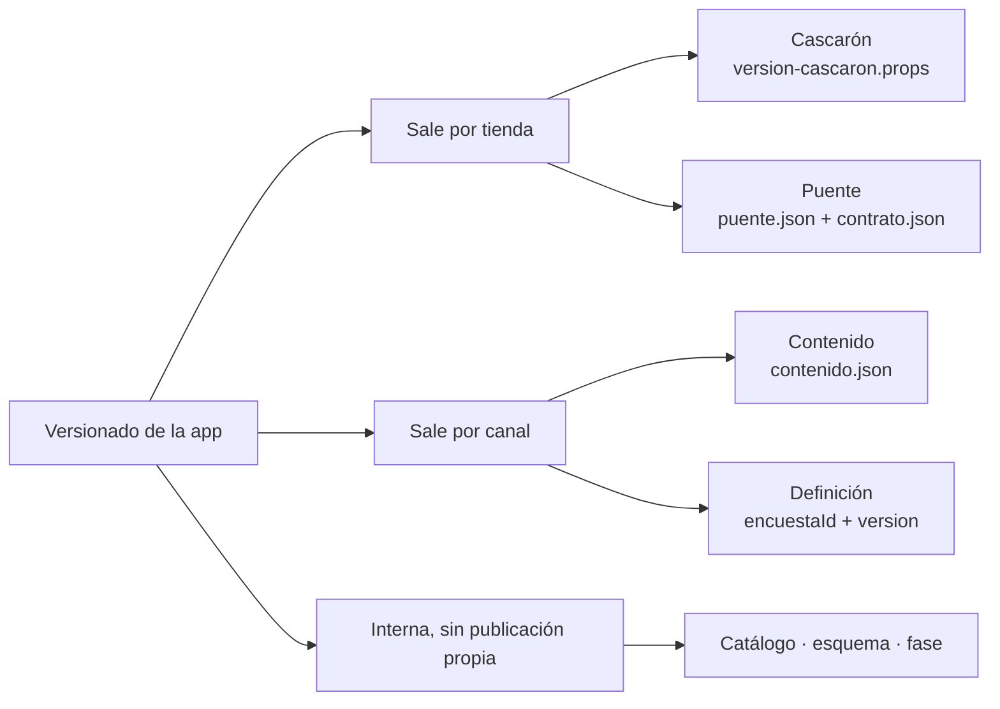

# Integración, PR y versionado del producto — conceptos y alternativas

## Índice

1. [Resumen ejecutivo](#1-resumen-ejecutivo)
2. [Definición](#2-definición)
3. [Aplicación por escenario](#3-aplicación-por-escenario)
4. [Ejemplos concretos](#4-ejemplos-concretos)
5. [Preguntas guía](#5-preguntas-guía)
6. [Criterios de calidad](#6-criterios-de-calidad)
7. [Anexo — Plantilla comentada](#7-anexo--plantilla-comentada)
8. [Observaciones](#8-observaciones)
9. [Referencias](#9-referencias)

Viene de: [`FC-TEM-02`](/LAB/Lab-Documentos/Lab-Documentos/Concepts/Framework-Concept/02-Cascaron-Puente-Y-Capacidades.md) ·
Sigue en: [`FC-TEM-04`](/LAB/Lab-Documentos/Lab-Documentos/Concepts/Framework-Concept/04-Estrategia-De-Pruebas.md) · El
procedimiento paso a paso está en
[`FC-TEM-06`](/LAB/Lab-Documentos/Lab-Documentos/Concepts/Framework-Concept/06-Procedimientos-PR-Integracion-Versionado.md).

## 1. Resumen ejecutivo

El pedido nace de un problema concreto: «al introducir un PR sobre una rama estable, al no dispararse pruebas
automatizadas puede romper funcionalidades que ya funcionaban»
([prompt](/LAB/Lab-Documentos/Lab-Documentos.Documentacion/PROMPTs/Concepts/01-Framework-Concept/Crear-Framework-Concept.md),
«Contexto»). Este documento explica los conceptos que lo resuelven: una sola rama estable (`main`) a la que se entra
sólo por PR; un check obligatorio que agrega toda la compuerta y no admite omisiones silenciosas; y versiones separadas
para cada cosa que se publica por un camino distinto (tienda, canal de contenido, contrato, encuesta). También compara
las alternativas que la mesa descartó, para que el lector sepa elegir en otro proyecto.

## 2. Definición

### 2.1 Qué es

**Integración continua** acá significa: cada PR contra `main` corre la compuerta en el runner propio, y la plataforma
impide fusionar mientras el check obligatorio no esté en verde.

**Cómo se aplica.** Abrís un PR; el workflow `framework-concept-demo` corre; si `fw-ok` sale rojo, el botón de
fusionar queda deshabilitado (una vez protegida `main`, ver 2.4).

**Un caso.** El parche `etapas/M-13-codigo-postal-cinco-digitos.patch` cambia el patrón del código postal: en la corrida
de esta guía (2026-10-26, copia de la demo) `Core.Tests` dio 6 fallas y `ci-local.sh` terminó con `rc=1`.

**Línea de versión.** Una secuencia de números para algo que se publica por un camino propio, con su gramática, su
fuente única y su regla de orden (P7).

**Cómo se aplica.** Cuando cambiás una página, subís `versionado/contenido.json`; cuando cambiás un método del puente,
`versionado/puente.json`.

**Un caso.** La pantalla de diagnóstico del emulador mostró, a la vez, «Cascarón 1.0.0 (build 1), puente 1.0.0,
contenido 1.1.0, definición v2» (E02 paso 8): cuatro números distintos de una misma app.

### 2.2 Qué problema resuelve

Un número único para todo no permite decir qué contenido corre sobre qué cascarón, ni detectar un puente incompatible
antes de que falle en el teléfono (N3 §6, «Qué pierde A»). Un workflow que sólo avisa deja el problema original
intacto: el PR se fusiona igual.

### 2.3 Qué NO es

| Se confunde con | Por qué no es lo mismo |
| --- | --- |
| El canal (`dev`, `beta`, `prod`) | No es una versión: es un puntero que promueve **el mismo** artefacto (P7) |
| La huella de `contrato.json` | Es dato de diagnóstico, no línea: no ordena (P7) |
| Un pre-release en el contenido (`1.2.0-beta`) | No se usa en ningún canal: la madurez la da el canal (`versionado/contenido.json`, «nota») |
| Un check con filtro `paths` | Si no corre, queda «Pending» y bloquea; por eso el alcance lo decide un paso del job (P6.2, GitHub *Troubleshooting required status checks*) |

### 2.4 Lo que dice GitHub sobre las ramas protegidas, y lo que implica

GitHub Docs, *About protected branches* (consultada el 2026-10-25, N3 §4.2), en la síntesis del dossier:

> Con «Require status checks before merging» no se puede cambiar la rama protegida hasta que los checks obligatorios
> pasen; estados exitosos: `success`, `skipped`, `neutral`.

**Qué implica.** `skipped` cuenta como éxito para GitHub. Si el check obligatorio fuera un job que se puede saltear, un
PR podría fusionarse sin correr nada. Por eso `fw-ok` es un **agregador** que corre siempre (`if: always()`) y trata
`skipped` y `cancelled` como rojo, salvo la única omisión declarada: el PR no toca la demo.

```yaml
          if [ "$COMPUERTA" = "success" ] && [ "$APK" = "success" ]; then
            echo "fw-ok en verde: compuerta y APK correctos."
            exit 0
          fi
          # skipped, cancelled o failure: todo cuenta como rojo.
          echo "::error::fw-ok en rojo: compuerta=$COMPUERTA, apk=$APK (estricto: «skipped» y «cancelled» también son rojo)."
          exit 1
```

*Fuente: [`.github/workflows/framework-concept-demo.yml`](/LAB/Lab-Documentos/Lab-Documentos/.github/workflows/framework-concept-demo.yml) L198–L204, árbol de trabajo del 2026-10-26 sin commit; versión fijada por `sha256` 928f181a00dd del archivo (`sha256sum` de la ruta, primeros 12 dígitos).*

La protección se puede configurar porque `hdcm-dev/Lab-Documentos` es público: en un repositorio privado de una
organización Free la API devuelve 403 (N3 §4.2, [C1]–[C4] y la medición previa [L5]). Al 2026-10-25 `main` tenía
`protected: false`; protegerla es el tramo A5 del plan (folio 037), después de un `fw-ok` verde.

### 2.5 Métodos y marcos: modelos de ramas

| Modelo | En qué consiste | Qué gana | Qué pierde | Decisión |
| --- | --- | --- | --- | --- |
| **GitHub Flow** | Rama corta → PR → revisión → merge → borrar rama (GitHub Docs *GitHub flow*) | Una sola rama estable; simple | Nada impide fusionar en rojo sin protección | **Elegido** (N3 §6.1) |
| **Trunk-based** | Un tronco; ramas de vida corta, integración al menos cada 24 h; release «justo a tiempo» (trunkbaseddevelopment.com) | Integración muy frecuente | Exige disciplina de integración diaria | Compatible: las ramas de release sólo justo a tiempo para un hotfix desde la etiqueta |
| **Con `develop`** | Dos ramas de larga vida | Separa «en curso» de «estable» | Duplica la integración; `main` queda como copia tardía donde lo que funcionaba se rompe sin que nadie lo vea | Descartado (N3 §6.1) |

**Criterio para elegir** (criterio de esta guía, apoyado en N3): si el equipo es chico y publica seguido, una sola rama
estable con PR obligatorio y check único bloqueante; las ramas de larga vida sólo si hay que mantener versiones viejas
del cascarón en paralelo en las tiendas.

### 2.6 Métodos y marcos: cómo se versiona

| Alternativa | Qué pasa | Decisión |
| --- | --- | --- |
| Número único para todo | No se sabe qué contenido corre en qué cascarón | Descartada (P7) |
| Piso `minShellVersion` | No detecta un puente nuevo incompatible | Descartada; reemplazada por rango con techo |
| Fecha como versión del contenido | No dice si el cambio rompe | Descartada |
| **Líneas separadas** | Cada camino de publicación con su número | **Elegida** (P7) |

Las líneas que rigen (P7, folio 035):

| Línea | Gramática | Fuente única en la demo |
| --- | --- | --- |
| Cascarón | `ApplicationDisplayVersion` `MAYOR.MENOR.PARCHE` + `ApplicationVersion` entero monótono | `versionado/version-cascaron.props` (1.0.0 / 1) |
| Puente | SemVer; el mayor es la identidad del contrato | `versionado/puente.json` (1.1.0) y `contrato.json` |
| Contenido | SemVer + `+<commit>`, sin pre-release | `versionado/contenido.json` (1.0.0) |
| Definición | `encuestaId` + `version` entero | `definiciones/encuesta-movilidad/vN.json` (plantilla: hoy `v1.json` y `v2.json`) |
| Catálogo | Una versión por entrada | `CatalogoDeCapacidades.cs` |
| Esquema del cascarón | Entero monótono | `Shell/Data/EsquemaDelCascaron.cs` |
| Fase | `diseño` | `versionado/fase.json` (el dictamen la ubicaba en `rutas.json`; desvío de nombre declarado en el README de la demo) |

Taxonomía de las líneas, según por dónde sale cada una (tabla anterior y `FC-TEM-06` §8.4):



Las **cuatro líneas visibles** en la pantalla de diagnóstico, para atribuir un error a versiones exactas (folio 023,
ítem 4), son cascarón, puente, contenido y definición; la huella del contrato se muestra al lado.

## 3. Aplicación por escenario

| Escenario | Qué aporta | Según el contexto |
| --- | --- | --- |
| `ESC-1` | La semilla sale del mismo pipeline que el canal, firmada igual | — |
| `ESC-2` | Corregir hacia adelante exige que la versión nueva sea estrictamente mayor | — |
| `ESC-3` | El mayor del puente separa índices: un cascarón sólo lee el de su mayor | — |
| `ESC-4` | El esquema fijo (C-1) hace que actualizar contenido nunca migre la base | — |
| `ESC-5` | Todo el tema | `CTX-3`: iOS sin job `macos-*` ni compuerta (P9) |
| `ESC-6` | No aplica: el ingreso no cambia versiones; sólo dispara la consulta | — |
| `ESC-7` | La política de soporte del cascarón usa su versión, no el rango del puente | No ejecutado en la demo |

## 4. Ejemplos concretos

### 4.1 Un contrato que cambió de 1.0.0 a 1.1.0

**Qué demuestra.** Que la compuerta clasifica el cambio contra la base del PR.
**Precondición.** `FC_GATE_BASE` armada a mano con el `contrato.json` 1.0.0 de A3.
**Resultado.** `LaVersionSubeSegunLaClasificacionFrenteALaBase` en verde: todo el incremento fue MENOR
([DISENO §6](/LAB/Lab-Documentos/Lab-Documentos/Concepts/Framework-Concept/Demo/DISENO-RED-Y-AUTENTICACION.md#6-contrato-del-puente-110)).

### 4.2 Un PR que no toca la demo

**Qué demuestra.** La omisión legítima declarada.
**Precondición.** Un PR que cambia sólo una guía fuera de `Concepts/Framework-Concept/Demo/**`.
**Resultado esperado.** El job `alcance` escribe `demo=false` con su motivo; `compuerta` y `apk` quedan `skipped`;
`fw-ok` sale verde «por omisión declarada». Verificado en el runner: en Lab-Documentos #33 (2026-10-28, run `40738280836`),
un PR que sólo cambió temas de la guía dejó `compuerta` y `apk` en `skipped` y `fw-ok` en verde (folio 048).

## 5. Preguntas guía

1. ¿Qué línea de versión sube mi cambio? ¿Puede ser más de una?
2. ¿Mi rama nace de `main` y vuelve a `main` en días, no semanas?
3. ¿El check obligatorio puede quedar `skipped` sin que nadie lo note?
4. ¿Un PR desde un fork puede correr en el runner propio? (No: la guarda de mismo repositorio lo deja en rojo.)
5. ¿Lo que voy a publicar se construyó desde una etiqueta alcanzable desde `main`?
6. ¿Puedo atribuir un error de campo a cuatro números exactos?

## 6. Criterios de calidad

| Bueno | Pobre |
| --- | --- |
| Un único check obligatorio, agregador, estricto | Varios checks obligatorios, alguno con `paths` |
| Omisiones legítimas declaradas con motivo | `skipped` tomado como verde |
| Una fuente única por línea, leída por el build | El número escrito a mano en tres archivos |
| El mismo artefacto promovido entre canales | Reconstruir para `prod` |
| `permissions: contents: read` y ningún secreto en jobs de PR | Secretos disponibles en un runner propio que corre código de PR |

## 7. Anexo — Plantilla comentada

Ficha de decisión de versionado para un PR (criterio de esta guía):

```markdown
## Versionado de este PR
- Cascarón: 1.0.0 (1) → ¿cambia?          <!-- ¿Cambió un permiso, el SDK, MauiVersion o el XAML? Sale por tienda -->
- Puente: 1.1.0 → ¿menor o mayor?          <!-- Usar la tabla de FC-TEM-02 §2.6 -->
- Contenido: 1.0.0 → 1.1.0                 <!-- ¿Es estrictamente mayor que lo publicado en el canal? -->
- Definición encuesta-movilidad: 2 → 3     <!-- ¿Conserva nombre y tipo de cada campo publicado? -->
- Esquema del cascarón: 1                  <!-- Si cambia, el PR trae su decisión sobre el sobre C-1 -->
- Fase: diseño                             <!-- ¿Este PR declara otra fase? -->
```

## 8. Observaciones

- **Hecho.** El runner `i7infra-runner-dev` traía SDK 10.0.402 y maui-android 10.0.110 (comentario del workflow, R2 §5); el
  que lo reemplaza desde el 2026-10-28, `hpdev-runner-dev`, trae SDK 10.0.403 y maui-android 10.0.110;
  la demo fija `MauiVersion` 10.0.20 y SDK 10.0.400 con `rollForward: latestPatch`. El riesgo de `workloadVersion`
  10.0.400.1 contra el workload del runner se midió en A5: con el SDK 10.0.403 del runner la compuerta falló (MSB4242,
  run 40432670449) y el `global.json` dejó de fijarlo; la versión de MAUI la sigue fijando `MauiVersion`.
- **Interpretación.** La condición de revisión de P6 (3 o más PR por mes que pasan de verde a rojo al actualizarse con
  `main`) es la señal para evaluar una *merge queue*.

## 9. Referencias

- GitHub, *GitHub flow*: https://docs.github.com/en/get-started/using-github/github-flow (consultada el 2026-10-25, N3).
- Hammant y otros, *Trunk Based Development*: https://trunkbaseddevelopment.com/ (consultada el 2026-10-25, N3).
- GitHub, *About protected branches*: https://docs.github.com/en/repositories/configuring-branches-and-merges-in-your-repository/managing-protected-branches/about-protected-branches (consultada el 2026-10-25, N3).
- GitHub, *Troubleshooting required status checks*: https://docs.github.com/en/pull-requests/collaborating-with-pull-requests/collaborating-on-repositories-with-code-quality-features/troubleshooting-required-status-checks (consultada el 2026-10-25, N3).
- Preston-Werner, *Semantic Versioning 2.0.0*: https://semver.org/ (consultada el 2026-10-25, N3).
- Dossier [N3](/LAB/Lab-Documentos/Lab-Documentos.Documentacion/PROMPTs/Concepts/01-Framework-Concept/OUTPUTs/Bitacoras/Nucleos/N3-PR-Integracion-Y-Versionado.md); dictamen P6, P7 del [folio 035](/LAB/Lab-Documentos/Lab-Documentos.Documentacion/PROMPTs/Concepts/01-Framework-Concept/OUTPUTs/Expedientes/0001-Framework-Concept-Maui-Autoactualizable/actuaciones/035-informe-r2-jurado-veredicto.md); [folio 023](/LAB/Lab-Documentos/Lab-Documentos.Documentacion/PROMPTs/Concepts/01-Framework-Concept/OUTPUTs/Expedientes/0001-Framework-Concept-Maui-Autoactualizable/actuaciones/023-providencia-respuesta-del-po-al-lote-de-la-ronda-1.md).
