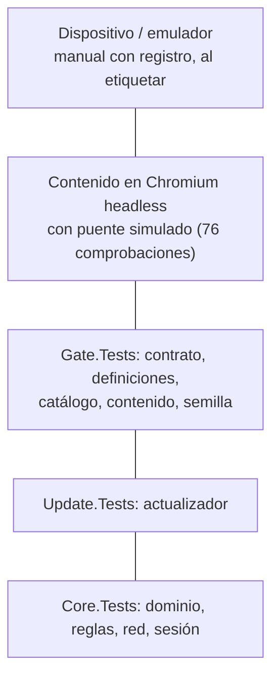

# Estrategia de pruebas — qué se prueba en cada capa y qué es compuerta

## Índice

1. [Resumen ejecutivo](#1-resumen-ejecutivo)
2. [Definición](#2-definición)
3. [Aplicación por escenario](#3-aplicación-por-escenario)
4. [Ejemplos concretos](#4-ejemplos-concretos)
5. [Preguntas guía](#5-preguntas-guía)
6. [Criterios de calidad](#6-criterios-de-calidad)
7. [Anexo — Plantilla comentada](#7-anexo--plantilla-comentada)
8. [Observaciones](#8-observaciones)
9. [Referencias](#9-referencias)

Viene de: [`FC-TEM-03`](/LAB/Lab-Documentos/Lab-Documentos/Concepts/Framework-Concept/03-Integracion-Y-Versionado.md) ·
Sigue en: [`FC-TEM-05`](/LAB/Lab-Documentos/Lab-Documentos/Concepts/Framework-Concept/05-La-Demo-Como-Caso-De-Estudio.md)

## 1. Resumen ejecutivo

Una compuerta que nadie vio fallar no prueba nada. Por eso cada suite que bloquea un PR en este repositorio entra con
un **rojo provocado**: un cambio pequeño y deliberado que la tiene que poner en rojo. La compuerta mínima tiene ocho
capas, todas en el runner `[self-hosted, i7infra-dev]`, detrás de `fw-ok`: build sin MAUI con avisos como error,
unitarias de dominio, unitarias del actualizador, instantánea del contrato, definiciones contra su esquema, catálogo
frente al manifiesto, contenido sin AOT ni API web con permisos, y APK. El dispositivo y el emulador no son compuerta:
son pruebas manuales con registro. Este documento dice qué mira cada capa, cómo provocar su rojo y qué queda afuera.

## 2. Definición

### 2.1 Qué es

**Compuerta.** El conjunto de pruebas que un PR tiene que pasar para poder fusionarse.

**Cómo se aplica.** Corrés `scripts/ci-local.sh` antes de abrir el PR; en el runner corre lo mismo, en el mismo orden.

**Un caso.** Corrida de esta guía (2026-10-26, copia de la demo): pasos 0 a 4 en verde, Core.Tests 211/211,
Update.Tests 102/102, Gate.Tests 52/52, `rc=0`.

**Rojo provocado.** Un cambio mínimo que debe hacer fallar una suite, para demostrar que la suite mira lo que dice
mirar (P8; VPI §3.4).

**Cómo se aplica.** Aplicás un parche de `etapas/`, corrés la compuerta, ves el rojo, deshacés con `patch -R`.

**Un caso.** `aviso-promovido-a-error.patch` agrega una variable sin uso: en la corrida de esta guía el build falló con
`error CS0219: La variable 'sinUso' está asignada pero su valor nunca se usa` y `rc=1`.

**Prueba intermitente (flaky).** Una prueba que pasa y falla sobre el mismo código (N4 §2, Luo y otros, 2014).

**Cómo se aplica.** Si aparece una, va a cuarentena con expediente, no a reintentos (P8).

**Un caso.** Ninguna prueba de la demo se registró como intermitente en E02 ni E03; el criterio queda escrito para
cuando aparezca.

### 2.2 Qué problema resuelve

Sin pruebas obligatorias, un PR rompe lo que funcionaba (prompt, «Contexto»). Sin rojo provocado, una suite puede
estar en verde porque no mira nada: el parche M-12 (cambiar sólo la constante del código postal) queda en verde, y por
eso no sirve como prueba de la protección (`etapas/README.md`).

### 2.3 Qué NO es

| Se confunde con | Por qué no |
| --- | --- |
| Cobertura mínima como compuerta | Descartada en r1: mide líneas tocadas, no comportamiento (P8) |
| Reintentar hasta que pase | Las intermitentes van a cuarentena (P8) |
| Probar en el emulador en cada PR | El runner no tiene KVM ni `docker.sock` (comentario del workflow) |
| Probar «el contenido nuevo contra el cascarón viejo» como regla de la industria | Rotulado criterio de I6 e I7, no estándar (P8) |

### 2.4 La pirámide: lo que dice la fuente y lo que implica

Ham Vocke, *The Practical Test Pyramid* (martinfowler.com, 2018-02-26), en la síntesis de N4 §3.1: escribir pruebas de
distinta granularidad y «cuanto más alto el nivel, menos pruebas»; las E2E son «notoriamente intermitentes», con mucho
mantenimiento y lentas.

**Qué implica.** La base de la compuerta son pruebas `net10.0` que corren en milisegundos sin dispositivo (dominio,
actualizador, contrato). Lo que necesita un teléfono queda arriba, fuera del PR, como prueba manual con registro.



## 3. Aplicación por escenario

| Escenario | Suite que lo cubre | Según el contexto |
| --- | --- | --- |
| `ESC-1` | `Gate.Tests/Semilla/SemillaTests.cs` (la semilla verifica con la pública versionada) | — |
| `ESC-2` | `Update.Tests` (`ArranqueTests.cs`, `CortesTests.cs`, `FirmaTests.cs`) | — |
| `ESC-3` | `Update.Tests/PredicadoTests.cs`; contenido headless con capacidades faltantes | `CTX-2`: no se prueba en dispositivo |
| `ESC-4` | `Core.Tests` (`EncuestaServiceTests.cs`, `DefinicionTests.cs`, `Red/`, `Auth/`); humo del receptor | `CTX-6`: `EnLineaMedida` sólo en pruebas (`TransicionesDeRedTests`) |
| `ESC-5` | Todo `ci-local.sh` + `etapas/` | `CTX-3`: iOS fuera de la compuerta |
| `ESC-6` | `Core.Tests/Auth/` | Recorrido manual en E03 |
| `ESC-7` | Sin suite propia de la demo: NO VERIFICADO — no se encontró un caso que publique un `mandatory` | — |

## 4. Ejemplos concretos

### 4.1 Las ocho capas y su rojo

| Capa (P8) | Dónde | Rojo provocado | Medido |
| --- | --- | --- | --- |
| Build sin MAUI, avisos como error | `ci-local.sh` paso 1 | `etapas/aviso-promovido-a-error.patch` | Sí: CS0219, `rc=1` (esta guía, 2026-10-26) |
| Unitarias de dominio | `tests/FrameworkConcept.Core.Tests` | `etapas/M-13-codigo-postal-cinco-digitos.patch` | Sí: 6 fallas de 211, `rc=1` (esta guía) |
| Unitarias del actualizador | `tests/FrameworkConcept.Update.Tests` | Cada caso visto en rojo contra el código de E01 | En E02 (`rojos-actualizador.md`) |
| Instantánea del contrato | `Gate.Tests/Contrato/InstantaneaDelContratoTests.cs` | Cambiar la forma de un método sin subir el puente | En E02 (`rojos-compuerta.md`) |
| Definiciones | `Gate.Tests/Definiciones/` | Editar una pregunta sin subir `version` | En E02 (`rojos-compuerta.md`) |
| Catálogo frente al manifiesto | `Gate.Tests/Catalogo/CatalogoFrenteAlManifiestoTests.cs` | Una capacidad sin su permiso | En E02 (`rojos-compuerta.md`) |
| Contenido sin AOT ni API web | `Gate.Tests/Contenido/ContenidoTests.cs` | `RunAOTCompilation=true`; `navigator.geolocation` | En E02 (`rojos-compuerta.md`) |
| APK del cascarón | `ci-local.sh` paso 6 | `etapas/error-de-compilacion-en-el-cascaron.patch` (CS0029) | En E02 (`correcciones.md`); no repetido acá |

Los rojos de la compuerta que no tienen parche en `etapas/` «se provocan desde las propias pruebas o con
`guion.sh humo`» ([`etapas/README.md`](/LAB/Lab-Documentos/Lab-Documentos/Concepts/Framework-Concept/Demo/etapas/README.md)).

### 4.2 El rojo de M-13 (corrida de esta guía)

**Qué demuestra.** Que `Core.Tests` cuida la regla del código postal portada del caso base.
**Precondición.** Copia de la demo; `patch -p1 < etapas/M-13-codigo-postal-cinco-digitos.patch`.
**Resultado.**

```text
=== 2. Core.Tests ===
Con error! - Con error:     6, Superado:   205, Omitido:     0, Total:   211, Duración: 331 ms - FrameworkConcept.Core.Tests.dll (net10.0)
rc=1
```

*Salida registrada: `scripts/ci-local.sh --hasta 4` en el contenedor `fc-demo-build:f327f6144f9b` (SDK de
`contenedor/Dockerfile`), 2026-10-26.*

## 5. Preguntas guía

1. ¿Qué capa de la tabla 4.1 cubre mi cambio?
2. ¿Vi mi prueba nueva en rojo antes de verla en verde?
3. ¿Mi prueba depende de la red, del reloj o del orden? ¿Puede ser intermitente?
4. ¿Mi PR toca `global.json` o `Directory.Build.props`? Entonces exige una prueba en dispositivo «manual: con registro»
   antes de fusionar (P6.8; el workflow avisa).
5. ¿Lo que pruebo a mano en el emulador quedó registrado (logcat, captura, comando)?

## 6. Criterios de calidad

| Bueno | Pobre |
| --- | --- |
| Cada suite obligatoria con su rojo medido | Una suite que nadie vio fallar |
| Las pruebas puras (funciones sin red ni disco) prueban las decisiones | La lógica sólo probada por la UI |
| `ci-local.sh` y el workflow con los mismos pasos en el mismo orden | Un local «parecido» al CI |
| Las intermitentes en cuarentena con expediente | Reintentos automáticos |
| Las salidas registradas con SDK, workload e imagen | «Pasó en mi máquina» |

## 7. Anexo — Plantilla comentada

Registro de un rojo provocado (criterio de esta guía):

```markdown
## Rojo provocado: <nombre>
- Capa: <una de las ocho de P8>             <!-- ¿La prueba pertenece a fw-ok? -->
- Cambio: <parche o edición>                <!-- ¿Es el cambio mínimo que debe fallar? ¿No es un M-12? -->
- Comando: scripts/ci-local.sh --hasta 4    <!-- ¿Se puede repetir desde un clon limpio? -->
- Salida: <línea de dotnet test o build>     <!-- ¿Copiada tal cual, con fecha e imagen? -->
- Deshacer: patch -R -p1 < etapas/<parche>  <!-- ¿Quedó el árbol limpio después? -->
```

## 8. Observaciones

- **Hecho.** Componentes Razor con bUnit, contrato con Playwright y el contenido sobre el piso declarado son «tramo
  siguiente» (P8): entran cuando se publique el primer contenido fuera de la demo o se declare la fase `candidata`.
- **Hecho.** La prueba de UI del caso base con Appium no se portó: localiza `resource-id` nativos y el contenido es DOM
  dentro de un WebView (MAPA-CASO-BASE, «Lo que no se copió»).
- **Hecho.** El contenido se prueba en Chromium headless con `src/FrameworkConcept.Content/Testing/probar-en-navegador.sh`
  (76 de 76 en E03). No se corrió en esta guía.

## 9. Referencias

- Vocke, H. (2018). *The Practical Test Pyramid*: https://martinfowler.com/articles/practical-test-pyramid.html (consultada el 2026-10-25, N4).
- Luo, Q. y otros (2014). *An empirical analysis of flaky tests*, FSE 2014: https://doi.org/10.1145/2635868.2635920 (consultada el 2026-10-25, N4).
- Dossier [N4](/LAB/Lab-Documentos/Lab-Documentos.Documentacion/PROMPTs/Concepts/01-Framework-Concept/OUTPUTs/Bitacoras/Nucleos/N4-Estrategia-De-Pruebas.md); [E02 `rojos-compuerta.md`](/LAB/Lab-Documentos/Lab-Documentos.Documentacion/PROMPTs/Concepts/01-Framework-Concept/OUTPUTs/Ensayos/E02-Demo-Integracion/rojos-compuerta.md), [`rojos-actualizador.md`](/LAB/Lab-Documentos/Lab-Documentos.Documentacion/PROMPTs/Concepts/01-Framework-Concept/OUTPUTs/Ensayos/E02-Demo-Integracion/rojos-actualizador.md); dictamen P8 del [folio 035](/LAB/Lab-Documentos/Lab-Documentos.Documentacion/PROMPTs/Concepts/01-Framework-Concept/OUTPUTs/Expedientes/0001-Framework-Concept-Maui-Autoactualizable/actuaciones/035-informe-r2-jurado-veredicto.md).
