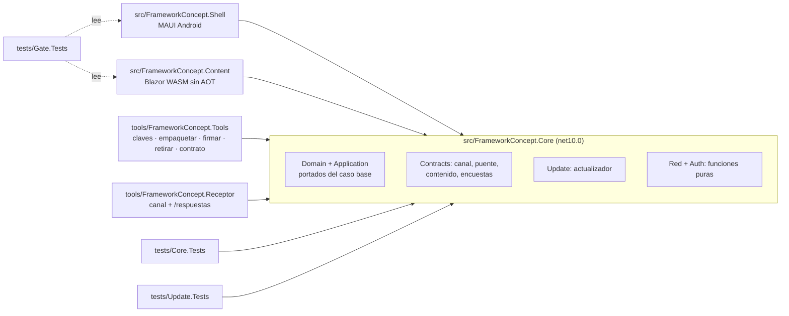

# La demo como caso de estudio — del caso base a una app autoactualizable

## Índice

1. [Resumen ejecutivo](#1-resumen-ejecutivo)
2. [Definición](#2-definición)
3. [Aplicación por escenario](#3-aplicación-por-escenario)
4. [Ejemplos concretos](#4-ejemplos-concretos)
5. [Preguntas guía](#5-preguntas-guía)
6. [Criterios de calidad](#6-criterios-de-calidad)
7. [Anexo — Plantilla comentada](#7-anexo--plantilla-comentada)
8. [Observaciones](#8-observaciones)
9. [Referencias](#9-referencias)

Viene de: [`TEM-04`](/LAB/Lab-Documentos/Lab-Documentos/Concepts/Framework-Concept/04-Estrategia-De-Pruebas.md) ·
Sigue en: [`TEM-06`](/LAB/Lab-Documentos/Lab-Documentos/Concepts/Framework-Concept/06-Procedimientos-PR-Integracion-Versionado.md)

## 1. Resumen ejecutivo

La demo es el ejemplo que esta guía recorre de punta a punta. No parte de cero: toma el dominio, las reglas y las
pruebas de la app `MovilidadUrbana.MAUI` del laboratorio Lab-E2E.WebBlazor (un ABM de localidades y una encuesta de
movilidad de tres pasos), copiadas archivo por archivo con su mapa, y las reparte en un cascarón MAUI y un contenido
Blazor WebAssembly. Todo se compila dentro de un contenedor cuya receta está versionada; todo se corre con un guion
único, `scripts/guion.sh`. Este documento explica cómo está armada, cómo se corre y qué no se pudo verificar, para que
el lector la use como laboratorio y como modelo de un proyecto propio.

## 2. Definición

### 2.1 Qué es

**Demo.** La carpeta
[`Concepts/Framework-Concept/Demo/`](/LAB/Lab-Documentos/Lab-Documentos/Concepts/Framework-Concept/Demo/README.md)
del repositorio Lab-Documentos: una solución .NET 10 de ocho proyectos, sus definiciones de encuesta, su versionado,
sus scripts y sus parches de rojo provocado.

**Cómo se aplica.** La usás para ver funcionando lo que la guía explica: cada tema remite a un archivo de la demo.

**Un caso.** Para entender el rollback, leés [`TEM-01` §4.3](/LAB/Lab-Documentos/Lab-Documentos/Concepts/Framework-Concept/01-Actualizacion-Sin-Tienda.md#43-contenido-que-no-avisa-listo-corrida-real)
y después corrés `scripts/guion.sh publicar sin-listo`.

**Caso base.** La app de la que se portaron dominio, reglas y pruebas: `MovilidadUrbana.MAUI`, commit `8fb4c3a` de
Lab-E2E.WebBlazor ([`MAPA-CASO-BASE.md`](/LAB/Lab-Documentos/Lab-Documentos/Concepts/Framework-Concept/Demo/MAPA-CASO-BASE.md)).

**Cómo se aplica.** Para saber de dónde salió un archivo de `src/FrameworkConcept.Core/`, buscás su fila en el mapa: dice
el blob original y si se copió «tal cual» o «adaptado».

**Un caso.** `Domain/Entities/RespuestaDeEncuesta.cs` (blob `dc1a0205`) está «Adaptado»: suma `EncuestaId` y
`VersionDefinicion` (P13.2).

### 2.2 Qué problema resuelve

Una guía para alguien sin experiencia en la técnica necesita algo que se pueda tocar. La demo da un resultado visible en
cada paso (pantalla, logcat, salida de prueba) y permite provocar las fallas que la guía describe.

### 2.3 Qué NO es

| Se confunde con | Por qué no |
| --- | --- |
| Un producto | El receptor es un doble de prueba; las claves y la CA son de demostración |
| Una referencia al caso base | Es una **copia** con mapa: no se comparten proyectos entre apps, y el original es `net10.0-android` (MAPA-CASO-BASE) |
| Una app que corre en iOS | iOS es diseño sin ensayo (P9) |
| Una demo con todos los escenarios ejecutados | `ESC-6` (consulta disparada por el ingreso) y `ESC-7` (obligatoria) no se ejecutaron |

### 2.4 Cómo está armada



| Carpeta | Qué hay |
| --- | --- |
| `contenedor/Dockerfile` | SDK .NET 10.0.400 (fijado por digest), workload set 10.0.400.1 con `maui-android`, JDK 17, SDK de Android, python3, openssl |
| `scripts/` | `contenedor.sh`, `imagen.sh`, `guion.sh`, `ci-local.sh` |
| `versionado/` | Fuentes únicas: `contenido.json`, `puente.json`, `version-cascaron.props`, `fase.json` |
| `definiciones/encuesta-movilidad/` | `v1.json`, `v2.json`, `esquema.json` (JSON Schema 2020-12) |
| `semilla/` | Contenido 1.0.0 y definición v1 embebidos en el APK |
| `claves/` | Sólo `publica-demo.pem` se versiona |
| `etapas/` | Los tres parches de rojo provocado |
| `infra/keycloak/` | Emisor OIDC de ensayo, realm `fc-demo` |

### 2.5 El contenedor de compilación

No hace falta .NET instalado. `scripts/contenedor.sh` construye la imagen si falta (`scripts/imagen.sh`) y la etiqueta
con la huella de la receta: `fc-demo-build:<huella>`. Si la receta cambia, se construye otra. En la máquina de esta
guía la imagen vigente era `fc-demo-build:f327f6144f9b`.

## 3. Aplicación por escenario

| Escenario | Qué paso de la demo lo muestra | Estado |
| --- | --- | --- |
| `ESC-1` | Paso 1 del recorrido (semilla) | Verificado en el emulador (E02) |
| `ESC-2` | Pasos 3, 4, 6 y 7 | Verificado en el emulador (E02) |
| `ESC-3` | Contenido headless (capturas 07–09 de E02) y `Update.Tests` | Verificado fuera del dispositivo |
| `ESC-4` | Pasos 2 y 5; pasos `d`–`f` de E03 | Verificado en el emulador; la red cortada en el **dispositivo** (no sólo el receptor) se ensayó en E03 con modo avión |
| `ESC-5` | `ci-local.sh` y `etapas/` | Verificado en local; runner NO VERIFICADO (A5) |
| `ESC-6` | Ingreso con Keycloak (E03) | La consulta disparada por el ingreso no se observó |
| `ESC-7` | — | No ejecutado |

## 4. Ejemplos concretos

### 4.1 Del caso base a la demo: las pruebas de ViewModels

**Qué demuestra.** Cómo se conserva una regla cuando la pantalla cambia de tecnología.
**Precondición.** El caso base tenía 18 pruebas sobre ViewModels (XAML con CommunityToolkit.Mvvm).
**Resultado.** Se adaptaron a los servicios de aplicación «con mismos datos de entrada y mismos mensajes»; lo que era
sólo de la vista («Paso 1 de 3», volver atrás) salió, y entraron casos de P13.2 (MAPA-CASO-BASE, «Pruebas»).

### 4.2 Un rojo de la definición

**Qué demuestra.** Que la definición v1 y el dominio dicen lo mismo.
**Precondición.** `v1.json` con `"maximo": 111` en la edad.
**Resultado.** README de la demo, tramo A1: «Con error: 2, Superado: 63 … (V1CoincideConElDominio,
ElValidadorEquivaleAlCasoBase)».

### 4.3 El desvío de red declarado

**Qué demuestra.** Cómo se documenta un apartamiento en lugar de esconderlo.
**Precondición.** P11 pide un solo camino de red y excluye el túnel público.
**Resultado.** El camino medido es la IP privada de la máquina del receptor por la red del laboratorio, en HTTPS con la
CA de demostración, sólo con el emulador. Con el moto g42, el único medio que funcionó fue `guion.sh tunel`
(cloudflared), declarado como **medio de laboratorio**; el reenvío inverso de `adb` queda NO VERIFICADO (README de la
demo, «Qué hace falta»).

## 5. Preguntas guía

1. ¿Qué archivo del caso base originó el que estoy leyendo, y qué se le cambió?
2. ¿Puedo correr lo que quiero probar sin dispositivo (`humo`, headless, `ci-local.sh`)?
3. ¿Qué IP usa el dispositivo para llegar al receptor? ¿Está en el certificado (`FC_TLS_IPS`)?
4. ¿Generé claves nuevas? Entonces ¿rehíce `publicar v1`, `definicion v1`, `firmar` y `semilla` antes del APK?
5. ¿Dejé el entorno limpio (`guion.sh parar`, `limpiar`, `keycloak.sh parar`)?

## 6. Criterios de calidad

**Criterio de esta guía.** La tabla es criterio propio del autor de la guía, derivado de las decisiones de la mesa que
cita el tema; no es una decisión de la mesa. Donde una fila repite una decisión, la decisión es la que rige (ver
«Referencias»).

| Una demo buena… | Una pobre… |
| --- | --- |
| Compila en un contenedor con receta versionada | Depende de lo instalado en una máquina |
| Tiene un guion único | Pide copiar veinte comandos sueltos |
| Declara lo no verificado con motivo | Promete lo que no corrió |
| Copia el caso base con mapa por archivo | Copia «parecido», sin poder rastrear el original |
| No versiona ninguna clave privada | Trae la privada «para que ande» |

## 7. Anexo — Plantilla comentada

Fila del mapa para un archivo portado (formato de `MAPA-CASO-BASE.md`):

```markdown
| Archivo | Blob | Cómo | Por qué |
| --- | --- | --- | --- |
| `Domain/…/X.cs` | `abcd1234` | Tal cual / **Adaptado** | … |
<!-- Archivo: ruta relativa bajo src/FrameworkConcept.Core/ -->
<!-- Blob: git rev-parse --short=8 <commit>:<ruta> del caso base; permite recuperar el original exacto -->
<!-- Cómo: «Tal cual» si sólo cambió el espacio de nombres -->
<!-- Por qué: la decisión (P13.2, R1 §14.x) que justifica la adaptación -->
```

## 8. Observaciones

- **Hecho.** `guion.sh demo` de punta a punta como un solo comando: NO VERIFICADO (E02 §7); sus pasos se corrieron uno
  por uno.
- **Hecho.** Un sobre con caracteres no ASCII en el dispositivo después del arreglo del puente: NO VERIFICADO (la
  encuesta de E02 fue ASCII).
- **Hecho.** El recorrido desde un clon limpio siguiendo sólo la guía (criterio de aceptación de P10 y P11): NO
  VERIFICADO en esta guía; esta guía corrió la compuerta y la prueba de humo sobre una copia del árbol de trabajo.
- **Interpretación.** El rojo provocado de la definición (4.2) y los de `etapas/` son el mejor primer ejercicio para un
  lector nuevo: no necesitan dispositivo.

## 9. Referencias

- [README de la demo](/LAB/Lab-Documentos/Lab-Documentos/Concepts/Framework-Concept/Demo/README.md); [MAPA-CASO-BASE](/LAB/Lab-Documentos/Lab-Documentos/Concepts/Framework-Concept/Demo/MAPA-CASO-BASE.md); [`etapas/README.md`](/LAB/Lab-Documentos/Lab-Documentos/Concepts/Framework-Concept/Demo/etapas/README.md).
- Relevamiento [R1](/LAB/Lab-Documentos/Lab-Documentos.Documentacion/PROMPTs/Concepts/01-Framework-Concept/OUTPUTs/Bitacoras/Relevamientos/R1-MovilidadUrbana-MAUI.md) (caso base) y [R2](/LAB/Lab-Documentos/Lab-Documentos.Documentacion/PROMPTs/Concepts/01-Framework-Concept/OUTPUTs/Bitacoras/Relevamientos/R2-Entorno-De-Compilacion-Y-Ensayo.md) (entorno); dossier [N5](/LAB/Lab-Documentos/Lab-Documentos.Documentacion/PROMPTs/Concepts/01-Framework-Concept/OUTPUTs/Bitacoras/Nucleos/N5-Guia-Didactica-Y-Demo.md); dictamen P10, P11 del [folio 035](/LAB/Lab-Documentos/Lab-Documentos.Documentacion/PROMPTs/Concepts/01-Framework-Concept/OUTPUTs/Expedientes/0001-Framework-Concept-Maui-Autoactualizable/actuaciones/035-informe-r2-jurado-veredicto.md).
