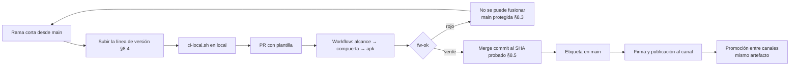

# Procedimientos de PR, integración y versionado — fw-ok, ramas, protección de main y líneas de versión

## Índice

1. [Resumen ejecutivo](#1-resumen-ejecutivo)
2. [Definición](#2-definición)
3. [Aplicación por escenario](#3-aplicación-por-escenario)
4. [Ejemplos concretos](#4-ejemplos-concretos)
5. [Preguntas guía](#5-preguntas-guía)
6. [Criterios de calidad](#6-criterios-de-calidad)
7. [Anexo — Plantilla comentada](#7-anexo--plantilla-comentada)
8. [Procedimientos](#8-procedimientos)
9. [Observaciones](#9-observaciones)
10. [Referencias](#10-referencias)

**Variante declarada.** Este tema agrega un apartado propio, §8 «Procedimientos», después de los siete apartados
comunes; por eso Observaciones y Referencias pasan a §9 y §10. Es la única variante del conjunto y está registrada en
[`FC-ANEXO-99` §8](/LAB/Lab-Documentos/Lab-Documentos/Concepts/Framework-Concept/99-Anexos.md#8-insumos-fuera-del-conjunto-y-apartamientos-declarados).

Viene de: [`FC-TEM-05`](/LAB/Lab-Documentos/Lab-Documentos/Concepts/Framework-Concept/05-La-Demo-Como-Caso-De-Estudio.md) ·
Sigue en: [`FC-TEM-07`](/LAB/Lab-Documentos/Lab-Documentos/Concepts/Framework-Concept/07-Red-Y-Autenticacion.md) · Los
conceptos están en [`FC-TEM-03`](/LAB/Lab-Documentos/Lab-Documentos/Concepts/Framework-Concept/03-Integracion-Y-Versionado.md).

## 1. Resumen ejecutivo

Este es el documento de los pasos. Dice qué hace quien abre un PR, qué corre el workflow, cuándo `fw-ok` sale verde o
rojo, cómo se protege `main` para que un rojo no se pueda fusionar, cómo se fusiona y qué versión sube cada cambio.
Cada procedimiento trae sus entradas, salidas y validaciones, para que un agente también pueda ejecutarlo o
verificarlo. La protección de `main` y la corrida en el runner son el tramo A5 del plan (folio 037): al 2026-10-26 el
workflow existía pero no tenía una corrida con `run_id`, y `main` no estaba protegida. Al 2026-10-29 las dos cosas están:
la corrida completa (compuerta y APK) tiene `run_id` `40847315104`, y `main` exige `fw-ok` (folio 048).

## 2. Definición

### 2.1 Qué es

**`fw-ok`.** El único check requerido de `main`: un job agregador del workflow `framework-concept-demo` que corre
siempre y resume los otros tres (`alcance`, `compuerta`, `apk`) con reglas estrictas (P6.3).

**Cómo se aplica.** Mirás `fw-ok` en el PR: si está verde, el PR se puede fusionar; si está rojo, leés su mensaje, que
dice qué job falló y por qué.

**Un caso.** Un PR desde un fork deja `alcance` en `skipped` por la guarda de mismo repositorio, y `fw-ok` lo informa en
rojo: «un PR desde un fork no corre en el runner propio» (workflow, L182–L185).

**Protección de `main`.** La regla de la plataforma que obliga a entrar por PR y exige `fw-ok` en verde, en modo
estricto (la rama del PR al día con `main`), sin excepción para administradores (folio 023, ítem 1).

**Cómo se aplica.** Se configura una vez, después de ver un `fw-ok` verde en el runner, y se prueba con un PR que
aplica M-13.

**Un caso.** Prueba de implantación pedida por P6.1: el parche M-13 en un PR, con la captura del botón de fusionar
deshabilitado. Pendiente (A5).

### 2.2 Qué problema resuelve

El que dio origen al pedido: un PR que entra a la rama estable sin que corran las pruebas.

### 2.3 Qué NO es

| Se confunde con | Por qué no |
| --- | --- |
| Varios checks obligatorios | Uno solo, agregador; así una omisión no pasa como éxito |
| Filtrar el workflow por `paths` | El alcance lo decide el job `alcance`; el workflow siempre dispara |
| Merge automático sin control | Automático sólo con delegación asentada y guardas G1–G4, con `fw-ok` como corrida exigida (P6.5) |

## 3. Aplicación por escenario

| Escenario | Qué procedimiento aplica |
| --- | --- |
| `ESC-1`, `ESC-2`, `ESC-3`, `ESC-4` | 8.4 (versionado) cuando el cambio toca contenido, definición o puente; 8.1–8.3 siempre |
| `ESC-5` | Todos |
| `ESC-6` | 8.1–8.3; el ingreso no cambia versiones |
| `ESC-7` | 8.5 (publicar): una obligatoria se publica como cualquier contenido, marcada `mandatory`; no ejecutado en la demo |

Según el contexto: en `CTX-3` (iOS) no hay job `macos-*` ni compuerta (P9); en un PR que cambia `global.json` o
`Directory.Build.props` el job `alcance` avisa que P6.8 exige una prueba en dispositivo antes de fusionar.

## 4. Ejemplos concretos

### 4.1 El agregador, en el YAML real

```yaml
  fw-ok:
    needs: [alcance, compuerta, apk]
    if: always()
    runs-on: [self-hosted, i7infra-dev]
    timeout-minutes: 5
```

*Fuente: [`.github/workflows/framework-concept-demo.yml`](/LAB/Lab-Documentos/Lab-Documentos/.github/workflows/framework-concept-demo.yml) L165–L169, árbol de trabajo del 2026-10-26 sin commit; versión fijada por `sha256` 928f181a00dd del archivo (`sha256sum` de la ruta, primeros 12 dígitos).*

`if: always()` es lo que impide que `fw-ok` quede `skipped` cuando un job anterior falla: GitHub recomienda exactamente
eso para checks obligatorios con `needs` (N3 §4.2, [F8]).

### 4.2 La tabla de decisión de `fw-ok`

| `alcance` | `demo` | `compuerta` | `apk` | `fw-ok` |
| --- | --- | --- | --- | --- |
| distinto de `success` (fork, falla) | — | — | — | **rojo** |
| `success` | `false` | `skipped` | `skipped` | **verde** por omisión declarada |
| `success` | `false` | otro | otro | **rojo** (incoherente) |
| `success` | `true` | `success` | `success` | **verde** |
| `success` | `true` | cualquier otro (`failure`, `skipped`, `cancelled`) | — | **rojo** |

Tabla derivada del paso «Agregador estricto» del workflow (L171–L204).

### 4.3 La compuerta en local, en rojo y en verde

Corridas de esta guía sobre una copia de la demo (2026-10-26, imagen `fc-demo-build:f327f6144f9b`):

| Comando | Resultado |
| --- | --- |
| `scripts/ci-local.sh --hasta 4` | Build 0/0; Core 211/211; Update 102/102; Gate 52/52; `rc=0` |
| `patch -p1 < etapas/M-13-codigo-postal-cinco-digitos.patch` + `scripts/ci-local.sh --hasta 4` | Core.Tests 6 con error de 211; `rc=1` |
| `patch -p1 < etapas/aviso-promovido-a-error.patch` + `scripts/ci-local.sh --hasta 1` | `error CS0219`; `rc=1` |

## 5. Preguntas guía

1. ¿Mi rama sale de `main` actualizada y tiene un solo propósito?
2. ¿Corrí `scripts/ci-local.sh` antes de abrir el PR?
3. ¿Completé los cuatro campos de la plantilla, incluidos los dos de tienda?
4. ¿Mi PR cambia algún archivo de `versionado/`? ¿Debería?
5. ¿Quién fusiona: alguien que no escribió el cambio, o el ciclo automático con delegación asentada?
6. ¿Qué sigue después del merge: nada, publicar, etiquetar o probar en dispositivo?

## 6. Criterios de calidad

**Criterio de esta guía.** La tabla es criterio propio del autor de la guía, derivado de las decisiones de la mesa que
cita el tema; no es una decisión de la mesa. Donde una fila repite una decisión, la decisión es la que rige (ver
«Referencias»).

| Un procedimiento bueno… | Uno pobre… |
| --- | --- |
| Tiene una salida observable por paso (verde, rojo, `run_id`) | Termina en «debería andar» |
| Prueba la protección con un rojo provocado | Supone que la protección funciona |
| Deja escrito qué sigue después del merge | Deja la publicación a la memoria de alguien |
| Fusiona con merge commit atado al SHA probado | Fusiona un SHA distinto del que pasó la compuerta |

## 7. Anexo — Plantilla comentada

La plantilla de PR del repositorio, con las preguntas de cada campo
([`.github/pull_request_template.md`](/LAB/Lab-Documentos/Lab-Documentos/.github/pull_request_template.md)):

```markdown
## Unidad declarada
<!-- ¿Qué cambia, en una o dos frases, y qué parte del repositorio toca? -->

## Qué sigue después del merge
<!-- ¿Nada, publicar contenido o definición, etiquetar, o prueba en dispositivo «manual: con registro»
     (obligatoria si cambia global.json, workloadVersion o MauiVersion, P6.8)? -->

## ¿Cambia el propósito declarado en la ficha de tienda?
<!-- Si un contenido o una definición agrega un módulo visible que la ficha no describe: Sí → sale también por tienda -->
- [ ] No
- [ ] Sí — sale también por tienda (explicar):
- [ ] No aplica (el PR no toca la demo)

## ¿Cambia los datos que se recogen o se comparten?
<!-- Una pregunta nueva, un campo nuevo al receptor, una capacidad nueva: Sí → actualizar Data safety (Play) y
     la privacidad de App Store Connect ANTES de promover a prod -->
- [ ] No
- [ ] Sí — qué datos y dónde se actualiza la declaración de la tienda:
- [ ] No aplica (el PR no toca la demo)
```

## 8. Procedimientos

El flujo completo de un cambio, desde la rama hasta la publicación (§8.1 a §8.5; la tabla de decisión de `fw-ok` está
en §4.2):



### 8.1 Rama y PR

1. Crear una rama corta desde `main` (GitHub Flow, [`FC-TEM-03` §2.5](/LAB/Lab-Documentos/Lab-Documentos/Concepts/Framework-Concept/03-Integracion-Y-Versionado.md#25-métodos-y-marcos-modelos-de-ramas)).
2. Hacer el cambio y, si corresponde, subir la línea de versión (8.4).
3. Correr `Concepts/Framework-Concept/Demo/scripts/ci-local.sh` (o `--hasta 4` para lo rápido).
4. Abrir el PR contra `main` y completar la plantilla.
5. Esperar `fw-ok`. Si sale rojo, leer su mensaje y el job que falló.

#### Entradas — 8.1

- Rama con el cambio; árbol limpio; Docker disponible para `ci-local.sh`.

#### Salidas — 8.1

- PR abierto con la plantilla completa; corrida del workflow con `run_id`.

#### Validaciones — 8.1

- `ci-local.sh` termina con `rc=0`.
- `fw-ok` en verde en el PR, o rojo con motivo.

### 8.2 Qué corre el workflow

| Job | Cuándo | Qué hace |
| --- | --- | --- |
| `alcance` | Siempre, salvo PR desde fork (guarda de mismo repositorio) | `git diff --name-only base...head`: decide `demo=true` si el PR toca `Concepts/Framework-Concept/Demo/**` o el propio workflow; avisa P6.8 si toca `global.json` o `Directory.Build.props` |
| `compuerta` | `demo == 'true'` | Pasos 0 a 5 de `ci-local.sh`: base del PR, build sin MAUI, tres suites, publish y empaquetado del contenido |
| `apk` | Después de `compuerta` | Paso 6: APK `android-arm64` |
| `fw-ok` | Siempre | El agregador de 4.2 |

Todos con `runs-on: [self-hosted, i7infra-dev]`, `permissions: contents: read`, `persist-credentials: false` y ningún
secreto. `concurrency` cancela la corrida anterior del mismo PR.

#### Entradas — 8.2

- Evento `pull_request` o `workflow_dispatch`.

#### Salidas — 8.2

- Cuatro jobs con su resultado; `fw-ok` como check.

#### Validaciones — 8.2

- En la API de corridas (`actions/runs/{id}/jobs`), los jobs corrieron en el runner propio (criterio de aceptación 1
  de P11): `hpdev-runner-dev` desde el 2026-10-28; antes, `i7infra-runner-dev`, que conserva la etiqueta, así que el
  campo `runner_name` dice cuál fue. NO VERIFICADO al 2026-10-26.

### 8.3 Proteger `main` (tramo A5)

Configuración aprobada por el PO (folio 023, ítem 1; P6.1):

| Ajuste | Valor |
| --- | --- |
| Rama | `main` de `hdcm-dev/Lab-Documentos` |
| PR obligatorio | Sí |
| Checks requeridos | **sólo** `fw-ok` |
| Modo estricto (rama al día) | Sí |
| Excepción para administradores | No («Do not allow bypassing the above settings») |
| Aprobación de workflows de forks | Para todos los colaboradores externos (P6.4) |

Orden: primero un `fw-ok` verde en el runner, después la protección (folio 037, A5); si se protege antes, el primer PR
queda bloqueado por un check que nunca corrió.

#### Entradas — 8.3

- Un `run_id` con `fw-ok` en verde; permisos de administración del repositorio.

#### Salidas — 8.3

- Regla de protección activa sobre `main`.

#### Validaciones — 8.3

- Un PR con `etapas/M-13-codigo-postal-cinco-digitos.patch`: `fw-ok` rojo y el botón de fusionar deshabilitado, con
  captura (prueba de implantación de P6.1). Pendiente.

### 8.4 Qué versión sube cada cambio

| Si el PR cambia… | Sube | Dónde | Sale por |
| --- | --- | --- | --- |
| Páginas Razor, CSS, JS del contenido | **Contenido** (SemVer; menor para algo nuevo compatible) | `versionado/contenido.json` | Canal |
| Una encuesta | **Definición** (`version` + 1) | `definiciones/<encuestaId>/vN.json` nuevo (plantilla: en la demo, `definiciones/encuesta-movilidad/v1.json` y `v2.json`) | Canal, sin contenido nuevo |
| La tabla de métodos, el catálogo o el transporte | **Puente** (menor o mayor, [`FC-TEM-02` §2.6](/LAB/Lab-Documentos/Lab-Documentos/Concepts/Framework-Concept/02-Cascaron-Puente-Y-Capacidades.md#26-cómo-se-clasifica-un-cambio-del-puente)) | `versionado/puente.json` + `FrameworkConcept.Tools contrato` | Tienda (lo implementa el cascarón) |
| Permisos, XAML, código nativo, SDK, MAUI | **Cascarón** (`ApplicationDisplayVersion` y `ApplicationVersion` + 1) | `versionado/version-cascaron.props` | Tienda |

Estas son las **cuatro líneas** que la pantalla de diagnóstico muestra juntas (folio 023, ítem 4). La instantánea de
`Gate.Tests` comprueba que `versionado/puente.json`, `ContratoDelPuente.Version` y `contrato.json` coincidan (r02 y
r06 de `rojos-compuerta.md`).

#### Entradas — 8.4

- El diff del PR.

#### Salidas — 8.4

- Los archivos de versión actualizados en el mismo PR.

#### Validaciones — 8.4

- `Gate.Tests` verde (instantánea del contrato y definiciones frente a la base del PR).

### 8.5 Fusionar y publicar

1. **Fusionar.** Manual por defecto, por alguien que no escribió el cambio; automático sólo con delegación asentada
   (folio 007) y guardas G1–G4 (P6.5).
2. **Publicar contenido o definición.** Sólo desde una etiqueta alcanzable desde `main`; el job de firma no acepta otro
   artefacto (P6.7). En producción es **diseño, no implantado**: firma en un job aparte con *environment* protegido y
   revisor obligatorio (P2, «Custodia de la clave»). En la demo, `scripts/guion.sh publicar`, `definicion`, `firmar`.
3. **Promover entre canales.** El mismo artefacto, sin reconstruir.

#### Entradas — 8.5

- PR con `fw-ok` verde; etiqueta anotada en `main` (producción).

#### Salidas — 8.5

- Merge commit en `main`; índice firmado con la versión nueva.

#### Validaciones — 8.5

- `scripts/guion.sh verificar` comprueba lo publicado como lo haría el teléfono.

## 9. Observaciones

- **Hecho.** No había corrida del workflow con `run_id` ni protección de `main` al 2026-10-26 (folio 037, A5; registro
  de la corrida, entrada 22).
- **Hecho.** Al 2026-10-29, `main` exige `fw-ok` como check obligatorio, estricto (la rama tiene que estar al día) y
  también para administradores (API de protección de ramas). La corrida completa del workflow, con compuerta y APK, tiene
  `run_id` `40847315104` en `hpdev-runner-dev` (folio 048). Falta la prueba de un PR en rojo con M-13 que no se pueda fusionar.
- **Hecho.** El runner no tiene `docker.sock` ni KVM: los pasos corren `dotnet` directo (comentario del workflow).
- **Interpretación.** El paso «base del PR» (`git archive` de la demo en `main`) es lo que permite a `Gate.Tests`
  comparar contrato y definiciones con lo ya publicado; sin base, con `CI=true`, la compuerta falla en lugar de omitir
  (r18 de `rojos-compuerta.md`).

## 10. Referencias

- [Workflow](/LAB/Lab-Documentos/Lab-Documentos/.github/workflows/framework-concept-demo.yml); [plantilla de PR](/LAB/Lab-Documentos/Lab-Documentos/.github/pull_request_template.md); [`scripts/ci-local.sh`](/LAB/Lab-Documentos/Lab-Documentos/Concepts/Framework-Concept/Demo/scripts/ci-local.sh).
- GitHub, *Troubleshooting required status checks*: https://docs.github.com/en/pull-requests/collaborating-with-pull-requests/collaborating-on-repositories-with-code-quality-features/troubleshooting-required-status-checks (consultada el 2026-10-25, N3).
- GitHub, *Secure use reference*: https://docs.github.com/en/actions/reference/security/secure-use (consultada el 2026-10-25, N3).
- Dictamen P6, P7 del [folio 035](/LAB/Lab-Documentos/Lab-Documentos.Documentacion/PROMPTs/Concepts/01-Framework-Concept/OUTPUTs/Expedientes/0001-Framework-Concept-Maui-Autoactualizable/actuaciones/035-informe-r2-jurado-veredicto.md); [folio 023](/LAB/Lab-Documentos/Lab-Documentos.Documentacion/PROMPTs/Concepts/01-Framework-Concept/OUTPUTs/Expedientes/0001-Framework-Concept-Maui-Autoactualizable/actuaciones/023-providencia-respuesta-del-po-al-lote-de-la-ronda-1.md); [folio 007](/LAB/Lab-Documentos/Lab-Documentos.Documentacion/PROMPTs/Concepts/01-Framework-Concept/OUTPUTs/Expedientes/0001-Framework-Concept-Maui-Autoactualizable/actuaciones/007-providencia-delegacion-del-merge.md).
