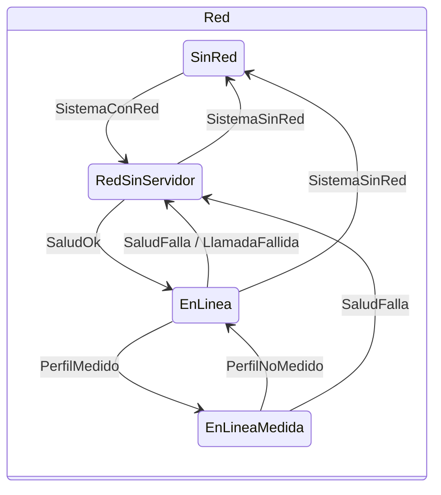
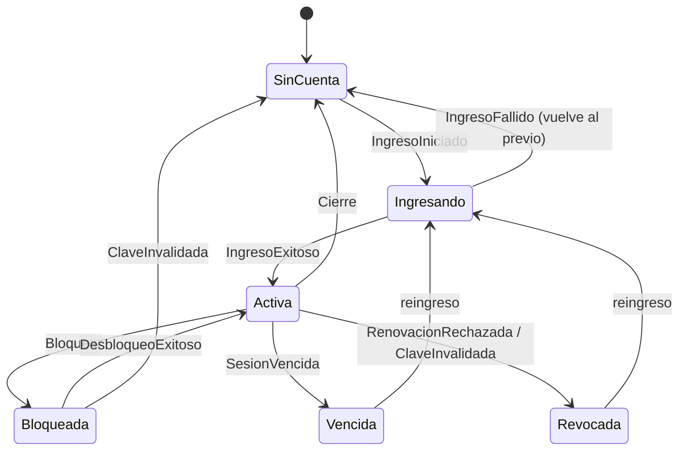

# Red y autenticación con el sistema operativo — estado de red, política de acciones y sesión

## Índice

1. [Resumen ejecutivo](#1-resumen-ejecutivo)
2. [Definición](#2-definición)
3. [Aplicación por escenario](#3-aplicación-por-escenario)
4. [Ejemplos concretos](#4-ejemplos-concretos)
5. [Preguntas guía](#5-preguntas-guía)
6. [Criterios de calidad](#6-criterios-de-calidad)
7. [Anexo — Plantilla comentada](#7-anexo--plantilla-comentada)
8. [Observaciones](#8-observaciones)
9. [Referencias](#9-referencias)

Viene de: [`TEM-06`](/LAB/Lab-Documentos/Lab-Documentos/Concepts/Framework-Concept/06-Procedimientos-PR-Integracion-Versionado.md) ·
Sigue en: [`TEM-08`](/LAB/Lab-Documentos/Lab-Documentos/Concepts/Framework-Concept/08-Cohesion-Global.md)

## 1. Resumen ejecutivo

Una app de campo trabaja con red intermitente. El cascarón combina lo que dice el sistema operativo con un chequeo de
salud propio y llega a cuatro estados (`EnLinea`, `EnLineaMedida`, `RedSinServidor`, `SinRed`), que muestra en una banda
permanente mientras dure el problema y que usa para reconectar solo. Cada acción del usuario está declarada como
`SoloLocal`, `Encolable` o `SoloEnLinea`; el cascarón decide si se permite, si queda pendiente o si se bloquea, y el
botón dice por qué. La identidad entra una vez con OIDC (code + PKCE) en el navegador del sistema; después se desbloquea
con la seguridad del teléfono (huella, rostro, PIN o patrón), que protege el refresh token en el Keystore. Cerrar o
vencer la sesión nunca borra lo pendiente. Todo esto entró en la demo por pedido del PO (folio 038) y se ensayó en el
emulador (E03).

## 2. Definición

### 2.1 Qué es

**Estado de red combinado.** La conclusión del cascarón sobre si puede hablar con su servidor, a partir de
`Connectivity` del sistema y de `GET /salud` con timeout de 3 s y caché de 10 s
([DISENO §2](/LAB/Lab-Documentos/Lab-Documentos/Concepts/Framework-Concept/Demo/DISENO-RED-Y-AUTENTICACION.md#2-red-combinada)).

**Cómo se aplica.** Tu página no consulta la red: escucha `network.changed` y muestra lo que llega.

**Un caso.** E03 paso `e`: con red y el receptor caído, banda «Sin acceso al servidor. Hay red pero el servidor no
responde. Reintentando…»; la salud se reintenta a +0,1 s, +15 s, +35 s.

**Política de acciones.** Una constante del cascarón que declara la clase de cada acción y los métodos del puente que
la ejecutan; un evaluador puro decide con el estado de red y de sesión del momento.

**Cómo se aplica.** Usás `BotonDeAccion` en lugar de `<button>`: se deshabilita y muestra el motivo debajo.

**Un caso.** En modo avión, «Enviar ahora» (`SoloEnLinea`) queda deshabilitado con «Sin conexión», y «Registrar» la
encuesta (`Encolable`) se ejecuta y queda pendiente (E03 paso `d`).

**Desbloqueo local.** La entrada a la app con la seguridad del teléfono, separada de la sesión con el servidor: abre una
clave AES-256-GCM del `AndroidKeyStore` que sella el refresh token (DISENO §3.4).

**Cómo se aplica.** Después del primer ingreso, la app pregunta «¿Usar la seguridad del teléfono para entrar?»; si
aceptás, los arranques siguientes muestran «Desbloquear».

**Un caso.** E03 paso `b`: `am force-stop`, abrir, `Bloqueada`; huella simulada; entra como `encuestador` sin cuenta ni
navegador.

### 2.2 Qué problema resuelve

El PO lo pidió así: «manejo de autentificación usando los mecanismos configurados en el sistema operativo, manejo de red
(detección de corte de internet, notificación al usuario que no hay red, y reconexión automatica) con bloqueo de
acciones que requieren internet» ([folio 038](/LAB/Lab-Documentos/Lab-Documentos.Documentacion/PROMPTs/Concepts/01-Framework-Concept/OUTPUTs/Expedientes/0001-Framework-Concept-Maui-Autoactualizable/actuaciones/038-providencia-autenticacion-del-so-y-manejo-de-red-en-la-demo.md),
testimonio literal).

### 2.3 Qué NO es

| Se confunde con | Por qué no |
| --- | --- |
| La biometría como login | La biometría es la llave del refresh token guardado; la identidad la da el emisor (DISENO §3.1) |
| Un login dentro de un WebView | Prohibido: el formulario se abre en el navegador del sistema (RFC 8252) |
| Un toast de «sin red» | Es una banda permanente mientras dure, que desaparece sola (DISENO §2.6) |
| Un período de gracia local | No existe: sin red se opera sin límite; al vencer la sesión se reingresa con red antes de sincronizar (P4) |
| El contenido decide qué se bloquea | Decide el cascarón; el despachador del puente rechaza con `AccionBloqueada` (-32005) aunque el contenido se equivoque |

### 2.4 RFC 8252: la cita y su código

RFC 8252 (*OAuth 2.0 for Native Apps*, BCP 212, 2017), §5, en la síntesis del dossier N2:

> «native apps MUST use an external user-agent»

**Qué implica.** La app no ve la clave de la persona: el formulario del emisor corre en el navegador del sistema (Custom
Tab en Android) y vuelve a la app por un esquema propio con un `code` que sólo sirve junto al `code_verifier` de PKCE
(RFC 7636). La demo lo hace con `WebAuthenticator` de MAUI Essentials y arma el pedido así:

```csharp
            ("state", state),
            ("code_challenge", desafio),
            ("code_challenge_method", "S256"),
            // Corrector E03 (P0) — Cada ingreso interactivo vuelve a pedir las credenciales (OIDC Core §3.1.2.1). Sin
            // esto, la sesión SSO viva del emisor en el navegador entra sola después de un Cierre o de una Revocada.
            ("prompt", ParametrosDeSesion.PromptDelIngreso)
```

*Fuente: [`Demo/src/FrameworkConcept.Core/Auth/Oidc.cs`](/LAB/Lab-Documentos/Lab-Documentos/Concepts/Framework-Concept/Demo/src/FrameworkConcept.Core/Auth/Oidc.cs) L74–L79, árbol de trabajo del 2026-10-26 sin commit; versión fijada por `sha256` 3f4114e525f1 del archivo (`sha256sum` de la ruta, primeros 12 dígitos).*

### 2.5 Las dos máquinas de estado





Las dos son funciones puras en `Core` (`TransicionesDeRed.Siguiente`, `TransicionesDeSesion.Siguiente`), probadas en
`tests/FrameworkConcept.Core.Tests/Red/` y `Auth/`.

### 2.6 La política de la demo

```csharp
    public static IReadOnlyList<AccionDeclarada> Acciones { get; } =
    [
        new("localidades.guardar", ClaseDeAccion.SoloLocal, ["documents.put", "documents.delete"],
            "Alta, modificación y baja de localidades: documentos del teléfono."),
        new("encuesta.enviar", ClaseDeAccion.Encolable, ["encuestas.enqueueRespuesta"],
            "Registrar una encuesta: se guarda con su fila del outbox y sale cuando haya red y sesión (P5)."),
        new("outbox.enviarAhora", ClaseDeAccion.SoloEnLinea, ["outbox.sendNow"],
            "«Enviar ahora»: fuerza una pasada del sincronizador. Sin servidor no tiene sentido: se bloquea con motivo."),
        new(Ingresar, ClaseDeAccion.SoloEnLinea, ["auth.signIn"],
            "Ingresar con la cuenta (OIDC en el navegador del sistema): necesita llegar al emisor.")
    ];
```

*Fuente: [`Demo/src/FrameworkConcept.Core/Red/PoliticaDeAcciones.cs`](/LAB/Lab-Documentos/Lab-Documentos/Concepts/Framework-Concept/Demo/src/FrameworkConcept.Core/Red/PoliticaDeAcciones.cs) L41–L51, árbol de trabajo del 2026-10-26 sin commit; versión fijada por `sha256` 41de31a84c05 del archivo (`sha256sum` de la ruta, primeros 12 dígitos).*

| Clase | Permitida si | Queda pendiente si |
| --- | --- | --- |
| `SoloLocal` | Entrada abierta | Nunca |
| `Encolable` | Entrada abierta | No hay servidor o la sesión no es válida |
| `SoloEnLinea` | Entrada abierta, con servidor y sesión válida | Nunca |

## 3. Aplicación por escenario

| Escenario | Qué aporta | Según el contexto |
| --- | --- | --- |
| `ESC-1` | Sin cuenta todavía: `SinCuenta`, o modo Dispositivo | `CTX-4`: no hay ingreso; `CTX-5`: «Ingresar con tu cuenta» |
| `ESC-2` | No aplica: la activación del contenido no depende de la sesión | — |
| `ESC-3` | `auth.session` es una capacidad del catálogo; un contenido que la pide como `requires` no se activa sin ella | — |
| `ESC-4` | Banda permanente, `Encolable` pendiente, reconexión automática que vacía el outbox | `CTX-6`: `EnLineaMedida` no verificado en dispositivo |
| `ESC-5` | `SinTokensEnElPuenteTests` en la compuerta: el refresh token nunca cruza el puente | — |
| `ESC-6` | El ingreso con cuenta es disparador de la consulta del canal (P2) | No observado en la demo |
| `ESC-7` | La versión mínima del cascarón se evalúa también al ingresar (P4) | Diseño, no ejecutado |

## 4. Ejemplos concretos

### 4.1 Encuesta sin red y reconexión sola (corrida real, E03)

**Qué demuestra.** Que lo encolado sale solo cuando vuelve el servidor, con el dueño correcto.
**Precondición.** APK en modo con cuenta; `encuestador` ingresado; modo avión.
**Resultado.** Encuesta registrada a las 23:31:24Z sin red; receptor levantado a las 23:33:15; la app pasó sola a
`EnLinea` en 6,4 s y la fila se envió a +0,57 s, con dueño `encuestador` (E03 §4.3).

### 4.2 Cerrar sesión conserva lo pendiente (corrida real, E03)

**Qué demuestra.** P4: «retener es reversible, borrar no».
**Precondición.** Una encuesta pendiente; «Cerrar sesión».
**Resultado.** La confirmación avisa que lo pendiente se conserva; queda `SinCuenta` con «pendientes conservados 1»;
con red, el outbox **no** envía sin sesión; al reingresar como `encuestador`, la fila sale en 0,7 s (E03 paso `g`).

### 4.3 Quitar el bloqueo de pantalla (corrida real, E03 y correcciones)

**Qué demuestra.** Que la clave del Keystore se invalida al quitar el bloqueo y la app no deja entrar sin volver a
ingresar.
**Precondición.** Desbloqueo activado; `adb shell locksettings clear --old 1234`.
**Resultado.** En E03 la sesión quedó `Revocada`; después de las correcciones, desde `Bloqueada` pasa a `SinCuenta`
(DISENO §3.2, «corrector E03»). Sin bloqueo de pantalla, el desbloqueo no se ofrece y la app dice por qué (D-03 = T1).

## 5. Preguntas guía

1. ¿Qué clase tiene la acción que agrego? ¿Qué ve la persona sin red, sin servidor y sin sesión?
2. ¿Mi página muestra el motivo que manda el cascarón o inventa uno?
3. ¿Algo de lo que hago con el token podría cruzar el puente?
4. ¿Qué pasa con lo pendiente si la persona cierra sesión? ¿Y si otra persona ingresa en el mismo teléfono?
5. ¿El teléfono tiene bloqueo de pantalla y Android 11 o más? Si no, ¿qué ve la persona?

## 6. Criterios de calidad

**Criterio de esta guía.** La tabla es criterio propio del autor de la guía, derivado de las decisiones de la mesa que
cita el tema; no es una decisión de la mesa. Donde una fila repite una decisión, la decisión es la que rige (ver
«Referencias»).

| Bueno | Pobre |
| --- | --- |
| Distingue «sin red» de «hay red pero el servidor no responde» | Sólo mira `Connectivity` |
| La política la evalúa el cascarón y el puente la hace cumplir | El contenido decide y nadie lo controla |
| El botón bloqueado dice por qué | Un botón gris sin explicación |
| El refresh token vive sellado en el Keystore o en memoria | El token en texto plano en la base o en el puente |
| Cerrar sesión borra tokens y clave, conserva pendientes con su dueño | Borrar la base al cerrar sesión |

## 7. Anexo — Plantilla comentada

Declaración de una acción nueva (formato de `PoliticaDeAcciones.Acciones`):

```csharp
new("<area>.<accion>",                 // ¿El id es estable y en el formato de las demás?
    ClaseDeAccion.Encolable,           // ¿Qué pasa sin servidor? SoloLocal / Encolable / SoloEnLinea
    ["<metodo.del.puente>"],           // ¿Todos los métodos que la ejecutan están listados? Si no, el puente no la bloquea
    "<qué hace y por qué esa clase>")  // ¿Un lector entiende el motivo sin abrir otro archivo?
```

## 8. Observaciones

- **Hecho — apartamiento H-1.** Con `BIOMETRIC_STRONG | DEVICE_CREDENTIAL`, enrolar una huella nueva **no** invalida la
  clave: Android sólo invalida por enrolamiento las claves exclusivamente biométricas. La mesa mantuvo P4 (huella,
  rostro, PIN o patrón) y lo dejó como **apartamiento declarado del borrador §4**, avisado al PO (E03 §5 H-1; DISENO
  §3.4 y §12). Se conserva la invalidación al quitar el bloqueo de pantalla.
- **Hecho.** El comentario de
  [`Shell/Auth/CofreDeSesion.cs`](/LAB/Lab-Documentos/Lab-Documentos/Concepts/Framework-Concept/Demo/src/FrameworkConcept.Shell/Auth/CofreDeSesion.cs)
  L128 dice «Una huella nueva invalida la clave (borrador §4)», y la línea siguiente llama a
  `SetInvalidatedByBiometricEnrollment(true)`; según H-1, con `DeviceCredential` esa llamada no produce ese efecto. El
  comentario contradice lo medido.
- **Hecho.** `EnLineaMedida` en un dispositivo, la regresión sin cuenta (R0) en el emulador y todo en un teléfono
  físico: NO VERIFICADOS (E03 §7).
- **Hecho.** La carrera dueño/token se corrigió (token por fila bajo el cerrojo de la identidad) y se ensayó sólo el
  envío normal (E03 §9, «Carrera dueño/token»).
- **Hecho.** El ANR al volver del navegador (H-3) no se repitió en 7 reingresos después de la corrección; su causa no se
  demostró (E03 §9).
- **Interpretación.** Todos los tiempos de la política (5 → 60 s de backoff, 10 s de caché, 5 min para bloquear tras
  segundo plano) son criterio de la demo, no valores de producto (DISENO §2.3).

## 9. Referencias

- Denniss y Bradley (2017), *RFC 8252: OAuth 2.0 for Native Apps*: https://www.rfc-editor.org/rfc/rfc8252 (consultada el 2026-10-25, N2).
- Sakimura y otros (2015), *RFC 7636: PKCE*: https://www.rfc-editor.org/rfc/rfc7636 (citada a través de N2; el texto propio no se leyó).
- [DISENO-RED-Y-AUTENTICACION](/LAB/Lab-Documentos/Lab-Documentos/Concepts/Framework-Concept/Demo/DISENO-RED-Y-AUTENTICACION.md); ensayo [E03](/LAB/Lab-Documentos/Lab-Documentos.Documentacion/PROMPTs/Concepts/01-Framework-Concept/OUTPUTs/Ensayos/E03-Red-Y-Autenticacion/INFORME.md) y sus [correcciones](/LAB/Lab-Documentos/Lab-Documentos.Documentacion/PROMPTs/Concepts/01-Framework-Concept/OUTPUTs/Ensayos/E03-Red-Y-Autenticacion/correcciones.md); dictamen P4, P5 del [folio 035](/LAB/Lab-Documentos/Lab-Documentos.Documentacion/PROMPTs/Concepts/01-Framework-Concept/OUTPUTs/Expedientes/0001-Framework-Concept-Maui-Autoactualizable/actuaciones/035-informe-r2-jurado-veredicto.md).
