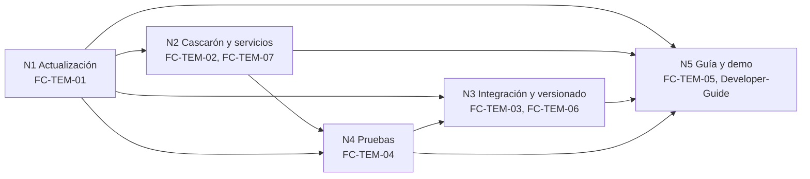
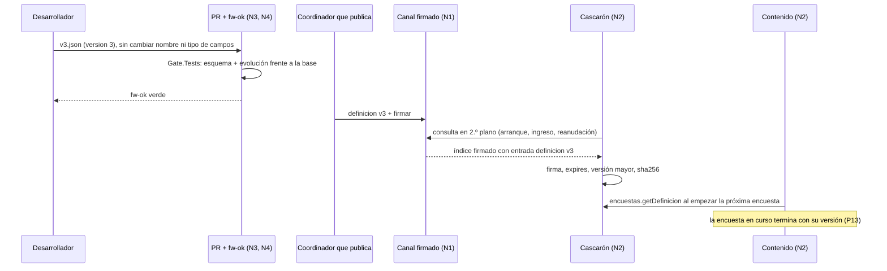

# Cohesión global — cómo se relacionan los núcleos, qué pasa por cada borde y qué contradicciones se resolvieron

## Índice

1. [Por qué un documento de cohesión](#1-por-qué-un-documento-de-cohesión)
2. [Núcleos y documentos](#2-núcleos-y-documentos)
3. [Grafo de dependencias](#3-grafo-de-dependencias)
4. [Contratos entre núcleos](#4-contratos-entre-núcleos)
5. [El modelo completo en un recorrido](#5-el-modelo-completo-en-un-recorrido)
6. [Contradicciones resueltas y apartamientos](#6-contradicciones-resueltas-y-apartamientos)
7. [Preguntas guía](#7-preguntas-guía)
8. [Referencias](#8-referencias)

## 1. Por qué un documento de cohesión

El pedido se descompuso en cinco núcleos que se pueden estudiar por separado
([bitácora 01](/LAB/Lab-Documentos/Lab-Documentos.Documentacion/PROMPTs/Concepts/01-Framework-Concept/OUTPUTs/Bitacoras/01-Descomposicion-En-Nucleos.md)).
Cada uno decide algo que otro usa. Este documento dice qué cruza cada borde, para que un cambio en un tema se pueda
seguir hasta los otros, y registra dónde las fuentes se contradecían y cómo quedó.

Este documento **no define términos nuevos**: usa los cinco del vocabulario de
[`00-Marco` §2](/LAB/Lab-Documentos/Lab-Documentos/Concepts/Framework-Concept/00-Marco.md#2-vocabulario-mínimo), con
su operación y su escena, y el glosario de orientación de
[`FC-ANEXO-99` §1](/LAB/Lab-Documentos/Lab-Documentos/Concepts/Framework-Concept/99-Anexos.md#1-glosario).

## 2. Núcleos y documentos

| Núcleo | Qué lo une | Documento de la guía | Decisiones |
| --- | --- | --- | --- |
| N1 Actualización dinámica sin tienda | Cascarón y contenido, tiendas, canal firmado, activación, rollback, semilla | [`FC-TEM-01`](/LAB/Lab-Documentos/Lab-Documentos/Concepts/Framework-Concept/01-Actualizacion-Sin-Tienda.md) | P1, P2 |
| N2 Cascarón y servicios nativos | Puente, catálogo, base local, outbox, encuestas como datos | [`FC-TEM-02`](/LAB/Lab-Documentos/Lab-Documentos/Concepts/Framework-Concept/02-Cascaron-Puente-Y-Capacidades.md), [`FC-TEM-07`](/LAB/Lab-Documentos/Lab-Documentos/Concepts/Framework-Concept/07-Red-Y-Autenticacion.md) | P3, P4, P5, P12, P13 |
| N3 PR, integración y versionado | Ramas, protección, compuerta, líneas de versión, iOS | [`FC-TEM-03`](/LAB/Lab-Documentos/Lab-Documentos/Concepts/Framework-Concept/03-Integracion-Y-Versionado.md), [`FC-TEM-06`](/LAB/Lab-Documentos/Lab-Documentos/Concepts/Framework-Concept/06-Procedimientos-PR-Integracion-Versionado.md) | P6, P7, P9 |
| N4 Estrategia de pruebas | Capas, compuerta mínima, rojos provocados | [`FC-TEM-04`](/LAB/Lab-Documentos/Lab-Documentos/Concepts/Framework-Concept/04-Estrategia-De-Pruebas.md) | P8 |
| N5 Guía didáctica y demo | Lector, estructura de la guía, demo derivada del caso base | [`FC-TEM-05`](/LAB/Lab-Documentos/Lab-Documentos/Concepts/Framework-Concept/05-La-Demo-Como-Caso-De-Estudio.md), [Developer-Guide](/LAB/Lab-Documentos/Lab-Documentos/Concepts/Framework-Concept/Developer-Guide.md) | P10, P11 |

La red y la autenticación (`FC-TEM-07`) pertenecen a N2 por su origen (el borrador §4, §6, §7 y P4), y tienen documento
propio porque entraron a la demo en un incremento aparte (folio 038).

## 3. Grafo de dependencias

## 4. Contratos entre núcleos

| De → a | Qué pasa por el borde | Dónde se ve en la demo |
| --- | --- | --- |
| N1 → N2 | El modelo de contenido (Blazor WASM en `HybridWebView`) fija la forma del puente: `Call(sobre)` sobre el transporte de `hybridwebview.js` | `Contracts/Puente/TransporteDelPuente.cs` |
| N1 → N3 | Las líneas de versión que se publican por canal (contenido, definición) y las que van por tienda (cascarón, puente) | `versionado/` |
| N2 → N1 | El predicado de compatibilidad usa el catálogo y la versión del puente del cascarón | `Update/PredicadoDeCompatibilidad.cs` |
| N2 → N4 | El contrato del puente es lo que fija la instantánea | `Contracts/contrato.json`, `Gate.Tests/Contrato/` |
| N4 → N3 | Las suites que `fw-ok` exige en verde | `scripts/ci-local.sh`, workflow |
| N3 → N1 | Sólo se publica lo construido desde una etiqueta alcanzable desde `main` | Diseño (P6.7) |
| N1–N4 → N5 | La guía enseña lo decidido; la demo lo ejecuta | Esta guía y `Demo/` |

## 5. El modelo completo en un recorrido

Una corrección de la encuesta, de punta a punta, toca los cinco núcleos:

Nada de este recorrido necesita tienda ni una versión nueva del contenido (P1: «Corregir una encuesta publica sólo la
definición»). Si en cambio la corrección exigiera un tipo de pregunta que el renderizador no sabe dibujar, cruzaría a
N1 (contenido nuevo) y quizás a N2 (capacidad nueva, por tienda).

## 6. Contradicciones resueltas y apartamientos

| Tensión | Entre | Cómo quedó | Evidencia |
| --- | --- | --- | --- |
| Estructura de la guía en carpetas `00-`…`99-` | P10 (folio 035) y el despacho del tramo A4 (archivos planos en `Framework-Concept/`) | Archivos planos numerados con los mismos roles (marco, temas, anexos); `Developer-Guide.md` es el documento central | Este conjunto |
| Demo sin login | P4 «Decisión para la demo» y el pedido del PO del folio 038 | El folio 038 la sustituye: login, desbloqueo y red entran a la demo | Folio 038, «Efecto» |
| Invalidar la clave al enrolar una huella | Borrador §4 y P4 (aceptar PIN o patrón) | Se mantiene P4; **apartamiento declarado H-1**, avisado al PO | E03 §5 H-1 |
| Ubicación de la fase | P7 (`versionado/rutas.json`) y la demo (`versionado/fase.json`) | Desvío de nombre declarado | README de la demo, A1; `fase.json` |
| Camino de red con el teléfono de medida | P11 (un camino, sin túnel público) y el g42 que no alcanza al receptor | Túnel como **medio de laboratorio**, desvío declarado; camino medido sólo con el emulador | README de la demo, «Qué hace falta» |
| `minShellVersion` | Borrador y N3 §6 contra P3 | Sale del teléfono: rango con techo + predicado; el piso del cascarón es política de soporte | P3 |
| `sqlite-net-pcl` | Inclinación del borrador (D-05) contra P5 | EF Core SQLite 10.0.11 detrás de `IDb` | P5 |
| Comentario de `CofreDeSesion.cs` L128 | Código contra H-1 | **Sin resolver**: el comentario dice que una huella nueva invalida la clave; lo medido dice que no | [`FC-TEM-07` §8](/LAB/Lab-Documentos/Lab-Documentos/Concepts/Framework-Concept/07-Red-Y-Autenticacion.md#8-observaciones) |

## 7. Preguntas guía

1. Si cambio el puente, ¿qué documentos de la guía y qué pruebas toco?
2. Si una decisión de un núcleo cambia, ¿qué fila de la tabla de contratos se mueve?
3. ¿Hay alguna contradicción nueva entre el borrador del PO y lo decidido que no figure en la tabla 6?

## 8. Referencias

- [Bitácora 01](/LAB/Lab-Documentos/Lab-Documentos.Documentacion/PROMPTs/Concepts/01-Framework-Concept/OUTPUTs/Bitacoras/01-Descomposicion-En-Nucleos.md) y [bitácora 02](/LAB/Lab-Documentos/Lab-Documentos.Documentacion/PROMPTs/Concepts/01-Framework-Concept/OUTPUTs/Bitacoras/02-Cohesion-Global.md).
- Dictamen del [folio 035](/LAB/Lab-Documentos/Lab-Documentos.Documentacion/PROMPTs/Concepts/01-Framework-Concept/OUTPUTs/Expedientes/0001-Framework-Concept-Maui-Autoactualizable/actuaciones/035-informe-r2-jurado-veredicto.md); [folio 038](/LAB/Lab-Documentos/Lab-Documentos.Documentacion/PROMPTs/Concepts/01-Framework-Concept/OUTPUTs/Expedientes/0001-Framework-Concept-Maui-Autoactualizable/actuaciones/038-providencia-autenticacion-del-so-y-manejo-de-red-en-la-demo.md).
- Borrador del PO, `Framework-APP.md` (insumo fuera del conjunto; ver `FC-ANEXO-99` §8).
