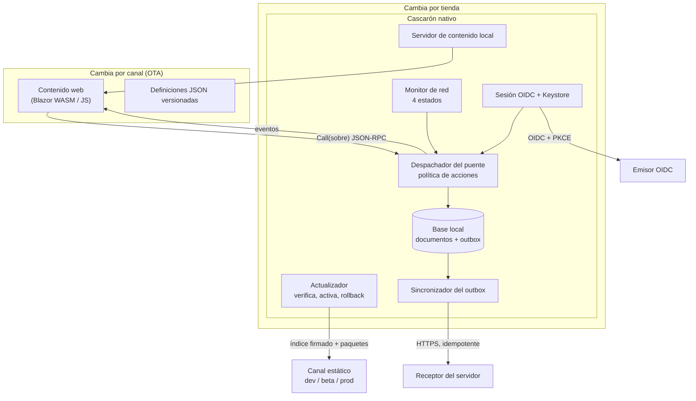
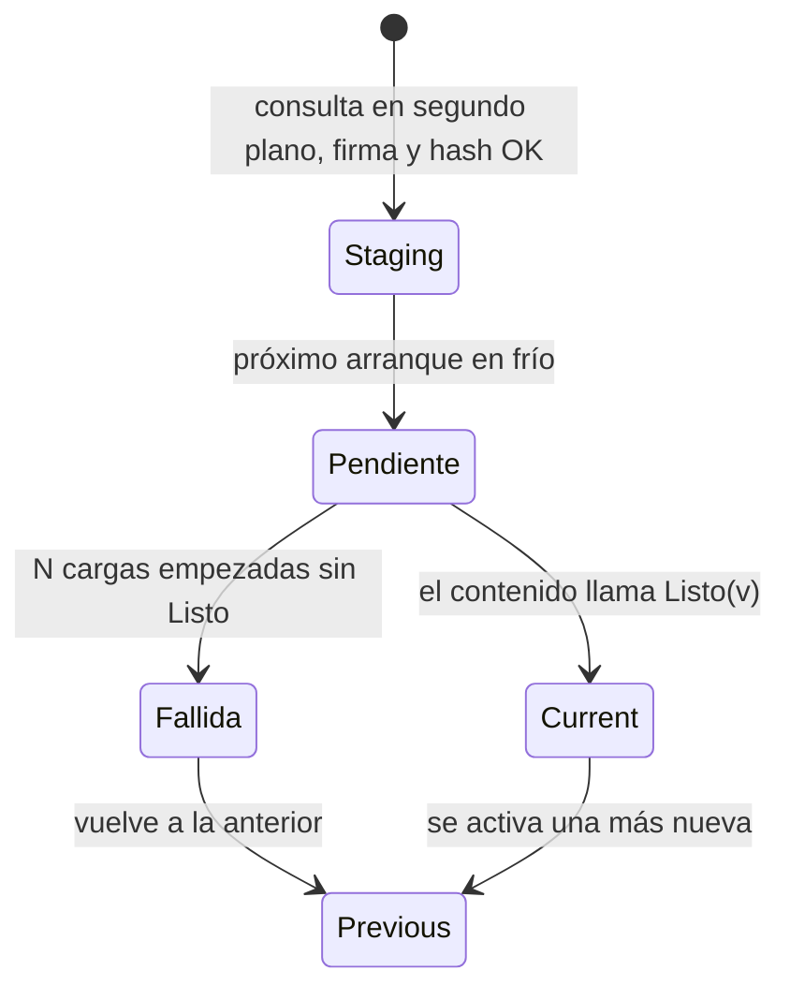
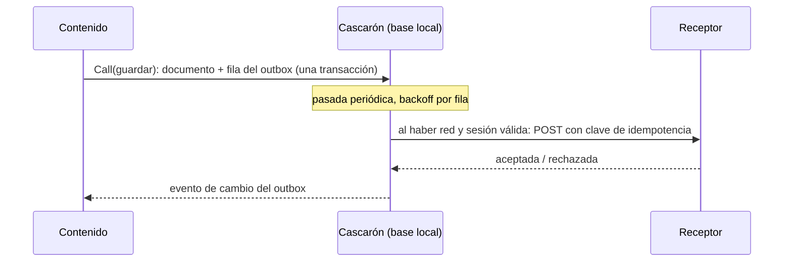

# App híbrida con actualización OTA y trabajo sin red: cómo se arranca y se construye un proyecto con estos principios

**Alias:** App-Hibrida-OTA-Offline-First
**Naturaleza:** propio
**Tema:** Arquitectura y decisiones para una app móvil con cascarón nativo y contenido web actualizable por canal (OTA firmada con staging y rollback), base local como fuente de verdad con outbox, sesión del dispositivo con Keystore y equipos compartidos; destilado de la demo de `Framework-Concept` y de su guía
**Consumidor:** un equipo de agentes IA o de personas que arranca o revisa una app con estos principios; quien preside una mesa de diseño sobre ella
**Condicion-de-carga:** al decidir si una app nueva conviene híbrida con OTA; al diseñar o revisar el puente, el canal, el outbox o la sesión; al armar el plan de pruebas o la lista de arranque; se carga por secciones según el «Mapa de carga» de §0
**Hereda-de:** —
**Sustituye:** —
**Compatible-con:** `MAUI-Framework-Developer-Guide.md` (libro de esta carpeta, edición 2026-11-01)
**Versión:** 1.0
**Estado:** Vigente
**Fecha:** 2026-11-01

---

## 0. Propósito y alcance

Este conocimiento dice **qué decidir, en qué orden y con qué criterio** para construir una app con tres
principios: híbrida (cascarón nativo + contenido web), actualizable sin tienda (OTA, *live updates*) y
*offline-first*. No repite el libro: lo condensa en decisiones, contratos y listas, y remite al capítulo donde
está la evidencia. La implementación de referencia es la demo .NET MAUI de esta carpeta (`../Demo/`); los
principios valen para Capacitor, Cordova o Expo con la misma forma.

**Regla de evidencia.** Cada afirmación lleva su fuente: `[ruta:líneas]` relativa a esta carpeta, `[Libro §x]`
para la guía `../MAUI-Framework-Developer-Guide.md`, o `[Rn]` para las referencias del Anexo B del libro. Lo que
es **propuesta** de este conocimiento, sin ensayo en la demo, se marca así. Las cifras de la demo son
**parámetros de la demo, no norma** [Libro §1.4.2].

**Mapa de carga.**

| Si vas a… | Cargá |
|---|---|
| decidir si el enfoque conviene | §1, §2 |
| diseñar la arquitectura | §3, §4 |
| montar el canal OTA | §5 |
| diseñar datos y sincronización | §6 |
| diseñar ingreso, sesión y equipos compartidos | §7 |
| fijar metas de arranque | §8 |
| planificar pruebas y operación | §9, §10 |
| arrancar el proyecto | §11 |
| comparar con la industria | §12 |

## 1. Cuándo usarlo y cuándo no

**Conviene** cuando se cumplen a la vez:

1. Las **pantallas y reglas cambian más seguido** que lo que tarda una revisión de tienda, y el cambio no
   necesita una capacidad nativa nueva [Libro §1.1].
2. La app se usa **donde la red falta o es cara** (trabajo de campo, encuestas, inspecciones) y el dato no puede
   perderse [Libro §1.4] [R38].
3. Hay **un equipo que puede operar un canal firmado** (claves, publicación, retiradas) [Libro §3.10].
4. Las políticas de la tienda admiten el contenido descargado: Google Play admite código interpretado con acceso
   indirecto a las API (JavaScript en WebView) [R3]; Apple lo regula en 2.5.2 y 4.7 [R1]. Que WebAssembly cuente
   como «interpretado» es **NO VERIFICADO** [Libro §12.4].

**No conviene** cuando:

- lo que cambia seguido es **nativo** (cámara, sensores, permisos): toda capacidad nueva es un cambio de tienda
  [Libro §1.5];
- la app exige **arranque instantáneo** con presupuesto estricto y el motor web no lo da: la demo, con Blazor
  WebAssembly, mide 6,9–7,3 s en régimen frente a un umbral de 5 s [Libro Anexo H.3];
- es una **app de consumo individual** cuyo modelo de amenazas manda cerrar ante riesgo (banca): sus defensas
  no se trasladan tal cual a equipos compartidos sin red [Libro §9.1] [folio 058];
- no habrá quien custodie claves de firma: sin eso, OTA es un canal de ataque [Libro §3.3].

**Alternativas** a evaluar antes: PWA con *service worker* si no hace falta tienda ni capacidades
nativas [R26]; app nativa pura si el ritmo de cambio es bajo; un SaaS de *live updates* (EAS Update, Appflow,
Capawesome) si el equipo no quiere operar el canal, sabiendo que CodePush se retiró [R18] [R19] [R20] [R22]
[Libro §12.6].

## 2. Principios y decisiones con criterio

| Id | Principio | Criterio para aplicarlo | Fuente |
|---|---|---|---|
| P-1 | **Cascarón y contenido separados.** El binario cambia por tienda; el contenido, por canal. | Si un cambio necesita permiso, plugin o API nueva → tienda. Si sólo cambia UI, reglas o textos → canal. | [Libro §1.2.1] |
| P-2 | **Un solo método en el puente.** Operaciones nuevas son filas de una tabla, no métodos nuevos. | La superficie expuesta al contenido no crece; la validación queda en un punto. | [../Demo/src/FrameworkConcept.Shell/Bridge/PuenteDelCascaron.cs:9-17] |
| P-3 | **El contenido pide, el cascarón decide.** | Toda política (red, sesión, permisos) se impone en el despachador, aunque el contenido también la muestre. | [Libro §6.2] |
| P-4 | **Ningún token cruza el puente.** | El contenido ve el estado de la sesión, nunca el secreto; una prueba de compuerta lo vigila. | [Libro §6.5] |
| P-5 | **La confianza es la firma, no el servidor.** Verificar antes de leer. | Índice firmado sobre los bytes, con vencimiento; paquete con hash. | [Libro §3.3] |
| P-6 | **Nunca activar en la misma corrida que se baja.** | Bajar a staging en segundo plano; activar en el próximo arranque en frío. Nunca hacer esperar al abrir. | [Libro §1.3.2] |
| P-7 | **Rollback por evidencia positiva.** | Una versión se confirma sólo si el contenido avisa `Listo`; si no, vuelve a la anterior. | [Libro §3.5] |
| P-8 | **No hay bajar de versión remoto.** | Se corrige hacia adelante o se retira en el índice firmado. | [Libro §3.7] |
| P-9 | **La base local es la fuente de verdad; la red, un recurso que falta.** | Documento y fila del outbox en la misma transacción. | [Libro §1.4] [R29] |
| P-10 | **Los datos de negocio que cambian viajan como definiciones versionadas**, y la versión viaja con cada respuesta. | Cambiar una pregunta publicada exige subir la versión. | [Libro §1.4.3] |
| P-11 | **La biometría abre un secreto; no es identidad.** | La identidad la da un emisor OIDC. | [../Demo/DISENO-RED-Y-AUTENTICACION.md:145] |
| P-12 | **Cuatro líneas de versión visibles**: cascarón, puente, contenido, definición, con la huella del contrato. | Sin eso no se sabe qué corre en un teléfono. | [Libro §1.6] |
| P-13 | **Lo medido manda sobre lo escrito.** | Cifras con fecha y fuente; lo no ejercitado se marca NO VERIFICADO / NO EJECUTADO. | [Libro §11.4] |

Prioridad cuando chocan: seguridad (P-4, P-5) > integridad del dato (P-9) > disponibilidad (P-6, P-7) >
velocidad de arranque (§8). Esta prioridad es **propuesta** de este conocimiento, coherente con las decisiones
de la demo (por ejemplo, activar en el próximo arranque sacrifica inmediatez a cambio de no esperar ni romper).

## 3. Arquitectura de referencia



Figura 1. Arquitectura de referencia. El contenido nunca habla con la red ni ve secretos: todo pasa por el
despachador. Mapa equivalente en la demo: [Libro §2.3] y [Libro Anexo D].

**Ubicación de cada pieza en la demo:** contrato e índice en `../Demo/src/FrameworkConcept.Core/Contracts/`;
actualizador en `../Demo/src/FrameworkConcept.Core/Update/`; puente en
`../Demo/src/FrameworkConcept.Shell/Bridge/`; sincronizador en `../Demo/src/FrameworkConcept.Shell/Sync/`
[Libro §2.3]. Regla práctica: **lo que la compuerta debe leer sin compilar la plataforma va en un proyecto sin
dependencias nativas** (la demo pone el catálogo de capacidades en Core por eso)
[../Demo/src/FrameworkConcept.Core/Contracts/Puente/CatalogoDeCapacidades.cs:29-30].

## 4. Contrato del puente

**Forma del mensaje.** Sobre JSON-RPC 2.0 con un campo `v` (versión del puente con que se escribió el
contenido) [R28] [../Demo/src/FrameworkConcept.Core/Contracts/Puente/Sobre.cs:5-19]:

```json
{ "jsonrpc": "2.0", "v": "1.2.0", "id": "7", "method": "bridge.ready", "params": { "version": "1.1.0" } }
```

La respuesta lleva `result` o `error`, nunca ambos; los eventos son notificaciones sin `id` [Libro §4.2.2].

**Códigos de error mínimos** (reservar el rango −32000 para el dominio) [Libro §4.2.3]: los cinco de JSON-RPC
más `VersionDelPuenteIncompatible`, `CapacidadNoDisponible`, `PermisoDenegado`, `ConflictoDeVersion`,
`AccionBloqueada`, `AutenticacionCancelada`, `AutenticacionFallida`.

**El contrato son tres piezas**: tabla de métodos, catálogo de capacidades (id + versión + permisos del
sistema) y transporte (incluido el mayor del framework). Se serializa en orden fijo y se resume en una huella
que la compuerta compara [Libro §4.4].

**Servicio frente a capacidad.** Un *servicio del cascarón* (documentos, outbox, bridge) siempre está; una
*capacidad* depende del dispositivo y de permisos. El paquete declara `requires` (sin ella no se activa) y
`optional` (degrada y oculta) [Libro §4.5.1].

**Versionado.** Rangos siempre `>=A.B.C <(A+1).0.0`; un cambio que rompe sube el mayor del puente y abre un
índice nuevo por mayor [Libro §4.5.1] [Libro §4.7]. Detectar funciones por la **versión de la entrada** del
catálogo, no por prueba y error [Libro §4.5.2].

**Seguridad del transporte.** La ruta del puente se acepta sólo desde la página local
[../Demo/src/FrameworkConcept.Shell/Bridge/PuenteDelCascaron.cs:11-12]; revisar la guía de Android sobre
puentes WebView inseguros [R37].

**Plantilla de método nuevo:** [Libro §4.9] y [Libro Anexo F.1].

## 5. Estrategia OTA

### 5.1 Firma y confianza

- **Índice del canal** firmado (ES256 en la demo) por canal y mayor del puente, con `KeyId`, emisión, `Expires`,
  entradas y retiradas; **manifiesto del paquete** dentro del zip con versión, rango del puente, capacidades y
  motor web mínimo. Nunca decir «manifiesto» a secas [Libro §1.3.1].
- **Orden de verificación**: firma y clave conocida no revocada → `keyId` interno = externo → formato →
  vigencia → canal y mayor; sólo después se lee el JSON; hash y versión estrictamente mayor, por entrada
  [../Demo/src/FrameworkConcept.Core/Update/VerificacionDelIndice.cs:18-22,50].
- **Vencimiento** contra el ataque de congelamiento: en la demo, 30 días de vida y renovación cada 7
  [../Demo/src/FrameworkConcept.Core/Contracts/ParametrosDeProducto.cs:15-19] [R27].
- **Claves**: activa, de reserva y revocadas embebidas en el cascarón [Libro §3.3.3]. Camino de crecimiento: TUF
  (roles, umbral, rotación) [Libro §12.5].

### 5.2 Staging y activación



Figura 2. Ciclo de vida de una versión [Libro §1.3.2].

- Disparadores de consulta: arranque en frío y reanudación (con mínimo de 15 min desde la última consulta
  exitosa) [Libro §1.3.3].
- **Semilla** firmada dentro del binario, instalada por el mismo camino que un paquete bajado; no es destino de
  rollback [Libro §3.6].

### 5.3 Rollback

- Contar **cargas empezadas** (evidencia: el WebView pidió el arranque del runtime), no tiempo. En la demo,
  2 cargas sin `Listo` = fallida; con 1, cerrar la app mientras carga marcaba versiones sanas como fallidas
  [../Demo/src/FrameworkConcept.Core/Update/Actualizador.cs:34-39].
- **Escrituras idempotentes**: primero anotar la fallida, después mover el puntero [Libro §3.5.3]. Es la idea
  de las ranuras A/B de Android [R45].
- Retención: 2 versiones en el teléfono, al menos 3 en el servidor por canal y mayor [Libro §3.7].
- Política de soporte: `CascaronMinimoSoportado` bloquea sólo con red, para que haya cómo actualizar
  [Libro §3.7].

### 5.4 Economía de datos

- Una versión retenida cuesta del orden de 9 MB en la demo [Libro §3.8]: dimensionar con `current` + `previous`.
- La red tiene el estado `EnLineaMedida` y la política prevé `SoloWiFi` [Libro §1.5] [Libro §6.2]. **Propuesta**:
  bajar paquetes sólo en red no medida salvo versión obligatoria; la demo no lo implementa.
- **Propuesta** (extensión natural del libro): campo `porcentaje` para despliegue gradual [Libro §12.6]; paquetes
  diferenciales sólo si el tamaño medido lo justifica.
- Canal propio estático antes que SaaS, por la lección del retiro de CodePush [Libro §12.6] [R22].

**Lista de publicación:** [Libro §3.10] y [Libro Anexo F.4].

## 6. Offline-first y outbox



Figura 3. Escritura local y envío diferido [Libro §1.4.2].

Reglas del sincronizador [Libro §5.4]:

1. **Idempotencia**: clave única por fila; el receptor deduplica.
2. **Dueño**: cada fila tiene dueño y sólo sale con la sesión de ese dueño; filtrar antes de ordenar.
3. **Orden por entidad**, no global: una entidad trabada no frena a las demás.
4. **Backoff exponencial por fila** (demo: 5 s a 10 min, sin límite de intentos), distinto del reintento del
   chequeo de salud [Libro §6.6].
5. **Disparadores**: periódico, vuelta de la red, vuelta de la sesión, «Enviar ahora».
6. **Carta muerta** visible: `Rechazada` y `Error` no se borran ni se reintentan solas.

**Política de acciones**: cada acción se declara `SoloLocal`, `Encolable`, `SoloEnLinea` o `SoloWiFi`; el
contenido la muestra y el despachador la impone con `AccionBloqueada`
[../Demo/src/FrameworkConcept.Core/Red/PoliticaDeAcciones.cs:5-19,41-51].

**Red**: cuatro estados (`EnLinea`, `EnLineaMedida`, `RedSinServidor`, `SinRed`); sólo un chequeo de salud
confirma que se llega al servidor [../Demo/src/FrameworkConcept.Core/Red/EstadoDeRed.cs:8-16] [Libro §6.1].

**Actualizar sin tocar pendientes**: la respuesta guarda la versión de definición; el servidor la acepta con
esa versión aunque haya una nueva [Libro §1.4.3] [Libro §5.6].

**Cifrado de la base**: decisión del producto según el dato; SQLCipher con clave en Keystore cuando haya datos
personales [Libro §6.8, D-N4-3] [R49].

## 7. Sesión, autenticación del dispositivo y equipos compartidos

- **Identidad por emisor OIDC**; seis estados de sesión (`SinCuenta`, `Ingresando`, `Activa`, `Bloqueada`,
  `Vencida`, `Revocada`) [Libro §6.3].
- **Ingreso en producción por navegador del sistema** con authorization code + PKCE S256 (RFC 8252, RFC 7636);
  ROPC nunca en producción (RFC 9700) [R6] [R7] [R39] [Libro §6.8, D-N4-1].
- **Desbloqueo local**: el refresh token se sella con una clave AES-256-GCM del Keystore que exige autenticación
  del usuario (biometría fuerte o credencial) y se usa dentro de `BiometricPrompt`
  [../Demo/src/FrameworkConcept.Shell/Auth/CofreDeSesion.cs:119-130] [R34] [R35]. El access token vive en
  memoria. Bloqueo tras 5 min en segundo plano (demo) [Libro §6.6].
- **Apartamiento conocido**: con `BIOMETRIC_STRONG | DEVICE_CREDENTIAL`, enrolar una huella nueva no invalida la
  clave; declararlo [Libro §6.4].
- **iOS (Keychain `.userPresence`)**: con Secure Enclave, la clave AES va envuelta (ECIES) por una P-256 del enclave: **equivalente en diseño** al Keystore, **NO VERIFICADO** en un teléfono. Sin enclave (el simulador, donde se ensayó) **apartamiento**: la clave sale a la memoria del proceso [Libro §6.4].
- **Atestación del entorno** (root, acceso remoto): no la puede afirmar la app sola; servicios como Play
  Integrity [R32]. La demo no la usa [Libro §1.5] [Libro §9].

### 7.1 Pool de equipos compartidos

El framework apunta a **equipos de trabajo compartidos que operan sin red** [Libro §9.1] [folio 058]. Lo que la
demo ya sostiene:

- el **dueño** de cada fila del outbox es la identidad (el `sub` de la cuenta; en modo Dispositivo, el id de
  instalación), y el sincronizador sólo envía filas del dueño presente [Libro §5.4.2];
- `allowBackup="false"` porque el equipo se reaprovisiona [Libro §9.6, D-N7-3].

**Propuestas** para un pool (no ensayadas en la demo; decidir en mesa del producto):

1. Cambio de turno = cerrar sesión, nunca borrar filas ajenas pendientes: quedan esperando a su dueño.
2. Mostrar en diagnóstico cuántas filas pendientes son de otros dueños, para no reaprovisionar con datos sin
   enviar.
3. Elegir `offline_access` sólo si las jornadas sin red superan la vida de la sesión SSO; la decisión está
   abierta en el libro [Libro §6.8, D-N4-4].
4. Evaluar gestión de flota (Android Enterprise / modo dedicado) para el aprovisionamiento; fuera del alcance de
   la demo.
5. Cerrar la app ante riesgo, como hace una app bancaria, puede perder trabajo no enviado en un equipo
   compartido sin red: preferir avisar y bloquear acciones `SoloEnLinea` [Libro §9.7].

## 8. Métricas de arranque

- **TPR** (tiempo hasta el primer render) del arranque en frío, en **APK Release** y en un **teléfono de medida
  fijo**; las cifras de emulador no cuentan [Libro Anexo H.3].
- Medir tres regímenes: recién instalado, primera corrida, régimen [Libro Anexo H.3].
- Umbral de la demo: ≤ 5 000 ms; la versión fusionada **no cumple** (6,9–7,3 s); el arranque superpuesto
  ensayado (no fusionado) dio 4,8–5,6 s en régimen y 7,9–9,6 s en primera corrida o recién instalado
  [Libro Anexo H.3].
- Palancas probadas: sacar la verificación de la semilla del camino crítico; arranque superpuesto (servir la
  versión por adelantado y retener el saludo hasta que decida el actualizador) [Libro §3.6] [Libro §3.8].
- Registrar también: motor web mínimo (Blazor exige Android System WebView 94+) y espacio retenido
  [Libro §3.8].

## 9. Pruebas

- **Pirámide**: la lógica de verificación, rollback, outbox y política como funciones puras con pruebas unitarias
  sin dispositivo; contrato con instantánea y huella; el dispositivo sólo para lo que no se puede simular
  [Libro §8.1] [Libro §4.8].
- **Rojo provocado**: cada compuerta tiene un parche que la hace fallar a propósito, para probar que detecta
  [Libro §8.2].
- **Intermitentes en cuarentena**, no reintentos [Libro §8.3] [R15].
- **Prueba de «sin tokens en el puente»** y prueba de que la credencial cruza una sola vez [Libro §6.5].
- **Recorrido guiado de punta a punta**: actualizar, firma inválida, versión sin `Listo` → rollback, respuesta
  sin red con definición en vuelo [Libro §10.4].
- **Pruebas que atan texto y código**: la documentación se verifica como código [Libro §8.4] [R40].

## 10. Procedimientos

| Procedimiento | Pasos mínimos | Fuente |
|---|---|---|
| Publicar una versión de contenido | compilar, empaquetar con manifiesto, firmar índice, subir a `dev`, probar, promover el **mismo artefacto** a `beta` y `prod` | [Libro §7.5] [Libro §7.10] [Libro Anexo F.4] |
| Retirar una versión | listarla en `retiradas`, refirmar el índice; el próximo arranque en frío la trata como fallida | [Libro §3.7] |
| Agregar un método al puente | fila en la tabla, caso en el despachador, entrada de capacidad si corresponde, actualizar instantánea del contrato, decidir menor o mayor | [Libro §4.9] |
| Agregar una acción | id estable, clase, métodos, texto del bloqueo | [Libro §6.2] [Libro Anexo F.2] |
| Integrar cambios | rama + PR, compuerta local igual a la remota, check agregador obligatorio | [Libro §7.1–7.3] |
| Rotar una clave | **propuesta**: publicar el cascarón con la clave de reserva embebida antes de firmar con ella; revocar la vieja en el siguiente | [Libro §3.3.3] |

## 11. Checklist de arranque de proyecto

- [ ] ¿Se cumplen los cuatro criterios de §1? Si no, registrar la alternativa elegida.
- [ ] Tabla de qué va por tienda y qué por canal (P-1).
- [ ] Contrato del puente v1: sobre, códigos, tabla de métodos, catálogo, transporte, huella (§4).
- [ ] Prueba de compuerta «sin tokens» desde el primer método (P-4).
- [ ] Par de claves de firma + clave de reserva; custodia definida; política de vencimiento (§5.1).
- [ ] Canal estático por entorno y por mayor del puente; semilla firmada en el binario (§5.2).
- [ ] `Listo` en el contenido y conteo de cargas para el rollback (§5.3).
- [ ] Base local + outbox con clave de idempotencia y dueño; receptor que deduplica (§6).
- [ ] Política de acciones declarada y aplicada en el despachador (§6).
- [ ] Emisor OIDC con PKCE y navegador del sistema; desbloqueo con Keystore (§7).
- [ ] Decisión sobre equipos compartidos, `offline_access`, cifrado de base y respaldo (§7.1).
- [ ] Teléfono de medida fijo y umbral de TPR (§8).
- [ ] Pantalla de diagnóstico con las cuatro líneas de versión y la huella (P-12).
- [ ] Recorrido guiado de punta a punta automatizable (§9).
- [ ] Revisión contra OWASP MASVS [R30] [Libro §9.6].
- [ ] Citas de políticas de tienda con fecha de consulta (§1).

## 12. Referencias y casos de la industria

| Caso o estándar | Qué toma este conocimiento | Fuente |
|---|---|---|
| Cordova / Capacitor | separación binario nativo + paquete web; plugins como capacidades | [R60] [R16] [R61] |
| Expo EAS Update | *runtime version* ≈ mayor del puente; canales | [R18] |
| Ionic Appflow, Capawesome, Capgo | *live updates* como servicio | [R19] [R20] [R21] |
| App Center / CodePush (retirado) | riesgo de depender de un SaaS; servidor propio publicado | [R22] [R23] |
| Shorebird | OTA para código compilado (Flutter) | [R24] |
| Blazor Hybrid frente a `HybridWebView` | por qué el contenido debe correr dentro del WebView para actualizarse | [R25] [R4] |
| PWA / Service Workers | alternativa sin tienda | [R26] |
| The Update Framework | firma, vencimiento, roles, rotación | [R27] |
| Android A/B updates | dos ranuras + marca de arranque exitoso | [R45] |
| Transactional outbox | escritura y envío en una transacción | [R29] |
| Android offline-first | capa de datos local como fuente de verdad | [R38] |
| RFC 8252, RFC 7636, RFC 9700 | login nativo por navegador, PKCE, ROPC desaconsejado | [R6] [R7] [R39] |
| Android Keystore, BiometricPrompt | sellado del refresh token | [R34] [R35] |
| Play Integrity | atestación del entorno | [R32] |
| OWASP MASVS / MASTG | requisitos y pruebas de seguridad móvil | [R30] [R31] |
| JSON-RPC 2.0, SemVer | sobre del puente, líneas de versión | [R28] [R13] |

Las URL completas están en el Anexo B del libro. Las tendencias del mercado (live update como servicio aparte,
firma esperable, despliegue gradual, atestación) son **NO VERIFICADO** hasta consultar sus fuentes
[Libro §12.6].

## 13. Límites de este conocimiento

- Destilado de una demo Android, con iOS ensayado sólo en el simulador; el Keychain en un teléfono y la política de Apple quedan NO VERIFICADOS [Libro §6.4]
  [Libro §12.4].
- Las propuestas de §5.4, §7.1 y §10 no se ensayaron.
- Las cifras son de un teléfono de medida y fechadas; se revalidan en cada producto.
