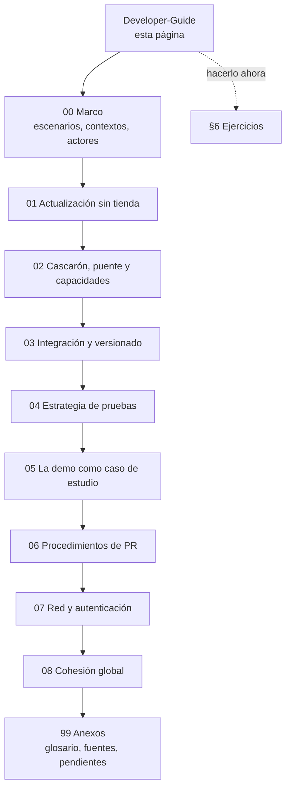
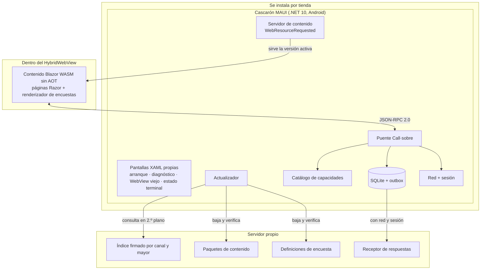

# Developer Guide — apps .NET MAUI con pantallas Blazor que se actualizan sin pasar por la tienda

## Índice

1. [Resumen](#1-resumen)
2. [Para quién es y qué tiene que traer](#2-para-quién-es-y-qué-tiene-que-traer)
3. [Cómo usar esta guía](#3-cómo-usar-esta-guía)
4. [La idea en una página](#4-la-idea-en-una-página)
5. [Recorrido con la demo](#5-recorrido-con-la-demo)
6. [Ejercicios guiados](#6-ejercicios-guiados)
7. [Los rojos provocados](#7-los-rojos-provocados)
8. [Limitaciones abiertas](#8-limitaciones-abiertas)
9. [Plataformas verificadas y estado del plan](#9-plataformas-verificadas-y-estado-del-plan)
10. [Observaciones](#10-observaciones)
11. [Referencias](#11-referencias)

## 1. Resumen

Esta guía enseña a construir una app .NET MAUI cuyas pantallas de negocio se escriben en Razor, corren como Blazor
WebAssembly dentro de un WebView y **se actualizan desde un servidor propio sin pasar por Google Play ni App Store**.
La app se separa en dos capas: el **cascarón**, que se instala por tienda y cambia poco, y el **contenido**, que se baja
firmado y se activa en el próximo arranque. Las encuestas viajan como datos. Un procedimiento de PR con una compuerta
obligatoria (`fw-ok`) impide que un cambio rompa lo que ya funcionaba, y cuatro líneas de versión dicen exactamente qué
corre en cada teléfono.

El hilo conductor es una demo que se compila y se prueba: está en
[`Demo/`](/LAB/Lab-Documentos/Lab-Documentos/Concepts/Framework-Concept/Demo/README.md) y toma su dominio de la app
`MovilidadUrbana.MAUI` del laboratorio Lab-E2E.WebBlazor. Todo lo que la guía afirma remite a un archivo de la demo, a
una fuente o a un folio del expediente 0001; lo que no se pudo verificar está marcado. El antecedente es el borrador del
PO, `Framework-APP.md`, que está en esta carpeta como insumo **fuera del conjunto**: la guía lo cita, no lo reemplaza
ni lo enlaza como parte de ella (ver [`ANEXO-99` §8](/LAB/Lab-Documentos/Lab-Documentos/Concepts/Framework-Concept/99-Anexos.md#8-insumos-fuera-del-conjunto-y-apartamientos-declarados)).

**Cómo leer las referencias.** Este documento es el **único índice** del conjunto (P10). Las marcas entre paréntesis
remiten a la evidencia y están todas en el [glosario](/LAB/Lab-Documentos/Lab-Documentos/Concepts/Framework-Concept/99-Anexos.md#1-glosario):

| Marca | Qué es | Dónde se consulta |
| --- | --- | --- |
| **P1**…**P13** | Las trece decisiones de la mesa evaluadora del expediente 0001 (por ejemplo, P2 = canal de actualización) | [Folio 037](/LAB/Lab-Documentos/Lab-Documentos.Documentacion/PROMPTs/Concepts/01-Framework-Concept/OUTPUTs/Expedientes/0001-Framework-Concept-Maui-Autoactualizable/actuaciones/037-resolucion-plan-de-aplicacion-y-cierre-de-la-mesa.md), tabla de decisiones |
| **folio NNN** | Cada actuación numerada del expediente 0001 | [`ANEXO-99` §4](/LAB/Lab-Documentos/Lab-Documentos/Concepts/Framework-Concept/99-Anexos.md#4-trazabilidad-a-folios) |
| **E01**, **E02**, **E03** | Los tres ensayos que corrieron la técnica de verdad | [`ANEXO-99` §4](/LAB/Lab-Documentos/Lab-Documentos/Concepts/Framework-Concept/99-Anexos.md#4-trazabilidad-a-folios) |
| **r01**…**r18** | Los rojos provocados de la compuerta, numerados en E02 `rojos-compuerta.md` | [§7](#7-los-rojos-provocados) |
| **PO** | El dueño del producto (quien pidió la guía y decide) | [Glosario](/LAB/Lab-Documentos/Lab-Documentos/Concepts/Framework-Concept/99-Anexos.md#1-glosario) |

## 2. Para quién es y qué tiene que traer

### 2.1 Perfil del lector

«Sin experiencia» admite dos lecturas: sin experiencia en programación, o sin experiencia en **esta técnica**. La guía
toma la segunda (P10, folio 035): el lector sabe C# y .NET básico y usa git; no conoce MAUI, Blazor WebAssembly, firma
digital ni integración continua. Esos cuatro temas se explican acá.

### 2.2 Lo que el lector trae

- C# y .NET básico.
- git: ramas, commits, PR.

### 2.3 Lo que la guía enseña o resuelve

| Hace falta | Cómo se resuelve |
| --- | --- |
| .NET 10, MAUI, JDK, SDK de Android | No se instalan: todo compila en el contenedor de `Demo/contenedor/Dockerfile`, con `scripts/contenedor.sh` |
| Docker | Sí hace falta, con internet la primera vez (la imagen tarda unos minutos) |
| Un dispositivo Android con WebView ≥ 94 | Sólo para los ejercicios 9 y 10. Se comprueba con `scripts/guion.sh dispositivo`. Un emulador sirve si su imagen trae WebView ≥ 94 (la integración usó uno con WebView 155) |
| `adb` y depuración USB | Sólo para los ejercicios 9 y 10 |
| La clave de demostración | El clon trae sólo la pública; el ejercicio 6 explica cómo generar un par propio |

## 3. Cómo usar esta guía

| Si querés… | Leé |
| --- | --- |
| **Aprender** la técnica en orden | Este documento de corrido, después [`00-Marco`](/LAB/Lab-Documentos/Lab-Documentos/Concepts/Framework-Concept/00-Marco.md) y los temas `01` a `07` |
| **Hacerlo ahora** | [§6 Ejercicios guiados](#6-ejercicios-guiados) |
| **Evaluar** un PR o una decisión | Las «Preguntas guía» y «Criterios de calidad» de cada tema y [`TEM-06`](/LAB/Lab-Documentos/Lab-Documentos/Concepts/Framework-Concept/06-Procedimientos-PR-Integracion-Versionado.md) |

Los documentos del conjunto:

| Documento | Id | Qué contiene |
| --- | --- | --- |
| [00-Marco.md](/LAB/Lab-Documentos/Lab-Documentos/Concepts/Framework-Concept/00-Marco.md) | `MARCO-REFERENCIA` | Siete escenarios, contextos, actores y mapa conceptual |
| [01-Actualizacion-Sin-Tienda.md](/LAB/Lab-Documentos/Lab-Documentos/Concepts/Framework-Concept/01-Actualizacion-Sin-Tienda.md) | `TEM-01` | N1: contenido descargable, canal firmado, activación, rollback, semilla |
| [02-Cascaron-Puente-Y-Capacidades.md](/LAB/Lab-Documentos/Lab-Documentos/Concepts/Framework-Concept/02-Cascaron-Puente-Y-Capacidades.md) | `TEM-02` | N2: puente, catálogo, predicado de compatibilidad, base local, outbox, encuestas como datos |
| [03-Integracion-Y-Versionado.md](/LAB/Lab-Documentos/Lab-Documentos/Concepts/Framework-Concept/03-Integracion-Y-Versionado.md) | `TEM-03` | N3: conceptos y alternativas de ramas, protección y líneas de versión |
| [04-Estrategia-De-Pruebas.md](/LAB/Lab-Documentos/Lab-Documentos/Concepts/Framework-Concept/04-Estrategia-De-Pruebas.md) | `TEM-04` | N4: capas, compuerta mínima, rojos provocados |
| [05-La-Demo-Como-Caso-De-Estudio.md](/LAB/Lab-Documentos/Lab-Documentos/Concepts/Framework-Concept/05-La-Demo-Como-Caso-De-Estudio.md) | `TEM-05` | N5: cómo está armada la demo, el caso base, el contenedor y el guion |
| [06-Procedimientos-PR-Integracion-Versionado.md](/LAB/Lab-Documentos/Lab-Documentos/Concepts/Framework-Concept/06-Procedimientos-PR-Integracion-Versionado.md) | `TEM-06` | Pasos: `fw-ok`, ramas, protección de `main`, las cuatro líneas de versión, fusionar y publicar |
| [07-Red-Y-Autenticacion.md](/LAB/Lab-Documentos/Lab-Documentos/Concepts/Framework-Concept/07-Red-Y-Autenticacion.md) | `TEM-07` | Estado de red, política de acciones, OIDC + PKCE, desbloqueo con la seguridad del teléfono |
| [08-Cohesion-Global.md](/LAB/Lab-Documentos/Lab-Documentos/Concepts/Framework-Concept/08-Cohesion-Global.md) | `TEM-08` | Relaciones entre núcleos, contratos en cada borde, contradicciones resueltas |
| [99-Anexos.md](/LAB/Lab-Documentos/Lab-Documentos/Concepts/Framework-Concept/99-Anexos.md) | `ANEXO-99` | Glosario, fuentes, trazabilidad a folios, mapa guía↔demo, pendientes, verificación y apartamientos |
| [Demo/README.md](/LAB/Lab-Documentos/Lab-Documentos/Concepts/Framework-Concept/Demo/README.md) | — | Cómo se compila y se corre la demo, y su estado |

Ruta de lectura sugerida:



## 4. La idea en una página

### 4.1 El problema

Una app de tienda no puede actualizarse a sí misma por otro camino que la tienda. Google Play lo dice así:

> «An app distributed via Google Play may not modify, replace, or update itself using any method other than Google
> Play's update mechanism. […] This restriction does not apply to code that runs in a virtual machine or an
> interpreter where either provides indirect access to Android APIs (such as JavaScript in a webview or browser).»
> — Google, *Device and Network Abuse* (consultada el 2026-10-25)

**Qué significa para nosotros.** Lo que se actualiza tiene que correr **dentro** de un WebView y tocar el teléfono
**indirectamente**. Por eso las pantallas son Blazor WebAssembly sin AOT (código intermedio interpretado dentro del
WebView) y todo acceso al dispositivo pasa por un puente del cascarón. El detalle de Apple y de Play, y lo que queda sin
verificar (`.wasm`), está en [`TEM-01` §2.4](/LAB/Lab-Documentos/Lab-Documentos/Concepts/Framework-Concept/01-Actualizacion-Sin-Tienda.md#24-lo-que-permiten-las-tiendas-dos-citas-y-lo-que-implican).

### 4.2 La arquitectura



### 4.3 Las reglas que no se negocian

1. **Bajar no es aplicar.** Lo nuevo se baja en segundo plano y se activa en el próximo
   [arranque en frío](/LAB/Lab-Documentos/Lab-Documentos/Concepts/Framework-Concept/99-Anexos.md#1-glosario) (la app se abre con su proceso cerrado), antes de mostrar (P2).
2. **Nada sin firma.** El índice se verifica con ECDSA P-256 antes de leer su contenido; vence a los 30 días (P2).
3. **Hacia adelante.** No hay «bajar de versión» en el servidor: se publica una mayor o se retira la mala (P2).
4. **El puente es un contrato.** Tabla de métodos + catálogo + transporte, con versión propia y prueba de instantánea
   (P3).
5. **Lo pendiente no se toca.** Ninguna actualización ni cierre de sesión descarta respuestas sin enviar (P4, P13).
6. **Ningún PR entra en rojo.** [`fw-ok`](/LAB/Lab-Documentos/Lab-Documentos/Concepts/Framework-Concept/99-Anexos.md#1-glosario) (el job que resume la compuerta) es el único check requerido de `main` y no admite omisiones silenciosas (P6).

## 5. Recorrido con la demo

Cada paso dice qué se ve y en qué tema se explica. Dos gestos se repiten:

- **Abrir en frío**: cerrar la app del todo y volver a abrirla. Con `adb`, `adb shell am force-stop com.frameworkconcept.demo`
  y tocar el ícono; a mano, quitarla de las recientes. Es lo que hace la función `arrancar` de
  [`scripts/guion.sh`](/LAB/Lab-Documentos/Lab-Documentos/Concepts/Framework-Concept/Demo/scripts/guion.sh) (L329–L344).
- **Diagnóstico**: el ítem «Diagnóstico» de la barra superior de la pantalla de contenido; también hay un botón
  «Diagnóstico» en las pantallas «WebView viejo» y «estado terminal»
  ([`ContenidoPage.xaml`](/LAB/Lab-Documentos/Lab-Documentos/Concepts/Framework-Concept/Demo/src/FrameworkConcept.Shell/Pages/ContenidoPage.xaml) L9,
  [`WebViewViejoPage.xaml`](/LAB/Lab-Documentos/Lab-Documentos/Concepts/Framework-Concept/Demo/src/FrameworkConcept.Shell/Pages/WebViewViejoPage.xaml) L23,
  [`EstadoTerminalPage.xaml`](/LAB/Lab-Documentos/Lab-Documentos/Concepts/Framework-Concept/Demo/src/FrameworkConcept.Shell/Pages/EstadoTerminalPage.xaml) L16). Los resultados citados son corridas reales: las del emulador
`fc-android-emu-hpdev` (Android 13, WebView 155) en los ensayos
[E02](/LAB/Lab-Documentos/Lab-Documentos.Documentacion/PROMPTs/Concepts/01-Framework-Concept/OUTPUTs/Ensayos/E02-Demo-Integracion/INFORME.md)
y [E03](/LAB/Lab-Documentos/Lab-Documentos.Documentacion/PROMPTs/Concepts/01-Framework-Concept/OUTPUTs/Ensayos/E03-Red-Y-Autenticacion/INFORME.md),
y las de esta guía sobre una copia de la demo.

### 5.1 La demo por dentro

Ocho proyectos: `Core` (dominio portado, contratos, actualizador, red y sesión como funciones puras), `Shell` (el
cascarón MAUI), `Content` (Blazor WASM), `Tools` (claves, empaquetar, firmar, retirar, contrato), `Receptor` (doble de
prueba del servidor) y tres suites (`Core.Tests`, `Update.Tests`, `Gate.Tests`). Detalle en
[`TEM-05`](/LAB/Lab-Documentos/Lab-Documentos/Concepts/Framework-Concept/05-La-Demo-Como-Caso-De-Estudio.md).

### 5.2 Del caso base a pantallas descargables

El caso base es un ABM de localidades y una encuesta de movilidad de tres pasos escritos en XAML. En la demo, el
dominio y las reglas se copiaron tal cual (con mapa por archivo en
[`MAPA-CASO-BASE.md`](/LAB/Lab-Documentos/Lab-Documentos/Concepts/Framework-Concept/Demo/MAPA-CASO-BASE.md)), las
pantallas pasaron a Razor (`src/FrameworkConcept.Content/Pages/`: `Inicio.razor`, `Localidades.razor`,
`Encuesta.razor`) y la encuesta pasó a ser un dato:
`definiciones/encuesta-movilidad/v1.json`.

### 5.3 v1 → v2 sin tienda

| Paso | Qué hacés | Qué pasó en la corrida real (E02 §4.2) | Tema |
| --- | --- | --- | --- |
| 1 | Abrir la app | «activada la semilla 1.0.0+5d5c2b4», `Listo(1.0.0)` | `TEM-01` |
| 2 | `scripts/guion.sh parar`; tomar una encuesta | «Por enviar: 1», definición v1, `Pendiente (Connection failure)` | `TEM-02` |
| 3 | `scripts/guion.sh publicar v2`, `scripts/guion.sh definicion v2`, `scripts/guion.sh firmar`, `scripts/guion.sh servir`; abrir en frío | Se ve 1.0.0; `Enviada (HTTP 201)`; 1.1.0 queda en staging | `TEM-01`, `TEM-02` |
| 4 | Abrir en frío | `activada 1.1.0+5d5c2b4 (desde staging)`: cabecera azul, «Novedades»; la encuesta nueva usa v2 | `TEM-01` |
| 5 | `scripts/guion.sh respuestas` | La respuesta v1 aceptada con `versionDefinicion: 1`, sin duplicados | `TEM-02` |
| 6 | `scripts/guion.sh firma-invalida`; abrir en frío; `scripts/guion.sh firmar` | `Rechazado FirmaInvalida`; sigue 1.1.0 | `TEM-01` |
| 7 | `scripts/guion.sh publicar sin-listo`, `scripts/guion.sh firmar`; abrir en frío varias veces | 1.2.0 se activa sin `Listo`; vuelve a 1.1.0 y queda como fallida | `TEM-01` |
| 8 | Tocar «Diagnóstico» en la barra superior | Cascarón 1.0.0 (build 1), puente 1.0.0, contenido 1.1.0, definición v2, fallidas: 1.2.0 | `TEM-03` |

En el paso 8 el puente decía 1.0.0 porque E02 es anterior al incremento de red y autenticación, que lo subió a 1.1.0.

### 5.4 Sin red y con cuenta

Con el APK compilado contra el emisor de ensayo (Keycloak en contenedor), E03 mostró el ingreso por el navegador del
sistema, el desbloqueo con huella y con PIN, la banda «Sin conexión», la banda «Sin acceso al servidor», la reconexión
automática en 6,4 s con el outbox vaciándose solo, y el cierre de sesión que conserva lo pendiente. Se explica en
[`TEM-07`](/LAB/Lab-Documentos/Lab-Documentos/Concepts/Framework-Concept/07-Red-Y-Autenticacion.md).

### 5.5 El PR que protege lo que funcionaba

`scripts/ci-local.sh` corre los mismos pasos, en el mismo orden, que el workflow
[`framework-concept-demo.yml`](/LAB/Lab-Documentos/Lab-Documentos/.github/workflows/framework-concept-demo.yml) en el
runner `[self-hosted, i7infra-dev]`. Los parches de `etapas/` provocan rojos. Se explica en
[`TEM-04`](/LAB/Lab-Documentos/Lab-Documentos/Concepts/Framework-Concept/04-Estrategia-De-Pruebas.md) y
[`TEM-06`](/LAB/Lab-Documentos/Lab-Documentos/Concepts/Framework-Concept/06-Procedimientos-PR-Integracion-Versionado.md).

## 6. Ejercicios guiados

Todos se corren desde la carpeta de la demo:

```bash
cd LAB/Lab-Documentos/Lab-Documentos/Concepts/Framework-Concept/Demo   # desde la raíz del espacio de trabajo
```

Los ejercicios 1 a 5 no necesitan dispositivo. Los que modifican archivos (3, 4, 5, 6) conviene hacerlos en una copia
de la carpeta, como hizo esta guía para medirlos. Copiá sin arrastrar salidas de corridas anteriores (`bin/`, `obj/`,
`salida/`, que `.gitignore` excluye) y entrá a la copia:

```bash
rsync -a --exclude bin --exclude obj --exclude salida ./ ../Demo-copia/ && cd ../Demo-copia
```

Si ya copiaste con `cp -r`, `scripts/guion.sh limpiar` borra `salida/`, `bin/` y `obj/` y no toca `claves/` ni
`semilla/` ([`guion.sh`](/LAB/Lab-Documentos/Lab-Documentos/Concepts/Framework-Concept/Demo/scripts/guion.sh) L37 y
L540–L544).

### Ejercicio 1 — Compilar sin instalar nada

**Objetivo.** Ver que el contenedor resuelve la cadena de herramientas.

```bash
scripts/contenedor.sh dotnet build FrameworkConcept.Demo.SinMaui.slnf -c Release
```

**Qué tiene que pasar.** La primera vez se construye la imagen `fc-demo-build:<huella>` (unos minutos). Después:
«Compilación correcta», 0 advertencias, 0 errores (README de la demo, tramo A1).

### Ejercicio 2 — La compuerta en verde

```bash
scripts/ci-local.sh --hasta 4
```

**Qué tiene que pasar.** Corrida de esta guía (2026-10-26):

```text
=== 2. Core.Tests ===
Correctas! - Con error:     0, Superado:   211, Omitido:     0, Total:   211, Duración: 306 ms - FrameworkConcept.Core.Tests.dll (net10.0)
=== 3. Update.Tests ===
Correctas! - Con error:     0, Superado:   102, Omitido:     0, Total:   102, Duración: 628 ms - FrameworkConcept.Update.Tests.dll (net10.0)
=== 4. Gate.Tests (FC_GATE_BASE=salida/compuerta/base) ===
Correctas! - Con error:     0, Superado:    52, Omitido:     0, Total:    52, Duración: 436 ms - FrameworkConcept.Gate.Tests.dll (net10.0)
```

*Salida registrada: imagen `fc-demo-build:f327f6144f9b`, copia de la demo fuera de git (base del PR vacía).*

Sin `--hasta`, la compuerta sigue con el publish del contenido y el APK (pasos 5 y 6).

**Qué cambia según dónde lo corras.** El paso 0 arma la «base del PR» con lo publicado en la rama de destino, que por
omisión es `origin/main` (encabezado de [`ci-local.sh`](/LAB/Lab-Documentos/Lab-Documentos/Concepts/Framework-Concept/Demo/scripts/ci-local.sh) L13–L16):

| Dónde corrés | Qué informa el paso 0 | Qué esperar |
| --- | --- | --- |
| Copia fuera de git (como esta guía) | «la demo no está en un repositorio git → base vacía» | Verde con las cifras de arriba |
| Clon del repositorio, con `Demo/` ya publicada en `origin/main` | La base es la demo de `main` | Verde si no cambiaste contrato ni definiciones publicadas; si los cambiaste sin subir versión, rojo en `Gate.Tests` (r01, r07) |
| Clon donde `Demo/` todavía no está en `origin/main` (estado al 2026-10-26, ver §10) | NO VERIFICADO: esta guía no corrió ese caso | Usá una copia, o pasá una base a mano con `FC_GATE_BASE` |

### Ejercicio 3 — Un PR que rompe una regla (M-13)

```bash
patch -p1 < etapas/M-13-codigo-postal-cinco-digitos.patch
scripts/ci-local.sh --hasta 4
patch -R -p1 < etapas/M-13-codigo-postal-cinco-digitos.patch
```

**Qué tiene que pasar.** `Core.Tests` en rojo: «Con error: 6, Superado: 205 … Total: 211», `rc=1` (corrida de esta
guía). Es el rojo con que se probará la protección de `main`.

**Pregunta.** ¿Por qué el parche M-12 (cambiar sólo la constante) no serviría? Respuesta en
[`etapas/README.md`](/LAB/Lab-Documentos/Lab-Documentos/Concepts/Framework-Concept/Demo/etapas/README.md).

### Ejercicio 4 — Un aviso que se vuelve error

```bash
patch -p1 < etapas/aviso-promovido-a-error.patch
scripts/ci-local.sh --hasta 1
patch -R -p1 < etapas/aviso-promovido-a-error.patch
```

**Qué tiene que pasar.** El build falla con `error CS0219: La variable 'sinUso' está asignada pero su valor nunca se
usa`, `rc=1` (corrida de esta guía). Con `CI=true`, `Directory.Build.props` trata los avisos como errores.

### Ejercicio 5 — El receptor sin teléfono

```bash
scripts/guion.sh humo
```

**Qué tiene que pasar.** «humo: 47 OK, 0 MAL» (corrida de esta guía). Mirá la carta muerta: una definición no publicada,
valores que no cumplen la v1 y una v1 retirada (P13.5). No toca `claves/` ni `semilla/`.

### Ejercicio 6 — Publicar, firmar y romper la firma

Este ejercicio genera un par de claves propio y pisa `claves/publica-demo.pem`: hacelo en una copia de la carpeta.

```bash
scripts/guion.sh claves --forzar
scripts/guion.sh publicar v1
scripts/guion.sh definicion v1
scripts/guion.sh firmar
scripts/guion.sh verificar
scripts/guion.sh firma-invalida
scripts/guion.sh verificar
scripts/guion.sh firmar
```

Antes de empezar, en la copia: `scripts/guion.sh limpiar`. Si `salida/` trae un canal de otra corrida, `publicar v1`
responde «RECHAZADO: P7: ya hay un paquete 1.0.0 distinto en el canal…» y `definicion v1` «ya estaba publicada,
idéntica» (lo vio el lector sin contexto que recorrió esta guía; ver
[bitácora 03](/LAB/Lab-Documentos/Lab-Documentos.Documentacion/PROMPTs/Concepts/01-Framework-Concept/OUTPUTs/Bitacoras/03-Verificacion-De-La-Guia.md)).

**Qué tiene que pasar.** Corrida de esta guía (2026-10-27 01:11 UTC, que es el 2026-10-26 22:11 en hora argentina;
copia de la demo con `salida/` vacía), extracto:

```text
empaquetar: contenido 1.0.0+local → salida/canal/dev/puente-1/paquetes/contenido-1.0.0.zip
  archivos: 47 (9798327 B sin comprimir), zip: 3789330 B
  compatibleConPuente: >=1.1.0 <2.0.0 (compatible en teoría con: ningún ensayo lo revalidó, P3)
firmar: salida/canal/dev/puente-1/indice.json (826 B) firmado con demo-2026
verificar: OK — dev/puente-1, firmado por demo-2026, vence el 2026-11-26, 1 contenido(s) y 1 definición(es) con size y sha256 correctos.
firma-invalida: salida/canal/dev/puente-1/indice.json alterado (expires + 1 año) y la firma de al lado quedó como estaba.
verificar: RECHAZADO — FirmaInvalida: la firma no corresponde a los bytes de indice.json
```

El segundo `verificar` termina con `rc=1`; el `firmar` siguiente lo deja otra vez en OK. Fijate que `definicion v1`
avisa «cambia los datos que se recogen o comparten»: es el campo de tienda de la plantilla de PR (P6.6).

### Ejercicio 7 — Una encuesta corregida sin subir la versión

Editá en `definiciones/encuesta-movilidad/v1.json` el `"maximo": 110` de la edad a `111` y corré:

```bash
scripts/contenedor.sh dotnet test tests/FrameworkConcept.Core.Tests -c Release
```

**Qué tiene que pasar.** 2 con error y 209 superadas. Las dos rojas son `V1CoincideConElDominio` y el caso
«fuera de rango» de `ElValidadorEquivaleAlCasoBase`: NUnit muestra el nombre del caso, no el del método, porque el
caso se nombra con `SetName("fuera de rango")`
([`DefinicionTests.cs`](/LAB/Lab-Documentos/Lab-Documentos/Concepts/Framework-Concept/Demo/tests/FrameworkConcept.Core.Tests/DefinicionTests.cs) L64;
recorrido del lector sin contexto, bitácora 03). Volvé el valor a 110. La compuerta de definiciones (`Gate.Tests`) además rechaza editar una pregunta
publicada sin subir `version` frente a la base del PR (r07 de `rojos-compuerta.md`).

### Ejercicio 8 — El contenido en un navegador

```bash
src/FrameworkConcept.Content/Testing/probar-en-navegador.sh
```

**Qué tiene que pasar.** El contenido corre en Chromium headless con el puente simulado: 76 de 76 comprobaciones en E03
(40 de 40 en E02, antes del incremento). No se corrió en esta guía.

### Ejercicio 9 — El recorrido v1 → v2 en un dispositivo

Precondición: dispositivo con WebView ≥ 94 que llegue por IP a tu máquina. Reemplazá `<IP>` por esa IP.

```bash
scripts/guion.sh claves --forzar        # sólo si en ESTA carpeta no hay claves/privada (la del ejercicio 6 quedó en la copia)
scripts/guion.sh publicar v1
scripts/guion.sh definicion v1
scripts/guion.sh firmar
scripts/guion.sh semilla
FC_TLS_IPS=<IP> scripts/guion.sh tls
scripts/guion.sh servir
FC_RID=android-x64 FC_URL_CANAL=https://<IP>:8099 scripts/guion.sh apk   # android-arm64 para un teléfono
scripts/guion.sh dispositivo -H <host> -P <puerto> -s <serie>
scripts/guion.sh instalar    -H <host> -P <puerto> -s <serie>
```

Si generaste claves acá, todo lo que sigue se firma con ellas: por eso hay que rehacer `publicar`, `definicion`,
`firmar` y `semilla` antes del APK. Después seguí la tabla de §5.3. **Qué tiene que pasar.** Lo de esa tabla. Si regenerás las claves y no rehacés la
semilla antes del APK, el cascarón dice «semilla: firma rechazada» y arranca sin contenido (README de la demo).

### Ejercicio 10 — Red y cuenta

Con el emisor de ensayo, después de `guion.sh tls`:

```bash
EMISOR=https://<IP>:8443/realms/fc-demo
infra/keycloak/keycloak.sh certificado
infra/keycloak/keycloak.sh levantar
infra/keycloak/keycloak.sh probar
FC_OIDC_EMISOR=$EMISOR scripts/guion.sh servir
FC_RID=android-x64 FC_URL_CANAL=https://<IP>:8099 FC_OIDC_EMISOR=$EMISOR scripts/guion.sh apk
```

Ingresá como `encuestador` / `demo-encuestador` (credenciales públicas de prueba, sólo para este emisor). Después:

| Acción | Qué tiene que pasar (E03) |
| --- | --- |
| `adb shell cmd connectivity airplane-mode enable` | Banda «Sin conexión»; la encuesta queda «Por enviar: 1»; «Enviar ahora» deshabilitado con su motivo |
| `scripts/guion.sh parar` y `airplane-mode disable` | «Sin acceso al servidor. Hay red pero el servidor no responde. Reintentando…» |
| `FC_OIDC_EMISOR=$EMISOR scripts/guion.sh servir` | Vuelve sola a «En línea»; el outbox se vacía con el dueño `encuestador` |

Al terminar: `infra/keycloak/keycloak.sh parar`, `scripts/guion.sh parar` y, si querés, `scripts/guion.sh limpiar`.

## 7. Los rojos provocados

| Parche o cambio | Suite | Qué tiene que pasar | Medido |
| --- | --- | --- | --- |
| `etapas/M-13-codigo-postal-cinco-digitos.patch` | `Core.Tests` | 6 fallas, `rc=1` | Esta guía, 2026-10-26 |
| `etapas/aviso-promovido-a-error.patch` | Build con `CI=true` | CS0219, `rc=1` | Esta guía, 2026-10-26 |
| `etapas/error-de-compilacion-en-el-cascaron.patch` | APK (paso 6) | CS0029 en `App.cs` | E02 `correcciones.md` |
| Contrato cambiado sin subir el puente | `Gate.Tests` | `ElCodigoCoincideConContratoJson` | E02 `rojos-compuerta.md` r01 |
| Pregunta editada sin subir `version` | `Gate.Tests` | `FrenteALaBaseDelPr` | r07 |
| Capacidad sin su permiso | `Gate.Tests` | `CadaCapacidadTieneSuPermiso` | r12 |
| `RunAOTCompilation=true` | `Gate.Tests` | `ElContenidoNoUsaAot` | r16 |
| `navigator.geolocation` en el contenido | `Gate.Tests` | `ElContenidoNoUsaApiWebQuePidenPermisos` | r17 |
| `CI=true` sin base del PR | `Gate.Tests` | Falla en lugar de omitir | r18 |
| Clave revocada, anti-rollback, marca pendiente | `Update.Tests` | Cada caso en rojo | E02 `rojos-actualizador.md` |

## 8. Limitaciones abiertas

| Limitación | Qué significa para vos | Fuente |
| --- | --- | --- |
| **TPR del moto g42 sin medir** después de la corrección | El umbral de arranque (≤ 5 000 ms, máximo de 5 corridas) no está demostrado; el intento anterior dio 8,2–8,7 s y lo estimado tras la corrección (~7,5 s) seguiría fuera. Si se confirma, P1 prevé evaluar el modelo de reserva. Para medirlo: APK Release y `scripts/guion.sh tpr -H <host> -P <puerto> -s <serie>`, con la pantalla encendida y sin bloqueo (con la pantalla apagada el WebView no carga y no hay marca, folio 042) | E02 §4.3, §5 H-A; folio 042 |
| **Apartamiento H-1** | Con PIN o patrón aceptados, enrolar otra huella no invalida la clave del Keystore; contradice el borrador §4 y fue avisado al PO | E03 §5 H-1 |
| **iOS sólo diseño** | Nada se compiló ni se probó en iOS; los riesgos (WebAssembly ante la 2.5.2, guía 4.7, memoria del runtime WASM en WKWebView) están nombrados, no resueltos | P9, folio 023 |
| Sin corrida del workflow ni protección de `main` | La compuerta está probada en local; en el runner y con `main` protegida es el tramo A5 | Folio 037 |
| Sólo emulador | Ningún recorrido completo en teléfono físico | E02 §7, E03 §7 |
| `.wasm` ante las tiendas | Ninguna política lo nombra | P1 |

La lista completa está en [`99-Anexos` §6](/LAB/Lab-Documentos/Lab-Documentos/Concepts/Framework-Concept/99-Anexos.md#6-pendientes-y-no-verificado).

## 9. Plataformas verificadas y estado del plan

| Plataforma | Estado |
| --- | --- |
| Android, emulador Android 13 x86_64, WebView 155 | Recorridos completos de E02 y E03 |
| Android, moto g42 | Sólo E01 (contenido descargado y servido) y un intento anterior de E02; sin recorrido completo |
| Android con WebView 83 | El runtime de Blazor .NET 10 no arranca (E01) |
| iOS | Diseño sin ensayo, NO VERIFICADO — sin Mac ni cuenta de Apple Developer |

Plan de aplicación del folio 037: A1 núcleo, A2 componentes y A3 integración, hechos (con los NO VERIFICADO de E02);
incremento de red y autenticación, hecho (E03); A4 esta guía; A5 entrega por PR y protección de `main`, pendiente.

## 10. Observaciones

- **Hecho.** La carpeta `Demo/` todavía no tiene commit en el repositorio (2026-10-26); las líneas citadas son del árbol
  de trabajo.
- **Hecho.** Las corridas de esta guía se hicieron sobre una copia de la demo fuera de git: la base del PR quedó vacía
  y el paso 0 lo informó («la demo no está en un repositorio git → base vacía»).
- **Interpretación.** La técnica cuesta: ~9 MB por versión retenida, un WebView ≥ 94, unos 2 s más de primer render que
  la alternativa compilada, y diez grupos de mecanismos que existen sólo por bajar código (P1, «Precio que la guía
  declara»). Vale cuando las pantallas cambian más seguido que el ciclo de la tienda.

## 11. Referencias

- Google, *Device and Network Abuse*: https://support.google.com/googleplay/android-developer/answer/9888379?hl=en (consultada el 2026-10-25).
- [README de la demo](/LAB/Lab-Documentos/Lab-Documentos/Concepts/Framework-Concept/Demo/README.md); [DISENO-RED-Y-AUTENTICACION](/LAB/Lab-Documentos/Lab-Documentos/Concepts/Framework-Concept/Demo/DISENO-RED-Y-AUTENTICACION.md); [MAPA-CASO-BASE](/LAB/Lab-Documentos/Lab-Documentos/Concepts/Framework-Concept/Demo/MAPA-CASO-BASE.md).
- Expediente 0001: [folio 035](/LAB/Lab-Documentos/Lab-Documentos.Documentacion/PROMPTs/Concepts/01-Framework-Concept/OUTPUTs/Expedientes/0001-Framework-Concept-Maui-Autoactualizable/actuaciones/035-informe-r2-jurado-veredicto.md), [folio 037](/LAB/Lab-Documentos/Lab-Documentos.Documentacion/PROMPTs/Concepts/01-Framework-Concept/OUTPUTs/Expedientes/0001-Framework-Concept-Maui-Autoactualizable/actuaciones/037-resolucion-plan-de-aplicacion-y-cierre-de-la-mesa.md), [folio 038](/LAB/Lab-Documentos/Lab-Documentos.Documentacion/PROMPTs/Concepts/01-Framework-Concept/OUTPUTs/Expedientes/0001-Framework-Concept-Maui-Autoactualizable/actuaciones/038-providencia-autenticacion-del-so-y-manejo-de-red-en-la-demo.md).
- Fuentes completas en [`99-Anexos` §3](/LAB/Lab-Documentos/Lab-Documentos/Concepts/Framework-Concept/99-Anexos.md#3-fuentes).
