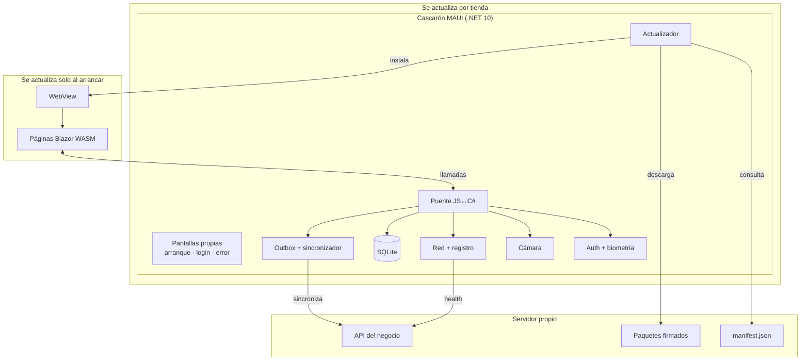
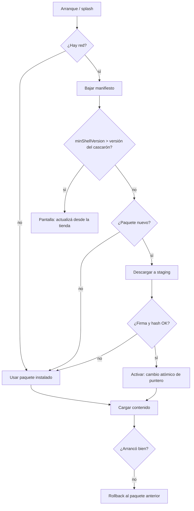
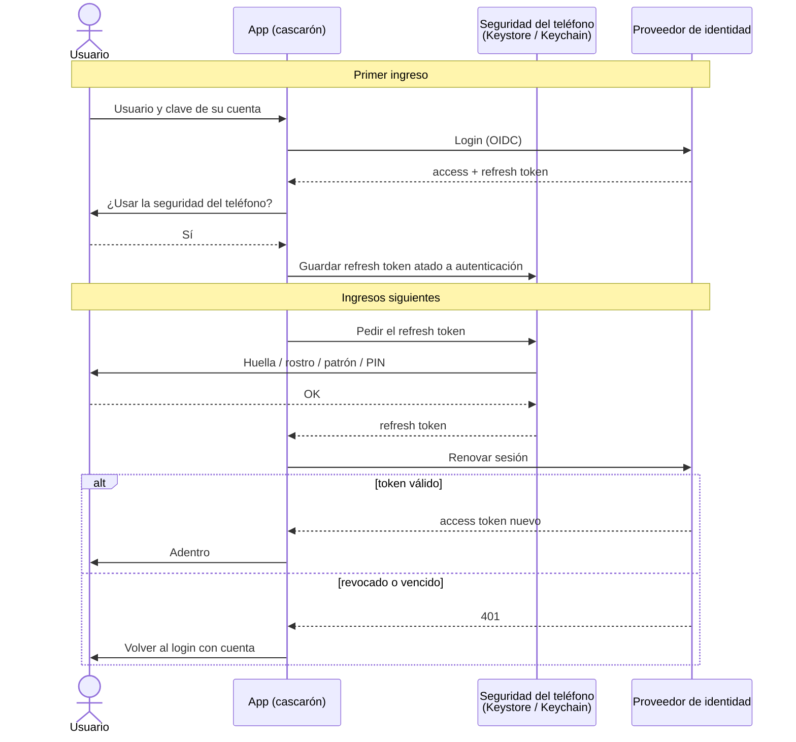
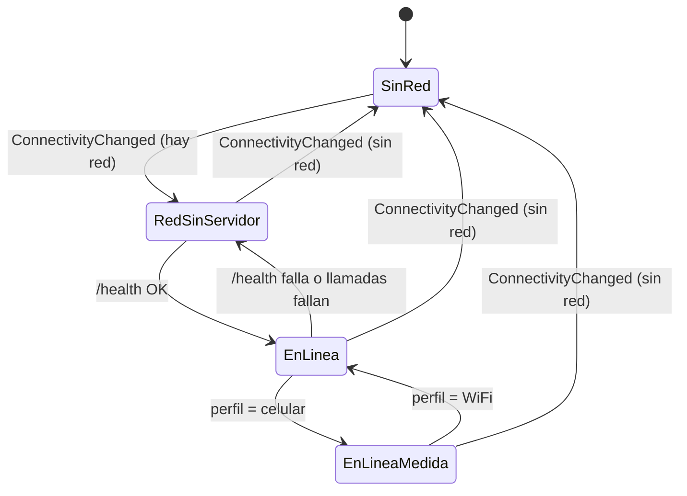
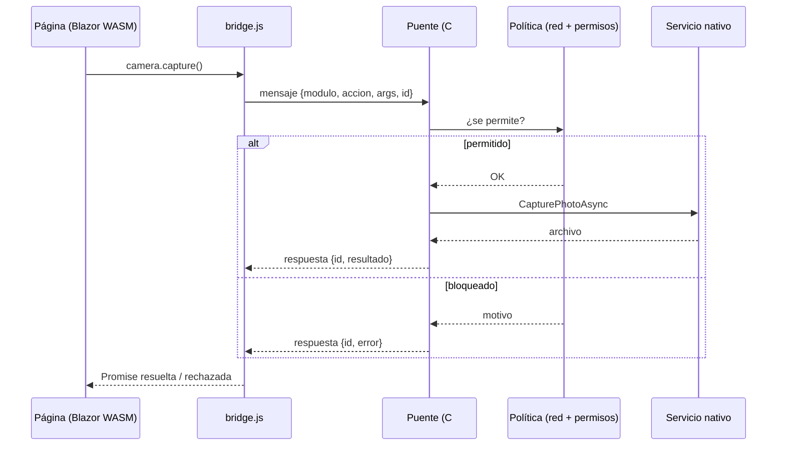

# Framework APP — MAUI + Blazor Hybrid autoactualizable

> Estado: borrador en construcción (2026-10-03). Se va completando a medida que se decide.
> Relacionado: [Cascaron-Aplicacion-Maui.md](Cascaron-Aplicacion-Maui.md) (vacío; probablemente sea el mismo concepto: el "cascarón" es la parte nativa de este framework).

## Índice

1. [Qué se quiere](#1-qué-se-quiere)
2. [El punto crítico: qué se puede actualizar sin tienda](#2-el-punto-crítico-qué-se-puede-actualizar-sin-tienda)
3. [Autoactualización al arrancar](#3-autoactualización-al-arrancar)
4. [Login y seguridad del teléfono](#4-login-y-seguridad-del-teléfono)
5. [Cámara](#5-cámara)
6. [Red: estado y actividad](#6-red-estado-y-actividad)
7. [Política de acciones según la red](#7-política-de-acciones-según-la-red)
8. [Base local SQLite](#8-base-local-sqlite)
9. [Puente cascarón ↔ contenido](#9-puente-cascarón--contenido)
10. [Plataformas y compilación](#10-plataformas-y-compilación)
11. [Estructura tentativa de la solución](#11-estructura-tentativa-de-la-solución)
12. [Prueba de concepto (primer paso)](#12-prueba-de-concepto-primer-paso)
13. [Decisiones abiertas](#13-decisiones-abiertas)
14. [Riesgos](#14-riesgos)

## 1. Qué se quiere

Un framework reutilizable en **.NET MAUI** para armar apps **Android e iOS** donde:

1. Las pantallas son **Blazor Hybrid** (Razor dentro de un WebView nativo).
2. Si cambio esas pantallas, la app **se autoactualiza al arrancar**, sin pasar por la tienda.
3. Tiene acceso controlado a **cámara**.
4. Conoce el **estado de la red** y registra la actividad de red.
5. **Login**: la primera vez el usuario entra con su cuenta; después se desbloquea con **la seguridad del teléfono** (huella, rostro, patrón, PIN o clave — lo que tenga configurado).
6. Tiene una **base local SQLite**.
7. Hay una **política de acciones según haya red o no**: qué se puede hacer offline, qué se encola y qué se bloquea.

## 2. El punto crítico: qué se puede actualizar sin tienda

Esto condiciona toda la arquitectura, así que va primero.

- En Blazor Hybrid (`BlazorWebView`) los componentes Razor **se compilan a la DLL de la app**. No son HTML que se baja: son código .NET.
- **iOS** no permite JIT y las reglas de App Store (guideline 2.5.2) prohíben bajar **código ejecutable** que cambie la app. Sí permite contenido web/JS interpretado por WebKit, siempre que no cambie el propósito de la app.
- **Android** técnicamente permitiría cargar ensamblados, pero Play también lo restringe y sería tener dos mecanismos distintos por plataforma. No vale la pena.

Conclusión: **"actualizar las páginas Razor compiladas" sin tienda no es viable en iOS**. Hay que separar la app en dos capas:

| Capa | Qué contiene | Cómo se actualiza |
|---|---|---|
| **Cascarón nativo** (MAUI, compilado) | Servicios nativos: cámara, biometría, red, SQLite, actualizador, login, puente JS↔C#. Pantallas mínimas propias (arranque, login, error, "actualizá la app"). | Tienda (Play / App Store). Cambia poco. |
| **Contenido** (paquete descargable) | Las pantallas del negocio. | Al arrancar, desde un servidor propio. Cambia seguido. |



### Opciones para la capa de contenido

**A. Blazor WebAssembly empaquetado, servido localmente en el WebView** ⟵ *candidata principal*
- Las páginas se escriben en Razor (lo que quiero), pero se publican como **Blazor WASM**: un paquete estático (`_framework/*.wasm`, html, css, js).
- El cascarón descarga el paquete, lo guarda en disco y lo sirve al WebView desde ahí (en .NET 10 `HybridWebView`/`BlazorWebView` permiten interceptar las requests — `WebResourceRequested` — para servir desde una carpeta propia; **verificar** en la versión elegida).
- Lo ejecuta el motor de WebKit/Chromium → entra en la excepción de contenido web.
- Las páginas llaman a los servicios nativos a través de un **puente** (JS interop ↔ `HybridWebView`, mensajes C#↔JS).
- Contras: dos runtimes .NET (el de MAUI y el WASM dentro del WebView), primer arranque más pesado (el paquete WASM pesa varios MB; usar trimming y compresión), y todo acceso nativo pasa por una API de puente que hay que diseñar y versionar.

**B. Interfaz dirigida por datos (server-driven UI)**
- La app trae un **renderizador Razor genérico** compilado; lo que se baja es una definición (JSON) de pantallas, formularios, listas, reglas, textos e imágenes.
- 100 % seguro para tiendas, arranque rápido, sin segundo runtime.
- Contra: solo se puede expresar lo que el renderizador sabe dibujar. Lógica nueva = release del cascarón.

**C. Híbrido A + B**
- Pantallas "de formulario/listado" por datos (B); pantallas ricas o muy cambiantes como WASM (A).
- Más poder, más complejidad. Dejarlo como evolución, no como inicio.

**D. Descartada: sitio remoto en vivo en un WebView.** Simple, pero sin red no hay app, choca con el requisito de offline + SQLite, y Apple rechaza apps que son "un sitio envuelto".

**Recomendación inicial:** A, con el cascarón en MAUI Blazor Hybrid (para sus propias pantallas) y el contenido en WASM. Si en la prueba de concepto el peso o el arranque del WASM no convencen, caer a B.

> **Decisión abierta D-01:** A vs B vs C. Se decide después de la prueba de concepto (§10).

## 3. Autoactualización al arrancar

### Flujo



### Piezas

- **Manifiesto** (`manifest.json` en el servidor), por canal (`dev`, `beta`, `prod`):
  - `version` del paquete de contenido.
  - `minShellVersion`: versión mínima del cascarón que lo soporta (si la API del puente cambia).
  - `url`, `sha256`, `size`, `firma`.
  - `obligatorio` (bloquea hasta actualizar) vs opcional (se aplica en el próximo arranque).
- **Firma**: el paquete se firma con clave privada (Ed25519 o RSA) en el pipeline; el cascarón trae la **clave pública embebida**. Sin firma válida no se activa. HTTPS solo no alcanza.
- **Instalación atómica**: descargar a `staging/`, verificar, descomprimir, y recién ahí cambiar el puntero `current → vN`. Conservar `vN-1` para **rollback**.
- **Rollback automático**: si el contenido no avisa "arranqué bien" (ping por el puente) en X segundos, volver al anterior y reportar.
- **Paquete semilla**: el cascarón trae una versión del contenido embebida, para que el primer arranque sin red funcione.
- **Política de espera**: no trabar el arranque más de N segundos esperando la red; si tarda, usar lo instalado y aplicar en el próximo arranque.
- **Actualización del cascarón**: por tienda. Android puede usar la API *In-App Updates* de Play; iOS solo puede llevar al usuario a la ficha de App Store.

> **Decisión abierta D-02:** ¿el servidor de actualizaciones es estático (blob/nginx + manifiesto) o un servicio con lógica (canales por usuario, rollout por porcentaje)? Arrancar estático.

## 4. Login y seguridad del teléfono

### Modelo

1. **Primer ingreso:** el usuario entra con **su cuenta** (OIDC — p. ej. Keycloak — o el backend propio). Se obtienen access token + refresh token.
2. **Vinculación:** se le ofrece "usar la seguridad del teléfono para entrar". Si acepta, el **refresh token** se guarda protegido por el hardware y atado a la autenticación del dispositivo.
3. **Ingresos siguientes:** la app pide la **autenticación del sistema** (huella / rostro / patrón / PIN / clave). Si pasa, se libera el refresh token, se renueva la sesión y se entra.
4. **Si falla o se revoca:** volver al login con cuenta.

La biometría **no es** el login: es la **llave que abre el secreto guardado**. La identidad la sigue dando el servidor.



### Por plataforma

- **Android:** `BiometricPrompt` con autenticadores `BIOMETRIC_STRONG | DEVICE_CREDENTIAL` → acepta huella/rostro **o** patrón/PIN/clave del teléfono. La clave de cifrado del token vive en **Android Keystore** con `setUserAuthenticationRequired(true)`.
- **iOS:** `LocalAuthentication` con la política `deviceOwnerAuthentication` (Face ID / Touch ID con caída al código del teléfono). El token en **Keychain** con control de acceso `userPresence`.
- **MAUI:** `SecureStorage` sirve para guardar, pero **no** ata la lectura a la biometría. Para eso hace falta código de plataforma propio o un plugin comunitario (evaluar `Plugin.Maui.Biometric` u otro; **verificar** que soporte la caída a credencial del dispositivo en ambas plataformas).

### Reglas

- Si el teléfono **no tiene ningún bloqueo configurado** → no ofrecer el desbloqueo local (o exigir login con cuenta siempre). **Decisión abierta D-03.**
- Si se agrega una huella nueva, Android puede invalidar la clave → detectar y pedir login con cuenta otra vez.
- Tiempo de sesión: re-pedir la seguridad del teléfono al volver de segundo plano después de X minutos.
- Cerrar sesión = borrar tokens y la clave del Keystore/Keychain.

## 5. Cámara

- **Foto/video simple:** `MediaPicker.CapturePhotoAsync` (MAUI Essentials). Abre la cámara del sistema. Lo más robusto.
- **Vista previa dentro de la pantalla, escaneo, control fino:** `CameraView` de **CommunityToolkit.Maui.Camera**; códigos de barra/QR con una librería de escaneo (evaluar `ZXing.Net.Maui` o `BarcodeScanning.Native.Maui`).
- **Desde las páginas web/WASM:** dos caminos:
  - Pedir al cascarón por el puente (`camera.capture()` → devuelve archivo/ruta) ⟵ recomendado.
  - `getUserMedia` dentro del WebView: requiere manejar el pedido de permiso del WebView en cada plataforma (Android `WebChromeClient.onPermissionRequest`, iOS delegado de captura de WKWebView). Más frágil.
- **Permisos:** `Permissions.Camera` en MAUI + `AndroidManifest.xml` (`CAMERA`) + `Info.plist` (`NSCameraUsageDescription`, y `NSPhotoLibraryUsageDescription` si se guarda en galería).
- Las fotos van primero a almacenamiento local de la app (y a SQLite como referencia) y se suben según la política de red (§7).

## 6. Red: estado y actividad

### Estado

- `Connectivity.Current.NetworkAccess` y el evento `ConnectivityChanged` → Internet / ConstrainedInternet / Local / None.
- `ConnectionProfiles` → WiFi / celular / etc. (para reglas tipo "descargar solo con WiFi").
- **Ojo:** "hay red" ≠ "llego a mi servidor". Agregar un **chequeo de salud** propio (`GET /health` con timeout corto, con caché de unos segundos) y exponer un estado combinado:

| Estado | Significado |
|---|---|
| `SinRed` | El sistema dice que no hay conexión. |
| `RedSinServidor` | Hay red pero el backend no responde (portal cautivo, servidor caído). |
| `EnLinea` | Backend alcanzable. |
| `EnLineaMedida` | En línea por datos móviles (opcional, para limitar consumo). |



### Actividad

- Todo `HttpClient` del framework pasa por un `DelegatingHandler` propio que: registra método/URL/estado/duración/bytes, agrega el token, aplica reintentos (Polly / `Microsoft.Extensions.Http.Resilience`) y marca el estado `RedSinServidor` si fallan las llamadas.
- El registro va a SQLite (tabla circular, con límite) y se puede ver en una pantalla de diagnóstico y/o subir.
- Las páginas web acceden al estado de red por el puente (evento `network.changed`).

## 7. Política de acciones según la red

Cada acción del negocio se **declara** con su clase, y el framework decide:

| Clase | Sin red | Con red |
|---|---|---|
| `SoloLocal` | Se ejecuta. | Se ejecuta. |
| `Encolable` | Se guarda en la **bandeja de salida** (outbox) en SQLite; la UI la muestra como "pendiente". | Se ejecuta; si falla, se encola. |
| `SoloEnLinea` | Se **bloquea** con mensaje claro (botón deshabilitado + motivo). | Se ejecuta. |
| `SoloWiFi` (opcional) | Bloqueada. | Solo con WiFi; con datos móviles pregunta o espera. |

Ejemplo de declaración (idea):

```csharp
[Accion("pedido.crear", Clase = ClaseAccion.Encolable)]
[Accion("pago.confirmar", Clase = ClaseAccion.SoloEnLinea)]
[Accion("foto.subir", Clase = ClaseAccion.Encolable, RequiereWiFi = true)]
```



```mermaid
flowchart TD
    P[La página pide ejecutar una acción] --> Q{Clase de la acción}
    Q -- SoloLocal --> E[Ejecutar local]
    Q -- SoloEnLinea --> R1{¿EnLinea?}
    R1 -- sí --> X[Llamar a la API]
    R1 -- no --> BLQ[Bloquear con motivo]
    Q -- Encolable --> R2{¿EnLinea?}
    R2 -- sí --> X
    R2 -- no --> OB[(Outbox: pendiente)]
    X -- falla de red --> OB
    Q -- SoloWiFi --> R3{¿WiFi?}
    R3 -- sí --> X
    R3 -- no --> ESP[Esperar o preguntar]
    OB -. al volver EnLinea .-> SY[Sincronizador<br/>orden + backoff + idempotencia]
    SY --> X
```

### Bandeja de salida (outbox)

- Tabla `Outbox`: id, acción, payload, **clave de idempotencia** (GUID generado al crear), intentos, próximo intento, estado, error.
- Un sincronizador la vacía cuando el estado pasa a `EnLinea`: en orden, con backoff exponencial, y el servidor usa la clave de idempotencia para no duplicar.
- Conflictos: definir por acción (último gana / el servidor rechaza y la UI lo muestra). **Decisión abierta D-04.**
- La política puede venir en el **manifiesto de contenido** para poder cambiarla sin tienda (p. ej. pasar una acción de `Encolable` a `SoloEnLinea`).

## 8. Base local SQLite

- **Librería:** `sqlite-net-pcl` (liviana, probada en MAUI/iOS) o **EF Core SQLite** (más cómoda, pero en iOS hay que cuidar el trimming/AOT; usar modelo compilado). **Decisión abierta D-05.** Inclinación: `sqlite-net-pcl` para el framework.
- **Ubicación:** `FileSystem.AppDataDirectory`.
- **Cifrado:** SQLCipher (`sqlite-net-sqlcipher` / `SQLitePCLRaw.bundle_e_sqlcipher`) con la clave en `SecureStorage`. Recomendado si guarda datos de usuarios.
- **Migraciones:** tabla `SchemaVersion` + scripts numerados que corre el cascarón al arrancar (antes que el contenido).
- **Tablas del framework:** `Outbox`, `RegistroRed`, `Sesion`, `ContenidoVersion`, `Config`. Las tablas del negocio las define cada app.
- **Acceso desde el contenido web:** por el puente, con una API acotada (no SQL libre desde JS): `db.query("pedidos", filtro)`, `db.save("pedidos", obj)`. Así el cascarón controla qué se puede tocar.

## 9. Puente cascarón ↔ contenido

Si se va por la opción A, es la pieza más importante del diseño: es el **contrato** entre lo que se actualiza por tienda y lo que se actualiza solo.

- API versionada (`bridgeVersion`), expuesta como módulo JS + wrapper C# para el WASM.
- Módulos: `auth`, `camera`, `network`, `db`, `outbox`, `storage`, `device`, `log`, `update`.
- Cada llamada valida permisos y la política de red antes de ejecutar.
- Cambios incompatibles → subir `minShellVersion` en el manifiesto.



## 10. Plataformas y compilación

- **.NET 10 (LTS)** como base.
- **Android:** compilable en Linux (como se hace hoy con una app híbrida de referencia de la organización en el devcontainer, con el celular por USB).
- **iOS:** necesita **Mac con Xcode** para compilar y firmar (o un runner macOS de CI). Cuenta de Apple Developer, certificados y perfiles de aprovisionamiento. Sin Mac propio: CI con runner macOS + firma por secretos. **Decisión abierta D-06:** dónde compila iOS.
- Distribución de prueba: Android por APK/Play interno; iOS por TestFlight.

## 11. Estructura tentativa de la solución

```
Framework.App.sln
├─ src/
│  ├─ Framework.Core            # contratos: IAuth, ICamera, INetwork, IDb, IOutbox, IUpdater, políticas
│  ├─ Framework.Maui            # implementaciones MAUI + código de plataforma (Android/iOS)
│  ├─ Framework.Bridge          # puente JS↔C# (lado cascarón) + bridge.js
│  ├─ Framework.Bridge.Wasm     # cliente del puente para el contenido Blazor WASM
│  └─ Framework.Shell           # app MAUI Blazor Hybrid de referencia (el cascarón)
├─ samples/
│  └─ Contenido.Demo            # Blazor WASM de ejemplo, empaquetado y firmado
├─ tools/
│  └─ empaquetar-contenido      # publish WASM → zip → sha256 → firma → manifest.json
└─ tests/
```

Posible publicación como NuGets (`Framework.Core`, `Framework.Maui`, …) con versión unificada para todos los paquetes.

## 12. Prueba de concepto (primer paso)

Objetivo: validar el riesgo grande (§2) antes de construir lo demás.

1. Cascarón MAUI mínimo con un WebView que sirva un paquete Blazor WASM **desde una carpeta descargada**.
2. Cambiar una página, re-empaquetar, subir manifiesto → la app lo toma en el próximo arranque.
3. Una llamada por el puente (p. ej. `device.info()` y `camera.capture()`).
4. Medir: tamaño del paquete, tiempo de primer arranque y de arranques siguientes, en un Android de gama baja y en un iPhone.
5. Correrlo en iOS real (no solo simulador).

Si pasa → seguir con A. Si no → B.

## 13. Decisiones abiertas

| Id | Tema | Estado |
|---|---|---|
| D-01 | Contenido: WASM (A) / por datos (B) / híbrido (C) | Pendiente de la prueba de concepto |
| D-02 | Servidor de actualizaciones estático vs con lógica | Inclinación: estático |
| D-03 | Teléfono sin bloqueo configurado | Pendiente |
| D-04 | Resolución de conflictos del outbox | Pendiente, por acción |
| D-05 | sqlite-net-pcl vs EF Core | Inclinación: sqlite-net-pcl |
| D-06 | Dónde se compila y firma iOS | Pendiente |
| D-07 | Proveedor de identidad (Keycloak / backend propio / otro) | Pendiente |

## 14. Riesgos

- **Rechazo en App Store** si el contenido descargado cambia el propósito de la app o se interpreta como código ejecutable no permitido. Mitigar: contenido solo ejecutado por WebKit, el cascarón tiene funcionalidad propia, y el propósito de la app no cambia por actualización.
- **Peso y arranque** del WASM en equipos de gama baja.
- **Seguridad del canal de actualización:** sin firma, quien controle el servidor o la red controla la app.
- **Deriva del puente:** si el contrato no se versiona, una actualización de contenido puede romper cascarones viejos.
- **Biometría en Android:** diferencias entre fabricantes; probar en varios equipos.
