# Guía del desarrollador del framework MAUI híbrido

**Versión del libro:** 1.0.0-borrador · **Fecha:** 2026-11-01 · **Estado:** en edición (reedición 04).

> Este libro explica cómo construir una app .NET MAUI cuyas pantallas de negocio se bajan firmadas desde un servidor
> propio, se activan sin pasar por la tienda y funcionan sin red. Todo lo que afirma remite a la demo que lo
> acompaña (`Demo/`), a los documentos de la guía o a una fuente pública. Las rutas son relativas a
> `Concepts/Framework-Concept/`.

## Índice general

- [Prólogo. Cómo usar este libro](#prólogo-cómo-usar-este-libro)
- [Parte I. Fundamentos](#parte-i-fundamentos)
  - [Capítulo 1. Fundamentos: una app híbrida que se actualiza sola y trabaja sin red](#capítulo-1-fundamentos-una-app-híbrida-que-se-actualiza-sola-y-trabaja-sin-red)
  - [Capítulo 2. Marco de referencia](#capítulo-2-marco-de-referencia)
- [Parte II. Mecanismo](#parte-ii-mecanismo)
  - [Capítulo 3. Actualizar sin tienda: OTA firmada con rollback](#capítulo-3-actualizar-sin-tienda-ota-firmada-con-rollback)
  - [Capítulo 4. El cascarón y el contrato del puente](#capítulo-4-el-cascarón-y-el-contrato-del-puente)
  - [Capítulo 5. Trabajo sin red: base local y outbox](#capítulo-5-trabajo-sin-red-base-local-y-outbox)
  - [Capítulo 6. Red y sesión del dispositivo](#capítulo-6-red-y-sesión-del-dispositivo)
- [Parte III. Ingeniería](#parte-iii-ingeniería)
  - [Capítulo 7. Integración y versionado](#capítulo-7-integración-y-versionado)
  - [Capítulo 8. Estrategia de pruebas](#capítulo-8-estrategia-de-pruebas)
  - [Capítulo 9. Seguridad del entorno y cuentas: lo que hace la industria](#capítulo-9-seguridad-del-entorno-y-cuentas-lo-que-hace-la-industria)
- [Parte IV. Práctica](#parte-iv-práctica)
  - [Capítulo 10. La demo como caso de estudio y ejercicios](#capítulo-10-la-demo-como-caso-de-estudio-y-ejercicios)
  - [Capítulo 11. Cohesión y mantenimiento de la guía](#capítulo-11-cohesión-y-mantenimiento-de-la-guía)
- [Parte V. Industria](#parte-v-industria)
  - [Capítulo 12. El framework en la industria](#capítulo-12-el-framework-en-la-industria)
- [Anexos](#anexos)
  - [Anexo A. Glosario](#anexo-a-glosario)
  - [Anexo B. Referencias](#anexo-b-referencias)
  - [Anexo C. Folios y ensayos citados](#anexo-c-folios-y-ensayos-citados)
  - [Anexo D. Mapa libro ↔ demo](#anexo-d-mapa-libro--demo)
  - [Anexo E. Marcas de estado](#anexo-e-marcas-de-estado)
  - [Anexo F. Plantillas](#anexo-f-plantillas)
  - [Anexo G. Diferencias con el borrador Framework-APP.md](#anexo-g-diferencias-con-el-borrador-framework-appmd)
  - [Anexo H. Historia de tramos y corrida fechada](#anexo-h-historia-de-tramos-y-corrida-fechada)

## Prólogo. Cómo usar este libro

El libro tiene cinco partes. La Parte I define el vocabulario y el marco; las demás lo usan sin redefinirlo.

Tabla 0.1. Rutas de lectura por perfil.

| Perfil | Ruta recomendada | Para qué |
|---|---|---|
| Quien llega sin contexto | Caps. 1 → 2 → 10 | Entender la idea y correr la demo |
| Desarrollador del contenido | Caps. 1 → 4 → 5 → 8 | Escribir pantallas Razor que respeten el puente y trabajen sin red |
| Desarrollador del cascarón | Caps. 1 → 3 → 4 → 6 → 9 | Mantener el actualizador, el puente, la red y la sesión |
| Quien integra y publica | Caps. 1 → 7 → 8 → 3.10 | Abrir PR, pasar la compuerta, publicar en un canal |
| Quien evalúa la arquitectura | Caps. 1 → 2 → 12 → 9 | Compararla con la industria y con los estándares |

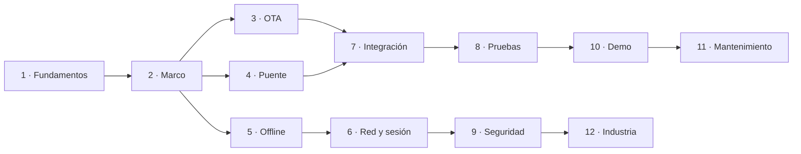

Figura 0.1. Dependencias de lectura entre capítulos. Mirá que todo sale del capítulo 1: ahí se define cada término.

### Convención de marcas

Tabla 0.2. Marcas de estado que usa el libro.

| Marca | Significa |
|---|---|
| **NO VERIFICADO** | Diseño o afirmación sin evidencia medida todavía. |
| **NO EJECUTADO** | El código existe, pero ningún recorrido de la demo lo ejercitó. |
| **ESPECULACIÓN** | Inferencia sobre sistemas de terceros a partir de lo observable; no es un hecho. |
| **HISTÓRICO (fecha)** | Vale para esa fecha; puede haber cambiado. |
| **VARIANTE NO FUSIONADA** | Medida en un ensayo, no incorporada a la rama estable. |

Las citas van entre corchetes al final de la oración: `[archivo:líneas]` para el repo (la ruta se omite cuando el nombre del archivo es único dentro de `Demo/`), `[folio NNN]` para el
expediente del proyecto (privado, sin enlace), `[E0x]` para los ensayos, `[Rn]` para la web (Anexo B) y `[bitácora de la reedición 04, núcleo Nn]` para los registros de trabajo de esta edición (privados, sin enlace). Las cifras
de pruebas y de tiempos medidos no figuran en el texto: están en la corrida fechada del Anexo H.

---

## Parte I. Fundamentos

### Capítulo 1. Fundamentos: una app híbrida que se actualiza sola y trabaja sin red

**Objetivos**

- Definir app híbrida, cascarón, contenido, puente y capacidad tal como los usa este framework.
- Distinguir este modelo de Blazor Hybrid, de un sitio web envuelto y de la interfaz dirigida por servidor.
- Explicar qué es una actualización OTA, qué la vuelve confiable y en qué momento se activa una versión.
- Explicar qué es offline-first y para qué sirve el outbox.
- Ubicar los temas secundarios (red, sesión y Keystore, contrato del puente, capacidades) y las cuatro líneas de versión.

**Requisitos previos.** Ninguno dentro del libro. Ayuda conocer C#, .NET MAUI y nociones de HTTP y JSON.

#### 1.1 El problema: pantallas que cambian seguido y una tienda que tarda

Una app de encuestas de campo cambia sus pantallas a menudo: una pregunta nueva, un texto corregido, un orden
distinto. Cada cambio de una app nativa pasa por la revisión de la tienda y por la actualización que hace cada
persona en su teléfono. El borrador que dio origen al framework lo pide así: «Si cambio esas pantallas, la app **se
autoactualiza al arrancar**, sin pasar por la tienda» [Framework-APP.md §1]. La guía lo resume en una frase: una
corrección de texto en una encuesta no debería esperar el ciclo de revisión de una tienda
[01-Actualizacion-Sin-Tienda.md:55-57].

La respuesta del framework tiene tres ideas que se sostienen entre sí:

1. **Separar** lo que cambia poco (la app instalada) de lo que cambia seguido (las pantallas).
2. **Actualizar** las pantallas por un canal propio, firmado, con vuelta atrás automática.
3. **Trabajar sin red**: la app guarda todo en el teléfono y envía después.

El resto del capítulo define cada idea. Los capítulos 3 a 6 cuentan cómo están construidas.

#### 1.2 App híbrida

##### 1.2.1 Cascarón y contenido

Una **app híbrida** (*hybrid app*) es, en este framework, una app nativa instalada por tienda que muestra sus pantallas
de negocio en un WebView. Esas pantallas son un paquete web que la app sirve desde el disco del teléfono y que habla
con el sistema sólo a través de un puente. Es el modelo de Cordova y Capacitor [R60] [R16], con otra
tecnología de base.

El **cascarón** (*native shell*) es la app .NET MAUI que se instala por tienda: tiene pantallas propias en XAML
(arranque, error, «WebView viejo»), el actualizador, el puente y la base local, y no contiene pantallas de negocio
[00-Marco.md:44-45]. El **contenido** (*web content*) son las pantallas de negocio: páginas Razor compiladas a Blazor
WebAssembly, empaquetadas, firmadas y bajadas por el cascarón [00-Marco.md:54-55].

La regla para decidir dónde va un cambio sale del vocabulario de la guía: si el cambio necesita un permiso nuevo,
código nativo o una API del teléfono que el catálogo no tiene, es del cascarón y viaja por tienda; si no, es contenido
[00-Marco.md:47-48]. Por ejemplo, agregar la cámara a la encuesta pide un permiso en el `AndroidManifest`: es un cambio
del cascarón [00-Marco.md:50-51].

En la demo, la pantalla que muestra el contenido crea un único `HybridWebView`, le engancha un servidor local y
registra el puente como único objeto invocable:

```csharp
// Demo/src/FrameworkConcept.Shell/Pages/ContenidoPage.xaml.cs:37-44
// C-1 de E01 — un único HybridWebView; el contenido lo sirve WebResourceRequested desde content/versions/vN.
// HybridRoot apunta a una página de reserva del APK («hwv»): nunca se usa para el contenido descargado.
servidor.Raiz = contenido.Directorio;
servidor.CargaIniciada += AlIniciarLaCarga;
var vista = new HybridWebView { HybridRoot = "hwv", DefaultFile = "index.html" };
_vista = vista;
vista.WebResourceRequested += servidor.AlPedirRecurso;
vista.SetInvokeJavaScriptTarget(puente);   // P3 — un solo objeto, un solo método: Call(sobre)
```

El servidor local atiende cada pedido del WebView desde la carpeta de la versión activa y corta cualquier pedido a
otro origen distinto de `https://0.0.0.1/` con un 403 [Demo/src/FrameworkConcept.Shell/Hosting/ServidorDeContenido.cs:16-17,39-45].
`HybridWebView` es el control de .NET MAUI que hospeda contenido web y permite llamadas entre JavaScript y C# [R4].

El **puente** (*bridge*) es la única vía entre contenido y cascarón: un objeto con un solo método, `Call`, que el
contenido invoca desde JavaScript con `window.HybridWebView.InvokeDotNet('Call', [sobreJson])`, donde el sobre es un
mensaje JSON-RPC 2.0 con un campo de versión `v` [Demo/src/FrameworkConcept.Shell/Bridge/PuenteDelCascaron.cs:3-7].
Agregar una operación no agrega un método C#: agrega una fila a la tabla de métodos del contrato
[Demo/src/FrameworkConcept.Shell/Bridge/PuenteDelCascaron.cs:9-10]. El capítulo 4 lo detalla.

Una **capacidad** (*capability*) es algo que el teléfono ofrece al contenido a través del cascarón (cámara, estado de
red, etc.). El contenido declara cuáles necesita (`requires`) y cuáles aprovecha si están (`optional`) en el manifiesto
de su paquete [Demo/src/FrameworkConcept.Core/Contracts/Contenido/ManifiestoContenido.cs:15,26-29]. Un **servicio del
cascarón** es una operación del puente que no depende de hardware (por ejemplo, guardar en la base local); el capítulo
4.5 trata la diferencia.

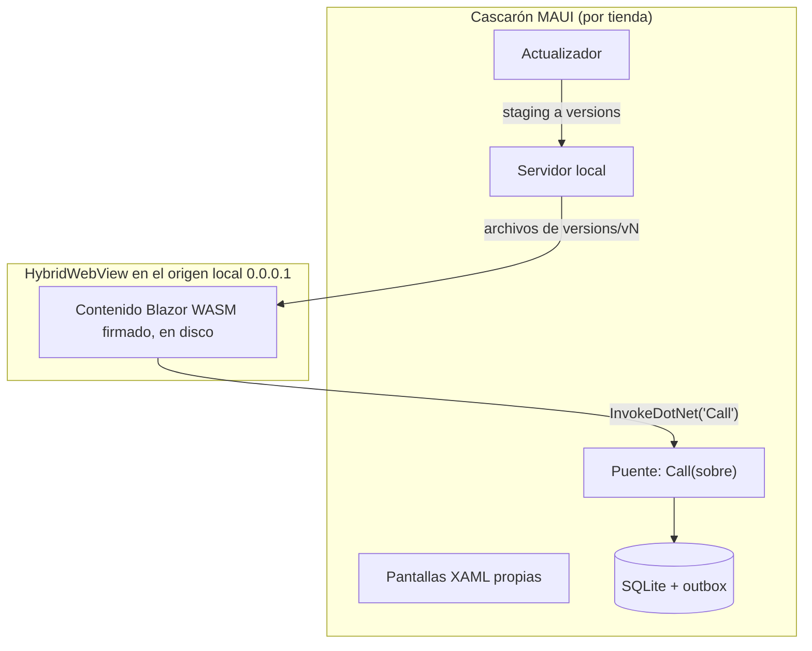

Figura 1.1. Anatomía de la app híbrida. Mirá que el contenido sólo toca el cascarón por una flecha: el puente.

##### 1.2.2 Qué no es

> **Recuadro. Blazor Hybrid no es esto.** Microsoft llama *Blazor Hybrid* a hospedar componentes Razor con
> `BlazorWebView`: los componentes se compilan dentro de la DLL de la app y corren en el proceso .NET nativo [R25].
> Ese código no se puede bajar sin reinstalar. En este framework el contenido es **Blazor WebAssembly** servido por
> `HybridWebView`: corre dentro del motor del WebView y se reemplaza por el canal [01-Actualizacion-Sin-Tienda.md:63]
> [Demo/src/FrameworkConcept.Shell/Pages/ContenidoPage.xaml.cs:37-44]. El borrador original habla de «pantallas
> Blazor Hybrid» [Framework-APP.md:1,27]; el libro usa ese nombre sólo en este recuadro.

Tabla 1.1. Con qué se confunde el modelo y por qué no es lo mismo.

| Se confunde con | Por qué no es lo mismo | Fuente |
|---|---|---|
| Blazor Hybrid (`BlazorWebView`) | Razor compilado en la DLL; no se baja | [01-Actualizacion-Sin-Tienda.md:63] |
| Un sitio web dentro de la app | Un sitio remoto en vivo no anda sin red; acá el contenido está en el teléfono | [01-Actualizacion-Sin-Tienda.md:64] |
| Actualizar el cascarón | Permisos, código nativo y SDK sólo cambian por tienda | [01-Actualizacion-Sin-Tienda.md:65] |
| Interfaz dirigida por servidor (*server-driven UI*) | Acá el código de las pantallas viaja empaquetado; sólo las encuestas viajan como datos (definiciones) | [00-Marco.md:63-64] |
| Rollback remoto | No se «baja» de versión: se corrige hacia adelante o se retira la mala | [01-Actualizacion-Sin-Tienda.md:66] |

##### 1.2.3 Qué permiten las tiendas

La separación no es un capricho: es lo que habilitan las políticas de las tiendas. Google Play prohíbe que una app se
modifique por un mecanismo distinto del suyo, pero excluye «code that runs in a virtual machine or an interpreter where
either provides indirect access to Android APIs (such as JavaScript in a webview or browser)» [R3]
[01-Actualizacion-Sin-Tienda.md:72-75]. Apple, en la pauta 2.5.2, prohíbe bajar código que introduzca o cambie
funciones de la app [R1] [01-Actualizacion-Sin-Tienda.md:82-83].

Dos consecuencias en la demo:

- Todo acceso nativo pasa por el puente, es decir, llega a Android de forma indirecta (§1.2.1).
- El contenido se compila **sin AOT**, para que lo bajado siga siendo IL interpretado:

```xml
<!-- Demo/src/FrameworkConcept.Content/FrameworkConcept.Content.csproj:15-18 -->
<!-- P1 — SIN AOT. Con AOT el código descargado deja de ser IL interpretado y cambia de clase ante las
     tiendas: habilitarlo es una decisión con su propia revisión, no una optimización. ... -->
<RunAOTCompilation>false</RunAOTCompilation>
```

Ninguna de las dos políticas nombra WebAssembly. Si un `.wasm` interpretado cuenta como «código interpretado» ante
Apple y ante Play es **NO VERIFICADO** [01-Actualizacion-Sin-Tienda.md:88-89] [folio 035]. Un contenido que cambie el
propósito declarado en la ficha de la tienda tiene que salir por tienda; la plantilla de PR lo pregunta (capítulo 7).

#### 1.3 Actualización OTA

Una **actualización OTA** (*over-the-air*, *live update*) reemplaza el contenido web sin reinstalar el binario. En la
demo, el cascarón consulta el canal en segundo plano, baja a `staging/`, verifica firma y hash, activa en el próximo
arranque en frío y vuelve atrás si la versión no confirma `Listo` [Demo/src/FrameworkConcept.Shell/Actualizacion/ConsultasDelCanal.cs:5-7]
[Demo/src/FrameworkConcept.Core/Update/Actualizador.cs:35-39,92-160]. La industria ofrece lo mismo como servicio:
Expo EAS Update, Ionic Appflow, Capawesome, CodePush (capítulo 12) [R18] [R19].

##### 1.3.1 Índice del canal frente a manifiesto del paquete

Un **canal** (*channel*) es una carpeta estática del servidor (`dev`, `beta`, `prod`) con un índice firmado por canal y
por mayor del puente [00-Marco.md:69-70]. Hay dos documentos que se suelen llamar «manifiesto» y que no hay que
confundir:

- El **índice del canal** (*channel index*) es la lista firmada de lo que se puede bajar. Vive en
  `/{canal}/puente-{mayor}/indice.json`, se firma byte a byte y la firma va al lado, en `indice.json.sig`. Trae canal,
  mayor del puente, clave de firma (`KeyId`), fecha de emisión, vencimiento (`Expires`), entradas de contenido y de
  definiciones, y versiones retiradas [Demo/src/FrameworkConcept.Core/Contracts/Canal/IndiceDelCanal.cs:3-34].
- El **manifiesto del paquete** (*package manifest*) es `manifiesto.json`, que viaja dentro del zip del contenido y
  dice qué versión es, con qué rango del puente es compatible, qué capacidades pide y qué motor web mínimo exige
  [Demo/src/FrameworkConcept.Core/Contracts/Contenido/ManifiestoContenido.cs:3-24].

El propio código lo aclara: el índice «NO es el “manifiesto del paquete de contenido” ni el “manifiesto de la app”
(AndroidManifest.xml / Info.plist, que sólo cambia por tienda)»
[Demo/src/FrameworkConcept.Core/Contracts/Canal/IndiceDelCanal.cs:10-12]. En este libro nunca se dice «manifiesto» a
secas.

El índice vale 30 días desde su emisión y se renueva cada 7 [Demo/src/FrameworkConcept.Core/Contracts/ParametrosDeProducto.cs:15-19].
Si la firma no verifica o venció, el cascarón lo descarta; la demo lo provoca con `scripts/guion.sh firma-invalida`
[00-Marco.md:72-76]. La firma es ES256 [Demo/src/FrameworkConcept.Core/Update/FirmaEs256.cs]; el capítulo 3 explica
el orden de verificación y su relación con The Update Framework (TUF) [R27].

##### 1.3.2 Ciclo de vida de una versión

Una versión de contenido pasa por estos estados:

1. **Staging.** La consulta en segundo plano baja el paquete a `staging/` y verifica firma y hash. Nunca activa nada
   [Demo/src/FrameworkConcept.Shell/Actualizacion/ConsultasDelCanal.cs:5-7].
2. **Pendiente.** En el próximo arranque en frío, antes de mostrar, el actualizador la activa y la carga
   [00-Marco.md:105-107].
3. **Current.** Si el contenido llama `Listo(v)`, queda confirmada y la anterior pasa a `previous`. El teléfono guarda
   dos versiones, `current` y `previous` [Demo/src/FrameworkConcept.Core/Contracts/ParametrosDeProducto.cs:30-31].
4. **Fallida.** Si la versión acumula `CargasSinListoParaFallar` cargas empezadas sin `Listo` (hoy, 2), el cascarón la
   anota como fallida y vuelve a `previous` [Demo/src/FrameworkConcept.Core/Update/Actualizador.cs:39,92-109]. Sólo
   cuenta una carga que llegó a pedir `_framework/dotnet.js`, la evidencia de que el contenido empezó a cargar
   [Demo/src/FrameworkConcept.Shell/Hosting/ServidorDeContenido.cs:19-32]. El criterio es un conteo, no un tiempo; el
   borrador decía «si no avisa en X segundos» [Framework-APP.md §3].

La **semilla** (*seed*) es el contenido y la definición que el APK trae embebidos, firmados igual que el canal; el
primer arranque la instala y la muestra mientras consulta el canal [00-Marco.md:96-98]. Una **retirada** es una
versión que el índice marca como mala: el próximo arranque en frío la trata como fallida
[Demo/src/FrameworkConcept.Core/Contracts/Canal/IndiceDelCanal.cs:21].

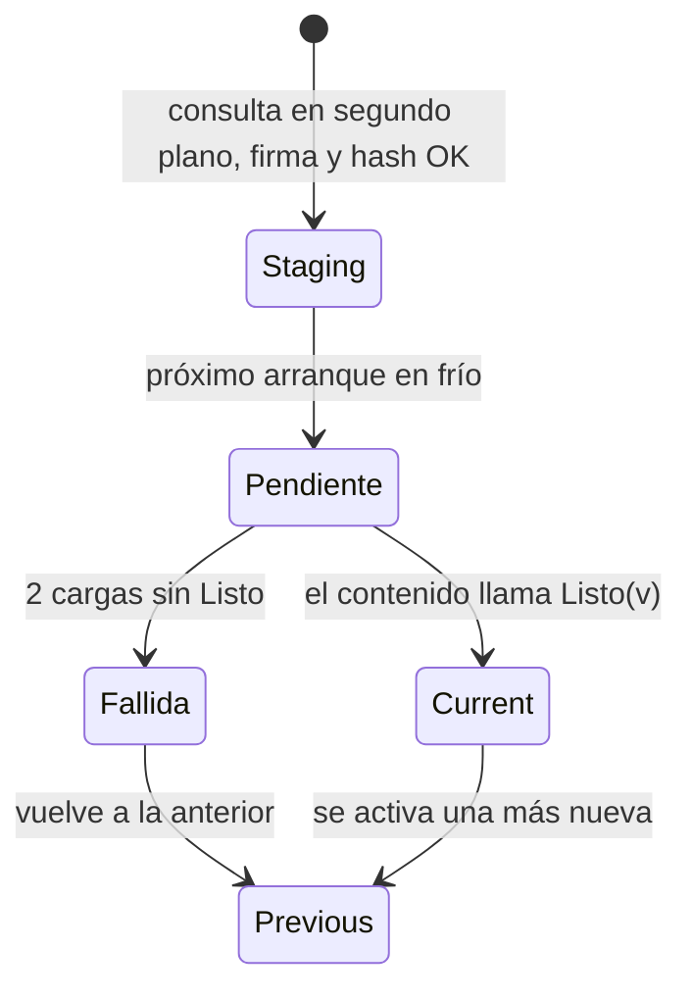

Figura 1.2. Ciclo de vida simplificado de una versión. Mirá que la activación nunca ocurre en la misma corrida que la
descarga. El capítulo 3 agrega el estado terminal «sin versión sana».

En la demo, el ensayo de integración lo recorrió de punta a punta: 1.0.0 → 1.1.0 (el primer arranque deja la versión
en staging, el segundo muestra la cabecera azul) y una 1.2.0 «sin Listo» que vuelve a 1.1.0 [00-Marco.md:109-110] [E02].

> **Del borrador a la demo.** El borrador consultaba el índice antes de mostrar y activaba en el mismo arranque
> [Framework-APP.md §3]. La demo consulta siempre en segundo plano y activa en el **próximo** arranque en frío
> [Demo/src/FrameworkConcept.Shell/Actualizacion/ConsultasDelCanal.cs:5-7]. La razón: nunca hacer esperar al abrir.
> El Anexo G trae la tabla completa de equivalencias.

##### 1.3.3 Disparadores de la consulta

El diseño prevé tres disparadores: arranque en frío, ingreso exitoso y reanudación [00-Marco.md:141-142]. En el código
hay dos implementados:

- **Arranque en frío**, después de decidir qué pantalla mostrar [Demo/src/FrameworkConcept.Shell/Pages/ArranquePage.xaml.cs:103,112].
- **Reanudación**, al volver desde segundo plano; el actualizador la omite si no pasaron 15 minutos desde la última
  consulta exitosa [Demo/src/FrameworkConcept.Shell/App.cs:31-32] [Demo/src/FrameworkConcept.Core/Contracts/ParametrosDeProducto.cs:21-22].

```csharp
// Demo/src/FrameworkConcept.Shell/App.cs:26-34 (comentarios de línea omitidos)
ventana.Resumed += (_, _) =>
{
    Bitacora.Log("app: reanudada");
    servicios.GetRequiredService<ISesionDelUsuario>().AlVolverAlFrente();
    servicios.GetRequiredService<IMonitorDeRed>().Reevaluar();
    if (servicios.GetRequiredService<ContenidoActivo>().Version is not null)
        servicios.GetRequiredService<ConsultasDelCanal>().ConsultarEnSegundoPlano(DisparadorDeConsulta.Reanudacion);
    servicios.GetRequiredService<SincronizadorDelOutbox>().Despertar();
};
```

El ingreso con cuenta existe en la demo [E03], pero ningún llamador usa el disparador de ingreso exitoso: que el
ingreso dispare la consulta es **NO VERIFICADO** [00-Marco.md:144-146]. El comentario de `ConsultasDelCanal.cs:9-11`
todavía dice que «la demo no tiene login»; quedó desactualizado y se corrige en un cambio de código aparte.

#### 1.4 Offline-first

##### 1.4.1 La base local como fuente de verdad

Una app **offline-first** trabaja siempre contra su base local y trata la red como un recurso que puede faltar. En la
demo, el cascarón guarda documentos, definiciones y versiones de contenido en SQLite con EF Core
[Demo/src/FrameworkConcept.Shell/Data/DbSqlite.cs]. El contenido no habla con el servidor: le pide al cascarón que
guarde, y el cascarón decide cuándo enviar. El capítulo 5 describe las tablas.

##### 1.4.2 El outbox

El **outbox** (*transactional outbox*, aplicado al cliente) es una tabla de la base local donde cada operación que
necesita servidor queda como fila pendiente, escrita en la misma transacción que el documento [R29]. Un
sincronizador las envía cuando hay red. En la demo hace una pasada cada 30 segundos, con espera exponencial
(*backoff*) entre 5 segundos y 10 minutos:

```csharp
// Demo/src/FrameworkConcept.Shell/Sync/SincronizadorDelOutbox.cs:23-25
private static readonly TimeSpan EsperaEntrePasadas = TimeSpan.FromSeconds(30);
private static readonly TimeSpan BackoffInicial = TimeSpan.FromSeconds(5);
private static readonly TimeSpan BackoffMaximo = TimeSpan.FromMinutes(10);
```

Al reanudar la app, el cascarón lo despierta [Demo/src/FrameworkConcept.Shell/App.cs:32]. Estos son parámetros de la
demo, no norma; el capítulo 5 cuenta la idempotencia, el dueño de cada fila, «Enviar ahora» y la carta muerta.

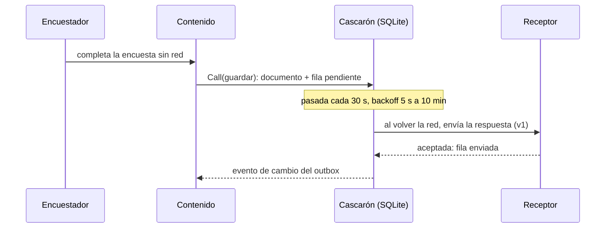

Figura 1.3. Recorrido de una respuesta tomada sin red. Mirá que el contenido nunca espera al servidor.

##### 1.4.3 Versiones de definición en vuelo

Una **definición** es una encuesta escrita como datos JSON (`encuestaId` + `version`) que dibujan las páginas genéricas
del contenido; cambiar una pregunta publicada exige subir `version` [00-Marco.md:60-64]. El escenario ESC-4 muestra por
qué la versión viaja con la respuesta: una encuesta tomada sin red con la v1 queda en el outbox; mientras tanto se
publica la v2; al volver la red, la respuesta se envía con `versionDefinicion: 1` y el servidor la acepta como v1
[00-Marco.md:123-126] [E02].

#### 1.5 Temas secundarios en una página

Tabla 1.2. Temas secundarios: qué son, de quién son y dónde se detallan.

| Tema | Pertenece a | En una frase | Detalle |
|---|---|---|---|
| Red | Cascarón | Cuatro estados (`EnLinea`, `EnLineaMedida`, `RedSinServidor`, `SinRed`) deciden qué acción se permite, se encola o se bloquea [Demo/src/FrameworkConcept.Core/Red/EstadoDeRed.cs:8-16] [00-Marco.md:166] | Cap. 6 |
| Autenticación del dispositivo y Keystore | Cascarón | La primera vez se ingresa con la cuenta; después se desbloquea con la seguridad del teléfono y el secreto queda en el almacén seguro del sistema [00-Marco.md:165] | Cap. 6 |
| Contrato del puente | Borde cascarón ↔ contenido | Una sola función versionada; el contenido pide y el cascarón decide [Demo/src/FrameworkConcept.Shell/Bridge/PuenteDelCascaron.cs:3-10] | Cap. 4 |
| Capacidades | Cascarón | Lo que el teléfono ofrece; una capacidad nueva es un cambio de tienda [00-Marco.md:47-51] | Cap. 4 |

> **Recuadro. Tres responsabilidades distintas.** La biometría abre un secreto, la identidad la da el servidor y el
> entorno lo atestigua un tercero. El diseño de la demo lo dice así: «La biometría no es el login: es la llave que abre
> el refresh token guardado. La identidad la da el emisor» [Demo/DISENO-RED-Y-AUTENTICACION.md:145]. Que el teléfono
> no esté comprometido (sin root, sin acceso remoto) no lo puede afirmar la app sola: lo atestiguan servicios como
> Play Integrity [R32]. La demo no usa atestación; el capítulo 9 lo discute con casos de apps de consumo.

#### 1.6 Cuatro líneas de versión

En una app que se actualiza por partes, «la versión» no alcanza para saber qué corre en un teléfono. La guía define
**cuatro líneas de versión** visibles en la pantalla de diagnóstico: cascarón, puente, contenido y definición, con la
huella del contrato al lado [03-Integracion-Y-Versionado.md:154-155] [Developer-Guide.md:37]. Cada una cambia por un
motivo distinto: el cascarón por tienda, el puente cuando cambia el contrato, el contenido por el canal y la definición
cuando cambia una encuesta. El capítulo 7 explica qué sube cada cambio y las líneas internas.

> **En la industria.** La separación entre un binario nativo y un paquete web actualizable es la base de Cordova y
> Capacitor [R60] [R16]; los servicios de *live updates* (EAS Update, Appflow, Capawesome) la explotan
> comercialmente [R18] [R19]. Expo ata cada actualización a una *runtime version*, la misma idea que el índice
> por mayor del puente [R18]. El patrón outbox viene del mundo de microservicios [R29]. El capítulo 12 compara
> mecanismo por mecanismo.

**Preguntas guía**

1. Un cambio agrega una pregunta a una encuesta y otro agrega la lectura de código QR. ¿Cuál va por canal y cuál por
   tienda? ¿Por qué?
2. ¿Qué diferencia hay entre el índice del canal y el manifiesto del paquete? ¿Quién lee cada uno y cuándo?
3. ¿Por qué la demo no activa una versión en el mismo arranque en que la baja?
4. ¿Qué pasaría con una respuesta tomada sin red si la versión de la definición no viajara con ella?
5. ¿Qué decisión de compilación sostiene la lectura de las políticas de las tiendas, y qué queda sin verificar?

**Resumen.** El framework separa un cascarón nativo, que cambia por tienda, de un contenido Blazor WebAssembly que se
baja firmado, se sirve desde el disco por `HybridWebView` y habla con el sistema sólo por un puente con un método. La
actualización OTA baja en segundo plano, activa en el próximo arranque en frío y vuelve atrás por conteo de cargas sin
`Listo`. La app trabaja contra su base local y envía por un outbox con reintentos. Red, sesión, contrato y capacidades
son responsabilidades del cascarón que se detallan en los capítulos 4 a 6.

---

### Capítulo 2. Marco de referencia

**Objetivos**

- Conocer los siete escenarios que ordenan la guía y su estado de verificación.
- Conocer los contextos que cambian las respuestas y los actores que deciden.
- Ubicar cada pieza del framework en la demo.
- Saber qué capítulo leer según el escenario.

**Requisitos previos.** Capítulo 1.

#### 2.1 Siete escenarios

Un **escenario** es una situación concreta del ciclo de vida de la app con un identificador estable (`ESC-n`) que el
resto de la guía cita [00-Marco.md:31-32]. Los siete salen del dictamen de diseño del proyecto; ESC-6 y ESC-7 nacen de
pedidos posteriores [00-Marco.md:243] [folio 035].

Tabla 2.1. Escenarios, qué pasa y su estado en la demo.

| Id | Escenario | Qué pasa | Estado en la demo | Capítulo |
|---|---|---|---|---|
| ESC-1 | Primer arranque | El cascarón instala la semilla, la muestra y consulta el canal en segundo plano | Recorrido: «activada la semilla 1.0.0» y `Listo(1.0.0)` [00-Marco.md:96-101] [E02] | 3 |
| ESC-2 | Actualización con fallo y rollback | Baja a staging, activa en el próximo arranque, vuelve a `previous` tras dos cargas sin `Listo` | Recorrido: 1.0.0 → 1.1.0; 1.2.0 vuelve a 1.1.0; índice con firma inválida rechazado [00-Marco.md:105-110] [E02] | 3 |
| ESC-3 | Contenido incompatible o capacidad faltante | El actualizador no activa un paquete que pide otro puente, una capacidad ausente o un WebView menor a 94, y dice por qué | Probado por la suite de actualización y en navegador con puente simulado; en dispositivo sólo existe la pantalla «WebView viejo» [00-Marco.md:114-119] | 4 |
| ESC-4 | Sin red con versión de definición en vuelo | La respuesta v1 queda en el outbox y se acepta como v1 aunque ya exista la v2 | Recorrido y E03 (aviso «Sin conexión», reconexión) [00-Marco.md:123-128] | 5 |
| ESC-5 | PR y release | La compuerta corre en el PR; un `fw-ok` rojo impide fusionar; después se publica por la línea que corresponda | `scripts/ci-local.sh` reproduce la compuerta; los parches de `etapas/` provocan rojos [00-Marco.md:132-137] | 7, 8 |
| ESC-6 | Actualizar al iniciar sesión | El ingreso exitoso dispara la consulta del canal | Ingreso implementado [E03]; disparo **NO VERIFICADO** [00-Marco.md:141-147] | 1.3.3, 6 |
| ESC-7 | Actualización obligatoria | Un contenido `mandatory` se activa en el primer arranque en frío tras quedar verificado; nunca sin red ni descartando pendientes | Diseño; **NO EJECUTADO** en la demo [00-Marco.md:151-156] | 3 |

#### 2.2 Contextos y actores

Un **contexto** es una condición del entorno que cambia la respuesta de un escenario [00-Marco.md:158-166].

Tabla 2.2. Contextos.

| Id | Contexto | Qué cambia | Estado |
|---|---|---|---|
| CTX-1 | Android con WebView ≥ 94 | Contexto de referencia: todo el recorrido funciona | Verificado en el emulador de ensayo; en el teléfono de medida, contenido servido y tiempos de arranque medidos (Anexo H) sin recorrido completo [E01] [folio 049] |
| CTX-2 | Android con WebView < 94 | El contenido no arranca; el cascarón muestra «WebView viejo» | Medido en E01 (WebView 83) |
| CTX-3 | iOS | Mismo diseño, otras API (Keychain, `app://`) y otras reglas | **NO VERIFICADO** [folio 023] |
| CTX-4 | Modo Dispositivo (sin emisor OIDC) | No hay cuenta: el dueño del outbox es el id de instalación | Verificado en E02 |
| CTX-5 | Modo con cuenta | Ingreso, desbloqueo con la seguridad del teléfono, bloqueo a los 5 min en segundo plano, outbox con dueño | Verificado en E03 en el emulador |
| CTX-6 | Estado de la red | Qué acciones se permiten, quedan pendientes o se bloquean | Verificado en E03 salvo `EnLineaMedida` |

Un **actor** es quien decide algo en el sistema. Los tres primeros los nombra el dictamen; los demás son criterio de
la guía [00-Marco.md:169-181].

Tabla 2.3. Actores.

| Id | Actor | Qué decide | Qué no decide |
|---|---|---|---|
| ACT-01 | Encuestador | Qué carga y cuándo; si activa el desbloqueo | Qué versión corre |
| ACT-02 | Coordinador que publica | Cuándo publicar, en qué canal; retirar versiones | El código |
| ACT-03 | Servidor (canal + receptor) | Sirve índice y paquetes; acepta respuestas de versiones no retiradas | Qué se activa en el teléfono |
| ACT-04 | Desarrollador del contenido | Páginas Razor, renderizado de encuestas, `requires`/`optional` | El catálogo de capacidades y la base |
| ACT-05 | Desarrollador del cascarón | Puente, catálogo, actualizador, base, versión del cascarón | El contenido |
| ACT-06 | Revisor del PR | Si un PR se fusiona | Saltar `fw-ok` |
| ACT-07 | Compuerta (workflow + runner autoalojado) | Verde o rojo | Nada fuera de lo que prueba |

#### 2.3 Mapa del framework y de la demo

La demo es el hilo conductor del libro. Cada concepto del capítulo 1 tiene una pieza concreta.

Tabla 2.4. Concepto → pieza de la demo.

| Concepto | Pieza | Ruta (relativa a `Demo/`) |
|---|---|---|
| Cascarón | Proyecto MAUI | `src/FrameworkConcept.Shell/` |
| Contenido | Proyecto Blazor WebAssembly sin AOT | `src/FrameworkConcept.Content/` |
| Contrato e índice | Tipos compartidos | `src/FrameworkConcept.Core/Contracts/` |
| Actualizador y firma | Núcleo de la OTA | `src/FrameworkConcept.Core/Update/` |
| Servidor local | `ServidorDeContenido` | `src/FrameworkConcept.Shell/Hosting/` |
| Puente | `PuenteDelCascaron` y despachador | `src/FrameworkConcept.Shell/Bridge/` |
| Base local y outbox | `DbSqlite`, `SincronizadorDelOutbox` | `src/FrameworkConcept.Shell/Data/`, `src/FrameworkConcept.Shell/Sync/` |
| Parámetros de producto | `ParametrosDeProducto` | `src/FrameworkConcept.Core/Contracts/ParametrosDeProducto.cs` |
| Definiciones | Encuestas en JSON | `definiciones/encuesta-movilidad/` |
| Recorrido y compuerta | Guion y CI local | `scripts/guion.sh`, `scripts/ci-local.sh` |
| Rojos provocados | Parches | `etapas/` |

Fuente de la tabla: [00-Marco.md:208-218] y el árbol de `Demo/src`.

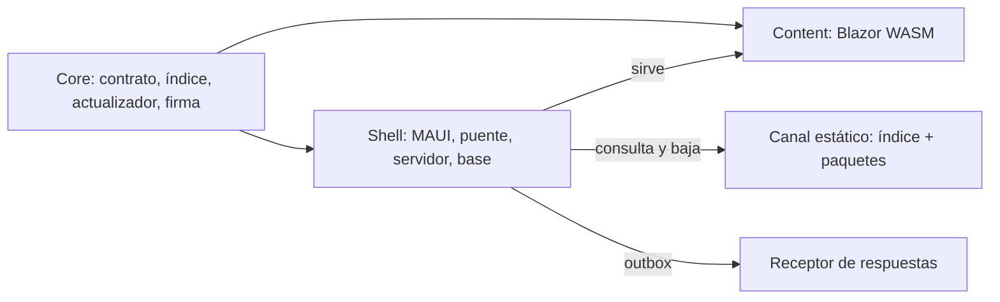

Figura 2.1. Mapa de piezas. Mirá que Content y Shell comparten los tipos de Core en compilación, pero en ejecución
sólo se hablan por el puente (capítulo 4.4).

#### 2.4 Cómo se relacionan los capítulos

Tabla 2.5. Escenario → capítulo que lo resuelve.

| Si estás en… | Leé | Y mirá en la demo |
|---|---|---|
| ESC-1, ESC-2, ESC-7 | Cap. 3 | `semilla/`, `Actualizador.cs`, `ParametrosDeProducto.cs` |
| ESC-3 | Cap. 4 | `PredicadoDeCompatibilidad.cs` |
| ESC-4 | Caps. 5 y 6 | `definiciones/encuesta-movilidad/`, `Shell/Sync/` |
| ESC-5 | Caps. 7 y 8 | `scripts/ci-local.sh`, `etapas/` |
| ESC-6 | Cap. 6 | `Shell/Auth/` |

Fuente: [00-Marco.md:208-218]. La figura 0.1 muestra el mismo mapa como orden de lectura.

> **En la industria.** Ordenar una guía por escenarios con identificador estable es la práctica de los casos de uso y
> de los requisitos trazables; los catálogos de controles como OWASP MASVS hacen lo mismo con sus identificadores
> (`MASVS-STORAGE-1`, etc.) [R30]. El capítulo 9 usa ese catálogo.

**Preguntas guía**

1. ¿Qué escenarios están verificados de punta a punta y cuáles sólo diseñados?
2. En el contexto CTX-4, ¿quién es el dueño de una fila del outbox?
3. ¿Qué actor decide qué versión corre en un teléfono? ¿Y cuál decide qué se publica?
4. Un PR rompe una prueba del contrato. ¿Qué escenario es y qué capítulos leés?

**Resumen.** Siete escenarios (ESC-1 a ESC-7), seis contextos y siete actores ordenan la guía. Cuatro escenarios están
recorridos en la demo, ESC-3 sólo en pruebas y navegador, y ESC-6 y ESC-7 quedan pendientes. Cada concepto tiene una
pieza de la demo, y cada escenario un capítulo.

## Parte II. Mecanismo

### Capítulo 3. Actualizar sin tienda: OTA firmada con rollback

**Objetivos**

- Entender por qué el contenido puede cambiar sin pasar por la tienda y qué límites ponen las políticas de Google Play y Apple.
- Conocer cada pieza de la actualización: índice del canal, firma, staging, puntero, marca pendiente, fallida, retirada y semilla.
- Seguir el ciclo de vida completo de una versión, desde que se publica hasta que queda confirmada o fallida.
- Saber cuándo el cascarón decide un rollback y por qué esa decisión resiste un corte de energía.
- Ejercitar el mecanismo con el guion de la demo y publicar con una lista de verificación.

**Requisitos previos:** capítulo 1 (app híbrida, OTA, offline-first) y capítulo 2 (marco de referencia).

#### 3.1 El problema y lo que permiten las tiendas

Una app instalada desde la tienda cambia sólo cuando la tienda aprueba una versión nueva y la persona la instala. Para corregir un texto, una validación o una pantalla, ese ciclo es lento. La **actualización de contenido por aire** (*OTA live update*) separa la app en dos: el cascarón nativo, que sigue viajando por la tienda, y el contenido web que corre dentro del WebView, que se reemplaza bajando un paquete firmado.

Las dos tiendas lo permiten con condiciones. Google Play prohíbe que una app se modifique por un camino que no sea el suyo. La excepción es «code that runs in a virtual machine or an interpreter where either provides indirect access to Android APIs (such as JavaScript in a webview or browser)» [01-Actualizacion-Sin-Tienda.md:70-74] [R3]. Apple, en la pauta 2.5.2, prohíbe bajar código que «introduces or changes features or functionality of the app» [01-Actualizacion-Sin-Tienda.md:80-83] [R1].

De esas dos lecturas salen tres reglas de diseño:

1. El contenido corre *dentro* del WebView y llega al sistema sólo **indirectamente**, por el puente (capítulo 4).
2. Un cambio que altera el propósito declarado en la ficha de la tienda sale por tienda, no por el canal.
3. El contenido se compila **sin AOT**, para que lo que se baja siga siendo código interpretado [Demo/src/FrameworkConcept.Content/FrameworkConcept.Content.csproj:15-18] [R5].

Ninguna de las dos políticas nombra WebAssembly. Si un `.wasm` interpretado cuenta como «código interpretado» es **NO VERIFICADO** ante Apple y ante Play [01-Actualizacion-Sin-Tienda.md:88-89] [folio 035].

#### 3.2 Vocabulario

Tabla 3.1. Términos de la actualización.

| Término | Definición | Dónde está |
|---|---|---|
| **Índice del canal** (*channel index*) | JSON firmado que lista lo que se puede bajar: entradas de contenido y de definiciones (versión, `size`, `sha256`), `expires`, `retiradas` y `keyId`. Vive en `/{canal}/puente-{mayor}/indice.json`. | [Demo/src/FrameworkConcept.Core/Contracts/Canal/IndiceDelCanal.cs:3-37] |
| **Manifiesto del paquete** (*package manifest*) | Declaración que viaja *dentro* del zip: compatibilidad con el puente y capacidades. No es el índice del canal. | [IndiceDelCanal.cs:10-12] |
| **Firma del índice** | ECDSA P-256 con SHA-256 (ES256) sobre los bytes exactos de `indice.json`, guardada al lado en `indice.json.sig`. | [Demo/src/FrameworkConcept.Core/Update/FirmaEs256.cs:6-17] |
| **Paquete** | Zip de una versión del contenido; el índice fija su tamaño y su `sha256`. | [IndiceDelCanal.cs:44-55] |
| **Archivos planos** | Los archivos que quedan *adentro* del zip, sin precompresión `.br` ni `.gz`. Lo plano es el contenido, no el transporte. | [IndiceDelCanal.cs:44] |
| **Staging** | Directorio donde la versión bajada y verificada espera su activación. Hay una sola a la vez. | [Demo/src/FrameworkConcept.Core/Update/AlmacenDeContenidoEnDisco.cs:61-78] |
| **Puntero** | Archivo con `current`, `previous`, `pendiente` y `CargasSinListo`. Es la única fuente de verdad sobre qué versión se muestra. | [Demo/src/FrameworkConcept.Core/Update/IAlmacenDeContenido.cs:68] |
| **Marca pendiente** | Estado de una versión recién activada hasta que el contenido confirma `Listo(version)` por el puente. | [Actualizador.cs:293-307] |
| **Fallida** | Versión que *el teléfono* descarta porque no llegó a `Listo`. Nunca se vuelve a activar. | [Actualizador.cs:97-106] |
| **Retirada** | Versión que *el servidor* descarta, anunciándola en el índice firmado; el teléfono la trata como fallida. | [Actualizador.cs:113-119] |
| **Semilla** (*seed*) | Versión completa embebida en el APK, firmada igual que el canal. | [Actualizador.cs:164-174] |

Una aclaración de vocabulario: «manifiesto» a secas no se usa. Hay tres archivos que la industria llama así y son distintos: el índice del canal, el manifiesto del paquete y el manifiesto de la app (`AndroidManifest.xml` o `Info.plist`), que sólo cambia por tienda [IndiceDelCanal.cs:10-12].

#### 3.3 Por qué confiar: verificación, vigencia y claves

La confianza no depende del servidor ni de TLS: depende de la firma. Un servidor comprometido o un intermediario pueden servir cualquier archivo, pero no pueden fabricar una firma válida sin la clave privada, que no sale de quien publica [FirmaEs256.cs:15-17].

##### 3.3.1 El orden de verificación

`VerificacionDelIndice` es una función pura: recibe bytes y devuelve un veredicto, sin red ni archivos, para que cada paso tenga su prueba [Demo/src/FrameworkConcept.Core/Update/VerificacionDelIndice.cs:14-25]. El orden es:

```csharp
// Demo/src/FrameworkConcept.Core/Update/VerificacionDelIndice.cs:18-22
///   1. firma y clave (conocida, no revocada)   — sobre los BYTES recibidos, antes de leer el JSON
///   2. el keyId de adentro coincide con el de la firma
///   3. formato conocido
///   4. expires                                 — un índice vencido no vale aunque la firma sea buena (C08, «freeze»)
///   5. canal y mayor del puente                — un índice de otro canal u otro mayor no es para este cascarón
```

La regla que sostiene todo está en una línea: «Sólo ahora se lee el JSON: nada de lo que dice un índice sin firma válida se usa» [VerificacionDelIndice.cs:50]. Primero se verifica, después se lee. La versión estrictamente mayor y el `sha256` de cada paquete se comprueban después, entrada por entrada [VerificacionDelIndice.cs:24]. Además, el actualizador no baja un paquete que declare más de 64 MB, para proteger la memoria del teléfono de un índice mal escrito [Actualizador.cs:31-32].

##### 3.3.2 Vigencia: `expires`

Un índice firmado y vencido no vale. Sin vencimiento, un atacante que guardó un índice viejo y legítimo podría servirlo para siempre y dejar al teléfono congelado en una versión con un defecto conocido: es el **ataque de congelamiento** (*freeze attack*) que describe The Update Framework (TUF) [R27]. En la demo, `expires` es la fecha de emisión más 30 días, y el índice se renueva cada 7 [Demo/src/FrameworkConcept.Core/Contracts/ParametrosDeProducto.cs:15-19].

##### 3.3.3 Claves: activa, reserva y revocación

El cascarón trae embebido un conjunto de claves públicas, cada una con su `keyId`, y acepta sólo las conocidas y no revocadas [FirmaEs256.cs:23-42]. El orden de los rechazos sirve al diagnóstico: primero «¿qué clave?» (`ClaveDesconocida`, `ClaveRevocada`) y después «¿la firma cierra?» (`FirmaInvalida`). Rotar o revocar una clave exige un cascarón nuevo por tienda, porque la lista viaja en el APK.

**En la industria.** TUF generaliza este esquema con roles separados (raíz, objetivos, instantánea, tiempo), umbrales de firmantes y delegación [R27]. La demo usa una sola firma ES256 sobre los bytes por simplicidad; TUF queda como camino de crecimiento si aparecen varios firmantes o delegación de roles [bitácora de la reedición 04, núcleo N2].

#### 3.4 El ciclo de vida de una versión

Una versión pasa por estados bien definidos. El punto clave es que **bajar no es aplicar**: lo verificado espera en staging y se activa recién en el próximo arranque en frío, antes de mostrar nada. Nunca se activa en caliente [Actualizador.cs:139-141].

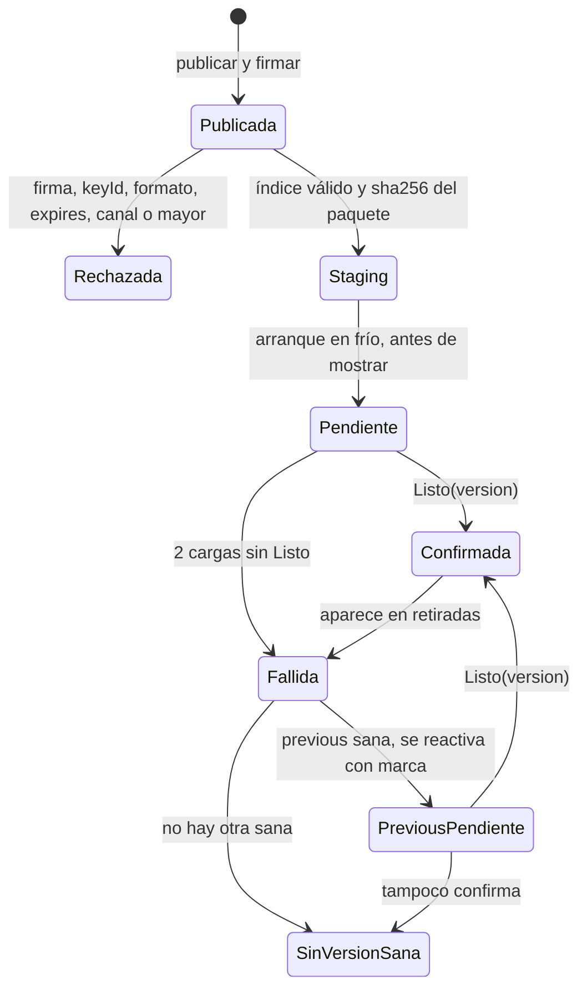

Figura 3.1. Estados de una versión de contenido. Mirá que de `Fallida` no se vuelve directo a mostrar: volver a `previous` es otra activación, con su propia marca pendiente, y si también falla queda el estado terminal «sin versión sana» [Actualizador.cs:121-137].

Dos detalles del código que la figura resume:

- **Mientras hay una marca pendiente, staging espera.** Si se activara lo nuevo, `previous` sería una versión sin confirmar y el rollback no tendría a dónde volver con seguridad [Actualizador.cs:139-148].
- **No se vuelve a la semilla.** Si ninguna versión está sana, el puntero queda como está, con las versiones a la vista para la pantalla terminal [Actualizador.cs:121-123].

La consulta al canal y la activación ocurren en momentos distintos:

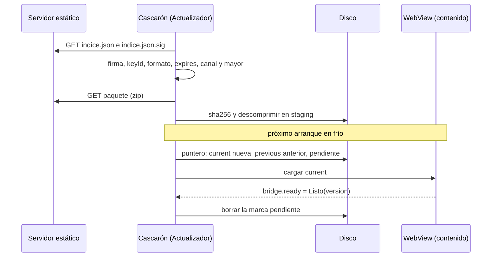

Figura 3.2. Consulta, staging y activación. Los disparadores de la consulta son el arranque, la vuelta desde segundo plano (como mucho una vez cada 15 minutos) y el ingreso con cuenta [ParametrosDeProducto.cs:21-22]; el detalle de red está en el capítulo 6.

#### 3.5 Rollback por evidencia

Una versión recién activada puede estar rota: un error de JavaScript, un recurso faltante, una excepción al iniciar Blazor. El cascarón no puede inspeccionar el contenido por dentro, así que exige una prueba positiva: el contenido llama `bridge.ready` con su versión cuando terminó el primer render con el puente sano [Demo/src/FrameworkConcept.Core/Contracts/Puente/TablaDeMetodos.cs:25-28] [Demo/src/FrameworkConcept.Content/Bridge/BridgeSession.cs:112-124].

##### 3.5.1 Qué cuenta como falla

La marca sola no prueba nada: la persona pudo cerrar la app mientras cargaba. Por eso el cascarón anota cada arranque en que el WebView **empezó a cargar** la versión pendiente, detectado cuando pide `_framework/dotnet.js` [Demo/src/FrameworkConcept.Shell/Hosting/ServidorDeContenido.cs:20] [Demo/src/FrameworkConcept.Shell/Pages/ContenidoPage.xaml.cs:114]. Sólo cuando eso pasó `CargasSinListoParaFallar` veces sin `Listo`, el arranque siguiente da la versión por fallida.

```csharp
// Demo/src/FrameworkConcept.Core/Update/Actualizador.cs:34-39
/// P2 — Cuántos arranques con la carga EMPEZADA y sin «Listo» hacen falta para dar una versión por fallida.
/// Criterio de la demo (corrección de E02), no valor de producto del folio 036: con 1, cerrar la app mientras
/// carga (el TPR del teléfono de medida pasa de 8 s) dejaba una versión sana como fallida para siempre.
/// </summary>
public const int CargasSinListoParaFallar = 2;
```

El valor 2 es un **parámetro** de la demo, no un valor de producto. Bajarlo a 1 da más falsos positivos; subirlo expone más tiempo a la persona a una versión rota. La alternativa de medir el tiempo hasta `Listo` quedó registrada y no se adoptó [bitácora de la reedición 04, núcleo N2].

##### 3.5.2 El recorrido real en la demo

Con el valor actual, el paso 7 del recorrido de la demo pide abrir la app en frío cuatro veces [Demo/README.md:89]:

Tabla 3.2. Arranques del rollback con `CargasSinListoParaFallar = 2`.

| Arranque | Qué pasa |
|---|---|
| 1 | Se muestra 1.1.0; la consulta baja 1.2.0 a staging. |
| 2 | Se activa 1.2.0 con marca pendiente; el WebView empieza a cargar (carga 1) y no llega a `Listo`. |
| 3 | Sigue pendiente (1 de 2): se reintenta; carga 2 sin `Listo`. |
| 4 | 2 cargas sin `Listo`: 1.2.0 queda fallida y se vuelve a 1.1.0, con su propia marca. |

Cuando eso ocurre, el cascarón deja en su bitácora la nota «rollback: 1.2.0 empezó a cargar 2 veces sin confirmar Listo; queda como fallida» [Actualizador.cs:103].

##### 3.5.3 Idempotencia frente a un corte

El orden de las escrituras es deliberado:

```csharp
// Demo/src/FrameworkConcept.Core/Update/Actualizador.cs:97-105
if (puntero.Pendiente is { } pendiente)
{
    if (puntero.CargasSinListo >= CargasSinListoParaFallar)
    {
        await almacen.AgregarFallidaAsync(pendiente, ct);
        fallidas.Add(pendiente);
        // …
        puntero = puntero with { Pendiente = null, CargasSinListo = 0 };
        await almacen.ReemplazarPunteroAsync(puntero, ct);
```

Primero se anota la fallida y después se mueve el puntero. Si el proceso se corta entre las dos escrituras, el próximo arranque encuentra la misma marca y repite el paso, sin reinstalar la versión mala [Actualizador.cs:95-96]. Las escrituras se hacen con escritura a temporal y renombre [AlmacenDeContenidoEnDisco.cs:58], y dos candados ordenados evitan que el arranque, la consulta y `Listo` se pisen [Actualizador.cs:41-44]. `Listo` sólo borra la marca de *esa* versión: un `Listo` viejo o de otra versión no confirma nada [Actualizador.cs:299-301].

**En la industria.** Las actualizaciones A/B de Android usan dos ranuras y una marca de «arranque exitoso»: si el sistema nuevo no la pone, el cargador vuelve a la ranura anterior [R45]. `current`/`previous` más `Listo` es la misma idea llevada al contenido. Expo EAS Update también vuelve a la versión embebida cuando una actualización falla al arrancar [R18].

#### 3.6 La semilla

La semilla resuelve el primer arranque: una app recién instalada, sin red, tiene que mostrar algo. Por eso el APK trae una versión completa, firmada igual que el canal, que se instala **por el mismo camino que un paquete bajado** [Actualizador.cs:164-165].

Se activa en dos casos [Actualizador.cs:173-174]:

1. **Primer arranque**, cuando nunca hubo puntero.
2. **Cascarón nuevo con una semilla más nueva que `current`**: si la tienda instala un cascarón cuya semilla supera lo instalado, esa semilla actualiza. Así, una actualización por tienda nunca deja al teléfono atrás del contenido que trae.

La semilla **no** es destino de rollback: si no queda versión sana, no se vuelve a ella (§3.4). Leerla y verificarla cuesta segundos, así que se carga sólo en el primer arranque o cuando cambió la huella de la instalación del cascarón [Actualizador.cs:166-171].

Un clon nuevo del repositorio no tiene claves de firma: `scripts/guion.sh claves` las genera y la semilla se firma con ellas al compilar [Demo/scripts/guion.sh:585].

**Variante ensayada, no fusionada.** El ensayo E04 probó un **arranque superpuesto**: el WebView sirve la versión por adelantado y el cascarón retiene el saludo hasta que el actualizador decide; una subvariante sirve la semilla directo desde el APK [E04] [folio 053]. Vive en ramas descartables sin fusionar y **no** es el comportamiento de `main`. Adoptarla es una decisión abierta.

#### 3.7 Retención, retiradas y versión obligatoria

Tabla 3.3. Parámetros de retención y forzado.

| Parámetro | Valor | Fuente |
|---|---|---|
| Versiones en el teléfono | 2 (`current` y `previous`) | [ParametrosDeProducto.cs:30-31] |
| Paquetes firmados en el servidor, por canal y mayor del puente | al menos 3 | [ParametrosDeProducto.cs:27-28] |
| Arranques hasta aplicar una obligatoria | 1 | [ParametrosDeProducto.cs:33-34] |

**No hay «bajar de versión» remoto.** Una versión mala se corrige hacia adelante, con una versión mayor, o se **retira**: el servidor la lista en `retiradas` del índice firmado y el próximo arranque en frío la trata como fallida local [01-Actualizacion-Sin-Tienda.md:66] [IndiceDelCanal.cs:21] [Actualizador.cs:113-119].

**Versión obligatoria.** Una entrada con `Mandatory = true` se activa en el próximo arranque en frío, igual que las demás [IndiceDelCanal.cs:49]. La política es coherente, pero no se ejercitó en la demo: **NO EJECUTADO**.

**Política de soporte.** El índice puede declarar `CascaronMinimoSoportado`. Si el cascarón está debajo, el arranque se bloquea con una pantalla propia, pero sólo con red, para que haya cómo actualizar [Actualizador.cs:68-75]. No es una declaración de compatibilidad: ésa la hace el predicado del capítulo 4.

#### 3.8 Costos y arranque

Retener una versión cuesta del orden de 9,13 MB en el teléfono, y el contenido Blazor exige un Android System WebView 94 o superior [01-Actualizacion-Sin-Tienda.md:221] [ParametrosDeProducto.cs:9-10] [E01]. Con un WebView más viejo el cascarón muestra su propia pantalla «actualizá el WebView» [Actualizador.cs:77-80].

El **tiempo hasta el primer render** (TPR) del arranque en frío se midió en el teléfono de medida en varias fechas y con varias variantes. Como son datos fechados, las cifras no van en el texto: están juntas en la Tabla H.3 del Anexo H, y ninguna es un valor normativo.

El umbral del producto es TPR ≤ 5 000 ms; con la versión fusionada, la demo **no cumple** y se abrió la condición de revisión de P1 [Demo/README.md:246] [Demo/README.md:437-439].

#### 3.9 Práctica con `scripts/guion.sh`

El guion de la demo publica, firma y sirve un canal local. Los pasos 3, 4, 6 y 7 del recorrido ejercitan este capítulo [Demo/README.md:80-89]:

```bash
# Paso 3 y 4: 1.0.0 → 1.1.0
scripts/guion.sh publicar v2
scripts/guion.sh definicion v2
scripts/guion.sh firmar
scripts/guion.sh servir
# abrir en frío: se sigue viendo 1.0.0 y v2 baja a staging
# abrir en frío otra vez: «activada 1.1.0 (desde staging)»

# Paso 6: firma inválida
scripts/guion.sh firma-invalida   # abrir en frío: «Rechazado FirmaInvalida», sigue 1.1.0
scripts/guion.sh firmar           # restaura la firma buena

# Paso 7: versión que nunca confirma Listo
scripts/guion.sh publicar sin-listo
scripts/guion.sh firmar           # abrir en frío cuatro veces (Tabla 3.2)
```

La variante `sin-listo` publica una versión que se dibuja pero no avisa `Listo` [Demo/scripts/guion.sh:108] [BridgeSession.cs:122-124]. Para retirar una versión publicada, `scripts/guion.sh retirar` [Demo/scripts/guion.sh:593].

#### 3.10 Lista de verificación de publicación

- [ ] La versión es SemVer estrictamente mayor que la publicada, con `+commit` y sin pre-release [IndiceDelCanal.cs:45].
- [ ] El contenido se compiló sin AOT y los archivos del zip son planos.
- [ ] El cambio no altera el propósito declarado en la tienda; si lo altera, va por tienda.
- [ ] El manifiesto del paquete declara un `compatibleConPuente` que el cascarón en producción satisface (capítulo 4).
- [ ] El índice se firmó con la clave activa y `expires` quedó a 30 días.
- [ ] El servidor retiene al menos 3 paquetes firmados por canal y mayor.
- [ ] La versión llama `bridge.ready` después del primer render; se probó en un emulador de ensayo.
- [ ] Si hay que corregir, se planificó hacia adelante o con `retiradas`, nunca «bajando».

**En la industria.** Capacitor ofrece *live updates* administrados (Capawesome Cloud, Ionic Appflow) y Expo ofrece EAS Update [R18] [R20] [R19]. Microsoft CodePush se retiró junto con App Center el 2025-03-31 [R22]: depender del servicio de un tercero es un riesgo operativo. La demo usa un servidor estático propio, sin cerrar la puerta a un servicio administrado más adelante.

**Preguntas guía**

1. ¿Por qué se verifica la firma sobre los bytes y no sobre el JSON ya leído?
2. ¿Qué ataque evita `expires` que la firma sola no evita?
3. ¿Qué pasaría si `CargasSinListoParaFallar` valiera 1 y la persona cerrara la app durante la carga?
4. ¿Por qué lo que está en staging no se activa mientras `current` espera su `Listo`?
5. ¿En qué caso la semilla actualiza una instalación existente?

**Resumen.** El contenido cambia sin tienda porque corre interpretado dentro del WebView y llega al sistema sólo por el puente. La confianza viene de un índice firmado con ES256, verificado antes de leerse y con vencimiento. Bajar no es aplicar: lo verificado espera en staging y se activa en el próximo arranque en frío. Una versión queda confirmada sólo cuando el contenido dice `Listo`; si empezó a cargar dos veces sin decirlo, se vuelve a `previous`, en un orden de escrituras que resiste cortes. La semilla cubre el primer arranque y las actualizaciones por tienda, pero nunca es destino de rollback.

---

### Capítulo 4. El cascarón y el contrato del puente

**Objetivos**

- Distinguir qué pertenece al cascarón y qué al contenido, y por qué esa frontera define qué viaja por tienda.
- Entender el puente: un solo método nativo, sobres JSON-RPC 2.0 con versión y códigos de error propios.
- Leer el contrato del puente: tabla de métodos, catálogo de capacidades y transporte.
- Aplicar las tres capas de compatibilidad y clasificar un cambio como menor o mayor.
- Agregar un método nuevo con su plantilla y sus pruebas.

**Requisitos previos:** capítulos 1 y 3.

#### 4.1 La frontera entre cascarón y contenido

El **cascarón** (*shell*) es la app MAUI que se instala por tienda: pantallas XAML propias, actualizador, servidor de contenido local, puente, catálogo de capacidades y base de datos [00-Marco.md:45] [99-Anexos.md:38]. El **contenido** (*web content*) es la aplicación Blazor WebAssembly que corre en el WebView y se actualiza por el canal (capítulo 3).

La regla de frontera es una sola: si algo necesita un permiso o un código nativo que el catálogo no tiene, va al cascarón y viaja por tienda; si no, es contenido [00-Marco.md:49].

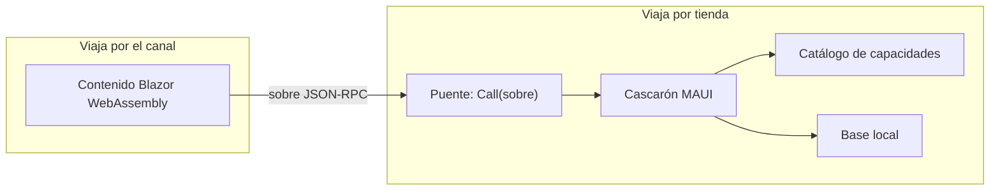

Figura 4.1. La frontera. El contenido no toca el sistema: todo lo que necesita del dispositivo pasa por el puente y lo resuelve el cascarón.

Por la misma regla, el contenido no puede usar las API web que piden permisos desde el WebView (geolocalización, `getUserMedia`): la compuerta de pruebas busca esos usos en el código del contenido y los rechaza [Demo/tests/FrameworkConcept.Gate.Tests/Contenido/ContenidoTests.cs:75-79].

#### 4.2 El puente

##### 4.2.1 Un solo método

El **puente** (*bridge*) es un único objeto con un único método, `Call(sobre)`, registrado en el `HybridWebView` [Demo/src/FrameworkConcept.Shell/Pages/ContenidoPage.xaml.cs:44]:

```csharp
// Demo/src/FrameworkConcept.Shell/Bridge/PuenteDelCascaron.cs:14-17
public sealed class PuenteDelCascaron(DespachadorDelPuente despachador)
{
    public Task<string> Call(string sobre) => despachador.AtenderAsync(sobre);
}
```

Agregar una operación no agrega un método acá: agrega una fila a la tabla de métodos y un caso en el despachador. Así la superficie C# expuesta al contenido no cambia nunca [PuenteDelCascaron.cs:9-10]. Esto concentra la validación en un punto y evita el riesgo clásico de exponer muchos métodos nativos a JavaScript [R37].

##### 4.2.2 El sobre

Lo que cruza es un **sobre** (*envelope*): un mensaje JSON-RPC 2.0 [R28] con un campo extra, `v`, que dice la versión del puente con la que se escribió el contenido [Demo/src/FrameworkConcept.Core/Contracts/Puente/Sobre.cs:5-19].

```json
{ "jsonrpc": "2.0", "v": "1.2.0", "id": "7", "method": "bridge.ready", "params": { "version": "1.1.0" } }
```

La respuesta repite `id` y lleva `result` o `error`, nunca los dos [Sobre.cs:21-28]. Los **eventos** del cascarón al contenido son notificaciones JSON-RPC sin `id`, enviadas con `HybridWebView.InvokeJavaScriptAsync` [Sobre.cs:33-37].

##### 4.2.3 Códigos de error

Tabla 4.1. Códigos de error del puente [Sobre.cs:39-71].

| Código | Nombre | Cuándo |
|---|---|---|
| -32700 / -32600 | `JsonInvalido` / `PedidoInvalido` | Sobre ilegible, o sin `jsonrpc`, `id` o `method` (JSON-RPC 2.0). |
| -32601 | `MetodoInexistente` | El método no está en la tabla. |
| -32602 / -32603 | `ParametrosInvalidos` / `ErrorInterno` | Faltan parámetros obligatorios / excepción no prevista. |
| -32001 | `VersionDelPuenteIncompatible` | El mayor de `v` no es el del cascarón. |
| -32002 | `CapacidadNoDisponible` | La capacidad que el método necesita no está en este cascarón. |
| -32003 | `PermisoDenegado` | La persona negó el permiso. |
| -32004 | `ConflictoDeVersion` | Otro cambió el documento. |
| -32005 | `AccionBloqueada` | La acción no está permitida ahora (sin servidor, sesión bloqueada). |
| -32006 / -32007 | `AutenticacionCancelada` / `AutenticacionFallida` | Ingreso cancelado por la persona / rechazado por el emisor o el Keystore. |

#### 4.3 El transporte

El **transporte** es cómo viaja el sobre entre el WebView y .NET. Lo pone MAUI y forma parte del contrato [Demo/src/FrameworkConcept.Core/Contracts/Puente/TransporteDelPuente.cs:5-26]:

- el script `_framework/hybridwebview.js`;
- la ruta `POST /__hwvInvokeDotNet`, que el servidor de contenido acepta sólo desde la página local [PuenteDelCascaron.cs:11-12];
- el método nativo `Call(sobre)` y los eventos por `InvokeJavaScriptAsync`;
- el **mayor de MAUI**, leído de `$(MauiVersion)`.

Dos condiciones prácticas salen del transporte. Primera: en Android, `hybridwebview.js` lleva el cuerpo en un encabezado HTTP que no admite UTF-8, así que el sobre se manda en ASCII con escapes `\uXXXX` [02-Cascaron-Puente-Y-Capacidades.md:116-117]. Segunda: como `hybridwebview.js` cambia con MAUI, **subir el mayor de MAUI es un cambio mayor del puente**, y obliga a un índice nuevo `/canal/puente-N+1/` [TransporteDelPuente.cs:6-8] [R4].

El transporte es lo que separa este modelo de Blazor Hybrid (recuadro de §1.2.2): el contenido corre *dentro* del WebView y habla con .NET sólo por el puente, y por eso se puede actualizar por el canal.

#### 4.4 El contrato

El **contrato del puente** son tres piezas: la tabla de métodos, el catálogo (id y versión de cada entrada) y el transporte [Demo/src/FrameworkConcept.Core/Contracts/Puente/ContratoDelPuente.cs:6-7]. Se serializan en un orden fijo en `contrato.json`, que está versionado.

##### 4.4.1 Instantánea y huella

La compuerta compara la instantánea del código con `contrato.json` [ContratoDelPuente.cs:9-13]:

- si difieren y la versión no subió, rojo;
- si la versión subió y no difieren, rojo.

Las descripciones no entran en la instantánea, así que cambiar un comentario no cambia el contrato [ContratoDelPuente.cs:20]. La **huella** sha256 de `contrato.json` se informa en el handshake sólo para diagnóstico: no es una línea de versión [ContratoDelPuente.cs:54-56].

En la versión 1.2.0, `contrato.json` tiene 21 métodos, 4 eventos y 3 entradas de catálogo [Demo/src/FrameworkConcept.Core/Contracts/contrato.json] [bitácora de la reedición 04, núcleo N3].

##### 4.4.2 Qué se comparte y qué cruza

En **ejecución** sólo cruza texto: `Call(string)`. No hay interfaces C# que el contenido invoque. En **compilación**, en cambio, el proyecto del contenido referencia a Core [Demo/src/FrameworkConcept.Content/FrameworkConcept.Content.csproj:80] y comparte los tipos del contrato (records, `CodigosDeError`). Por eso el `v` que manda el contenido es la versión del puente contra la que se compiló [Demo/src/FrameworkConcept.Content/Bridge/BridgeClient.cs:27]. Si algún día llega contenido que no sea .NET, el camino es generar el cliente desde `contrato.json`.

#### 4.5 Servicios del cascarón y capacidades del dispositivo

No toda fila de la tabla es igual:

- Un **servicio del cascarón** es una operación que el cascarón siempre ofrece, sin permiso del sistema: `documents.*`, `outbox.*`, `bridge.*`. No lleva capacidad.
- Una **capacidad** (*capability*) es una función del dispositivo con id estable y versión propia, declarada en el catálogo con sus permisos de Android, claves de `Info.plist` y `<queries>` [Demo/src/FrameworkConcept.Core/Contracts/Puente/CatalogoDeCapacidades.cs:28-50].

El catálogo de la demo tiene tres entradas, y ninguna exige un permiso de tiempo de ejecución:

```csharp
// Demo/src/FrameworkConcept.Core/Contracts/Puente/CatalogoDeCapacidades.cs:37-49
new("device.info", VersionSemantica.Parse("1.0.0"), [], []),
new("network.status", VersionSemantica.Parse("1.1.0"), ["android.permission.ACCESS_NETWORK_STATE"], []),
new("auth.session", VersionSemantica.Parse("1.1.0"), ["android.permission.USE_BIOMETRIC"], ["NSFaceIDUsageDescription"],
    ["android.support.customtabs.action.CustomTabsService"])
```

El catálogo vive en Core, y no en el proyecto MAUI, para que la compuerta lo lea sin compilar Android [CatalogoDeCapacidades.cs:29-30].

##### 4.5.1 `requires` y `optional`

El manifiesto del paquete declara qué necesita:

```json
// Demo/src/FrameworkConcept.Content/declaracion-del-contenido.json
{
  "compatibleConPuente": ">=1.1.0 <2.0.0",
  "capabilities": {
    "requires": [],
    "optional": [
      { "id": "device.info", "rango": ">=1.0.0 <2.0.0" },
      { "id": "network.status", "rango": ">=1.1.0 <2.0.0" },
      { "id": "auth.session", "rango": ">=1.0.0 <2.0.0" },
      { "id": "camera.capture", "rango": ">=1.0.0 <2.0.0" }
    ]
  }
}
```

- `requires`: sin esa capacidad, el paquete no se activa.
- `optional`: el contenido funciona sin ella y oculta lo que dependa de ella. `camera.capture` está a propósito: el catálogo no la tiene, y la demo muestra cómo degradar sin fallar.

Un **rango de versión** tiene siempre la forma `>=A.B.C <(A+1).0.0`. El techo no es opcional: cualquier otro techo se rechaza al leer el rango [Demo/src/FrameworkConcept.Core/Contracts/RangoDeVersion.cs:6-12] [RangoDeVersion.cs:52-55].

##### 4.5.2 Detección por versión de entrada

El contenido usa `auth.lock`, que llegó con el puente 1.2, pero declara `>=1.1.0`. No es un error: el contenido detecta la función por la versión de la entrada `auth.session` del catálogo. Con `auth.session` 1.0.0 el botón «Bloquear» no se muestra [Demo/src/FrameworkConcept.Content/Auth/SesionDelContenido.cs:42-46]. El piso bajo amplía los cascarones donde el contenido corre; la detección hace que degrade bien.

#### 4.6 Compatibilidad en tres capas

La compatibilidad no se decide en un solo lugar sino en tres, cada una con su momento.

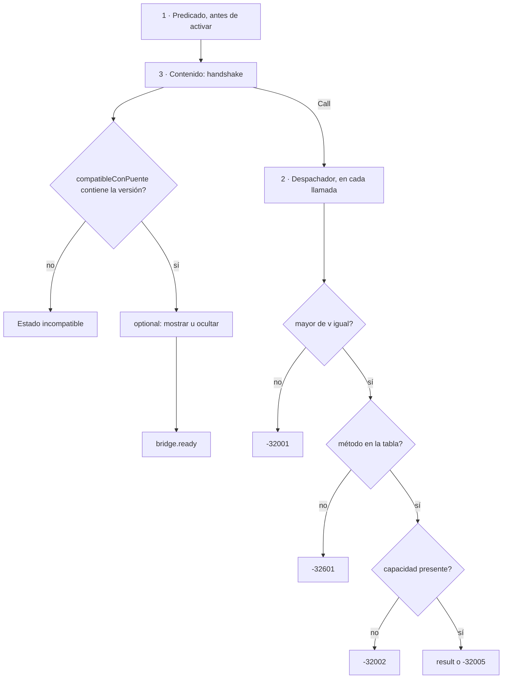

Figura 4.2. Las tres capas de compatibilidad. Seguí cada flecha «no»: cada capa atrapa un desfase distinto.

1. **Predicado, antes de activar.** Un paquete se activa sólo si el puente está en `compatibleConPuente`, cada `requires` está en el catálogo y en rango, y el WebView alcanza el mínimo (nunca menos de 94). Evalúa las tres dimensiones aunque la primera falle, para que el diagnóstico diga todo lo que falta. `optional` no entra [Demo/src/FrameworkConcept.Core/Update/PredicadoDeCompatibilidad.cs:6-43].
2. **Despachador, en cada llamada.** Valida el sobre en orden: forma JSON-RPC, mayor de `v`, método en la tabla, capacidad en el catálogo e implementada, parámetros obligatorios y política de acciones [Demo/src/FrameworkConcept.Shell/Bridge/DespachadorDelPuente.cs:21-28] [DespachadorDelPuente.cs:98-114].
3. **Contenido, después del handshake.** Vuelve a comprobar `compatibleConPuente`, porque es barato y porque el contenido pudo abrirse por otro camino (la semilla, una prueba) [BridgeSession.cs:78-84].

#### 4.7 Evolución del contrato

##### 4.7.1 Menor o mayor

Tabla 4.2. Clasificación de un cambio [TablaDeMetodos.cs:7-9] [02-Cascaron-Puente-Y-Capacidades.md:168].

| Cambio | Clase | Consecuencia |
|---|---|---|
| Método nuevo, entrada nueva del catálogo, campo opcional nuevo en una respuesta | **Menor** | Sube el menor del puente; el contenido viejo sigue andando. |
| Método quitado, parámetro obligatorio nuevo, cambio de tipo o forma, cambio del transporte (incluido el mayor de MAUI) | **Mayor** | Nuevo mayor del puente, índice nuevo `/canal/puente-N+1/` con su semilla, cascarón por tienda. |

Un ejemplo real de cambio menor: de 1.1.0 a 1.2.0 se sumaron `auth.signInWithPassword` y `auth.lock`, y la entrada `auth.session` subió a 1.1.0 [CatalogoDeCapacidades.cs:47-48] [TablaDeMetodos.cs:4-5].

El índice por mayor es lo que une este capítulo con el anterior: cada cascarón lee sólo el índice de su mayor del puente [IndiceDelCanal.cs:6-7], así que un contenido escrito para otro mayor nunca le llega.

##### 4.7.2 El ciclo de un cambio

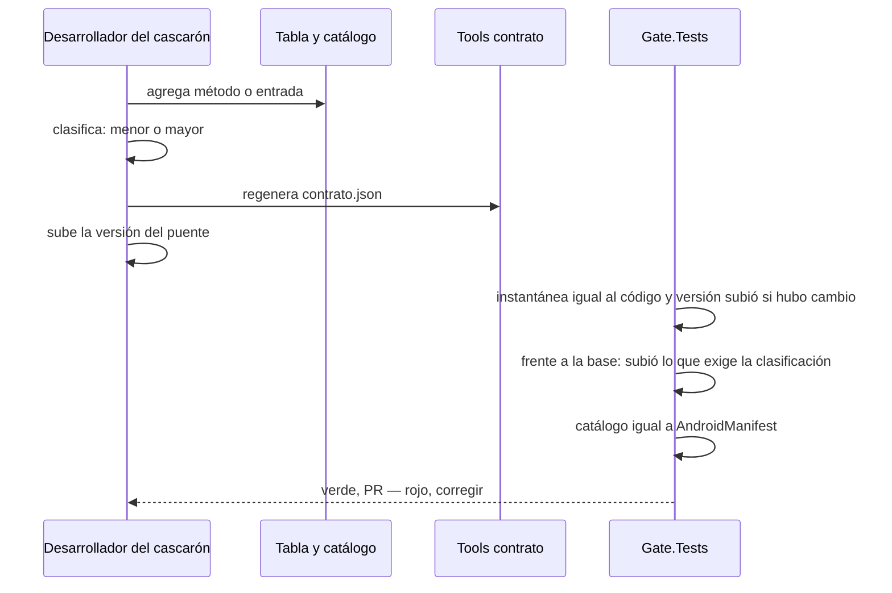

Figura 4.3. Ciclo de un cambio de contrato. La compuerta frena tanto el olvido de subir la versión como una subida sin cambio.

En el ensayo E02 se cambió la forma de un método sin subir la versión y la compuerta lo bloqueó [04-Estrategia-De-Pruebas.md:119]. La comparación «frente a la base» necesita la demo de la rama de destino en `FC_GATE_BASE`, que preparan `scripts/ci-local.sh` o el workflow; en una corrida suelta esa prueba se omite [Demo/tests/FrameworkConcept.Gate.Tests/Infraestructura/Repositorio.cs:48-54].

#### 4.8 Cómo se prueba y sus límites

- **Gate.Tests** fija la instantánea, el clasificador y la coincidencia del catálogo con el `AndroidManifest`.
- **Core.Tests** cubre el contrato y los sobres; **Update.Tests**, el predicado.
- Los conteos de cada corrida van en el Anexo H.

Dos límites conviene decirlos:

1. **El puente simulado puede desfasarse.** Para probar el contenido en un navegador, `puente-simulado.js` escribe a mano las versiones del catálogo y la del puente [Demo/src/FrameworkConcept.Content/Testing/puente-simulado.js:32] [puente-simulado.js:47]. Ninguna prueba las ata a `CatalogoDeCapacidades.cs`.
2. **`requires` no se ejercitó en el dispositivo.** La demo declara `requires: []`; un `requires` faltante se prueba sólo en el predicado y en el navegador, no en un teléfono.

#### 4.9 Plantilla de método nuevo

- [ ] Nombre `dominio.verbo`, parámetros y respuesta con tipo; ¿lleva capacidad o es servicio del cascarón?
- [ ] Si lleva capacidad: ¿está en el catálogo con sus permisos, claves de `Info.plist` y `<queries>`? ¿Evita permisos de tiempo de ejecución que no hagan falta?
- [ ] Clasificación menor o mayor según la Tabla 4.2.
- [ ] Caso en `DespachadorDelPuente` y códigos de error de la Tabla 4.1.
- [ ] `contrato.json` regenerado con `FrameworkConcept.Tools contrato` y versión del puente subida.
- [ ] El contenido detecta la función por la versión de la entrada y degrada si falta.
- [ ] ¿El piso del rango es el puente mínimo que de verdad usás?
- [ ] Puente simulado actualizado a mano (límite 1 de §4.8).

**En la industria.** Capacitor y Cordova exponen funciones nativas como plugins con registro dinámico [R61] [R17]. La demo elige una tabla versionada detrás de un solo método: la superficie nativa queda fija y una función nueva es una fila. La *runtime version* de Expo cumple el papel del mayor del puente: un paquete OTA sólo llega a binarios con la misma [R18]. La instantánea del contrato se parece a los contratos dirigidos por el consumidor de Pact [R51]. OWASP MASVS-PLATFORM trata los puentes de WebView como superficie de ataque [R30].

**Preguntas guía**

1. ¿Por qué agregar una función no cambia la superficie C# expuesta al contenido?
2. ¿Qué error recibe un contenido compilado contra el puente 2.x en un cascarón 1.x, y en qué capa?
3. ¿Por qué subir el mayor de MAUI es un cambio mayor del puente?
4. ¿Qué diferencia hay entre `requires` y `optional` para el predicado?
5. ¿Cómo muestra u oculta el contenido una función que llegó en un menor del puente?

**Resumen.** El cascarón es lo que viaja por tienda; el contenido, lo que viaja por el canal. Se hablan por un solo método, `Call(sobre)`, con sobres JSON-RPC 2.0 que llevan la versión del puente. El contrato reúne tabla, catálogo y transporte, y la compuerta lo congela en una instantánea. La compatibilidad se controla en tres capas: el predicado antes de activar, el despachador en cada llamada y el contenido después del handshake. Un cambio menor suma; uno mayor abre un índice nuevo y exige cascarón por tienda.

### Capítulo 5. Trabajo sin red: base local y outbox

**Objetivos**

- Definir *offline-first* y explicar por qué la base local es la fuente de verdad del teléfono.
- Conocer las cinco tablas reales del cascarón y quién es dueño de cada una.
- Entender por qué el documento y su fila del outbox se guardan en una sola transacción.
- Seguir paso a paso al sincronizador: idempotencia, dueño, orden por entidad, reintentos y carta muerta.
- Saber cómo conviven las versiones de definición en vuelo con las actualizaciones del contenido.

**Requisitos previos:** capítulo 1 (§1.4, offline-first y outbox) y capítulo 4 (contrato del puente).

#### 5.1 Offline-first: definición y por qué

**Offline-first** (*offline-first*) es un criterio de diseño en el que la app guarda primero en el teléfono y sincroniza después. La red mejora la experiencia, pero no es una condición para operar. En la demo esto se ve en la política de acciones: guardar una localidad (`SoloLocal`) y registrar una encuesta (`Encolable`) funcionan sin red [Demo/src/FrameworkConcept.Core/Red/PoliticaDeAcciones.cs:43-46].

Hay tres razones para elegirlo:

1. **Continuidad.** Quien trabaja en campo no puede depender de la cobertura. Si guardar exige red, se pierde trabajo.
2. **Latencia.** Leer de la base local responde en el acto, porque no hay ida y vuelta al servidor.
3. **Un único camino de escritura.** Si todo pasa por la base local, hay una sola manera de guardar, con o sin red. El caso «sin red» deja de ser una excepción.

Que la base local sea la fuente de verdad no significa que el servidor sobre. El teléfono es la fuente de verdad de **lo que la persona hizo**, y el servidor es la fuente de verdad de **lo que la organización aceptó**. El **outbox** (*transactional outbox*, definido en §1.4.2) es el puente entre las dos: guarda las intenciones de envío hasta que el servidor las acepta o las rechaza [R29].

#### 5.2 Las tablas reales

El cascarón es el dueño del esquema. El contenido nunca ejecuta DDL: sólo guarda documentos JSON a través del puente. El esquema funciona como un «sobre fijo» de columnas estables, así que una actualización de contenido nunca necesita migración. Un cambio de esquema exige subir `EsquemaDelCascaron.Version` y sale por tienda [Demo/src/FrameworkConcept.Shell/Data/Tablas.cs:3-5].

La persistencia usa EF Core sobre SQLite, detrás de la interfaz `IDb`. El `DbContext` declara cinco tablas [Demo/src/FrameworkConcept.Shell/Data/ContextoDelCascaron.cs:8-12]:

```csharp
// Demo/src/FrameworkConcept.Shell/Data/ContextoDelCascaron.cs:8-12
public DbSet<FilaDeOutbox> Outbox => Set<FilaDeOutbox>();
public DbSet<FilaDeDocumento> Documentos => Set<FilaDeDocumento>();
public DbSet<FilaDeDefinicion> Definiciones => Set<FilaDeDefinicion>();
public DbSet<FilaDeVersionDeContenido> VersionesDeContenido => Set<FilaDeVersionDeContenido>();
public DbSet<FilaDeConfiguracion> Configuracion => Set<FilaDeConfiguracion>();
```

Tabla 5.1. Tablas del cascarón.

| Tabla | Qué guarda | Fuente |
| --- | --- | --- |
| `Outbox` | Una fila por envío pendiente o resuelto: clave de idempotencia, dueño, acción, entidad, versiones, payload, estado, intentos y próximo intento | [Tablas.cs:10-55] |
| `Documentos` | Documentos JSON del contenido: colección, id, versión de forma, versión y el JSON tal cual | [Tablas.cs:69-80] |
| `Definiciones` | Cada versión de una definición de encuesta. Se conservan las que tienen respuestas sin enviar | [Tablas.cs:83-90] |
| `VersionesDeContenido` | Qué pasó con cada versión de contenido en este teléfono (activada, `Listo`, rollback) | [Tablas.cs:92-99] |
| `Configuracion` | Pares clave-valor del cascarón (id de instalación, última consulta, refresh sellado) | [Tablas.cs:101-106] |

Las fechas se guardan como milisegundos Unix (`long`), porque SQLite no compara ni ordena `DateTimeOffset` [Tablas.cs:7].

> **Nota de coherencia.** El diseño previo de `Framework-APP.md` listaba otras tablas (`RegistroRed`, `Sesion`, `ContenidoVersion`, `Config`) y se inclinaba por `sqlite-net-pcl`. La demo implementa las cinco tablas de la Tabla 5.1 con EF Core. El registro de red vive en memoria, en un buffer circular de 200 llamadas [Demo/src/FrameworkConcept.Core/Red/TransicionesDeRed.cs:73-74]. Este libro describe lo implementado [Framework-APP.md:288,292].

> **Límite declarado.** La demo no cifra la base local. `Framework-APP.md` recomienda SQLCipher cuando hay datos de personas [Framework-APP.md:290]. Es una decisión de producto (véase §6.8, D-N4-3) [R30][R49].

#### 5.3 Una transacción: documento y fila del outbox

La regla central del outbox es que **el cambio local y la intención de enviarlo se escriben juntos o no se escriben**. Si se guardara primero el documento y la app se cerrara antes de crear la fila, el dato quedaría en el teléfono sin salir nunca. Si se creara primero la fila, podría salir un envío de algo que no quedó guardado.

En la demo, `GuardarYEncolarAsync` resuelve esto con un único `SaveChanges`:

```csharp
// Demo/src/FrameworkConcept.Shell/Data/DbSqlite.cs:89-116 (recortado)
public Task<bool> GuardarYEncolarAsync(FilaDeDocumento documento, FilaDeOutbox fila, CancellationToken ct = default) =>
    ConCerrojo(async db =>
    {
        if (await db.Outbox.AnyAsync(f => f.ClaveIdempotencia == fila.ClaveIdempotencia, ct))
            return false;
        // … alta o actualización del documento …
        fila.CreadaEn = Ahora;
        fila.ProximoIntentoEn = Ahora;
        db.Outbox.Add(fila);

        // Un solo SaveChanges = una sola transacción de SQLite: el documento y la fila quedan juntos (P5).
        await db.SaveChangesAsync(ct);
        return true;
    }, ct);
```

Hay dos detalles que vale la pena mirar. El primero es que, si la clave de idempotencia ya existe, el método devuelve `false` y no duplica nada: reintentar el guardado desde la UI es inofensivo. El segundo es que la clave también tiene un índice único en la base [ContextoDelCascaron.cs:20], de modo que la garantía no depende sólo del código.

La Figura 5.1 muestra el recorrido completo de una acción encolable.

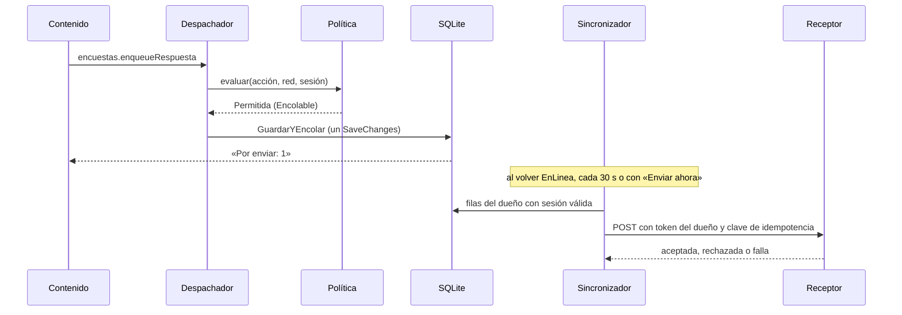

Figura 5.1. Guardar, encolar y sincronizar. Fijate en que el contenido recibe el «Por enviar» antes de que exista la red: el envío ocurre después y en otro proceso lógico.

#### 5.4 El sincronizador

El `SincronizadorDelOutbox` es el único componente que envía filas. Su diseño se resume en seis reglas.

##### 5.4.1 Idempotencia

Cada fila lleva una `ClaveIdempotencia` única y el receptor deduplica por ella, así que reenviar nunca duplica [Tablas.cs:14-15]. Esto permite reintentar sin miedo: si el servidor recibió el POST pero la respuesta se perdió, el segundo envío se descarta del lado del servidor.

##### 5.4.2 Dueño

Cada fila tiene un `Dueno` [Tablas.cs:17-18]. El sincronizador sólo mira las filas cuyo dueño es la identidad presente con sesión válida, y las filtra **antes** de aplicar el orden por entidad, para que una fila ajena no trabe a nadie [Demo/src/FrameworkConcept.Shell/Sync/SincronizadorDelOutbox.cs:128-130]. Justo antes de enviar, vuelve a validar al dueño y toma *su* token, porque la sesión pudo cambiar durante la pasada [SincronizadorDelOutbox.cs:142-153].

> **Nota de coherencia.** El comentario de `Dueno` todavía dice «la sesión por dispositivo (no hay login)» [Tablas.cs:17]. Con el modo con cuenta, el dueño es el `sub` de la cuenta; en modo Dispositivo, el id de instalación. La corrección del comentario queda para un PR de código.

##### 5.4.3 Orden por entidad

El orden se respeta **por entidad**, no globalmente. En cada pasada sale como mucho la primera fila pendiente de cada entidad, y si la primera fila de una entidad está en carta muerta, esa entidad queda trabada [SincronizadorDelOutbox.cs:131-136]:

```csharp
// Demo/src/FrameworkConcept.Shell/Sync/SincronizadorDelOutbox.cs:130-136
foreach (var fila in sinEnviar.Where(f => sesion.PuedeEnviarFilaDe(f.Dueno)))
{
    // La primera fila sin enviar de cada entidad decide: si está en carta muerta, la entidad queda trabada;
    // si está pendiente, es la única de su entidad que puede salir en esta pasada.
    if (!vistas.Add(fila.Entidad)) continue;
    if (fila.Estado == EstadoDeFila.Pendiente && (ignorarBackoff || fila.ProximoIntentoEn <= ahora)) elegidas.Add(fila);
}
```

El beneficio es que un problema queda acotado: una encuesta rechazada no frena las respuestas de otra encuesta.

##### 5.4.4 Reintentos con backoff exponencial

Ante una falla de red o del servidor, la fila espera antes del próximo intento: 5 s, 10 s, 20 s y así hasta un máximo de 10 min, sin límite de intentos [SincronizadorDelOutbox.cs:15,24-25,170]. Este **backoff por fila** es distinto del reintento del chequeo de salud (véase §6.1 y la Tabla 6.3).

##### 5.4.5 Cuándo corre una pasada

Corre una pasada en cuatro casos: cada 30 s [SincronizadorDelOutbox.cs:23,90], al volver la red a un estado con servidor, al volver la sesión a `Activa` [SincronizadorDelOutbox.cs:17-19] y cuando la persona toca **«Enviar ahora»** (`outbox.sendNow`). En la reconexión y en «Enviar ahora», la pasada ignora el backoff de las filas. Un semáforo garantiza que corra una sola pasada a la vez [SincronizadorDelOutbox.cs:28-29,99-112].

##### 5.4.6 Carta muerta

Una fila tiene cuatro estados [Tablas.cs:58-67]. `Rechazada` (el servidor la rechazó) y `Error` (algo que reintentar no arregla, como un payload ilegible) forman la **carta muerta** (*dead letter*): **no se borran**, se muestran al usuario y en la pantalla de Diagnóstico.

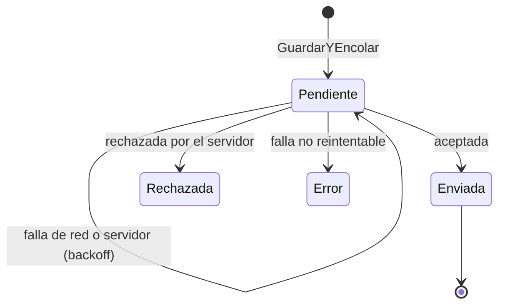

Figura 5.2. Estados de una fila del outbox. Lo que hay que notar es que de `Rechazada` y `Error` no sale ninguna flecha: la carta muerta queda a la vista y no se descarta.

#### 5.5 Encuestas y versiones de definición en vuelo

Las encuestas viajan como **datos**, no como código [02-Cascaron-Puente-Y-Capacidades.md:37]. Cada respuesta registra con qué definición se tomó (`EncuestaId` y `VersionDefinicion`) [Tablas.cs:31-35]. Antes de encolar, el despachador comprueba que esa versión de la definición esté en el teléfono [Demo/src/FrameworkConcept.Shell/Bridge/DespachadorDelPuente.cs:214-215].

El problema que esto resuelve es el de la **versión de definición en vuelo**: una persona completa una encuesta con la versión 3, sin red, y mientras tanto el servidor publica la versión 4. La respuesta guardada sigue siendo de la 3 y debe interpretarse como tal. Por eso la tabla `Definiciones` conserva las versiones que tienen respuestas sin enviar [Tablas.cs:83], y la carta muerta de Diagnóstico muestra la versión con que se tomó cada fila [Demo/src/FrameworkConcept.Shell/Pages/DiagnosticoPage.xaml.cs:131].

#### 5.6 Actualizar sin tocar los pendientes

Hay una regla que une este capítulo con el 3: **ninguna actualización espera a vaciar el outbox ni descarta pendientes** (P13.7) [02-Cascaron-Puente-Y-Capacidades.md:97][01-Actualizacion-Sin-Tienda.md:220]. Esto es posible por dos decisiones previas:

- el esquema es un sobre fijo, así que una versión nueva del contenido no migra la base (§5.2);
- cada fila guarda la versión del contenido y de la definición con que se tomó [Tablas.cs:28-35], así que el receptor sabe interpretarla aunque el contenido ya haya cambiado.

La alternativa, «sincronizar antes de actualizar», parece prudente, pero ata la actualización a la red y, si hay una fila en carta muerta, la deja bloqueada para siempre.

> **En la industria.** El patrón *transactional outbox* nació en los microservicios para publicar eventos sin transacciones distribuidas [R29]. La guía de arquitectura de Android propone la misma idea para móviles: la base local como fuente única y la sincronización como tarea en segundo plano [R38]. OWASP MASVS-STORAGE exige pensar qué datos sensibles quedan en el almacenamiento local y cómo se protegen [R30].

**Preguntas guía**

1. ¿Qué se pierde si el documento y la fila del outbox se guardan en dos transacciones?
2. ¿Por qué el orden es por entidad y no global?
3. ¿Qué diferencia hay entre `Rechazada` y una fila `Pendiente` con muchos intentos?
4. Si se publica una definición nueva mientras hay respuestas pendientes, ¿qué tabla las protege?
5. ¿Por qué no conviene vaciar el outbox antes de una actualización OTA?

**Resumen**

La base local es la fuente de verdad de lo que hizo la persona. El cascarón es dueño de cinco tablas con esquema fijo. El documento y su fila del outbox se guardan en un único `SaveChanges`. El sincronizador envía con idempotencia, sólo las filas del dueño con sesión válida y en orden por entidad, reintenta con backoff de 5 s a 10 min y nunca borra la carta muerta. Las versiones de definición en vuelo se conservan, y ninguna actualización toca los pendientes.

---

### Capítulo 6. Red y sesión del dispositivo

**Objetivos**

- Distinguir «hay red» de «llego a mi servidor» y conocer los cuatro estados de red combinados.
- Clasificar una acción del negocio según la red y saber cómo la hace cumplir el despachador.
- Elegir entre el modo Formulario y el modo Navegador para el ingreso, con su justificación en los estándares.
- Entender la cadena del secreto: biometría, Keystore y refresh token.
- Tener a mano todos los tiempos de red y sesión en una sola tabla.

**Requisitos previos:** capítulo 4 (contrato del puente, error -32005) y capítulo 5.

#### 6.1 Estado de red combinado

El sistema operativo informa si hay conectividad, pero eso no garantiza que el servidor responda: puede haber un portal cautivo, un DNS caído o un servidor en mantenimiento. Por eso la demo combina la señal de `Connectivity` del sistema [R55] con un chequeo de salud propio y obtiene el **estado de red combinado**, con cuatro valores:

Tabla 6.1. Estados de red.

| Estado | Significado | Aviso para la persona |
| --- | --- | --- |
| `EnLinea` | Hay red y el servidor responde | Ninguno |
| `EnLineaMedida` | Igual, pero por datos móviles sin WiFi | «Datos móviles» |
| `RedSinServidor` | Hay red, pero el servidor no responde | «Hay red pero el servidor no responde. Reintentando…» |
| `SinRed` | El sistema no tiene conectividad | «Sin conexión. Lo que hagas se guarda y se envía cuando vuelva.» |

Los textos salen de `TransicionesDeRed.MotivoDe` [Demo/src/FrameworkConcept.Core/Red/TransicionesDeRed.cs:44-50].

La máquina de estados es una función pura (estado actual más señal da el estado siguiente), sin MAUI ni reloj, lo que permite probarla sin dispositivo [TransicionesDeRed.cs:3-8,13-37]. Hay una regla de fondo: **sólo un chequeo de salud exitoso saca de `RedSinServidor`** [TransicionesDeRed.cs:25-26].

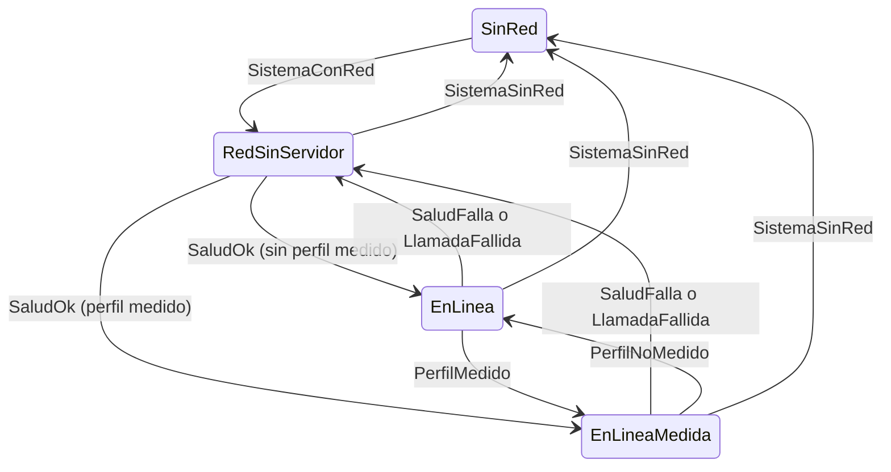

Figura 6.1. Estados de red. Observá que de `SinRed` nunca se pasa directo a `EnLinea`: siempre se pasa por `RedSinServidor` hasta que la salud lo confirme.

El chequeo de salud es un `GET /salud` con un timeout de 3 s, y su resultado se reutiliza durante 10 s. En `RedSinServidor` se reintenta con backoff de 5 a 60 s, sin límite de intentos, y en línea se confirma cada 60 s [TransicionesDeRed.cs:58-71]. El código aclara que estos valores son de la demo y no valores de producto [TransicionesDeRed.cs:53-55]. El nombre del endpoint lo decide cada servidor: `Framework-APP.md` usaba `GET /health` [Framework-APP.md:214].

#### 6.2 Política de acciones

La **política de acciones** clasifica cada acción del negocio según lo que necesita de la red [Demo/src/FrameworkConcept.Core/Red/PoliticaDeAcciones.cs:5-19]:

- `SoloLocal`: se ejecuta siempre.
- `Encolable`: se guarda en el outbox y sale cuando haya red y sesión válida.
- `SoloEnLinea`: sin servidor se bloquea, con el botón deshabilitado y un motivo.
- `SoloWiFi`: está contemplada en la lógica, pero ninguna acción de la demo la usa.

En la demo, la política es una constante del cascarón [PoliticaDeAcciones.cs:33-36,41-51]:

```csharp
// Demo/src/FrameworkConcept.Core/Red/PoliticaDeAcciones.cs:41-51 (recortado)
public static IReadOnlyList<AccionDeclarada> Acciones { get; } =
[
    new("localidades.guardar", ClaseDeAccion.SoloLocal, ["documents.put", "documents.delete"], /* … */),
    new("encuesta.enviar", ClaseDeAccion.Encolable, ["encuestas.enqueueRespuesta"], /* … */),
    new("outbox.enviarAhora", ClaseDeAccion.SoloEnLinea, ["outbox.sendNow"], /* … */),
    new(Ingresar, ClaseDeAccion.SoloEnLinea, ["auth.signIn", "auth.signInWithPassword"], /* … */)
];
```

La política se aplica en dos lugares, y ninguno reemplaza al otro:

1. **En el contenido**, que consulta la evaluación (`actions.policy`, `actions.check`, evento `actions.changed`) y deshabilita el botón con su motivo [PoliticaDeAcciones.cs:58-69].
2. **En el despachador del puente**, que evalúa cada método que es una acción del negocio y, si no está permitida, responde con `AccionBloqueada` (-32005) [Demo/src/FrameworkConcept.Shell/Bridge/DespachadorDelPuente.cs:27][Demo/src/FrameworkConcept.Core/Contracts/Puente/Sobre.cs:64].

El contenido puede tener un error y el despachador no. Esa es la frontera de confianza del capítulo 4.

**Plantilla para una acción nueva.** Para sumar una acción, respondé: ¿qué id estable tiene (dominio en español, por ejemplo «localidades.guardar»)? ¿Qué clase le corresponde? ¿Qué métodos del puente la ejecutan? ¿Qué texto explica el bloqueo? Si es `Encolable`, ¿cuál es su entidad para el orden del outbox? Las preguntas salen de la forma de `AccionDeclarada` [PoliticaDeAcciones.cs:21-30] y de la lista de chequeo de `02-Cascaron-Puente-Y-Capacidades.md:244`.

#### 6.3 Sesión e identidad

La identidad la da un **emisor OIDC** (*OpenID Provider*), no el teléfono. La sesión pasa por seis estados: `SinCuenta`, `Ingresando`, `Activa`, `Bloqueada`, `Vencida` y `Revocada` [Demo/src/FrameworkConcept.Core/Auth/Sesion.cs:18-32]. `Bloqueada` significa que hay identidad pero el refresh token está sellado en el Keystore y falta el desbloqueo local (§6.4).

El ingreso tiene dos modos, que se eligen al compilar con la propiedad `FcModoDeIngreso` [07-Red-Y-Autenticacion.md:157-164].

Tabla 6.2. Modos de ingreso.

| Modo | Método del puente | Canje | Cuándo |
| --- | --- | --- | --- |
| `Formulario` (por defecto) | `auth.signInWithPassword` | ROPC (`grant_type=password`) [Demo/src/FrameworkConcept.Core/Auth/Oidc.cs:108-115] | Sólo con el emisor de ensayo |
| `Navegador` | `auth.signIn` | Authorization code + PKCE S256 en la Custom Tab (`WebAuthenticator`) [Oidc.cs:70-80,86-93] | Producción |

**Modo Navegador.** Sigue RFC 8252: la app nativa abre el navegador del sistema, nunca una WebView propia, para que la app no vea la clave [R6]. Usa PKCE con `code_challenge_method=S256`, porque la app es un cliente público sin secreto [R7][Oidc.cs:76,86]. Además manda `prompt` en cada ingreso interactivo, para que la sesión SSO viva en el navegador no entre sola después de un cierre de sesión [Oidc.cs:77-79].

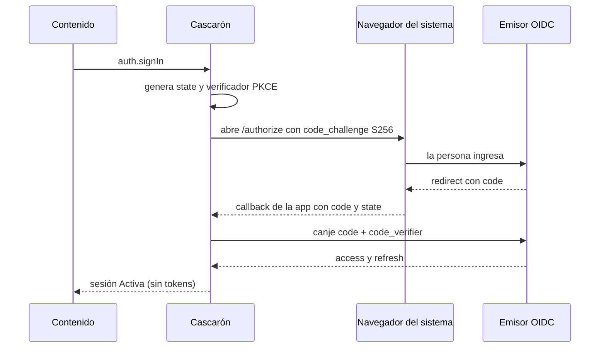

Figura 6.2. Ingreso en modo Navegador. Mirá la última flecha: el contenido se entera de que hay sesión, pero no recibe ningún token.

**Modo Formulario.** El contenido dibuja su propio formulario y la clave cruza el puente **una sola vez**, en un método específico. El cascarón la canjea con ROPC. El propio código lo explica: el BCP de seguridad de OAuth (RFC 9700 §2.4) desaconseja ROPC, y la demo lo usa sólo porque el emisor de ensayo no trae el endpoint del borrador *OAuth 2.0 for First-Party Applications* [Oidc.cs:96-106][R39][R56]. Cambiar de emisor cambia ese cuerpo y nada más.

**Recomendación para producción.** Modo Navegador por defecto: es el estándar maduro y trae MFA y SSO sin costo. Un formulario propio vale cuando el emisor implemente el borrador de apps first-party. ROPC, nunca en producción (D-N4-1, §6.8).

#### 6.4 Desbloqueo local y Keystore

La seguridad del teléfono (huella, rostro, PIN o patrón) **no es identidad**. Sólo abre un secreto. El refresh token se sella con una clave AES-256-GCM del AndroidKeyStore con alias `fc.sesion.refresh` [Demo/src/FrameworkConcept.Shell/Auth/CofreDeSesion.cs:18-38][R34]. La clave exige autenticación en cada uso (timeout 0) y acepta biometría fuerte o la credencial del dispositivo:

```csharp
// Demo/src/FrameworkConcept.Shell/Auth/CofreDeSesion.cs:119-130 (recortado)
var especificacion = new KeyGenParameterSpec.Builder(Alias, KeyStorePurpose.Encrypt | KeyStorePurpose.Decrypt)
    .SetBlockModes(KeyProperties.BlockModeGcm)!
    .SetEncryptionPaddings(KeyProperties.EncryptionPaddingNone)!
    .SetKeySize(256)!
    .SetUserAuthenticationRequired(true)!
    .SetUserAuthenticationParameters(0, (int)(KeyPropertiesAuthType.BiometricStrong | KeyPropertiesAuthType.DeviceCredential))!
    .SetInvalidatedByBiometricEnrollment(true)!
    .Build();
```

La clave sólo se puede usar dentro de un `CryptoObject` de `BiometricPrompt`, el diálogo de la plataforma, sin paquete AndroidX [CofreDeSesion.cs:150-163][R35]. El desbloqueo se ofrece sólo con API 30 o superior y con bloqueo de pantalla configurado [CofreDeSesion.cs:24-26][Oidc.cs:246]. Si el Keystore invalida la clave (por ejemplo, porque se quitó el bloqueo de pantalla), la clave se borra y hay que volver a ingresar con la cuenta [CofreDeSesion.cs:15-16,27].

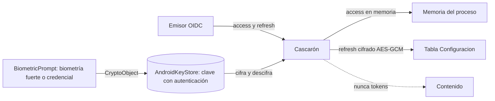

Figura 6.3. La cadena del secreto. El texto sellado vive en la base y la clave vive en el hardware. Ninguno de los dos sirve sin el otro ni sin la persona frente al teléfono.

> **Apartamiento declarado H-1.** El borrador pedía que una huella nueva invalidara la clave. Con `BIOMETRIC_STRONG | DEVICE_CREDENTIAL` eso no ocurre: enrolar una huella nueva no invalida la clave [07-Red-Y-Autenticacion.md:302-309][E03 H-1]. Se mantuvo la combinación porque el PO pidió aceptar también PIN y patrón (P4). La invalidación al quitar el bloqueo de pantalla sigue vigente. El comentario de `CofreDeSesion.cs:128-129` todavía afirma lo contrario y se corrige en un PR de código aparte.

`Framework-APP.md` advertía que `SecureStorage` no ata la lectura a la biometría y proponía evaluar un plugin [Framework-APP.md:189]. La demo cerró esa pregunta en Android con código de plataforma. En iOS (Keychain), el mecanismo equivalente está **NO VERIFICADO**.

#### 6.5 Ningún token cruza el puente

El contenido ve **el estado** de la sesión (quién es, si está activa o bloqueada), pero nunca un token. Esta regla (P3) la hace cumplir una prueba de la compuerta que recorre todos los parámetros, respuestas y eventos del contrato y falla si alguno nombra un token o una credencial [Demo/tests/FrameworkConcept.Gate.Tests/Contrato/SinTokensEnElPuenteTests.cs:8-20]:

```csharp
// Demo/tests/FrameworkConcept.Gate.Tests/Contrato/SinTokensEnElPuenteTests.cs:16-17
// «clave» no entra: claveIdempotencia es legítima (P13.6).
private static readonly string[] Prohibidas = ["token", "secret", "password", "contrasena", "credencial", "verifier", "verificador"];
```

La única excepción es `auth.signInWithPassword`, cuyos parámetros sí llevan la clave. Otra prueba verifica que la credencial cruce una sola vez y nunca vuelva [SinTokensEnElPuenteTests.cs:36-40]. La propia prueba se describe como «una red gruesa»: un nombre inocente que contenga «token» la hace saltar, y eso se discute en el PR [SinTokensEnElPuenteTests.cs:10-11].

#### 6.6 Tabla única de tiempos

Hay varios tiempos parecidos que conviene no mezclar. La Tabla 6.3 los junta con su propósito.

Tabla 6.3. Tiempos de red y sesión.

| Parámetro | Valor | Para qué | Fuente | Naturaleza |
| --- | --- | --- | --- | --- |
| Timeout de salud | 3 s | No colgar el chequeo | [TransicionesDeRed.cs:59] | demo |
| Caché de salud | 10 s | No preguntar dos veces seguidas | [TransicionesDeRed.cs:62] | demo |
| Reintento de salud | de 5 a 60 s; en línea, cada 60 s | Volver a alcanzar el servidor | [TransicionesDeRed.cs:65-71] | demo |
| Backoff por fila del outbox | de 5 s a 10 min, exponencial | Que el servidor acepte la fila | [SincronizadorDelOutbox.cs:24-25,170] | demo |
| Pasada del sincronizador | cada 30 s | Barrido periódico | [SincronizadorDelOutbox.cs:23] | demo |
| Bloqueo tras segundo plano | 5 min | Volver a pedir la seguridad del teléfono | [Oidc.cs:249] | demo |
| Renovación anticipada del access | 30 s antes de vencer | Evitar llamadas con token vencido | [Oidc.cs:252] | demo |
| Reanudación con consulta OTA | 15 min | Buscar versión nueva del contenido | [ParametrosDeProducto.cs:21-22] [99-Anexos.md:219] | producto [folio 036] |
| Sesión SSO del emisor de ensayo | 30 min sin uso, 10 h como máximo | Vida de la sesión en el emisor | [07-Red-Y-Autenticacion.md:144-150] | ensayo |

Los dos backoffs resuelven problemas distintos: el de salud mide si se alcanza el servidor, y el de fila mide si el servidor acepta ese envío. Los 15 min de la reanudación OTA y los 5 min del bloqueo también son independientes: uno consulta el canal y el otro protege la sesión.

#### 6.7 Casos medidos y lo que sigue sin verificar

Los ensayos E03 y E05 corrieron estos mecanismos en un emulador de ensayo y en un teléfono de medida. Las cifras de tiempo están en la corrida fechada (Anexo H).

- **Encuesta sin red y reconexión sola.** Se registró una encuesta en modo avión, se levantó el receptor, la app pasó sola a `EnLinea` y la fila salió con el dueño correcto [E03 §4.3][07-Red-Y-Autenticacion.md:245-250].
- **Cerrar sesión conserva lo pendiente.** Con red y sin sesión, el outbox no envió. Al reingresar con la misma cuenta, la fila salió [E03 paso g][07-Red-Y-Autenticacion.md:252-257]. El criterio es «retener es reversible, borrar no».
- **Quitar el bloqueo de pantalla.** La clave del Keystore quedó invalidada. Después de las correcciones de E03, la sesión pasa de `Bloqueada` a `SinCuenta` [07-Red-Y-Autenticacion.md:259-265].
- **Login en el contenido** (E05): ingreso, sesión activa, bloqueo y desbloqueo sin red, en el emulador y en el teléfono de medida [E05].

Siguen **NO VERIFICADOS**: el estado `EnLineaMedida` en un dispositivo, la regresión del modo sin cuenta en el emulador, el conjunto completo en un teléfono físico y el Keychain de iOS [E03 §7][07-Red-Y-Autenticacion.md §8].

#### 6.8 Decisiones abiertas

Tabla 6.4. Decisiones de red y sesión.

| Id | Pregunta | Alternativas | Recomendación |
| --- | --- | --- | --- |
| D-N4-1 | ¿Con qué canje se ingresa en producción? | (a) Navegador, RFC 8252 + PKCE; (b) formulario con el borrador de apps first-party; (c) ROPC | (a) por defecto; (b) cuando el emisor lo soporte y se quiera UI propia; (c) nunca [R39] |
| D-N4-2 | ¿Qué hacer con la invalidación por enrolamiento (H-1)? | (a) Mantener biometría fuerte o credencial y declararlo; (b) sólo biometría | (a): lo pidió el PO (P4) y la invalidación al quitar el bloqueo sigue vigente |
| D-N4-3 | ¿Se cifra la base local? | (a) No (la demo); (b) SQLCipher con la clave en el Keystore; (c) cifrar sólo payloads sensibles | La decide el producto según el dato; (b) cuando haya datos personales [R30][R49] |
| D-N4-4 | ¿Se piden *offline tokens*? | (a) `openid profile`, que vence con la sesión SSO; (b) `offline_access` | Abierta: (a) es más simple y segura; (b) evita reingresos en jornadas largas sin red |
| D-N4-5 | ¿Cuántos backoffs se exponen? | Uno o dos | Dos, documentados por separado (Tabla 6.3) |

> **En la industria.** RFC 8252 es la práctica actual para apps nativas: navegador del sistema, nunca una WebView embebida para el login [R6], con PKCE obligatorio para clientes públicos [R7]. El BCP de seguridad de OAuth (RFC 9700) desaconseja ROPC [R39], y el IETF trabaja en un camino estándar para formularios propios de apps first-party [R56]. Del lado de la plataforma, Android documenta el Keystore con claves atadas a la autenticación [R34] y `BiometricPrompt` con `CryptoObject` [R35]. .NET MAUI ofrece `Connectivity` y `WebAuthenticator` como piezas de base [R55][R54]. OWASP MASVS ordena los controles en STORAGE, AUTH y NETWORK [R30].

**Preguntas guía**

1. ¿Por qué `SistemaConRed` lleva a `RedSinServidor` y no a `EnLinea`?
2. Si el contenido tiene un error y no deshabilita un botón `SoloEnLinea`, ¿qué pasa cuando se invoca el método sin servidor?
3. ¿Qué gana el modo Navegador frente al modo Formulario, y qué pierde?
4. ¿Por qué la huella no es identidad? ¿Qué abre exactamente?
5. ¿Qué dos backoffs hay y qué mide cada uno?

**Resumen**

El estado de red combina el sistema con un chequeo de salud y tiene cuatro valores. Sólo la salud confirma que se llega al servidor. La política de acciones clasifica cada acción en `SoloLocal`, `Encolable` o `SoloEnLinea`; el contenido la muestra y el despachador la impone con -32005. La identidad la da el emisor OIDC: en producción se ingresa por el navegador del sistema con PKCE, y ROPC queda limitado al ensayo. La seguridad del teléfono abre una clave del Keystore que sella el refresh token, con el apartamiento H-1 declarado. Ningún token cruza el puente, y una prueba de la compuerta lo hace cumplir.

## Parte III. Ingeniería

Esta parte trata lo que rodea al mecanismo. El capítulo 7 muestra cómo entra un cambio al repositorio sin romper lo que andaba; el 8, cómo se prueba; el 9, qué hace la industria para proteger el entorno de la app y para dar de alta cuentas. Las rutas de las citas son relativas a `Concepts/Framework-Concept/`. El workflow vive en la raíz del repositorio y se cita como `../../.github/workflows/framework-concept-demo.yml`, con líneas al commit `9b5b5ad`.

### Capítulo 7. Integración y versionado

**Objetivos**

- Entender por qué la demo tiene una sola rama estable y un único check obligatorio.
- Leer la tabla de decisión del agregador `fw-ok` y explicar por qué un `skipped` es peligroso.
- Correr en local la misma compuerta que corre el servidor de integración.
- Distinguir los dos caminos de publicación, las cuatro líneas de versión visibles y las tres internas.
- Saber qué número sube cada tipo de cambio y cómo llega un artefacto desde la fusión hasta un canal.

**Requisitos previos:** capítulo 1 (cuatro líneas de versión), capítulo 3 (índice del canal, firma y promoción) y capítulo 4 (contrato del puente).

#### Parte A. Conceptos

#### 7.1 Una rama estable y PR obligatorio

El problema que resuelve este capítulo es concreto: un PR que rompe lo que funcionaba. La respuesta de la demo es el modelo más simple que lo evita. Hay una sola rama de integración, `main`, y todo cambio entra por **pull request** (*PR*): una propuesta de fusión que se revisa y se prueba antes de entrar.

Es el modelo que GitHub llama *GitHub flow*: ramas cortas que salen de `main` y vuelven a `main` [R8]. Es compatible con el desarrollo basado en tronco (*trunk-based development*), que pide ramas todavía más cortas [R9]. Se descartó una rama `develop` intermedia: suma una segunda integración y no aporta nada a un equipo chico [03-Integracion-Y-Versionado.md §2.5].

Tabla 7.1. Modelos de ramas considerados.

| Modelo | Decisión | Criterio |
|---|---|---|
| GitHub flow con `main` protegida | Elegido | Una sola integración |
| Trunk-based | Compatible | Ramas más cortas; no cambia la compuerta |
| `develop` + `main` (git-flow) | Descartado | Dos integraciones para un equipo chico |

#### 7.2 La compuerta y el check agregador `fw-ok`

**Compuerta** (*gate*): el conjunto de pruebas que un PR tiene que pasar para poder fusionarse. En GitHub, una rama protegida exige que ciertos **checks obligatorios** (*required status checks*) estén en verde [R10].

El primer reflejo sería declarar obligatorios todos los jobs. Tiene un problema: GitHub toma un job **omitido** (`skipped`) como éxito a los fines del check obligatorio [R11]. Si un job no corre porque una condición lo saltea, el PR pasa sin que nadie haya probado nada.

La demo lo resuelve con un **check agregador** (*required aggregate check*): un job que corre siempre, no lee el código del PR y sólo mira el resultado de los demás. Se llama `fw-ok` y es el único check obligatorio de `main` [../../.github/workflows/framework-concept-demo.yml:5-6, 164-170].

```yaml
# ../../.github/workflows/framework-concept-demo.yml:166-170
  fw-ok:
    needs: [alcance, compuerta, apk]
    if: always()
    # …
```

`if: always()` hace que corra aunque algo haya fallado o se haya omitido; `needs` le da acceso a los resultados.

La regla es **estricta**: `skipped` y `cancelled` cuentan como rojo. Hay una sola excepción, la **omisión declarada**: el PR no toca la demo y el job `alcance` lo informa con su motivo [../../.github/workflows/framework-concept-demo.yml:188-196].

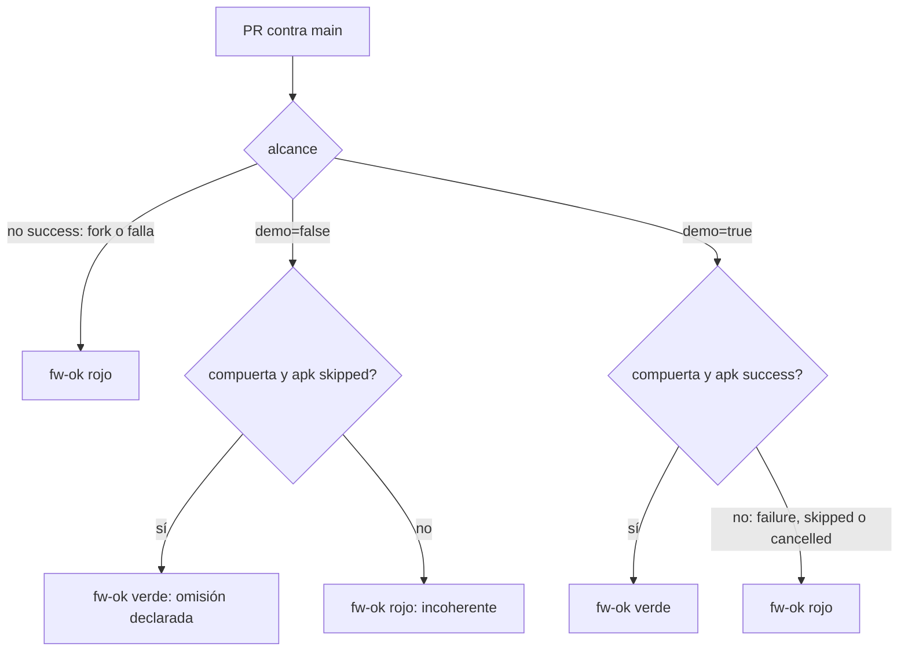

Figura 7.1. Decisión del agregador `fw-ok`. Fijate que hay un solo camino verde por omisión, y que exige que *ambos* jobs estén omitidos [../../.github/workflows/framework-concept-demo.yml:182-205].

Dos detalles del job `alcance` completan el cuadro:

- **Sin filtro `paths` en `on:`.** Si el workflow tuviera `paths`, un PR que no toca la demo no dispararía nada y el check obligatorio quedaría esperando. El alcance lo decide un paso con `git diff --name-only "$BASE_SHA...$HEAD_SHA"` [../../.github/workflows/framework-concept-demo.yml:4, 21-24, 68]. Si cambia el propio workflow, corre todo [:70-71].
- **Guarda de mismo repositorio.** Un PR desde un *fork* no corre en el runner autoalojado: `alcance` queda omitido y, por la regla estricta, `fw-ok` da rojo [:42, 182-186]. El workflow pide sólo `permissions: contents: read` y no usa secretos [:26-27], como recomienda GitHub para runners propios [R12].

#### 7.3 Compuerta local igual a la remota

Un desarrollador tiene que poder ver el rojo antes de abrir el PR. Para eso, `Demo/scripts/ci-local.sh` corre **los mismos pasos, en el mismo orden** que el workflow [Demo/scripts/ci-local.sh:2-11].

Tabla 7.2. Los siete pasos de la compuerta.

| Paso | Qué hace |
|---|---|
| 0. Base del PR | Extrae la demo tal como está en la rama de destino para comparar contrato y definiciones |
| 1. Build | `FrameworkConcept.Demo.SinMaui.slnf` con avisos como error |
| 2. `Core.Tests` | Dominio, reglas portadas y contrato |
| 3. `Update.Tests` | Actualizador |
| 4. `Gate.Tests` | Instantánea del contrato, definiciones, catálogo frente al manifiesto, contenido sin AOT |
| 5. Contenido | `dotnet publish` del contenido y empaquetado con su manifiesto del paquete |
| 6. APK | El cascarón MAUI para `android-arm64` |

Fuente: [Demo/scripts/ci-local.sh:5-11].

La **base del PR** merece una definición propia: es la demo tal como está en la rama de destino. El paso 0 la arma con `git archive` y la pasa a las pruebas en la variable `FC_GATE_BASE` [Demo/scripts/ci-local.sh:83-110]. Sin base no hay con qué comparar lo publicado, y por eso `Gate.Tests` falla si corre en integración (`CI=true`) sin ella [Demo/tests/FrameworkConcept.Gate.Tests/Infraestructura/Repositorio.cs:51-56]. En local, las pruebas que la necesitan se omiten y lo informan (véase §8.4).

**Avisos como error sólo en integración.** La propiedad se activa cuando `CI` vale `true`, que GitHub define en todos sus runners:

```xml
<!-- Demo/Directory.Build.props:18 -->
<TreatWarningsAsErrors Condition="'$(CI)' == 'true'">true</TreatWarningsAsErrors>
```

`ci-local.sh` exporta `CI=true`, así que en local el aviso también rompe [Demo/scripts/ci-local.sh:43]. El runner no tiene KVM ni acceso a Docker, así que los pasos corren `dotnet` directo y el dispositivo queda fuera del PR [../../.github/workflows/framework-concept-demo.yml:12-13].

#### 7.4 Dos caminos de publicación, cuatro líneas visibles y tres internas

**Línea de versión:** una secuencia de números para algo que se publica por un camino propio [03-Integracion-Y-Versionado.md §2.1]. La demo separa las líneas para que un error se pueda atribuir a versiones exactas.

Hay **dos caminos de publicación**: la **tienda** (Play Store, App Store), lento y revisado, y el **canal** OTA del capítulo 3, inmediato y firmado. Sobre ellos viajan **cuatro líneas visibles**, las que muestra junta la pantalla de diagnóstico [Developer-Guide.md:37; 06-Procedimientos-PR-Integracion-Versionado.md:285], y **tres internas**.

Tabla 7.3. Las líneas de versión y su fuente única.

| Línea | Camino | Fuente única | Valor al commit `9b5b5ad` |
|---|---|---|---|
| Cascarón | Tienda | `Demo/versionado/version-cascaron.props` | `1.0.0` / entero `1` |
| Puente | Tienda | `Demo/versionado/puente.json` (+ `contrato.json`) | `1.2.0` |
| Contenido | Canal | `Demo/versionado/contenido.json` | `1.0.0` (+commit al empaquetar) |
| Definición | Canal | `encuestaId` + `version` de cada `definiciones/<id>/vN.json` | por encuesta |
| Catálogo de capacidades | interna | catálogo del contrato | — |
| Esquema de la base del cascarón | interna | migraciones del cascarón | — |
| Fase | interna | `Demo/versionado/fase.json` | `diseño` |

Fuentes: [Demo/versionado/puente.json:2; Demo/versionado/contenido.json:2; Demo/versionado/version-cascaron.props; Demo/versionado/fase.json:2; 03-Integracion-Y-Versionado.md:128-155].

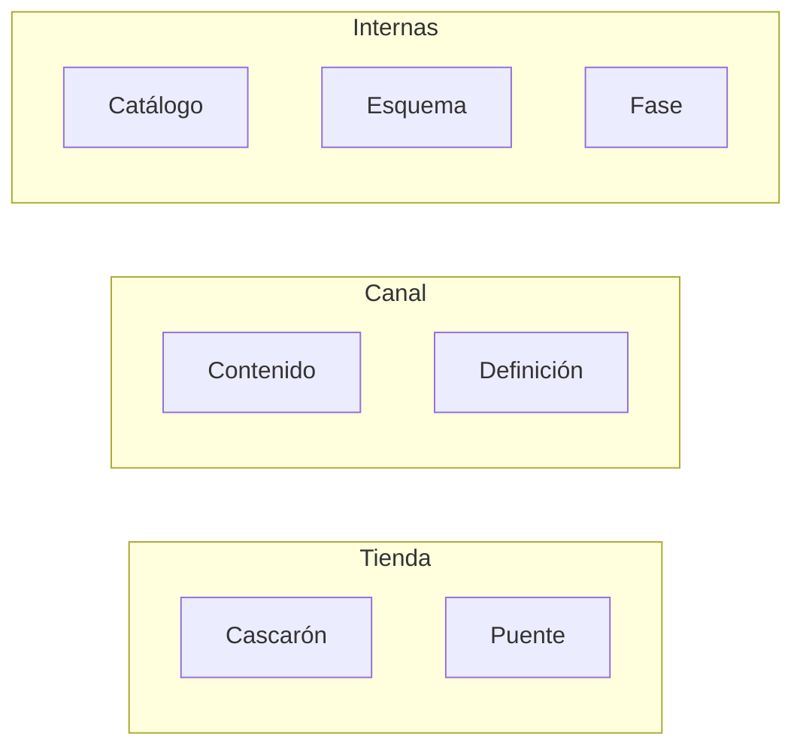

Figura 7.2. Caminos y líneas de versión. Lo que importa mirar es que el **puente sale por tienda** aunque su número viva en un JSON: lo implementa el cascarón.

Dos reglas de la fuente única: el contenido usa SemVer 2.0.0 sin sufijo de pre-release, porque «la madurez la da el canal, no un sufijo» [Demo/versionado/contenido.json:3; R13]; y el mayor del puente es la identidad del contrato, que la instantánea de `Gate.Tests` compara con `ContratoDelPuente.Version` y con `contrato.json` [Demo/versionado/puente.json:3].

#### 7.5 Canales y promoción del mismo artefacto

**Canal:** un puntero con nombre (`dev`, `beta`, `prod`) que apunta a un artefacto publicado. **No es una versión** [03-Integracion-Y-Versionado.md:75]. Promover es mover el puntero al **mismo** artefacto ya firmado, sin reconstruirlo [06-Procedimientos-PR-Integracion-Versionado.md:308]. Así, lo que llega a `prod` es byte a byte lo que se probó en `dev`.

#### Parte B. Procedimientos

#### 7.6 Rama y PR

1. Crear una rama corta desde `main` actualizado.
2. Correr `scripts/ci-local.sh --hasta 4` (pasos 0 a 4, sin publicar ni APK) hasta verde.
3. Actualizar en el mismo PR los archivos de versión que correspondan (§7.9).
4. Abrir el PR contra `main` con la plantilla del anexo F.

```bash
scripts/ci-local.sh --hasta 4        # lo rápido
scripts/ci-local.sh                  # todo, con base origin/main
FC_BASE_REF=main scripts/ci-local.sh # otra rama de destino
```

Fuente: [Demo/scripts/ci-local.sh:13-17].

#### 7.7 Qué corre el workflow

Tabla 7.4. Jobs del workflow.

| Job | Corre en | Qué hace |
|---|---|---|
| `alcance` | Runner autoalojado, sólo PR del mismo repositorio | Decide si el PR toca la demo |
| `compuerta` | Ídem | Pasos 0 a 5 |
| `apk` | Ídem | Paso 6 |
| `fw-ok` | Siempre | Agregador estricto (figura 7.1) |

Fuente: [../../.github/workflows/framework-concept-demo.yml:41-205]. Un `concurrency` con `cancel-in-progress` cancela la corrida anterior del mismo PR cuando llega un commit nuevo [:29-31].

#### 7.8 Proteger `main` y probar la protección

La protección se configura en GitHub: check obligatorio `fw-ok`, rama al día con la base antes de fusionar (modo estricto) y sin excepción para administradores [R10]. Está asentada desde el 2026-10-29 [folio 051]. La corrida completa del workflow en el runner, con compuerta y APK, figura en [folio 048].

Probar una protección es provocar el caso que tiene que frenar: un PR con `etapas/M-13-codigo-postal-cinco-digitos.patch` tiene que dejar `fw-ok` en rojo y el botón de fusionar deshabilitado [06-Procedimientos-PR-Integracion-Versionado.md:273-274]. Esa prueba, con captura, es **NO EJECUTADO** al cierre de esta edición.

#### 7.9 Qué versión sube cada cambio

Tabla 7.5. Del cambio a la línea.

| Si el PR cambia… | Sube | Dónde | Sale por |
|---|---|---|---|
| Páginas Razor, CSS, JS del contenido | Contenido (menor si es nuevo y compatible) | `versionado/contenido.json` | Canal |
| Una encuesta | Definición (`version` + 1) | `definiciones/<encuestaId>/vN.json` nuevo | Canal, sin contenido nuevo |
| Tabla de métodos, catálogo o transporte | Puente (menor o mayor, §4) | `versionado/puente.json` + `contrato.json` | Tienda |
| Permisos, XAML, nativo, SDK, MAUI | Cascarón (`ApplicationDisplayVersion` y `ApplicationVersion` + 1) | `versionado/version-cascaron.props` | Tienda |

Fuente: [06-Procedimientos-PR-Integracion-Versionado.md:278-283]. `ApplicationVersion` es un entero monótono: cada build que llega a un teléfono lleva uno mayor que el anterior, como exigen las tiendas [Demo/versionado/version-cascaron.props:1-3].

#### 7.10 Fusionar, etiquetar, firmar y promover

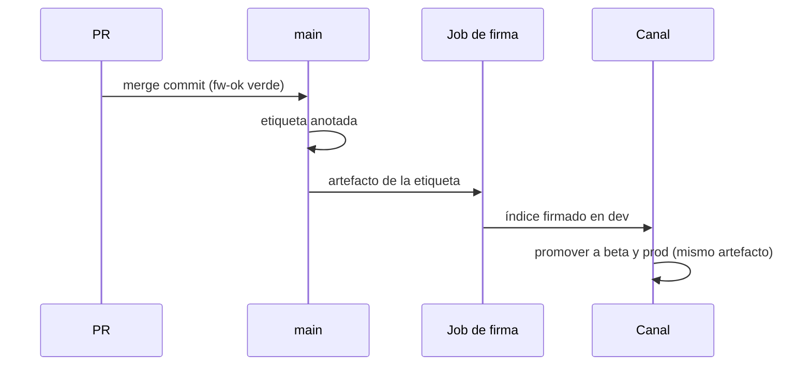

Figura 7.3. Del merge al canal. Lo que hay que mirar: la firma sólo acepta artefactos de una etiqueta alcanzable desde `main`.

1. **Fusionar.** Manual por defecto, por alguien que no escribió el cambio; automático sólo con delegación asentada y guardas [06-Procedimientos-PR-Integracion-Versionado.md:303-304].
2. **Publicar contenido o definición** desde una etiqueta en `main`. En la demo: `scripts/guion.sh publicar`, `definicion`, `firmar` [:305-307]. En producción, la firma en un job aparte con *environment* protegido y revisor obligatorio es **diseño, no implantado** [:306-307].
3. **Verificar** con `scripts/guion.sh verificar`, que comprueba lo publicado como lo haría el teléfono [:320].
4. **Promover** entre canales sin reconstruir [:308].

#### 7.11 Estado al día (2026-11-01)

> **Recuadro.** `main` protegida con `fw-ok` obligatorio, estricta y para administradores [folio 051]. Corrida completa del workflow en el runner autoalojado [folio 048]. Compuerta local repetida el 2026-11-01 con los dos rojos reproducidos (véase la corrida fechada, anexo H). Pendiente: el PR de prueba con M-13 (**NO EJECUTADO**) y la firma en job protegido (diseño). Cola de fusión (*merge queue*): no por ahora; se revisa si hay tres o más PR por mes que pasan de verde a rojo después de fusionarse [03-Integracion-Y-Versionado.md:226-227; R50].

> **En la industria.** El patrón «un check agregador con `needs` y `if: always()`» es la respuesta habitual a la semántica de `skipped` de GitHub [R11]. Separar la versión del binario de la versión del contenido OTA es lo que Expo llama *runtime version*: un paquete OTA sólo se entrega a binarios con la misma versión de runtime, igual que acá el mayor del puente [R18; capítulo 12].

**Preguntas guía**

1. ¿Qué pasaría si `compuerta` fuera el check obligatorio y una condición la dejara en `skipped`?
2. Un PR cambia un método del puente y una página Razor. ¿Qué líneas suben y por qué caminos sale?
3. ¿Por qué el paso 0 necesita la rama de destino y no la rama del PR?

**Resumen.** Una rama estable, un PR obligatorio y un único check agregador estricto. La compuerta local y la remota son la misma. Dos caminos de publicación llevan cuatro líneas visibles y tres internas, cada una con su fuente única en `Demo/versionado/`. Los canales promueven el mismo artefacto firmado.

### Capítulo 8. Estrategia de pruebas

**Objetivos**

- Ubicar cada suite de la demo en la pirámide de pruebas.
- Provocar un rojo a propósito y leerlo.
- Aplicar la regla de cuarentena para pruebas intermitentes.
- Entender las pruebas que atan el texto con el código y el papel de `FC_GATE_BASE`.

**Requisitos previos:** capítulo 7.

#### 8.1 La pirámide aplicada

**Pirámide de pruebas** (*test pyramid*): muchas pruebas chicas y rápidas en la base, pocas grandes y lentas arriba. Cuanto más alto el nivel, menos pruebas, porque las de punta a punta son caras y tienden a ser intermitentes [R14; 04-Estrategia-De-Pruebas.md:84].

En la demo, la base corre en `net10.0`, sin dispositivo, y entra en el PR. El dispositivo queda arriba, fuera del PR [04-Estrategia-De-Pruebas.md §2.4].

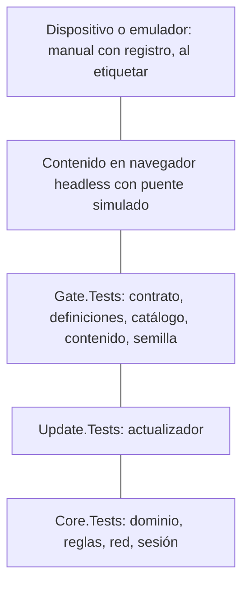

Figura 8.1. La pirámide de la demo, de la punta a la base. Las cantidades de cada suite cambian con el código; están en la corrida fechada (anexo H).

`Gate.Tests` no prueba lógica de dominio: prueba **reglas de arquitectura**. Tres ejemplos:

- `ElContenidoNoUsaAot`: el contenido no se compila con AOT, porque las tiendas sólo permiten actualizar sin revisión código interpretado (capítulo 1) [Demo/tests/FrameworkConcept.Gate.Tests/Contenido/ContenidoTests.cs:53].
- `SemillaTests`: la semilla que viaja con el cascarón es coherente con lo publicado [Demo/tests/FrameworkConcept.Gate.Tests/Semilla/SemillaTests.cs:17].
- `SinTokensEnElPuenteTests`: ningún campo del contrato nombra un token o una credencial.

```csharp
// Demo/tests/FrameworkConcept.Gate.Tests/Contrato/SinTokensEnElPuenteTests.cs:14-20
public class SinTokensEnElPuenteTests
{
    // «clave» no entra: claveIdempotencia es legítima (P13.6).
    private static readonly string[] Prohibidas = ["token", "secret", "password", "contrasena", "credencial", "verifier", "verificador"];

    private static bool Prohibido(string nombre) =>
        Prohibidas.Any(p => nombre.Contains(p, StringComparison.OrdinalIgnoreCase));
```

Es una «red gruesa»: un nombre inocente que contenga «token» la hace saltar, y entonces se discute en el PR [:10-11]. Es deliberado: un falso positivo cuesta una conversación; un falso negativo, una credencial expuesta al contenido.

#### 8.2 El rojo provocado

**Rojo provocado:** un cambio mínimo que *tiene* que hacer fallar una suite. Prueba que la compuerta mira lo que dice mirar [04-Estrategia-De-Pruebas.md §2.1]. La demo trae parches listos en `Demo/etapas/`.

**M-13: el código postal de cinco dígitos.** Cambia la regla de cuatro dígitos por cinco:

```diff
# Demo/etapas/M-13-codigo-postal-cinco-digitos.patch
-    [GeneratedRegex(@"^\d{4}$")]
+    [GeneratedRegex(@"^\d{5}$")]
     private static partial Regex CodigoPostal();
```

`Core.Tests` tiene que dar rojo. Se reprodujo el 2026-11-01 [bitácora de la reedición 04, núcleo N5; anexo H].

**El aviso promovido a error.** Agrega una variable asignada y nunca usada:

```diff
# Demo/etapas/aviso-promovido-a-error.patch
+        var sinUso = 0;   // CS0219: variable asignada y nunca usada (un aviso)
```

Con `CI=true`, el build falla con `error CS0219` en `LocalidadRules.cs` (§7.3). Hay un tercer parche, `error-de-compilacion-en-el-cascaron.patch`, para el paso 6.

#### 8.3 Pruebas intermitentes: cuarentena, no reintentos

**Prueba intermitente** (*flaky test*): una que pasa y falla sobre el mismo código [04-Estrategia-De-Pruebas.md:59; R15]. La regla de la demo: va a **cuarentena con expediente**, nunca a reintentos automáticos [04-Estrategia-De-Pruebas.md:61, 77]. Un reintento esconde la causa (orden, reloj, red) y le enseña al equipo a desconfiar del rojo. Ninguna prueba de la demo se registró como intermitente en los ensayos E02 y E03 [04-Estrategia-De-Pruebas.md:63].

#### 8.4 Pruebas que atan el texto con el código

Algunas pruebas comparan el código con lo que está **publicado** en la rama de destino: la instantánea del contrato del puente, las definiciones frente a sus versiones anteriores y el catálogo de capacidades frente al manifiesto del paquete. Para eso necesitan la base del PR en `FC_GATE_BASE` [Demo/tests/FrameworkConcept.Gate.Tests/Infraestructura/Repositorio.cs:11, 38].

Tabla 8.1. Comportamiento según `FC_GATE_BASE`.

| Situación | Resultado |
|---|---|
| `ci-local.sh` o workflow (arman la base) | Todas las pruebas de `Gate.Tests` corren |
| `dotnet test` suelto, sin `CI` | Las pruebas que comparan con lo publicado se omiten y lo informan |
| `CI=true` sin base | Falla con el mensaje «sin la base del PR no se puede comparar con lo publicado» |

Fuente: [Demo/tests/FrameworkConcept.Gate.Tests/Infraestructura/Repositorio.cs:51-57]. Por eso la cantidad de `Gate.Tests` superadas cambia según la variable: no es una contradicción (anexo H).

Una base armada a mano también sirve para provocar rojos de compatibilidad: `FC_GATE_BASE=/ruta/a/otra/demo scripts/ci-local.sh` [Demo/scripts/ci-local.sh:17].

#### 8.5 Ejercicio guiado: verde, rojo, rojo

```bash
# Desde Demo/
scripts/ci-local.sh --hasta 4                                   # 1. verde
patch -p1 < etapas/M-13-codigo-postal-cinco-digitos.patch
scripts/ci-local.sh --hasta 4                                   # 2. rojo en Core.Tests
patch -R -p1 < etapas/M-13-codigo-postal-cinco-digitos.patch
patch -p1 < etapas/aviso-promovido-a-error.patch
scripts/ci-local.sh --hasta 1                                   # 3. rojo de build: CS0219
patch -R -p1 < etapas/aviso-promovido-a-error.patch
```

**Criterio de logro:** el paso 1 termina con código de salida 0; el 2 con fallas en `Core.Tests` sobre la regla de código postal; el 3 con `error CS0219`. Las salidas medidas están en el anexo H.

> **En la industria.** Google clasifica las pruebas por tamaño (chica, mediana, grande) según qué recursos usan, más que por nombre [R52]. Android y .NET MAUI recomiendan lo mismo que la demo: la lógica fuera del proyecto de plataforma, para probarla sin dispositivo [R58; R53].

**Preguntas guía**

1. ¿Por qué `ElContenidoNoUsaAot` es una prueba y no una línea en la guía?
2. Mi prueba depende del reloj. ¿Puede ser intermitente? ¿Qué hago si lo es?
3. ¿Qué gana el equipo con un rojo provocado que ya conoce?

**Resumen.** Base ancha sin dispositivo, reglas de arquitectura en `Gate.Tests`, dispositivo fuera del PR. Los rojos provocados prueban la compuerta. Las intermitentes van a cuarentena. Las cifras viven en la corrida fechada, no en el texto.

### Capítulo 9. Seguridad del entorno y cuentas: lo que hace la industria

**Objetivos**

- Definir RASP, atestación, superposición, servicios de accesibilidad y acceso remoto.
- Separar lo que una app puede chequear en el teléfono de lo que tiene que verificar el servidor.
- Analizar dos casos de apps de consumo, distinguiendo lo observado de lo supuesto.
- Ubicar la demo frente a OWASP MASVS y conocer las decisiones abiertas.

**Requisitos previos:** capítulo 6 (red, sesión del dispositivo y Keystore).

#### 9.1 Encuadre

Las apps bancarias y de comercio electrónico son la referencia natural de seguridad móvil. Pero no son un modelo directo para este framework: atienden a una persona con su propio teléfono, mientras el framework apunta a equipos de trabajo compartidos que operan sin red [folio 058]. Se toma de ellas lo que sirve: el vocabulario, las APIs de plataforma y la separación entre ingreso y alta de cuentas.

Sobre la evidencia de este capítulo: lo de BNA+ y Mercado Libre es lo que observó y relató el responsable del producto en una sesión de trabajo del 2026-11-01, sin captura. **No se descompiló ni se instrumentó ninguna app de terceros.** Todo lo que se dice sobre cómo funcionan por dentro es **ESPECULACIÓN** fundada en las APIs públicas de Android.

#### 9.2 Conceptos

- **RASP** (*Runtime Application Self-Protection*): la app observa el entorno en el que corre y reacciona (avisa, limita o cierra). Complementa la seguridad del servidor, no la reemplaza: quien controla el teléfono puede burlar cualquier chequeo local [R30].
- **Atestación** (*attestation*): un tercero confiable firma un veredicto sobre la app y el dispositivo, y **el servidor** lo valida. En Android es Play Integrity [R32]; en iOS, App Attest.
- **Superposición** (*overlay*): una ventana de otra app dibujada encima de la propia, usada para engañar al usuario o capturar toques.
- **Servicio de accesibilidad:** un componente que puede leer la pantalla y actuar sobre ella. Existe para personas con discapacidad, y el malware bancario lo usa para operar a distancia.
- **Acceso remoto:** una herramienta que transmite la pantalla y acepta toques desde otro equipo. Puede ser soporte legítimo o fraude por ingeniería social («instalá esta app que te ayudo»).
- **`FLAG_SECURE`:** marca de ventana que impide capturas, grabación y la vista previa en recientes [R36].

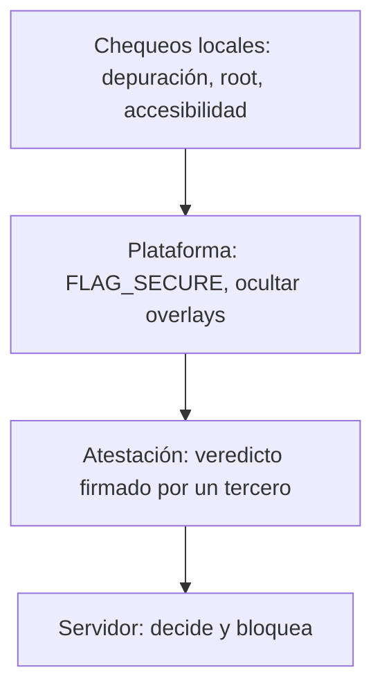

Figura 9.1. Capas de defensa del entorno. Mirá la dirección: cuanto más arriba, más difícil de burlar desde el teléfono.

La idea que resume el capítulo: **la biometría abre un secreto, la identidad la da el servidor y el entorno lo atestigua un tercero** (capítulo 1, §1.5).

#### 9.3 Caso BNA+: detección de acceso remoto

**Lo observado.** La app detecta una herramienta de acceso remoto y cierra a los pocos segundos (relato del responsable del producto, sin folio). **Lo documentado:** biometría opcional desde el menú, poca utilidad sin red, y una migración desde la app anterior por turnos [folio 058; R46].

##### 9.3.1 Mecanismos posibles

Tabla 9.1. Mecanismos típicos de RASP en Android (**ESPECULACIÓN**: ninguna fila afirma que BNA+ lo use).

| Mecanismo | Qué detecta o impide | API pública de Android | ¿Burlable en el teléfono? |
|---|---|---|---|
| Depuración | Depuración USB, depurador adjunto | `Settings.Global.ADB_ENABLED`, `Debug.isDebuggerConnected()` | Sí |
| Root y emulador | `su`, propiedades del sistema | Heurísticas; mejor, Play Integrity | Sí |
| **Acceso remoto** | Pantalla proyectada o servicio que controla la UI | `AccessibilityManager.getEnabledAccessibilityServiceList`, `MediaProjection` en curso; desde Android 15, aviso de grabación de pantalla (`WindowManager.addScreenRecordingCallback`) [R57] | Parcial |
| Superposición | Ventanas de otra app encima | `Window.setHideOverlayWindows(true)` (API 31) [R62] | No: lo aplica el sistema |
| Captura | Capturas y grabación | `FLAG_SECURE` | No: lo aplica el sistema |
| Atestación | App original, dispositivo certificado | Play Integrity, validado por el servidor | No en el servidor |

##### 9.3.2 El cierre a los pocos segundos

Tres hipótesis, todas **ESPECULACIÓN**; no hay evidencia para ordenarlas por probabilidad:

1. **Cerrar ante riesgo, con gracia corta.** Un chequeo al arrancar o al volver al frente encuentra un servicio de accesibilidad no permitido o una proyección activa, avisa y termina el proceso.
2. **Veredicto del servidor.** La app envía la atestación y señales del entorno; el servidor responde «bloquear». Explicaría una demora fija.
3. **SDK comercial de RASP o antifraude**, práctica habitual en banca. No hay evidencia de cuál.

```mermaid
flowchart TD
    A["Arranque o regreso al frente"] --> B{"Chequeos locales"}
    B -- "accesibilidad, proyección u overlay" --> R["Riesgo"]
    B -- "limpio" --> C["Atestación al servidor"]
    C -- "veredicto malo" --> R
    C -- "veredicto bueno" --> OK["Operación normal"]
    R --> D["Aviso"] --> E["Cierre del proceso"]
```

Figura 9.2. Flujo probable de detección y cierre (**ESPECULACIÓN**). Fijate que las hipótesis 1 y 2 son las dos ramas que llegan a «Riesgo».

**Cómo se confirmaría sin violar reglas:** registrar con `adb logcat`, sin datos personales, el momento del cierre y qué componente lo informa; repetir con la herramienta remota apagada. Queda como ensayo propuesto E-N7-1, **NO EJECUTADO**.

#### 9.4 Caso Mercado Libre: ingreso con la cuenta del teléfono

**Lo observado.** La app ofrece entrar con la cuenta de Google cargada en el teléfono. Con una cuenta de Gmail que no tiene cuenta en Mercado Libre, la app **no la crea en el momento**: el alta pasa por otro lado (relato del responsable del producto, sin folio).

**Lectura (ESPECULACIÓN).** La hoja del sistema corresponde a **Credential Manager** con «Iniciar sesión con Google»: la API de Android que unifica claves, *passkeys* y cuentas federadas [R33]. La app recibe un *ID token* firmado por Google con el correo verificado. El servidor busca una cuenta **vinculada** (*account linking*) a ese correo [R47]. Si no existe, no hace alta automática. Razones plausibles: un *marketplace* con pagos exige datos y verificaciones que el *ID token* no trae, y frenar cuentas creadas en masa.

Es una **política de alta separada del ingreso**: Google prueba quién sos; el servicio decide si te conoce.

```mermaid
sequenceDiagram
    actor U as Usuario
    participant A as App
    participant CM as Credential Manager
    participant S as Servidor de la app
    U->>A: Entrar con Google
    A->>CM: pedir credencial
    CM-->>A: ID token (correo verificado)
    A->>S: ID token
    alt cuenta vinculada
        S-->>A: sesión
    else sin cuenta
        S-->>A: derivar al alta, fuera del ingreso
    end
```

Figura 9.3. Ingreso frente a alta (**ESPECULACIÓN**). Lo que hay que mirar es la rama `else`: el ingreso nunca crea la cuenta.

El framework ya aplica la misma separación: el dispositivo no crea identidades; la cuenta la da de alta el emisor, y la biometría sólo abre el secreto guardado (capítulo 6) [Framework-APP.md §4].

#### 9.5 ¿Son híbridas estas apps?

- **Mercado Libre**, según lo observado en el uso (marca **[OBS]** del folio 058, sin documentación técnica consultada), se comporta como *Server Driven UI* (SDUI): el servidor manda la **descripción** de la pantalla y la app la dibuja con componentes **nativos** [folio 058]. Cambia sin tienda, como el framework, pero no es una WebView con HTML. Es probable (**ESPECULACIÓN**) que secciones como ayuda o términos sí sean web embebida.
- **BNA+:** nativa o multiplataforma compilada (**ESPECULACIÓN**); su actualización mayor fue reemplazar la app [folio 058].
- **Cómo manejan las páginas web cuando las embeben (ESPECULACIÓN):** WebView con lista blanca de dominios, interceptación de navegación (`shouldOverrideUrlLoading`), puente acotado y, para el login de terceros, **Custom Tabs**, que es lo que recomienda la RFC 8252 para OAuth en apps nativas [R6]. La demo hace eso en su variante de navegador: declara `CustomTabsService` en `<queries>` [Demo/src/FrameworkConcept.Shell/Platforms/Android/AndroidManifest.xml:15-19].

Tabla 9.2. Tres maneras de cambiar la pantalla sin tienda.

| Técnica | Qué viaja | Quién dibuja | Ejemplo |
|---|---|---|---|
| SDUI | Descripción (JSON) | Componentes nativos | Mercado Libre, observado [folio 058] |
| Web remota en WebView | Páginas del servidor | Motor web | Secciones embebidas (**ESPECULACIÓN**) |
| Contenido empaquetado y firmado | Paquete verificado, cargado del disco | Motor web, con puente | Este framework (capítulo 3) |

#### 9.6 La demo frente a OWASP MASVS

**OWASP MASVS** es el estándar abierto de requisitos de seguridad para apps móviles, organizado por grupos de control [R30].

Tabla 9.3. Estado de la demo por grupo MASVS.

| Grupo | En la demo | Evidencia |
|---|---|---|
| STORAGE | Refresh sellado con una clave AES-256-GCM del Keystore que pide autenticación en cada uso. Pero `allowBackup="true"` y la base local sin cifrar | [CofreDeSesion.cs:121-130]; [AndroidManifest.xml:11] |
| NETWORK | Sólo HTTPS; la CA de demostración sólo en `debug-overrides`, que un APK de Release ignora | [Red/ConCaDeDemo/network_security_config.xml:3-13] |
| AUTH | OIDC con desbloqueo local por biometría o credencial del dispositivo | capítulo 6 |
| CODE | Contenido firmado y verificado antes de activar | capítulo 3 |
| PLATFORM | Sin `FLAG_SECURE` | búsqueda sin resultados en `Demo/src` [bitácora de la reedición 04, núcleo N7] |
| RESILIENCE | Nada: la demo **no implementa RASP** | ídem |

Rutas completas: `Demo/src/FrameworkConcept.Shell/Auth/CofreDeSesion.cs`, `Demo/src/FrameworkConcept.Shell/Platforms/Android/AndroidManifest.xml`, `Demo/src/FrameworkConcept.Shell/Platforms/Android/Red/ConCaDeDemo/network_security_config.xml`.

```csharp
// Demo/src/FrameworkConcept.Shell/Auth/CofreDeSesion.cs:125-129
            .SetUserAuthenticationRequired(true)!
            // P4 — timeout 0: cada uso pide autenticación; vale la biometría fuerte o la credencial del dispositivo.
            .SetUserAuthenticationParameters(0, (int)(KeyPropertiesAuthType.BiometricStrong | KeyPropertiesAuthType.DeviceCredential))!
            // Una huella nueva invalida la clave (borrador §4).
            .SetInvalidatedByBiometricEnrollment(true)!
```

**Límite conocido.** El comentario de la línea 128 dice que una huella nueva invalida la clave. Lo medido en el ensayo E03 dice otra cosa: con la credencial del dispositivo aceptada, Android **no** la invalida [E03 H-1]. Manda lo medido; el comentario se corrige en un PR de código aparte (capítulo 11).

#### 9.7 Decisiones abiertas

Tabla 9.4. Decisiones del núcleo de seguridad. Las que tocan código son **propuestas** al responsable del producto y no entran en esta edición.

| ID | Pregunta | Alternativas | Recomendación de la mesa |
|---|---|---|---|
| D-N7-1 | ¿RASP en el cascarón? | Nada; mínimo de plataforma; Play Integrity con servidor; SDK comercial | Mínimo de plataforma en el framework (`FLAG_SECURE` como capacidad pedida por pantalla, ocultar overlays) y Play Integrity como capacidad opcional documentada. SDK comercial, fuera |
| D-N7-2 | Reacción ante riesgo | Cerrar; avisar y limitar; informar al servidor | Avisar y limitar, **nunca descartar el outbox**; el servidor decide bloquear |
| D-N7-3 | Respaldo del sistema | `allowBackup="false"`; reglas de exclusión | `false`: el equipo es compartido y se reaprovisiona |
| D-N7-4 | Ingreso federado | Sólo OIDC; sumar Credential Manager | OIDC (actual): cuentas de organización, no personales |
| D-N7-5 | Alta de cuentas | En el ingreso; separada | Separada, la crea el emisor |

La razón de D-N7-2 es propia del framework: en una app offline-first, cerrar el proceso ante una sospecha puede perder trabajo que todavía está en el outbox (capítulo 5).

> **En la industria.** MASVS-RESILIENCE y su guía de pruebas MASTG describen los controles contra manipulación y aclaran que son defensa en profundidad, no sustituto de la seguridad del servidor [R30]. Google desaconseja confiar sólo en chequeos locales y propone Play Integrity validado del lado servidor [R32]. Para el ingreso, la tendencia es Credential Manager y *passkeys* [R33; R48].

**Preguntas guía**

1. ¿Por qué un chequeo de root hecho por la app no alcanza para que el servidor confíe en el teléfono?
2. En un equipo compartido sin red, ¿qué se pierde si la app cierra ante un riesgo?
3. ¿Qué diferencia hay entre SDUI y el contenido firmado del framework, si los dos cambian sin tienda?

**Resumen.** Lo que se chequea en el teléfono se puede burlar; lo que atestigua un tercero y valida el servidor, no. Los casos BNA+ y Mercado Libre muestran detección de acceso remoto y alta separada del ingreso, pero su funcionamiento interno es especulación. La demo cumple en red, almacenamiento de la sesión y firma de código, y no implementa RASP. Las decisiones que tocan código quedan como propuesta.

## Parte IV. Práctica

### Capítulo 10. La demo como caso de estudio y ejercicios

**Objetivos**

- Ubicar cada pieza del framework en la carpeta `Demo/`.
- Compilar y probar la demo sin el workload de Android, y correr la compuerta local.
- Recorrer el ciclo completo de una versión, v1 → v2 → firma inválida → rollback, con el guion único.
- Resolver ejercicios con un criterio de logro observable.

**Requisitos previos:** capítulos 3 (OTA), 4 (puente), 5 (outbox) y 7 y 8 (integración y pruebas).

#### 10.1 Qué es la demo y para qué sirve

La **demo** es una app Android completa que materializa el framework sobre un caso real: una encuesta de movilidad de tres pasos, tomada del caso base y llevada a datos [Demo/README.md:1-5] [Demo/MAPA-CASO-BASE.md]. No es un prototipo descartable. Es la referencia ejecutable del libro: cada mecanismo que describen los capítulos 3 a 8 tiene en ella un archivo y una prueba que lo atan.

La demo resuelve tres preguntas que el texto solo no responde:

1. **¿Funciona?** Las suites y el recorrido del guion lo muestran.
2. **¿Dónde está?** Cada decisión del dictamen se marca en el código con un comentario `// P<n>` [Demo/README.md, «Dónde está cada decisión en el código»].
3. **¿Qué se rompe si lo cambio?** Los rojos provocados de `etapas/` lo enseñan (véase §8.2).

#### 10.2 Estructura de `Demo/`

Tabla 10.1. Carpetas de la demo y su papel [Demo/README.md, «Qué hay en cada carpeta»].

| Carpeta | Qué es | Capítulo |
| --- | --- | --- |
| `src/FrameworkConcept.Core/` | Núcleo sin MAUI: dominio, contrato del puente, índice del canal, firma, interfaces del actualizador, red y sesión | 3, 4, 6 |
| `src/FrameworkConcept.Shell/` | El cascarón: app MAUI para Android, actualizador, servidor de contenido, puente, base local, cofre de sesión | 3–6 |
| `src/FrameworkConcept.Content/` | El contenido: Blazor WebAssembly sin AOT | 1, 4 |
| `tools/FrameworkConcept.Tools/` | Claves de demostración, empaquetar, firmar el índice, publicar definiciones, retirar, regenerar `contrato.json` | 3, 4 |
| `tools/FrameworkConcept.Receptor/` | Receptor didáctico: un doble de prueba que sirve el canal y recibe las respuestas | 3, 5 |
| `definiciones/encuesta-movilidad/` | La encuesta como datos: `v1.json`, `v2.json` y `esquema.json` | 5 |
| `versionado/` | Fuentes únicas de versión: cascarón, puente, contenido y fase | 7 |
| `semilla/` | Contenido y definición embebidos en el APK | 3 |
| `claves/` | Sólo la clave pública de demostración | 3 |
| `tests/` | `Core.Tests`, `Update.Tests` y `Gate.Tests` | 8 |
| `scripts/` | `contenedor.sh`, `imagen.sh`, `guion.sh` y `ci-local.sh` | 7, 10 |
| `contenedor/` | La receta del contenedor de compilación (`Dockerfile`) | 10 |
| `etapas/` | Parches de rojo provocado | 8 |
| `infra/keycloak/` | Emisor OIDC de ensayo para el modo con cuenta | 6 |

```mermaid
flowchart LR
  Tools["Tools: empaquetar y firmar"] --> Receptor["Receptor didáctico (canal)"]
  Receptor -->|índice firmado y paquetes| Shell["Cascarón (Shell)"]
  Semilla["semilla/"] --> Shell
  Core["Core: contrato, canal, firma"] --> Shell
  Core --> Content["Contenido (Blazor WASM)"]
  Shell -->|puente Call| Content
  Shell -->|outbox| Receptor
  Tests["tests/: Core, Update, Gate"] --> Core
  Tests --> Shell
```

Figura 10.1. Piezas de la demo. Mirá que Core no depende de MAUI: por eso lo prueban las suites sin dispositivo, y que el contenido sólo llega al cascarón por el puente.

#### 10.3 Cómo se compila y se prueba

##### 10.3.1 El contenedor de compilación

No hace falta .NET instalado. `scripts/contenedor.sh` corre cada comando dentro de una imagen construida desde la receta versionada `contenedor/Dockerfile` (SDK .NET 10.0.400, workload `maui-android`, JDK 17, SDK de Android). La imagen se etiqueta con la huella de la receta: si la receta cambia, se construye otra [Demo/README.md:12-17]. Es el patrón de **entorno de compilación reproducible** (*reproducible build environment*): la receta es código y se revisa en el PR como cualquier otro cambio.

##### 10.3.2 La solución sin MAUI

`FrameworkConcept.Demo.SinMaui.slnf` es un filtro de solución que excluye el cascarón: compila y prueba todo lo que no necesita el workload de Android [Demo/README.md:31-35]. Es la parte rápida de la compuerta.

```bash
scripts/contenedor.sh dotnet build FrameworkConcept.Demo.SinMaui.slnf -c Release
scripts/contenedor.sh dotnet test FrameworkConcept.Demo.SinMaui.slnf -c Release
```

Con `CI=true`, los avisos se tratan como errores [Demo/Directory.Build.props].

Sin la variable `FC_GATE_BASE`, dos pruebas de `Gate.Tests` se omiten a propósito: comparan el contrato y las definiciones con la base del PR, y fuera de la compuerta no hay base. En integración continua, la falta de la variable no se omite: falla.

[Demo/tests/FrameworkConcept.Gate.Tests/Infraestructura/Repositorio.cs:50-60]

```csharp
var baseDelPr = Base;
const string comoSeArma = "La arma scripts/ci-local.sh (o el workflow) con la demo de la rama de destino y la pasa en FC_GATE_BASE.";

if (baseDelPr is null)
{
    if (EnIntegracionContinua)
        Assert.Fail("CI=true y falta FC_GATE_BASE: sin la base del PR no se puede comparar con lo publicado. " + comoSeArma);
    Assert.Ignore("Sin FC_GATE_BASE no hay base del PR para comparar. " + comoSeArma);
}
```

Las cifras de una corrida concreta están en la corrida fechada (Anexo H).

##### 10.3.3 La compuerta local

`scripts/ci-local.sh` corre los mismos pasos y en el mismo orden que el workflow del PR [Demo/scripts/ci-local.sh:1-21]:

Tabla 10.2. Pasos de la compuerta local.

| Paso | Qué hace |
| --- | --- |
| 0 | Arma la base del PR: copia de la demo en la rama de destino |
| 1 | Build sin MAUI con avisos como error |
| 2 | `Core.Tests`: dominio, reglas portadas y contrato |
| 3 | `Update.Tests`: actualizador |
| 4 | `Gate.Tests`: instantánea del contrato, definiciones, catálogo frente al manifiesto del paquete, contenido sin AOT |
| 5 | Publica el contenido Blazor y lo empaqueta |
| 6 | Compila el APK del cascarón para `android-arm64` |

```bash
scripts/ci-local.sh              # todo; la base es origin/main
scripts/ci-local.sh --hasta 4    # sólo lo rápido, sin publicar ni APK
```

La regla que enseña es la del capítulo 7: **si pasa en local, pasa en el PR**, porque es el mismo guion.

#### 10.4 El recorrido guiado con `scripts/guion.sh`

`scripts/guion.sh` es el **guion único** de la demo: un subcomando por acción, sin pasos escondidos [Demo/scripts/guion.sh:585-606]. Sin argumentos, lista los subcomandos.

##### 10.4.1 Preparación

```bash
IP=203.0.113.10                       # la IP por la que el dispositivo llega a esta máquina
scripts/guion.sh claves               # par ECDSA de demostración; la privada no se versiona
scripts/guion.sh publicar v1          # contenido 1.0.0, sin AOT, archivos planos
scripts/guion.sh definicion v1        # encuesta-movilidad v1
scripts/guion.sh firmar               # índice firmado, expires = ahora + 30 días
scripts/guion.sh semilla              # lo que ofrece el índice → semilla/
FC_TLS_IPS=$IP scripts/guion.sh tls   # CA y certificado HTTPS de demostración
scripts/guion.sh servir               # receptor didáctico por HTTPS
FC_RID=android-x64 FC_URL_CANAL=https://$IP:8099 scripts/guion.sh apk
```

[Demo/README.md, «Cómo se corre la demo»]. La dirección `203.0.113.10` es de documentación (RFC 5737): reemplazala por la tuya.

**Las claves en un clon nuevo.** El clon trae la clave pública y una semilla firmada con su privada, pero no la privada. Si generás un par nuevo con `claves --forzar`, tenés que rehacer `publicar v1`, `definicion v1`, `firmar` y `semilla` antes de compilar el APK; si no, el cascarón descarta la semilla y arranca sin contenido. `SemillaTests` lo frena en la compuerta [Demo/README.md, «Las claves en un clon nuevo»] [Demo/tests/FrameworkConcept.Gate.Tests/Semilla/SemillaTests.cs].

**Por qué hay una CA de demostración.** El canal es sólo HTTPS. El APK de Debug confía en la CA que genera `guion.sh tls` porque va en los `debug-overrides` de la configuración de red de Android; un APK de Release ignora ese bloque [Demo/README.md, «Por qué hay una CA de demostración»].

##### 10.4.2 Los siete pasos

`guion.sh demo` encadena todo; sólo el paso 2 es manual [Demo/scripts/guion.sh:383-420].

Tabla 10.3. Recorrido v1 → v2 y qué tiene que pasar [Demo/README.md, tabla del recorrido].

| Paso | Acción | Qué tiene que pasar | Capítulo |
| --- | --- | --- | --- |
| 1 | Abrir la app | Instala la semilla (contenido 1.0.0, definición v1) y la muestra | 3.6 |
| 2 | `parar`; tomar una encuesta | Queda «Por enviar: 1» en el outbox, con la definición v1 | 5 |
| 3 | `publicar v2`, `definicion v2`, `firmar`, `servir`; abrir en frío | Se sigue viendo 1.0.0; el outbox se envía; v2 baja a staging | 3.4, 5.4 |
| 4 | Abrir en frío | Se activa 1.1.0 antes de mostrar; la encuesta nueva usa v2 | 3.4, 5.5 |
| 5 | `respuestas` | La respuesta tomada con v1 figura aceptada con `versionDefinicion: 1` | 5.5 |
| 6 | `firma-invalida`; abrir en frío; `firmar` | `Rechazado FirmaInvalida`; sigue 1.1.0 | 3.3 |
| 7 | `publicar sin-listo`, `firmar`; abrir en frío cuatro veces | 1.2.0 se activa y no avisa `Listo`; al cuarto arranque vuelve a 1.1.0 y queda como fallida | 3.5 |

```mermaid
stateDiagram-v2
  [*] --> Semilla: paso 1
  Semilla --> Pendientes: paso 2 (sin red)
  Pendientes --> Staging: paso 3 (envía outbox, baja v2)
  Staging --> V2Activa: paso 4 (arranque en frío)
  V2Activa --> V2Activa: paso 6 (firma inválida rechazada)
  V2Activa --> SinListo: paso 7 (activa 1.2.0)
  SinListo --> V2Activa: rollback a previous
```

Figura 10.2. Recorrido del guion. Mirá el paso 3: la versión nueva baja pero no se muestra; recién el arranque en frío siguiente la activa.

El paso 7 lleva cuatro arranques porque el cascarón sólo da una versión por fallida cuando el WebView **empezó a cargarla** `CargasSinListoParaFallar` veces sin recibir `Listo`; un arranque cortado antes de cargar no cuenta.

[Demo/src/FrameworkConcept.Core/Update/Actualizador.cs:34-39]

```csharp
/// <summary>
/// P2 — Cuántos arranques con la carga EMPEZADA y sin «Listo» hacen falta para dar una versión por fallida.
/// Criterio de la demo (corrección de E02), no valor de producto del folio 036: con 1, cerrar la app mientras
/// carga (el TPR del teléfono de medida pasa de 8 s) dejaba una versión sana como fallida para siempre.
/// </summary>
public const int CargasSinListoParaFallar = 2;
```

Es un parámetro de la demo, no un valor de producto (véase §3.5).

**Cuidado con las esperas.** El guion espera un tiempo fijo por arranque (`FC_ESPERA`, 50 s por defecto). Una espera menor que lo que tarda `Listo` corta la app con la carga empezada, y dos cortes así seguidos dejan como fallida una versión sana [Demo/scripts/guion.sh:402-405]. Es el mismo fenómeno que motivó el parámetro.

##### 10.4.3 Pruebas sin dispositivo

- `scripts/guion.sh humo` prueba las herramientas y el receptor con claves propias en `salida/humo/`, sin tocar `claves/` ni `semilla/` [Demo/scripts/guion.sh:438-440].
- `src/FrameworkConcept.Content/Testing/probar-en-navegador.sh` prueba el contenido en Chromium headless con el puente simulado [Demo/README.md].

El dispositivo usado en las mediciones es un **emulador de ensayo** con Android 13 y WebView 155, y un **teléfono de medida** con Android 13 (API 33) [Demo/README.md:19-21] [folio 049]. El contenido Blazor exige Android System WebView 94 o mayor [Demo/src/FrameworkConcept.Core/Contracts/ParametrosDeProducto.cs:10].

**Desvío de red declarado.** El camino de red medido es que el dispositivo alcance por IP a la máquina del receptor. Cuando el teléfono de medida no llega por red, el único medio que funcionó fue un túnel efímero (`guion.sh tunel`), que queda como **medio de laboratorio**, no como camino de la demo. El reenvío inverso de puertos de adb sigue **NO VERIFICADO** [Demo/README.md:22-28] [E01].

#### 10.5 Ejercicios propuestos

Cada ejercicio tiene un criterio de logro que se puede comprobar sin interpretar.

Tabla 10.4. Ejercicios con criterio de logro.

| # | Ejercicio | Criterio de logro | Capítulo |
| --- | --- | --- | --- |
| E-10.1 | Compilá y probá la solución sin MAUI dentro del contenedor | `dotnet test` termina con `rc=0`; en `Gate.Tests` aparecen exactamente las omisiones de `FC_GATE_BASE` | 8.1 |
| E-10.2 | Corré `ci-local.sh --hasta 4` | `rc=0` en los pasos 0 a 4 | 7.3 |
| E-10.3 | Aplicá `etapas/M-13-codigo-postal-cinco-digitos.patch` y repetí E-10.2; deshacé con `-R` | `Core.Tests` en rojo, `rc=1`; tras deshacer, verde | 8.2 |
| E-10.4 | Aplicá `etapas/aviso-promovido-a-error.patch` y compilá con y sin `CI=true` | Con `CI=true`, `error CS0219`; sin `CI`, compila con un aviso | 8.2 |
| E-10.5 | Agregá un método al contrato sin regenerar `contrato.json` | `InstantaneaDelContratoTests` en rojo; tras regenerar con `FrameworkConcept.Tools contrato` y subir el menor del puente, verde | 4.7 |
| E-10.6 | Declarale al manifiesto del paquete un `requires` que no figura en el catálogo | `CatalogoFrenteAlManifiestoTests` en rojo | 4.5 |
| E-10.7 | Corré `guion.sh humo` | El informe termina sin comprobaciones «MAL» | 10.4.3 |
| E-10.8 | Con un dispositivo, hacé el recorrido de la Tabla 10.3 | Cada paso muestra lo de la columna «Qué tiene que pasar»; en el paso 5, `versionDefinicion: 1` | 3, 5 |
| E-10.9 | Generá claves nuevas con `claves --forzar` y compilá el APK **sin** rehacer la semilla | `SemillaTests` en rojo; tras rehacer la semilla, verde | 3.6 |

Los parches de `etapas/` y lo que provocan están descritos en [Demo/etapas/README.md]. El tercer parche, `error-de-compilacion-en-el-cascaron.patch`, asigna un texto a un `int` en `App.cs` (CS0029) y deja el APK sin compilar: sirve para ver el paso 6 de la compuerta en rojo.

> **En la industria.** Los frameworks de *live update* acompañan sus SDK con una app de ejemplo y un servidor de prueba; la demo hace lo mismo con el receptor didáctico. La compuerta local idéntica a la remota es la práctica que la documentación de GitHub llama verificar antes de fusionar con checks obligatorios [R10] [R11]; el rojo provocado es una forma liviana de lo que la literatura llama *mutation testing*. Véase el capítulo 12.

**Preguntas guía**

1. ¿Por qué Core no depende de MAUI, y qué ganan las pruebas con eso?
2. En el paso 3 la versión nueva ya bajó. ¿Por qué no se muestra?
3. ¿Qué pasaría en el paso 7 si `CargasSinListoParaFallar` valiera 1 y el teléfono tardara más que la espera?
4. ¿Por qué la compuerta falla, en vez de omitir, cuando falta `FC_GATE_BASE` en integración continua?

**Resumen.** La demo es la referencia ejecutable del libro. Se compila en un contenedor reproducible, se prueba sin dispositivo con la solución sin MAUI y se valida con la misma compuerta en local y en el PR. El guion único recorre el ciclo de una versión en siete pasos, y los rojos provocados muestran que cada suite mira lo que dice mirar.

---

### Capítulo 11. Cohesión y mantenimiento de la guía

**Objetivos**

- Distinguir dato vivo de dato fechado y aplicar la regla de fuente única.
- Saber de dónde sale cada cifra del libro.
- Resolver una divergencia entre texto y código con la regla «manda lo medido».
- Verificar la guía de forma mecánica antes de publicarla.

**Requisitos previos:** capítulos 7 y 8.

#### 11.1 Definiciones

- **Coherencia documental** (*documentation consistency*): cada afirmación verificable del texto tiene una fuente en el repo (archivo:línea) o en el expediente (folio), y esa fuente dice lo mismo hoy.
- **Dato vivo**: se lee de una fuente única del repo, por ejemplo la versión del puente. El texto no lo copia a mano; apunta a la fuente.
- **Dato fechado**: es la salida de una corrida (conteos de pruebas, tiempos medidos). Lleva fecha y commit, y vive en un solo lugar: el Anexo H.
- **Fuente única de verdad** (*single source of truth*): para cada cifra hay un único archivo que la define. El código ya sigue esta idea: el comentario de `ParametrosDeProducto.cs` dice que los valores están juntos «para que nadie los escriba a mano en otro lado» [Demo/src/FrameworkConcept.Core/Contracts/ParametrosDeProducto.cs:3-6].

#### 11.2 De dónde sale cada cifra

Tabla 11.1. Fuentes únicas y las pruebas que las atan.

| Dato | Fuente única | Prueba que la ata |
| --- | --- | --- |
| Versiones del cascarón, del puente y del contenido | `Demo/versionado/version-cascaron.props`, `puente.json`, `contenido.json` | `InstantaneaDelContratoTests` (puente) |
| Métodos, eventos y catálogo del puente | `Demo/src/FrameworkConcept.Core/Contracts/contrato.json` | `InstantaneaDelContratoTests` |
| Capacidades declaradas por el contenido | Manifiesto del paquete frente al catálogo | `CatalogoFrenteAlManifiestoTests` |
| Plazos y retenciones (vigencia 30 d, renovación 7 d, reanudación 15 min, 3 paquetes en el servidor, 2 en el teléfono, WebView 94) | [Demo/src/FrameworkConcept.Core/Contracts/ParametrosDeProducto.cs:10-34] | Pruebas de `Update.Tests` que los usan |
| Fase del versionado | `Demo/versionado/fase.json` | — |
| Conteos de pruebas | Salida de `scripts/ci-local.sh` | Dato fechado: Anexo H |

La nota de `puente.json` lo dice explícitamente: su versión «debe coincidir con `ContratoDelPuente.Version` y con `contrato.json`; la instantánea de la compuerta lo comprueba» [Demo/versionado/puente.json].

```mermaid
flowchart LR
  V["versionado/"] --> G1["InstantaneaDelContratoTests"]
  C["contrato.json"] --> G1
  C --> G2["CatalogoFrenteAlManifiestoTests"]
  P["ParametrosDeProducto.cs"] --> L3["Cap. 3 y 6"]
  V --> L1["Cap. 7"]
  C --> L2["Cap. 4"]
  T["salida de ci-local.sh"] -.->|fecha y commit| H["Anexo H"]
```

Figura 11.1. De dónde sale cada cifra. Mirá la flecha punteada: los conteos de pruebas no entran a los capítulos, sólo al anexo fechado.

#### 11.3 Por qué no hay conteos de pruebas en el texto

Los borradores de la guía fijaron conteos que envejecieron: decían 211 pruebas en `Core.Tests` y 52 en `Gate.Tests` [04-Estrategia-De-Pruebas.md:48-49] [99-Anexos.md:117], y las bitácoras de tramos de la demo citan 65, 96 o 202 [Demo/README.md, tramo A1]. Cada tramo sumó pruebas y el texto quedó atrás. Había tres alternativas: actualizarlos a mano (vuelve a envejecer), generarlos con un script (una herramienta para un dato menor) o no escribirlos y describir la forma («todas en verde, `rc=0`»). El libro adopta la tercera y deja una corrida fechada en el Anexo H. El criterio es la simplicidad.

Las bitácoras de tramos de `Demo/README.md` se conservan como **historia**: son trazabilidad legítima, no afirmaciones vigentes. El libro las rotula **HISTÓRICO** y toma las cifras actuales de la fuente única.

#### 11.4 Caso didáctico: manda lo medido

En el cofre de sesión hay un comentario que dice que «una huella nueva invalida la clave» [Demo/src/FrameworkConcept.Shell/Auth/CofreDeSesion.cs:128]. El ensayo E03 midió lo contrario: con autenticación `BiometricStrong | DeviceCredential`, enrolar una huella nueva **no** invalida la clave [E03 H-1] [07-Red-Y-Autenticacion.md:300-310].

```mermaid
flowchart TD
  D["Divergencia texto vs. código"] --> Q{"¿Hay medición?"}
  Q -->|sí| M["Manda lo medido"]
  Q -->|no| NV["Marcar NO VERIFICADO"]
  M --> F{"¿Quién está mal?"}
  F -->|el código| PR["PR de código aparte; el libro declara la observación"]
  F -->|el texto| T["Corregir el texto"]
```

Figura 11.2. Cómo se cierra una divergencia. Mirá que el libro nunca «arregla» el código desde un PR documental.

La regla tiene dos partes:

1. **Manda lo medido.** Se corrige la fuente equivocada, que en este caso es el comentario, no la guía.
2. **Cada PR hace una cosa.** La corrección del comentario va en un PR de código; mientras tanto, el libro declara la observación en el capítulo 6.

El mismo hallazgo apareció cuatro veces en la reedición, en cuatro núcleos distintos. Eso muestra por qué hace falta un registro de cohesión: sin él, la misma corrección se discute cuatro veces.

#### 11.5 Cómo verificar la guía antes de publicarla

Tabla 11.2. Verificaciones mecánicas.

| Verificación | Cómo | Qué cuenta como verde |
| --- | --- | --- |
| Referencias a archivos | Extraer los nombres entre comillas invertidas con `grep -noE` y buscar cada uno en `find Demo` | Toda referencia existe, salvo artefactos generados y rutas del expediente privado |
| Enlaces | `docs-enlaces-semanal.yml`: una vez por semana corre `lychee` sobre el árbol y abre o actualiza un único issue con el informe [../../.github/workflows/docs-enlaces-semanal.yml:1-6] | Issue sin enlaces rotos |
| Enlaces absolutos | `grep -nE '\]\(/'` sobre el libro (enlaces que empiezan con una ruta absoluta) | Cero coincidencias |
| Datos de infraestructura | Búsqueda de nombres de hosts, modelos o series de teléfonos, IPs y rutas del home | Cero coincidencias |
| Cifras | Ninguna cifra de pruebas fuera del Anexo H; toda marca listada en el Anexo E; toda `[Rn]` resuelta en el Anexo B | Las tres listas cierran |
| Corrida fechada | `ci-local.sh` y el resultado copiado al Anexo H con fecha y commit | Coincide con la salida |

La razón de los enlaces relativos: los enlaces absolutos a rutas del puesto de trabajo dan 404 en GitHub y en un clon aislado. Los documentos fuente tenían unos 125 enlaces así en 00 a 08 y 99 [bitácora de la reedición 04, núcleo N6]. El libro usa enlaces relativos dentro del repo y cita lo privado por folio, sin enlace.

> **En la industria.** La práctica se llama *docs as code*: la documentación vive en el repo, se revisa por PR y se verifica en CI [R40]. La separación entre tutorial, guía práctica, referencia y explicación de Diátaxis [R41] justifica la estructura del capítulo 7 en *Conceptos* y *Procedimientos*. Las pruebas de instantánea del contrato son la versión local de las líneas base de API [R43] [R44].

**Preguntas guía**

1. ¿Por qué la versión del puente es un dato vivo y el conteo de pruebas un dato fechado?
2. Si un capítulo necesita citar el plazo de vigencia del índice, ¿cómo lo hace sin copiarlo?
3. ¿Qué harías si encontrás una divergencia sin ninguna medición que la resuelva?

**Resumen.** La guía se mantiene coherente con tres reglas: fuente única para cada dato vivo, datos fechados en un solo anexo y «manda lo medido» ante una divergencia. Las verificaciones son mecánicas: referencias, enlaces, búsqueda de datos de infraestructura y una corrida fechada.

---

## Parte V. Industria

### Capítulo 12. El framework en la industria

**Objetivos**

- Ubicar el framework en el mapa de las apps híbridas y de los servicios de *live update*.
- Traducir cada mecanismo de la demo a su equivalente de la industria.
- Conocer lo que permiten las tiendas y cómo lo cumple la demo.
- Identificar los estándares de referencia y las extensiones naturales.

**Requisitos previos:** capítulos 1, 3 y 4.

> **Estado de las fuentes.** Las afirmaciones sobre productos de terceros de este capítulo provienen del relevamiento de la mesa N8 y **no se verificaron contra la web en la corrida del 2026-11-01**. Cada referencia nueva figura en el Anexo B con «Consulta: a verificar». Las fuentes F-01 a F-15 de la guía sí se consultaron el 2026-10-25 [99-Anexos.md:93-111].

#### 12.1 Definiciones

- **App híbrida**: app nativa instalada por tienda que muestra su interfaz, toda o en parte, con un WebView y ofrece capacidades del teléfono a través de un puente. En este framework: cascarón MAUI más `HybridWebView`.
- **Live update** (*OTA*, *code push*): cambiar el contenido web o interpretado de una app híbrida sin pasar por la tienda. El binario nativo no cambia.
- **Runtime version**: la identidad de compatibilidad entre el binario y el paquete. En la demo es el **mayor del puente** [Demo/versionado/puente.json].
- **PWA** (*Progressive Web App*): aplicación web que, con un *service worker* y un manifiesto web, se instala y funciona sin red, sin cascarón nativo.
- **MASVS**: el estándar de OWASP de requisitos de seguridad para apps móviles, en grupos como STORAGE, CRYPTO, AUTH, NETWORK, PLATFORM, CODE y RESILIENCE [R30].

#### 12.2 Familias de apps híbridas

Tabla 12.1. Mapa del mercado. Afirmaciones sobre terceros **NO VERIFICADO** hasta la consulta de las fuentes.

| Familia | Cascarón | Contenido | Live update | Qué toma o descarta este framework |
| --- | --- | --- | --- | --- |
| Apache Cordova [R17] | Nativo mínimo con plugins | HTML y JS en WebView | Plugins de terceros | Toma el puente por plugins; descarta el ecosistema por su mantenimiento |
| Ionic Capacitor [R16] | Proyecto nativo propio, editable | Web en WebView | Appflow [R19], Capawesome [R20], Capgo [R21] | El análogo más cercano: cascarón nativo, plugins versionados, paquetes por canal |
| React Native + Expo | Nativo, con UI nativa | JS interpretado | EAS Update [R18] | Toma el vocabulario: *runtime version* y canales |
| CodePush (App Center) | RN o Cordova | JS | Servicio alojado hasta el retiro de App Center [R22]; servidor de código abierto [R23] | Lección: no atar la actualización a un SaaS |
| Flutter + Shorebird [R24] | Nativo Flutter | Dart con parches | Shorebird | Fuera del stack; confirma la tendencia |
| .NET Blazor Hybrid [R25] | MAUI con `BlazorWebView` | Razor compilado en la app | No hay | Descartado para el contenido: lo compilado en la app no se puede bajar [01-Actualizacion-Sin-Tienda.md:63] |
| PWA [R26] | No hay | Web con *service worker* | Propia de la web | Descartada: no da Keystore, biometría ni capacidades con control del cascarón |

La elección del framework es **Blazor WebAssembly servido por `HybridWebView`**, no Blazor Hybrid: el contenido corre dentro del WebView como WASM sin AOT [Demo/src/FrameworkConcept.Content/FrameworkConcept.Content.csproj:18] y llega a Android sólo por el puente [Demo/src/FrameworkConcept.Core/Contracts/Puente/TransporteDelPuente.cs:25]. `HybridWebView` está documentado por Microsoft para .NET MAUI [R4].

```mermaid
flowchart LR
  subgraph Tienda["Cambia sólo por tienda"]
    B["Binario nativo o cascarón"]
  end
  subgraph OTA["Cambia por live update"]
    C["Contenido web o JS"]
  end
  B -->|puente versionado| C
  Cordova --> B
  Capacitor --> B
  FC["MAUI + HybridWebView (este framework)"] --> B
  EAS["EAS Update"] --> C
  Appflow --> C
  CodePush --> C
  PWA["PWA: sin cascarón"] -.-> C
```

Figura 12.1. Dónde cae cada producto. Mirá que todos separan lo que cambia por tienda de lo que cambia por canal; la PWA no tiene la primera mitad.

#### 12.3 Equivalencias mecanismo a mecanismo

Tabla 12.2. Mecanismos de la demo y su equivalente de la industria. Equivalentes **NO VERIFICADO** hasta la consulta.

| Mecanismo de la demo | Dónde está | Equivalente |
| --- | --- | --- |
| Mayor del puente | `Demo/versionado/puente.json`, `contrato.json` | *Runtime version* de EAS Update; versión de plugins en Capacitor |
| Canal `dev`/`beta`/`prod` con índice firmado | `Demo/src/FrameworkConcept.Core/Contracts/Canal/IndiceDelCanal.cs`; `FirmaEs256.cs` | *Channels* de EAS y Appflow; metadatos firmados con expiración de TUF [R27] |
| Índice con `expires` (30 días) | [Demo/tools/FrameworkConcept.Tools/Indexador.cs:18]; [ParametrosDeProducto.cs:16] | Expiración de metadatos en TUF |
| Staging y activación en el próximo arranque en frío | [Demo/src/FrameworkConcept.Core/Update/Actualizador.cs:139-160] | Política «al próximo arranque» de EAS y CodePush |
| Rollback por cargas sin `Listo` | [Actualizador.cs:34-39] | `notifyAppReady` de los plugins de Capacitor; rollback automático de CodePush |
| Semilla embebida | `Demo/semilla/` | *Embedded update* de Expo |
| Retirada en el índice | `IndiceDelCanal.cs` (`retiradas`) | Republicación o rollback de EAS |
| Contenido sin AOT, interpretado en el WebView | `FrameworkConcept.Content.csproj:18` | Condición de Google Play para código en un WebView [R3] |
| Índice por mayor (`/canal/puente-N/`) | [Demo/scripts/guion.sh:151] | Separación por *runtime version* |

[Demo/src/FrameworkConcept.Core/Contracts/ParametrosDeProducto.cs:15-16]

```csharp
/// <summary>P2 — Vigencia del índice firmado (<c>expires</c> = emitido + 30 días).</summary>
public static readonly TimeSpan VigenciaDelIndice = TimeSpan.FromDays(30);
```

La vigencia acotada es la defensa contra el **ataque de congelamiento** (*freeze attack*) que describe TUF: un atacante que repite un índice viejo pero bien firmado no puede sostenerlo más allá de `expires`.

#### 12.4 Lo que permiten las tiendas

- **Google Play.** La política de abuso de dispositivos y redes admite código que corre en una máquina virtual o un intérprete con acceso indirecto a las API de Android, como JavaScript en un WebView [R3] [01-Actualizacion-Sin-Tienda.md:68-74]. La demo lo cumple con tres hechos verificables: el contenido corre en el WebView sin AOT, llega a Android sólo por el puente y va firmado [Demo/src/FrameworkConcept.Content/FrameworkConcept.Content.csproj:18] [Demo/src/FrameworkConcept.Core/Update/FirmaEs256.cs].
- **Apple.** Las pautas de revisión (2.5.2 y 4.7) y el acuerdo de licencia del programa de desarrolladores regulan el código interpretado descargado [R1] [R2]. El inciso exacto del acuerdo vigente queda **NO VERIFICADO**: la guía cita §3.3.1 y versiones anteriores lo numeraban de otra forma [bitácora de la reedición 04, núcleo N8]. El cascarón iOS es diseño sin ensayo [ParametrosDeProducto.cs:12-13].
- **WebAssembly como «código interpretado»** ante las tiendas: **NO VERIFICADO** (véase §1.2.3).

Las políticas cambian: toda cita de una tienda lleva fecha de consulta.

#### 12.5 Estándares de referencia

Tabla 12.3. Estándares y dónde se aplican.

| Estándar | Qué aporta | Dónde en el libro |
| --- | --- | --- |
| OWASP MASVS y MASTG [R30] [R31] | Requisitos y pruebas de seguridad móvil | Cap. 9 |
| The Update Framework [R27] | Modelo de actualizaciones firmadas: roles, expiración, rotación de claves | Cap. 3 |
| RFC 8252 [R6] y RFC 7636 [R7] | OAuth en apps nativas por navegador externo y PKCE | Cap. 6 |
| SemVer 2.0.0 [R13] | Líneas de versión | Cap. 7 |
| JSON-RPC 2.0 [R28] | Formato del sobre del puente | Cap. 4 |
| Patrón *transactional outbox* [R29] | Escritura local y envío diferido en una transacción | Cap. 5 |

**Qué falta de TUF.** La demo firma el índice con una clave ES256 identificada por `keyId` y le pone `expires`. No implementa la separación de roles ni el umbral de firmas, y la rotación de claves es manual [Demo/src/FrameworkConcept.Core/Update/FirmaEs256.cs] [bitácora de la reedición 04, núcleo N8]. Es un camino de crecimiento, no un defecto del diseño actual.

#### 12.6 Tendencias y extensiones

Las tendencias que siguen son enunciados de la mesa N8, **NO VERIFICADO** hasta consultar sus fuentes:

1. La *live update* se consolida como un servicio aparte del framework y aparecen servidores autoalojados.
2. La firma del paquete pasa de opcional a esperable.
3. Los canales y el despliegue gradual por porcentaje son lo habitual.
4. Las tiendas empujan la atestación (Play Integrity [R32], App Attest), que conecta con el capítulo 9.
5. Microsoft ofrece `HybridWebView` desde .NET 9 como alternativa a `BlazorWebView` para contenido web [R4].

Tabla 12.4. Extensiones naturales de la demo (decisiones documentales; ninguna toca código en este libro).

| Extensión | Alternativas | Recomendación |
| --- | --- | --- |
| Despliegue por porcentaje | (a) no; (b) campo `porcentaje` en la entrada del índice; (c) canales por grupo | (a) por ahora; (b) es la extensión natural |
| TUF completo | (a) índice propio ES256; (b) TUF | (a), declarando qué roles faltan |
| Servicio de terceros | (a) servidor estático propio; (b) SaaS | (a), por la lección del retiro de CodePush |

> **En la industria.** Este capítulo es el recuadro grande del libro: cada capítulo anterior remite acá con su propio recuadro.

**Preguntas guía**

1. ¿Qué tiene en común el mayor del puente con la *runtime version* de EAS Update?
2. ¿Por qué Blazor Hybrid no sirve para el contenido actualizable?
3. ¿Qué ataque evita `expires` y cuál no evita mientras no haya rotación de claves?
4. ¿Qué perdería el producto si la actualización dependiera de un SaaS que se retira?

**Resumen.** El framework pertenece a la familia de Capacitor con *live updates*: cascarón nativo, contenido web por canal y un puente versionado. Sus mecanismos (índice firmado con expiración, staging, rollback por confirmación, semilla, retirada) tienen equivalente directo en la industria. Lo distinto es el stack (.NET MAUI y Blazor WASM en `HybridWebView`) y el control propio del canal.

---

## Anexos

### Anexo A. Glosario

Glosario único del libro. Una sola definición por término. Columna «§» = sección que lo define.

Tabla A.1. Glosario bilingüe, en orden alfabético.

| Término | Definición | Equivalente | § |
| --- | --- | --- | --- |
| Acceso remoto | Herramienta que transmite la pantalla y acepta toques | *remote access* | 9.2 |
| Actor | Quien decide algo en el sistema (ACT-nn) | *actor* | 2.2 |
| App híbrida | App nativa instalada por tienda que muestra su interfaz con un WebView y ofrece capacidades por un puente | *hybrid app* | 1.2 |
| Archivos planos | Archivos del zip sin precompresión .br ni .gz | *uncompressed assets* | 3.2 |
| Ataque de congelamiento | Servir un índice viejo y legítimo para frenar actualizaciones | *freeze attack* | 3.3.2 |
| Atestación | Veredicto firmado por un tercero sobre la integridad de la app y el dispositivo | *attestation* | 9.2 |
| Base del PR | La demo en la rama de destino, para comparar contrato y definiciones | *PR base* | 8.4 |
| Canal | Puntero (`dev`, `beta`, `prod`) que promueve el mismo artefacto; no es una versión | *channel* | 7.5 |
| Capacidad | Función del dispositivo ofrecida por el cascarón con id y versión propios en el catálogo | *capability* | 4.5 |
| Carta muerta | Filas `Rechazada` o `Error`: no se reintentan ni se borran, quedan a la vista | *dead letter* | 5.4.6 |
| Cascarón | La app MAUI instalada por tienda: pantallas XAML propias, actualizador, servidor de contenido, puente, base local | *native shell* | 1.2.1 |
| Check agregador `fw-ok` | Job que corre siempre y resume los demás; único check obligatorio | *required aggregate check* | 7.2 |
| Check obligatorio | Check que la rama protegida exige en verde | *required status check* | 7.2 |
| Chequeo de salud | GET al servidor propio con timeout corto que confirma que se lo alcanza | *health check* | 6.1 |
| Clave de idempotencia | Identificador único de una fila del outbox con el que el receptor deduplica los reenvíos | *idempotency key* | 5.4.1 |
| Coherencia documental | Cada afirmación verificable tiene una fuente que dice lo mismo hoy | *documentation consistency* | 11.1 |
| Compuerta | Pruebas que un PR tiene que pasar para fusionarse | *gate* | 7.3 |
| Contenido | Pantallas de negocio en Blazor WebAssembly sin AOT, descargables por canal | *web content*, *update bundle* | 1.2.1 |
| Contexto | Condición del entorno que cambia la respuesta de un escenario (CTX-n) | *context* | 2.2 |
| Contrato del puente | Tabla de métodos, catálogo y transporte, serializados en `contrato.json` | *bridge contract* | 4.4 |
| Credential Manager | API de Android que unifica claves, passkeys y cuentas federadas | *Credential Manager* | 9.4 |
| Current / previous | Punteros a la versión confirmada y a la anterior; el teléfono guarda dos | *current / previous* | 1.3.2 |
| Dato vivo / dato fechado | Leído de una fuente única / salida de una corrida con fecha y commit | — | 11.1 |
| Definición | Encuesta expresada como datos JSON validados por `esquema.json` | *survey definition* | 1.4.3 |
| Desbloqueo local | Biometría o credencial del dispositivo que abre un secreto del Keystore; no da identidad | *local unlock* | 6.4 |
| Disparador | Evento que inicia una consulta del canal (arranque en frío, reanudación; ingreso diseñado) | *update trigger* | 1.3.3 |
| Dueño (de una fila) | Identidad a la que pertenece una fila del outbox; sólo sale con la sesión válida de esa identidad | *owner* | 5.4.2 |
| Emisor OIDC | Servidor que autentica a la persona y emite los tokens | *OpenID Provider* | 6.3 |
| Escenario | Situación del ciclo de vida con identificador ESC-n | *scenario* | 2.1 |
| Estado de red combinado | `Connectivity` del sistema más la salud del servidor, en cuatro estados | *network state* | 6.1 |
| Fallida | Versión anotada tras CargasSinListoParaFallar cargas sin Listo | *failed release* | 1.3.2 |
| Firma del índice | ECDSA P-256 con SHA-256 sobre los bytes de indice.json | *ES256 signature* | 3.2 |
| Fuente única de verdad | Un único archivo define cada cifra | *single source of truth* | 11.1 |
| Huella | Sha256 de contrato.json, sólo diagnóstico | *fingerprint* | 4.4.1 |
| Índice del canal | Archivo firmado por canal y mayor del puente que ofrece paquetes, con `expires` y `retiradas` | *channel index* | 1.3.1 |
| Líneas de versión | Secuencias de números para lo que se publica por un camino propio; cuatro visibles | *version lines* | 1.6, 7.4 |
| Live update | Cambiar el contenido sin pasar por la tienda | *OTA*, *code push* | 1.3 |
| Manifiesto del paquete | Descripción del paquete de contenido: compatibilidad con el puente, capacidades, motor mínimo | *bundle manifest* | 1.3.1 |
| Marca Listo | Llamada del contenido que confirma que la versión arrancó sana | *ready signal* | 1.3.2 |
| Marca pendiente | Señal que el cascarón pone al activar una versión y que el contenido borra con `Listo` | *pending flag* | 3.5 |
| MASVS | Estándar de OWASP de requisitos de seguridad móvil | — | 12.1 |
| Modo Formulario | Ingreso con formulario propio; la clave cruza el puente una vez | *first-party login* | 6.3 |
| Modo Navegador | Ingreso con code + PKCE en el navegador del sistema (RFC 8252) | *native app authorization* | 6.3 |
| Offline-first | La app guarda primero en local y sincroniza después; la red es una mejora | *offline-first* | 1.4 |
| Omisión declarada | Único skipped aceptado: el PR no toca la demo, con motivo | — | 7.2 |
| Orden por entidad | Regla por la que una fila trabada sólo frena a las siguientes de su misma entidad | *per-entity ordering* | 5.4.3 |
| Outbox | Intención de enviar escrita en la misma transacción que el dato | *transactional outbox* | 1.4.2 |
| Paquete | Zip de una versión de contenido, fijado por size y sha256 | *package / bundle* | 3.2 |
| Pirámide de pruebas | Muchas pruebas chicas abajo, pocas grandes arriba | *test pyramid* | 8.1 |
| Política de acciones | `SoloLocal`, `Encolable` o `SoloEnLinea` por acción | *action policy* | 6.2 |
| Predicado de compatibilidad | Puente en rango, cada `requires` presente y en rango, motor ≥ mínimo | *compatibility check* | 4.6 |
| Prueba intermitente | Pasa y falla sobre el mismo código | *flaky test* | 8.3 |
| Puente | Un solo método nativo, `Call(sobre)`, entre contenido y cascarón | *bridge* | 4.2 |
| Puntero | Archivo con current, previous, pendiente y CargasSinListo | *pointer* | 3.2 |
| PWA | App web instalable con *service worker*, sin cascarón | *Progressive Web App* | 12.1 |
| Rango de versión | Siempre `>=A.B.C <(A+1).0.0` | *version range* | 4.6 |
| RASP | La app observa el entorno en que corre y reacciona | *Runtime Application Self-Protection* | 9.2 |
| Retirada | Versión que el índice marca para no usar | *revoked release* | 3.7 |
| Rojo provocado | Cambio mínimo que tiene que hacer fallar una suite | *seeded failure* | 8.2 |
| Rollback | Volver a `previous` cuando una versión no confirmó `Listo` tras `CargasSinListoParaFallar` cargas | *rollback* | 3.5 |
| Runtime version | Identidad de compatibilidad binario–paquete; en la demo, el mayor del puente | *runtime version* | 12.1 |
| SDUI | El servidor describe la pantalla y la app la dibuja con componentes nativos | *Server Driven UI* | 9.5 |
| Semilla | Contenido y definición embebidos en el APK para el primer arranque | *seed*, *embedded update* | 3.6 |
| Servicio de accesibilidad | Componente que lee y actúa sobre la pantalla | *accessibility service* | 9.2 |
| Servicio del cascarón | Función que el cascarón presta sin depender del hardware | *shell service* | 4.5 |
| Sobre | Mensaje JSON-RPC 2.0 con un campo extra `v`, la versión del puente que espera el contenido | *envelope* | 4.2 |
| Staging | Carpeta donde una versión bajada y verificada espera el próximo arranque en frío | *staging* | 3.2 |
| Superposición | Ventana de otra app encima de la propia | *overlay* | 9.2 |
| TPR | Tiempo hasta el primer render en arranque en frío | *time to first render* | 3.8 |
| Transporte | Hybridwebview.js, ruta de invocación, método, eventos y mayor de MAUI | *transport* | 4.3 |
| Versión de definición en vuelo | Versión de una definición con la que se tomó una respuesta todavía no enviada | *in-flight schema version* | 5.5 |
| Vinculación de cuentas | Asociar una identidad federada con una cuenta propia | *account linking* | 9.4 |

### Anexo B. Referencias

Formato: `R<n>. Autor u organización. *Título*. URL. Consulta: fecha.` R1 a R15 son las fuentes F-01 a F-15 de la guía, consultadas el 2026-10-25 [99-Anexos.md:93-111]. Desde R16, propuestas por los núcleos: el 2026-11-01 se comprobó sólo que cada URL responde (todas con HTTP 200, salvo R48, que rechaza clientes automáticos con 403), pero **no se contrastó su contenido** con lo que afirma el texto; por eso siguen con «Consulta: a verificar».

- R1. Apple. *App Review Guidelines* (2.5.2, 4.7). https://developer.apple.com/app-store/review/guidelines/. Consulta: 2026-10-25.
- R2. Apple. *Apple Developer Program License Agreement*. https://developer.apple.com/support/terms/apple-developer-program-license-agreement/. Consulta: 2026-10-25 (inciso a verificar).
- R3. Google. *Device and Network Abuse*. https://support.google.com/googleplay/android-developer/answer/9888379. Consulta: 2026-10-25.
- R4. Microsoft. *HybridWebView – .NET MAUI*. https://learn.microsoft.com/en-us/dotnet/maui/user-interface/controls/hybridwebview?view=net-maui-10.0. Consulta: 2026-10-25.
- R5. Microsoft. *Blazor WebAssembly build tools and AOT*. https://learn.microsoft.com/en-us/aspnet/core/blazor/webassembly-build-tools-and-aot?view=aspnetcore-10.0. Consulta: 2026-10-25.
- R6. IETF. *RFC 8252: OAuth 2.0 for Native Apps*. https://www.rfc-editor.org/rfc/rfc8252. Consulta: 2026-10-25.
- R7. IETF. *RFC 7636: Proof Key for Code Exchange*. https://www.rfc-editor.org/rfc/rfc7636. Consulta: 2026-10-25.
- R8. GitHub. *GitHub flow*. https://docs.github.com/en/get-started/using-github/github-flow. Consulta: 2026-10-25.
- R9. *Trunk Based Development*. https://trunkbaseddevelopment.com/. Consulta: 2026-10-25.
- R10. GitHub. *About protected branches*. https://docs.github.com/en/repositories/configuring-branches-and-merges-in-your-repository/managing-protected-branches/about-protected-branches. Consulta: 2026-10-25.
- R11. GitHub. *Troubleshooting required status checks*. https://docs.github.com/en/pull-requests/collaborating-with-pull-requests/collaborating-on-repositories-with-code-quality-features/troubleshooting-required-status-checks. Consulta: 2026-10-25.
- R12. GitHub. *Secure use reference*. https://docs.github.com/en/actions/reference/security/secure-use. Consulta: 2026-10-25.
- R13. *Semantic Versioning 2.0.0*. https://semver.org/. Consulta: 2026-10-25.
- R14. Vocke, H. *The Practical Test Pyramid*. https://martinfowler.com/articles/practical-test-pyramid.html. Consulta: 2026-10-25.
- R15. Luo, Q. y otros. *An empirical analysis of flaky tests* (FSE 2014). https://doi.org/10.1145/2635868.2635920. Consulta: 2026-10-25.
- R16. Ionic. *Capacitor* (documentación y plugins). https://capacitorjs.com/docs. Consulta: a verificar.
- R17. Apache. *Cordova: plugins*. https://cordova.apache.org/docs/en/latest/guide/hybrid/plugins/. Consulta: a verificar.
- R18. Expo. *EAS Update* (introducción y *runtime versions*). https://docs.expo.dev/eas-update/introduction/ y https://docs.expo.dev/eas-update/runtime-versions/. Consulta: a verificar.
- R19. Ionic. *Appflow Deploy*. https://ionic.io/docs/appflow/deploy/intro. Consulta: a verificar.
- R20. Capawesome. *Cloud Live Updates* y plugin *Live Update*. https://capawesome.io/cloud/live-updates/ y https://capawesome.io/plugins/live-update/. Consulta: a verificar.
- R21. Capgo. https://capgo.app/. Consulta: a verificar.
- R22. Microsoft. *Visual Studio App Center retirement*. https://learn.microsoft.com/appcenter/retirement. Consulta: a verificar.
- R23. Microsoft. *code-push-server*. https://github.com/microsoft/code-push-server. Consulta: a verificar.
- R24. Shorebird. https://shorebird.dev/. Consulta: a verificar.
- R25. Microsoft. *ASP.NET Core Blazor Hybrid*. https://learn.microsoft.com/en-us/aspnet/core/blazor/hybrid/. Consulta: a verificar.
- R26. Google. *Progressive Web Apps* (web.dev). https://web.dev/explore/progressive-web-apps. W3C. *Service Workers*. https://www.w3.org/TR/service-workers/. Consulta: a verificar.
- R27. *The Update Framework*. https://theupdateframework.io/. Consulta: a verificar.
- R28. *JSON-RPC 2.0 Specification*. https://www.jsonrpc.org/specification. Consulta: a verificar.
- R29. Richardson, C. *Pattern: Transactional outbox*. https://microservices.io/patterns/data/transactional-outbox.html. Consulta: a verificar.
- R30. OWASP. *MASVS* (incluye MASVS-RESILIENCE). https://mas.owasp.org/MASVS/. Consulta: a verificar.
- R31. OWASP. *MASTG*. https://mas.owasp.org/MASTG/. Consulta: a verificar.
- R32. Google. *Play Integrity API*. https://developer.android.com/google/play/integrity. Consulta: a verificar.
- R33. Google. *Credential Manager* y *Sign in with Google*. https://developer.android.com/identity/sign-in/credential-manager y https://developer.android.com/identity/sign-in/credential-manager-siwg. Consulta: a verificar.
- R34. Google. *Android Keystore system*. https://developer.android.com/privacy-and-security/keystore. Consulta: a verificar.
- R35. Google. *Biometric authentication*. https://developer.android.com/identity/sign-in/biometric-auth. Consulta: a verificar.
- R36. Google. *FLAG_SECURE* y *setHideOverlayWindows*. https://developer.android.com/reference/android/view/WindowManager.LayoutParams#FLAG_SECURE. Consulta: a verificar.
- R37. Google. *Insecure WebView native bridges*. https://developer.android.com/privacy-and-security/risks/insecure-webview-native-bridges. Consulta: a verificar.
- R38. Google. *Build an offline-first app*. https://developer.android.com/topic/architecture/data-layer/offline-first. Consulta: a verificar.
- R39. IETF. *RFC 9700: Best Current Practice for OAuth 2.0 Security*. https://www.rfc-editor.org/rfc/rfc9700. Consulta: a verificar.
- R40. Write the Docs. *Docs as Code*. https://www.writethedocs.org/guide/docs-as-code/. Consulta: a verificar.
- R41. Procida, D. *Diátaxis*. https://diataxis.fr/. Consulta: a verificar.
- R42. Microsoft. *Testing in .NET*. https://learn.microsoft.com/dotnet/core/testing/. Consulta: a verificar. Bibliografía complementaria: no se cita en el texto.
- R43. VerifyTests. *Verify*. https://github.com/VerifyTests/Verify. Consulta: a verificar.
- R44. Microsoft. *API compatibility (APICompat)*. https://learn.microsoft.com/dotnet/fundamentals/apicompat/overview. Consulta: a verificar.
- R45. Google. *A/B (seamless) system updates*. https://source.android.com/docs/core/ota/ab. Consulta: a verificar.
- R46. Banco de la Nación Argentina. *Preguntas frecuentes BNA+*. https://bna.com.ar/Personas/BNAMas/PreguntasFrecuentesBNAmas. Consulta: a verificar.
- R47. Google. *Account linking*. https://developers.google.com/identity/account-linking. Consulta: a verificar.
- R48. FIDO Alliance. *Passkeys*. https://fidoalliance.org/passkeys/. Consulta: a verificar.
- R49. Zetetic. *SQLCipher*. https://www.zetetic.net/sqlcipher/. Consulta: a verificar.
- R50. GitHub. *Managing a merge queue*. https://docs.github.com/en/repositories/configuring-branches-and-merges-in-your-repository/configuring-pull-request-merges/managing-a-merge-queue. Consulta: a verificar.
- R51. Pact. *Contract testing*. https://docs.pact.io/. Consulta: a verificar.
- R52. Winters, T. y otros. *Software Engineering at Google*, cap. 11 «Testing Overview». https://abseil.io/resources/swe-book/html/ch11.html. Consulta: a verificar.
- R53. Microsoft. *Unit testing .NET MAUI*. https://learn.microsoft.com/en-us/dotnet/maui/deployment/unit-testing. Consulta: a verificar.
- R54. Microsoft. *Web authenticator – .NET MAUI*. https://learn.microsoft.com/dotnet/maui/platform-integration/communication/authentication. Consulta: a verificar.
- R55. Microsoft. *Connectivity – .NET MAUI*. https://learn.microsoft.com/dotnet/maui/platform-integration/communication/networking. Consulta: a verificar.
- R56. IETF. *OAuth 2.0 for First-Party Applications* (borrador). https://datatracker.ietf.org/doc/draft-ietf-oauth-first-party-apps/. Consulta: a verificar.
- R57. Google. *Android 15 features*. https://developer.android.com/about/versions/15/features. Consulta: a verificar.
- R58. Google. *Fundamentals of testing Android apps*. https://developer.android.com/training/testing/fundamentals. Consulta: a verificar.
- R59. The Rust Project. *Documentation tests*. https://doc.rust-lang.org/rustdoc/write-documentation/documentation-tests.html. Consulta: a verificar. Bibliografía complementaria: no se cita en el texto.

- R60. Apache Software Foundation. Apache Cordova. https://cordova.apache.org/. Consulta: a verificar.
- R61. Capacitor. Plugins. https://capacitorjs.com/docs/plugins. Consulta: a verificar.
- R62. Android Developers. Window.setHideOverlayWindows. https://developer.android.com/reference/android/view/Window#setHideOverlayWindows(boolean). Consulta: a verificar.

Las referencias de los cinco bloques se unificaron por URL: una misma fuente tiene un solo número en todo el libro.

### Anexo C. Folios y ensayos citados

Los folios pertenecen al expediente 0001, que vive en un repositorio privado de documentación. Se citan por número, sin enlace. Las descripciones usan roles neutros.

Tabla C.1. Folios del expediente.

| Folios | Tema |
| --- | --- |
| 001–007 | Pedido del PO y providencias iniciales: contrato de entrada, actualización al ingresar, escenario de la encuesta, actualización forzada al iniciar, delegación de la fusión |
| 008–022 | Ronda 1 de la mesa: requisitos, verificación, lector sin contexto, arquitectura MAUI híbrida, decisiones, migración al abrir, integración y pruebas, seguridad del canal y tiendas, editor didáctico, caso de referencia y capacidades, refutador, veredicto |
| 023 | Respuesta del PO al lote de la ronda 1 |
| 024–035 | Ronda 2 de la mesa, con umbrales formales y veredicto |
| 036 | Respuesta del PO a la ronda 2: valores de producto (plazos y retenciones de `ParametrosDeProducto.cs`) |
| 037 | Resolución: plan de aplicación y cierre de la mesa |
| 038 | Providencia: autenticación del sistema operativo y manejo de red en la demo |
| 039–040 | Aprobación de la redacción y cierre del expediente |
| 041 | Liberación del teléfono de medida y limpieza |
| 042 | Marca de primer render y TPR |
| 043, 046 | Cambio de entorno de laboratorio y su corrección |
| 044–045 | Redacción de datos sensibles en el repo público y evidencia local |
| 047, 049 | TPR en el teléfono de medida, medido por el cascarón |
| 048 | Compuerta en el host de compilación y runner autoalojado |
| 050 | Dictamen: condición 2 de P1, evaluar el camino de reserva «C-min» |
| 051 | Historia reescrita; registra la protección de `main` |
| 052–053 | Ensayo E04: arranque superpuesto y semilla del APK |
| 054 | Dictamen de UX: arranque, actualización y trabajo sin conexión |
| 055 | Dictamen: decisiones abiertas, estándares, UX y diseño |
| 056 | Login en el contenido probado en el teléfono de medida |
| 057 | Desbloqueo local probado sin red |
| 058 | Dictamen: economía de datos y situaciones de uso; observaciones sobre apps de consumo (Server Driven UI) |

Tabla C.2. Ensayos.

| Ensayo | Tema |
| --- | --- |
| E01 | WASM descargado en el WebView: viabilidad y condición de WebView ≥ 94 |
| E02 | Integración de la demo: recorrido v1 → v2, rollback y correcciones |
| E03 | Red y autenticación: estados de red, Keystore y biometría (H-1: la huella nueva no invalida la clave con credencial del dispositivo) |
| E04 | Arranque superpuesto (variantes ensayadas en ramas sin fusionar) |
| E05 | Login en el contenido |

### Anexo D. Mapa libro ↔ demo

Tabla D.1. Sección del libro → archivos de la demo.

| Sección | Archivos |
| --- | --- |
| 1.2, 12.2 | `Demo/src/FrameworkConcept.Content/FrameworkConcept.Content.csproj`; `Demo/src/FrameworkConcept.Core/Contracts/Puente/TransporteDelPuente.cs` |
| 1.3, 3.2 | `Demo/src/FrameworkConcept.Core/Contracts/Canal/IndiceDelCanal.cs`; `Demo/src/FrameworkConcept.Core/Contracts/Contenido/ManifiestoContenido.cs` |
| 3.3 | `Demo/src/FrameworkConcept.Core/Update/FirmaEs256.cs`; `Demo/tools/FrameworkConcept.Tools/Indexador.cs` |
| 3.4, 3.5 | `Demo/src/FrameworkConcept.Core/Update/Actualizador.cs` |
| 3.6 | `Demo/semilla/`; `Demo/claves/`; `Demo/tests/FrameworkConcept.Gate.Tests/Semilla/SemillaTests.cs` |
| 3.7, 11.2 | `Demo/src/FrameworkConcept.Core/Contracts/ParametrosDeProducto.cs` |
| 4.2–4.4 | `Demo/src/FrameworkConcept.Core/Contracts/contrato.json`; `Demo/src/FrameworkConcept.Content/wwwroot/js/puente.js` |
| 4.5, 4.6 | `Demo/src/FrameworkConcept.Core/Contracts/Puente/CatalogoDeCapacidades.cs`; `Demo/src/FrameworkConcept.Core/Contracts/RangoDeVersion.cs` |
| 5.2–5.4 | `Demo/src/FrameworkConcept.Shell/Data/ContextoDelCascaron.cs`; `Demo/src/FrameworkConcept.Shell/Sync/SincronizadorDelOutbox.cs` |
| 5.5 | `Demo/definiciones/encuesta-movilidad/`; `Demo/src/FrameworkConcept.Core/Domain/Entities/RespuestaDeEncuesta.cs` |
| 6.1, 6.2 | `Demo/src/FrameworkConcept.Core/Red/`; `Demo/DISENO-RED-Y-AUTENTICACION.md` |
| 6.3–6.5 | `Demo/src/FrameworkConcept.Core/Auth/`; `Demo/src/FrameworkConcept.Shell/Auth/CofreDeSesion.cs`; `Demo/tests/FrameworkConcept.Gate.Tests/Contrato/SinTokensEnElPuenteTests.cs`; `Demo/infra/keycloak/` |
| 7 | `Demo/versionado/`; `Demo/scripts/ci-local.sh`; `.github/workflows/framework-concept-demo.yml` (raíz del repo) |
| 8 | `Demo/tests/`; `Demo/etapas/` |
| 9.6 | `Demo/src/FrameworkConcept.Shell/Platforms/Android/` (manifiesto y configuración de red) |
| 10 | `Demo/README.md`; `Demo/scripts/guion.sh`; `Demo/scripts/contenedor.sh`; `Demo/contenedor/Dockerfile` |
| 11.5 | `.github/workflows/docs-enlaces-semanal.yml` (raíz del repo) |

### Anexo E. Marcas de estado

Convención: **NO VERIFICADO** (no hay medición ni fuente consultada), **NO EJECUTADO** (diseñado e implementado, nunca corrido), **ESPECULACIÓN** (inferencia sin evidencia directa), **HISTÓRICO (fecha)** (dato vigente en esa fecha, hoy no) y **VARIANTE NO FUSIONADA** (medida en un ensayo, no incorporada a la rama estable).

Tabla E.1. Marcas del libro.

| Marca | Qué | Dónde |
| --- | --- | --- |
| NO VERIFICADO | WASM como «código interpretado» ante Apple y Play (folio 035) | 1.2.3, 3.1, 12.4 |
| NO VERIFICADO | Inciso del acuerdo de Apple sobre código interpretado | 12.4 |
| NO VERIFICADO | Que el ingreso con cuenta dispare la consulta del canal (ESC-6) | 1.3.3, 2.1 |
| NO VERIFICADO | Cascarón iOS (CTX-3; piso 16.4, diseño sin ensayo) | Tabla 2.2, 12.4 |
| NO VERIFICADO | `requires` faltante en un dispositivo real | 4.8 |
| NO VERIFICADO | Keychain de iOS como equivalente del cofre | 6.4, 6.7 |
| NO VERIFICADO | `EnLineaMedida` en dispositivo; regresión sin cuenta en emulador; conjunto en teléfono físico | 6.7 |
| NO VERIFICADO | Reenvío inverso de puertos de adb como camino de red | 10.4.3 |
| NO VERIFICADO | Afirmaciones sobre productos de terceros y tendencias | 12.2, 12.3, 12.6 |
| NO EJECUTADO | Versión obligatoria (`mandatory`, ESC-7) | 2.1, 3.7 |
| NO EJECUTADO | PR de prueba con M-13 que deja fw-ok en rojo y la fusión deshabilitada | 7.8, 7.11 |
| NO EJECUTADO | Firma en job con environment protegido | 7.10 |
| NO EJECUTADO | Ensayo E-N7-1 (logcat del cierre de BNA+) | 9.3.2 |
| ESPECULACIÓN | Mecanismos internos de detección de acceso remoto y cierre de BNA+ | 9.1, 9.3.1 (tabla 9.1), 9.3.2 (figura 9.2) |
| ESPECULACIÓN | Credential Manager y alta separada del ingreso en Mercado Libre | 9.4 (figura 9.3) |
| ESPECULACIÓN | Web embebida en Mercado Libre; naturaleza técnica de BNA+; manejo de páginas web en las apps de referencia | 9.5, tabla 9.2 |
| HISTÓRICO (2026-10-25/26) | Conteos de pruebas de las bitácoras de tramos y de los borradores | 11.3, Anexo H |
| HISTÓRICO | TPR ~8,2 s con la semilla en el camino crítico | 3.8, H.3 |
| VARIANTE NO FUSIONADA | Arranque superpuesto E04 (V1, V1S), folios 052 y 053 | 3.6, 3.8, H.3 |


### Anexo F. Plantillas

#### F.1 Método nuevo del puente

```text
Método:            <dominio>.<accion>
Clase:             servicio del cascarón | capacidad <id>
Parámetros:        <nombre: tipo, obligatorio/opcional>
Resultado:         <tipo>
Errores:           -32601 (método no encontrado), -32002, -32005, …
Política de red:   SoloLocal | Encolable | SoloEnLinea
Cambio de versión: menor (agrega) | mayor (rompe)
Pasos:             1) tabla de métodos en Core  2) regenerar contrato.json
                   3) subir versionado/puente.json  4) prueba en Core.Tests
                   5) puente simulado del contenido
```

#### F.2 Acción nueva

```text
Acción:      <nombre>
Política:    SoloLocal | Encolable | SoloEnLinea
Sin red:     qué ve la persona y qué queda en el outbox
Idempotencia: clave de idempotencia y dueño
Prueba:      caso en Core.Tests/Red
```

#### F.3 Descripción de PR

```text
Qué cambia y por qué:
Línea de versión que sube: cascarón | puente | contenido | definición | ninguna
Compuerta local: scripts/ci-local.sh → rc=0 (fecha, commit)
Rojo provocado (si agrega una suite):
Documentación tocada:
```

#### F.4 Publicación de una versión de contenido

```text
1. publicar <variante>      → paquete sin AOT, con manifiesto
2. firmar                   → índice del canal, expires = emisión + 30 días
3. verificar                → firma y compatibilidad con el mayor del puente
4. promover dev → beta → prod el MISMO artefacto
5. vigilar el rollback (marcas sin Listo) en el canal
6. si falla: retirar <versión> en el índice y volver a firmar
```

### Anexo G. Diferencias con el borrador `Framework-APP.md`

El borrador del PO es un insumo fuera del conjunto y no se edita [99-Anexos.md §8]. Esta tabla le sirve a quien llega desde él.

Tabla G.1. Borrador frente a demo.

| Tema | Borrador | Demo | Evidencia |
| --- | --- | --- | --- |
| Activación | Consulta antes de mostrar y activa en el mismo arranque | Consulta en segundo plano; activa en el **próximo** arranque en frío | `Framework-APP.md` §3; [ConsultasDelCanal.cs:5-7]; [Actualizador.cs:139-160] |
| Rollback | «Si no avisa en X segundos» | Cuenta cargas empezadas sin `Listo` (`CargasSinListoParaFallar`); no usa tiempo | [Actualizador.cs:34-39] |
| Artefacto | `manifest.json` | `indice.json` (índice del canal) por canal y mayor del puente, más el manifiesto del paquete | `IndiceDelCanal.cs`; `ManifiestoContenido.cs` |
| Firma | Ed25519 o RSA | ECDSA P-256 (ES256) con `keyId` y `expires` | `FirmaEs256.cs` |
| Versión forzada | `obligatorio` | `mandatory` | `00-Marco.md` ESC-7 |
| Base local | Inclina hacia `sqlite-net-pcl` | EF Core SQLite detrás de `IDb` | [Framework-APP.md:288]; [ContextoDelCascaron.cs:8-12] |
| Cifrado de la base | SQLCipher si hay datos de usuarios | Sin cifrar; límite de la demo y decisión de producto | [Framework-APP.md:290] |
| Salud | `GET /health` | `GET /salud` (el nombre lo decide cada servidor) | [Framework-APP.md:214]; `DISENO-RED-Y-AUTENTICACION.md` |
| Tablas | `Outbox, RegistroRed, Sesion, ContenidoVersion, Config` | `Outbox, Documentos, Definiciones, VersionesDeContenido, Configuracion` | [Framework-APP.md:292]; [ContextoDelCascaron.cs:8-12] |
| Biometría | `SecureStorage` y un plugin comunitario a evaluar | `BiometricPrompt` y `AndroidKeyStore` directos, sin paquete | [CofreDeSesion.cs:20-25] |
| D-03 | Decisión abierta | Cerrada (T1, API ≥ 30) | [Sesion.cs:172]; [Oidc.cs:245] |
| Tipo de app | «MAUI + Blazor Hybrid» | Blazor WebAssembly servido por `HybridWebView` | [Framework-APP.md:1,27]; [01-Actualizacion-Sin-Tienda.md:63] |

### Anexo H. Historia de tramos y corrida fechada

#### H.1 Historia

Los conteos que siguen son **HISTÓRICO**: valían en su fecha y se conservan por trazabilidad.

Tabla H.1. Conteos históricos.

| Fecha | Fuente | Dato |
| --- | --- | --- |
| 2026-10-25 | `Demo/README.md`, tramo A1 | `Core.Tests` 65; contrato con 11 métodos y 2 eventos |
| 2026-10-26 | `99-Anexos.md`, C-01 | `Core.Tests` 211, `Update.Tests` 102, `Gate.Tests` 52, `rc=0` |
| 2026-10-26 | `99-Anexos.md`, C-02 y C-03 | Rojo M-13: 6 con error en `Core.Tests`, `rc=1`; aviso promovido: `error CS0219`, `rc=1` |
| 2026-10-26 | `99-Anexos.md`, C-04 | `guion.sh humo`: 47 correctas, 0 con error |

#### H.2 Corrida fechada 2026-11-01

- **Commit:** `9b5b5ad` de la rama `fc/libro-guia-desarrolladores`.
- **Comando:** `dotnet test FrameworkConcept.Demo.SinMaui.slnf`, desde `Demo/`.
- **SDK:** 10.0.40x (`global.json` fija 10.0.400 con `rollForward: latestPatch`; la corrida usó el SDK del host).

Tabla H.2. Resultado.

| Suite | Sin `FC_GATE_BASE` | Con `FC_GATE_BASE` |
| --- | --- | --- |
| `Core.Tests` | 220 superadas | 220 superadas |
| `Update.Tests` | 102 superadas | 102 superadas |
| `Gate.Tests` | 56 superadas, 2 omitidas | 58 superadas |

Contrato del puente en la misma fecha: versión 1.2.0, 21 métodos, 4 eventos y 3 entradas de catálogo (`auth.session` 1.1.0, `device.info` 1.0.0, `network.status` 1.1.0) [Demo/src/FrameworkConcept.Core/Contracts/contrato.json].

Para repetirla: correr `scripts/ci-local.sh` y reemplazar esta tabla con la nueva fecha y el nuevo commit.

#### H.3 Mediciones de TPR en el teléfono de medida

Tabla H.3. TPR del arranque en frío, APK Release. «Régimen» son los arranques con el contenido ya instalado; «primera corrida» es el primer arranque de la serie; «recién instalado» es el primer arranque tras instalar el APK.

| Fecha o ensayo | Variante | ¿Fusionada? | TPR | Fuente |
|---|---|---|---|---|
| antes de la corrección | semilla en el camino crítico | histórica | ~8,2 s | [Demo/README.md:246-248] |
| 2026-10-29 | semilla fuera del camino crítico (`main`) | sí | 6,9–7,3 s en régimen; 9,2 s en la primera corrida | [Demo/README.md:276-277] [folio 049] |
| E04 | arranque superpuesto V1 | no | 4,8–5,2 s en régimen; 9,6 s en la primera corrida | [folio 052] [E04] |
| E04 | V1 con semilla desde el APK (V1S) | no | 4,9–5,6 s en régimen; 7,9–8,8 s recién instalado | [folio 053] [E04] |

El umbral es TPR ≤ 5 000 ms en el teléfono de medida; las cifras de emulador no cuentan para él [Demo/README.md:245-246].

