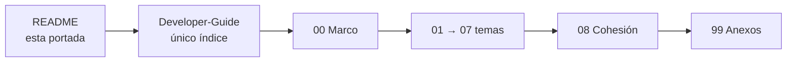

# Framework Concept — portada de la carpeta

## Índice

0. [Empezá acá](#0-empezá-acá)
1. [Qué hay acá](#1-qué-hay-acá)
2. [Dónde está el índice](#2-dónde-está-el-índice)

## 0. Empezá acá

1. [`Developer-Guide`](/LAB/Lab-Documentos/Lab-Documentos/Concepts/Framework-Concept/Developer-Guide.md) §1 y §4: la
   idea en una página.
2. Ejercicio 1 de la misma guía: compilar sin instalar nada.
3. [`Demo/README`](/LAB/Lab-Documentos/Lab-Documentos/Concepts/Framework-Concept/Demo/README.md): para el teléfono.

Vocabulario: app híbrida = cascarón nativo (native shell, App Shell model) + contenido Blazor WASM (update bundle)
actualizado OTA (live updates / code push), offline-first con outbox.

## 1. Qué hay acá

Una guía de estudio para construir apps .NET MAUI con pantallas Blazor WebAssembly que se actualizan desde un servidor
propio sin pasar por las tiendas, con procedimientos de PR, integración y versionado que impiden romper lo que ya
funcionaba, y una demo que la ilustra en [`Demo/`](/LAB/Lab-Documentos/Lab-Documentos/Concepts/Framework-Concept/Demo/README.md).

## 2. Dónde está el índice

Esta portada **no es un índice**: la decisión P10 del expediente 0001
([folio 037](/LAB/Lab-Documentos/Lab-Documentos.Documentacion/PROMPTs/Concepts/01-Framework-Concept/OUTPUTs/Expedientes/0001-Framework-Concept-Maui-Autoactualizable/actuaciones/037-resolucion-plan-de-aplicacion-y-cierre-de-la-mesa.md))
fija un único índice, que es
[`Developer-Guide.md`](/LAB/Lab-Documentos/Lab-Documentos/Concepts/Framework-Concept/Developer-Guide.md). Su §3 tiene
la tabla de documentos y la ruta de lectura.

El archivo `Framework-APP.md` que está en esta carpeta es el borrador del PO: es un insumo **fuera del conjunto**, no
se edita ni forma parte de la guía (ver
[`FC-ANEXO-99` §8](/LAB/Lab-Documentos/Lab-Documentos/Concepts/Framework-Concept/99-Anexos.md#8-insumos-fuera-del-conjunto-y-apartamientos-declarados)).
