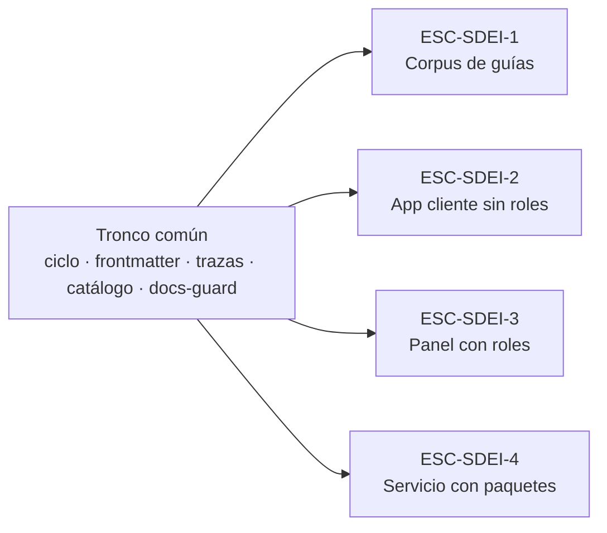

# 00 Marco de referencia

Este documento fija el vocabulario común del cuerpo: **cuatro escenarios** (los tipos de sistema que se documentan),
**contextos** que cambian las respuestas dentro de un escenario, **actores** con lo que cada uno decide, y las
**convenciones** de escritura y de identificación. Cada eje se define acá y en ningún otro lugar; el Mapa y los temas
lo citan por su identificador. Sirve a quien estudia, que necesita el vocabulario antes de los temas, y a un agente,
que encuentra los identificadores estables en un solo archivo.

## Índice

1. [Definiciones](#1-definiciones)
2. [Escenarios](#2-escenarios)
3. [Contextos](#3-contextos)
4. [Actores](#4-actores)
5. [Convenciones](#5-convenciones)
6. [Un caso que recorre el marco](#6-un-caso-que-recorre-el-marco)
7. [Preguntas guía](#7-preguntas-guía)

## 1. Definiciones

| Término | Definición |
| --- | --- |
| Escenario | Tipo de sistema que se documenta. Fija qué audiencias hay, qué clases de pieza documental se activan y contra qué se ancla la versión |
| Contexto | Variante dentro de un escenario que cambia una respuesta concreta (dónde vive una pieza, si hay sitio publicado, qué runner corre la compuerta) |
| Actor | Rol que interviene en el sistema documentador, con lo que le toca decidir y lo que no |
| Clase de pieza (`CL-nn`) | Categoría cerrada de pieza documental: especificación, ayuda al usuario, contrato REST, `AGENTS.md`, etc. El catálogo completo está en el [Mapa](01-Mapa.md#4-por-artefacto) |
| Clase de intervención D/P/H | **D**: la produce un generador determinista. **P**: la propone un agente o una persona y entra por la compuerta. **H**: sólo la decide una persona |
| Ancla de versión | El dato que dice contra qué estado del código vale una pieza: el commit, un SHA fijado entre repositorios o una etiqueta |
| Cuerpo documental | Conjunto de documentos de una guía bajo un README que declara `corpus_id` (su identificador, acá `SDEI`) y `version` |
| Compuerta | Control que corre en la integración continua (CI) en cada pull request y termina en verde o en rojo. Las de este cuerpo las corre el workflow `docs-guard`, agrupadas de PR-1 a PR-7 (enlaces, frontmatter, anti-inyección, estructura y mermaid, trazas, contrato, referencias). Un control **bloquea** (rojo) o sólo **avisa** según la regla de bloqueo del [anexo de criterios](99-Anexos/Criterios-De-Calidad.md#2-qué-automatiza-la-compuerta) |
| Anti-inyección | Controles que buscan en el texto instrucciones escondidas para un agente de IA: comentarios HTML, caracteres invisibles, HTML oculto, enlaces a dominios fuera de una lista (AI-1 a AI-5) |
| Traza | Declaración, en el frontmatter, de que un documento **depende de** otro identificador: si el identificador cambia de versión o desaparece, el documento hay que revisarlo. Forma `traces: [ID]` o `traces: [ID@MAYOR.MENOR]`. El identificador se declara una sola vez en el repositorio (como `doc_id` o como encabezado que empieza con el ID, con una línea `**Versión:** 1.0` si tiene versión), y de esas declaraciones sale solo el **registro de IDs** contra el que `traces-resolve` verifica. Si la ficha sube a 1.1, la página que traza a `@1.0` da rojo; una traza sin versión (`traces: [ID]`) sólo comprueba que el ID existe, y la subida de versión no la pone en rojo: por eso traza con `@MAYOR.MENOR` toda página que repite lo que dice una regla. `traces-resolve` corre sobre la carpeta que recibe la compuerta, tenga o no un README con `corpus_id`: un ID que no resuelve da rojo igual. Detalle en el [anexo del esquema](99-Anexos/Esquema-Frontmatter-Y-Prefijos.md#4-trazas) |
| Ficha | Página corta que declara una regla o un caso de uso con su identificador (`RN-LOC-01` = regla de negocio, ámbito «localización», número 01), su versión y dónde se aplica en el código, con la forma `ruta#Símbolo@SHA` (archivo, método o clase, y commit). Cuando el código cambia, quien lo cambia actualiza la ficha y sube su versión |
| Requerimiento documental | Lo que una audiencia necesita lograr con la documentación, escrito como fila de un registro (RRD) con un criterio verificable Dado/Cuando/Entonces («Dado un estado, cuando la persona hace algo, entonces observa tal resultado») y la decisión de una persona |
| Carril programado | Corrida semanal de la CI que sólo avisa (abre o actualiza un issue): enlaces externos rotos, anclas atrasadas, documentos sin revisar hace más de un año |
| Guarda de merge | Comprobación que hace un agente antes de fusionar su propio pull request: abierto, sin conflictos, con todos los controles en verde y sin una duda declarada. Sólo vale si la persona responsable dejó **asentada por escrito** la delegación del merge en el repositorio; con una duda (una **reserva**), el merge vuelve a la persona |
| Repositorio hermano | Repositorio `.Documentacion` que acompaña a uno de código con el mismo nombre (por ejemplo, Lab-Documentos y Lab-Documentos.Documentacion) y guarda índices, expedientes y bitácoras |
| Runner | Máquina que ejecuta los trabajos de la CI. Se elige por etiqueta: `[self-hosted, i7infra-dev]` es la etiqueta del runner del laboratorio, no una dirección |

## 2. Escenarios

Cada escenario es un tipo de sistema real de los repositorios del laboratorio de la cátedra (los repositorios
`Lab-*`). El tronco común es el mismo en los cuatro: las fases del ciclo documental (1a captura y 1b evaluación de
requerimientos, 2 análisis, 3 diseño, 4 implementación, 5 integración; las explica `TEM-02`), el frontmatter, las
trazas, el catálogo de piezas y la compuerta; un escenario sólo activa, quita o sustituye clases de pieza
y controles, nunca agrega fases.

*Diagrama: los cuatro escenarios salen del mismo tronco. Lo que cambia entre ellos es la tabla de §2.5.*

### ESC-SDEI-1 — Corpus de guías

Un repositorio dedicado a documentación formativa: lo que contiene son guías, y el código que aparece (las
pruebas de concepto de `Examples/`) existe para ilustrarlas, no es un producto que se documente. El ejemplo es este
repositorio, Lab-Documentos, que aloja varias guías; este cuerpo es una de ellas. Las audiencias son quien estudia, quien enseña y los agentes. La versión se ancla con la
versión del cuerpo en su README y una etiqueta por compuerta.

### ESC-SDEI-2 — App cliente sin roles

Una aplicación que usa una sola clase de persona usuaria, sin perfiles con permisos distintos. El ejemplo es
MovilidadUrbana (repositorio Lab-E2E.WebBlazor): una app MAUI con una API web. La ayuda al usuario final es una sola
para todos; la documentación técnica y el contrato REST salen del código. La versión se ancla con el SHA del código
fijado en un archivo `source.lock`.

### ESC-SDEI-3 — Panel con roles

Un panel web donde cada rol ve pantallas y ayuda distintas. El ejemplo es Lab-Geometria, que además tiene un marco de
desarrollo guiado por especificación (SDD) con su propio registro de identificadores. La ayuda de una pantalla traza
al caso de uso de la unidad que la contiene, y la confidencialidad por rol se resuelve en el servidor.

### ESC-SDEI-4 — Servicio con paquetes

Un servicio que publica paquetes para que otros sistemas lo integren, con varias líneas de versión. El ejemplo es un
servicio de notificaciones push de repositorio privado, que en este cuerpo se nombra con el alias **SDD-B** (el
segundo marco SDD del laboratorio, junto al de Lab-Geometria; el alias no es una sigla del producto). Las audiencias son
quien integra, quien opera y los agentes; la versión se ancla con la etiqueta de cada línea.

### 2.5 Qué cambia entre escenarios

| Parámetro | ESC-SDEI-1 Corpus de guías | ESC-SDEI-2 App sin roles | ESC-SDEI-3 Panel con roles | ESC-SDEI-4 Servicio con paquetes |
| --- | --- | --- | --- | --- |
| Audiencias | Estudiante, docente, agente | Persona usuaria, desarrollo, consumidor de la API, agente | Lo anterior más los roles del panel | Integrador, operador, agente |
| Clases activas | CL-02, CL-03, CL-09, CL-10, CL-11, CL-12 | CL-02 a CL-07, CL-12 | CL-01 a CL-08, CL-12 | CL-01 a CL-05, CL-07, CL-08, CL-11 a CL-13 |
| Confidencialidad | No aplica | Lo que viaja en el paquete de la app instalada es visible para quien la instala | En el build y en el servidor | En el build y en los secretos |
| Fuente generada | — | OpenAPI y comentarios XML | OpenAPI y comentarios XML | API pública de los paquetes |
| Ancla de versión | Versión del cuerpo y etiqueta | SHA en `source.lock` | Etiqueta y SHA | Etiqueta por línea de versión |
| Registro de IDs | `doc_id` y `corpus_id` | Fichas provisionales `RN-LOC-nn` | El del SDD del proyecto | El del SDD del proyecto |

## 3. Contextos

Un contexto no es un escenario más: cruza los cuatro y cambia una sola respuesta.

### CTX-SDEI-1 — Con sitio publicado o sin sitio

Sin sitio, la documentación se lee en el render de Markdown del repositorio y los canales para agentes son el propio
Markdown con frontmatter, el `AGENTS.md` y el índice interno. Con sitio, aparecen los canales derivados (una página
`.md` por página publicada, `llms.txt`) y la compuerta suma el build del sitio. Hoy ningún escenario publica sitio.

### CTX-SDEI-2 — Con SDD o sin SDD

Con un marco SDD, la especificación (necesidades, casos de uso, reglas, decisiones de arquitectura) ya tiene lugar y
registro de identificadores, y el registro de requerimientos documentales vive junto a ella. Sin SDD, ese registro va
en `docs/_requisitos.md` del árbol que se documenta y las reglas se escriben como fichas propias.

### CTX-SDEI-3 — Mismo repositorio, repositorio hermano o repositorio dedicado

La topología dice dónde vive una pieza respecto del código. En el mismo repositorio, el ancla es el commit. En el
repositorio hermano `.Documentacion` o en uno dedicado, el ancla es un SHA fijado (`base_commit`) y el desfase se
detecta con un aviso programado.

### CTX-SDEI-4 — Dentro o fuera de la organización del runner

Los repositorios de la organización que tiene el runner `[self-hosted, i7infra-dev]` llaman al workflow reutilizable
`docs-guard.yml` de Lab-Documentos. Un repositorio de otra organización no puede llamarlo con ese runner: copia el
workflow junto con su huella (el SHA-256 del archivo, que permite comprobar que la copia no cambió) y lo corre en el
runner de su organización de GitHub.

## 4. Actores

| Id | Actor | Decide | No decide |
| --- | --- | --- | --- |
| `ACT-SDEI-1` | Persona responsable del producto (PO) | Lo de clase H del producto: aceptar decisiones de arquitectura, pasar a vigente, etiquetar, publicar; asentar la delegación del merge | Cada pull request de clase D o P sin reserva: lo fusiona el agente que lo abrió, después de pasar la guarda |
| `ACT-SDEI-2` | Analista | Acepta, rechaza o difiere cada requerimiento documental; decide las divergencias entre lo que la especificación dice y lo que se quiso decir | La clase de una pieza que ya está en el catálogo |
| `ACT-SDEI-3` | Desarrollo | Escribe el código, sus comentarios XML y el contrato que se emite en el build | El texto de la ayuda al usuario final |
| `ACT-SDEI-4` | Agente de IA | Propone (clase P): fichas, borradores, traducciones, reindexado, correcciones por deriva | Nada de clase H; no aprueba su propio trabajo |
| `ACT-SDEI-5` | Estudiante y docente | Recorren la guía y la evalúan con los criterios de calidad | El contenido normativo del cuerpo |
| `ACT-SDEI-6` | Persona usuaria | Usa la ayuda dentro del producto | — |

Clase H quiere decir «la decide una persona», no siempre el PO: la tabla dice qué persona decide cada cosa (por
ejemplo, una divergencia entre especificación e intención la decide la analista). Una regla atraviesa la tabla:
quien verifica no es quien redactó, y una segunda identidad de la misma persona no
aprueba a la primera. Que un agente fusione su pull request con la guarda no contradice la regla: quien verifica son
los controles de la compuerta, que el agente no escribió en ese pull request, y la delegación la dio una persona.

## 5. Convenciones

| Convención | Regla | Detalle |
| --- | --- | --- |
| Frontmatter | Todo documento del cuerpo abre con los diez campos más `description`; `corpus_id` y `version` sólo en el README | [Esquema de frontmatter](99-Anexos/Esquema-Frontmatter-Y-Prefijos.md#2-los-diez-campos-más-description) |
| Identificadores | Un prefijo del registro cerrado, guion y sufijo (`TEM-01`, `CQ-05`, `ESC-SDEI-2`). Una traza apunta al identificador, no a la ruta | [Registro de prefijos](99-Anexos/Esquema-Frontmatter-Y-Prefijos.md#5-registro-de-prefijos) |
| Trazas | `traces: [ID]` o `traces: [ID@MAYOR.MENOR]`; cada una tiene que resolver contra el registro, o la compuerta da rojo | [Esquema](99-Anexos/Esquema-Frontmatter-Y-Prefijos.md#4-trazas) |
| Enlaces | Relativos dentro del repositorio; nunca un relativo que salga del repositorio. Entre repositorios, `Repo@ancla:corpus_id/doc_id` con enlace permanente al SHA | [Glosario](99-Anexos/Glosario.md#2-términos) (cita entre repositorios) |
| Citación | APA 7, autor-año, en castellano, **siempre** con fecha de consulta; la cita en el texto enlaza a su ancla `ref-…` del anexo | [Referencias](99-Anexos/Referencias.md) |
| Criterio propio | Lo que no sale de una fuente se rotula **[criterio propio]** y se separa de los hechos | [Lista de verificación](99-Anexos/Lista-De-Verificacion.md#2-evidencia-y-veracidad) |
| Diagramas | Mermaid en el Markdown, con una línea en cursiva debajo que dice qué muestra; nunca ASCII ni imagen si hay alternativa | [Criterios de calidad](99-Anexos/Criterios-De-Calidad.md) (`CQ-13`) |
| Ejemplos | Todo fragmento de código dice de dónde sale (`[Compilado: ruta, l. x–y]`) o se rotula `[Fragmento ilustrativo: motivo]` | [Patrones de ejemplos](99-Anexos/Patrones-De-Ejemplos.md) (`PE-03`, `PE-04`) |
| Estados | `borrador` → `vigente` → `obsoleto`; pasar a vigente es acto H | [README](README.md#6-versión-y-estado) |
| Repositorios privados | Se nombran por un alias (el servicio push privado es **SDD-B**); en lo versionado no van rutas del equipo, direcciones IP, hosts ni usuarios | — |
| Idioma | Castellano rioplatense claro, con voseo, sin regionalismos que traben la lectura; los términos de una API o de un formato van en su idioma original (`traces`, `pull request`) | — |

## 6. Un caso que recorre el marco

MovilidadUrbana tiene hoy un defecto real: el texto de la pantalla promete 60 caracteres para el nombre de una
localidad y el campo admite 80. Una desarrolladora va a corregir el código, y la ayuda al usuario que menciona el límite tiene que seguir
diciendo la verdad. La ayuda de ejemplo vive en la mini demo de `Examples/` de este repositorio, no en el de la app.
Con el marco se ubica así:

1. **Escenario** `ESC-SDEI-2`: app cliente sin roles. La ayuda es una sola y la regla se escribe como ficha
   provisional `RN-LOC-01`, porque el proyecto no tiene SDD (`CTX-SDEI-2`, rama «sin SDD»).
2. **Contexto** `CTX-SDEI-3`: la ayuda de la demostración vive en otro repositorio que el código, así que se ancla al
   SHA del código en `source.lock`; contra ese SHA la traza resuelve, y contra la rama principal del código un aviso
   programado detecta que el método que valida el largo (el «símbolo» que cita la ficha) cambió.
3. **Actores**: un agente (`ACT-SDEI-4`) propone actualizar la ficha y el `source.lock`; la compuerta corre en el pull
   request; si el número correcto es 60 u 80 es una divergencia que **decide una persona** (`ACT-SDEI-2`).

## 7. Preguntas guía

1. ¿En qué escenario está el sistema que tenés que documentar, y qué clases de pieza activa?
2. ¿Qué contexto cambia la respuesta en tu caso: hay sitio, hay SDD, dónde vive la pieza, en qué organización corre
   la compuerta?
3. ¿Qué parte de tu cambio es de clase H y, por lo tanto, no la puede cerrar un agente?
4. ¿Contra qué ancla de versión vale la pieza que vas a escribir?

Documento anterior: [README](README.md). Siguiente documento: [01 Mapa](01-Mapa.md).
