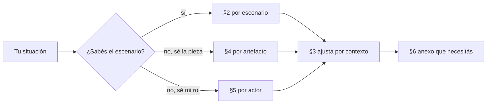

# 01 Mapa — estoy acá, qué aplico

El Mapa es la entrada por situación. Quien llega con un problema concreto («tengo que documentar una API», «una
página de ayuda quedó desactualizada», «soy un agente y tengo que proponer una página») busca su fila y sale con la
pieza que tiene que producir, el control que la va a revisar, el tema que lo explica y el anexo que necesita. Usa el
vocabulario del [Marco](00-Marco.md): escenarios `ESC-SDEI-n`, contextos `CTX-SDEI-n` y actores `ACT-SDEI-n`.

## Índice

1. [Cómo se usa](#1-cómo-se-usa)
2. [Por escenario](#2-por-escenario)
3. [Por contexto](#3-por-contexto)
4. [Por artefacto](#4-por-artefacto)
5. [Por actor](#5-por-actor)
6. [Anexos](#6-anexos)
7. [Preguntas guía](#7-preguntas-guía)

## 1. Cómo se usa

*Diagrama: se entra por la tabla que corresponde a lo que se sabe, se ajusta por contexto y se sale por un anexo.*

Los temas `TEM-01` a `TEM-07` figuran en las tablas por su identificador; mientras estén en redacción, la columna
«Anexo» da lo que ya se puede usar.

## 2. Por escenario

| Estoy en… | Lo primero que aplico | Piezas que activo | Control que me revisa | Tema | Anexo |
| --- | --- | --- | --- | --- | --- |
| `ESC-SDEI-1` Corpus de guías: escribo o cambio una guía | El frontmatter de diez campos y la estructura de seis secciones por tema | CL-10 guía; CL-12 si escribo un proceso | `docs-guard` completo: esquema, enlaces, anti-inyección, mermaid, referencias | `TEM-06` | [Esquema](99-Anexos/Esquema-Frontmatter-Y-Prefijos.md), [Referencias](99-Anexos/Referencias.md), [Lista de verificación](99-Anexos/Lista-De-Verificacion.md) |
| `ESC-SDEI-2` App sin roles: documento una app y su API | Fijo el SHA del código en `source.lock`; escribo las reglas como fichas y la ayuda con `traces` | CL-02, CL-05, CL-06, CL-07 | `traces-resolve` contra el SHA; diff del contrato OpenAPI | `TEM-03`, `TEM-05` | [Esquema](99-Anexos/Esquema-Frontmatter-Y-Prefijos.md#4-trazas), [Patrones de ejemplos](99-Anexos/Patrones-De-Ejemplos.md) |
| `ESC-SDEI-3` Panel con roles: agrego ayuda a una pantalla | Trazo la ayuda al caso de uso de la unidad de la pantalla; el rol decide qué se sirve | CL-01, CL-06, CL-08 | `traces-resolve`; cruce de rol en las pruebas de acceso | `TEM-05`, `TEM-07` | [Cómo decidir](99-Anexos/Como-Decidir.md) si el cambio supera una norma del proyecto |
| `ESC-SDEI-4` Servicio con paquetes: publico una versión | Actualizo README y CHANGELOG del paquete; reviso el contrato contra la línea anterior | CL-05, CL-11, CL-13 | Diff del contrato; copias fijadas de conocimiento verificadas por huella | `TEM-03`, `TEM-07` | [Glosario](99-Anexos/Glosario.md) (ancla de versión, copia fijada) |

## 3. Por contexto

| Si además… | Cambia | Aplico | Anexo |
| --- | --- | --- | --- |
| `CTX-SDEI-1` hay sitio publicado | Aparecen los canales derivados para agentes y el build del sitio entra a la compuerta | Una página `.md` por página publicada y `llms.txt` rotulado como propuesta | [Glosario](99-Anexos/Glosario.md) (canal derivado) |
| `CTX-SDEI-1` no hay sitio | El render del repositorio es el canal; no hay build que verificar | Markdown con frontmatter y `AGENTS.md` | [Esquema](99-Anexos/Esquema-Frontmatter-Y-Prefijos.md) |
| `CTX-SDEI-2` el proyecto tiene SDD | El registro de requerimientos documentales va con la especificación; los IDs son los del SDD | Trazas a `CU-`, `RN-` del registro del proyecto | [Ejercicios](99-Anexos/Ejercicios.md) (`EJR-SDEI-05`) |
| `CTX-SDEI-2` el proyecto no tiene SDD | El registro va en `docs/_requisitos.md`; las reglas son fichas propias | Tabla `ID \| Audiencia \| Tarea \| Pieza \| Criterio \| Decisión` | [Esquema](99-Anexos/Esquema-Frontmatter-Y-Prefijos.md#6-registro-de-requerimientos-documentales) |
| `CTX-SDEI-3` la pieza vive en otro repositorio que el código | El ancla deja de ser el commit: es un SHA fijado | `source.lock` o `base_commit`; el desfase lo avisa el carril programado | [Glosario](99-Anexos/Glosario.md) (ancla de versión) |
| El código cambió y una página que lo describe quedó desactualizada, en el **mismo** repositorio | Quien cambia el código sube la versión de la ficha de la regla (de 1.0 a 1.1); la página traza a `@1.0` | `traces-resolve` da rojo en ese mismo pull request hasta que la página se revisa y traza a `@1.1`. La revisa quien propone el cambio (un agente o una persona, clase P); si el cambio altera lo que la regla promete, decide la analista. Si nadie sube la versión de la ficha, hoy ningún control lo detecta: lo cubre la revisión del pull request (`CQ-03` es parcial en este punto) | [Esquema](99-Anexos/Esquema-Frontmatter-Y-Prefijos.md#4-trazas) |
| El código cambió y la página vive en **otro** repositorio (`CTX-SDEI-3`) | El pull request del código no ve la página | El carril programado avisa; un agente propone actualizar la ficha y el SHA fijado; una persona decide si la regla cambió | [Ejercicios](99-Anexos/Ejercicios.md) (`EJR-SDEI-04`) |
| El código cambió y la página desactualizada **no traza** a ninguna ficha (por ejemplo, una página técnica `CL-07` que describe la arquitectura) | Ningún control la conecta con el cambio | Se agrega la traza a la ficha o al requerimiento de los que depende, con versión, para que el próximo cambio la ponga en rojo; mientras no la tenga, la revisión del pull request del código es la única defensa | [Esquema](99-Anexos/Esquema-Frontmatter-Y-Prefijos.md#4-trazas) |
| `CTX-SDEI-4` el repositorio está fuera de la organización del runner | No puede llamar al workflow reutilizable | Copia del workflow con huella, en el runner propio | [Cómo decidir](99-Anexos/Como-Decidir.md) |

## 4. Por artefacto

Catálogo cerrado de catorce clases de pieza. Una pieza nueva se clasifica en una de ellas; si no encaja en ninguna,
se abre una clase nueva por expediente, no se improvisa.

| Clase | Artefacto | Dónde vive | Ancla | Control (bloquea salvo indicación) | Intervención | Tema |
| --- | --- | --- | --- | --- | --- | --- |
| CL-01 | Especificación: necesidad, caso de uso, regla, decisión de arquitectura | Repo de código | Commit y versión del ID | Esquema, enlaces, registro de IDs | P redacta; H acepta la decisión | `TEM-02` |
| CL-02 | Registro de requerimientos documentales | Con la especificación o en `docs/_requisitos.md` | Commit | Esquema del registro | P propone; H evalúa | `TEM-02` |
| CL-03 | `AGENTS.md` | Raíz de cada repositorio | Commit | Existe y sus enlaces resuelven; excluido del aviso AI-3 por huella | H | `TEM-04` |
| CL-04 | Referencia .NET (comentarios XML) | En el código | Commit | Build con avisos como error | D | `TEM-01`, `TEM-06` |
| CL-05 | Contrato REST (`openapi.json`) | Emitido en el build | Commit | Diff del contrato | D | `TEM-06` |
| CL-06 | Ayuda al usuario final | Repo de la interfaz, o `Examples/` con `source.lock` | Commit y versión del ID trazado | Enlaces, `traces-resolve`, anti-inyección | P | `TEM-05` |
| CL-07 | Documentación técnica escrita | `docs/tecnica/` del código | Commit | Enlaces, frontmatter, mermaid | P | `TEM-01` |
| CL-08 | Índice interno para agentes (ia-db) | Repo hermano `.Documentacion` | `base_commit` y `base_tag` | Aviso programado de atraso | P | `TEM-04` |
| CL-09 | Expedientes, bitácoras y prompts | Repo hermano `.Documentacion` | Commit | Enlaces y barrido de datos privados | P actúa; H resuelve | — |
| CL-10 | Guía de estudio (este cuerpo) | Repositorio dedicado | Versión del cuerpo y etiqueta | `docs-guard` completo | P borrador; H vigente | — |
| CL-11 | Conocimiento compartido | Base de conocimiento común, copiado con huella | Versión y SHA-256 | Verificación de la copia; aviso si la base avanza | H | `TEM-07` |
| CL-12 | Proceso «Cómo intervenir» | Plantilla en el cuerpo; una instancia por proyecto | Versión de la plantilla | Bloques entradas, salidas y validaciones presentes | H | Ruta intervenir: [plantilla](Examples/Como-Intervenir.md) |
| CL-13 | README y CHANGELOG | Mismo repositorio | Fecha o versión del paquete | Entrada en el pull request | P | `TEM-03` |
| CL-14 | Canales derivados para agentes | Artefacto del build del sitio | Versión del build | Reproducibilidad; anti-inyección | D | `TEM-04` |

CL-14 está latente: no se activa mientras ningún escenario publique sitio (`CTX-SDEI-1`).

## 5. Por actor

| Soy… | Lo que me toca | Lo que no me toca | Empiezo por |
| --- | --- | --- | --- |
| `ACT-SDEI-1` PO | Decidir lo de clase H; asentar por escrito la delegación del merge; pasar a vigente | Fusionar cada pull request sin reserva | [Cómo decidir](99-Anexos/Como-Decidir.md#6-quién-decide) |
| `ACT-SDEI-2` Analista | Evaluar el registro de requerimientos; decidir divergencias entre letra e intención | Elegir herramientas | [Ejercicios](99-Anexos/Ejercicios.md) (`EJR-SDEI-05`) |
| `ACT-SDEI-3` Desarrollo | Comentarios XML, contrato emitido, documentación técnica | La ayuda al usuario final | §4, filas CL-04, CL-05 y CL-07 |
| `ACT-SDEI-4` Agente de IA | Proponer páginas, fichas y correcciones que pasen la compuerta | Lo de clase H | [Esquema](99-Anexos/Esquema-Frontmatter-Y-Prefijos.md), [Lista de verificación](99-Anexos/Lista-De-Verificacion.md) |
| `ACT-SDEI-5` Estudiante o docente | Recorrer la ruta «aprender»; quien enseña, además, evaluar las guías con criterios | El contenido normativo | [Marco](00-Marco.md), [Ejercicios](99-Anexos/Ejercicios.md); quien enseña, [Criterios de calidad](99-Anexos/Criterios-De-Calidad.md) |
| `ACT-SDEI-6` Persona usuaria | Leer la ayuda del producto | — | La ayuda de su producto, no esta guía |

## 6. Anexos

| Necesito… | Anexo | `doc_id` |
| --- | --- | --- |
| Escribir un frontmatter válido o elegir un prefijo de ID | [Esquema de frontmatter y registro de prefijos](99-Anexos/Esquema-Frontmatter-Y-Prefijos.md) | `ANX-SDEI-ESQUEMA` |
| Saber qué significa una sigla o un término | [Glosario](99-Anexos/Glosario.md) | `ANX-SDEI-GLOSARIO` |
| Citar una fuente o encontrar la referencia completa de una cita | [Referencias](99-Anexos/Referencias.md) | `ANX-SDEI-REFERENCIAS` |
| Evaluar si una guía es buena | [Criterios de calidad CQ-01 a CQ-14](99-Anexos/Criterios-De-Calidad.md) | `ANX-SDEI-CQ` |
| Escribir un ejemplo o material de consulta | [Patrones de ejemplos PE-01 a PE-12](99-Anexos/Patrones-De-Ejemplos.md) | `ANX-SDEI-PE` |
| Revisar una guía antes de pasarla a vigente | [Lista de verificación VER-*](99-Anexos/Lista-De-Verificacion.md) | `ANX-SDEI-VER` |
| Elegir entre alternativas de diseño | [Cómo decidir](99-Anexos/Como-Decidir.md) | `ANX-SDEI-DECIDIR` |
| Comprobar que aprendí | [Ejercicios](99-Anexos/Ejercicios.md) | `ANX-SDEI-EJERCICIOS` |

## 7. Preguntas guía

1. ¿Por qué tabla entraste y qué fila describe tu situación?
2. ¿Qué control de la compuerta va a mirar la pieza que vas a producir, y qué tendría que estar mal para que dé rojo?
3. Si la pieza no encaja en ninguna clase del catálogo, ¿quién decide abrir una nueva?

Documento anterior: [00 Marco](00-Marco.md). Siguiente documento: [Tema 01 — Qué es un sistema
documentador](TEM-01-Sistema-Documentador.md), en el orden que da el [README](README.md#3-rutas-de-lectura). La
[guía de un solo archivo](Sistema-Documentador-Tecnico-Guide.md) está `obsoleta`; su tabla de destinos lleva cada
sección vieja a su tema.
