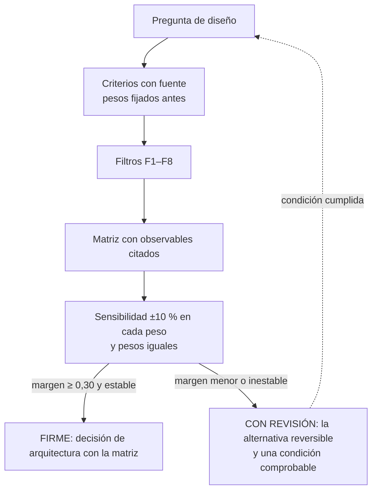
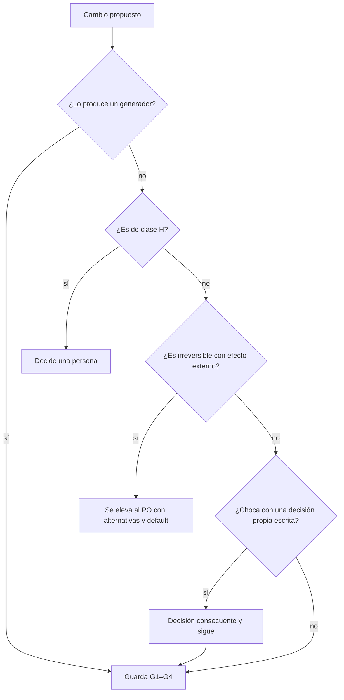

# Anexo — cómo decidir

Diseñar un sistema documentador obliga a elegir: un repositorio dedicado o el mismo del código, un generador de sitio
o ninguno, un control que bloquea o uno que avisa. Este anexo da una regla estable para esas elecciones, de modo que un
sistema nuevo no reabra el debate cada vez. La regla compara alternativas con criterios que tienen fuente, puntúa con
una escala donde cada punto tiene un observable, y dice cuándo la decisión es firme. Cierra con quién decide qué.

## Índice

1. [Definiciones](#1-definiciones)
2. [Los criterios](#2-los-criterios)
3. [La escala anclada](#3-la-escala-anclada)
4. [Pesos, filtros y regla de firmeza](#4-pesos-filtros-y-regla-de-firmeza)
5. [Una matriz trabajada](#5-una-matriz-trabajada)
6. [Quién decide](#6-quién-decide)
7. [Preguntas guía](#7-preguntas-guía)

## 1. Definiciones

| Término | Definición |
| --- | --- |
| Criterio (`K`) | Dimensión por la que se compara toda alternativa de una pregunta de diseño |
| Peso | Fracción de importancia de un criterio; los pesos suman 1 |
| Escala anclada | Escala de 1 a 5 en la que cada punto tiene un observable; sin observable, la celda queda «s/d» |
| Filtro duro | Restricción que excluye una alternativa antes de puntuar; no se compensa con puntaje |
| Margen | Diferencia de puntaje ponderado entre la primera y la segunda alternativa admitidas |
| Decisión firme | Margen de 0,30 o más, y el ganador no cambia al mover ±10 % cualquier peso |
| Decisión con revisión | Margen menor o ganador inestable: se toma la alternativa reversible y se escribe una condición de revisión comprobable |

## 2. Los criterios

Los tres primeros son los que un sistema documentador tiene que mostrar por pedido del caso: simplicidad, practicidad y
escalabilidad. Los demás salen del mismo pedido (audiencia, coherencia con los marcos existentes, desfase de
versiones), salvo el costo, que es **[criterio propio]** y por eso pesa menos.

| K | Criterio | Qué mide | Fuente de industria |
| --- | --- | --- | --- |
| K1 | Simplicidad | Cuántas piezas, herramientas o reglas nuevas agrega | [Böckeler (2025)](Referencias.md#ref-bockeler-2025): la crítica al exceso de ceremonia |
| K2 | Practicidad | Si funciona hoy con lo que hay, sin pasos humanos ni permisos extra, y si está medido | [GitLab (s. f.)](Referencias.md#ref-gitlab-sf); [Write the Docs (s. f.)](Referencias.md#ref-writethedocs-sf) |
| K3 | Escalabilidad | Cuánto cuesta aplicarlo a un sistema nuevo | [Backstage (s. f.)](Referencias.md#ref-backstage-sf) |
| K4 | Costo de adopción | Migración, dependencias y operación para un equipo chico | [Docusaurus (s. f.)](Referencias.md#ref-docusaurus-sf) |
| K5 | Doble audiencia | Si la misma fuente sirve a personas y a agentes, con verificación | [AGENTS.md (s. f.)](Referencias.md#ref-agentsmd-sf); [Howard (s. f.)](Referencias.md#ref-howard-sf); [OWASP (2025)](Referencias.md#ref-owasp-2025) |
| K6 | Coherencia con los marcos SDD | Si reutiliza un mecanismo ya catalogado o lo contradice | [Thoughtworks (2025)](Referencias.md#ref-thoughtworks-2025) |
| K7 | Riesgo de deriva (alto = riesgo bajo) | Si la deriva entre documentación y código se detecta, cuándo y cómo | [Winters et al. (2020)](Referencias.md#ref-winters-2020); [Tan et al. (2024)](Referencias.md#ref-tan-2024); [DORA (s. f.)](Referencias.md#ref-dora-sf) |

## 3. La escala anclada

| Punto | K1 Simplicidad | K2 Practicidad | K3 Escalabilidad | K4 Costo | K5 Doble audiencia | K6 Coherencia SDD | K7 Deriva |
| --- | --- | --- | --- | --- | --- | --- | --- |
| 5 | Ninguna pieza nueva | Funciona hoy y está medido | Un sistema nuevo = una fila o un parámetro | Menos de una hora, sin migración | Una sola fuente sirve a los dos, con verificación | Reusa un mecanismo catalogado tal cual | Se detecta de forma determinista en el PR |
| 4 | Una pieza nueva (archivo, campo) | Medido en copia o con un acto humano | Una configuración por sistema | Un PR mecánico | Sirve a los dos con un paso extra | Compatible sin cambiar norma | Se detecta en un aviso programado |
| 3 | Dos o tres piezas | Paso sin medir | Adaptación por sistema | Migración de muchos archivos | Sirve bien a una audiencia | Neutral | Se detecta a mano |
| 2 | Herramienta o servicio nuevo | Exige otro repo, otro expediente o decisión del PO | Rehacer parte por sistema | Toolchain nuevo, cientos de MB | Una audiencia queda mal servida | Choca con una regla local | Se detecta tarde |
| 1 | Infraestructura nueva | Bloqueado | Rehacer todo por sistema | Compra u operación permanente | Perjudica a una audiencia | Contradice una norma (exige apartamiento) | Invisible |

Se puntúa citando el observable: «K1 = 4 porque agrega un archivo» se puede discutir; «K1 = 4» solo, no.

## 4. Pesos, filtros y regla de firmeza

**Pesos.** K1, K2, K3, K5, K6 y K7 pesan 0,15 cada uno; K4, 0,10. El pedido no ordena los seis primeros, así que el
reparto es igual (razón insuficiente); K4 pesa menos porque no tiene origen en el pedido. Los pesos se fijan antes de
puntuar y se guarda su huella: si se fijan después, el resultado se contrasta con pesos iguales.

**Filtros duros.** Excluyen una alternativa antes de puntuar:

| Filtro | Excluye la alternativa que… |
| --- | --- |
| F1 | no corre en el runner que fija el caso (`[self-hosted, i7infra-dev]`) |
| F2 | escribe rutas del equipo, usuarios o hosts en lo versionado |
| F3 | nombra un repositorio privado (se usa su alias) |
| F4 | modifica material del dueño del caso sin mandato |
| F5 | se aparta de un conocimiento compartido sin dejar ficha del apartamiento |
| F6 | ignora un estándar de industria aplicable que se relevó |
| F7 | reduce la arquitectura documental a la elección de una herramienta |
| F8 | no aplica el Profile de guía de estudio |

**Regla de firmeza.**

*Diagrama: de la pregunta a la decisión. Una decisión con revisión vuelve a la pregunta cuando se cumple su condición.*

## 5. Una matriz trabajada

**Pregunta.** ¿La guía del sistema documentador es un cuerpo de varios documentos o un archivo único? Es la decisión
que dio forma a este cuerpo, y por eso sirve de ejemplo (`PE-01`, problema conductor).

| Alternativa | K1 | K2 | K3 | K4 | K5 | K6 | K7 | Total | Filtro |
| --- | --- | --- | --- | --- | --- | --- | --- | --- | --- |
| **A** Cuerpo documental: README, Marco, Mapa, siete temas, ejemplos y anexos | 3 | 4 | 5 | 3 | 5 | 5 | 4 | **4,20** | Pasa |
| B Enriquecer el archivo único | 5 | 4 | 2 | 5 | 4 | 2 | 3 | 3,50 | **Excluida por F8**: el Profile pide un documento por tema |
| C Archivo único más satélites por escenario | 3 | 3 | 3 | 3 | 3 | 2 | 2 | 2,70 | Pasa |

**Cálculo de A.** 0,15 × (3 + 4 + 5 + 5 + 5 + 4) + 0,10 × 3 = 0,15 × 26 + 0,30 = 4,20.

**Lectura de algunas celdas** [criterio propio: la tabla de puntos la fijó la mesa del expediente 0002; esta lectura la
reconstruye con la escala de §3]:

| Celda | Observable que la justifica |
| --- | --- |
| A · K1 = 3 | Agrega varias piezas (README, Marco, Mapa, anexos) aunque reusa la estructura de seis secciones del Profile |
| A · K3 = 5 | Un sistema nuevo es una fila en las tablas del Marco y del Mapa |
| A · K6 = 5 | Reusa tal cual el Profile de guía de estudio |
| B · K3 = 2 | Cada sistema nuevo obliga a rehacer secciones de un archivo que ya mezcla los cuatro escenarios |
| C · K7 = 2 | Los satélites repiten contenido del archivo central y la deriva entre ellos se nota tarde |

**Sensibilidad.** Con B excluida, el margen de A sobre C es 1,50. Moviendo ±10 % cada peso (y renormalizando), el
margen mínimo es 1,48; con pesos iguales, A da 4,14 y C 2,71. El ganador no cambia: la decisión es **FIRME**. Aun sin
el filtro F8, A le gana a B por 0,66 en el peor caso de la sensibilidad.

El cálculo se reprodujo el 2026-10-27 con Python 3, sin dependencias, sobre los pesos de §4 y los puntos de esta tabla.

## 6. Quién decide

Decidir bien no alcanza: hay que saber si la decisión la puede cerrar quien la tomó. La regla depende de la clase de
intervención y de si el efecto se puede deshacer.

| Situación | Clase | Quién decide | Cómo entra |
| --- | --- | --- | --- |
| La produce un generador determinista (contrato emitido, índice generado) | D | El generador; la compuerta lo verifica | Pull request por la guarda G1–G4, sin reserva |
| Un agente o una persona propone una página, una ficha, una corrección | P | Quien propone, con la compuerta en verde | Pull request por la guarda G1–G4 si la delegación del merge está asentada por escrito en el repositorio |
| Aceptar una decisión de arquitectura, pasar a vigente, etiquetar, publicar, cambiar `AGENTS.md` o un conocimiento compartido | H | Una persona | La persona fusiona o aprueba |
| Lo aditivo y reversible que choca con una decisión propia ya escrita | P | Quien propone, con un análisis | Se escribe una decisión consecuente que ratifica o ajusta la anterior, y se sigue |
| Lo irreversible con consecuencia fuera del repositorio (configuración de la organización, publicación de paquetes, compras) | H | La persona responsable del producto | Se le eleva con alternativas y una opción por defecto |

*Diagrama: lo que se puede deshacer y no es de clase H lo cierra la guarda; sólo lo irreversible con efecto externo y
lo de clase H llegan a una persona.*

## 7. Preguntas guía

1. ¿Qué alternativas reales tiene tu pregunta, y alguna cae por un filtro antes de puntuar?
2. ¿Qué observable de la escala justifica cada celda que pusiste?
3. ¿Tu decisión sigue ganando con pesos iguales? Si no, ¿qué condición comprobable la haría revisar?
4. ¿Tu cambio es reversible? Si no lo es y tiene efecto fuera del repositorio, ¿a quién se lo elevás y con qué opción
   por defecto?

Volver al [Mapa](../01-Mapa.md#6-anexos).
