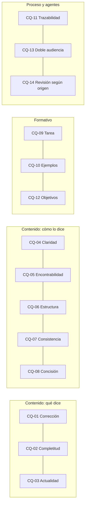

# Anexo — criterios de calidad

Catorce criterios para distinguir una documentación buena de una pobre. Cada uno tiene un identificador estable que
se cita en revisiones («no cumple `CQ-07`»), una pregunta que se responde con sí o no, y su fuente. Cinco se verifican
con la compuerta; los demás, con revisión de una persona y con la prueba de lectura P-LECT.

## Índice

1. [Los catorce criterios](#1-los-catorce-criterios)
2. [Qué automatiza la compuerta](#2-qué-automatiza-la-compuerta)
3. [Cómo se usan en una revisión](#3-cómo-se-usan-en-una-revisión)

## 1. Los catorce criterios

| Id | Criterio | Pregunta de verificación | Automatizable | Fuente |
| --- | --- | --- | --- | --- |
| `CQ-01` | Corrección | ¿Cada afirmación técnica y cada ejemplo coincide con el sistema en la versión declarada? | Parcial: compilar los ejemplos | [Aghajani et al. (2019)](Referencias.md#ref-aghajani-2019); [Aghajani et al. (2020)](Referencias.md#ref-aghajani-2020) |
| `CQ-02` | Completitud | ¿Están cubiertas la instalación, el despliegue y cada función nueva? | No | [Aghajani et al. (2020)](Referencias.md#ref-aghajani-2020) |
| `CQ-03` | Actualidad | ¿Toda referencia a código, ruta o símbolo existe en el commit citado? | Sí | [Tan et al. (2024)](Referencias.md#ref-tan-2024) |
| `CQ-04` | Claridad | ¿Un lector sin conocimiento del dominio ejecuta la guía sin ayuda? | No: prueba de lectura | [Aghajani et al. (2020)](Referencias.md#ref-aghajani-2020); [Bhat et al. (2026)](Referencias.md#ref-bhat-2026) |
| `CQ-05` | Encontrabilidad | ¿Hay índice, anclas predecibles y entradas «estoy acá → qué aplico»? | Sí: índice y anclas | [Aghajani et al. (2020)](Referencias.md#ref-aghajani-2020); Profile de guía de estudio |
| `CQ-06` | Estructura y cohesión | ¿Las unidades siguen el mismo patrón interno y se enlazan entre sí? | Parcial | [Treude et al. (2020)](Referencias.md#ref-treude-2020); Profile de guía de estudio |
| `CQ-07` | Consistencia terminológica | ¿Un término, un significado, registrado en el glosario? | Parcial | [Treude et al. (2020)](Referencias.md#ref-treude-2020); [Horn et al. (1969)](Referencias.md#ref-horn-1969) |
| `CQ-08` | Concisión y relevancia | ¿Cada bloque trata un solo tipo de información? | No | [Treude et al. (2020)](Referencias.md#ref-treude-2020); [Horn et al. (1969)](Referencias.md#ref-horn-1969) |
| `CQ-09` | Orientación a la tarea | ¿La unidad parte de una tarea real y prevé errores con su recuperación? | No | [van der Meij y Carroll (1995)](Referencias.md#ref-vandermeij-1995); [Merrill (2002)](Referencias.md#ref-merrill-2002) |
| `CQ-10` | Ejemplos trabajados de calidad | ¿Hay ejemplos resueltos, rotulados, con procedencia, antes de los ejercicios? | Parcial | [Sweller y Cooper (1985)](Referencias.md#ref-sweller-1985); [Atkinson et al. (2000)](Referencias.md#ref-atkinson-2000); [Chen et al. (2025)](Referencias.md#ref-chen-2025) |
| `CQ-11` | Trazabilidad de fuentes | ¿Toda afirmación externa tiene referencia completa con fecha de consulta, y toda interna, ruta y línea o commit? | Sí: enlaces y formato | [Aghajani et al. (2020)](Referencias.md#ref-aghajani-2020); [ISO (2021)](Referencias.md#ref-iso-690-2021) |
| `CQ-12` | Objetivos y evaluación | ¿La unidad declara objetivos observables y cierra con preguntas guía y un ejercicio? | Parcial: presencia | [Krathwohl (2002)](Referencias.md#ref-krathwohl-2002); [Merrill (2002)](Referencias.md#ref-merrill-2002) |
| `CQ-13` | Doble audiencia | ¿Frontmatter válido, IDs estables, diagramas como código y fragmentos con procedencia? | Sí | [Chatlatanagulchai et al. (2025)](Referencias.md#ref-chatlatanagulchai-2025) |
| `CQ-14` | Revisión según origen | Si `origin` no es `human`, ¿pasó revisión técnica y editorial registrada? | Sí: metadato | [Yamasaki et al. (2026)](Referencias.md#ref-yamasaki-2026); [Bhat et al. (2026)](Referencias.md#ref-bhat-2026) |

*Diagrama: los catorce criterios agrupados por lo que miran. Los del grupo «proceso y agentes» son los más fáciles de
automatizar.*

## 2. Qué automatiza la compuerta

Un control bloquea sólo si cumple cinco condiciones: es determinista y no usa red; el defecto lo introduce el mismo
pull request; tiene par rojo/verde; su línea de base sobre lo que vigila es 0; y no tiene falsos positivos conocidos o
los canaliza por excepciones con huella. Si falla una, el control avisa.

| Criterio | Control de `docs-guard` | Bloquea o avisa |
| --- | --- | --- |
| `CQ-03` | PR-5 `traces-resolve`: cada traza resuelve contra el registro o contra el SHA de `source.lock`. Aviso `cita-linea` para rutas del workspace sin línea | PR-5 bloquea; `cita-linea` avisa |
| `CQ-05` | PR-1 enlaces y anclas (`lychee --offline --include-fragments`); PR-4 estructura de encabezados | Bloquea |
| `CQ-11` | PR-7 `reflint`: año, título en cursiva y fecha de consulta en cada referencia; aviso `url-fecha` en lo heredado | Bloquea en un cuerpo nuevo; avisa en lo heredado |
| `CQ-13` | PR-2 esquema de frontmatter y registro de prefijos; PR-4 mermaid que parsea | Bloquea |
| `CQ-14` | PR-2 exige `confidence` cuando `origin` no es `human`. La revisión en sí la registra el pull request que pasa el documento a vigente | Bloquea la falta del metadato |

## 3. Cómo se usan en una revisión

1. Quien revisa recorre la tabla de §1 sobre el documento y anota los criterios que no cumple, con la línea.
2. Los cinco automatizables ya los vio la compuerta: si el pull request está en verde, se dan por cumplidos.
3. `CQ-04` se comprueba con una prueba de lectura: un lector sin contexto recorre el documento y anota las dudas que
   el texto no responde. El umbral es cero dudas sin respuesta.
4. La revisión cita los identificadores; la [lista de verificación](Lista-De-Verificacion.md) completa el control de
   forma.

Volver al [Mapa](../01-Mapa.md#6-anexos).
