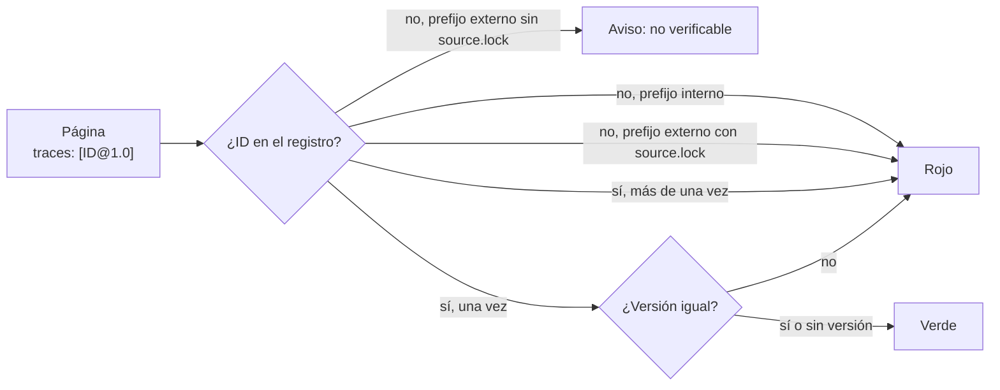

# Anexo — esquema de frontmatter y registro de prefijos

Este anexo es el contrato que cumple todo documento del cuerpo y que conviene adoptar en los proyectos que el cuerpo
documenta. Le dice a una persona qué escribir en la cabecera de una página y a un agente cómo leerla sin parsear la
prosa. Lo verifica la compuerta `docs-guard` en el grupo PR-2 (esquema) y en el PR-5 (trazas).

## Índice

1. [Definiciones](#1-definiciones)
2. [Los diez campos más description](#2-los-diez-campos-más-description)
3. [README del cuerpo y páginas de ayuda](#3-readme-del-cuerpo-y-páginas-de-ayuda)
4. [Trazas](#4-trazas)
5. [Registro de prefijos](#5-registro-de-prefijos)
6. [Registro de requerimientos documentales](#6-registro-de-requerimientos-documentales)
7. [Un ejemplo completo y sus errores](#7-un-ejemplo-completo-y-sus-errores)
8. [Dónde vive la fuente de verdad](#8-dónde-vive-la-fuente-de-verdad)

## 1. Definiciones

| Término | Definición |
| --- | --- |
| Frontmatter | Bloque YAML entre dos líneas `---` al principio del archivo. La compuerta entiende un subconjunto: `clave: valor`, `clave: [a, b]` y listas con `- elemento` |
| Vocabulario cerrado | Lista fija de valores admitidos para un campo; un valor fuera de la lista pone la compuerta en rojo |
| Cuerpo nuevo | Carpeta con un `README.md` cuyo frontmatter tiene `corpus_id`. Dentro de ella, todo archivo que no sea un README tiene que tener frontmatter |
| Prefijo | La parte de un identificador antes del primer guion (`TEM` en `TEM-01`). Sale de un registro cerrado |

## 2. Los diez campos más description

| Campo | Obligatorio | Valores | Para qué sirve |
| --- | --- | --- | --- |
| `doc_id` | Sí | Prefijo registrado, guion y sufijo en mayúsculas (`TEM-01`, `ANX-SDEI-CQ`) | Identidad estable: las trazas y las citas entre repositorios apuntan a él, no a la ruta |
| `doc_type` | Sí | `tema`, `marco-de-referencia`, `familia`, `mapa`, `anexo`, `anexo-referencias`, `indice`, `guia-practica`, `guia-de-estudio`, `operativa`, `study-note`, `rrd`, `proceso`, `ficha` | Decide qué estructura se espera y qué controles se relajan (en `anexo-referencias`, AI-4 sólo avisa) |
| `title` | Sí | Texto, 3 caracteres o más | Título para índices y canales; el H1 visible puede ser más corto |
| `status` | Sí | `borrador`, `vigente`, `obsoleto` | Ciclo de vida; pasar a `vigente` es acto de una persona |
| `origin` | Sí | `human`, `ia-assisted`, `ia-generated` | Quién produjo el texto; gatilla la revisión según origen (`CQ-14`) |
| `confidence` | Si `origin` no es `human` | `alta`, `media`, `baja` | Cuánto confía quien redactó en lo que afirma |
| `owner` | Sí | Texto | Responsable de mantenerlo |
| `last_review` | Sí | Fecha `AAAA-MM-DD` | Frescura: el carril programado avisa pasados 365 días |
| `audience` | Sí | Lista con uno o más de: `humano`, `agente`, `estudiante`, `docente`, `desarrollo`, `qa`, `devops`, `po`, `analista`, `persona-usuaria` | A quién sirve; ordena las rutas de lectura |
| `traces` | Sí (puede ser `[]`) | Lista de `ID` o `ID@MAYOR.MENOR`, sin repetidos | De qué depende el documento; cada traza tiene que resolver |
| `description` | Sí | Texto de 10 a 160 caracteres | Resumen para índices y agentes. La revisa una persona en el pull request que pasa el documento a vigente |

## 3. README del cuerpo y páginas de ayuda

Dos formas tienen su propio esquema:

| Forma | Cómo se reconoce | Campos obligatorios |
| --- | --- | --- |
| README de un cuerpo | `README.md` con `corpus_id` | `corpus_id` (mayúsculas y guiones), `version` (SemVer, admite sufijo `-borrador`), `title`, `description`. Puede sumar los diez campos, como el [README de este cuerpo](../README.md) |
| Página de ayuda al usuario final | Tiene `roles` o `translation_of` y no tiene `doc_id` | `title` y, según el caso, `roles` o `translation_of`. El esquema completo lo trae el ejemplo de la ayuda por rol |

`corpus_id` y `version` viven sólo en el README: un tema no repite la versión del cuerpo.

## 4. Trazas

Una traza dice de qué otro identificador depende un documento. Tiene dos niveles:

| Nivel | Dónde | Forma | Ejemplo |
| --- | --- | --- | --- |
| 1 | En el frontmatter de la página | `traces: [ID]` o `traces: [ID@MAYOR.MENOR]` | `traces: [RN-LOC-01@1.0]` |
| 2 | En la ficha del ID | `ruta#Símbolo@SHA` de dónde se declara, se verifica y se aplica en el código | `Pantalla.cs#LargoMaximo@8fb4c3a` |

El registro contra el que se resuelven se genera solo: lo forman los `doc_id` de todo el repositorio y los
encabezados que empiezan con un identificador (por ejemplo, el encabezado `### ESC-SDEI-2 — App cliente sin roles`
del [Marco](../00-Marco.md#2-escenarios) declara `ESC-SDEI-2`). Con `@MAYOR.MENOR`, la declaración tiene que tener
esa versión.



*Diagrama: cómo decide el control `traces-resolve`. Un ID declarado dos veces es ambiguo y también da rojo.*

## 5. Registro de prefijos

El registro es cerrado: un prefijo nuevo entra por un pull request que lo agrega. **Interno** quiere decir que el ID se
declara en este repositorio; si no resuelve, bloquea. **Externo** quiere decir que se declara en el sistema que se
documenta y se resuelve contra el SHA de su `source.lock`.

| Prefijo | Ámbito | Qué identifica |
| --- | --- | --- |
| `ESC` | interno | Escenario del marco |
| `CTX` | interno | Contexto del marco |
| `ACT` | interno | Actor del marco |
| `DOC` | interno | Documento temático por tipo de documentación |
| `FAM` | interno | Familia documental |
| `MET` | interno | Método ágil |
| `ARQ` | interno | Modelo de arquitectura |
| `MARCO` | interno | Documento del marco de referencia |
| `MAPA` | interno | Mapa conceptual |
| `ANX` | interno | Anexo |
| `IDX` | interno | Índice |
| `TEM` | interno | Tema del cuerpo |
| `CQ` | interno | Criterio de calidad |
| `PE` | interno | Patrón de ejemplo |
| `OBJ` | interno | Objetivo de aprendizaje |
| `EJR` | interno | Ejercicio |
| `RD` | interno | Requerimiento documental |
| `VER` | interno | Ítem de verificación |
| `GP` | interno | Guía práctica de un ejemplo |
| `RF` | externo | Requisito funcional |
| `RNF` | externo | Requisito no funcional |
| `RN` | externo | Regla de negocio |
| `CU` | externo | Caso de uso |
| `ADR` | externo | Decisión de arquitectura |
| `TC` | externo | Caso de prueba |
| `RSK` | externo | Riesgo |
| `FLU` | externo | Flujo de usuario |
| `NB` | externo | Necesidad de negocio |

Las referencias bibliográficas usan anclas `ref-apellido-año` dentro del [anexo de referencias](Referencias.md); no
son identificadores del registro.

**Convención de este cuerpo [criterio propio].** Los identificadores del marco y de los anexos llevan el `corpus_id`
como segundo segmento (`ESC-SDEI-1`, `ANX-SDEI-CQ`), porque el registro es único para todo el repositorio y otras
guías ya declaran `ESC-1` o `MARCO-CONVENCIONES`. Sin ese segmento, una traza a `ESC-1` sería ambigua.

## 6. Registro de requerimientos documentales

Un archivo `_requisitos.md` o con `doc_type: rrd` tiene una tabla con estas columnas, en este orden:

| Columna | Regla |
| --- | --- |
| `ID` | `RD-nn` |
| `Audiencia` | Una sola |
| `Tarea` | Lo que esa audiencia necesita lograr |
| `Pieza` | Clase y archivo |
| `Criterio` | Forma Dado/Cuando/Entonces |
| `Decisión` | `aceptado`, `rechazado`, `diferido` o `pendiente` |

Ejemplo de fila válida [Fragmento ilustrativo: muestra la forma]:

| ID | Audiencia | Tarea | Pieza | Criterio | Decisión |
| --- | --- | --- | --- | --- | --- |
| RD-03 | persona usuaria | cargar un comentario sin que se corte | CL-06, `docs/ayuda/comentarios.md` | Dado el límite de la regla, cuando la persona lee la ayuda, entonces el número coincide con el de la ficha | aceptado |

## 7. Un ejemplo completo y sus errores

Frontmatter válido de un tema [Fragmento ilustrativo: muestra la forma]:

```yaml
---
doc_id: TEM-03
doc_type: tema
title: Topología de repositorios y versionado
description: Dónde vive cada pieza documental respecto del código y contra qué versión vale.
status: borrador
origin: ia-assisted
confidence: media
owner: Lab-Documentos — guía del sistema documentador
last_review: 2026-10-27
audience: [humano, agente, estudiante]
traces: [MARCO-SDEI, TEM-02]
---
```

| Si cambiás… | La compuerta dice | Grupo |
| --- | --- | --- |
| `status: aprobado` | `esquema-cuerpo`: valor fuera del vocabulario | PR-2 |
| Borrás `confidence` con `origin: ia-assisted` | `esquema-cuerpo`: falta `confidence` | PR-2 |
| `doc_id: TOP-03` | `prefijo`: «TOP-» no está en el registro | PR-2 |
| `traces: [TEM-99]` | `traza-no-resuelve` | PR-5 |
| Borrás el bloque entero | `sin-frontmatter`: todo documento del cuerpo abre con frontmatter | PR-2 |

## 8. Dónde vive la fuente de verdad

Las tablas de este anexo explican el contrato. Los datos que la compuerta lee están en el repositorio:

| Dato | Archivo |
| --- | --- |
| Esquema de un documento con `doc_id` | [`cuerpo.schema.json`](../../../../tools/docs-guard/esquemas/cuerpo.schema.json) |
| Esquema del README de un cuerpo | [`readme-cuerpo.schema.json`](../../../../tools/docs-guard/esquemas/readme-cuerpo.schema.json) |
| Esquema de una página de ayuda | [`ayuda.schema.json`](../../../../tools/docs-guard/esquemas/ayuda.schema.json) |
| Registro de prefijos | [`prefijos.txt`](../../../../tools/docs-guard/prefijos.txt) |

Si una tabla de este anexo y su archivo no coinciden, manda el archivo, y la diferencia se corrige en este anexo en el
mismo pull request que cambió el archivo.

Volver al [Mapa](../01-Mapa.md#6-anexos).
