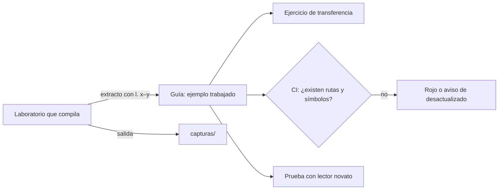

# Anexo — patrones de ejemplos

Un ejemplo pesa más que la prosa, para las personas y para los agentes: en un estudio con cuatro bibliotecas poco
conocidas, lo que más mejoró la generación de código a partir de la documentación fueron los ejemplos, más que las
descripciones o las listas de parámetros ([Chen et al., 2025](Referencias.md#ref-chen-2025)). Estos doce patrones
dicen cómo escribirlos y dónde poner el material de consulta.

## Índice

1. [Los doce patrones](#1-los-doce-patrones)
2. [Marcas de procedencia](#2-marcas-de-procedencia)
3. [Ciclo de vida de un ejemplo](#3-ciclo-de-vida-de-un-ejemplo)

## 1. Los doce patrones

| Id | Patrón | Qué hacer | Fuente |
| --- | --- | --- | --- |
| `PE-01` | Problema conductor | Un caso real recorre toda la guía y cada unidad lo hace avanzar. En este cuerpo, el límite de 60 u 80 caracteres del nombre de una localidad en MovilidadUrbana | [Merrill (2002)](Referencias.md#ref-merrill-2002) |
| `PE-02` | Ejemplo trabajado, después ejercicio | Primero el caso resuelto y rotulado; recién después un ejercicio análogo, con la respuesta aparte | [Sweller y Cooper (1985)](Referencias.md#ref-sweller-1985); [Atkinson et al. (2000)](Referencias.md#ref-atkinson-2000) |
| `PE-03` | Ejemplo ejecutable con procedencia | Todo fragmento sale de un laboratorio que compila; lleva `[Compilado: ruta, l. x–y]` y la versión del SDK; la salida se guarda en `capturas/` | [Chen et al. (2025)](Referencias.md#ref-chen-2025); [Aghajani et al. (2020)](Referencias.md#ref-aghajani-2020) |
| `PE-04` | Contraejemplo rotulado | Mostrar lo que no conviene, marcado `[Fragmento ilustrativo: contraejemplo]` | [van der Meij y Carroll (1995)](Referencias.md#ref-vandermeij-1995) |
| `PE-05` | Error previsto y recuperación | Cada procedimiento trae «si ves X, hacé Y» | [van der Meij y Carroll (1995)](Referencias.md#ref-vandermeij-1995) |
| `PE-06` | Instrucciones probadas en contenedor | Instalación y lanzamiento verificados en un devcontainer limpio | [Aghajani et al. (2020)](Referencias.md#ref-aghajani-2020) |
| `PE-07` | Bloques tipados | Dentro de la página, rotular los bloques por tipo (concepto, procedimiento, principio); entre páginas, separar tutorial, guía, referencia y explicación | [Horn et al. (1969)](Referencias.md#ref-horn-1969) |
| `PE-08` | Mapa de entrada | Tablas «estoy acá → qué aplico» por escenario, contexto y artefacto | Profile de guía de estudio; el [Mapa](../01-Mapa.md) de este cuerpo |
| `PE-09` | Prueba con un lector novato | Antes de publicar, alguien con poco dominio ejecuta la guía y se registra el resultado (P-LECT) | [Aghajani et al. (2020)](Referencias.md#ref-aghajani-2020); [Bhat et al. (2026)](Referencias.md#ref-bhat-2026) |
| `PE-10` | Ejemplos variados en lo superficial | Dos o tres ejemplos que cambian el dominio y mantienen la estructura | [Atkinson et al. (2000)](Referencias.md#ref-atkinson-2000) (verificación parcial); [Chen et al. (2025)](Referencias.md#ref-chen-2025) |
| `PE-11` | Fecha y versión visibles | Cada guía declara las versiones verificadas y la fecha; lo deprecado se marca | [Wang et al. (2025)](Referencias.md#ref-wang-2025) |
| `PE-12` | Material de consulta separado del recorrido | Glosario, referencias, listas de verificación y plantillas en anexos con anclas estables | [ISO/IEC/IEEE (2022)](Referencias.md#ref-iso-26514-2022); Profile de guía de estudio |

Los dos patrones con más respaldo, para personas y para agentes, son `PE-03` y `PE-09`.

## 2. Marcas de procedencia

| Marca | Cuándo | Ejemplo |
| --- | --- | --- |
| `[Compilado: ruta, l. x–y]` | El fragmento es copia de un archivo que compila en el repositorio | `[Compilado: Examples/Prueba-Ayuda-Por-Rol/Web/HelpCatalog.cs, l. 1–20]` |
| `[Fragmento ilustrativo: motivo]` | El fragmento muestra una forma y no corre tal cual | `[Fragmento ilustrativo: muestra la forma del frontmatter]` |
| `[Fragmento ilustrativo: contraejemplo]` | El fragmento muestra lo que no conviene | Un frontmatter sin `description` |

Las dos marcas responden lo que un lector necesita antes de confiar en un fragmento: si corre y de dónde sale.

## 3. Ciclo de vida de un ejemplo

*Diagrama: un ejemplo nace en un laboratorio que compila, se cita con su procedencia y la compuerta comprueba que lo
citado siga existiendo (`CQ-03`).*

Volver al [Mapa](../01-Mapa.md#6-anexos).
