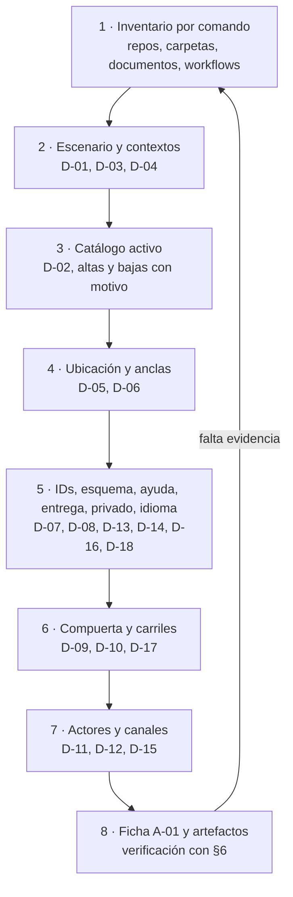

# Diseñar el sistema documentador de un proyecto — decisiones, artefactos y compuertas

> **Borrador ensayado, no probado.** Conocimiento 1.4, ensayado en la ronda 4 del expediente 0003 (`EXP0003-F208`,
> 2026-11-02; enmendado por `EXP0003-F209`): ocho corridas válidas bajo aislamiento total, ninguna pasa la métrica e.
> Ningún caso del brazo B (C1, C2, C3a) tiene una corrida que pase. P0 abiertos:
>
> - **C1 K4-01**: con una H abierta, los artefactos A-02…A-13 deben producirse con el default y el rótulo
>   «propuesta sujeta a D-nn»; la columna está en la plantilla A-01 §6, pero ninguna DE obligatoria ni la carta
>   exigen producirlos.
> - **C2 K4-01**: sin el repo del código, la regla de acceso propio deja D-18 entero pendiente; falta admitir la
>   ruta:línea del índice como prueba, rotulada «según el índice».
> - **C2 K4-02**: la fila H de exponer documentación de API admite default «pendiente»; falta exigir un default
>   concreto (no «pendiente») en la fila H de cada API documentable.
> - **C3a K4-01**: el alcance «sólo lo suyo» con autorización en repo ajeno queda «no activado»; falta activar las
>   extensiones de alcance y superficie y separar el nivel por pieza del nivel por audiencia.
>
> Úsese como guía con criterio, no como procedimiento validado.

Folio del rótulo: [`Lab-Documentos.Documentacion@c2a918c:EXP0003-F208`, §9](https://github.com/hdcm-dev/Lab-Documentos.Documentacion/blob/c2a918c6700d2506379ac7986da895c93cb56548/PROMPTs/DEVs/Enchacement/01-Replanteo-Y-Analisis/OUTPUTs/Expedientes/0003-Reedicion-DocsAsCode-Y-Especificacion/actuaciones/208-resultado-ronda-4.md#9-veredicto-y-rótulo-del-pr-7),
enmendado por `EXP0003-F209` (consultado el 2026-11-02).

**Alias:** DocsAsCode-Designing-Specification
**Naturaleza:** propio
**Tema:** Cómo diseñar la documentación como código de un proyecto nuevo o existente: escenario y contextos, catálogo de piezas activo, topología y anclas, identificadores y trazas, compuerta con regla de bloqueo, actores y clase de intervención, canales para agentes, audiencias y regla de entrega, ayuda en el punto de uso, y la verificación del diseño
**Consumidor:** quien diseña o revisa el sistema documentador de un proyecto (persona o agente), y quien aprueba ese diseño
**Condicion-de-carga:** al arrancar la documentación de un proyecto, al adoptar la documentación como código en un proyecto que ya tiene documentos y al revisar un diseño documental existente; se carga por secciones según el mapa de carga de §0
**Hereda-de:** —
**Sustituye:** —
**Compatible-con:** Rule-Forma-De-Conocimiento.md 1.3
**Versión:** 1.4
**Estado:** Borrador
**Fecha:** 2026-11-02

Manda `**Versión:**`; `version` del frontmatter la repite.

## Índice

0. [Propósito y alcance](#0-propósito-y-alcance)
1. [Identidad del artefacto](#1-identidad-del-artefacto)
2. [Estructura](#2-estructura)
3. [Contrato de uso](#3-contrato-de-uso)
4. [Decisiones ya tomadas](#4-decisiones-ya-tomadas)
5. [Esqueletos de referencia](#5-esqueletos-de-referencia)
6. [Criterios de aceptación](#6-criterios-de-aceptación)
7. [Anti-patrones](#7-anti-patrones)
8. [Conformidad](#8-conformidad)
9. [Trazabilidad](#9-trazabilidad)
10. [Control de cambios](#10-control-de-cambios)

## 0. Propósito y alcance

Un **sistema documentador** es el conjunto de piezas, fuentes de verdad, repositorios, anclas de versión, controles,
canales y actores que producen y mantienen la documentación de un sistema de software (`README.md:38-42`). Este
conocimiento dice qué decidir para diseñar uno, qué artefactos deja y cómo se comprueba; lo aplica una persona o un
agente que no conoce el laboratorio de origen, y lo que falta lo marca «pendiente» (§3.5).

**Cuándo conviene.** El proyecto vive en Git, se cambia por pull request y su CI corre controles que terminan en
verde o en rojo. **Cuándo no.** Si la documentación no se versiona o nadie puede volver obligatorio un control, la
parte normativa no aplica entera: §2.4 (filas «I-01» e «I-01, I-15, I-16») dice qué conservar. **Qué queda afuera.** La explicación y los ensayos, en el libro del
cuerpo de origen (cap. 17.4); operar la compuerta, en `TEM-06-Compuertas-Y-CI.md`; el índice para agentes, en
`Indexing` (§9); lo de un marco de especificación concreto, en su perfil.

**Estado.** En su cuerpo de origen, `borrador` hasta que una persona la revise. **Rutas de evidencia.** Sin prefijo,
relativas a la carpeta del cuerpo de origen en Lab-Documentos `00171bd`; con `.github/`, `scripts/` o `tools/`, a la
raíz de ese repositorio. Una regla marcada `(DK-nn)` nace de la ronda 1 de ensayos, con la 1.0; una `(R2-x)`, de la
ronda 2, con la 1.1: **[criterio propio]** (§9, Fuentes). Una cita `F399:n` es la línea n de la resolución del
ciclo 3 de la mesa de origen, sobre audiencias y ayuda en el punto de uso (§9, Fuentes); con ella entran D-18 e I-21…I-25,
mientras el cuerpo de origen no las escriba. Una cita con `@3b10b0f` es la línea en Lab-Documentos `3b10b0f`, donde el
cuerpo ya escribe la regla de entrega. Una regla marcada `(R3: id)` nace de la ronda 3 de ensayos, con la 1.4; una
cita `F206:n` es la línea n de su resultado (§9, Fuentes): **[criterio propio]**, como DK y R2.

**Terminología mínima** (sentido único; la definición completa está en `99-Anexos/Glosario.md`):

| Término | Sentido en este conocimiento |
| --- | --- |
| Escenario | Tipo de sistema que se documenta; fija audiencias, clases de pieza activas y ancla (`00-Marco.md:37`) |
| Contexto | Variante que cambia una sola respuesta dentro de un escenario (`00-Marco.md:38`, `:119`) |
| Clase de pieza (`CL-nn`) | Clase cerrada de pieza documental del catálogo de §2.1 |
| Clase de intervención | **D** la produce un generador determinista; **P** la propone un agente o una persona y entra por la compuerta; **H** la decide una persona (`00-Marco.md:41`) |
| Audiencia | Conjunto de lectores a los que se dirige una pieza, por sus necesidades y sus tareas. Orienta qué se escribe y cómo; no da ni quita acceso (`F399:91`) |
| Regla de entrega | Qué audiencia recibe una pieza, por qué canal, con qué nivel de acceso y en qué punto se hace cumplir; es la que protege (`F399:92`). Niveles: `publico`, `producto`, `restringido`, `interno` (`F399:94`); puntos de aplicación: repositorio, build y servidor (`F399:95`) |
| Rol | Grupo de personas usuarias, o de consumidores de la API, al que el producto da permisos distintos (política, claim, esquema de autenticación propio, menú restringido). Dos roles o más suman «panel con roles» al escenario medido (R2-G) |
| Ancla | Contra qué estado del código vale una pieza: commit, SHA fijado o etiqueta (`00-Marco.md:42`) |
| Traza | `traces: [ID]` o `traces: [ID@MAYOR.MENOR]`: el documento depende de ese ID (`00-Marco.md:48`) |
| Control | Una comprobación de la CI que termina en 0 o en 1; bloquea o avisa según la regla de bloqueo |
| Compuerta | El carril PR: el conjunto de controles de cada pull request. Un control suelto no es una compuerta (`99-Anexos/Glosario.md:55`) |
| Compuerta de escalón | El hito que da por cumplida una etapa y deja pasar a la siguiente; no es el carril PR. Fuera del cuerpo de origen, sólo si el proyecto prueba su sistema documental por etapas (`99-Anexos/Glosario.md:56`) |
| Carril programado | Corrida periódica que sólo avisa, con un issue (`00-Marco.md:51`) |
| Guarda de merge | G1 abierto con la misma cabeza, G2 sin conflictos, G3 controles en éxito, G4 sin reserva (`TEM-06-Compuertas-Y-CI.md:48`) |
| Línea de base | Cantidad de hallazgos de un control sobre lo que vigila, medida antes de que bloquee (`TEM-06-Compuertas-Y-CI.md:47`) |
| Atraso | Commits que un SHA fijado está detrás de la rama principal; entero ≥ 0; avisa (`99-Anexos/Glosario.md:47`) |
| Deriva | Distancia entre lo que una pieza afirma y lo que el código hace; no es el atraso. En una copia fijada, que su huella SHA-256 ya no coincida con la declarada (`99-Anexos/Glosario.md:62-63`) |

**Mapa de carga.**

| Tarea | Secciones |
| --- | --- |
| Diseñar desde cero o adoptar en un proyecto existente | §2, §3 y §5.1; §6 para verificar |
| Revisar un diseño hecho | §2.2, §6 y §7 |
| Tomar una sola decisión | Su fila de §3.2 y §3.3 |
| Escribir un artefacto | §5 |
| Correr comandos en un ensayo o en un lugar de trabajo asignado | §3.7 |

## 1. Identidad del artefacto

Es un **conocimiento de diseño**: enseña a decidir un sistema documentador. Supone Git (o una copia con la huella
del árbol, §2.4), pull requests, una CI con códigos de salida y Markdown. Sitio, marco de especificación y agentes de
IA entran como decisión (D-01, D-03, D-04, D-12). Sólo §6 es normativa.

## 2. Estructura

### 2.1 Las piezas: catálogo de catorce clases

El catálogo es cerrado (`01-Mapa.md:76-94`). Cada fila dice dónde vive la pieza por defecto, contra qué se ancla,
qué control la mira y qué clase de intervención la cambia.

| Clase | Pieza | Dónde vive | Ancla | Control | Intervención |
| --- | --- | --- | --- | --- | --- |
| CL-01 | Especificación: necesidad, caso de uso, regla, decisión de arquitectura; también A-01, en cualquier escenario | Repo del código | Commit y versión del ID | Esquema, enlaces, registro de IDs | P redacta; H acepta |
| CL-02 | Registro de requerimientos documentales (RRD) | Con la especificación o en `docs/_requisitos.md` | Commit | Esquema del registro | P propone; H evalúa |
| CL-03 | `AGENTS.md` | Raíz de cada repo | Commit | Existe y sus enlaces resuelven | H |
| CL-04 | Referencia generada desde comentarios del código | En el código | Commit | Build con avisos como error | D |
| CL-05 | Contrato REST emitido en el build | Build; si el contrato se genera en ejecución, un paso de la CI levanta el servicio y lo extrae | Commit | Diff del contrato | D |
| CL-06 | Ayuda al usuario final | Repo de la interfaz | Commit y versión del ID trazado | Enlaces, trazas, anti-inyección | P |
| CL-07 | Documentación técnica escrita del producto; la de una demo que ilustra una guía es CL-10 (DK-14) | `docs/tecnica/` del código | Commit | Enlaces, frontmatter, mermaid | P |
| CL-08 | Índice interno para agentes; sólo si D-12 elige un índice (R2: DC3a-13) | Repo hermano `.Documentacion` | SHA fijado y etiqueta | Aviso de atraso | P |
| CL-09 | Expedientes, bitácoras, prompts y análisis de trabajo previos al intake | Repo hermano | Commit | Enlaces y barrido de lo privado | P actúa; H resuelve |
| CL-10 | Guía de estudio, y la documentación de la demo que la ilustra | Repo dedicado | Versión del cuerpo y etiqueta | Compuerta completa | P borrador; H vigente |
| CL-11 | Conocimiento compartido copiado, medido y con huella declarada; sin huella, es pieza propia de donde vive (R2: K2-12, DC3a-13) | Base común, copia con huella | Versión y SHA-256 | Verificación de la copia | H |
| CL-12 | Proceso «Cómo intervenir» | Plantilla más una instancia por proyecto | Versión de la plantilla | Bloques entradas, salidas y validaciones | H |
| CL-13 | README y CHANGELOG | Mismo repo | Fecha o versión del paquete | Entrada en el pull request | P |
| CL-14 | Canales derivados para agentes | Build del sitio | Versión del build | Reproducibilidad; anti-inyección | D |

CL-14 sólo existe si hay sitio publicado (`01-Mapa.md:96`). Cada clase vive donde dice la tabla salvo evidencia en
contra (R2: K2-06). Una clase D con la fuente presente y la generación apagada, o sin el paso que extrae un contrato
generado en ejecución, queda activa con su control «pendiente» y la línea de base anotada, en hallazgos del control
(`TEM-06-Compuertas-Y-CI.md:47`); se da de baja sólo si la
fuente no existe, o si vive en un repo ajeno y la versión consumida es el ancla (DK-13, R2: DC3a-12).

### 2.2 Invariantes: valen en cualquier proyecto

| Id | Invariante | Evidencia |
| --- | --- | --- |
| I-01 | La documentación vive en Git como Markdown, se revisa por pull request y la verifica la CI | `README.md:40-42` |
| I-02 | Todo documento lleva frontmatter con esquema cerrado; la versión del cuerpo vive sólo en su README. Una pieza con versión propia trazable la declara en `version` | `00-Marco.md:168`; `99-Anexos/Esquema-Frontmatter-Y-Prefijos.md:41-55`, `:66`. La segunda oración: pendiente de escribirse en `00-Marco.md:168` |
| I-03 | Los identificadores salen de un registro cerrado de prefijos; una traza apunta al ID, no a la ruta | `00-Marco.md:169`; `99-Anexos/Esquema-Frontmatter-Y-Prefijos.md:98-100` |
| I-04 | Toda traza resuelve contra el registro; un ID declarado dos veces es ambiguo; quien repite una regla traza con `@MAYOR.MENOR` | `00-Marco.md:48`; `99-Anexos/Esquema-Frontmatter-Y-Prefijos.md:77-80`, `:94` |
| I-05 | Enlaces relativos dentro del repo y nunca fuera; entre repos, por SHA o etiqueta, nunca por la rama principal | `00-Marco.md:171`; `TEM-03-Topologia-Y-Versionado.md:137-138` |
| I-06 | Toda fuente externa lleva fecha de consulta; lo que no sale de una fuente se rotula **[criterio propio]** | `00-Marco.md:172-173` |
| I-07 | Todo ejemplo dice de dónde sale o se rotula ilustrativo; los diagramas son código, con una línea que dice qué muestran | `00-Marco.md:174-175` |
| I-08 | Estados `borrador → vigente → obsoleto`; pasar a vigente es acto de una persona | `00-Marco.md:176` |
| I-09 | Lo privado se nombra por alias; en lo versionado no van rutas del equipo, IP, hosts ni usuarios | `00-Marco.md:177` |
| I-10 | La clase de intervención la fija el catálogo por clase de pieza; no se elige caso por caso | `TEM-02-Ciclo-Documental.md:66-68` |
| I-11 | Quien verifica no es quien redactó; un agente no decide nada de clase H | `00-Marco.md:154`, `:159-162` |
| I-12 | Una pieza de clase D no se edita a mano: se regenera | `Examples/Como-Intervenir.md:84-85`, `:96` |
| I-13 | Una pieza que no encaja en el catálogo abre una clase nueva por expediente; no se improvisa | `01-Mapa.md:76-77`; `Examples/Como-Intervenir.md:66-67` |
| I-14 | Un escenario activa, quita o sustituye piezas y controles, nunca agrega fases; dos escenarios se componen por unión de sus clases | `00-Marco.md:59-63` |
| I-15 | Un control bloquea sólo si cumple las cinco condiciones de la regla de bloqueo (§2.2, debajo de la tabla); si falla una, avisa | `TEM-06-Compuertas-Y-CI.md:109-117` |
| I-16 | Quien adopta la compuerta mide primero la línea de base y sanea, o acota la carpeta que verifica | `TEM-06-Compuertas-Y-CI.md:119-120` |
| I-17 | Un agente fusiona sólo con la guarda G1–G4 y con la delegación del merge asentada por escrito; con reserva, decide una persona | `TEM-06-Compuertas-Y-CI.md:48`; `00-Marco.md:52` |
| I-18 | Un requerimiento documental es una fila con audiencia, tarea, pieza, criterio Dado/Cuando/Entonces y la decisión de una persona | `99-Anexos/Esquema-Frontmatter-Y-Prefijos.md:144-153`; `TEM-02-Ciclo-Documental.md:73` |
| I-19 | Una pieza que vive fuera del repo del código paga un ancla fijada y un aviso de atraso | `TEM-03-Topologia-Y-Versionado.md:132-133`; `00-Marco.md:135-137` |
| I-20 | Una pieza se ubica con tres preguntas: ¿la emite el build?, ¿cambia en el mismo pull request que el código?, ¿habla del producto o del proyecto? | `TEM-03-Topologia-Y-Versionado.md:109-123` |
| I-21 | La audiencia no es un permiso: la entrega la decide la regla de entrega y se hace cumplir en el repositorio, el build y el servidor | `TEM-05-Ayuda-Al-Usuario-Final.md:63`, `:103-106`; `F399:123`, `:128` |
| I-22 | El nivel de una fuente no supera la visibilidad del repo que la contiene: `restringido` e `interno` exigen repo o submódulo privado | `F399:195` |
| I-23 | Lo que viaja en un paquete instalable es `publico`, texto y recursos compilados incluidos; una variante de nivel mayor que `producto` se sirve por API con el token del usuario | `00-Marco.md:112`; `F399:131`, `:196` |
| I-24 | Un agente lee con la audiencia y el alcance de su usuario, por el mismo filtro que la página (página, `.md`, `llms.txt`, MCP); nunca tiene acceso propio | `TEM-04-Doble-Audiencia.md:89`; `TEM-05-Ayuda-Al-Usuario-Final.md:108`; `F399:97`, `:132` |
| I-25 | El texto de un campo traza a la regla que lo valida y sus números salen de ella; la letra la escribe una persona | `F399:144-145` |

**Regla de bloqueo** (I-15, D-10, DE-16). Un control bloquea sólo si cumple las cinco condiciones; si falla una,
avisa (`TEM-06-Compuertas-Y-CI.md:109-117`):

1. es determinista y no usa red; vale para el control, no para instalar sus herramientas (§5.7, R2-A);
2. el defecto lo introduce el mismo pull request;
3. tiene prueba negativa: un par rojo/verde;
4. su línea de base sobre el corpus que vigila es 0;
5. no tiene falsos positivos conocidos, o los canaliza por excepciones con huella que aprueba una persona; agregar
   una excepción es de clase H, así que un agente no la agrega en su propio pull request.

### 2.3 Apéndice por escenario

Sale de `00-Marco.md:106-115`, en términos neutrales; un proyecto con rasgos de dos escenarios activa la unión de
sus clases (I-14). La fila «Audiencias típicas» orienta la escritura y no lleva al agente, que es lector (I-24); quién
recibe qué lo decide D-18 (`F399:125-126`; el cuerpo de origen todavía dice «Audiencias», `00-Marco.md:108`).

| Parámetro | Corpus de guías | App sin roles | Panel con roles | Servicio con paquetes |
| --- | --- | --- | --- | --- |
| Audiencias típicas (D-18) | Estudiante, docente | Persona usuaria, desarrollo, consumidor de la API | Lo anterior más los roles del panel | Integrador, operador |
| Clases activas por defecto | CL-02, CL-03, CL-08 a CL-13; CL-01 sólo por A-01 (DK-14) | CL-02 a CL-08, CL-12, CL-13 | CL-01 a CL-08, CL-12 | CL-01 a CL-05, CL-07, CL-08, CL-11 a CL-13 |
| Confidencialidad | No aplica | Lo que viaja en la app instalada es visible | En el build y en el servidor | En el build y en los secretos |
| Fuente generada | — | Contrato y comentarios del código | Contrato; comentarios previstos | API pública de los paquetes |
| Ancla | Versión del cuerpo y etiqueta | Commit; SHA fijado si la ayuda vive afuera (`TEM-03-Topologia-Y-Versionado.md:145`) | Etiqueta y SHA | Etiqueta por línea de versión; SHA si la línea no tiene etiqueta |
| Registro de IDs (que resuelve según D-04) | `doc_id` del cuerpo | Fichas propias | El del marco de especificación del proyecto | El del marco de especificación del proyecto |

Las clases activas por defecto son un punto de partida: cada alta o baja frente a la fila se anota en A-01 con su
motivo y su evidencia en el proyecto (`00-Marco.md:110`). La fila no es la respuesta de un proyecto concreto.

### 2.4 Condiciones de aplicabilidad

| Invariantes | Premisa | Si no se cumple |
| --- | --- | --- |
| I-01 | La documentación vive en Git, se cambia por pull request y una CI corre controles con código de salida | Sin eso, §6 no se puede comprobar: se conservan el catálogo (§2.1), las decisiones de §3.2 y A-01 como registro escrito, y cada control queda «pendiente: sin CI» [criterio propio] |
| I-01, I-15, I-16 | La plataforma puede volver obligatorio un check antes del merge (propiedad del plan u organización, no del repo) | Todo control queda en «avisa»; A-01 lo declara en D-10 y la revisión del pull request es la defensa |
| I-17 | Una persona responsable puede asentar la delegación por escrito | Lo que no cubre ninguna delegación lo fusiona una persona (D-11) |
| I-19, D-06, D-17 | Hay piezas fuera del repo del código | Si todo vive junto al código, el ancla es el commit y no hace falta `source.lock` ni aviso de atraso |
| I-03, I-04 | Hay un registro de IDs que resuelve según el criterio de D-04 (propio o del marco de especificación) | Sin registro, las trazas sólo comprueban existencia; se arranca con un registro mínimo (D-07) |
| I-11 | Hay al menos dos identidades: quien redacta y quien verifica | Si una persona trabaja sola, verifica la compuerta, y lo de clase H queda en esa persona con registro escrito [criterio propio] |
| DE-2 | El proyecto llega con `.git` | Copia sin `.git` (DK-18): la cabecera de A-01 dice «SHA: pendiente» más la huella del árbol (comando 11 de §3.1), contra la que valen las citas ruta:línea, y lista `{excluidas}`. Si el proyecto es el repo de la compuerta, `{compuerta}` es la del árbol recibido, con la huella de `dg.py` y `ci-local.sh` (R2: K2-03) |
| DE-24 | Las carpetas que nombra §3.1 existen y se leen | La que no existe da cuenta 0, con su código de salida y «carpeta ausente»; la que existe sin permiso de lectura queda «pendiente: sin lectura», sin cambiar la ruta. Un comando adaptado (otra carpeta, otro nombre de archivo), informado junto al literal, no es una suposición (R2-F) |
| I-20, D-05 | Se reciben todos los repos del proyecto | Clase repartida (DK-15): A-01 §3 lista todas sus ubicaciones; el índice del repo que no llegó es evidencia secundaria declarada, también para los contextos de D-01, D-03, D-04 y la visibilidad de D-14. «Todas las ubicaciones» incluye las que el índice declara: van en A-01 §3 con el rótulo «según el índice», nunca omitidas ni «pendiente» (R3: K3-01, K3-02, K3-05). Sin índice, vale la descripción de ese repo citada con ruta:línea, o la regla de I-20 rotulada «sin verificar en el hermano», rótulo que llevan también CL-08 y CL-09 (R2-G, R2-H) |
| I-15, DE-14 | Llega la compuerta de origen con sus herramientas (§8) | A-02, A-03, A-07, A-08 y A-10 se producen igual, en el formato de §5.6, §5.7 y §6, rotulados «sin probar»; esperan sólo la copia del guion y su huella, y el par rojo/verde queda «pendiente». D-04 y D-07 se contestan con los comandos 1b, 7 y 9 (R2-A) |

## 3. Contrato de uso

### 3.1 Procedimiento de diseño en ocho pasos



*Figura 1. Del inventario a la ficha. Una decisión sin evidencia vuelve al inventario o queda «pendiente».*

El paso 1 se hace con comandos y se guarda su salida: árbol, Markdown con y sin frontmatter, workflows y su runner,
registro de IDs y cada espacio de IDs en uso (D-07). Cada decisión cita esa salida o una ruta:línea en el SHA leído;
lo de clase H se lista para una persona con opciones y default (DE-22). Cada patrón de esta lista cerrada lleva un
renglón en A-01 §1 con comando y cuenta, aunque dé 0 (DK-16). Antes del inventario se listan `{excluidas}`, las
carpetas que no se leen (excluidas por el encargo o sin permiso), como nombres de carpeta separados por espacios;
cada nombre vale a cualquier profundidad, como en `grep --exclude-dir`. El bucle del bloque arma con ellas `X` para
`grep` y `P` para `find`, que poda por nombre y no entra a la carpeta (R2-F). A mano, `X` lleva un `--exclude-dir=`
por carpeta y `P`, un `-o -name` por carpeta detrás de `-name .git`. El comando 1 no las excluye (`dg.py` recorre
toda carpeta legible): con `{excluidas}` legibles se usa el 1b, o el 1 sobre cada carpeta permitida. `{compuerta}` es
la compuerta de origen, `tools/docs-guard/` en `Lab-Documentos@{sha}` (§8), decida lo que decida D-09 después; sin
ella, el comando 1 sin compuerta. `{carpeta-tecnica}` son las ubicaciones de CL-07 (por defecto `docs/tecnica/`);
`{carpeta-ayuda}`, las de CL-06 en A-01 §3 (por defecto, la carpeta de ayuda del repo de la interfaz); `{indice}`, el
índice del proyecto; `{carpeta-a-verificar}`, las carpetas nuevas de D-10; `{maquina-o-etiqueta}`, la salida de
`hostname -s`. `{cache}` es la caché de herramientas, por defecto `.docs-guard-cache/` en el lugar de trabajo
asignado (DE-25), nunca `/tmp`, que es lo que usa el guion sin ella (`scripts/ci-local.sh:43`); si queda dentro del
árbol, su nombre va en `{excluidas}`. La caché de npm es `{cache}/npm`. Lo que falte sigue §2.4. Los comandos se copian del bloque, no de la tabla:

| Patrón | Comando |
| --- | --- |
| ID declarado más de una vez, incluidas copias congeladas (control `id-duplicado`, `tools/docs-guard/dg.py:707-715`) | 1; sin compuerta, 1b, aproximado (no salta bloques de código): la compuerta lo confirma después |
| Versión declarada dos veces | 2 |
| Estado «planificado» o equivalente en la documentación técnica | 3; además, el estado de cada documento y una línea en A-01 con la proporción planificada, con su ruta:línea (R2-F). El estado se lee del frontmatter (`status:`); sin frontmatter, de la tabla de cabecera del documento (fila «Estado»). Si los dos existen y difieren, se citan los dos pares ruta:línea y manda el frontmatter (I-02), con la diferencia anotada como hallazgo (R3: K-9, K-10) |
| Traza de la interfaz a una unidad que no le corresponde | 4; cada ID, contra la unidad que lo declara |
| Puntero a un documento obsoleto o ausente según el CHANGELOG | 5; cada ruta nombrada, contra el árbol; sin CHANGELOG, «archivo ausente» con la cuenta 0 y su rc |
| Advertencia del índice del proyecto (control declarado y no ejercido, especificación atrasada) | 6; la cuenta y la lista pasan a A-01, y cada advertencia, como reserva, con su estado. Las marcas de control no ejercido («sin implementar», «no ejercido», «avisa») cuentan como advertencia (R3: K3-03) |
| Espacios de IDs en uso | 7; cada prefijo con su origen (registro, expedientes, marco, convenio externo), y marcados los que chocan con los Id de A-01 (`D-`, `CL-`, `A-`, `DE-`, `I-`) y con los prefijos por defecto de los artefactos (`RD`, `FIC`, `PRC`, `AUD`). Las colisiones internas (un mismo ID con dos sentidos en el proyecto) salen del 1b y van con sus dos ruta:línea (R3: K3-04, K3-12) |
| Plataformas que compila cada máquina | 8, o el equivalente del ecosistema; da la línea plataforma → runner de D-09 |

```bash
EXC=({excluidas}); X=(--exclude-dir=.git); P=(-name .git)   # antes de todo; «command grep» saltea envoltorios
for d in "${EXC[@]}"; do X+=(--exclude-dir="$d"); P+=(-o -name "$d"); done   # {excluidas}: nombres, a cualquier profundidad
python3 {compuerta}/dg.py trazas --raiz . .                                            # 1: no excluye {excluidas}
command grep -rIhoE "${X[@]}" --include='*.md' -e '^doc_id: *[A-Z][A-Z0-9]*(-[A-Z0-9]+)+' -e '^#{1,6} +`?[A-Z][A-Z0-9]*(-[A-Z0-9]+)+' . | sed -E 's/^(doc_id: *|#+ +`?)//' | sort | uniq -cd   # 1b
command grep -rlE "${X[@]}" '^version:' --include='*.md' . | xargs -r grep -l 'Versión:\*\*'   # 2
command grep -rniE "${X[@]}" -e planificad -e previst -e 'a implementar' -e TODO {carpeta-tecnica}; echo "rc=$?"   # 3
command grep -rn "${X[@]}" '^traces:' {carpeta-ayuda}; echo "rc=$?"                              # 4
find . -maxdepth 1 -iname 'changelog*' | wc -l                                       # 5: 0 = «archivo ausente»
find . -maxdepth 1 -iname 'changelog*' -exec grep -niE -e obsolet -e retirad -e elimin -e renombr {} + </dev/null; echo "rc=$?"   # 5
command grep -niE -e advertencia -e aviso -e warning -e pendiente -e 'sin implementar' -e 'no ejercid' {indice}; echo "rc=$?"   # 6: lista
command grep -ciE -e advertencia -e aviso -e warning -e pendiente -e 'sin implementar' -e 'no ejercid' {indice}             # 6: cuenta
command grep -rIhoE "${X[@]}" --include='*.md' '\b[A-Z][A-Z0-9]*-[A-Z0-9]+' . | sed -E 's/-.*//' | sort | uniq -c | sort -rn   # 7
command grep -rhoE "${X[@]}" --include='*.csproj' '<TargetFrameworks?>[^<]+' . | sort | uniq -c   # 8
command grep -rIlwE "${X[@]}" '{PREFIJO}-[0-9]+' . | wc -l                             # 9: 0 = prefijo libre
date -u +%F                                                                            # 10: «Fecha» de A-01
find . \( "${P[@]}" \) -prune -o -type f -print0 | LC_ALL=C sort -z | xargs -0 sha256sum | sha256sum   # 11
command grep -rnIiE "${X[@]}" -f {lista-privada} {carpeta}                                       # 12; sin lista, 12b
command grep -rnIiE "${X[@]}" -e '[0-9]{1,3}(\.[0-9]{1,3}){3}' -e '/(home|Users)/[a-z]' -e '{maquina-o-etiqueta}' {carpeta}   # 12b
command grep -rniE -e privad -e 'públic' -e private -e public -e visibility README* AGENTS.md .github {indice}   # 13
export DOCS_GUARD_CACHE={cache} npm_config_cache={cache}/npm npm_config_update_notifier=false   # 14 y 15: antes
{copia-proyecto}/scripts/ci-local.sh herramientas {carpeta-a-verificar}             # 14: con red, una vez (§5.7)
npx --yes markdownlint-cli2@0.17.2 --help | head -1   # 14: con red; a {cache}/npm; vale el encabezado, no el rc
npm_config_offline=true {copia-origen}/scripts/ci-local.sh autoprueba {carpeta-a-verificar}   # 15
python3 {copia-proyecto}/tools/docs-guard/dg.py trazas --raiz . {carpeta-a-verificar}  # 16: sin herramientas
```

En un ensayo o en un lugar de trabajo con envoltorio, cada línea del bloque se corre dentro de él (§3.7).

### 3.2 Decisiones del aplicador

Cada decisión se escribe en A-01 (§5.1) con su evidencia: ruta:línea del proyecto, o «pendiente: qué falta». El
default se aplica si no hay razón para otra cosa; la razón se escribe.

| Id | Pregunta | Opciones | Criterio | Default | Clase | Evidencia en el cuerpo |
| --- | --- | --- | --- | --- | --- | --- |
| D-01 | ¿Escenario y contextos? | Escenario: corpus de guías · app sin roles · panel con roles · servicio con paquetes · unión de los escenarios medidos (I-14) · nuevo por expediente; enseñar no es escenario, es D-15. Contextos, uno por subfila: sitio (remite a D-03 y hereda su clase), marco de especificación, topología, organización del runner; cada uno con valor y evidencia, o «pendiente» | Audiencias, superficies (panel, portal, app móvil, servicio, SDK), tipos de alcance y documentos OpenAPI, además de roles, porque de ese inventario sale D-18 (`F399:124`, `:307`); paquetes publicados; roles (§0) detectados con un inventario de autorización (políticas, claims, esquemas, menús restringidos) y no con una búsqueda léxica de «rol» (DK-11); en un proyecto nuevo, la tabla de permisos de la descripción del producto, con ruta:línea, es inventario declarado. La organización se mide (D-09) o, sin `.git`, se toma como evidencia secundaria declarada del texto del repo que la nombra (R2-G). El inventario contesta siempre «¿el producto filtra por alcance?» con ruta:línea o con la búsqueda negativa y su salida (R3: K-11); un curso o guía declarado en el propósito del repo se anota para D-15, y un paquete que el equipo publica, para la unión con «servicio con paquetes» (R3: K-1, K-2) | — (se deduce) | P; H si hace falta un escenario nuevo | `00-Marco.md:56-63`, `:76-102`, `:121-145` |
| D-02 | ¿Qué clases de pieza se activan? | Subconjunto de CL-01…CL-14 | Fila del escenario (§2.3) más contextos; cada alta o baja con motivo; fuente presente con generación apagada, según §2.1 | La fila del escenario | P | `00-Marco.md:109-110`; `01-Mapa.md:76-94` |
| D-03 | ¿Hay sitio publicado? | Sí · No | Con sitio, se activa CL-14 y el build del sitio entra a la compuerta | No | H | `00-Marco.md:121-125`; `01-Mapa.md:96` |
| D-04 | ¿Hay marco de especificación con registro de IDs? | Sí: se usa su registro · No: fichas propias y `docs/_requisitos.md` | Un registro resuelve si cada ID se declara una sola vez, con versión, en un `doc_id` o en un encabezado del repo (`# ID — título` más `**Versión:**`), aunque el marco viva afuera. Se decide leyendo con los comandos 1b y 2; el control de trazas lo confirma (duplicados en rojo; cuentas en su resumen). Los IDs de una especificación que vive en el repo resuelven ahí (DK-07). Una numeración de convenio sin registro en el repo es un prefijo externo, no un marco (R2: K2-02, DC3a-20) | — | P | `00-Marco.md:127-131`; `99-Anexos/Esquema-Frontmatter-Y-Prefijos.md:77-80` |
| D-05 | ¿Dónde vive cada pieza? | Build · mismo repo · repo hermano · repo dedicado; una clase puede tener varias ubicaciones, todas en A-01 §3 | Las tres preguntas de I-20, en orden: la emite el build → build; cambia en el mismo pull request que el código → mismo repo; habla del proyecto (índices, expedientes, bitácoras) → repo hermano; del producto pero formativa, de demostración o de varios productos → repo dedicado (R2: DC1R2-03) | Mismo repo; CL-04 y CL-05, build | P | `TEM-03-Topologia-Y-Versionado.md:117-122` |
| D-06 | ¿Contra qué ancla vale cada pieza? | Commit · SHA fijado (`source.lock`, `base_commit`) · etiqueta por línea | Sale de D-05 y de las líneas de versión vivas: se lista cada una con su etiqueta o «sin etiqueta», el conjunto de anclas las cubre todas y una línea sin etiqueta se ancla por SHA (DK-17). Una línea declarada a futuro entra como plan, por SHA hasta tener etiqueta. Antes de proponer A-09 se anota el mecanismo actual con ruta:línea; un ancla escrita en prosa es una instancia existente (R2-D) | Commit | P | `00-Marco.md:114`; `TEM-03-Topologia-Y-Versionado.md:142-147` |
| D-07 | ¿Qué prefijos e IDs? | Registro del proyecto (A-02, §5.6) con ámbito interno o externo · segmento del cuerpo si el registro es compartido | Antes de fijar un ID: comando 1 o 1b sobre la raíz entera (y los hermanos leídos), comando 7 con el origen de cada espacio y sus choques con los Id de A-01, y comando 9 en 0 para cada prefijo nuevo; un prefijo en uso con otro sentido se cambia, o se declara un rango con su motivo. Interno, el que la compuerta recorre; externo, el que no (marco fuera de las carpetas verificadas). Sin control de trazas, se contesta la opción y la unicidad queda «pendiente». Los prefijos heredados fuera del registro no se resuelven en la adopción: se cuentan en A-08 y van a un saneamiento aparte, P (DK-05, DK-06, R2-B) | Registro mínimo del proyecto más los externos del dominio | La que fije la tabla P/H escrita del proyecto; sin tabla, P para un prefijo del registro propio y H para un alta en un registro ajeno (DK-06) | `99-Anexos/Esquema-Frontmatter-Y-Prefijos.md:77-80`, `:96-140`; `tools/docs-guard/dg.py:707-715` |
| D-08 | ¿Qué esquema de frontmatter? | Diez campos más `description` · mapeo a uno existente | En un proyecto existente, lo heredado avisa y lo nuevo bloquea; el vocabulario es del proyecto (§5.2). Un campo que exige una norma del proyecto (aprobador, fecha de aprobación) se mapea si tiene campo; si no, se suma al esquema del proyecto por pull request o va en el cuerpo, nunca igualado a `owner` ni a `last_review` (R2: DC3a-15) | Diez campos más `description` | P | `99-Anexos/Esquema-Frontmatter-Y-Prefijos.md:41-55`; `TEM-06-Compuertas-Y-CI.md:49` |
| D-09 | ¿Cómo corre la compuerta? | Llamar al workflow reutilizable · copia con huella en runner propio; nunca una compuerta escrita de cero | La organización se mide: remoto `origin` del repo y líneas `uses:` de sus workflows; la de la compuerta de origen, en su remoto si llega; sin `.git` ni remoto, el archivo del repo que la nombra (README, índice, línea `uses:` de un workflow) da el valor con ruta:línea y el rótulo «evidencia secundaria declarada»; «pendiente: organización», sin demandarla, sólo si ningún archivo la nombra (R3: K-1, tercera ronda). El reutilizable no recibe A-02 ni A-03 (§5.7). Etiqueta de runner por plataforma (Linux; Mac para iOS), con la línea plataforma → runner del comando 8 (DK-01, DK-04, R2: DC3a-05, K2-17) | Copia con huella del guion local de la compuerta de origen, en el runner del proyecto; el reutilizable sólo si la medición prueba que el repo está en la organización del runner y el proyecto no declara prefijos ni vocabulario propios | H | `00-Marco.md:54`, `:139-145`; `.github/workflows/docs-guard.yml:20-22`, `:32-48`, `:60`; `tools/docs-guard/dg.py:39-40` |
| D-10 | ¿Qué controles bloquean y cuáles avisan, en qué carpeta? | Tabla control × carpeta: bloquea o avisa, con la línea de base medida | Si el proyecto ya tiene tabla de bloqueo, se lee primero y manda. Cinco condiciones de la regla de bloqueo (§2.2) más línea de base. En un proyecto existente la compuerta recibe sólo las carpetas nuevas y lo heredado avisa; si la carpeta por defecto no existe, «pendiente» con motivo, sin cambiarla. Si la plataforma impide o sólo avisa es del plan u organización: se afirma con evidencia (configuración o respuesta de la API) y vale para los repos hermanos de la misma organización; volver obligatorio el check es un acto H que se lista en A-01 §4 (DK-10, R2: DC3a-02) | Avisa hasta línea de base 0 | P | `TEM-06-Compuertas-Y-CI.md:88-97`, `:107-147` |
| D-11 | ¿Quién decide qué? | Mapeo de actores más el mapa de delegaciones del merge existentes, cada una con su alcance | Cada delegación, asentada por escrito en un archivo del árbol leído, con ruta:línea. **Acta citada, no versionada** (R3: K-5, DC3a-01): si un archivo del árbol cita un acta, minuta o resolución que decide algo (con fecha, número o nombre) y el árbol no la tiene, la decisión se toma como decidida: va a A-01 §4 «decidida por {actor} — citada, no versionada», con la ruta:línea de la cita, y su valor entra en la decisión; no se reabre ni se excluye su default. La única acción que deja es versionar el acta, anotada en A-01 §7. Ejemplo: `README.md:12` dice «el merge de documentación lo hace el agente (acta del 2026-03-04)» y el acta no está: D-11 = «agente con guarda para documentación — citada, no versionada (`README.md:12`)». Por cada visto bueno obligatorio, quién lo da en ausencia del titular, o «pendiente». Lo que cae fuera de todas lo fusiona una persona, y eso no es «sin delegación» (DK-19). El pull request de adopción con decisiones H abiertas lleva reserva y lo fusiona una persona (R2-C) | El mapa medido; sin ninguna delegación, fusiona una persona | H | `00-Marco.md:149-162`; `99-Anexos/Como-Decidir.md:136-164` |
| D-12 | ¿Qué canales hay para agentes? | `AGENTS.md` puntero · índice para agentes · canales derivados (sólo con sitio) | Hay agentes en el repo; tamaño del corpus. El índice que se elige es el punto de entrada de A-11. Todo canal para agentes pasa por el filtro único de I-24; A-01 contesta «¿el canal para agentes usa el mismo filtro que la página, con el token del usuario?» con ruta:línea, o «pendiente» si no hay canal medido (R3: K-11); `canal_agente: ninguno` por defecto en lo no público es propuesta de la mesa de origen, no regla (`F399:132`) | `AGENTS.md` puntero; con D-03 = Sí, también CL-14, generada por el build (R2: DC3a-18) | H | `TEM-04-Doble-Audiencia.md:43-45`; `01-Mapa.md:83`, `:88`, `:94` |
| D-13 | ¿Cómo es la ayuda al usuario final? | Ninguna · única · por rol · por idioma. **En el punto de uso** (canal de CL-06, no clase nueva): ninguno · recursos con anclas desde la ficha de la regla (`muestra`, `valida`, `contiene`) · catálogo de microtexto con traza; capas de vocabulario cerrado `etiqueta · pista · info · ejemplo · validacion` (`F399:143-146`) | Roles con permisos distintos; idiomas; confidencialidad resuelta en el servidor. Formularios con reglas: el texto sigue I-25, etiqueta y error iguales para todas las audiencias, la ayuda larga por `contexto: <app>/<id>` (`F399:149-150`). Las pantallas trazan a los casos de uso de la unidad de la interfaz, con el prefijo medido (comando 7). Con más de un idioma, A-01 declara que el texto localizado en archivos de recursos no se ancla y qué controles faltan (R2: DC1R2-12, DC3a-06). La fila separa **estado actual** (lo que el código hace hoy, con ruta:línea o búsqueda negativa) de **opción de diseño** (la propuesta, «propuesto»); la ayuda que vive en otro repo sigue la clase repartida de §2.4 (DK-15) (R3: K-3, K3-10) | Por rol si D-01 da roles con permisos distintos; única si no los da; si D-01 queda pendiente, «pendiente» con el mismo motivo (DK-12) | P | `TEM-05-Ayuda-Al-Usuario-Final.md:80-110`, `:187-189`; `F399:309` |
| D-18 | ¿Audiencias y entrega? | Perfil mínimo: roles con jerarquía declarada con `incluye:` en el registro A-12, nivel de acceso y la regla `nivel-vs-repo` (I-22) · perfil mínimo más extensiones: tipo de alcance, superficie, identificador de contexto, columna `cumple` | Inventario de D-01: una extensión entra sólo si D-01 la registra. Nivel siempre que haya producto; rol en el panel con roles. El paquete instalable lleva sólo `publico` (I-23); cada nivel se prueba con un par: autorizado 200 con contenido, no autorizado distinto de 200 y sin contenido (403 o 404, elegido y declarado). Se contesta con las cinco reglas de §3.2.1, en orden | Perfil mínimo si D-01 da roles; «sin audiencias declaradas» si no | P; exponer o ensanchar documentación de API, H por cambio; cambiar la jerarquía, H | `TEM-05-Ayuda-Al-Usuario-Final.md:103-108`; `F399:104-108`, `:124`, `:127-131`, `:306` |
| D-14 | ¿Qué es privado y cómo se nombra? | Alias por destino privado | I-09; barrido por lista antes de cada pull request público (§3.6); visibilidad de cada repo (público o privado) con evidencia (comando 13 sin red); si el índice o el README la declaran, ése es el valor, rotulado «evidencia secundaria declarada», y `nivel-vs-repo` se evalúa contra él; «pendiente» sólo sin ninguna declaración (R3: K3-05); el inventario de destinos privados sale de un comando dado (DK-23). Sin `{lista-privada}`, patrones genéricos y «lista: pendiente» (R2-I) | Alias más barrido | P | `00-Marco.md:177` |
| D-15 | ¿Hay un cuerpo formativo? | Sí, con un perfil de guía de estudio · No | Sólo si el proyecto enseña, medido por su propósito declarado (README, descripción del repo); una guía de estudio interna del equipo no activa CL-10 (DK-14) | No | P | `99-Anexos/Como-Decidir.md:89` (filtro F8, generalizado) |
| D-16 | ¿Idioma y estilo? | Los del proyecto | Audiencia; lista de los términos que no se traducen, con evidencia: como mínimo las claves del frontmatter, los IDs y los términos medidos del contrato (API, esquema) o del paquete (DK-27, R2: DC3a-21) | Los del proyecto | P | `00-Marco.md:178-179` |
| D-17 | ¿Cómo es el carril programado? | Frecuencia; días de frescura; qué vigila; modo (sólo avisa, con issue) (DK-20) | Hay piezas con ancla fijada o copias, incluidas las de datos externos; la frecuencia y la frescura que fija el proyecto mandan sobre el default y van en «qué vigila» (R2: DC3a-04). Los enlaces externos entran en «qué vigila» sólo si A-01 los ancla con ruta:línea; sin ancla, van como nota, no como valor (R3: C3a E-3) | Semanal; frescura de 365 días; sólo avisa, con issue | P | `TEM-06-Compuertas-Y-CI.md:44`, `:99-105`; `99-Anexos/Esquema-Frontmatter-Y-Prefijos.md:52` |

### 3.2.1 D-18 paso a paso (R3: K-5, K3-06, K3-07, K3-09, K3-11, C3a K-3)

Cinco reglas, en orden. Cada una tiene disparador, salida en A-01 y ejemplo; lo que no tiene evidencia queda
«pendiente» y abre su fila H en A-01 §4 (§5.1).

1. **Audiencia de entrega = identidad con acceso propio.** *Disparador:* cada candidato del inventario de D-01. Entra
   a A-12 sólo si el producto lo autentica y le da acceso propio (rol, grupo, esquema de autenticación o credencial),
   con ruta:línea del punto que lo autentica (`F399:91-97`; `TEM-05-Ayuda-Al-Usuario-Final.md:104-109@3b10b0f`).
   No entran: el agente, que hereda la audiencia de su usuario (I-24; `99-Anexos/Glosario.md:84@3b10b0f`), ni los
   valores de `audience` que sólo orientan la escritura (`desarrollo`, `qa`, `po`, §5.2). *Salida:* una fila de A-01 §5
   por identidad, con su evidencia; los descartados, en una línea con el motivo. *Ejemplo:* `[Authorize(Roles =
   "Operador")]` en `Api/OperacionesController.cs:14` → audiencia `operador`; «desarrollo» en un `audience:` → no.
2. **`incluye:` sólo con evidencia de autorización.** *Disparador:* dos audiencias donde una parece abarcar a la
   otra. Se declara `{mayor} incluye: {menor}` sólo si **todo** punto que autoriza a la menor autoriza también a la
   mayor, o si una política compuesta lo dice explícitamente (la mayor exige o hereda la política de la menor), porque
   la jerarquía significa que la mayor tiene todo lo de la menor (`F399:96`;
   `TEM-05-Ayuda-Al-Usuario-Final.md:111-113@3b10b0f`). Se prueba con la búsqueda de **todas** las políticas,
   atributos y comprobaciones que nombran a la menor (comando del inventario de autorización de D-01) y la ruta:línea
   de cada una, con la mayor presente en cada línea; un solo punto compartido no alcanza **[criterio propio]**
   (R3: K3-06). Si falta un punto o la búsqueda no corre, roles planos y una fila H «jerarquía» en A-01 §4, porque
   cambiar la jerarquía es clase H (`TEM-05-Ayuda-Al-Usuario-Final.md:111-113@3b10b0f`). *Salida:* en A-01 §5, la
   línea `incluye:` con la búsqueda y la lista de ruta:línea, o «plana» con el punto que falta. *Ejemplo:* la búsqueda
   de `Operador` devuelve tres puntos, `Roles = "Admin,Operador"` en `Api/TurnosController.cs:12`,
   `Api/ReportesController.cs:9` y `policy.RequireRole("Admin", "Operador")` en `Program.cs:31`, todos con `Admin` →
   `admin incluye: operador`. *Contraejemplo:* sólo `Roles = "Admin,Operador"` en `Api/TurnosController.cs:12`,
   sin buscar el resto (o con `Roles = "Operador"` en otro punto) → roles planos, H abierta; un nombre
   «superusuario» sin política común → plana, H abierta.
3. **Nivel por cómo se entra, con punto de cumplimiento.** *Disparador:* cada pieza o grupo de piezas entregadas. Sin
   autenticación → `publico`; con sesión del producto → `producto`; con credencial emitida a un tercero (integrador,
   clave de API, invitación, grupo que concede una persona) → `restringido`; lo que no se compila en el producto →
   `interno` (`F399:94-95`; `TEM-05-Ayuda-Al-Usuario-Final.md:126-131@3b10b0f`). *Salida:* nivel y punto de
   aplicación (repositorio, build o servidor) con la ruta:línea que lo hace cumplir (política, middleware, filtro del
   build). Sin esa ruta:línea, el nivel queda «pendiente» con fila H; **nunca se da nivel a una audiencia que la regla
   1 o la 2 dejaron sin decidir**. *Ejemplo:* documento OpenAPI de integradores detrás de `RequireAuthorization("ApiKey")`
   en `Program.cs:40` → `restringido`, servidor, `Program.cs:40`.
4. **Alcance sólo con «sólo lo suyo» o inventario de alcances.** *Disparador:* el inventario de D-01 contesta si el
   producto filtra por alcance. La extensión entra, `por-aplicacion`, sólo si el código restringe a cada sesión lo de
   su aplicación o inquilino (la consulta filtra por el id de la sesión, ruta:línea) o si el proyecto declara un
   inventario de alcances (claims de scope, tabla de aplicaciones); los valores viven en el producto
   (`TEM-05-Ayuda-Al-Usuario-Final.md:114-116@3b10b0f`; `F399:93`, `:130`). Si no, la extensión no se activa y la
   búsqueda negativa va en A-01 §1. *Ejemplo:* `.Where(x => x.AplicacionId == usuario.AplicacionId)` en
   `Datos/Consultas.cs:88` → alcance `por-aplicacion`.
5. **Homónimos no son audiencias.** *Disparador:* una palabra de rol fuera de una política. La misma palabra en una
   carpeta, un rol de base de datos, un usuario del sistema operativo, una cuenta de servicio, un valor de `audience:`
   o una etiqueta de menú sin política no es un rol (§0, DK-11); dos nombres con la misma política son una sola
   audiencia. *Salida:* el homónimo, descartado con su ruta:línea en la línea de descartados de A-01 §5. *Ejemplo:*
   `db_admin` en `Datos/schema.sql:3` y el menú «Administración» sin `[Authorize]` en `Shared/Menu.razor:22` → no son
   la audiencia `admin`.

### 3.3 Cómo decidir entre alternativas

La matriz es obligatoria cuando la fila tiene más de una opción admisible y el default no aplica o se descarta; en
cualquier otro caso basta el default con su razón (DK-25). Se usa la regla de `99-Anexos/Como-Decidir.md`:

- **Criterios** K1 simplicidad, K2 practicidad, K3 escalabilidad, K4 costo de adopción, K5 doble audiencia, K6
  coherencia con el marco de especificación del proyecto, K7 riesgo de deriva (`99-Anexos/Como-Decidir.md:50-58`).
- **Escala anclada** de 1 a 5, en la tabla de abajo (`99-Anexos/Como-Decidir.md:62-68`, en términos neutrales):
  se puntúa citando el observable («K1 = 4 porque agrega un archivo»); sin observable, «s/d» (`:60-70`).
- **Pesos** por defecto: 0,15 para K1, K2, K3, K5, K6 y K7; 0,10 para K4. Se fijan antes de puntuar y se guarda su
  huella (`99-Anexos/Como-Decidir.md:74-76`).
- **Filtros duros**, generalizados (`99-Anexos/Como-Decidir.md:78-89`): F1 excluye lo que no corre en el runner que
  fija **el proyecto**, por plataforma; F2 lo que escribe rutas, usuarios o hosts en lo versionado; F3 es I-09; F4 lo
  que toca material del dueño sin mandato; F5 lo que se aparta de un conocimiento compartido sin ficha; F6 lo que
  ignora un estándar relevado; F7 lo que reduce la arquitectura a una herramienta; F8 lo que no aplica el perfil de D-15.
- **Firmeza.** FIRME si el margen es 0,30 o más y el ganador no cambia al mover ±10 % cada peso; si no, CON
  REVISIÓN: la alternativa reversible y una condición comprobable (`99-Anexos/Como-Decidir.md:41-42`, `:91-102`).

| Punto | K1 Simplicidad | K2 Practicidad | K3 Escalabilidad | K4 Costo | K5 Doble audiencia | K6 Coherencia con el marco | K7 Deriva |
| --- | --- | --- | --- | --- | --- | --- | --- |
| 5 | Ninguna pieza nueva | Funciona hoy y está medido | Un sistema nuevo = una fila o un parámetro | Menos de una hora, sin migración | Una sola fuente sirve a los dos, con verificación | Reusa un mecanismo catalogado tal cual | Se detecta de forma determinista en el PR |
| 4 | Una pieza nueva (archivo, campo) | Medido en copia o con un acto humano | Una configuración por sistema | Un PR mecánico | Sirve a los dos con un paso extra | Compatible sin cambiar norma | Se detecta en un aviso programado |
| 3 | Dos o tres piezas | Paso sin medir | Adaptación por sistema | Migración de muchos archivos | Sirve bien a una audiencia | Neutral | Se detecta a mano |
| 2 | Herramienta o servicio nuevo | Exige otro repo, otro expediente o decisión de una persona responsable | Rehacer parte por sistema | Toolchain nuevo, cientos de MB | Una audiencia queda mal servida | Choca con una regla local | Se detecta tarde |
| 1 | Infraestructura nueva | Bloqueado | Rehacer todo por sistema | Compra u operación permanente | Perjudica a una audiencia | Contradice una norma (exige apartamiento) | Invisible |

Cuando puntúan varios evaluadores, FIRME exige además una ventaja de tres o más puntos de celda **[criterio propio,
adoptado por la mesa del expediente 0003; §9, Fuentes]**.

### 3.4 Proyecto nuevo frente a proyecto existente

En un proyecto **nuevo**, A-01 precede a los documentos y la compuerta bloquea desde el primer pull request: la
línea de base es 0 por construcción y se mide igual, con la compuerta o con los comandos de §3.1 (R2: DC3a-02); con
línea de base 0, cada control de la compuerta que cumple las otras cuatro condiciones bloquea, y los de A-13 avisan
hasta su par (DE-30). Un curso o guía declarado en el propósito del repo (README, descripción) activa D-15 aunque no haya sitio ni
paquete, salvo una guía de estudio interna del equipo (DK-14), y un paquete del equipo
suma «servicio con paquetes» a D-01; el alojamiento, el build del sitio y los enlaces externos sin evidencia quedan
«pendiente» con su motivo (R3: K-1, K-2, K-6; C3a E-1). En uno
**existente** manda el inventario: se mide la línea de base de cada control (I-16), lo heredado (lo escrito antes
de la adopción, `TEM-06-Compuertas-Y-CI.md:49`; **[criterio propio]** (R2: DC3a-02): cuenta como heredado lo que tiene
frontmatter o vive dentro de un cuerpo, y un README suelto sin frontmatter no) avisa, la carpeta nueva con README de cuerpo bloquea y la
compuerta se llama sólo sobre carpetas limpias con `ruta` (`TEM-06-Compuertas-Y-CI.md:119-120`), como lo escribe la
tabla de D-10. Migrar lo heredado es una decisión aparte, con su propia matriz (§3.3).

### 3.5 Regla de falla y no inventar

Si una pregunta de §3.2 no se puede contestar con este conocimiento y el proyecto, se cita textual lo que no
resuelve («`DocsAsCode-Designing-Specification §3.2`, D-nn, no resuelve: …»), la decisión queda «pendiente: qué
falta» sin completarla por inferencia, y se sigue con lo que no depende de ella, diciendo qué quedó sin hacer.

**Lo que no se demanda** (R2-H). Lo que §2.4, §3.6 y D-09 ya resuelven como «pendiente» (sin `.git`, carpeta sin
lectura, repo, índice, lista privada o compuerta que no llegó, organización sin medir) no se pide: se anota con la cita.

Una afirmación sobre el proyecto sin ruta:línea en el SHA leído es una invención. Una lectura con ancla va en su fila
con la cita; lo que no tiene ancla queda «pendiente». No hay tercera vía: toda suposición es un defecto, aunque
resulte acertada (DK-21). Una búsqueda negativa («no hay X») se informa con el comando exacto y su salida. En A-01
cada cita repite el archivo (`{archivo}:60`, nunca `:60` sola); con más de un repo leído, lleva el repo como prefijo
y el chequeo corre desde la carpeta que los contiene. Antes de cerrar A-01, este chequeo da salida vacía, que va en
A-01 §8 (DK-22), con una muestra de cinco citas releídas contra lo que afirman (R2: DC1R2-05):

```bash
command grep -oE '[A-Za-z0-9_./-]+\.[A-Za-z]+:[0-9]+(-[0-9]+)?' A-01.md | sort -u | while IFS=: read -r f r; do
  if [ ! -f "$f" ]; then echo "NO EXISTE $f"; elif [ "$(wc -l < "$f")" -lt "${r#*-}" ]; then echo "FUERA DE RANGO $f:$r"; fi
done
```

### 3.6 Público y privado

Todo lo que va a un repositorio público, A-01 incluida, pasa un barrido antes del pull request: repositorios
privados, hosts, rutas del equipo, usuarios e IP. Los patrones son valores privados: viven fuera de lo versionado en
`{lista-privada}`, un patrón por línea, y el barrido (comando 12 de §3.1) no da salida. Sin la lista, el comando 12b
usa patrones genéricos (IPv4, rutas de usuario y un `-e` por etiqueta de runner o máquina del inventario) y
D-14 queda «lista: pendiente» (R2-I). Lo privado se nombra con un alias entre llaves definido una vez; canónicos:
`{servicio-privado}`, `{host-de-pruebas}`, `{etiqueta-runner}`, `{usuario}`, `{persona}`, `{repositorio}`,
`{dir-de-trabajo}`, `{organizacion}`. La visibilidad de cada repo se afirma con evidencia (configuración o respuesta
de la API; sin red, comando 13 y el índice, como evidencia secundaria declarada). A lo público van cifras y huellas
(I-09, D-14, DK-23).

### 3.7 Dónde corre el cómputo (R3: D1, K-8)

*Disparador:* el encargo fija un envoltorio de comandos (`{envoltorio}`) o un lugar de trabajo asignado
(DE-25). *Regla:* todo comando, todo cómputo y toda escritura sobre la corrida pasan por el envoltorio: también
generar, transformar o editar un archivo con un guion (`python3`, heredoc, `cp`, `sed -i`), y también leer un derivado
de `{dir-de-corrida}` ya generado. La herramienta de archivo del aplicador (leer, escribir, editar, sin consola) es la
única vía permitida fuera del envoltorio, y sólo dentro de `{dir-de-corrida}`, para lo que se lee o se escribe a
mano, nunca para obtener un valor calculado (`F206:43-48`, `:138`). Lo que no corre dentro del envoltorio es un dato
faltante: «pendiente», con el comando y lo que devolvió; nunca se corre por otra vía.

| Acción | ¿Permitida? | Ejemplo |
| --- | --- | --- |
| Leer con la herramienta de archivo un fuente dentro de `{dir-de-corrida}` y citar la ruta:línea que se ve | Sí | Abrir `{dir-de-corrida}/repo/Program.cs` y citar `Program.cs:40` |
| Escribir o editar a mano A-01 u otro artefacto con la herramienta de archivo dentro de `{dir-de-corrida}` | Sí | Completar la fila D-10 de A-01 |
| Leer o escribir con la herramienta de archivo fuera de `{dir-de-corrida}` | No, anula la corrida | Abrir el repo original o `/tmp` |
| Contar, buscar, filtrar o transformar (`grep`, `find`, `wc`, `sort`, `python3`, `sed`) | Sólo con el envoltorio | `{envoltorio} bash -c 'grep -rn "Roles" {dir-de-corrida}/repo'` |
| Leer un derivado ya generado para tomar un valor (conteo, lista, huella) | Sólo con el envoltorio | `{envoltorio} cat {dir-de-corrida}/_auxiliares/inventario-07.txt` |
| Correr cualquier comando en la consola del equipo sin el envoltorio | No, anula la corrida | `python3` o `cp` sueltos, aunque escriban en el mismo directorio |

*Salida:* A-01 §1 y §8 copian cada comando tal como corrió, con el
envoltorio. Los auxiliares (salidas de comandos, guiones) van en `{dir-de-corrida}/_auxiliares/`, uno por comando, con el número
del bloque de §3.1 en el nombre (`inventario-07.txt`); no son artefactos ni van al repo **[criterio propio]** (R3: K-7).
*Ejemplo:* editar los dos `enum` de A-03 es

```bash
{envoltorio} bash -c 'python3 - {dir-de-corrida}/.docs-guard/tools/docs-guard/esquemas/cuerpo.schema.json <<"EOF"
import json, sys
p = sys.argv[1]; s = json.load(open(p))
s["properties"]["doc_type"]["enum"] = ["ficha", "anexo", "rrd", "proceso"]
json.dump(s, open(p, "w"), ensure_ascii=False, indent=2)
EOF'
```

y no un `python3` ni un heredoc en la consola del equipo, aunque escriban en el mismo directorio: eso anula la
corrida.

## 4. Decisiones ya tomadas

No se reabren al aplicar este conocimiento; se reabren en el cuerpo de origen, con su propia decisión.

| Decisión | Criterio | Fuente en el cuerpo |
| --- | --- | --- |
| Documentación como código | Una fuente versionada, revisada y verificada como el código | `README.md:40-42` |
| Esquema de frontmatter cerrado | El agente lee la cabecera sin parsear la prosa | `99-Anexos/Esquema-Frontmatter-Y-Prefijos.md:17-19` |
| ID en lugar de ruta | La ruta cambia; el ID es estable | `00-Marco.md:169` |
| Trazas versionadas | La subida de versión de una regla pone en rojo a quien la repite | `00-Marco.md:48` |
| Clase D/P/H por catálogo | Nadie elige quién decide caso por caso | `TEM-02-Ciclo-Documental.md:66-68` |
| Cinco condiciones para bloquear | Un control con falsos positivos que bloquea enseña a ignorar la compuerta | `TEM-06-Compuertas-Y-CI.md:62-63`, `:109-117` |
| Dos carriles | Lo determinista bloquea en el pull request; lo que usa red o no depende del pull request avisa | `TEM-06-Compuertas-Y-CI.md:66-82` |
| Anclas entre repos por SHA o etiqueta | La rama principal cambia de significado con cada commit | `TEM-03-Topologia-Y-Versionado.md:137-138` |
| RRD con Dado/Cuando/Entonces | El requerimiento se comprueba con un instrumento | `TEM-02-Ciclo-Documental.md:73` |

## 5. Esqueletos de referencia

### 5.1 Ficha de diseño documental (A-01)

Es el artefacto central (CL-01, decisión de arquitectura documental). Se entrega vacía al aplicador y se completa
entera; si va a un repo, suma el frontmatter de §5.2 con `doc_type: ficha` y su `doc_id`, al que trazan los demás
artefactos (R2: DC3a-07). La plantilla vacía completa está en [A-01: ficha vacía](A-01-ficha-vacia.md). [Fragmento ilustrativo: esqueleto vacío]

```markdown
# Ficha de diseño documental — {proyecto}

Cabecera: proyecto y repositorios leídos con su SHA (o «SHA: pendiente» y huella del árbol con `LC_ALL=C`, comando 11, §2.4); `{excluidas}`;
fecha (salida de `date -u +%F`, comando 10); quién aplica (el rol, no un nombre); conocimiento aplicado (alias,
versión, huella).

## 1. Inventario (paso 1): comandos corridos y salida recortada; un renglón por patrón de §3.1, aunque dé 0

## 2. Decisiones

| Id | Pregunta | Valor | Evidencia (ruta:línea en el SHA leído, o «pendiente: qué falta») | Clase (P o H) | Si es H: opciones y default para la persona |
| --- | --- | --- | --- | --- | --- |
| D-01 … D-18 (una fila por decisión, con la pregunta de §3.2; D-01 con una subfila por contexto) | | | | | |

## 3. Catálogo activo

| Clase | Activa (sí o no) | Alta o baja frente al escenario, con motivo | Dónde vive (todas las ubicaciones) | Ancla | Evidencia |
| --- | --- | --- | --- | --- | --- |
| CL-01 … CL-14 (una fila por clase) | | | | | |

## 4. Decisiones de clase H para una persona (Id, estado, opciones, default, quién decide)
## 5. Audiencias y entrega (D-18): por regla de §3.2.1, identidad con acceso propio, incluye con evidencia, nivel y punto de cumplimiento ruta:línea, alcance, descartados
## 6. Artefactos A-02 a A-13 (producido o no, ruta, motivo, «propuesta sujeta a D-nn», «sin probar»)
## 7. Lo que el conocimiento no resolvió (cita textual)
## 8. Verificación (§6): compuerta, par rojo/verde, chequeo de citas y su muestra, y barrido, con su salida
```

La sección 4 lleva las filas H de §3.2 (D-03, D-09, D-11, D-12 y las que su columna Clase vuelva H) más las acciones H
de la tabla P/H del proyecto que la adopción toca, y la excepción que la adopción necesite agregar; nada más (DK-24).
**Filas H obligatorias de audiencias y API** (R3: K-4, K3-08, C3a K-4): una por cada API documentable (cada documento
OpenAPI o grupo de endpoints que D-01 inventaría: exponerla o ensancharla es H por cambio,
`TEM-05-Ayuda-Al-Usuario-Final.md:141-144@3b10b0f`, `00-Marco.md:160@3b10b0f`), y una por cada punto de D-18 que las
reglas de §3.2.1 dejan sin decidir (audiencia sin acceso propio probado, `incluye:` sin evidencia, nivel sin punto de
cumplimiento). Una audiencia en A-12 con un punto abierto lleva su fila aquí; ninguna queda sólo en §5. Ejemplo:
`AUD-04 integrador · abierta · opciones: restringido por clave / no exponer · default propuesto: no exponer · PO`.
Una H que el proyecto ya registra como decidida por una persona, con ruta:línea, se asienta «decidida por {actor}»
con la cita, conserva sus opciones y no se reabre; la que cita un acta no versionada va «decidida por {actor} —
citada, no versionada» (D-11). Abiertas quedan las demás, con valor = default rotulado «propuesto»; una suposición
que sostiene un valor lo deja «pendiente» (R2-C; R3: K-2, K-8). En una celda, la barra vertical va `\|` (DK-26).

### 5.2 Frontmatter mínimo

```yaml
doc_id: {PREFIJO}-{SUFIJO}
doc_type: {tipo del vocabulario del proyecto}
title: {título}
description: {de 10 a 160 caracteres}
status: borrador
origin: {human | ia-assisted | ia-generated}
confidence: {alta | media | baja}
owner: {responsable}
last_review: {AAAA-MM-DD}
audience: [{audiencias}]
traces: [{ID o ID@MAYOR.MENOR}]
```

[Fragmento ilustrativo: los diez campos más `description` de `99-Anexos/Esquema-Frontmatter-Y-Prefijos.md:41-55`;
`confidence` es obligatorio si `origin` no es `human`.] Un valor con «: » va entre comillas. Cada artefacto traza al
`doc_id` de A-01 y a ninguna pieza que todavía no tenga `doc_id`. Una pieza declara su ID una sola vez: en `doc_id`,
con un H1 sin el ID, porque `doc_id` y `# ID —` en el mismo archivo dan `id-duplicado`
(`tools/docs-guard/dg.py:707-715`; R2-B, R2-J).

**Vocabulario** (DK-02). El de `doc_type` y `audience` es del proyecto, se declara en A-03 y arranca de la lista de
origen: `doc_type` admite `tema`, `marco-de-referencia`, `familia`, `mapa`, `anexo`, `anexo-referencias`, `indice`,
`guia-practica`, `guia-de-estudio`, `operativa`, `study-note`, `rrd`, `proceso` y `ficha`
(`99-Anexos/Esquema-Frontmatter-Y-Prefijos.md:46`); `audience`, `humano`, `agente`, `estudiante`, `docente`,
`desarrollo`, `qa`, `devops`, `po`, `analista` y `persona-usuaria` (`:53`). La compuerta los lee de su esquema
(`tools/docs-guard/esquemas/cuerpo.schema.json:10`, `:18`); un valor nuevo va en A-03, nunca en la compuerta de
origen. `audience` lleva audiencias del escenario (§2.3) y sólo orienta; los roles de un panel, `roles` del esquema de ayuda
(`99-Anexos/Esquema-Frontmatter-Y-Prefijos.md:64`). Con D-18, una página declara a quién se entrega en `delivery:`,
cerrado a las audiencias de A-12; `audiencias:`, `audiences:` y variantes cercanas dan aviso, y lo heredado sin
`delivery:` avisa, sin migración (`F399:134`, `:198`). `doc_type` de los artefactos en Markdown: A-01 `ficha`; la
nota de A-03, si la hay, y A-08 `anexo`; A-04 `rrd`; A-06 `proceso`. A-02 (`.txt`) y el esquema de A-03 (`.json`)
no llevan frontmatter.

### 5.3 Fila del RRD

| ID | Audiencia | Tarea | Pieza | Criterio | Decisión |
| --- | --- | --- | --- | --- | --- |
| RD-nn | {una sola} | {lo que necesita lograr} | {CL-nn y archivo} | Dado {estado}, cuando {acción}, entonces {resultado}; instrumento: {control} | pendiente |

[Fragmento ilustrativo: columnas en el orden de `99-Anexos/Esquema-Frontmatter-Y-Prefijos.md:146-153`.] Las filas
se numeran en un rango de `RD-nn` libre en todo el repo (comando 9; D-07, DK-05). El criterio usa las palabras Dado,
Cuando y Entonces enteras y en ese orden: «Dada» da rojo (`tools/docs-guard/dg.py:303-304`). El RRD inicial lleva una
fila por cada pieza nueva de la adopción y por cada clase activa que todavía no tiene pieza (R2: DC3a-09, DC1R2-19).

### 5.4 Instancia de «Cómo intervenir»

Una página por proyecto, `doc_type: proceso`, que contesta seis campos con datos del proyecto: escenario y clases
activas; dónde vive cada pieza; guion de validación local; workflow y runner de la compuerta; quién decide y si hay
delegación; excepciones a la plantilla (`Examples/Como-Intervenir.md:160-174`).

### 5.5 `AGENTS.md` puntero

Tres líneas bajo un H1 con el nombre del proyecto: dónde está la documentación y su contrato de frontmatter (A-03);
qué guion local corre antes de proponer (A-07); y qué no decide un agente (enlace a A-01 §4). Es un puntero, no una
copia de la guía, y lo decide una persona (`TEM-04-Doble-Audiencia.md:45`). Cada puntero es un enlace relativo a una
pieza que existe o que entra en el mismo pull request (R2-E). [Fragmento ilustrativo]

### 5.6 Registro de prefijos

```text
# prefijo   ámbito    descripción
RD          interno   requerimiento documental
FIC         interno   ficha o anexo del sistema documentador
PRC         interno   proceso
CU          externo   caso de uso
```

[Fragmento ilustrativo: el formato que lee la compuerta (`tools/docs-guard/prefijos.txt:1-5`; `tools/docs-guard/dg.py:261-266`);
interno bloquea si no resuelve en el repo; externo resuelve contra el SHA fijado (`99-Anexos/Esquema-Frontmatter-Y-Prefijos.md:98-100`).]
A-02 es el registro **del proyecto** (DK-01): con la copia de §5.7, el `prefijos.txt` de esa copia, en la ruta que
declara A-06 y sin un segundo ejemplar; si la compuerta lo recibe como parámetro, `docs/_gobierno/prefijos.txt`. No se
agregan prefijos del proyecto al registro de origen ni se usa el de origen como registro del proyecto. Prefijo por
artefacto, por defecto (DK-05, R2-B): A-04 `RD`; A-06 `PRC`; A-01, la nota de A-03 y A-08 `FIC`; A-12 `AUD`. Cada uno se
comprueba libre con el comando 9; si está en uso, otro, con su motivo en D-07.

### 5.7 Workflow de la compuerta

El workflow reutilizable fija su runner (`.github/workflows/docs-guard.yml:20-22`, `:60`), recibe sólo `ruta`,
`herramientas-ref` y `trazas-extra` (`:32-48`) y lee su configuración al lado del guion (`tools/docs-guard/dg.py:39-40`):
no recibe A-02 ni A-03. El default de D-09 es la copia con huella, anotada en A-06, con la etiqueta de runner del
proyecto por plataforma (`00-Marco.md:139-145`). Se arma así (DK-01, DK-02):

1. Se copian `tools/docs-guard/` y `scripts/` (`ci-local.sh` y sus dos `docs-guard.*`) de `Lab-Documentos@{sha}` a
   `{copia-proyecto}` (por defecto `.docs-guard/` en la raíz, fuera de toda carpeta verificada) con esa disposición
   (`scripts/ci-local.sh:37-38`); una segunda copia intacta, `{copia-origen}` (por defecto `.docs-guard-origen/`),
   queda para la autoprueba. A-06 declara las dos rutas (R2-E).
2. A-02 **es** el `prefijos.txt` de `{copia-proyecto}`; A-06 declara esa ruta como la de A-02.
3. A-03 es el `esquemas/cuerpo.schema.json` de esa copia, en el formato de origen: JSON Schema con `enum` en
   `doc_type` (`tools/docs-guard/esquemas/cuerpo.schema.json:10`) y en `audience`
   (`tools/docs-guard/esquemas/cuerpo.schema.json:18`), con una nota Markdown que lo describa si hace falta, y con la forma del esqueleto de abajo. El
   `excepciones.txt` de esa copia es el de A-08.
4. La huella SHA-256 cubre sólo el guion (`dg.py` y `ci-local.sh`) frente a `{sha}`; la configuración se versiona en
   el proyecto y cambia por pull request.
El reutilizable (`uses: {organizacion-de-la-compuerta}/{repo-de-la-compuerta}/.github/workflows/docs-guard.yml@{sha}`
con `ruta` y `herramientas-ref`) sirve dentro de la organización del runner y sin configuración propia (DK-01, DK-04).

**Esqueleto de A-03** (R2-A, K2-03). Sin la compuerta, A-03 se produce «sin probar» con esta forma; sólo cambian los
dos `enum` de vocabulario:

```json
{
  "$schema": "{URL de draft-07, copiada de cuerpo.schema.json:2}",
  "$id": "cuerpo.schema.json",
  "title": "Frontmatter de documento del cuerpo de {proyecto}",
  "description": "Los diez campos más description. confidence es obligatorio si origin no es human.",
  "type": "object",
  "required": ["doc_id", "doc_type", "title", "status", "origin", "owner", "last_review", "audience", "traces", "description"],
  "properties": {
    "doc_id": { "type": "string", "pattern": "^[A-Z][A-Z0-9]*(-[A-Z0-9]+)+$" },
    "doc_type": { "enum": [{vocabulario del proyecto: doc_type}] },
    "title": { "type": "string", "minLength": 3 },
    "description": { "type": "string", "minLength": 10, "maxLength": 160 },
    "status": { "enum": ["vigente", "borrador", "obsoleto"] },
    "origin": { "enum": ["human", "ia-assisted", "ia-generated"] },
    "confidence": { "enum": ["alta", "media", "baja"] },
    "owner": { "type": "string", "minLength": 1 },
    "last_review": { "type": "string", "pattern": "^\\d{4}-\\d{2}-\\d{2}$" },
    "audience": { "type": "array", "minItems": 1, "items": { "enum": [{vocabulario del proyecto: audience}] } },
    "traces": { "type": "array", "uniqueItems": true, "items": { "type": "string", "pattern": "^[A-Z][A-Z0-9]*(-[A-Z0-9]+)+(@\\d+\\.\\d+)?$" } }
  },
  "if": { "properties": { "origin": { "enum": ["ia-assisted", "ia-generated"] } } },
  "then": { "required": ["confidence"] }
}
```

[Fragmento ilustrativo: la forma de `tools/docs-guard/esquemas/cuerpo.schema.json:1-23`, con el vocabulario del
proyecto en los dos `enum` (§5.2), `title` y `description` propios y `$schema` copiado de la línea 2 del origen; el
resto, tal cual, porque la compuerta lo lee así.]

**Configuración y autoprueba** (DK-03). Los fixtures de la autoprueba suponen la configuración de origen
(`scripts/ci-local.sh:159-170`): la copia de origen, intacta, corre `autoprueba` y la del proyecto, los grupos PR-1 a
PR-7 (`scripts/ci-local.sh:9-27`). Si la autoprueba da rojo, la configuración del proyecto se pasó mal. Esa
composición, «autoprueba con la copia de origen, grupos con la copia del proyecto», es la que vale para el par
rojo/verde de DE-14; correr la autoprueba con la copia del proyecto no es un fallo del proyecto (R3: K-6, K-8).

**Red y herramientas** (R2-A). Lo que pide red es instalar, no controlar:

| Paso de `ci-local.sh` | Necesita red | Herramientas | Sin red |
| --- | --- | --- | --- |
| `herramientas` | Sí: baja lychee y el parser de mermaid a `{cache}` (`scripts/ci-local.sh:64-83`; `npm ci`, con la caché de npm); markdownlint, no | curl, tar, Node.js | No corre: se corre antes, con red, y deja `{cache}` |
| `enlaces` (PR-1) | No, con lychee en `{cache}` (`scripts/ci-local.sh:85-87`) | lychee | Sin lychee, «pendiente: herramientas sin red» |
| `esquema`, `ai`, `trazas`, `contrato`, `fijadas` | No | Python 3 | Corren: `dg.py` usa sólo la biblioteca estándar |
| `estructura` (PR-4) | Sí, si markdownlint-cli2 no está en la caché de npm (`{cache}/npm`, por `npm_config_cache`): lo baja npx (`scripts/ci-local.sh:89-91`) | Node.js, markdownlint-cli2, mermaid | Sin markdownlint en la caché de npm, «pendiente: herramientas sin red»; el control mermaid-arroba de `dg.py` corre |
| `autoprueba`; `todo` | Sí: PR-4 (`scripts/ci-local.sh:201-204`); `todo` empieza por `herramientas` (`:234-235`) | Todas | Sin las dos cachés (`{cache}` y la de npm), pendiente con su comando; los grupos, de a uno |

Las dos cachés se arman antes, con red y en el montaje, no durante la corrida: `{cache}` con `herramientas` y la de
npm con markdownlint-cli2 en la versión que fija el guion (`scripts/ci-local.sh:42`), las dos líneas del comando 14
de §3.1. Sin `npm_config_cache`, npm usa `~/.npm` y deja ahí sus registros en cada corrida: escribe fuera del lugar de
trabajo (DE-25). Después, `npm_config_offline=true` hace que npx falle (ENOTCACHED) en vez de salir a la red (15); sin
herramientas, los controles de `dg.py` corren de a uno (16). Todo paso de `ci-local.sh` recibe una RUTA que existe,
aunque no la use: por defecto es la carpeta de la guía de origen (`scripts/ci-local.sh:35`) y, si no existe, corta
antes de cualquier paso con rc 2 (`:253`); el reutilizable la pasa siempre (`.github/workflows/docs-guard.yml:84`).

```yaml
jobs:
  docs-guard:
    runs-on: [self-hosted, {etiqueta-runner}]   # etiqueta de Linux del proyecto
    env:
      DOCS_GUARD_CACHE: {cache}                 # la misma en todos los pasos
      npm_config_cache: {cache}/npm             # la caché de npm, dentro de {cache}
      npm_config_update_notifier: "false"
    steps:
      - uses: actions/checkout@{sha-de-checkout}   # el repo, con {copia-proyecto} y {copia-origen} dentro
      - run: {copia-proyecto}/scripts/ci-local.sh herramientas {carpeta-a-verificar}   # primero; con red
      - run: npx --yes markdownlint-cli2@0.17.2 --help | head -1 || true   # caché de npm para PR-4; --help sale con rc 2
      - run: {copia-origen}/scripts/ci-local.sh autoprueba {carpeta-a-verificar}
      - run: {copia-proyecto}/scripts/ci-local.sh {grupo} {carpeta-a-verificar}   # un paso por grupo, con A-02 y A-03
  contrato-ios:                                  # sólo si un build de iOS emite una pieza D
    runs-on: [self-hosted, {etiqueta-runner}]   # etiqueta de Mac del proyecto
```

[Fragmento ilustrativo: los valores entre llaves son parámetros del proyecto; ningún dueño, repositorio ni etiqueta
del laboratorio de origen se copia. El resto de los pasos (un paso por grupo con `continue-on-error`, `avisos` y el
agregador estricto) sigue el orden de `.github/workflows/docs-guard.yml:82-148`.] **`source.lock` (A-09)** (R2-D): una clave por línea, `repo: {repositorio}`,
`sha: {sha}` (de 7 a 40 caracteres; el completo, si falta, «pendiente»), `comparar: {rama principal}` y `rutas:` con
las carpetas del código que la pieza describe (`Examples/MovilidadUrbana-Mini-Demo/source.lock:4-7`; `tools/docs-guard/dg.py:565`).

## 6. Criterios de aceptación

Parte normativa. Se aplica al `Consumidor` y se comprueba sobre A-01 y los artefactos que deja el diseño.
`[enumerable]` se decide contando o comparando; `[interpretativo]` pide juicio.

**Artefactos que se verifican**, nombrados por su Id. El que depende de una decisión H abierta se produce con el
default, en borrador, en la salida del aplicador (no en el repo), rotulado «propuesta sujeta a D-nn», y lo mismo la
ubicación de CL-03 y CL-12 en D-05 (DK-08); el que depende de la compuerta ausente, rotulado «sin probar» (§5.7). Una
instancia que ya existe se actualiza en su ruta, sin duplicarla (DK-09); si es derivada («no editar acá»), el cambio
se propone en su fuente (R2: DC1R2-11).

| Id | Artefacto | Clase | Dónde, por defecto | Lo pide |
| --- | --- | --- | --- | --- |
| A-01 | Ficha de diseño documental (§5.1), con `doc_id` si va al repo | CL-01 | `docs/_diseno/ficha-diseno-documental.md` del repo que fija D-05 | Todas |
| A-02 | Registro de prefijos (§5.6) | — | El `prefijos.txt` de la copia de la compuerta (§5.7), en la ruta que declara A-06 | D-07 |
| A-03 | Esquema de frontmatter y su vocabulario (§5.2), o referencia fijada a uno existente | — | El `esquemas/cuerpo.schema.json` de la copia (§5.7); su nota, en `docs/_gobierno/` | D-08 |
| A-04 | RRD inicial (§5.3) | CL-02 | Con la especificación o en `docs/_requisitos.md` | D-04 |
| A-05 | `AGENTS.md` puntero (§5.5) | CL-03 | Raíz de cada repo | D-12 |
| A-06 | Instancia de «Cómo intervenir» (§5.4) | CL-12 | `docs/_gobierno/como-intervenir.md` | Todas |
| A-07 | Workflow de la compuerta más guion local (§5.7) | — | `.github/workflows/` y `scripts/` | D-09 |
| A-08 | Informe de línea de base y archivo de excepciones vacío | — | Informe en la descripción del pull request de adopción; `excepciones.txt` de la copia de la compuerta (§5.7) | D-10 |
| A-09 | `source.lock` (§5.7) o `base_commit` | — | Donde la pieza no está junto al código | D-05, D-06 |
| A-10 | Carril programado | — | `.github/workflows/` | D-17 |
| A-11 | Entrada en el índice del proyecto y en el CHANGELOG | CL-08, CL-13 | Un archivo por destino (el punto de entrada de D-12 y el CHANGELOG), con su ruta y la línea de inserción; no el archivo entero | D-12 |
| A-12 | Registro de audiencias: prefijo `AUD-`, `doc_type: registro-audiencias`, una fila por audiencia con sus dimensiones y `incluye:`; es la fuente. La matriz audiencia × página es salida derivada del build, no artefacto (`F399:98`, `:312`) | — | `docs/_gobierno/`, junto a la nota de A-03 **[criterio propio]** | D-18 |
| A-13 | Tabla de controles de entrega y de punto de uso, cada uno con estado «avisa» o «bloquea» y su par rojo/verde o «pendiente»: `audiencia-vocabulario`, `delivery-clave-cercana`, `nivel-vs-repo`, `cruce-de-audiencia`, `indice-sin-fuga`, `paquete-sin-fuga`, `ampliacion-de-acceso`, `contrato-por-exposicion`, `contexto-resuelve`, `anclas` extendidas, `traduccion-atrasada`, `anti-inyeccion-en-recursos`, pruebas de entrega pareadas (`F399:263-277`) | — | Con A-08 **[criterio propio]** | D-10, D-18 |

**Conformidad del diseño.**

- [ ] DE-1 `[obligatorio]` `[enumerable]` A-01 existe y contesta D-01…D-18 y los cuatro contextos de D-01, cada uno con valor o «pendiente: qué falta».
- [ ] DE-2 `[obligatorio]` `[enumerable]` Toda afirmación sobre el proyecto en A-01 cita ruta:línea en el SHA leído o, sin `.git`, en la huella del árbol (§2.4).
- [ ] DE-3 `[obligatorio]` `[enumerable]` El catálogo activo de A-01 tiene una fila por cada clase CL-01…CL-14.
- [ ] DE-4 `[obligatorio]` `[enumerable]` Cada alta o baja frente a la fila del escenario (§2.3) tiene motivo y evidencia.
- [ ] DE-5 `[obligatorio]` `[enumerable]` Ninguna pieza queda fuera del catálogo; la que no encaja tiene un expediente abierto (I-13).
- [ ] DE-6 `[obligatorio]` `[enumerable]` Cada pieza activa tiene ubicación (D-05) y ancla (D-06).
- [ ] DE-7 `[obligatorio]` `[enumerable]` Toda pieza que vive fuera del repo del código tiene A-09 y la vigila A-10 (I-19).
- [ ] DE-8 `[obligatorio]` `[enumerable]` A-02 es un registro cerrado del proyecto con ámbito; ningún ID usa un prefijo fuera de él y ninguno choca con otro del repo (D-07).
- [ ] DE-9 `[obligatorio]` `[enumerable]` Todo documento nuevo con frontmatter pasa la compuerta del proyecto en verde, con A-02 y A-03.
- [ ] DE-10 `[obligatorio]` `[enumerable]` A-04 tiene las seis columnas en orden, criterio Dado/Cuando/Entonces literal y decisión.
- [ ] DE-11 `[obligatorio]` `[enumerable]` A-05 es un puntero y A-01 lo lista como clase H.
- [ ] DE-12 `[obligatorio]` `[enumerable]` A-06 contesta los seis campos de §5.4 con datos del proyecto.
- [ ] DE-13 `[obligatorio]` `[enumerable]` A-07 corre el mismo guion en la CI y en local, con la etiqueta de runner del proyecto por plataforma.
- [ ] DE-14 `[obligatorio]` `[enumerable]` Par rojo/verde de referencia: con la compuerta que fija D-09 (la de origen o su copia con huella, nunca un guion escrito por el aplicador), con A-02 y A-03 y sobre A-01…A-07 montados, una traza a un ID inexistente plantada da rojo en el control de trazas y, sin ella, la compuerta da verde; la autoprueba de origen sigue en verde (§5.7). La salida textual de las corridas va en A-01 §8 (§7 hasta la 1.2); un paso que necesita red o herramientas ausentes queda «pendiente» con su comando, nunca corrido por otra vía.
- [ ] DE-15 `[obligatorio]` `[enumerable]` A-08 registra la línea de base de cada control antes de activar su bloqueo.
- [ ] DE-16 `[obligatorio]` `[enumerable]` Cada control que bloquea cumple las cinco condiciones de la regla de bloqueo (§2.2, debajo de la tabla); los demás avisan.
- [ ] DE-17 `[obligatorio]` `[enumerable]` A-10 declara frecuencia, frescura, qué vigila y modo.
- [ ] DE-18 `[obligatorio]` `[enumerable]` Si CL-08 o CL-13 están activas, A-11 tiene su entrada.
- [ ] DE-19 `[obligatorio]` `[enumerable]` El barrido por lista de §3.6 da 0 sobre lo que va a un repositorio público, A-01 incluida.
- [ ] DE-20 `[recomendado]` `[interpretativo]` Una decisión en la condición de §3.3 (más de una opción admisible y el default no aplica o se descarta) trae matriz, pesos fijados antes y firmeza.
- [ ] DE-21 `[recomendado]` `[enumerable]` Un proyecto con rasgos de dos escenarios declara la unión en D-01 y D-02.
- [ ] DE-28 `[obligatorio]` `[enumerable]` Si D-01 da roles, A-12 existe con el perfil mínimo de D-18: roles con `incluye:`, nivel de acceso y la regla `nivel-vs-repo`.
- [ ] DE-29 `[obligatorio]` `[enumerable]` Ninguna fuente de nivel mayor que `producto` vive en un repositorio público (I-22).
- [ ] DE-30 `[obligatorio]` `[enumerable]` Cada control de A-13 avisa hasta tener su par rojo/verde corrido; ninguno bloquea sin él (I-15).
- [ ] DE-31 `[obligatorio]` `[enumerable]` Cada audiencia de A-12 trae la ruta:línea de su acceso propio; cada `incluye:`, la de la autorización que lo sostiene; cada nivel, la de su punto de cumplimiento (§3.2.1). Ninguna audiencia sin decidir tiene nivel.
- [ ] DE-32 `[obligatorio]` `[enumerable]` A-01 §4 tiene una fila por cada API documentable y por cada punto abierto de D-18 (§5.1).

**Conformidad del aplicador.**

- [ ] DE-22 `[obligatorio]` `[enumerable]` No decide nada de clase H: A-01 §4 lista exactamente las decisiones y acciones H que fija §5.1, con opciones y default, incluidas las filas obligatorias de audiencias y API, y asienta como «decidida por {actor}», con su cita, la que el proyecto ya registra, o «citada, no versionada» si cita un acta que el árbol no tiene.
- [ ] DE-23 `[obligatorio]` `[enumerable]` Aplica la regla de falla de §3.5: lo no resuelto, con cita textual; 0 suposiciones; no demanda lo que §3.5 ya resuelve como pendiente.
- [ ] DE-24 `[obligatorio]` `[enumerable]` 0 invenciones: cada cita ruta:línea, con su archivo (§3.5), existe en el SHA leído y sostiene lo afirmado; cada búsqueda negativa trae su comando y su salida.
- [ ] DE-25 `[obligatorio]` `[enumerable]` No escribe fuera del lugar de trabajo que se le asignó, temporales incluidos, ni usa red si el encargo dice «sin red»; con envoltorio, todo comando, cómputo o lectura para un valor va dentro de él, y la herramienta de archivo sólo lee o escribe a mano dentro de `{dir-de-corrida}` (tabla de §3.7).
- [ ] DE-26 `[obligatorio]` `[interpretativo]` No toma como norma los parámetros del laboratorio de origen (runner, perfil, idioma, registro de prefijos, vocabulario, la fila de un escenario como respuesta).
- [ ] DE-27 `[obligatorio]` `[enumerable]` Antes de cerrar A-01, el chequeo de citas de §3.5 da salida vacía sobre las citas con archivo, A-01 no tiene continuaciones abreviadas y esa salida va en A-01 §8.

## 7. Anti-patrones

| Anti-patrón | Por qué falla | Ancla |
| --- | --- | --- |
| Reducir la arquitectura documental a elegir una herramienta | Deja sin decidir ubicación, anclas, actores y compuerta | `99-Anexos/Como-Decidir.md:88` |
| Citar otro repo por la rama principal | La cita cambia de significado con cada commit | `TEM-03-Topologia-Y-Versionado.md:137-138` |
| Ubicar una pieza afuera sin ancla ni aviso | Envejece sin que nadie lo note | `TEM-03-Topologia-Y-Versionado.md:132-133` |
| Un control con falsos positivos que bloquea | Enseña a ignorar la compuerta | `TEM-06-Compuertas-Y-CI.md:62-63` |
| Un agente que aprueba lo de clase H o agrega su propia excepción | Rompe I-11 | `TEM-06-Compuertas-Y-CI.md:115-117` |
| Editar a mano una pieza de clase D | Se pierde en la próxima regeneración | `Examples/Como-Intervenir.md:96` |
| Nombrar lo privado en lo versionado | Expone a terceros | `00-Marco.md:177` |
| Copiar los parámetros del laboratorio como norma (etiqueta de runner, perfil de guía de estudio, idioma, registro de prefijos, vocabulario de `doc_type` y `audience`) | Ata el diseño a un solo destino | `99-Anexos/Como-Decidir.md:82`, `:89`; `00-Marco.md:178` |
| Tomar la fila del escenario como respuesta del proyecto | La fila es un default; el proyecto se mide | `00-Marco.md:110-111` |
| Escribir una compuerta propia o adaptar la de origen sin separar su autoprueba | El verde ya no prueba lo mismo que la compuerta de origen | `scripts/ci-local.sh:159-170` |
| Correr la autoprueba o `todo` creyéndolos fuera de línea | Instalan herramientas por red: la corrida deja de ser «sin red» | `scripts/ci-local.sh:89-91`, `:234-235` |
| Usar la audiencia como permiso | Una página escondida en el menú y entregada por su dirección no protege nada (I-21) | `TEM-05-Ayuda-Al-Usuario-Final.md:63`, `:103-106` |
| Variantes no públicas en recursos compilados | Lo que viaja en el paquete lo lee quien lo instala (I-23) | `00-Marco.md:112`; `F399:196` |
| Tomar un homónimo por un rol (carpeta, rol de base de datos, menú sin política, `audience:`) | Inventa audiencias que el producto no autentica | §3.2.1, regla 5; §0, «Rol» |
| Dar nivel a una audiencia sin decidir | El nivel promete una entrega que nadie decidió ni hace cumplir | §3.2.1, regla 3; `F206:139` |
| Reabrir una decisión que cita un acta no versionada | Excluye un valor decidido por falta de un archivo | D-11; `F206:132` |
| Computar o escribir fuera del envoltorio «porque el contenido sale del mismo directorio» | Anula la corrida | §3.7 |
| Un 404 sin el par autorizado | Sin el 200 con contenido al autorizado, el rechazo no prueba la regla de entrega | `F399:128`, `:199` |

## 8. Conformidad

Este conocimiento es **consultivo**. Se adopta declarando conformidad con su §6 en la versión 1.4, que se aplica a su
`Consumidor`. Qué manda ante un conflicto con un marco de trabajo lo declara el perfil de ese marco.

**Lo que necesita quien lo consume y no vive acá:** el repositorio del proyecto en un SHA fijo (o su copia con la
huella del árbol), con permiso de lectura; la compuerta de origen en un SHA fijo, `Lab-Documentos@{sha}`, con su
huella y con sus herramientas ya instaladas en la caché, en la versión fija del guion, para copiarla y correrla sin
red (§3.1, §5.7); si se puede, su remoto, para medir la organización (D-09); una persona que conteste lo de clase H;
si el proyecto tiene marco de especificación, su registro de IDs; y la lista privada del barrido (§3.6). Sin demanda
de lo que falte (§3.5).

## 9. Trazabilidad

| | |
| --- | --- |
| **Índice** | `README.md` del cuerpo de origen (`IDX-SDEI`), §4 «Tabla de contenido» |
| **Hermanos** | El libro del cuerpo de origen, sección «De la explicación al conocimiento» (cap. 17.4): pendiente, en redacción |
| **Consumidor** | El de la cabecera |
| **Artefacto de referencia** | El cuerpo de origen; la compuerta `tools/docs-guard/` con `scripts/ci-local.sh`; la mini demo `Examples/MovilidadUrbana-Mini-Demo/` |
| **Origen** | `derivado-de Lab-Documentos@00171bd:Guides/Documentacion-Tecnica/Sistema-De-Documentacion-E-Integracion/README.md (versión de origen 2.0)` ; `derivado-de Lab-Documentos@00171bd:Guides/Documentacion-Tecnica/Sistema-De-Documentacion-E-Integracion/00-Marco.md (versión de origen 2.0)` ; `derivado-de Lab-Documentos@00171bd:Guides/Documentacion-Tecnica/Sistema-De-Documentacion-E-Integracion/01-Mapa.md (versión de origen 2.0)` ; `derivado-de Lab-Documentos@00171bd:Guides/Documentacion-Tecnica/Sistema-De-Documentacion-E-Integracion/TEM-02-Ciclo-Documental.md (versión de origen 2.0)` ; `derivado-de Lab-Documentos@00171bd:Guides/Documentacion-Tecnica/Sistema-De-Documentacion-E-Integracion/TEM-03-Topologia-Y-Versionado.md (versión de origen 2.0)` ; `derivado-de Lab-Documentos@00171bd:Guides/Documentacion-Tecnica/Sistema-De-Documentacion-E-Integracion/TEM-04-Doble-Audiencia.md (versión de origen 2.0)` ; `derivado-de Lab-Documentos@00171bd:Guides/Documentacion-Tecnica/Sistema-De-Documentacion-E-Integracion/TEM-05-Ayuda-Al-Usuario-Final.md (versión de origen 2.0)` ; `derivado-de Lab-Documentos@00171bd:Guides/Documentacion-Tecnica/Sistema-De-Documentacion-E-Integracion/TEM-06-Compuertas-Y-CI.md (versión de origen 2.0)` ; `derivado-de Lab-Documentos@00171bd:Guides/Documentacion-Tecnica/Sistema-De-Documentacion-E-Integracion/99-Anexos/Como-Decidir.md (versión de origen 2.0)` ; `derivado-de Lab-Documentos@00171bd:Guides/Documentacion-Tecnica/Sistema-De-Documentacion-E-Integracion/99-Anexos/Esquema-Frontmatter-Y-Prefijos.md (versión de origen 2.0)` ; `derivado-de Lab-Documentos@00171bd:Guides/Documentacion-Tecnica/Sistema-De-Documentacion-E-Integracion/99-Anexos/Glosario.md (versión de origen 2.0)` ; `derivado-de Lab-Documentos@00171bd:Guides/Documentacion-Tecnica/Sistema-De-Documentacion-E-Integracion/Examples/Como-Intervenir.md (versión de origen 2.0)` ; `derivado-de Lab-Documentos@00171bd:.github/workflows/docs-guard.yml` ; `derivado-de Lab-Documentos@00171bd:tools/docs-guard/` ; `derivado-de Lab-Documentos@00171bd:scripts/ci-local.sh` · Se tomaron las tablas normativas y las reglas con nombre; la explicación quedó en el cuerpo y en el libro |
| **Fuentes** | La regla de firmeza entre evaluadores (§3.3): Lab-Documentos.Documentacion `0d001ed`, `PROMPTs/DEVs/Enchacement/01-Replanteo-Y-Analisis/OUTPUTs/Expedientes/0003-Reedicion-DocsAsCode-Y-Especificacion/actuaciones/099-resolucion.md:143`. Las reglas marcadas `(DK-nn)`: defectos consolidados DK-01…DK-27 de la ronda 1 de ensayos de reproducción del mismo expediente (tres casos, dos corridas por caso), **[criterio propio]**, en Lab-Documentos.Documentacion `8861902` (rama `dac/0003-ensayos`, fusionado en el PR #57), `PROMPTs/DEVs/Enchacement/01-Replanteo-Y-Analisis/OUTPUTs/Expedientes/0003-Reedicion-DocsAsCode-Y-Especificacion/evidencia/ronda-1/defectos-consolidados.md`. Las marcadas `(R2-x)` o `(R2: id)`: familias R2-A…R2-J y defectos de un solo caso de la ronda 2 (cuatro casos, 66 defectos), **[criterio propio]**, en Lab-Documentos.Documentacion `4343a53` (misma rama, fusionado en el PR #57), `PROMPTs/DEVs/Enchacement/01-Replanteo-Y-Analisis/OUTPUTs/Expedientes/0003-Reedicion-DocsAsCode-Y-Especificacion/actuaciones/204-resultado-ronda-2.md` §5. Las citas `F399:n` (D-18, I-21…I-25, A-12, A-13, DE-28…DE-30): resolución del ciclo 3 de la mesa del mismo expediente, en Lab-Documentos.Documentacion `682bab8` (rama `dac/0003-ciclo3`, fusionado en el PR #53), `PROMPTs/DEVs/Enchacement/01-Replanteo-Y-Analisis/OUTPUTs/Expedientes/0003-Reedicion-DocsAsCode-Y-Especificacion/actuaciones/399-resolucion-ciclo-3-audiencias.md`. Las marcadas `(R3: id)` y las citas `F206:n`: defectos de la ronda 3 de ensayos (cuatro casos, ocho corridas), **[criterio propio]**, en Lab-Documentos.Documentacion `c6c165b` (rama `dac/0003-ensayos`, fusionado en el PR #57), `PROMPTs/DEVs/Enchacement/01-Replanteo-Y-Analisis/OUTPUTs/Expedientes/0003-Reedicion-DocsAsCode-Y-Especificacion/actuaciones/206-resultado-ronda-3.md` §5 y §6. El veredicto de la ronda 4 y el rótulo de la cabecera: Lab-Documentos.Documentacion `c2a918c` (PR #57), `PROMPTs/DEVs/Enchacement/01-Replanteo-Y-Analisis/OUTPUTs/Expedientes/0003-Reedicion-DocsAsCode-Y-Especificacion/actuaciones/208-resultado-ronda-4.md` §9, enmendado por `EXP0003-F209` (corrige la descripción de C1 K4-01 y C2 K4-02). La regla de §3.7 se apoya en `F206:43-48`, `:47-48` y `:138`; quien monta un ensayo puede sumar una guardia que revisa cada herramienta antes de que corra y rechaza la consola que no sea el envoltorio y toda lectura, escritura o búsqueda fuera de `{dir-de-corrida}` (un rechazo no anula la corrida; rodearlo, sí): es requisito del entorno de ensayo, no del proyecto **[criterio propio, de `F206` §9, punto 3]**. Las citas con `@3b10b0f`: el cuerpo de origen en Lab-Documentos `3b10b0f`. Las fuentes de industria de los criterios K1–K7 están en el [anexo de referencias](../99-Anexos/Referencias.md), cada una con su fecha de consulta: [Böckeler, 2025](../99-Anexos/Referencias.md#ref-bockeler-2025); [Write the Docs, s. f.](../99-Anexos/Referencias.md#ref-writethedocs-sf); [Backstage, s. f.](../99-Anexos/Referencias.md#ref-backstage-sf); [Winters et al., 2020](../99-Anexos/Referencias.md#ref-winters-2020); [Tan et al., 2024](../99-Anexos/Referencias.md#ref-tan-2024) |

**Dependencias:**

| Alias | Secciones | Uso |
| --- | --- | --- |
| `Logica-De-Decision` | — | consulta |
| `Conformacion-Pull-Request-Automatico` | — | consulta |
| `Indexing` | — | consulta |
| `Forma-De-Conocimiento` | — | consulta |

## 10. Control de cambios

| Versión | Fecha | Cambio |
| --- | --- | --- |
| 1.0 | 2026-11-01 | Primera redacción, en borrador, antes de los ensayos de reproducción. Las correcciones que salgan de ellos suben `Y` |
| 1.1 | 2026-11-01 | Correcciones de la ronda 1 de ensayos (§9, Fuentes). Compuerta parametrizada por proyecto: registro de prefijos propio y su ruta (DK-01), vocabulario de `doc_type` y `audience` en A-03 (DK-02), par rojo/verde con la compuerta de D-09 y la autoprueba separada (DK-03), D-09 con la organización medida y copia con huella por default (DK-04), unicidad de IDs en todo el repo y prefijo por artefacto (DK-05), clase de un prefijo nuevo y prefijos heredados (DK-06). Definición operativa del registro que resuelve (DK-07); artefactos sujetos a una decisión H abierta (DK-08); rutas por defecto e instancia existente (DK-09); D-10 por control y carpeta (DK-10); contextos y roles en D-01 (DK-11); default de D-13 sin circularidad (DK-12); fuente con generación apagada o en ejecución (DK-13); fronteras de CL-01, CL-07, CL-09, CL-10 y D-15 (DK-14); clase repartida entre repos (DK-15); patrones enumerables del inventario (DK-16); líneas de versión en D-06 (DK-17); copia sin `.git` (DK-18); mapa de delegaciones en D-11 (DK-19); modo del carril en D-17 (DK-20); 0 suposiciones (DK-21); búsquedas negativas y chequeo de citas, DE-27 (DK-22); barrido por lista y alias canónicos (DK-23); composición de la lista H (DK-24); cuándo es obligatoria la matriz (DK-25); `\|` en celdas (DK-26); términos que no se traducen (DK-27). Revisión antes de fusionar: comandos del inventario en un bloque numerado y sin `\|`; copia de la compuerta con A-02, A-03 y huella definidos (§5.7) y la compuerta de origen en §8; fila I-01 de §2.4 y «Cuándo no» en §0; `{compuerta}` del inventario; citas con archivo en A-01; mapa de carga en tabla. Supera la meta de ≤ 500 líneas (Lab-Documentos.Documentacion `0d001ed`, `PROMPTs/DEVs/Enchacement/01-Replanteo-Y-Analisis/OUTPUTs/Expedientes/0003-Reedicion-DocsAsCode-Y-Especificacion/actuaciones/099-resolucion.md:334`) en unas 90: son reglas operativas de DK-01…DK-27 que un aplicador ciego necesita; la explicación ya pasó al libro (cap. 17.4) |
| 1.2 | 2026-11-01 | Correcciones de la ronda 2 de ensayos (§9, Fuentes). R2-A compuerta de origen: tabla paso → red y herramientas, «no usa red» es del control, camino sin compuerta con artefactos «sin probar» (§2.2, §2.4, §5.7, §6, §8; C0 K2-01, C1 01 y 08, C2 K2-03, C3a 10 y 11). R2-B prefijos e IDs: comandos 1b, 7 y 9, prefijos `FIC` y `PRC`, un ID declarado una vez, ámbito por recorrido de la compuerta (D-04, D-07, §5.2, §5.6). R2-C delegación y H: adopción con H abiertas es reserva, H ya decidida «decidida por {actor}», ancla de una delegación (D-11, §5.1, DE-22). R2-D anclas: plantilla de `source.lock`, ancla actual antes de A-09, líneas a futuro (D-06, §5.7). R2-E rutas: `{copia-proyecto}` fuera de lo verificado, A-01 con `doc_id`, punteros como enlaces, A-11 por destino (§5.1, §5.5, §5.7, §6). R2-F inventario: `{excluidas}`, carpeta ausente o sin lectura, `{carpeta-tecnica}`, patrones 6 y 8, proporción planificada (§2.4, §3.1). R2-G D-01: «rol» definido, unión de los escenarios medidos, tabla de permisos declarada, evidencia secundaria para contextos y D-03, subfila sitio (§0, §2.4, D-01). R2-H lo que no se demanda (§3.5, §8, DE-23). R2-I barrido sin lista, `{repositorio}` y `{persona}`, visibilidad sin red (§3.6, D-14). R2-J forma literal: Dado/Cuando/Entonces, comillas en YAML, «Fecha» con `date -u` y «Quién aplica» = rol (§5.1, §5.2, §5.3). De un solo caso: C0 K2-03 (§2.4); C1 02 (§2.1), 03 (D-05), 05 (§3.5), 11 (§6), 19 (§5.3); C2 K2-02 (D-04), K2-06 (§2.1, D-05), K2-12 (§2.1); C3a 02 (§3.4, D-10), 04 (D-17), 06 (D-13), 12 (§2.1), 13 (§2.1), 15 (D-08), 18 (D-12), 21 (D-16). Los pasos sin `.git`, sin carpeta, sin repo hermano y sin compuerta pasan de §3.1 a filas de §2.4, y los comandos, al bloque numerado de §3.1. Revisión antes de fusionar: markdownlint-cli2 a la caché de npm en el comando 14 y en la tabla de red (R2-A); comando 5 sin leer la entrada estándar y CHANGELOG ausente con su cuenta; comando 6 con cuenta; `{excluidas}` por bucle para `grep` y `find`; workflow ilustrativo con `herramientas` primero; esqueleto de A-03; «heredado» con frontmatter (DC3a-02). Revisión del ensayo de la 1.2: RUTA existente en `herramientas` y `autoprueba` (comandos 14 y 15, workflow); caché de npm en `{cache}/npm`; `{excluidas}` por nombre a cualquier profundidad, con poda en `find` y el comando 1 que no las excluye; huella con `LC_ALL=C`; «heredado» con la fuente y el criterio propio separados; `{carpeta-ayuda}`, `{cache}`, `{carpeta-a-verificar}` y `{maquina-o-etiqueta}` con default; línea de base en hallazgos del control. Supera la meta de ≤ 500 líneas en unas 200, por la misma razón que la 1.1; la explicación, al libro (cap. 17.4) |
| 1.3 | 2026-11-02 | Ciclo 3 de la mesa de origen, audiencias y ayuda en el punto de uso (§9, Fuentes, `F399`). D-18 «Audiencias y entrega» nueva: perfil mínimo y extensiones, criterio en el inventario de D-01, clase P con H para exponer o ensanchar API y cambiar la jerarquía. Ajustes: D-01 inventaría audiencias, superficies, alcances y documentos OpenAPI; D-12 remite al filtro único; D-13 suma la opción «en el punto de uso» y las capas, y conserva la frase «no se ancla» hasta que exista el resolvedor; §2.3 «Audiencias típicas», sin agente. Invariantes I-21…I-25; términos «audiencia» y «regla de entrega» (§0); `delivery:` y `audience` de orientación (§5.2); sección de audiencias y entrega en A-01 (§5.1); artefactos A-12 (registro de audiencias; la matriz es derivada) y A-13 (controles); criterios DE-28…DE-30; tres anti-patrones (§7). `canal_agente` y la regla del asistente quedan como propuesta rotulada, no obligatorios. El cuerpo de origen todavía no escribe estas reglas: por eso citan `F399:n`. Supera la meta de ≤ 500 líneas en unas 230, por la misma razón que la 1.1 y la 1.2 |
| 1.4 | 2026-11-02 | Correcciones de la ronda 3 de ensayos (§9, Fuentes, `F206` §5). P0: aislamiento de cómputo, §3.7 nueva (todo cómputo, escritura y lectura de derivados por el envoltorio, con marcadores `{envoltorio}` y `{dir-de-corrida}` y ejemplo; la guardia del entorno de ensayo, en §9) y DE-25; filas H obligatorias en A-01 §4 por cada API documentable y cada punto abierto de D-18, sin nivel para una audiencia sin decidir (§5.1, DE-22, DE-32); D-18 operativa, §3.2.1 nueva con cinco reglas (identidad con acceso propio, `incluye:` con evidencia de autorización, nivel por sesión o credencial de tercero con punto de cumplimiento ruta:línea, alcance con «sólo lo suyo» o inventario de alcances, homónimos) y DE-31; acta citada no versionada como decisión «citada, no versionada» (D-11, §5.1). P1: organización sin `.git` por evidencia secundaria (D-09); D-04, visibilidad y ubicaciones según el índice (§2.4, D-14); H decididas con opciones y valor «propuesto» (§5.1); composición de la compuerta (§5.7); estado actual frente a diseño en D-13; patrones 3, 6 y 7 de §3.1; filtro del agente (D-12) y alcance en el inventario (D-01); proyecto nuevo (§3.4, D-01, D-17). P2: auxiliares en `{dir-de-corrida}/_auxiliares/` (§3.7); prefijo `AUD` (§5.6, §3.1). Cuatro anti-patrones (§7). Estado: ronda 4 no aprobada (`F208` §9); publicado como borrador ensayado, no probado, por decisión del PO; rótulo de la cabecera según `F208` §9, enmendado por `F209`. Citas del cuerpo ya escrito, con `@3b10b0f` |
