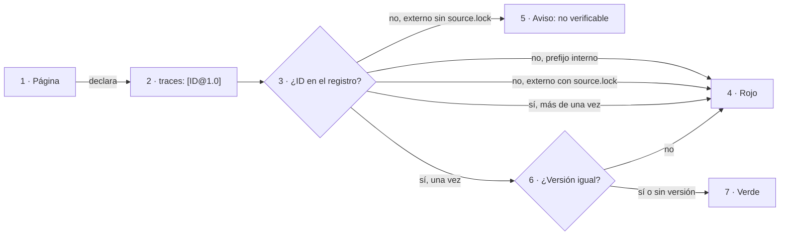

# DocsAsCode Developer Guide — Anexos B a J

## Anexos B a J

[← Anterior](DocsAsCode-Developer-Guide-Parte-VI.md) · [Índice general](DocsAsCode-Developer-Guide.md#índice-general)

### B. Referencias

*Forma: referencia.*

Las fuentes externas que el libro cita, en un solo lugar y en APA 7 adaptado al castellano. Cada entrada abre con un
ancla `ref-apellido-año`: en el texto, la cita va como «(Aghajani et al., 2020)» y lleva a su entrada de este anexo.
Las direcciones web de cada entrada (URL y
DOI resuelto) viven en el [anexo de referencias del cuerpo](99-Anexos/Referencias.md), con la misma ancla; acá
quedan el autor, el año, el título, el identificador estable cuando lo hay, la fecha de consulta y el estado de
verificación. Así el libro no lleva enlaces a dominios fuera de la lista permitida, que la compuerta bloquea fuera del
anexo de referencias [Compilado: TEM-06-Compuertas-Y-CI.md, l. 92, 96]. Las entradas de B.1 a B.7 son las del
anexo del cuerpo, en su orden [Compilado: 99-Anexos/Referencias.md, l. 57–175], salvo Khan y Uddin (2022), que ningún capítulo cita, y las tres de lengua de B.3,
que se suman en esta edición. También se suman B.8, el software de la compuerta; B.9, las fuentes de industria y
las normas que cita el capítulo 18; y B.10, las de audiencias y punto de uso. Cuando un autor tiene dos obras del mismo año, o dos sin fecha, se distinguen con
una letra (2026a, 2026b; s. f., a, s. f., b) que va igual en la cita del texto.

La norma de citación del cuerpo (estilo, fecha de consulta siempre, software con versión, fuentes en Git por versión
o commit, estado de verificación y procedencia de las fechas) está explicada en [2.2.1](DocsAsCode-Developer-Guide-Parte-I.md#221-la-norma-de-citación).
Las formas por tipo de fuente (artículo, ponencia, preprint, libro, página web, software) están en el anexo de
referencias del cuerpo [Compilado: 99-Anexos/Referencias.md, l. 46–53]; acá se aplican sin la URL.

Al final de cada entrada, **V** quiere decir verificada en fuente primaria o registro oficial, y **P**, parcial: sólo
resumen o fuentes secundarias concordantes [Compilado: 99-Anexos/Referencias.md, l. 41]. Las consultas fechadas el
2026-10-26 se transcribieron de las bitácoras de investigación del expediente 0002 de DocAsCode sin volver a
consultar, y las del 2026-10-27 son directas [Compilado: 99-Anexos/Referencias.md, l. 42]. Las del 2026-11-01 son
consultas de esta edición y no figuran en el cuerpo: son las tres de lengua de B.3 y todas las de B.8 y B.9.

#### B.1 Calidad de la documentación

<a id="ref-aghajani-2019"></a>Aghajani, E., Nagy, C., Vega-Márquez, O. L., Linares-Vásquez, M., Moreno, L., Bavota, G., y Lanza, M. (2019). Software documentation issues unveiled. En *Proceedings of ICSE 2019* (pp. 1199-1210). IEEE. DOI 10.1109/ICSE.2019.00122 (consultado el 2026-10-26). Verificación: V (registro).\
<a id="ref-aghajani-2020"></a>Aghajani, E., Nagy, C., Linares-Vásquez, M., Moreno, L., Bavota, G., Lanza, M., y Shepherd, D. C. (2020). Software documentation: The practitioners' perspective. En *Proceedings of ICSE 2020* (pp. 590-601). ACM. DOI 10.1145/3377811.3380405 (consultado el 2026-10-26). Verificación: V.\
<a id="ref-tan-2024"></a>Tan, W. S., Wagner, M., y Treude, C. (2024). Detecting outdated code element references in software repository documentation. *Empirical Software Engineering*, *29*, art. 5. DOI 10.1007/s10664-023-10397-6 (consultado el 2026-10-26). Verificación: V (resumen).\
<a id="ref-treude-2020"></a>Treude, C., Middleton, J., y Atapattu, T. (2020). Beyond accuracy: Assessing software documentation quality. En *Proceedings of ESEC/FSE 2020* (pp. 1509-1512). ACM. DOI 10.1145/3368089.3417045 (consultado el 2026-10-26). Verificación: V (dimensiones); P (DOI).\
<a id="ref-bhat-2026"></a>Bhat, A., Arawjo, I., Shrivastava, D., y Guo, J. L. C. (2026). *"A second set of eyes": The process and challenges of software documentation review* (arXiv:2608.26232). arXiv (consultado el 2026-10-26). Verificación: V (resumen).

#### B.2 Diseño instruccional y ejemplos

<a id="ref-merrill-2002"></a>Merrill, M. D. (2002). First principles of instruction. *Educational Technology Research and Development*, *50*(3), 43-59. DOI 10.1007/BF02505024 (consultado el 2026-10-26). Verificación: V.\
<a id="ref-sweller-1985"></a>Sweller, J., y Cooper, G. A. (1985). The use of worked examples as a substitute for problem solving in learning algebra. *Cognition and Instruction*, *2*(1), 59-89. DOI 10.1207/s1532690xci0201_3 (consultado el 2026-10-26). Verificación: P.\
<a id="ref-atkinson-2000"></a>Atkinson, R. K., Derry, S. J., Renkl, A., y Wortham, D. (2000). Learning from examples: Instructional principles from the worked examples research. *Review of Educational Research*, *70*(2), 181-214. DOI 10.3102/00346543070002181 (consultado el 2026-10-26). Verificación: P.\
<a id="ref-krathwohl-2002"></a>Krathwohl, D. R. (2002). A revision of Bloom's taxonomy: An overview. *Theory Into Practice*, *41*(4), 212-218. DOI 10.1207/s15430421tip4104_2 (consultado el 2026-10-26). Verificación: P.\
<a id="ref-carroll-1990"></a>Carroll, J. M. (1990). *The Nurnberg funnel: Designing minimalist instruction for practical computer skill*. MIT Press. Verificación: P.\
<a id="ref-vandermeij-1995"></a>van der Meij, H., y Carroll, J. M. (1995). Principles and heuristics for designing minimalist instruction. *Technical Communication*, *42*(2), 243-261. Verificación: P.\
<a id="ref-horn-1969"></a>Horn, R. E., Nicol, E., Kleinman, J., y Grace, M. (1969). *Information mapping for learning and reference*. Information Resources Inc. Verificación: P.

#### B.3 Normas, estilo y lengua

<a id="ref-iso-26514-2022"></a>ISO/IEC/IEEE. (2022). *ISO/IEC/IEEE 26514:2022 Systems and software engineering — Design and development of information for users* (1.ª ed.). Ficha oficial en el sitio de comités de ISO (consultado el 2026-10-26). Verificación: **sin verificar**: la definición de audiencia (§3.1.7) se cita adaptada y no se cotejó con la edición publicada.\
<a id="ref-iso-690-2021"></a>ISO. (2021). *ISO 690:2021 Information and documentation — Guidelines for bibliographic references and citations to information resources*. Verificación: P.\
<a id="ref-apa-2020"></a>American Psychological Association. (2020). *Publication manual of the American Psychological Association* (7.ª ed.). Verificación: P.\
<a id="ref-rae-asale-2010"></a>Real Academia Española y Asociación de Academias de la Lengua Española. (2010). *Ortografía de la lengua española*. Espasa (consultado el 2026-11-01). Verificación: P (ficha por el buscador; el sitio de la obra respondió 403; se cita por título y año, sin apartado).\
<a id="ref-rae-asale-2005"></a>Real Academia Española y Asociación de Academias de la Lengua Española. (2005). *Diccionario panhispánico de dudas*. Santillana (consultado el 2026-11-01). Verificación: P (el sitio respondió 403; año y editorial de la primera edición sin verificar en fuente primaria).\
<a id="ref-microsoft-spanish-neutral-2021"></a>Microsoft. (2021). *Spanish (Neutral) Style Guide* [Guía de estilo de localización, PDF]. Listada en el índice de guías de estilo de Microsoft Learn (consultado el 2026-11-01). Verificación: V (PDF de 56 páginas creado el 2021-04-29; año tomado de esa fecha).

#### B.4 Modelos de lenguaje y documentación

<a id="ref-wang-2025"></a>Wang, C., Huang, K., Zhang, J., Feng, Y., Zhang, L., Liu, Y., y Peng, X. (2025). LLMs meet library evolution: Evaluating deprecated API usage in LLM-based code completion. En *Proceedings of ICSE 2025* (arXiv:2406.09834) (consultado el 2026-10-26). Verificación: V.\
<a id="ref-chen-2025"></a>Chen, J., Chen, S., Cao, J., Shen, J., y Cheung, S.-C. (2025). *When LLMs meet API documentation: Can retrieval augmentation aid code generation just as it helps developers?* (arXiv:2503.15231). arXiv. DOI 10.48550/arXiv.2503.15231 (consultado el 2026-10-26). Verificación: V (resumen).\
<a id="ref-chatlatanagulchai-2025"></a>Chatlatanagulchai, W., et al. (2025). *Agent READMEs: An empirical study of context files for agentic coding* (arXiv:2511.12884). arXiv (consultado el 2026-10-26). Verificación: V.\
<a id="ref-yamasaki-2026"></a>Yamasaki, K., et al. (2026). *Who writes the docs in SE 3.0? Agent vs. human documentation pull requests* (arXiv:2601.20171). arXiv (consultado el 2026-10-26). Verificación: V (resumen).

#### B.5 Práctica de la industria

<a id="ref-bockeler-2025"></a>Böckeler, B. (2025, 15 de octubre). *Understanding spec-driven development: Kiro, spec-kit, and Tessl*. martinfowler.com (consultado el 2026-10-26). Verificación: V.\
<a id="ref-writethedocs-sf"></a>Write the Docs. (s. f.). *Docs as code* (consultado el 2026-10-26). Verificación: V.\
<a id="ref-gitlab-sf"></a>GitLab. (s. f., a). *Documentation workflow*. GitLab Docs (consultado el 2026-10-26). Verificación: V.\
<a id="ref-gitlab-testing-sf"></a>GitLab. (s. f., b). *Documentation testing*. GitLab Docs (consultado el 2026-10-26). Verificación: V.\
<a id="ref-backstage-sf"></a>Backstage. (s. f.). *TechDocs architecture* (consultado el 2026-10-26). Verificación: V.\
<a id="ref-docusaurus-sf"></a>Docusaurus. (s. f.). *Versioning* (consultado el 2026-10-26). Verificación: V.\
<a id="ref-agentsmd-sf"></a>AGENTS.md. (s. f.). *AGENTS.md* (consultado el 2026-10-26). Verificación: V.\
<a id="ref-howard-sf"></a>Howard, J. (s. f.). *The /llms.txt file* (consultado el 2026-10-26). Verificación: V.\
<a id="ref-owasp-2025"></a>OWASP GenAI Security Project. (2025). *LLM01:2025 Prompt injection* (consultado el 2026-10-26). Verificación: V.\
<a id="ref-thoughtworks-2025"></a>Thoughtworks. (2025, 5 de noviembre). *Spec-driven development* [Technology Radar, anillo Assess] (consultado el 2026-10-26). Verificación: V.\
<a id="ref-winters-2020"></a>Winters, T., Manshreck, T., y Wright, H. (Eds.). (2020). *Software engineering at Google*, cap. 10 «Documentation». O'Reilly (consultado el 2026-10-26). Verificación: V.\
<a id="ref-dora-sf"></a>DORA. (s. f.). *Documentation quality* (consultado el 2026-10-26). Verificación: V.

#### B.6 Versionado, estilo y adopciones públicas

Los repositorios se citan por el commit más reciente que tocó la ruta que materializa la práctica
[Compilado: 99-Anexos/Referencias.md, l. 131–133]; el guion que reproducía la consulta figura en el anexo J.

<a id="ref-procida-sf"></a>Procida, D. (s. f.). *Diátaxis: A systematic approach to technical documentation authoring* (consultado el 2026-10-27). Verificación: P (la página no nombra al autor; la autoría es la conocida del marco).\
<a id="ref-prestonwerner-sf"></a>Preston-Werner, T. (s. f.). *Semantic Versioning 2.0.0* (consultado el 2026-10-27). Verificación: V.\
<a id="ref-lacan-sf"></a>Lacan, O. (s. f.). *Keep a Changelog* (versión 1.1.0) (consultado el 2026-10-27). Verificación: V.\
<a id="ref-fowler-2013"></a>Fowler, M. (2013, 21 de agosto). *GivenWhenThen*. martinfowler.com (consultado el 2026-10-27). Verificación: V.\
<a id="ref-github-docs-2026"></a>GitHub. (2026a). *github/docs* (commit ee20fda) [Repositorio] (consultado el 2026-10-27). Ruta `content/`; la verificación diaria de enlaces está en `.github/workflows/link-check-daily.yml` (commit 7abf80d, 2026-01-26). Verificación: V (API pública de GitHub).\
<a id="ref-github-openapi-2026"></a>GitHub. (2026b). *github/rest-api-description* (commit a5c38c1) [Repositorio] (consultado el 2026-10-27). Ruta `descriptions/`, descripciones OpenAPI de la API REST. Verificación: V (API pública de GitHub).\
<a id="ref-kubernetes-website-2026"></a>Kubernetes. (2026). *kubernetes/website* (commit ed70e31) [Repositorio] (consultado el 2026-10-27). Ruta `content/en/`; 33 ramas `release-1.*` (la última, `release-1.36`). Verificación: V (API pública de GitHub).\
<a id="ref-microsoft-azure-docs-2026"></a>Microsoft. (2026a). *MicrosoftDocs/azure-docs* (commit d7e590b) [Repositorio] (consultado el 2026-10-27). Ruta `articles/`. Verificación: V (API pública de GitHub).\
<a id="ref-stripe-openapi-2026"></a>Stripe. (2026). *stripe/openapi* (commit a6cd987) [Repositorio] (consultado el 2026-10-27). Ruta `openapi/`. Verificación: V (API pública de GitHub).\
<a id="ref-mintlify-docs-2026"></a>Mintlify. (2026). *mintlify/docs* (commit 4a8f15c) [Repositorio] (consultado el 2026-10-27). Archivo `.vale.ini`. Verificación: V (API pública de GitHub).\
<a id="ref-redhat-openshift-docs-2026"></a>Red Hat. (2026). *openshift/openshift-docs* (commit df83131) [Repositorio] (consultado el 2026-10-27). Archivo `.vale.ini`. Verificación: V (API pública de GitHub).\
<a id="ref-grafana-2026"></a>Grafana Labs. (2026). *grafana/grafana* (commit 5427e8d) [Repositorio] (consultado el 2026-10-27). Archivo `.vale.ini`; la documentación del producto vive en `docs/sources/` del mismo repositorio (commit 7b102dd, 2026-10-27). Verificación: V (API pública de GitHub).\
<a id="ref-backstage-2026"></a>Backstage. (2026). *backstage/backstage* (commit 82079b4) [Repositorio] (consultado el 2026-10-27). Ruta `docs/`, en el mismo repositorio que el código. Verificación: V (API pública de GitHub).\
<a id="ref-istio-2026"></a>Istio. (2026). *istio/istio.io* (commit 2100f40) [Repositorio] (consultado el 2026-10-27). Ruta `content/`; 33 ramas `release-1.*` (la última, `release-1.31`). Verificación: V (API pública de GitHub).\
<a id="ref-docusaurus-2026"></a>Docusaurus. (2026). *facebook/docusaurus* (commit 206e741) [Repositorio] (consultado el 2026-10-27). Ruta `website/versioned_docs/`, doce versiones publicadas. Verificación: V (API pública de GitHub).\
<a id="ref-jest-2026"></a>Jest. (2026). *jestjs/jest* (commit ea7258e) [Repositorio] (consultado el 2026-10-27). Ruta `website/versioned_docs/`, cuatro versiones publicadas. Verificación: V (API pública de GitHub).

#### B.7 Desarrollo guiado por especificación

<a id="ref-github-2026"></a>GitHub. (2026c). *Spec Kit* (v1.2.4) [Software] (consultado el 2026-10-27). Verificación: V.\
<a id="ref-kiro-sf"></a>Kiro. (s. f.). *Specs*. Kiro Docs (consultado el 2026-10-27). Verificación: V.\
<a id="ref-nygard-2011"></a>Nygard, M. (2011, 15 de noviembre). *Documenting architecture decisions*. Cognitect (consultado el 2026-10-27). Verificación: V.

#### B.8 Software

La norma pide citar el software con la versión usada [Compilado: 99-Anexos/Referencias.md, l. 39]; el cuerpo no
citaba las herramientas de su propia compuerta. Van con la versión que fija el repositorio, para que una salida
registrada en el libro se reproduzca con las mismas piezas. Spec Kit queda en
[B.7](#b7-desarrollo-guiado-por-especificación).

| Herramienta | Para qué la usa la compuerta | Dónde se fija la versión | Entrada |
| --- | --- | --- | --- |
| `docs-guard` | Los controles PR-1 a PR-7 y la autoprueba | El commit de Lab-Documentos que se verifica; la etiqueta `docs-guard-v1.0.0` (commit 14d5a28, 2026-10-27) es anterior al control `mermaid-arroba` | [Lab-Documentos, 2026](#ref-lab-documentos-2026) |
| lychee | PR-1, enlaces y anclas sin red | `scripts/ci-local.sh`, l. 40–41, con su SHA-256 | [lycheeverse, 2025](#ref-lycheeverse-2025) |
| markdownlint-cli2 | PR-4, estructura de encabezados y tablas | `scripts/ci-local.sh`, l. 42 | [Anson, 2025a](#ref-anson-2025a) |
| markdownlint | Motor de reglas de markdownlint-cli2 | Dependencia exacta de markdownlint-cli2 0.17.2 | [Anson, 2025b](#ref-anson-2025b) |
| mermaid | PR-4, que cada diagrama parsee | `tools/docs-guard/mermaid/package.json`, l. 7–8, y su lockfile | [Sveidqvist, 2024](#ref-sveidqvist-2024) |
| jsdom | Documento sin navegador para el parser de mermaid | Mismo `package.json` y lockfile | [jsdom, 2024](#ref-jsdom-2024) |
| actions/checkout | Trae el repositorio y las herramientas en el runner | Fijada por SHA en `.github/workflows/docs-guard.yml`, l. 68 y 73 | [GitHub, 2024](#ref-github-checkout-2024) |

*Tabla B.1. Las herramientas de la compuerta y dónde fija cada una su versión [Compilado:
scripts/ci-local.sh, l. 40–45; tools/docs-guard/mermaid/package.json, l. 6–9; .github/workflows/docs-guard.yml, l. 68,
73; rutas desde la raíz de Lab-Documentos].*

Python 3 y Node.js no tienen versión fijada: se usan los del runner, y `dg.py` se limita a la biblioteca estándar
[Compilado: scripts/ci-local.sh, l. 30–31, 47].

<a id="ref-lab-documentos-2026"></a>Lab-Documentos. (2026). *docs-guard* (commit 00171bd) [Software]. Carpeta `tools/docs-guard` y guion `scripts/ci-local.sh` del repositorio público Lab-Documentos (consultado el 2026-11-01). Verificación: V.\
<a id="ref-lycheeverse-2025"></a>lycheeverse. (2025, 11 de febrero). *lychee* (versión 0.18.1) [Software]. GitHub (consultado el 2026-11-01). Verificación: V (registro de versiones de GitHub).\
<a id="ref-anson-2025a"></a>Anson, D. (2025a, 17 de enero). *markdownlint-cli2* (versión 0.17.2) [Software]. npm (consultado el 2026-11-01). Verificación: V (registro de npm).\
<a id="ref-anson-2025b"></a>Anson, D. (2025b, 15 de enero). *markdownlint* (versión 0.37.4) [Software]. npm (consultado el 2026-11-01). Verificación: V (registro de npm).\
<a id="ref-sveidqvist-2024"></a>Sveidqvist, K. (2024, 27 de noviembre). *mermaid* (versión 11.4.1) [Software]. npm y GitHub (consultado el 2026-11-01). Verificación: V (registro de versiones de GitHub; autoría según el registro de npm).\
<a id="ref-jsdom-2024"></a>jsdom. (2024, 22 de septiembre). *jsdom* (versión 25.0.1) [Software]. GitHub (consultado el 2026-11-01). Verificación: V (registro de versiones de GitHub).\
<a id="ref-github-checkout-2024"></a>GitHub. (2024, 23 de octubre). *actions/checkout* (v4.2.2) [Software]. GitHub (consultado el 2026-11-01). Verificación: V (registro de versiones de GitHub).

#### B.9 Industria y estándares

Las fuentes que el capítulo 18 suma para contrastar el sistema con la práctica de la industria y con las normas
de información para el usuario. Todas se consultaron el 2026-11-01; las páginas sin fecha van como «s. f.».

<a id="ref-gitbook-2026a"></a>GitBook. (2026a, 4 de febrero). *AI docs readership increased over 500% in 2025. What does it mean for you?* GitBook Blog (consultado el 2026-11-01). Verificación: V (dato del proveedor sobre los sitios de sus clientes).\
<a id="ref-gitbook-2026b"></a>GitBook. (2026b, 18 de marzo). *The State of Docs Report 2026 is live! Here are the highlights*. GitBook Blog (consultado el 2026-11-01). Verificación: V (encuesta del proveedor).\
<a id="ref-github-copilot-agents-sf"></a>GitHub. (s. f.). *Adding repository custom instructions for GitHub Copilot*. GitHub Docs (consultado el 2026-11-01). Verificación: V.\
<a id="ref-google-docguide-sf"></a>Google. (s. f.). *Documentation best practices*. Google Style Guides (consultado el 2026-11-01). Verificación: V.\
<a id="ref-iec-82079-2019"></a>IEC. (2019). *IEC/IEEE 82079-1:2019 Preparation of information for use (instructions for use) of products — Part 1: Principles and general requirements* (ed. 2.0). Ficha oficial en el catálogo de IEC (consultado el 2026-11-01). Verificación: V (ficha).\
<a id="ref-iso-26515-2018"></a>ISO/IEC/IEEE. (2018). *ISO/IEC/IEEE 26515:2018 Systems and software engineering — Developing information for users in an agile environment* (2.ª ed.). Ficha oficial en el sitio de comités de ISO (consultado el 2026-11-01). Verificación: V (ficha de comité).\
<a id="ref-markdoc-sf"></a>Markdoc. (s. f.). *Markdoc: A powerful, flexible, Markdown-based authoring framework* (consultado el 2026-11-01). Verificación: V.\
<a id="ref-mkdocs-material-sf"></a>Material for MkDocs. (s. f.). *Material for MkDocs* (consultado el 2026-11-01). Verificación: V.\
<a id="ref-microsoft-learn-mcp-2026"></a>Microsoft. (2026b, 5 de mayo). *Microsoft Learn MCP Server overview*. Microsoft Learn (consultado el 2026-11-01). Verificación: V.\
<a id="ref-mintlify-openapi-sf"></a>Mintlify. (s. f., a). *OpenAPI setup*. Mintlify Docs (consultado el 2026-11-01). Verificación: V.\
<a id="ref-mintlify-llmstxt-sf"></a>Mintlify. (s. f., b). *llms.txt*. Mintlify Docs (consultado el 2026-11-01). Verificación: V.\
<a id="ref-molina-2024"></a>Molina, D., y Christensen, W. (2024, 8 de julio). *A new era for Twilio's documentation*. Twilio Blog (consultado el 2026-11-01). Verificación: V.\
<a id="ref-onesignal-sf"></a>OneSignal. (s. f., a). *Create user* [Referencia de la API, página HTML y fuente .md]. OneSignal Documentation (consultado el 2026-11-01). Verificación: V (respuesta del propio sitio).\
<a id="ref-onesignal-llms-sf"></a>OneSignal. (s. f., b). *OneSignal* [Índice para agentes, llms.txt] (consultado el 2026-11-01). Verificación: V.

#### B.10 Audiencias, punto de uso y entrega

Las fuentes que suman los capítulos 7, 8 y 18 en esta edición, tomadas de la sección 9 del anexo del cuerpo.

<a id="ref-appcues-sf"></a>Appcues. (s. f.). *Targeting by user property*. (consultado el 2026-11-02). Verificación: V.\
<a id="ref-govuk-sf"></a>GOV.UK Design System. (s. f.). *Text input*. (consultado el 2026-11-02). Verificación: V.\
<a id="ref-jsonschema-annotations-sf"></a>JSON Schema. (s. f.). *Annotations*. (consultado el 2026-11-02). Verificación: V.\
<a id="ref-madcap-flare-2026"></a>MadCap Software. (2026). *Context-sensitive help* (Flare 2026). (consultado el 2026-11-02). Verificación: V.\
<a id="ref-microsoft-aspnet-openapi-2026"></a>Microsoft. (2026c, 29 de octubre). *Generate OpenAPI documents* (ASP.NET Core). Microsoft Learn. (consultado el 2026-11-02). Verificación: V.\
<a id="ref-microsoft-displayattribute-2026"></a>Microsoft. (2026d, 27 de mayo). *DisplayAttribute.Description property*. Microsoft Learn. (consultado el 2026-11-02). Verificación: V.\
<a id="ref-microsoft-blazor-validation-sf"></a>Microsoft. (s. f., a). *ASP.NET Core Blazor forms validation*. Microsoft Learn. (consultado el 2026-11-01). Verificación: V.\
<a id="ref-microsoft-apim-groups-sf"></a>Microsoft. (s. f., b). *Create and use groups in Azure API Management*. Microsoft Learn. (consultado el 2026-11-01). Verificación: V.\
<a id="ref-mintlify-auth-sf"></a>Mintlify. (s. f., c). *Authentication setup*. (consultado el 2026-11-02). Verificación: V.\
<a id="ref-mcp-authorization-2025"></a>Model Context Protocol. (2025, 18 de junio). *Authorization* (especificación 2025-06-18). (consultado el 2026-11-02). Verificación: V.\
<a id="ref-oasis-dita-resourceid-2015"></a>OASIS. (2015). *DITA 1.3: `<resourceid>`*. (consultado el 2026-11-02). `@appid` es único junto con `@appname`. Verificación: V.\
<a id="ref-owasp-llm06-2025"></a>OWASP GenAI Security Project. (2025). *LLM06:2025 Excessive agency*. (consultado el 2026-11-02). Verificación: V.\
<a id="ref-pendo-sf"></a>Pendo. (s. f.). *Take a tour of Pendo*. (consultado el 2026-11-01). Verificación: V.\
<a id="ref-redocly-permissions-sf"></a>Redocly. (s. f.). *Page permissions*. (consultado el 2026-11-02). Sin sesión, redirige al login. Verificación: V.\
<a id="ref-sherwin-2014"></a>Sherwin, K. (2014, rev. 2018). *Placeholders in form fields are harmful*. Nielsen Norman Group. (consultado el 2026-11-02). Verificación: V.\
<a id="ref-w3c-wcag22-331"></a>W3C. (s. f., a). *Understanding SC 3.3.1: Error identification* (WCAG 2.2, nivel A). (consultado el 2026-11-02). Verificación: V.\
<a id="ref-w3c-wcag22-332"></a>W3C. (s. f., b). *Understanding SC 3.3.2: Labels or instructions* (WCAG 2.2, nivel A). (consultado el 2026-11-02). Verificación: V.\
<a id="ref-w3c-wcag22-333"></a>W3C. (s. f., c). *Understanding SC 3.3.3: Error suggestion* (WCAG 2.2, nivel AA). (consultado el 2026-11-02). Verificación: V.\
<a id="ref-willison-2025"></a>Willison, S. (2025, 16 de junio). *The lethal trifecta for AI agents*. (consultado el 2026-11-02). Verificación: V.\
<a id="ref-zendesk-helpcenter-sf"></a>Zendesk. (s. f.). *Help Center API* (Web Widget). (consultado el 2026-11-02). Verificación: V.

### C. Esquema de frontmatter y prefijos

*Forma: referencia.*

El contrato que cumple todo documento del cuerpo, y que conviene adoptar en los proyectos que documenta, lo verifica
la compuerta en los grupos PR-2 (esquema) y PR-5 (trazas) [Compilado: 99-Anexos/Esquema-Frontmatter-Y-Prefijos.md,
l. 17–19]. Para qué sirven la traza y el registro está en [1.3](DocsAsCode-Developer-Guide-Parte-I.md#13-fuente-de-verdad-traza-y-ancla-de-versión).

#### C.1 Los diez campos más description

| Campo | Obligatorio | Valores | Para qué sirve |
| --- | --- | --- | --- |
| `doc_id` | Sí | Prefijo registrado, guion y sufijo en mayúsculas (`TEM-01`, `ANX-SDEI-CQ`) | Identidad estable: las trazas y las citas entre repositorios apuntan a él, no a la ruta |
| `doc_type` | Sí | `tema`, `marco-de-referencia`, `familia`, `mapa`, `anexo`, `anexo-referencias`, `indice`, `guia-practica`, `guia-de-estudio`, `operativa`, `study-note`, `rrd`, `proceso`, `ficha`, `registro-audiencias` | Decide qué estructura se espera y qué controles se relajan (en `anexo-referencias`, AI-4 sólo avisa) |
| `title` | Sí | Texto, 3 caracteres o más | Título para índices y canales; el H1 visible puede ser más corto |
| `status` | Sí | `borrador`, `vigente`, `obsoleto` | Ciclo de vida; pasar a `vigente` es acto de una persona |
| `origin` | Sí | `human`, `ia-assisted`, `ia-generated` | Quién produjo el texto; gatilla la revisión según origen (`CQ-14`) |
| `confidence` | Si `origin` no es `human` | `alta`, `media`, `baja` | Cuánto confía quien redactó en lo que afirma |
| `owner` | Sí | Texto | Responsable de mantenerlo |
| `last_review` | Sí | Fecha `AAAA-MM-DD` | Frescura: el carril programado avisa pasados 365 días |
| `audience` | Sí | Lista con uno o más de: `humano`, `agente`, `estudiante`, `docente`, `desarrollo`, `qa`, `devops`, `po`, `analista`, `persona-usuaria` | A quién se dirige; ordena las rutas de lectura. Es de **orientación**: no da ni quita acceso. `agente` queda en el vocabulario sólo como valor heredado |
| `traces` | Sí (puede ser `[]`) | Lista de `ID` o `ID@MAYOR.MENOR`, sin repetidos | De qué depende el documento; cada traza tiene que resolver |
| `delivery` | No | Lista de audiencias del registro (`AUD-`) | Regla de entrega: qué audiencias reciben la página. Es el campo que protege; `audience` sólo orienta. Lo heredado sin `delivery` sólo avisará; hoy el esquema comprueba únicamente la forma del campo |
| `description` | Sí | Texto de 10 a 160 caracteres | Resumen para índices y agentes. La revisa una persona en el pull request que pasa el documento a vigente |

*Tabla C.1. El contrato de frontmatter de un documento del cuerpo [Compilado: 99-Anexos/Esquema-Frontmatter-Y-Prefijos.md,
l. 43–56, 62–66]. Coincide campo por campo con `tools/docs-guard/esquemas/cuerpo.schema.json` en el commit de esta edición.*

#### C.2 README del cuerpo y páginas de ayuda

Dos formas tienen su propio esquema. La compuerta elige cuál aplicar en este orden: un `README.md` con `corpus_id`
es README de cuerpo; si no, un frontmatter con `doc_id` es documento del cuerpo; si no, uno con `roles` o
`translation_of` es página de ayuda [Compilado: tools/docs-guard/dg.py, l. 334–341].

| Forma | Cómo se reconoce | Campos obligatorios |
| --- | --- | --- |
| README de un cuerpo | `README.md` con `corpus_id` | `corpus_id` (mayúsculas y guiones), `version` (SemVer, admite sufijo de versión previa como `-borrador` o `-borrador.1`), `title`, `description`. Puede sumar los diez campos, como el README del cuerpo |
| Página de ayuda al usuario final | Tiene `roles` o `translation_of` y no tiene `doc_id` | `title`, `description` y, según el caso, `roles` o `translation_of`. Si lleva `traces`, cada una con `@MAYOR.MENOR` |

*Tabla C.2. Las dos formas con esquema propio [Compilado: 99-Anexos/Esquema-Frontmatter-Y-Prefijos.md, l. 72–75;
tools/docs-guard/esquemas/ayuda.schema.json, l. 6–18; tools/docs-guard/esquemas/readme-cuerpo.schema.json, l. 6–11]. La
tabla corrige dos celdas de la fuente según el archivo que manda (co-cambio): `description` es obligatoria en la
página de ayuda, y el sufijo admitido en `version` es cualquiera de versión previa.*

Una página de ayuda admite además, como opcionales, `delivery` y `contexto: <app>/<id>`, el identificador de contexto de la
[sección 8.4](DocsAsCode-Developer-Guide-Parte-III.md#84-ayuda-en-el-punto-de-uso-pantallas-campos-paneles-y-portales).

`corpus_id` y `version` viven sólo en el README: un tema no repite la versión del cuerpo
[Compilado: 99-Anexos/Esquema-Frontmatter-Y-Prefijos.md, l. 77]. La excepción es el conocimiento de especificación,
cuyo `version` repite la línea `**Versión:**` del propio conocimiento; el capítulo 17 cuenta por qué.

Una página de ayuda con `doc_id` **no** se valida contra el esquema de páginas de ayuda, aunque tenga `roles`: la
compuerta la toma como documento del cuerpo y no mira ese campo. Un ensayo de esta edición lo muestra: con
`roles: [student]`, en minúscula, la página con `doc_id` pasa y la de rol sin `doc_id` da rojo con
`esquema-ayuda`
[Salida registrada: corrida del 2026-11-01 sobre Lab-Documentos 00171bd; anexo J]. Las dos variantes y cuándo
conviene cada una están en [G.9](#g9-página-de-ayuda-en-dos-variantes).

#### C.3 Trazas en dos niveles

Una traza dice de qué otro identificador depende un documento.

| Nivel | Dónde | Forma | Ejemplo |
| --- | --- | --- | --- |
| 1 | En el frontmatter de la página | `traces: [ID]` o `traces: [ID@MAYOR.MENOR]` | `traces: [RN-LOC-01@1.1]` (la ayuda de la mini demo) |
| 2 | En la ficha del ID | `ruta#Símbolo@SHA` de dónde se declara, se verifica y se aplica en el código | `src/MovilidadUrbana.MAUI/Domain/Rules/LocalidadRules.cs#LocalidadRules.LargoMaximoDelNombre@8fb4c3a` (la ficha `RN-LOC-01`; el símbolo va como `Clase.Miembro`) |

*Tabla C.3. Los dos niveles de traza [Compilado: 99-Anexos/Esquema-Frontmatter-Y-Prefijos.md, l. 84–87].*

El registro contra el que se resuelven se genera solo: lo forman los `doc_id` de todo el repositorio y los
encabezados que empiezan con un identificador. El Marco del cuerpo, por ejemplo, declara `ESC-SDEI-2` con un
encabezado de nivel 3 que empieza por ese ID. Con `@MAYOR.MENOR`, la declaración tiene que tener esa versión
[Compilado: 99-Anexos/Esquema-Frontmatter-Y-Prefijos.md, l. 89–92].



*Figura C.1. Cómo decide el control `traces-resolve`. Un ID declarado dos veces es ambiguo y también da rojo
[Compilado: 99-Anexos/Esquema-Frontmatter-Y-Prefijos.md, l. 94–106]. El capítulo 9 recorre los casos con su salida.*

#### C.4 Registro de prefijos

El registro es cerrado: un prefijo nuevo entra por un pull request que lo agrega. **Interno** quiere decir que el ID
se declara en este repositorio; si no resuelve, bloquea. **Externo** quiere decir que se declara en el sistema que se
documenta y se resuelve contra el SHA de su `source.lock`
[Compilado: 99-Anexos/Esquema-Frontmatter-Y-Prefijos.md, l. 110–112].

| Prefijo | Ámbito | Qué identifica |
| --- | --- | --- |
| `ESC` | interno | Escenario del marco |
| `CTX` | interno | Contexto del marco |
| `ACT` | interno | Actor del marco |
| `DOC` | interno | Documento temático por tipo de documentación |
| `FAM` | interno | Familia documental |
| `MET` | interno | Método ágil |
| `ARQ` | interno | Modelo de arquitectura |
| `MARCO` | interno | Documento del marco de referencia |
| `MAPA` | interno | Mapa conceptual |
| `ANX` | interno | Anexo |
| `IDX` | interno | Índice |
| `FC` | interno | Documento del Framework Concept (`FC-TEM-nn`, `FC-GUIA-INDICE`, `FC-MARCO-REFERENCIA`, `FC-ANEXO-99`), espacio propio para no chocar con los cuerpos de `Guides/` |
| `AUD` | interno | Registro de audiencias (`doc_type: registro-audiencias`) |
| `TEM` | interno | Tema del cuerpo |
| `CQ` | interno | Criterio de calidad |
| `PE` | interno | Patrón de ejemplo |
| `OBJ` | interno | Objetivo de aprendizaje |
| `EJR` | interno | Ejercicio |
| `RD` | interno | Requerimiento documental |
| `VER` | interno | Ítem de verificación |
| `GP` | interno | Guía práctica de un ejemplo |
| `GUIA` | interno | Guía de estudio de `Guides/` sin espacio de prefijos propio (`GUIA-NET-IA`) |
| `DEMO` | interno | Pieza de una demo de `Examples/` (mini demo MovilidadUrbana: `DEMO-MU-nn`) |
| `RF` | externo | Requisito funcional |
| `RNF` | externo | Requisito no funcional |
| `RN` | externo | Regla de negocio |
| `CU` | externo | Caso de uso |
| `ADR` | externo | Decisión de arquitectura |
| `TC` | externo | Caso de prueba |
| `RSK` | externo | Riesgo |
| `FLU` | externo | Flujo de usuario |
| `NB` | externo | Necesidad de negocio |

*Tabla C.4. El registro cerrado de prefijos [Compilado: 99-Anexos/Esquema-Frontmatter-Y-Prefijos.md, l. 114–146].
Coincide fila por fila con `tools/docs-guard/prefijos.txt`, l. 8–42, en el commit de esta edición, `FC` y
`PE` = patrón de ejemplo incluidos; la fila `GUIA` sale del archivo, que manda, y es co-cambio para el anexo del cuerpo.*

Los identificadores del marco y de los anexos llevan el `corpus_id` como segundo segmento (`ESC-SDEI-1`,
`ANX-SDEI-CQ`) porque el registro es único para todo el repositorio y otras guías ya declaran `ESC-1`; es una
convención del cuerpo, declarada como criterio propio [Compilado: 99-Anexos/Esquema-Frontmatter-Y-Prefijos.md, l. 151–153].

#### C.5 Registro de requerimientos documentales

Un archivo `_requisitos.md`, o uno con `doc_type: rrd`, tiene una tabla con estas columnas, en este orden.

| Columna | Regla |
| --- | --- |
| `ID` | `RD-nn` |
| `Audiencia` | Una sola |
| `Tarea` | Lo que esa audiencia necesita lograr |
| `Pieza` | Clase y archivo |
| `Criterio` | Forma Dado/Cuando/Entonces |
| `Decisión` | `aceptado`, `rechazado`, `diferido` o `pendiente` |

*Tabla C.5. Columnas del RRD [Compilado: 99-Anexos/Esquema-Frontmatter-Y-Prefijos.md, l. 157–166].*

La primera fila del RRD de la mini demo es una fila válida; el capítulo 5 la lee completa, y qué controla la
compuerta en cada celda está en [G.10](#g10-lo-que-la-compuerta-exige-a-un-rrd)
[Compilado: 99-Anexos/Esquema-Frontmatter-Y-Prefijos.md, l. 168–173].

#### C.6 Un frontmatter completo y sus errores

Frontmatter válido de un tema, el de `TEM-03`, con las listas de `audience` y de `traces` recortadas
[Fragmento ilustrativo: frontmatter de `TEM-03`, l. 1–13, con `audience` y `traces` recortadas]:

```yaml
---
doc_id: TEM-SDEI-03
doc_type: tema
title: Tema 03 — Topología de repositorios y versionado
description: "Dónde vive cada pieza documental respecto del código y contra qué versión vale: commit, SHA fijado o etiqueta, con la regla para elegir."
status: borrador
origin: ia-assisted
confidence: media
owner: Lab-Documentos — guía del sistema documentador
last_review: 2026-10-28
audience: [humano, agente, estudiante]
traces: [MARCO-SDEI, MAPA-SDEI, TEM-SDEI-02]
---
```

| Si cambiás… | La compuerta dice | Grupo |
| --- | --- | --- |
| `status: aprobado` | `esquema-cuerpo`: valor fuera del vocabulario | PR-2 |
| Borrás `confidence` con `origin: ia-assisted` | `esquema-cuerpo`: falta `confidence` | PR-2 |
| `doc_id: TOP-03` | `prefijo`: «TOP-» no está en el registro | PR-2 |
| `traces: [TEM-SDEI-99]` | `traza-no-resuelve` | PR-5 |
| Borrás el bloque entero | `sin-frontmatter`: todo documento del cuerpo abre con frontmatter | PR-2 |

*Tabla C.6. Cinco errores y la regla que los detecta [Compilado: 99-Anexos/Esquema-Frontmatter-Y-Prefijos.md,
l. 196–202]. Las cinco filas se reprodujeron en esta edición mutando una copia de `TEM-03`, una por vez; cada
mutación dio la regla de su fila [Salida registrada: corrida del 2026-11-01 sobre Lab-Documentos 00171bd; se omiten
las rutas].*

#### C.7 Dónde vive la fuente de verdad del esquema

Las tablas de este anexo explican el contrato. Los datos que la compuerta lee están en `tools/docs-guard/`, desde la
raíz de Lab-Documentos: `esquemas/cuerpo.schema.json` (documento con `doc_id`), `esquemas/readme-cuerpo.schema.json`
(README de un cuerpo), `esquemas/ayuda.schema.json` (página de ayuda) y `prefijos.txt` (registro de prefijos)
[Compilado: 99-Anexos/Esquema-Frontmatter-Y-Prefijos.md, l. 208–213]. Si una tabla y su archivo no coinciden,
manda el archivo, y la diferencia se corrige en el anexo del cuerpo y en este libro en el mismo pull request
[Compilado: 99-Anexos/Esquema-Frontmatter-Y-Prefijos.md, l. 215–216]; que el libro se corrija en ese mismo pull request es **[criterio propio]**.

### D. Criterios de calidad

*Forma: referencia.*

Catorce criterios con identificador estable, que se citan en revisiones («no cumple `CQ-07`»); cinco los verifica la
compuerta [Compilado: 99-Anexos/Criterios-De-Calidad.md, l. 17–19]. Cómo se agrupan y cómo se usan en una revisión
está en [2.4](DocsAsCode-Developer-Guide-Parte-I.md#24-cómo-se-evalúa-una-guía); acá van las dos tablas que se consultan.

#### D.1 Los catorce criterios

| Id | Criterio | Pregunta de verificación | Automatizable | Fuente |
| --- | --- | --- | --- | --- |
| `CQ-01` | Corrección | ¿Cada afirmación técnica y cada ejemplo coincide con el sistema en la versión declarada? | Parcial: compilar los ejemplos | [Aghajani et al., 2019](#ref-aghajani-2019); [Aghajani et al., 2020](#ref-aghajani-2020) |
| `CQ-02` | Completitud | ¿Están cubiertas la instalación, el despliegue y cada función nueva? | No | [Aghajani et al., 2020](#ref-aghajani-2020) |
| `CQ-03` | Actualidad | ¿Toda referencia a código, ruta o símbolo existe en el commit citado? | Sí | [Tan et al., 2024](#ref-tan-2024) |
| `CQ-04` | Claridad | ¿Un lector sin conocimiento del dominio ejecuta la guía sin ayuda? | No: prueba de lectura | [Aghajani et al., 2020](#ref-aghajani-2020); [Bhat et al., 2026](#ref-bhat-2026) |
| `CQ-05` | Encontrabilidad | ¿Hay índice, anclas predecibles y entradas «estoy acá → qué aplico»? | Sí: índice y anclas | [Aghajani et al., 2020](#ref-aghajani-2020); Profile de guía de estudio |
| `CQ-06` | Estructura y cohesión | ¿Las unidades siguen el mismo patrón interno y se enlazan entre sí? | Parcial | [Treude et al., 2020](#ref-treude-2020); Profile de guía de estudio |
| `CQ-07` | Consistencia terminológica | ¿Un término, un significado, registrado en el glosario? | Parcial | [Treude et al., 2020](#ref-treude-2020); [Horn et al., 1969](#ref-horn-1969) |
| `CQ-08` | Concisión y relevancia | ¿Cada bloque trata un solo tipo de información? | No | [Treude et al., 2020](#ref-treude-2020); [Horn et al., 1969](#ref-horn-1969) |
| `CQ-09` | Orientación a la tarea | ¿La unidad parte de una tarea real y prevé errores con su recuperación? | No | [van der Meij y Carroll, 1995](#ref-vandermeij-1995); [Merrill, 2002](#ref-merrill-2002) |
| `CQ-10` | Ejemplos trabajados de calidad | ¿Hay ejemplos resueltos, rotulados, con procedencia, antes de los ejercicios? | Parcial | [Sweller y Cooper, 1985](#ref-sweller-1985); [Atkinson et al., 2000](#ref-atkinson-2000); [Chen et al., 2025](#ref-chen-2025) |
| `CQ-11` | Trazabilidad de fuentes | ¿Toda afirmación externa tiene referencia completa con fecha de consulta, y toda interna, ruta y línea o commit? | Sí: enlaces y formato | [Aghajani et al., 2020](#ref-aghajani-2020); [ISO, 2021](#ref-iso-690-2021) |
| `CQ-12` | Objetivos y evaluación | ¿La unidad declara objetivos observables y cierra con preguntas guía y un ejercicio? | Parcial: presencia | [Krathwohl, 2002](#ref-krathwohl-2002); [Merrill, 2002](#ref-merrill-2002) |
| `CQ-13` | Doble audiencia | ¿Frontmatter válido, IDs estables, diagramas como código y fragmentos con procedencia? | Sí | [Chatlatanagulchai et al., 2025](#ref-chatlatanagulchai-2025) |
| `CQ-14` | Revisión según origen | Si `origin` no es `human`, ¿pasó revisión técnica y editorial registrada? | Sí: metadato | [Yamasaki et al., 2026](#ref-yamasaki-2026); [Bhat et al., 2026](#ref-bhat-2026) |

*Tabla D.1. Los criterios `CQ-01` a `CQ-14` [Compilado: 99-Anexos/Criterios-De-Calidad.md, l. 29–44].*

#### D.2 Qué automatiza la compuerta

Un control bloquea sólo si cumple las cinco condiciones de la regla de bloqueo
([9.1](DocsAsCode-Developer-Guide-Parte-IV.md#91-dos-carriles-y-regla-de-bloqueo)); si falla una, avisa [Compilado: 99-Anexos/Criterios-De-Calidad.md, l. 67–69].

| Criterio | Control de `docs-guard` | Bloquea o avisa |
| --- | --- | --- |
| `CQ-03` | PR-5 `traces-resolve`: cada traza resuelve contra el registro o contra el SHA de `source.lock`. Aviso `cita-linea` para rutas del espacio de trabajo sin línea | PR-5 bloquea; `cita-linea` avisa |
| `CQ-05` | PR-1 enlaces y anclas (`lychee --offline --include-fragments`); PR-4 estructura de encabezados | Bloquea |
| `CQ-11` | PR-7 `reflint`: año, título en cursiva y fecha de consulta en cada referencia; PR-7 `url-fecha`: toda URL y toda cita por dominio en un code span con fecha de consulta o cita al anexo | Bloquean en un cuerpo nuevo; avisan en lo heredado, y `url-fecha` también en un documento `obsoleto` |
| `CQ-13` | PR-2 esquema de frontmatter y registro de prefijos; PR-4 mermaid que parsea y `mermaid-arroba` | Bloquea |
| `CQ-14` | PR-2 exige `confidence` cuando `origin` no es `human`. La revisión en sí la registra el pull request que pasa el documento a vigente | Bloquea la falta del metadato |

*Tabla D.2. Control de cada criterio automatizable [Compilado: 99-Anexos/Criterios-De-Calidad.md, l. 71–77;
`mermaid-arroba` en PR-4 según scripts/ci-local.sh, l. 14–17, desde la raíz de Lab-Documentos].*

`mermaid-arroba` da rojo con una arroba seguida de un nombre con punto en una etiqueta de mermaid, que el dibujo toma
por correo [Compilado: scripts/ci-local.sh, l. 14–17]. Los demás criterios los mira una persona
([2.4.3](DocsAsCode-Developer-Guide-Parte-I.md#243-cómo-se-usan-en-una-revisión)).

### E. Lista de verificación

*Forma: referencia.*

Cada ítem se responde con sí o no sobre el documento o el conjunto. Los identificadores `VER-…` son estables: una
revisión dice «no cumple `VER-G08`» y quien lee sabe qué falta. La columna «Origen» nombra la regla del marco de
prompts de la que sale cada ítem: el Profile de guía de estudio y las reglas *Evidences*, *Markdown*,
*Documentation*, *Dual-Audience* y *Narrative-Voice* [Compilado: 99-Anexos/Lista-De-Verificacion.md, l. 17–20].

#### E.1 Cómo se recorre la lista

Antes de pasar un documento a `vigente`, quien revisa (no quien redactó) recorre las secciones que le aplican: un
tema, E.2 a E.9; un anexo, E.2, E.5, E.6 y E.8; el conjunto, además, E.3. Lo que la compuerta ya verifica figura en
la columna «Compuerta»; si el pull request está en verde, esos ítems se dan por cumplidos
[Compilado: 99-Anexos/Lista-De-Verificacion.md, l. 37–39]. La lista la usa el paso «validar» del
[capítulo 12](DocsAsCode-Developer-Guide-Parte-V-a.md#12-cómo-intervenir-el-proceso-en-cinco-pasos).

#### E.2 Evidencia y veracidad

| Id | Verificación | Compuerta | Origen |
| --- | --- | --- | --- |
| `VER-E01` | Ninguna información inventada | — | Evidences |
| `VER-E02` | Toda afirmación lleva evidencia verificable: `ruta:línea` o commit para el repositorio; referencia con fecha de consulta para fuentes externas | PR-7 `reflint` (formato) | Evidences |
| `VER-E03` | Lo no verificado está marcado («No verificado», «Requiere verificación manual», «Información no disponible») y dice por qué | — | Evidences |
| `VER-E04` | El criterio propio se declara como tal y se separa de los hechos | — | Profile; Evidences |
| `VER-E05` | Las conclusiones salen de la evidencia; no se omitió ni reinterpretó evidencia contraria | — | Evidences |
| `VER-E07` | Hay una sección de observaciones que distingue hechos de interpretaciones, cuando el documento las tiene | — | Evidences |
| `VER-E08` | Definiciones y prácticas anclan a estándares o fuentes de la industria | — | Profile |
| `VER-E09` | Las inconsistencias entre documentos se señalan explícitamente | — | Reglas generales |

*Tabla E.1. Evidencia y veracidad [Compilado: 99-Anexos/Lista-De-Verificacion.md, l. 43–52].*

#### E.3 Estructura de la guía

| Id | Verificación | Compuerta | Origen |
| --- | --- | --- | --- |
| `VER-G01` | Se diseñó el mapa antes de escribir piezas: mapa → ejes → un documento por tema → anexos | — | Profile |
| `VER-G02` | Los tres ejes (escenarios, contextos, actores) están definidos una sola vez, en documentos propios, y el resto los referencia | — | Profile |
| `VER-G03` | Ningún tema queda sin cruce con al menos un escenario o contexto | — | Profile |
| `VER-G04` | Hay mapa con tablas de entrada por escenario, por contexto y por artefacto | — | Profile |
| `VER-G05` | Hay un documento de métodos y marcos: alternativas, diferencias y criterios de elección | — | Profile |
| `VER-G06` | Hay anexos: plantillas comentadas, listas de verificación y glosario | — | Profile |
| `VER-G07` | El README tiene la tabla de contenido de todo lo generado y la ruta de lectura sugerida | — | Profile |
| `VER-G08` | Cada documento enlaza al que lo precede y al que lo continúa; ninguno queda huérfano del mapa | PR-1 (que los enlaces resuelvan) | Profile |
| `VER-G09` | Revisión final de la guía completa contra el mapa: huecos, solapamientos y contradicciones corregidos | — | Profile |
| `VER-G10` | Cada sección deja al lector en condiciones de decidir, no sólo de reconocer términos | — | Profile |

*Tabla E.2. Estructura de la guía [Compilado: 99-Anexos/Lista-De-Verificacion.md, l. 56–67].*

#### E.4 Estructura de cada tema

| Id | Verificación | Origen |
| --- | --- | --- |
| `VER-T01` | **Definición**: qué es, qué problema resuelve, qué no es | Profile |
| `VER-T02` | **Aplicación por escenario**, con lo que cambia según el contexto | Profile |
| `VER-T03` | **Ejemplos concretos** del dominio, no descripciones abstractas | Profile |
| `VER-T04` | **Preguntas guía** para producir o evaluar el artefacto | Profile; Dual-Audience |
| `VER-T05` | **Criterios de calidad**: cómo distinguir una versión buena de una pobre | Profile |
| `VER-T06` | **Anexo**: plantilla comentada con preguntas por campo | Profile |
| `VER-T07` | Los seis encabezados se llaman igual en todos los temas (anclas predecibles) | Profile; Dual-Audience |

*Tabla E.3. Estructura de cada tema [Compilado: 99-Anexos/Lista-De-Verificacion.md, l. 71–79].*

#### E.5 Markdown, índices y mermaid

| Id | Verificación | Compuerta | Origen |
| --- | --- | --- | --- |
| `VER-M01` | Secciones jerárquicas, sin saltar niveles, sin títulos vacíos ni duplicados | PR-4 (MD001, MD024, MD025) | Markdown |
| `VER-M02` | Todo documento tiene índice | — | Markdown |
| `VER-M03` | Autocontenido y no delta: no remite a versiones previas ni a una conversación para entenderse | — | Markdown |
| `VER-M04` | Sin secciones vacías o decorativas | — | Markdown |
| `VER-M05` | Tablas para resumir o comparar, sin celdas de texto largo | PR-4 (MD056, columnas) | Markdown |
| `VER-M06` | Bloques de código con lenguaje indicado, mínimos y con contexto | — | Markdown |
| `VER-M07` | Diagramas en mermaid, sólo cuando aportan y sin redundancia | — | Markdown |
| `VER-M08` | Todo bloque mermaid es sintácticamente correcto y no lleva una arroba que el dibujo tome como correo | PR-4 (parser de mermaid y `mermaid-arroba`) | Markdown |
| `VER-M09` | Los ejemplos reales salen de una ejecución; los ilustrativos están marcados | — | Markdown |
| `VER-M10` | Enlaces válidos; se referencia en lugar de duplicar | PR-1 | Markdown |
| `VER-M11` | Estilo técnico, didáctico y uniforme: el conjunto se lee como una única obra | — | Markdown |

*Tabla E.4. Markdown, índices y mermaid [Compilado: 99-Anexos/Lista-De-Verificacion.md, l. 83–95]; `VER-M08` suma
el control `mermaid-arroba` (co-cambio).*

#### E.6 Contenido y organización

| Id | Verificación | Origen |
| --- | --- | --- |
| `VER-D01` | Se documenta el estado real de los sistemas; lo no verificable está marcado | Documentation |
| `VER-D02` | Se explica (qué es, para qué, cómo funciona, cuándo, cómo se relaciona), no sólo se describe | Documentation |
| `VER-D03` | Las relaciones (dependencias, procesos, repositorios) están documentadas | Documentation |
| `VER-D04` | No se asume que el lector conoce el proyecto | Documentation |
| `VER-D05` | Los procedimientos traen objetivo, prerrequisitos, pasos, resultado esperado, validaciones y errores posibles | Documentation |
| `VER-D06` | La arquitectura documenta componentes, responsabilidades, relaciones, flujos y límites, no listas de archivos | Documentation |
| `VER-D07` | Cada dato vive en un solo documento; el resto lo referencia | Documentation |
| `VER-D08` | Documentos pequeños, de una sola responsabilidad | Documentation |
| `VER-D09` | No se eliminó ni sobrescribió contenido existente sin mandato explícito | Reglas generales |

*Tabla E.5. Contenido y organización [Compilado: 99-Anexos/Lista-De-Verificacion.md, l. 99–109].*

#### E.7 Cara humana

| Id | Verificación | Origen |
| --- | --- | --- |
| `VER-H01` | Cada documento abre con un resumen breve: qué es, para qué, a quién sirve | Dual-Audience |
| `VER-H02` | Los flujos importantes se narran de punta a punta con un caso concreto; la narración complementa el diagrama | Dual-Audience |
| `VER-H03` | Cada término se define en su primer uso y está en el glosario | Dual-Audience |
| `VER-H04` | Las secciones densas cierran con preguntas guía | Dual-Audience |
| `VER-H05` | Todo ejemplo dice qué demuestra, sus precondiciones y el resultado esperado | Dual-Audience |

*Tabla E.6. Cara humana [Compilado: 99-Anexos/Lista-De-Verificacion.md, l. 113–119].*

#### E.8 Cara agente

| Id | Verificación | Compuerta | Origen |
| --- | --- | --- | --- |
| `VER-A01` | Frontmatter con los diez campos (`doc_id`, `doc_type`, `title`, `status`, `origin`, `confidence` si `origin` no es `human`, `owner`, `last_review`, `audience`, `traces`) más `description` | PR-2 | Dual-Audience |
| `VER-A02` | IDs estables con prefijo; las trazas apuntan al ID, no a la ruta | PR-2 (prefijo); PR-5 | Dual-Audience |
| `VER-A03` | Documentos del mismo tipo comparten secciones y anclas | — | Dual-Audience |
| `VER-A04` | Diagramas y modelos como código; binarios sólo sin alternativa | — | Dual-Audience |
| `VER-A05` | Los documentos que definen un proceso que un agente ejecuta tienen bloques entradas, salidas y validaciones | — | Dual-Audience |
| `VER-A06` | Fragmentos con procedencia: ruta, rango y versión | — | Dual-Audience |
| `VER-A07` | Cara humana y cara agente dicen lo mismo; los sinónimos figuran como alias en el glosario | — | Dual-Audience |

*Tabla E.7. Cara agente [Compilado: 99-Anexos/Lista-De-Verificacion.md, l. 123–131].*

#### E.9 Voz narrativa

| Id | Verificación | Origen |
| --- | --- | --- |
| `VER-V01` | La prosa responde al caso concreto, no a una plantilla rellenada | Narrative-Voice |
| `VER-V02` | Afirma con seguridad donde hay evidencia; señala la incertidumbre sin rodeos defensivos | Narrative-Voice |
| `VER-V03` | Largo de frase variado | Narrative-Voice |
| `VER-V04` | Causa → efecto → impacto en párrafos; listas sólo para enumeraciones reales | Narrative-Voice |
| `VER-V05` | Sin paralelismo forzado en listas | Narrative-Voice |
| `VER-V06` | Ninguna sección abre reformulando su título ni anunciando lo que va a tratar | Narrative-Voice |
| `VER-V07` | Sin muletillas («Es importante destacar», «Cabe destacar», «En resumen», «En conclusión») | Narrative-Voice |
| `VER-V08` | Sin conectores decorativos encadenados («Además», «Asimismo», «Por otro lado») | Narrative-Voice |
| `VER-V09` | Los cierres aportan información o recomendación; si un párrafo se borra sin perder nada, sobra | Narrative-Voice |
| `VER-V10` | Una sola voz en todo el conjunto | Narrative-Voice; Profile |
| `VER-V11` | Castellano rioplatense neutro y claro | Convención del cuerpo |

*Tabla E.8. Voz narrativa [Compilado: 99-Anexos/Lista-De-Verificacion.md, l. 135–147]. La jerarquía de estilo que
arbitra `VER-V11` cuando una duda de lengua no la resuelve el cuerpo está en [P.4](DocsAsCode-Developer-Guide-Parte-0.md#p4-convenciones).*

#### E.10 Proceso

| Id | Verificación | Origen |
| --- | --- | --- |
| `VER-W06` | Se reutilizó lo existente (guía anterior, ejemplos, conocimientos) antes de crear | Workflow |
| `VER-W09` | El workflow de CI corre en el runner con la etiqueta de runner que fija el caso, por plataforma (Linux; Mac para iOS); en este repositorio, la de `.github/workflows/docs-guard.yml`, l. 60 | Pedido del caso |
| `VER-I04` | Los documentos nuevos o los cambios de estructura quedan reflejados en el índice interno (ia-db) antes de cerrar el escalón | Indexing |
| `VER-I06` | No se duplica conocimiento entre índices | Indexing |

*Tabla E.9. Proceso [Compilado: 99-Anexos/Lista-De-Verificacion.md, l. 151–156].*

### F. Patrones de ejemplos

*Forma: referencia.*

Un ejemplo pesa más que la prosa, para las personas y para los agentes: en un estudio con cuatro bibliotecas poco
conocidas, lo que más mejoró la generación de código a partir de la documentación fueron los ejemplos, más que las
descripciones o las listas de parámetros ([Chen et al., 2025](#ref-chen-2025))
[Compilado: 99-Anexos/Patrones-De-Ejemplos.md, l. 17–20]. Los doce patrones dicen cómo escribirlos y dónde poner el
material de consulta. Las marcas de procedencia que acompañan a cada fragmento y el ciclo de vida de un ejemplo están
en [2.3](DocsAsCode-Developer-Guide-Parte-I.md#23-ejemplos-con-procedencia-y-su-ciclo-de-vida).

#### F.1 Los doce patrones

| Id | Patrón | Qué hacer | Fuente |
| --- | --- | --- | --- |
| `PE-01` | Problema conductor | Un caso real recorre toda la guía y cada unidad lo hace avanzar. En este cuerpo, el límite de 60 u 80 caracteres del nombre de una localidad en MovilidadUrbana | [Merrill, 2002](#ref-merrill-2002) |
| `PE-02` | Ejemplo trabajado, después ejercicio | Primero el caso resuelto y rotulado; recién después un ejercicio análogo, con la respuesta aparte | [Sweller y Cooper, 1985](#ref-sweller-1985); [Atkinson et al., 2000](#ref-atkinson-2000) |
| `PE-03` | Ejemplo ejecutable con procedencia | Todo fragmento sale de un laboratorio que compila; lleva `[Compilado: ruta, l. x–y]` y la versión del SDK; la salida se guarda en `capturas/` | [Chen et al., 2025](#ref-chen-2025); [Aghajani et al., 2020](#ref-aghajani-2020) |
| `PE-04` | Contraejemplo rotulado | Mostrar lo que no conviene, marcado `[Fragmento ilustrativo: contraejemplo]` | [van der Meij y Carroll, 1995](#ref-vandermeij-1995) |
| `PE-05` | Error previsto y recuperación | Cada procedimiento trae «si ves X, hacé Y» | [van der Meij y Carroll, 1995](#ref-vandermeij-1995) |
| `PE-06` | Instrucciones probadas en contenedor | Instalación y lanzamiento verificados en un devcontainer limpio | [Aghajani et al., 2020](#ref-aghajani-2020) |
| `PE-07` | Bloques tipados | Dentro de la página, rotular los bloques por tipo (concepto, procedimiento, principio); entre páginas, separar tutorial, guía, referencia y explicación | [Horn et al., 1969](#ref-horn-1969) |
| `PE-08` | Mapa de entrada | Tablas «estoy acá → qué aplico» por escenario, contexto y artefacto | Profile de guía de estudio; el [capítulo 11](DocsAsCode-Developer-Guide-Parte-V-a.md#11-estoy-acá-qué-aplico) de este libro |
| `PE-09` | Prueba con un lector novato | Antes de publicar, alguien con poco dominio ejecuta la guía y se registra el resultado (P-LECT) | [Aghajani et al., 2020](#ref-aghajani-2020); [Bhat et al., 2026](#ref-bhat-2026) |
| `PE-10` | Ejemplos variados en lo superficial | Dos o tres ejemplos que cambian el dominio y mantienen la estructura | [Atkinson et al., 2000](#ref-atkinson-2000) (verificación parcial); [Chen et al., 2025](#ref-chen-2025) |
| `PE-11` | Fecha y versión visibles | Cada guía declara las versiones verificadas y la fecha; lo deprecado se marca | [Wang et al., 2025](#ref-wang-2025) |
| `PE-12` | Material de consulta separado del recorrido | Glosario, referencias, listas de verificación y plantillas en anexos con anclas estables | [ISO/IEC/IEEE, 2022](#ref-iso-26514-2022); Profile de guía de estudio |

*Tabla F.1. Los patrones `PE-01` a `PE-12` [Compilado: 99-Anexos/Patrones-De-Ejemplos.md, l. 30–43].*

Los dos patrones con más respaldo son `PE-03` y `PE-09` [Compilado: 99-Anexos/Patrones-De-Ejemplos.md, l. 45]. El
libro aplica `PE-01` en el [capítulo 13](DocsAsCode-Developer-Guide-Parte-V-a.md#13-caso-de-estudio-la-mini-demo-movilidadurbana) y `PE-02` en el
[capítulo 16](DocsAsCode-Developer-Guide-Parte-V-b.md#16-ejercicios), con las claves en el anexo H.

### G. Plantillas

*Forma: referencia.*

Las plantillas comentadas del cuerpo: una por tema (G.1 a G.7), la instancia de «Cómo intervenir» (G.8), la página
de ayuda en sus dos variantes (G.9), lo que la compuerta exige a un registro de requerimientos (G.10) y el registro de
audiencias (G.11). Cada capítulo
temático remite acá desde su sección «Anexo» o su equivalente. Debajo de cada plantilla van las preguntas que guían sus campos: sin
ellas, una plantilla se llena por imitación.

#### G.1 Inventario del sistema documentador

Plantilla para inventariar el sistema documentador de un proyecto, una fila por pieza
([capítulo 4](DocsAsCode-Developer-Guide-Parte-II.md#4-qué-es-un-sistema-documentador)).

[Fragmento ilustrativo: plantilla vacía con una fila de ejemplo de la mini demo]

```markdown
## Inventario del sistema documentador de <proyecto>

Escenario: <ESC-SDEI-n> · Contextos: <CTX-SDEI-n, …> · Fecha: <AAAA-MM-DD> · Commit: <SHA>

| Pieza | Clase | Fuente de verdad | Ancla | Control | Intervención | Decide si discrepa |
| --- | --- | --- | --- | --- | --- | --- |
| docs/ayuda/alta-de-localidad.md | CL-06 | Fichas RN-LOC-01 y RN-LOC-02 | SHA en source.lock | traces-resolve | P | Analista |
```

| Campo | Preguntas que lo guían |
| --- | --- |
| Pieza | ¿Es una unidad que se escribe y se valida por separado? Si dos archivos siempre cambian juntos, ¿son una sola pieza? |
| Clase | ¿En qué clase del catálogo encaja? Si no encaja en ninguna, ¿quién abre una clase nueva? |
| Fuente de verdad | Si la pieza y esa fuente discrepan, ¿cuál manda? Si la respuesta es «la pieza», la pieza es la fuente |
| Ancla | ¿Contra qué commit, SHA fijado o etiqueta vale? El capítulo 6 ayuda a elegir |
| Control | ¿Qué control da rojo si la pieza deja de valer? Si ninguno, ¿hay al menos un aviso programado? |
| Intervención | ¿La genera una herramienta (D), la propone alguien (P) o sólo la decide una persona (H)? Si tiene dos actos, se escriben los dos, como en el catálogo: «P redacta; H acepta» |
| Decide si discrepa | ¿Qué actor del Marco resuelve una divergencia entre la pieza y la fuente? |

*Tabla G.1. Preguntas del inventario [Compilado: TEM-01-Sistema-Documentador.md, l. 314–337].*

#### G.2 Registro de requerimientos y cláusulas de la metodología

Plantilla de un RRD con una cláusula de la metodología ([capítulo 5](DocsAsCode-Developer-Guide-Parte-II.md#5-el-ciclo-documental)).

[Fragmento ilustrativo: plantilla vacía]

```markdown
---
doc_id: <PREFIJO-NN>
doc_type: rrd
title: Registro de requerimientos documentales de <proyecto>
description: <Qué documentación necesita cada audiencia y cómo se comprueba, en menos de 160 caracteres.>
status: borrador
origin: <human | ia-assisted | ia-generated>
confidence: <alta | media | baja, si origin no es human>
owner: <responsable>
last_review: <AAAA-MM-DD>
audience: [analista, po, desarrollo, agente]
traces: [<IDs de las reglas o casos de uso de los que salen los requerimientos>]
---

# Registro de requerimientos documentales

| ID | Audiencia | Tarea | Pieza | Fuente | Criterio | Decisión | Decide y fecha |
| --- | --- | --- | --- | --- | --- | --- | --- |
| RD-01 | <una sola> | <lo que necesita lograr> | <CL-nn, ruta> | <ID@versión de la regla o caso de uso> | Dado <estado>, cuando <acción>, entonces <resultado>; instrumento: <control> | pendiente | <quién, AAAA-MM-DD; motivo si es diferido o rechazado> |

## Cláusulas de la metodología

### CLA-01 <título corto>

| Campo | Valor |
| --- | --- |
| `fase` | <1a, 1b, 2, 3, 4, 5 o 5m> |
| `sujeto` | <actor del Marco> |
| `obliga` | <una frase que se cumple o no se cumple> |
| `origen` | <documento o decisión de donde sale> |
| `dado/cuando/entonces` | Dado <estado>, cuando <acción>, entonces <resultado> |
| `instrumento` | <control de la compuerta o revisión que la comprueba> |
| `nivel` | <debe, conviene u opcional> |
```

Las seis columnas `ID`, `Audiencia`, `Tarea`, `Pieza`, `Criterio` y `Decisión` son las que la compuerta exige;
`Fuente` y `Decide y fecha` las agrega la plantilla, como hace el RRD de la mini demo, porque la compuerta no las mira
pero la revisión sí. Las cláusulas pueden ir en el mismo archivo, después del registro, o en un documento propio de
la metodología del proyecto; su identificador usa un prefijo que el proyecto registra
[Compilado: TEM-02-Ciclo-Documental.md, l. 319–322].

| Campo | Preguntas que lo guían |
| --- | --- |
| `ID` | ¿Es `RD-` seguido de dos dígitos o más? ¿Lo cita alguna página en sus `traces`? |
| `Audiencia` | ¿Es una sola? ¿Está en el vocabulario de `audience` del esquema ([C.1](#c1-los-diez-campos-más-description))? |
| `Tarea` | ¿Es algo que la audiencia hace, no algo que la documentación «explica»? |
| `Pieza` | ¿Qué clase del catálogo y qué archivo? Si todavía no existe, ¿la crea la fase 4? |
| `Criterio` | ¿Tiene Dado, Cuando y Entonces? ¿Nombra el instrumento que lo comprueba? |
| `Fuente` | ¿De qué regla o caso de uso sale lo que la pieza va a afirmar, y en qué versión? |
| `Decisión` | ¿Es uno de los cuatro valores? `pendiente` quiere decir que la fase 1b todavía no ocurrió |
| `Decide y fecha` | ¿Quién decidió, cuándo, y es una persona? Si es `diferido` o `rechazado`, ¿dice el motivo? |
| Cláusula: `sujeto` y `obliga` | ¿A quién obliga y a qué, en una frase que se pueda cumplir o no cumplir? |
| Cláusula: `instrumento` y `nivel` | ¿Qué comando o revisión la comprueba? ¿Es debe, conviene u opcional? |

*Tabla G.2. Preguntas del RRD y de la cláusula [Compilado: TEM-02-Ciclo-Documental.md, l. 281–335].*

#### G.3 Topología y ancla de una pieza

Se completa en la fase 3 (diseño) y va en la descripción del pull request que agrega la pieza
([capítulo 6](DocsAsCode-Developer-Guide-Parte-II.md#6-topología-de-repositorios-y-versionado)).

[Fragmento ilustrativo: plantilla con el caso de la ayuda de la mini demo]

```markdown
## Topología y ancla de <pieza>

| Campo | Valor |
| --- | --- |
| Pieza y clase | docs/ayuda/alta-de-localidad.md · CL-06 |
| ¿La emite el build? | No |
| ¿Cambia en el mismo pull request que el código? | No en esta demo: el código vive en otro repositorio |
| ¿Habla del producto o del proyecto? | Del producto |
| Topología elegida | Repositorio dedicado (Lab-Documentos, Examples/) |
| Ancla | SHA 8fb4c3a en source.lock |
| Control que bloquea | traces-resolve contra el SHA |
| Control que avisa | Deriva contra main del código, en el workflow de la demo |
| Trazas | RD-01, RN-LOC-01@1.1, RN-LOC-02@1.0 |
| ¿Hace falta publicar varias versiones? | No: una sola versión del código está documentada |
```

| Campo | Preguntas que lo guían |
| --- | --- |
| Pieza y clase | ¿Qué clase del catálogo? La clase ya sugiere una topología |
| ¿La emite el build? | Si sí, ¿por qué la escribiría una persona? |
| ¿Cambia en el mismo pull request que el código? | Si el código cambia y la pieza no, ¿la pieza miente? |
| ¿Habla del producto o del proyecto? | ¿Se despliega con el producto, o sirve a quien trabaja en el proyecto? |
| Topología elegida | ¿Coincide con lo que dice la regla para ubicar una pieza? Si no, ¿cuál es el motivo? |
| Ancla | ¿Commit, SHA fijado o etiqueta? ¿Está escrito en un archivo que la compuerta lee? |
| Control que bloquea y control que avisa | ¿Qué da rojo si el ancla no existe? ¿Qué avisa si el código avanzó? |
| Trazas | ¿Cada traza lleva `@MAYOR.MENOR` cuando la ficha tiene versión? ¿Los IDs son únicos en el repositorio? |
| ¿Hace falta publicar varias versiones? | ¿Cuántas versiones del producto están en uso hoy? |

*Tabla G.3. Preguntas de la topología [Compilado: TEM-03-Topologia-Y-Versionado.md, l. 281–313]. «Control que avisa»
es A1, del workflow de la demo: contrato y anclas contra la rama principal, sólo aviso, no programado
[Compilado: .github/workflows/mini-demo-movilidad.yml, l. 9, desde la raíz de Lab-Documentos].*

#### G.4 Frontmatter para los dos lectores y bloque de AGENTS.md

Plantilla del frontmatter de una página pensada para la persona y para el agente; cada comentario (`#`) dice la
pregunta que guía el campo, y el contrato completo está en [C.1](#c1-los-diez-campos-más-description)
([capítulo 7](DocsAsCode-Developer-Guide-Parte-III.md#7-audiencias-y-lectura-por-agentes)).

```yaml
# [Fragmento ilustrativo: plantilla; los valores son ejemplos]
---
doc_id: DEMO-MU-21        # ¿Con qué identificador estable la va a citar un agente o una traza?
doc_type: guia-practica   # ¿Qué tipo de documento es? Decide qué estructura se espera
title: Dar de alta una localidad   # ¿Cómo la nombra un índice?
description: Cómo cargar una localidad nueva y qué hacer si la app rechaza el nombre.
                          # ¿Alcanza esta línea para decidir si abrir el documento? (10 a 160 caracteres)
status: borrador          # ¿La revisó y aprobó una persona? Si no, borrador
origin: ia-assisted       # ¿Quién la escribió? Si no fue una persona sola, hace falta confidence
confidence: media         # ¿Cuánto confía quien la escribió en lo que afirma?
owner: Lab-Documentos     # ¿Quién responde si queda desactualizada?
last_review: 2026-10-27   # ¿Cuándo se revisó por última vez contra la fuente?
audience: [persona-usuaria]   # ¿A quién se dirige? Orienta la escritura; no da acceso
traces: [RN-LOC-01@1.1]   # ¿Qué regla o caso de uso explica, y en qué versión se leyó?
---
```

Lista corta para el `AGENTS.md` de un repositorio, que es la puerta de la ruta «agente»:

| Bloque | Pregunta que lo guía |
| --- | --- |
| Qué es el repositorio | ¿Qué tiene que saber el agente antes de tocar nada, en dos líneas? |
| Dónde está la documentación | ¿Cuál es el README del cuerpo y cuáles los anexos de referencia? |
| Cómo se valida | ¿Qué comando corre la misma compuerta que la CI? (En Lab-Documentos, `scripts/ci-local.sh` desde la raíz) |
| Qué no puede hacer | ¿Qué es de clase H en este repositorio? |

*Tabla G.4. Bloques de un `AGENTS.md` [Compilado: TEM-04-Doble-Audiencia.md, l. 286–315].*

#### G.5 Página de ayuda al usuario final

Plantilla comentada de una página de ayuda; cada comentario dice la pregunta que guía el bloque
([capítulo 8](DocsAsCode-Developer-Guide-Parte-III.md#8-ayuda-al-usuario-final)).

```markdown
[Fragmento ilustrativo: plantilla; los valores entre <> se reemplazan]
---
doc_id: <PREFIJO-NN>          # ¿Con qué ID estable la cita el registro o un agente?
doc_type: guia-practica
title: <Verbo + objeto: «Dar de alta una localidad»>   # ¿Nombra la tarea, no la pantalla?
description: <Qué logra la persona y qué hacer si falla, en una línea>
status: borrador
origin: <human | ia-assisted | ia-generated>
confidence: <alta | media | baja>     # Obligatorio si origin no es human
owner: <quién responde por su frescura>
last_review: <AAAA-MM-DD>
audience: [persona-usuaria]
traces: [RD-<nn>, <RN-o-CU>@<MAYOR.MENOR>]   # ¿Qué fila la pidió y qué regla explica, en qué versión?
---

# <Título de la tarea>

## Antes de empezar
<Qué necesita tener o saber la persona. ¿Hay algo que no puede deshacer?>

## Pasos
<Numerados, con los nombres de botones y pantallas tal como se ven.>

## Qué pide cada campo
<Tabla: campo, qué escribir, ejemplo. ¿Cada límite coincide con la regla trazada?>
<Si la regla y el producto divergen: un párrafo en negrita con qué promete la pantalla, qué hace la app y qué
conviene hacer mientras se decide. Sin decidir cuál es el correcto.>

## Si algo sale mal
<Tabla: mensaje bajo el campo, qué pasó, qué hacer. ¿Está el mensaje literal?>
```

[Compilado: TEM-05-Ayuda-Al-Usuario-Final.md, l. 385–418; la línea `description` se reescribe porque la fuente repite ahí la del propio tema]. Esta plantilla es la variante completa, con `doc_id`.
En un panel con roles hay una segunda variante, sin `doc_id` y con `roles`, que la compuerta valida contra otro
esquema; las dos están en G.9.

#### G.6 Alta de un control nuevo

Cada fila es una pregunta que el pull request del control tiene que responder ([capítulo 9](DocsAsCode-Developer-Guide-Parte-IV.md#9-compuertas-de-calidad-y-ci)).

| Campo | Pregunta que lo guía | Ejemplo |
| --- | --- | --- |
| Nombre y grupo | ¿Qué detecta, en una frase, y en qué grupo `PR-n` entra? | `url-fecha`: URL o cita por dominio sin fecha de consulta ni cita al anexo; grupo `PR-7` |
| Condición 1 | ¿Es determinista y corre sin red? | Sí: expresión regular sobre el texto |
| Condición 2 | ¿El defecto lo introduce el mismo pull request? | Sí, si la URL es nueva |
| Condición 3 | ¿Dónde están sus fixtures `rojo/` y `verde/`? | `tools/docs-guard/fixtures/<control>/` |
| Condición 4 | ¿Cuál es su línea de base sobre la carpeta que vigila? | 0 en el cuerpo nuevo, sin contar la guía en estado `obsoleto`; alta en las guías viejas |
| Condición 5 | ¿Tiene falsos positivos conocidos? ¿Cómo se exceptúan? | Direcciones locales, dominios de ejemplo, imágenes de contenedor y direcciones de clonado: se exceptúan por clase, con un fixture verde que lo prueba |
| Decisión | ¿Bloquea o avisa? ¿Dónde? | Bloquea en el cuerpo nuevo, donde la línea de base es 0; avisa en lo heredado y en un documento `obsoleto` |
| Pasos | ¿Está en `ci-local.sh`, en el workflow y, si bloquea, en el agregador? | Paso `avisos`, que no entra al agregador |

*Tabla G.5. Preguntas del alta de un control [Compilado: TEM-06-Compuertas-Y-CI.md, l. 324–336].*

#### G.7 Hoja de integración con un SDD

Se completa una por proyecto, antes de la primera página que trace a la especificación. No es un archivo aparte: es
una sección más de la instancia de «Cómo intervenir» del proyecto (G.8) ([capítulo 10](DocsAsCode-Developer-Guide-Parte-IV.md#10-integración-con-un-marco-sdd)).

[Fragmento ilustrativo: plantilla; la columna del medio es la pregunta que guía cada campo y la última se completa]

| Campo | Pregunta que guía el campo | Valor |
| --- | --- | --- |
| Marco SDD | ¿Qué marco y en qué versión? Si no hay, se usa la rama «sin SDD» de `CTX-SDEI-2` y esta hoja no hace falta | |
| Repositorio y ancla | ¿En qué repositorio vive la especificación y contra qué SHA o etiqueta se resuelve? | |
| Declaración del ID | ¿Qué encabezado declara un ID (por ejemplo, `# CU-08002 — …`) y dónde va la versión (`**Versión:** 1.11`)? | |
| Prefijos que se trazan | ¿Qué prefijos de la especificación usan las páginas (`CU`, `RN`, `ADR`)? ¿Están como externos en el registro de prefijos? | |
| Carpetas excluidas del registro | ¿Qué carpetas guardan versiones congeladas (`_legacy/`) y quedan fuera de la fuente? | |
| Clases que se citan | ¿Qué clases ya produce el SDD, de modo que el sistema documentador sólo las cita? | |
| Clases que se agregan | ¿Qué declara el SDD fuera de alcance y agrega el sistema documentador (por ejemplo, CL-06)? | |
| Dónde vive el RRD | ¿En qué carpeta de la especificación y quién acepta cada fila? | |
| Runner y workflow | ¿Llama a `docs-guard.yml` por `uses:` o lo copia con su huella? ¿Con qué etiqueta de runner? | |
| Norma que no se toca | ¿Qué reglas del SDD mandan sobre este cuerpo y por qué vía se propone un cambio? | |

*Tabla G.6. Hoja de integración con un SDD [Compilado: TEM-07-Marco-SDD.md, l. 313–331].*

#### G.8 Instancia de «Cómo intervenir»

Una instancia ocupa una página y completa esta tabla para su proyecto; cada fila es una pregunta que la instancia
responde con datos del proyecto, no con la prosa de la plantilla. El proceso de cinco pasos al que pertenece está en
el [capítulo 12](DocsAsCode-Developer-Guide-Parte-V-a.md#12-cómo-intervenir-el-proceso-en-cinco-pasos).

| Campo | Pregunta que guía el campo |
| --- | --- |
| Escenario | ¿En qué `ESC-SDEI-n` está el proyecto y qué clases de pieza activa? |
| Dónde vive cada pieza | ¿En qué carpetas están las guías, la ayuda, la técnica, el RRD? |
| Guion de validación | ¿Qué comando corre la compuerta en local (el `scripts/ci-local.sh` del proyecto o su equivalente)? |
| Compuerta en la CI | ¿Qué workflow corre en el pull request y en qué runner? |
| Quién decide | ¿Hay delegación del merge asentada? ¿Quién decide lo de clase H? |
| Excepciones | ¿Qué se aparta de esta plantilla y por qué? |

*Tabla G.7. Campos de una instancia [Compilado: Examples/Como-Intervenir.md, l. 162–172].*

El frontmatter de la instancia lleva `doc_type: proceso` y `traces: [GP-SDEI-INTERVENIR, IDX-SDEI@2.0]`
[Compilado: Examples/Como-Intervenir.md, l. 174]. La instancia de este repositorio, `GP-SDEI-INTERVENIR-LD`, lo
cumple [Compilado: Examples/Como-Intervenir-Lab-Documentos.md, l. 2–12].

#### G.9 Página de ayuda en dos variantes

Quien escribe la ayuda de un producto elige entre dos formas de frontmatter, y la compuerta no las trata igual. La
diferencia la decide la presencia de `doc_id` (C.2): con `doc_id`, la página es un documento del cuerpo y `roles`
queda fuera del esquema; sin `doc_id` y con `roles` o `translation_of`, el esquema de ayuda controla `title`,
`description` y la forma de cada rol; sin ninguno de los tres no hay forma que aplicar
[Compilado: tools/docs-guard/dg.py, l. 334–342; tools/docs-guard/esquemas/ayuda.schema.json, l. 6–10].

##### G.9.1 Variante completa: diez campos más description

Es la página de la mini demo, una app sin roles (`ESC-SDEI-2`). Lleva los mismos diez campos más description de G.4, sin
comentarios y con valores propios: una `description` más larga, que nombra la app, y `origin: ia-generated`,
`confidence: alta`, `audience: [persona-usuaria]` y `traces: [RD-01, RN-LOC-01@1.1, RN-LOC-02@1.0]`, que traza
a la fila del RRD que la pidió y a las dos reglas que explica, con su versión
[Compilado: Examples/MovilidadUrbana-Mini-Demo/docs/ayuda/alta-de-localidad.md, l. 1–13]. La plantilla comentada
de G.5 es esta misma variante.

##### G.9.2 Variante de rol: esquema liviano

Es una página de la prueba de concepto de ayuda por rol, un panel con roles (`ESC-SDEI-3`). No tiene `doc_id`: la
cita el catálogo de ayuda del producto, que la filtra por `roles` con los nombres de los roles tal como los guarda la
aplicación, y la ordena por `order` y `topic`.

```yaml
---
title: Mis trabajos
description: Tus envíos, su estado y el desenlace de la revisión.
roles: [Student]
order: 11
traces: [CU-10006@1.1, CU-10007@1.3]
topic: mis-trabajos
---
```

[Compilado: Examples/Prueba-Ayuda-Por-Rol/Web/Ayuda/es/alumno/consultar-mis-trabajos.md, l. 1–8]. Su traducción
cambia `roles` por `translation_of`, con la página de origen y la traza que tradujo: `translation_of:
es/alumno/enviar-un-trabajo.md@CU-10005@1.2` [Compilado: Examples/Prueba-Ayuda-Por-Rol/Web/Ayuda/en/alumno/enviar-un-trabajo.md,
l. 4].

##### G.9.3 Cuál elegir

| Si la página… | Variante | Qué controla la compuerta |
| --- | --- | --- |
| La pide una fila del RRD y la tiene que citar un agente o una traza por su ID | Completa (G.9.1) | Los diez campos, el prefijo del `doc_id` y que cada traza resuelva |
| Vive en el catálogo de ayuda de un panel y se filtra por rol | De rol (G.9.2) | `title`, `description`, la forma de cada rol y que cada traza lleve versión |
| Traduce otra página | De rol, con `translation_of` | La forma de la referencia a la página de origen |

*Tabla G.8. Qué variante elegir [Compilado: tools/docs-guard/esquemas/ayuda.schema.json, l. 6–18;
tools/docs-guard/esquemas/cuerpo.schema.json; tools/docs-guard/dg.py, l. 334–356]. **[criterio propio]** en la
columna «Si la página…»: la fuente no da una regla de elección. Con `doc_id`, un rol mal escrito pasa sin aviso
(ensayo de [C.2](#c2-readme-del-cuerpo-y-páginas-de-ayuda)); si el panel filtra por rol, conviene la variante de rol.*

#### G.10 Lo que la compuerta exige a un RRD

G.2 es la plantilla completa del registro; esta sección es su parte mínima, lo que la compuerta lee y la regla que
falla si falta. La
validación corre sobre todo archivo con `doc_id` que se llame `_requisitos.md` o tenga `doc_type: rrd`
[Compilado: tools/docs-guard/dg.py, l. 283–306, 356–358].

| Qué mira | Regla que falla | Ejemplo que da rojo |
| --- | --- | --- |
| Una tabla cuyo encabezado tiene las seis columnas `ID`, `Audiencia`, `Tarea`, `Pieza`, `Criterio`, `Decisión`; puede tener más | `rrd-tabla` | Un registro con la columna `Requerimiento` en lugar de `Tarea` |
| Cada `ID` es `RD-` y dos dígitos o más | `rrd-id` | `RD-7`, `REQ-07` |
| Cada `Decisión` es `aceptado`, `rechazado`, `diferido` o `pendiente` | `rrd-decision` | `aprobado`, `en revisión` |
| Cada `Criterio` tiene, en ese orden, las palabras Dado, Cuando y Entonces | `rrd-criterio` | «La ayuda explica el límite» |

*Tabla G.9. Las cuatro reglas del RRD en la compuerta [Compilado: tools/docs-guard/dg.py, l. 283–306]. Los
ejemplos de la última columna son **[Fragmento ilustrativo: contraejemplo]**.*

La cláusula no tiene control propio: la revisa una persona con las preguntas de la tabla G.2, junto con lo que la
compuerta no lee, como que «Decide y fecha» nombre a una persona [Compilado: TEM-02-Ciclo-Documental.md, l. 236–240]. La
función que valida el registro sólo recorre la tabla de requerimientos y no mira las cláusulas
[Compilado: tools/docs-guard/dg.py, l. 283–306].

#### G.11 Registro de audiencias

Plantilla del registro (`AUD-`), la fuente de la regla de entrega; la matriz audiencia × página se deriva
([sección 7.2](DocsAsCode-Developer-Guide-Parte-III.md#72-dimensiones-y-perfil-mínimo)). Los nombres son los del ejemplo ilustrativo del aula: cada proyecto
declara los suyos. El perfil mínimo son las columnas Rol, Nivel e Incluye; Alcance y Superficie, sólo si el inventario
los registra.

```text
[Fragmento ilustrativo: plantilla; los valores son ejemplos, no describen un producto]
Visibilidad del repositorio: publico

| Audiencia | Rol | Alcance | Superficie | Nivel | Incluye |
| --- | --- | --- | --- | --- | --- |
| coordinacion | Coordinacion | generico | panel | producto | docente |
| docente | Docente | generico | panel | producto | alumno |
| alumno | Alumno | generico | panel, paquete | publico | — |
```

Cambiar la jerarquía es clase H. Un repositorio público no guarda fuentes de nivel `restringido` ni `interno`.

### H. Claves de los ejercicios

*Forma: referencia.*

Las claves de los cinco ejercicios del [capítulo 16](DocsAsCode-Developer-Guide-Parte-V-b.md#16-ejercicios), para mirarlas después de intentarlos. El caso
resuelto de cada uno está antes, en el capítulo que el enunciado indica (`PE-02`) [Compilado: 99-Anexos/Ejercicios.md,
l. 17–19]; donde valen varias respuestas, la clave da el criterio de corrección.

#### H.1 Clave del ejercicio 1: ubicar un sistema (`EJR-SDEI-01`)

Escenario `ESC-SDEI-3` (panel con roles). Contextos: `CTX-SDEI-2` en la rama «con SDD» (los requerimientos
documentales viven con la especificación y la ayuda traza a los casos de uso) y `CTX-SDEI-1` en la rama «sin sitio».
Se activan, entre otras, CL-01 (especificación), CL-06 (ayuda al usuario final) y CL-08 (índice para agentes); CL-14
(canales derivados) queda latente porque no hay sitio [Compilado: 99-Anexos/Ejercicios.md, l. 83–86].

#### H.2 Clave del ejercicio 2: escribir un frontmatter (`EJR-SDEI-02`)

Una respuesta válida [Fragmento ilustrativo: una de varias formas correctas]:

```yaml
---
doc_id: ANX-SDEI-PLANTILLA-RRD
doc_type: anexo
title: Anexo — plantillas del registro de requerimientos documentales
description: Plantillas comentadas para escribir filas del registro de requerimientos documentales con criterio Dado/Cuando/Entonces.
status: borrador
origin: ia-generated
confidence: media
owner: Lab-Documentos — guía del sistema documentador
last_review: 2026-10-27
audience: [humano, agente, analista]
traces: [ANX-SDEI-ESQUEMA]
---
```

[Compilado: 99-Anexos/Ejercicios.md, l. 90–104]. Sin `confidence`, da rojo el grupo PR-2 (esquema) con la regla
`esquema-cuerpo`, porque `origin` no es `human` [Compilado: 99-Anexos/Ejercicios.md, l. 106]. La clave se comprobó en
esta edición con la respuesta sin esa línea: `ERROR esquema-cuerpo: falta «confidence»`
[Salida registrada: corrida del 2026-11-01 sobre Lab-Documentos 00171bd; anexo J].

#### H.3 Clave del ejercicio 3: decidir con la escala (`EJR-SDEI-03`)

No hay una única respuesta: se evalúa que cada celda cite su observable. Una lectura posible: X agrega poco (K1
alto), sirve a la persona usuaria y al agente desde la misma fuente (K5 alto) y la deriva se ve en el pull request
del código (K7 = 5); Y suma una herramienta y un repositorio (K1 = 2) y un ancla entre repositorios (K7 = 4, aviso
programado). Si X gana por 0,30 o más con los pesos del capítulo 15, y sigue ganando al mover ±10 % cualquier peso y con
pesos iguales, la decisión es firme. Ninguna cae por un filtro si ambas corren en el runner del caso
[Compilado: 99-Anexos/Ejercicios.md, l. 108–112]. La regla de firmeza completa, con la sensibilidad, está en el
[capítulo 15](DocsAsCode-Developer-Guide-Parte-V-b.md#15-decidir-entre-alternativas) [Compilado: 99-Anexos/Como-Decidir.md, l. 41, 91–100]; la clave la
cita entera (co-cambio).

#### H.4 Clave del ejercicio 4: encontrar qué aplicar (`EJR-SDEI-04`)

Se entra por la tabla por escenario del [capítulo 11](DocsAsCode-Developer-Guide-Parte-V-a.md#11-estoy-acá-qué-aplico), fila `ESC-SDEI-2`, y se ajusta por
la tabla por contexto, fila `CTX-SDEI-3`, porque la pieza vive en otro repositorio que el código. Contra el SHA fijado
en `source.lock`, `traces-resolve` sigue en verde: el cambio no entró ahí. Un aviso programado cuenta cuántos commits
de atraso tiene el SHA fijado frente a la rama principal; la deriva por símbolo la mide A1 cuando corre la demo, y
**avisa**, porque la deriva no la introdujo el pull request de la documentación (no cumple la segunda condición de la
regla de bloqueo). Deuda: A1 no está programado; se cierra con el PR que lo programe o con el folio que decida no
hacerlo. Un agente propone actualizar la ficha y el `source.lock`; si el número de la regla es correcto, lo decide una
persona (analista) [Compilado: 99-Anexos/Ejercicios.md, l. 114–120].

#### H.5 Clave del ejercicio 5: redactar un requerimiento documental (`EJR-SDEI-05`)

Una fila válida:

| ID | Audiencia | Tarea | Pieza | Criterio | Decisión |
| --- | --- | --- | --- | --- | --- |
| RD-07 | estudiante | correr la compuerta en local antes de abrir un pull request | CL-10, tema `TEM-06` | Dado un clon del repositorio, cuando el estudiante sigue la sección, entonces `scripts/ci-local.sh` termina con el mismo veredicto que la CI | pendiente |

*Tabla H.1. Una fila del RRD que responde al ejercicio [Compilado: 99-Anexos/Ejercicios.md, l. 124–126].*

La acepta, rechaza o difiere el rol `ACT-SDEI-2`; en este cuerpo lo ocupa la responsable de la guía o quien el PO
designe por delegación asentada. Es la fase de evaluación del ciclo, de clase H
[Compilado: 99-Anexos/Ejercicios.md, l. 128]. La fila pasa las cuatro reglas de
[G.10](#g10-lo-que-la-compuerta-exige-a-un-rrd); `pendiente` es lo correcto, porque quien la redacta no es quien la
evalúa.

### I. Correspondencia

*Forma: referencia.*

De qué fuente sale cada capítulo y qué quedó afuera. La edición parte de Lab-Documentos `31660d3`; las citas `[Compilado: …]` del texto bajan a la línea. Las rutas son relativas a la carpeta del cuerpo.

| Fuente | Destino en el libro | Tratamiento |
| --- | --- | --- |
| `README.md` §1 a §3, §5 a §7 | P.1 a P.6; 17.1 y 17.2 | Íntegro, con las rutas reapuntadas |
| `README.md` §4, tabla de contenido | Índice general y este anexo | Navegación |
| `00-Marco.md` §1 a §7 | 3.1 a 3.7; lo editorial de §5, en P.4 | Íntegro; las definiciones, una vez |
| `01-Mapa.md` §1 a §3, §5, §6 | Capítulo 11; §5 también en 3.4 | Navegación reapuntada |
| `01-Mapa.md` §4 | 4.2 y 11.2 | Fusión con `TEM-01` |
| `01-Mapa.md` §7 | 3.7 | Fusión |
| `TEM-01` | 1.1, 1.2, 4.1 a 4.8; casos y adopciones en 18.1 y 18.2; anexo en G.1 | Íntegro y fusión |
| `TEM-02` | 1.1, 5.1 a 5.7; anexo en G.2 | Íntegro |
| `TEM-03` | 1.3, 6.1 a 6.7; adopciones en 18.2; anexo en G.3 | Íntegro |
| `TEM-04` Definición y escenario | 7.5, 7.6; la idea, en 1.5 | Condensado |
| `TEM-04` §3.1 | 18.1 y una frase en 7.7 | Fusión |
| `TEM-04` §3.2 a §3.5 | 7.7.1 a 7.7.4 | Condensado; el script del índice queda en la fuente |
| `TEM-04` §3.6 | 7.5 | Condensado |
| `TEM-04` Preguntas, Criterios, Anexo | 7.8, 7.9, G.4 | Condensado |
| `TEM-05` Definición | 7.1 y 8.1 | Reparto |
| `TEM-05` Aplicación por escenario | 7.2 a 7.4 (regla de entrega, niveles, API); 8.2 | Reparto |
| `TEM-05` §3.1 a §3.4 | 8.3; §3.3 remite al capítulo 14 | Condensado |
| `TEM-05` §3.5 | 8.4 | Condensado |
| `TEM-05` Preguntas, Criterios, Anexo | 8.5, 8.6, G.5 y G.9 | Condensado |
| `TEM-06` Definición, §1.1 a §1.3 | 1.7, 9.1; §1.3 en 9.1.5 | Íntegro |
| `TEM-06` Escenario, ejemplos | 9.2, 9.3; §3.1 en 18.3 | Íntegro y fusión |
| `TEM-06` Preguntas, Criterios, Anexo | 9.4, 9.5, G.6 | Íntegro |
| `TEM-07` | 1.8, 10.1 a 10.7; Spec Kit y Kiro también en 18.5; anexo en G.7 | Íntegro |
| `99-Anexos/Esquema-Frontmatter-Y-Prefijos.md` | Anexo C | Íntegro |
| `99-Anexos/Glosario.md` | Anexo A | Fusión con las tablas de definiciones |
| `99-Anexos/Referencias.md` | 2.2 y anexo B | Íntegro, sin URL |
| `99-Anexos/Criterios-De-Calidad.md` | 2.4 y anexo D | Íntegro |
| `99-Anexos/Patrones-De-Ejemplos.md` | 2.1, 2.3, P.4 y anexo F | Íntegro |
| `99-Anexos/Lista-De-Verificacion.md` | Anexo E | Íntegro |
| `99-Anexos/Como-Decidir.md` | Capítulo 15 | Íntegro |
| `99-Anexos/Ejercicios.md` | Capítulo 16 y anexo H | Íntegro |
| `Examples/Como-Intervenir*.md` | Capítulo 12 y G.8 | Íntegro |
| `Examples/MovilidadUrbana-Mini-Demo/` | Capítulo 13; citas en 5.3, 6.3 y 8.3 | Íntegro y cita |
| `Examples/Prueba-Ayuda-Por-Rol/` | Capítulo 14 y 8.3; `Audiencias/` en 14.1 y 14.2 | Íntegro y cita |
| `Examples/Lanzar-Example.md` | 14.3 | Reescrito como procedimiento |
| `Conocimientos/` | 17.4 y 18.6 | Remisión; el libro no lo reformula |

*Tabla I.1. Fuente y destino.*

| Excluido | Por qué |
| --- | --- |
| Índices propios, frontmatter y «documento anterior / siguiente» de cada documento | Los reemplaza la estructura del libro |
| Tabla de destinos de la guía de un solo archivo | Es delta; la reemplaza este anexo |
| Inventario del SDD de Lab-Geometria al 2026-09-15 | Estado fechado que `TEM-07` ya reverificó |
| Tabla de las siete familias de la guía de un solo archivo | Es de otra guía; se remite |
| Script completo del ensayo de `TEM-04` §3.3 y el detalle de la derivación de ayuda por rol | Condensados por extensión; quedan en la fuente y en la etiqueta `sdei-v2.0.0-borrador` |

*Tabla I.2. Lo que quedó afuera.*

### J. Marcas de estado y ensayos fechados

*Forma: referencia.*

Cada marca con su sección y cada ensayo con su fecha. Las salidas registradas son de Lab-Documentos `00171bd` salvo que se diga otra cosa: no se repitieron sobre el SHA del colofón.

#### J.1 Lo no verificado

| Qué | Dónde | Estado |
| --- | --- | --- |
| Conocimiento 1.4 | 17.4, 18.6 | **Borrador ensayado, no probado**: cuatro P0 abiertos, ninguna corrida pasa la métrica (`EXP0003-F208`, `EXP0003-F209`) |
| Que el material alcance para un proyecto nuevo | 18.6 | **Sin probar** |
| ISO/IEC/IEEE 26514:2022, §3.1.7 | 7.1, 18.4 | Sin verificar contra la edición publicada |
| Satélites `.resx` en MAUI Android | 8.8, 14.2 | Sin verificar; no se midió |
| Ayuda de campo de Salesforce | No se cita | Sin verificar (403 el 2026-11-02) |
| `@audience` de DITA | 18.4 | Sin abrir; no se cita |

*Tabla J.1. Lo no verificado.*

#### J.2 Marcas y ensayos

| Marca o ensayo | Sección | Detalle |
| --- | --- | --- |
| A VERIFICAR | P.6 | La guía de un solo archivo se archiva en el mismo pull request con la etiqueta anotada sdei-v2.0.0-borrador |
| A VERIFICAR | Colofón (tabla 0.1), fila «15 a 17» | Conocimientos/knowledge-DocsAsCode-Designing-Specification.md |
| A VERIFICAR | P.4 | Fila «NO VERIFICADO, HISTÓRICO, ESPECULACIÓN» remite al anexo J |
| [criterio propio] | 1.10 | Tabla 1.4: selección y redacción de los doce principios |
| [criterio propio: ejemplo construido] | 3.2.6 | Panel con roles que publica paquetes, ejemplo construido para ilustrar la composición por unión |
| No consultado (texto completo) | 1.4 | ISO/IEC/IEEE 26514:2022 citada por su página oficial de alcance; el texto completo no se consultó (TEM-02:348) |
| Deuda declarada | 1.3.4; 3.6 | A1 (deriva por símbolo de la mini demo) no está programado; cierra con el PR que lo programe o el folio que decida no hacerlo (00-Marco.md:193-194) |
| Medición en SHA | 3.2.5 | Fila «No presente en el ejemplo» de la tabla 3.2, ESC-SDEI-1 |
| Medición en SHA | 3.2.5 | Fila «No presente en el ejemplo» de la tabla 3.2, ESC-SDEI-2 |
| Medición en SHA | 3.2.5 | Fila «No presente en el ejemplo» de la tabla 3.2, ESC-SDEI-3 |
| Fechas de consulta transcritas | 2.2.1 | Consultas del 2026-10-26 transcritas de las bitácoras del expediente 0002 sin reconsultar; las del 2026-10-27, directas (Referencias.md:41) |
| Divergencia de fondo vigente | 3.6 | RN-LOC-01: letra e intención 60, comportamiento 80; sin decidir (ficha l. 37-39, 47) |
| Ensayo: inventario | 4.4.1 | 2026-11-01; piezas por doc_type (tema 7, proceso 2, rrd 1 sobre 0bed863); rc=0 |
| Ensayo: inventario sobre 00171bd | 4.4.1 | 2026-11-01; igual que sobre 0bed863 salvo rrd 2; rc=0 |
| Ensayo: la evaluación deja huella | 5.3.2 | 2026-11-01; rojo (rc=1, errores=2) y verde (rc=0); idéntico sobre 00171bd |
| Ensayo: traza desfasada e ID ambiguo | 6.3.2 | 2026-11-01; rojo (errores=1), verde, rojo (errores=5, ids-duplicados=2); idéntico sobre 00171bd |
| Verificado el 2026-11-01: base_commit del índice de LDD fuera de la expresión del carril | 6.1.2; 6.7 | 2026-11-01; sin coincidencias (rc=1) |
| Deuda declarada: A1 no programado | 4.4.2; 4.8; 5.7 | Evento de cierre: PR que programe A1 o folio que decida no hacerlo |
| Deuda declarada: clase de workflows y tools/docs-guard sin votar | 4.8 | Ninguna de las catorce clases |
| [criterio propio] | 5.1.4 | Regla de estados para un vigente que deriva |
| [criterio propio] (tabla) | 4.8; 5.7 | Lectura por columnas del catálogo; prefijo CLA- |
| [Fragmento ilustrativo] | 5.3.3 | Cláusula CLA-1b-01 con prefijo no registrado |
| ENSAYO FECHADO | 9.3.2 | Corrida del 2026-11-01 sobre una copia de Lab-Documentos en 00171bd: scripts/ci-local.sh todo → agregador verde (rc=0); con un enlace a #9-no-existe al final de TEM-06, scripts/ci-local.sh enlaces → 673 Total, 613 OK, 1 Error, 59 Excluded, rc=1 |
| HISTÓRICO (2026-10-27) | 9.3.2 | Corrida de la fuente en la rama del tema: 543 Total, 489 OK, 1 Error, 53 Excluded (TEM-06:227-243) |
| SALIDA REGISTRADA | 9.3.3 | Aviso AI-3 en AGENTS.md:17 por huella de excepción desactualizada (corrida del 2026-11-01, grupo PR-3) |
| ENSAYO FECHADO | 10.3.1 | Ensayo de trazas sobre LG 5f07b12: 2026-10-27 (fuente); repetido 2026-11-01 en clon nuevo (fuente, TEM-07:344); repetido 2026-11-01 por esta edición con dg.py de e3841b6 y de 00171bd: A rojo traza-ambigua, B verde, C rojo traza-version-desfasada, D rojo traza-no-resuelve |
| A VERIFICAR | 10.3.1 | 829 IDs y 355 repetidos; 715 y 52 sin _legacy/ (TEM-07:234-236) |
| MEDIDO (2026-11-01) | 10.2.3 | Conocimiento de lógica de decisión 1.0 en IA.SDD@bac7e48, §3.9 y §5.3; Master-Prompt.md l. 1025; Mesa-Rules.md l. 570; ADR-10010 l. 8 y 61 en LG 5f07b12 (TEM-07:172-178) |
| CONSULTADO (2026-10-27) | 10.2.2 | IA.SDD@bac7e48, SDD/Devs/Rules/Rules-Documentacion.md, l. 102 (tabla de fronteras) |
| BORRADOR HASTA EL ESCALÓN 2 | 10 (Estado), 10.2.3, 10.3.2 | Capas A y B; paso del ensayo a la CI; carpeta del RRD en Lab-Geometria; entrada de CL-07 a la compuerta |
| DEUDA DECLARADA | 9.1.3 | A1 no está programado (00-Marco.md:190-194, P-18) |
| FRAGMENTO COMPILADO CON CAMBIO | 10.3.1 | Guion de TEM-07:205-224 con la dirección de clonado de Lab-Geometria en la variable REPO_LG |
| FRAGMENTO COMPILADO CON CAMBIO | 9.3.1 | Bloque de docs-guard.yml en 00171bd l. 50-61 con runs-on como <etiqueta-de-runner> (P-11) |
| ENSAYO FECHADO | 13.3 | verificar.sh de la mini demo, 2026-11-01, Lab-Documentos 00171bd, contenedor mcr.microsoft.com/dotnet/sdk:10.0 (SDK 10.0.403) con python3 instalado aparte; C1-C4 verde, A1 sin deriva frente a main 59399ba; rc=0; 58 s |
| ENSAYO FECHADO | 13.5 | Atraso de 8fb4c3a frente a main de Lab-E2E.WebBlazor: 2 commits; diff en las rutas de source.lock vacío; 2026-11-01 |
| ENSAYO FECHADO | 12.4 | grep -rl 'RN-LOC-01@' sobre docs/ de la mini demo en 00171bd: cuatro archivos; 2026-11-01 |
| ENSAYO FECHADO | 14.3.3 | Corrida del tool-prompt saneado de LDD (mismos comandos que Examples/Lanzar-Example.md; túnel = paso 4 allí, 5 en la guía), 2026-11-01 20:10-20:12 UTC, sobre 0bed863; 200/302/200/404/200 y llms.txt con 4 entradas |
| NO VERIFICADO | 14.3.2, paso 5 | Túnel temporal (cloudflared) no corrido: publicaría la app en una URL abierta |
| HISTÓRICO (2026-09-19) | 14.1 | Capturas de capturas/ del 2026-09-19 |
| [criterio propio] | 12.9 | Clasificación por pasos del cambio AC-25 (tabla 12.3) |
| [criterio propio] | 13.4.6 | «La sección Supuestos vuelve aprendible el tutorial» |
| ENSAYO FECHADO | 15.5 | Reproducción de la matriz de Como-Decidir.md §5 con Python 3 sin dependencias, 2026-11-01, Lab-Documentos 00171bd: totales 4,20 / 3,50 / 2,70; margen mínimo A-C 1,477 (±10 % por peso, renormalizado); A-B 0,66; pesos iguales 4,14 / 3,57 / 2,71; rc=0 |
| [criterio propio] | 17.3 | Columna «Qué no ve» de la tabla 17.2, leída sobre semanal.sh:107-108 |
| [criterio propio] | 17.4.2 | Destinos de la tabla 17.4 (sección del conocimiento → capítulo) |
| [criterio propio] | 17.4.3 | «Para cambiar este mismo cuerpo rige el capítulo 12» |
| [criterio propio] | 15.4 | Regla R-06, del refutador del 0003, adoptada por el jurado |
| ENSAYO FECHADO | 18.1.1 | Reverificación del portal del proveedor público, 2026-11-01 21:31 UTC |
| CONDICIÓN | 18.1.3 | Consulta del 2026-11-01 |
| ENSAYO FECHADO | 18.2 | Adopciones al 2026-11-01 (tabla 18.3) |
| NO REPRODUCIDO | 18.2 | Guion 04-adopciones.sh, fila Docusaurus |
| NO VERIFICADO | 18.4 | ISO/IEC/IEEE 26511, 26512, 26513 |
| FECHA DUDOSA | 18.5.1 | GitBook 2026a y 2026b |
| FECHA DUDOSA | 18.5.3 | Spec Kit 1.2.5, «28 de octubre» |
| Salida registrada (ensayo E-L8-1) | C.2 | Qué esquema valida una página de ayuda: con doc_id y roles: [student] pasa; sin doc_id da rojo con esquema-ayuda (falta description; rol fuera del patrón). Comando: dg.py esquema --raiz <tmp> c. rc=1. |
| Salida registrada (ensayo E-L8-3) | C.6 | Las cinco mutaciones de la tabla C.6 sobre una copia de TEM-03 dan esquema-cuerpo (×2), prefijo, traza-no-resuelve y sin-frontmatter. Comandos: dg.py esquema y dg.py trazas. |
| Salida registrada (ensayo E-L8-2) | H.2 | Clave de EJR-SDEI-02 sin confidence: ERROR esquema-cuerpo: falta «confidence», rc=1. |
| Fechas de consulta transcritas | B.1 a B.5 | Consultas del 2026-10-26 transcritas de las bitácoras del expediente 0002 sin reconsultar (Referencias.md:41) |
| Consulta directa | B.6, B.7 | Consultas directas al escribir los temas (Referencias.md:41) |
| Consulta de esta edición | B.3 (tres de lengua), B.8, B.9 | RAE 2010 y 2005 (403, verificación P), Microsoft 2021 (V), las siete entradas de software por registro de GitHub y npm, y las catorce de industria y normas de B.9 (todas V) |
| Verificación P | B | Entradas con verificación parcial: treude-2020 (DOI), sweller-1985, atkinson-2000, krathwohl-2002, carroll-1990, vandermeij-1995, horn-1969, iso-690-2021, apa-2020, procida-sf, rae-asale-2010, rae-asale-2005 |
| NO VERIFICADO | B.3 | rae-asale-2005: año y editorial de la primera edición sin verificar en fuente primaria |
| No reproducido | B.6 | El guion de adopciones del expediente 0002 (04-adopciones.sh) queda «no reproducido» hasta que corra (P-12); el anexo B sólo remite al anexo J |
| Versión anterior al control | B.8 | La etiqueta docs-guard-v1.0.0 (14d5a28) es anterior a mermaid-arroba; la entrada cita el commit 00171bd |
| [criterio propio] | G.9.3 | Columna «Si la página…» de la tabla G.8 y la recomendación de la variante de rol cuando el panel filtra por rol |
| [criterio propio] | G.10 | Separar G.10 (lo que la compuerta exige al RRD) de G.2 (plantilla comentada), sin duplicar la plantilla |
| [Fragmento ilustrativo: contraejemplo] | G.10 | Ejemplos de la última columna de la tabla G.9 |
| [Fragmento ilustrativo] | C.6; G.1; G.2; G.3; G.4; G.5; G.7; H.2 | Plantillas y respuestas de ejemplo que muestran una forma y no corren tal cual |
| Rótulos a/b/c | B.5, B.6, B.7, B.9 | GitLab s. f., a (workflow) y s. f., b (testing); GitHub 2026a (docs), 2026b (rest-api-description), 2026c (Spec Kit); Microsoft 2026a (azure-docs) y 2026b (Learn MCP) |
| ENSAYO FECHADO | 7.7.2 | Índice generado del frontmatter, dos corridas, `diff` vacío; 2026-11-01 |
| ENSAYO FECHADO | 7.7.3 | `dg.py ai` con AI-1 y AI-2 plantados en una copia: `rc=1` y `rc=1`; 2026-11-01 |
| ENSAYO FECHADO | 8.3.2 | `dg.py trazas`: `traza-version-desfasada` y `traza-no-resuelve`, `rc=1`; 2026-11-01 |
| CRITERIO PROPIO | 7.6 | Tope de 50 000 *tokens* del archivo agregado |
| CRITERIO PROPIO | 8.5 | Línea «releída contra la versión nueva, sin cambios» |
| Propuesta | 7.11, 8.4 | `canal_agente` y la regla del asistente: propuestas de la mesa, sin puntuar |

*Tabla J.2. Marcas y ensayos.*

[← Anterior](DocsAsCode-Developer-Guide-Parte-VI.md) · [Índice general](DocsAsCode-Developer-Guide.md#índice-general)
