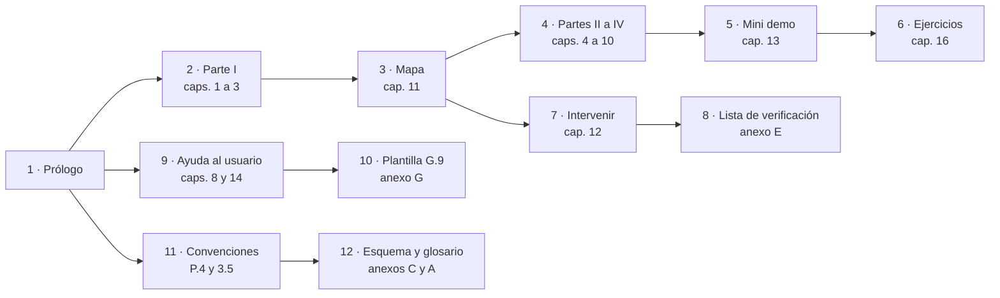

# DocsAsCode Developer Guide — Preliminares y prólogo

[← Anterior](DocsAsCode-Developer-Guide.md) · [Índice general](DocsAsCode-Developer-Guide.md#índice-general) · [Siguiente →](DocsAsCode-Developer-Guide-Parte-I.md)

## Preliminares

### Portada y colofón

*Forma: referencia.* Qué nombre tiene la obra, qué edición es, contra qué estado de sus fuentes vale y cómo se cita.

#### Portada

**DocsAsCode Developer Guide**

*Guía de estudio del sistema de documentación e integración (SDEI): diseñar, verificar y mantener la documentación de
un sistema de software tratada como código.*

El título lo fija el nombre del archivo que pidió la persona responsable del producto; el subtítulo repite el título
del cuerpo del que sale el libro ([README](README.md), l. 17). Tres nombres conviven en estas páginas y nombran cosas
distintas: **DocsAsCode** es el método; **SDEI** es este cuerpo; **sistema documentador** es lo que el método
construye. El anexo A registra los tres con su definición.

Edición `2.0.0-borrador.2`, del 2026-11-04, en Lab-Documentos. Es un borrador: sigue la versión del cuerpo y pasa a
vigente con él (P.6).

#### Colofón

Este libro es una edición de lectura: reúne y ordena los documentos del cuerpo SDEI, que siguen siendo la fuente.
Cada fila dice sobre qué estado de Lab-Documentos se editó, para que la distancia con las fuentes se pueda medir: la
regla de ancla de versión que el libro enseña, aplicada a sí mismo (P.5).

| Capítulos | Fuentes principales en el cuerpo | SHA de Lab-Documentos |
| --- | --- | --- |
| Preliminares y prólogo | `README.md`; `00-Marco.md` §5; `99-Anexos/Patrones-De-Ejemplos.md` §2 | `31660d3` |
| 1 a 3 (Parte I) | Definiciones de `TEM-01` a `TEM-07`; `00-Marco.md`; `01-Mapa.md` §5, §7; `99-Anexos/Referencias.md`, `Patrones-De-Ejemplos.md`, `Criterios-De-Calidad.md` | `31660d3` |
| 4 a 6 (Parte II) | `TEM-01-Sistema-Documentador.md`, `TEM-02-Ciclo-Documental.md`, `TEM-03-Topologia-Y-Versionado.md`; `01-Mapa.md` §4 | `31660d3` |
| 7 y 8 (Parte III) | `TEM-04-Doble-Audiencia.md`, `TEM-05-Ayuda-Al-Usuario-Final.md` | `31660d3` |
| 9 y 10 (Parte IV) | `TEM-06-Compuertas-Y-CI.md`, `TEM-07-Marco-SDD.md` | `31660d3` |
| 11 a 14 (Parte V) | `01-Mapa.md`; `Examples/Como-Intervenir.md`, `Examples/Como-Intervenir-Lab-Documentos.md`, `Examples/MovilidadUrbana-Mini-Demo/README.md`, `Examples/Prueba-Ayuda-Por-Rol/README.md`, `Examples/Lanzar-Example.md` | `31660d3` |
| 15 a 17 (Parte V) | `99-Anexos/Como-Decidir.md`, `99-Anexos/Ejercicios.md`; `README.md` §5–§6; `Conocimientos/knowledge-DocsAsCode-Designing-Specification.md` | `31660d3` |
| 18 (Parte VI) | Casos de `TEM-01`, `TEM-03`, `TEM-04`, `TEM-06` y `TEM-07`; `99-Anexos/Referencias.md` §4–§8 | `31660d3` |
| Anexos B a H | `99-Anexos/Referencias.md`, `Esquema-Frontmatter-Y-Prefijos.md`, `Criterios-De-Calidad.md`, `Lista-De-Verificacion.md`, `Patrones-De-Ejemplos.md`, `Ejercicios.md` §3; anexos de `TEM-01` a `TEM-07` | `31660d3` |
| Anexos A, I y J | `99-Anexos/Glosario.md`; este colofón; ensayos fechados de los temas y evidencia del expediente 0003 en Lab-Documentos.Documentacion | `31660d3` |

*Tabla 0.1. Capítulos, fuentes y estado de Lab-Documentos sobre el que se editaron, agrupados como se redactaron.
Rutas relativas a la carpeta del cuerpo; el anexo I baja la correspondencia a sección y línea.*

Para saber si una fuente cambió después de esta edición alcanza un comando, corrido desde la raíz de Lab-Documentos:

```text
git diff --stat <sha-del-colofón>..HEAD -- <fuentes>
```

[Fragmento ilustrativo: comando de la decisión P-01 del expediente 0003, con el SHA y las rutas de la fila] Una salida
vacía dice que el capítulo sigue al día; una con archivos, que la fuente se movió y el capítulo puede haber quedado
atrás. Manda la fuente (P.5).

#### Cómo citar este libro

La forma sigue APA 7 adaptada al castellano, la norma de citación del cuerpo
([Referencias](99-Anexos/Referencias.md#1-norma-de-citación); [APA, 2020](DocsAsCode-Developer-Guide-Anexos.md#ref-apa-2020)). Se cita por el commit de la
edición, nunca por la rama principal, como cualquier fuente en Git:

```text
Lab-Documentos. (2026). DocsAsCode Developer Guide: guía de estudio del sistema de documentación
e integración (ed. 2.0.0-borrador.2, commit 31660d3) [Guía de estudio]. GitHub.
```

[Fragmento ilustrativo: plantilla de la cita, con el año y el commit de esta edición; se agrega el enlace permanente al
archivo en ese commit] Tomar al repositorio como autor institucional es **[criterio propio]**: el campo `owner` del
cuerpo nombra al repositorio.

## Prólogo

### P. Cómo usar este libro

*Forma: referencia.* El prólogo no enseña el método; dice cómo está hecho el libro y por dónde entrar.
**Objetivos.** Al terminarlo podés elegir tu ruta de lectura, reconocer cada marca y cada cita del texto, y saber qué
hacer cuando el libro y su fuente no dicen lo mismo.

#### P.1 Qué es y a quién sirve

Un **sistema documentador** es el conjunto de piezas, fuentes de verdad, repositorios, anclas de versión, compuertas,
canales y actores (personas y agentes) que producen y mantienen la documentación de un sistema de software. Este
libro enseña a diseñarlo, a hacerlo funcionar dentro del ciclo de desarrollo y a intervenir en uno que ya existe, con
la documentación tratada como código (*docs as code*): Markdown versionado en Git, revisado por pull request y
verificado por la integración continua [Compilado: README.md, l. 38–42].

Tiene tres lectores, y desde esta edición un cuarto. Quien **estudia** el tema recorre los conceptos en orden y
termina con criterio para elegir piezas, repositorios y controles. La **persona del equipo** que tiene que tocar la
documentación de un proyecto concreto entra por su situación y sale con los pasos y la plantilla. Un **agente** de IA
que trabaja sobre un repositorio encuentra las convenciones, el contrato de frontmatter y los anexos de referencia
sin recorrer la prosa [Compilado: README.md, l. 44–47]. El cuarto **escribe la ayuda de un producto**, la única pieza
del cuerpo que lee la persona usuaria; por el Marco, la propone un agente y la decide una analista (`ACT-SDEI-4` y
`ACT-SDEI-2`, [Marco §4](00-Marco.md#4-actores)).

No es la documentación de un producto ni el manual de una herramienta. lychee, markdownlint, mermaid o DocFX aparecen
como medios de un control, no como tema [Compilado: README.md, l. 49–50].

#### P.2 Objetivos de aprendizaje

Los objetivos son los del cuerpo y son observables: cada uno se comprueba con un ejercicio del
[capítulo 16](DocsAsCode-Developer-Guide-Parte-V-b.md#16-ejercicios), cuyas claves están en el [anexo H](DocsAsCode-Developer-Guide-Anexos.md#h-claves-de-los-ejercicios).

| Id | Al terminar, podés… | Se comprueba con |
| --- | --- | --- |
| `OBJ-SDEI-01` | Ubicar un sistema en uno de los cuatro escenarios del marco y decir qué clases de pieza documental le corresponden | `EJR-SDEI-01` |
| `OBJ-SDEI-02` | Escribir el frontmatter de una página nueva (diez campos más `description`, [anexo C](DocsAsCode-Developer-Guide-Anexos.md#c-esquema-de-frontmatter-y-prefijos)) y anticipar qué control de la compuerta la rechazaría si le faltara un campo | `EJR-SDEI-02` |
| `OBJ-SDEI-03` | Elegir entre dos alternativas de diseño documental con la escala anclada, y decir si la decisión es firme | `EJR-SDEI-03` |
| `OBJ-SDEI-04` | Encontrar en el Mapa qué aplicar ante una situación concreta (un cambio de código que deja desactualizada una página) | `EJR-SDEI-04` |
| `OBJ-SDEI-05` | Redactar un requerimiento documental con criterio Dado/Cuando/Entonces y decir quién lo acepta | `EJR-SDEI-05` |

*Tabla P.1. Objetivos de aprendizaje [Compilado: README.md, l. 57–63].*

#### P.3 Rutas de lectura

El cuerpo se leía por tres rutas, todas desde su README ([README §3](README.md#3-rutas-de-lectura)). El libro las
conserva, las reapunta a sus capítulos y suma dos: leer de corrido y escribir la ayuda de un producto.



*Figura P.1. Rutas «aprender» (2 a 6), «intervenir» (3, 7, 8), «escribo la ayuda» (9, 10) y «agente» (11, 12).*

| Ruta | Para quién | Recorrido | Sale con |
| --- | --- | --- | --- |
| **Aprender** | Quien estudia el tema desde cero | Caps. [1](DocsAsCode-Developer-Guide-Parte-I.md#1-fundamentos-la-documentación-tratada-como-código) a [3](DocsAsCode-Developer-Guide-Parte-I.md#3-marco-de-referencia) → [cap. 11](DocsAsCode-Developer-Guide-Parte-V-a.md#11-estoy-acá-qué-aplico), leído entero como panorama → caps. 4 a 10 en orden → [cap. 13](DocsAsCode-Developer-Guide-Parte-V-a.md#13-caso-de-estudio-la-mini-demo-movilidadurbana) → [cap. 16](DocsAsCode-Developer-Guide-Parte-V-b.md#16-ejercicios) | `OBJ-SDEI-01` a `OBJ-SDEI-05` |
| **Intervenir** | La persona del equipo que tiene que cambiar la documentación de un proyecto; quien recién llega hace su primer cambio por acá y vuelve a los temas cuando necesita el porqué | [Cap. 11](DocsAsCode-Developer-Guide-Parte-V-a.md#11-estoy-acá-qué-aplico), fila de su escenario → [cap. 12](DocsAsCode-Developer-Guide-Parte-V-a.md#12-cómo-intervenir-el-proceso-en-cinco-pasos) y la instancia de su proyecto (anexo G) → [anexo E](DocsAsCode-Developer-Guide-Anexos.md#e-lista-de-verificación); para ver cómo se verifica una página en la CI, [cap. 9](DocsAsCode-Developer-Guide-Parte-IV.md#9-compuertas-de-calidad-y-ci) | Un pull request que la compuerta acepta |
| **Agente** | Un agente de IA que trabaja sobre el repositorio | `AGENTS.md` en la raíz del repositorio → este prólogo, [P.4](#p4-convenciones) → [3.5](DocsAsCode-Developer-Guide-Parte-I.md#35-convenciones) → [anexo C](DocsAsCode-Developer-Guide-Anexos.md#c-esquema-de-frontmatter-y-prefijos) → [anexo A](DocsAsCode-Developer-Guide.md#a-glosario-índice) | Las reglas para producir una página que pasa la compuerta |
| **Escribo la ayuda de un producto** | Quien redacta o propone ayuda dentro del producto | [Cap. 8](DocsAsCode-Developer-Guide-Parte-III.md#8-ayuda-al-usuario-final) → [cap. 14](DocsAsCode-Developer-Guide-Parte-V-a.md#14-caso-de-estudio-ayuda-por-rol) → [anexo C](DocsAsCode-Developer-Guide-Anexos.md#c-esquema-de-frontmatter-y-prefijos) → G.9 en el [anexo G](DocsAsCode-Developer-Guide-Anexos.md#g-plantillas), en la variante que corresponda | Una página de ayuda trazada a su regla |
| **De corrido** | Quien lee el libro como obra | Prólogo, partes I a VI en orden; los anexos, como consulta | El método completo, en el orden en que se construye |

*Tabla P.2. Rutas de lectura: las tres primeras, de [README](README.md), l. 94–96; las otras dos, de la decisión P-03.*

Cada capítulo abre con una línea que dice su forma según Diátaxis, que separa cuatro necesidades del lector con
cuatro formas de documento ([Procida, s. f.](DocsAsCode-Developer-Guide-Anexos.md#ref-procida-sf)): tutorial (13 y 16), guía práctica (12, 14 y 17),
referencia (preliminares, prólogo, 3, 11 y los anexos) y explicación (1, 2, 4 a 10, 15 y 18). El rótulo orienta la
lectura; no clasifica el contenido como norma.

#### P.4 Convenciones

Las convenciones son las del cuerpo ([Marco §5](00-Marco.md#5-convenciones)) y las explica la
[sección 3.5](DocsAsCode-Developer-Guide-Parte-I.md#35-convenciones); acá van las que necesitás para leer el libro.

| Qué ves | Qué significa | Fuente |
| --- | --- | --- |
| `[Autor, año]` enlazado a un ancla `ref-…` | Cita bibliográfica en APA 7 con fecha de consulta; lleva a su entrada del [anexo B](DocsAsCode-Developer-Guide-Anexos.md#b-referencias) | [Marco](00-Marco.md), l. 172 |
| `[Compilado: ruta, l. x–y]` | El fragmento o la frase sale de ese archivo del repositorio, en esas líneas; la ruta es relativa a la carpeta del cuerpo | [Patrones](99-Anexos/Patrones-De-Ejemplos.md#2-marcas-de-procedencia), l. 51 |
| `[Salida registrada: corrida del AAAA-MM-DD; recorte]` | Salida de un comando que se corrió, con fecha y lo que se omitió | [Patrones](99-Anexos/Patrones-De-Ejemplos.md#2-marcas-de-procedencia), l. 54 |
| `[Fragmento ilustrativo: motivo]` | Muestra una forma y no corre tal cual; con «contraejemplo», muestra lo que no conviene | [Patrones](99-Anexos/Patrones-De-Ejemplos.md#2-marcas-de-procedencia), l. 52–53 |
| **[criterio propio]** | Lo que no sale de una fuente, separado de los hechos | [Marco](00-Marco.md), l. 173 |
| **NO VERIFICADO**, **HISTÓRICO (fecha)**, **ESPECULACIÓN** | Marcas de estado: un dato sin comprobar, un hecho que valió en esa fecha, una conjetura. Todas están listadas en el [anexo J](DocsAsCode-Developer-Guide-Anexos.md#j-marcas-de-estado-y-ensayos-fechados) con su sección | Expediente 0003, plan del libro |
| `` #### 3.2.1 Título (`ESC-SDEI-1`) `` | En un encabezado, el número va primero y el identificador entre paréntesis: el que declara el ID es el documento fuente, no el libro | Expediente 0003, plan del libro |
| *Figura c.n.* y *Tabla c.n.* | Numeración por capítulo; el pie de figura dice qué mirar | [Marco](00-Marco.md), l. 174; expediente 0003, P-03 |
| `{servicio-privado}`, `{etiqueta-runner}` | Alias de lo privado: el servicio de repositorio privado y la etiqueta de los runners; no se escriben rutas del equipo, direcciones IP, hosts ni usuarios | [Marco](00-Marco.md), l. 177; expediente 0003, P-11 |

*Tabla P.3. Convenciones de lectura.*

La lengua sigue una jerarquía de tres niveles: primero las convenciones del cuerpo, voseo incluido; después, para la
lengua, la *Ortografía de la lengua española* ([RAE y ASALE, 2010](DocsAsCode-Developer-Guide-Anexos.md#ref-rae-asale-2010)) y el *Diccionario
panhispánico de dudas* ([RAE y ASALE, 2005](DocsAsCode-Developer-Guide-Anexos.md#ref-rae-asale-2005)); por último, la *Spanish (Neutral) Style Guide*
([Microsoft, 2021](DocsAsCode-Developer-Guide-Anexos.md#ref-microsoft-spanish-neutral-2021)), tomada por la lengua y no por su alcance. Si chocan, manda
el primer nivel [Compilado: 00-Marco.md, l. 189]. El choque más frecuente es el tratamiento: esa guía usa «tú» o
«usted», y el cuerpo usa «vos».

#### P.5 Relación con el cuerpo

El cuerpo va de lo general a lo particular: el Marco fija una sola vez el vocabulario, el Mapa lo cruza con las
situaciones del lector, cada tema sigue seis secciones más «Fuentes y observaciones», y los anexos guardan el
material de consulta [Compilado: README.md, l. 135–140]. El libro respeta ese orden y lo vuelve lectura continua.
No lo reemplaza.

La relación tiene tres reglas, que decidió el expediente 0003 (decisión P-01, con condición de revisión):

1. **Manda la fuente.** Si el libro y un documento del cuerpo dicen cosas distintas, vale el documento. El libro
   no reformula reglas ni umbrales: los cita con su identificador y enlaza a la fuente.
2. **Co-cambio.** Una corrección de fondo hecha en el libro se aplica también en la fuente, en el mismo pull request.
3. **SHA por capítulo.** El colofón dice sobre qué estado de Lab-Documentos se editó cada capítulo; el pull request
   que toca libro o fuentes prueba la distancia con el comando del colofón.

Ante una diferencia, corregí la fuente y llevá el cambio al capítulo en el mismo pull request; el
[capítulo 17](DocsAsCode-Developer-Guide-Parte-V-b.md#171-precedencia-y-co-cambio) muestra el procedimiento.

#### P.6 Versión, estado y origen

La versión del cuerpo sigue SemVer y vive en su README. Es la 2 porque el cuerpo reemplazó a la guía de un solo
archivo, primera forma del mismo contenido **[criterio propio del plan de implementación]** [Compilado: README.md,
l. 160–161]. Esta edición lleva la versión `2.0.0-borrador.2`, la misma que declara el cuerpo; la guía de un
solo archivo se archiva en el mismo pull request, con la etiqueta anotada `sdei-v2.0.0-borrador` (expediente 0003,
decisión P-08).

| Si ves… | Significa | Qué hacer |
| --- | --- | --- |
| `status: borrador` | El texto puede cambiar sin aviso | Usarlo, pero no citarlo como norma |
| `status: vigente` | Una persona lo revisó y lo aprobó | Citarlo por `corpus_id/doc_id` |
| `status: obsoleto` | Lo reemplaza otro documento | Ir al reemplazo que indica |

*Tabla P.4. Estados de un documento [Compilado: README.md, l. 167–171].*

Pasar a vigente es un acto de una persona. Cuando están los siete temas y la revisión del escalón da su visto bueno,
alguien pasa cada documento a `vigente` en un pull request propio; después la persona responsable del producto fija
la versión en `2.0.0` y la marca con una etiqueta anotada [Compilado: README.md, l. 162–165].

El diseño del cuerpo sale del expediente 0002 de DocAsCode, en el repositorio hermano Lab-Documentos.Documentacion:
decisiones D27 (cuerpo documental y rutas), D28 (citación APA 7 con fecha de consulta), D09 (contrato de frontmatter y
prefijos) y D29 (objetivos y ejercicios como anexo) [Compilado: README.md, l. 175–178]. El libro responde al pedido
que abrió el expediente 0003, en el mismo repositorio: reunir los documentos en uno, revisarlo como un libro y
abrirlo con los fundamentos del método.

#### Preguntas guía del prólogo

1. ¿Cuál de las cinco rutas es la tuya, y en qué capítulo termina?
2. Entre una frase con `[Compilado: …]` y otra con **[criterio propio]**, ¿cuál verificás en el repositorio, y cómo?
3. El capítulo que leés dice un umbral distinto del de su tema fuente: ¿cuál vale y qué hacés con la diferencia?

#### Resumen del prólogo

El libro es una edición de lectura del cuerpo SDEI: reúne, ordena y cita, y la fuente manda. El colofón ancla cada
capítulo a un estado de Lab-Documentos y un `git diff --stat` dice si quedó atrás. Cinco rutas reparten la entrada;
las marcas de la tabla P.3 dicen de dónde sale cada afirmación.

[← Anterior](DocsAsCode-Developer-Guide.md) · [Índice general](DocsAsCode-Developer-Guide.md#índice-general) · [Siguiente →](DocsAsCode-Developer-Guide-Parte-I.md)
