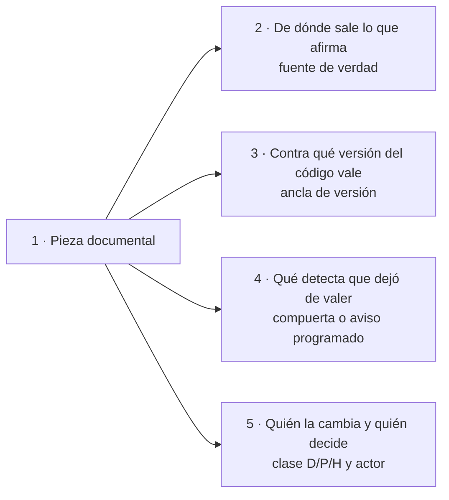
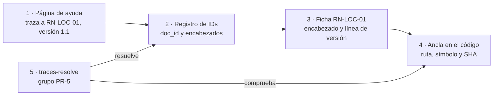
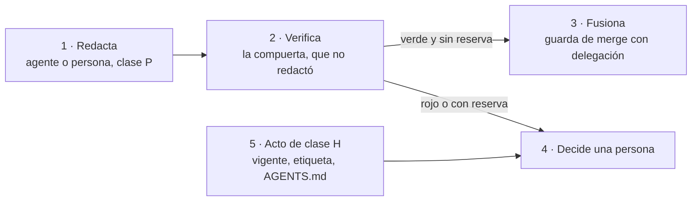
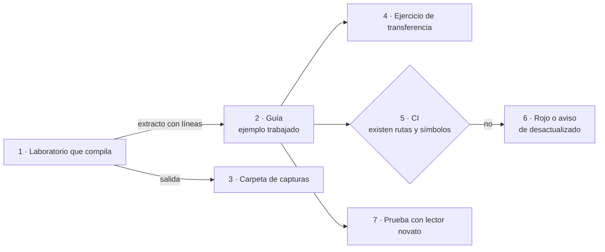
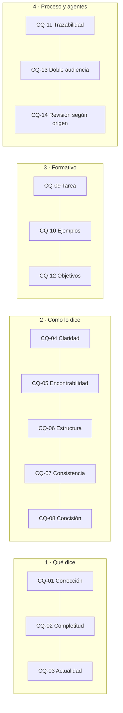
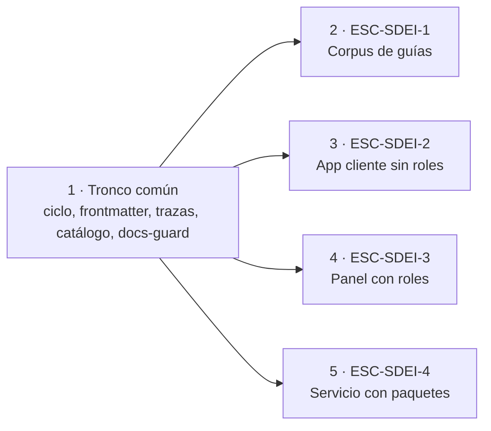
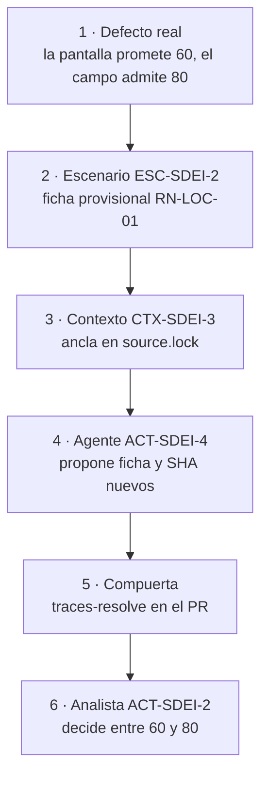

# DocsAsCode Developer Guide — Parte I. Fundamentos

[← Anterior](DocsAsCode-Developer-Guide-Parte-0.md) · [Índice general](DocsAsCode-Developer-Guide.md#índice-general) · [Siguiente →](DocsAsCode-Developer-Guide-Parte-II.md)

## Parte I. Fundamentos

Esta parte reúne lo que el resto del libro da por sabido. El capítulo 1 explica de qué está hecho un sistema
documentador y por qué se lo trata como código; el capítulo 2, cómo se escribe una guía que enseñe y cómo se prueba lo
que afirma; el capítulo 3 fija el vocabulario estable (escenarios, contextos, actores y convenciones) que reaparece
en los dieciocho capítulos y en los anexos. Quien ya conoce *docs as code* puede saltar al capítulo 3, que es
referencia y se consulta; los capítulos 1 y 2 son explicación y se leen de corrido. Los capítulos de las partes II
a VI citan el marco del capítulo 3 por identificador y no vuelven a definir sus términos.

### 1. Fundamentos: la documentación tratada como código

*Forma: explicación.* **Requisitos previos:** ninguno; conviene saber qué es un pull request.

**Objetivos.** Al terminar este capítulo podés:

1. Explicar por qué la documentación de software envejece y qué cuatro preguntas responde un sistema documentador
   para cada pieza.
2. Definir *docs as code* y señalar cómo materializa este cuerpo cada uno de sus componentes.
3. Distinguir fuente de verdad, ancla de versión y traza, y decir qué control verifica cada una.
4. Separar deriva, atraso y divergencia, con el instrumento que mide cada una y quién decide.
5. Clasificar un acto de cambio como D, P o H y decir quién lo cierra.
6. Explicar por qué el texto que lee un agente se controla como superficie de ataque.

#### 1.1 El problema

La documentación de software falla de maneras conocidas y medidas. Un estudio que analizó 878 artefactos de cuatro
fuentes (listas de correo, Stack Overflow, gestores de incidencias y pull requests) armó una taxonomía de esos
problemas ([Aghajani et al., 2019](DocsAsCode-Developer-Guide-Anexos.md#ref-aghajani-2019)). Una encuesta posterior a 146 profesionales ubicó entre los que
más pesan el contenido insuficiente o inadecuado y la información obsoleta o ambigua
([Aghajani et al., 2020](DocsAsCode-Developer-Guide-Anexos.md#ref-aghajani-2020)). Y en más de 3000 proyectos de GitHub, la mayoría tuvo en algún momento
de su historia al menos una referencia en la documentación a un elemento de código que ya no existía
([Tan et al., 2024](DocsAsCode-Developer-Guide-Anexos.md#ref-tan-2024)). [Compilado: TEM-01-Sistema-Documentador.md, l. 64–70]

Ninguna de esas fallas se arregla escribiendo mejor una página. Una página bien escrita el lunes miente el jueves si
el código cambió y nadie lo notó. Lo que la arregla es un sistema que sepa de dónde sale cada afirmación, que lo
compruebe en cada cambio y que diga quién decide cuando la página y el código discrepan
[Compilado: TEM-01-Sistema-Documentador.md, l. 70–72]. Sin ese sistema, la documentación se escribe cuando alguien se
acuerda y se revisa cuando alguien se queja [Compilado: TEM-02-Ciclo-Documental.md, l. 82]. La experiencia de Google
apunta en la misma dirección: la documentación que no tiene dueño se vuelve obsoleta
([Winters et al., 2020](DocsAsCode-Developer-Guide-Anexos.md#ref-winters-2020)).

A ese sistema este libro lo llama **sistema documentador**: el conjunto de piezas documentales, fuentes de verdad,
repositorios, anclas de versión, compuertas, canales y actores (personas y agentes de IA) que producen y mantienen la
documentación de un sistema. La documentación es lo que se lee; el sistema documentador es lo que hace que lo que se
lee sea correcto, esté al día y llegue a quien lo necesita [Compilado: TEM-01-Sistema-Documentador.md, l. 38–41]. El
método con que se lo construye es *docs as code* (§1.2), y el cuerpo de guías del que sale este libro, `SDEI`, es una
aplicación de ese método a sí mismo [Compilado: README.md, l. 38–42].

Para cada pieza, un sistema documentador responde cuatro preguntas
[Compilado: TEM-01-Sistema-Documentador.md, l. 74–80]:

*Figura 1.1. Las cuatro preguntas que el sistema documentador responde para cada pieza. Las secciones 1.3, 1.6 y 1.7
desarrollan una o dos cada una.*

#### 1.2 Docs as code: definición y componentes

Write the Docs, la comunidad de referencia de quienes escriben documentación técnica, define *docs as code* (en
castellano, **documentación como código**) como escribir la documentación con las mismas herramientas que el código, y
enumera sus componentes: gestor de incidencias, control de versiones con Git, marcado en texto plano, revisión de
código y pruebas automatizadas ([Write the Docs, s. f.](DocsAsCode-Developer-Guide-Anexos.md#ref-writethedocs-sf)). El libro de ingeniería de software de
Google llega a lo mismo desde la práctica: la documentación está tan acoplada al código que conviene tratarla como
código, necesita dueño y, idealmente, vive bajo control de versiones junto al código que documenta
([Winters et al., 2020](DocsAsCode-Developer-Guide-Anexos.md#ref-winters-2020)). [Compilado: TEM-01-Sistema-Documentador.md, l. 43–50]

GitLab, que documenta su producto en el mismo repositorio que el código, lleva la idea al proceso: pide la revisión del
código, la de la persona redactora técnica y la de quien mantiene el proyecto antes del merge, y alienta que la
documentación vaya en el mismo merge request que el código que describe ([GitLab, s. f.](DocsAsCode-Developer-Guide-Anexos.md#ref-gitlab-sf))
[Compilado: TEM-02-Ciclo-Documental.md, l. 93–96]. Write the Docs agrega una consecuencia que en este libro es
central: con pruebas automáticas se puede bloquear el merge de una función que no trae su documentación
[Compilado: TEM-06-Compuertas-Y-CI.md, l. 51–53].

La definición operativa que usa el libro, y que el anexo A recoge, es esta: escribir la documentación en texto plano,
versionarla en Git, revisarla por pull request y verificarla en la integración continua (CI), con las mismas
herramientas que el código [Compilado: 99-Anexos/Glosario.md, l. 69].

*Tabla 1.1. Los componentes de* docs as code *y la forma que toman en este cuerpo.*

| Componente | Qué aporta | Cómo lo materializa este cuerpo | Dónde se desarrolla |
| --- | --- | --- | --- |
| Marcado en texto plano | Un formato que se compara línea por línea y que leen personas y programas | Markdown con frontmatter de diez campos más `description` | Anexo C |
| Control de versiones | Historia, autoría y un estado del texto por cada estado del código | Git; el commit, un SHA fijado o una etiqueta como ancla de versión | Capítulo 6 |
| Revisión de código | Una segunda mirada antes de que el cambio entre | Pull request; la guarda de merge cuando hay delegación asentada | Capítulos 5 y 15 |
| Pruebas automatizadas | Un juicio repetible en cada cambio | La compuerta `docs-guard`, grupos PR-1 a PR-7 más `autoprueba` | Capítulo 9 |
| Gestor de incidencias | Un lugar donde queda lo que se detectó y nadie arregló todavía | El issue que abre o actualiza el carril programado | Capítulo 9 |

[Compilado: 00-Marco.md, l. 45, 52, 178; TEM-03-Topologia-Y-Versionado.md, l. 55–62; TEM-06-Compuertas-Y-CI.md, l. 44]

Una carpeta `docs/` en el repositorio no alcanza para hablar de *docs as code*: sin fuente declarada, sin ancla y sin
control es documentación sin sistema [Compilado: TEM-01-Sistema-Documentador.md, l. 138–139].

#### 1.3 Fuente de verdad, traza y ancla de versión

Estas ideas responden las dos primeras preguntas de la figura 1.1, y se definen con precisión porque las verifica un
control.

##### 1.3.1 Pieza documental y fuente de verdad

Una **pieza documental** es una unidad que se escribe, se versiona y se valida por separado: una página de ayuda, un
`AGENTS.md`, el `openapi.json`, un caso de uso [Compilado: TEM-01-Sistema-Documentador.md, l. 56;
99-Anexos/Glosario.md, l. 91]. Cada pieza pertenece a una **clase de pieza** (`CL-nn`), una categoría de un catálogo
cerrado de catorce que fija dónde vive la pieza, contra qué se ancla, qué control la revisa y quién interviene. Una
pieza nueva se clasifica en una de esas clases; si no encaja en ninguna, se abre una clase nueva por expediente, no se
improvisa [Compilado: 00-Marco.md, l. 40; 01-Mapa.md, l. 77–78]. El catálogo completo está en el capítulo 4.

La **fuente de verdad** es el lugar del que sale lo que una pieza afirma. Si la pieza y la fuente discrepan, manda la
fuente [Compilado: TEM-01-Sistema-Documentador.md, l. 57]. Para la referencia de una API, la fuente es el código que
la emite; para la ayuda que menciona una regla de negocio, es la ficha de esa regla. La regla obliga a declarar,
pieza por pieza, cuál es la fuente.

##### 1.3.2 Ancla de versión

El **ancla de versión** es el dato que dice contra qué estado del código vale una pieza: el commit, un SHA fijado
entre repositorios o una etiqueta [Compilado: 00-Marco.md, l. 42]. Una guía de estudio como esta suma una cuarta
forma, la versión del cuerpo en su README, en SemVer, con una etiqueta anotada por versión
[Compilado: TEM-03-Topologia-Y-Versionado.md, l. 62].

Qué ancla corresponde depende de dónde vive la pieza. Si vive en el mismo repositorio que el código, el commit que la
contiene es el ancla y el mismo pull request cambia las dos cosas. Si vive en otro repositorio, el SHA fijado es
obligatorio, porque es lo único que no se mueve; la etiqueta se agrega cuando existe una que contiene exactamente el
código documentado, para que una persona sepa qué versión es sin buscar el SHA
[Compilado: TEM-03-Topologia-Y-Versionado.md, l. 59–60, 72–75]. Las versiones con nombre siguen SemVer: mayor, menor
y parche, y la mayor sube con un cambio que rompe a quien depende de la versión anterior
([Preston-Werner, s. f.](DocsAsCode-Developer-Guide-Anexos.md#ref-prestonwerner-sf)). El historial legible de cada versión va en un CHANGELOG, escrito
para personas, con la versión más reciente arriba y su fecha ([Lacan, s. f.](DocsAsCode-Developer-Guide-Anexos.md#ref-lacan-sf))
[Compilado: TEM-03-Topologia-Y-Versionado.md, l. 77–81]. El capítulo 6 trata dónde se escribe cada ancla para que la
compuerta la lea.

##### 1.3.3 Traza y registro de identificadores

Una **traza** es la declaración, en el frontmatter, de que un documento depende de otro identificador: si el
identificador cambia de versión o desaparece, el documento hay que revisarlo. Tiene dos formas, `traces: [ID]` y
`traces: [ID@MAYOR.MENOR]` [Compilado: 00-Marco.md, l. 48]. La traza apunta al identificador, nunca a la ruta del
archivo [Compilado: 00-Marco.md, l. 179]: una ruta cambia cuando alguien reordena carpetas; el identificador, no **[criterio propio]**.

La compuerta resuelve cada traza contra un **registro de identificadores** que arma sola, sin que nadie lo mantenga a
mano: lo forman los `doc_id` de todo el repositorio y los encabezados que empiezan con un identificador, con una línea
`**Versión:** 1.1` debajo cuando el identificador tiene versión [Compilado: 99-Anexos/Esquema-Frontmatter-Y-Prefijos.md,
l. 89–92; 00-Marco.md, l. 48]. De ahí salen tres consecuencias que el resto del libro usa sin repetir:

- **Con versión, la traza detecta el cambio.** Si la ficha sube de 1.0 a 1.1, la página que traza a `@1.0` da rojo.
  Una traza sin versión sólo comprueba que el identificador existe, y la subida no la pone en rojo; por eso traza con
  `@MAYOR.MENOR` toda página que repite lo que dice una regla [Compilado: 00-Marco.md, l. 48].
- **Un identificador se declara una sola vez.** El registro es uno para todo el repositorio, y una traza a un
  identificador declarado dos veces es ambigua y da rojo. Por eso los identificadores de este cuerpo llevan su
  `corpus_id` (`TEM-SDEI-03`, no `TEM-03`): otras guías del mismo repositorio ya chocaron en el registro
  [Compilado: TEM-03-Topologia-Y-Versionado.md, l. 89–91]. Por la misma razón, este libro nunca abre un encabezado con
  un identificador que el cuerpo ya declara: el número de sección va primero y el identificador, entre paréntesis.
- **La traza tiene un segundo nivel en el código.** La ficha de una regla dice dónde se declara, se verifica y se
  aplica, con la forma `ruta#Símbolo@SHA` (archivo, `Clase.Miembro` y commit)
  [Compilado: 99-Anexos/Esquema-Frontmatter-Y-Prefijos.md, l. 84–87].

*Figura 1.2. La cadena de una traza, del texto que lee la persona al símbolo del código. La compuerta comprueba los
dos tramos: que el identificador exista una sola vez con la versión pedida y que el ancla de la ficha se cumpla en el
SHA fijado.*

El capítulo 9 explica cómo decide `traces-resolve` cada caso, y el anexo C trae la tabla de prefijos.

##### 1.3.4 Deriva, atraso y divergencia

Tres palabras que en la conversación se usan como sinónimos nombran en este libro cosas distintas, cada una con su
instrumento. Mezclarlas lleva a buscar en el control equivocado.

*Tabla 1.2. Las separaciones de vocabulario y el instrumento de cada una.*

| Término | Qué nombra | Instrumento | Bloquea o avisa |
| --- | --- | --- | --- |
| Letra | Lo que la app promete a quien la usa, textual: el texto de ayuda bajo el campo y los mensajes | Lectura de la pantalla; la ficha la registra | — |
| Intención | Para qué existe la regla, lo que el producto debía hacer, y qué la respalda en el código | La ficha de la regla | — |
| Comportamiento | Lo que el código hace | Las anclas `ruta#Símbolo@SHA` de la ficha | — |
| Divergencia | Diferencia entre letra, intención y comportamiento. **Leve** si no cambia qué se acepta, qué se rechaza ni qué se guarda; **de fondo** si cambia alguna de esas tres cosas, como el 60/80 de la mini demo | Ninguno la decide: la decide una persona (`ACT-SDEI-2`), acto de clase H | — |
| Deriva | Distancia entre lo que una pieza afirma y lo que el código hace | `traces-resolve`, verde o rojo por traza | Bloquea en el carril PR |
| Atraso | Commits que el SHA fijado (`base_commit`, `sha` de `source.lock`) está detrás de la rama principal del repositorio que fija; un entero mayor o igual a 0 | Control 3 (`atraso`) del carril programado | Avisa |
| Deriva de copia fijada | Copia fijada cuya huella SHA-256 ya no coincide con la declarada | Control 4 del carril programado; el nombre es un alias hasta que se renombre el control | Avisa |

[Compilado: 99-Anexos/Glosario.md, l. 47, 56, 64–65, 67, 82, 85; ../../../tools/docs-guard/semanal.sh, l. 14–15]

El atraso y la deriva se confunden porque suelen aparecer juntos: el código avanzó y la página quedó atrás. Pero un
SHA fijado puede estar cien commits atrás sin que ninguna afirmación de la página haya dejado de valer, y una página
del mismo repositorio, sin atraso posible, puede afirmar algo que el código ya no hace. Para las piezas que viven en
otro repositorio que el código, el aviso programado cuenta el atraso, y la deriva por símbolo (que el método que cita
la ficha haya cambiado) la mide un control de la mini demo, A1, cuando la demo corre. A1 todavía no está programado:
es una deuda declarada, que se cierra con el pull request que lo programe o con el folio que decida no hacerlo
[Compilado: 00-Marco.md, l. 200–204]. El capítulo 13 muestra ese control en funcionamiento.

#### 1.4 Tipos de documentación y lectores

No toda la documentación cumple la misma función, y mezclar funciones en una página la vuelve difícil para todos.
Diátaxis separa cuatro necesidades del lector y cuatro formas que les responden: el tutorial, para aprender
haciendo; la guía práctica, para resolver una tarea concreta; la referencia, para consultar un dato exacto; y la
explicación, para entender por qué ([Procida, s. f.](DocsAsCode-Developer-Guide-Anexos.md#ref-procida-sf)). El cuerpo recoge la misma separación en el
patrón `PE-07`: entre páginas, separar tutorial, guía, referencia y explicación; dentro de la página, rotular los
bloques por tipo [Compilado: 99-Anexos/Patrones-De-Ejemplos.md, l. 38]. Este libro lo aplica a escala de capítulo:
cada uno declara su forma en la apertura.

*Tabla 1.3. Las cuatro formas de Diátaxis y dónde aparecen en este libro.*

| Forma | El lector quiere… | Ejemplo en este libro |
| --- | --- | --- |
| Tutorial | Aprender haciendo, con un resultado garantizado | Capítulo 13, la mini demo MovilidadUrbana; capítulo 16, ejercicios |
| Guía práctica | Resolver una tarea que ya sabe que tiene | Capítulo 12, cómo intervenir; capítulo 14, levantar la prueba de ayuda por rol |
| Referencia | Consultar un dato exacto sin leer prosa | Capítulo 3, marco de referencia; capítulo 11, mapa; anexos A a J |
| Explicación | Entender por qué las cosas son así | Capítulos 1 y 2; capítulos 4 a 10, uno por tema |

La norma ISO/IEC/IEEE 26514:2022 mira el mismo problema desde el proceso: trata la información para usuarios como un
producto con su propio desarrollo, que empieza por establecer qué información se necesita, decide cómo presentarla y
recién después la prepara; y aclara que el diseño sigue a lo largo de todo el ciclo de vida
([ISO/IEC/IEEE, 2022](DocsAsCode-Developer-Guide-Anexos.md#ref-iso-26514-2022)) [Compilado: TEM-02-Ciclo-Documental.md, l. 85–88;
TEM-05-Ayuda-Al-Usuario-Final.md, l. 37–40]. El registro de requerimientos documentales del capítulo 5 es la forma
escrita de ese primer paso. La norma se cita por su página oficial de alcance; su texto completo no se consultó
[Compilado: TEM-02-Ciclo-Documental.md, l. 348].

Qué documentos existen en un proyecto de software y para qué sirve cada uno es tema de otra guía del mismo
repositorio, [Documentación técnica](../Creacion-Guias-Tecnicas/README.md), que los ordena en siete familias, de la
visión a la documentación para usuarios [Compilado: ../Creacion-Guias-Tecnicas/README.md, l. 20, 57–128]. Este libro
no las redefine. Le agrega a esa guía la dimensión que no trata: qué maquinaria mantiene cada documento correcto.

Del lado de los lectores, el cuerpo distingue tres. La **persona que estudia** recorre los conceptos en orden y
termina con criterio para elegir piezas, repositorios y controles. La **persona del equipo** que tiene que tocar la
documentación de un proyecto concreto entra por su situación y sale con los pasos y la plantilla. Un **agente** de IA
que trabaja sobre un repositorio busca las convenciones, el contrato de frontmatter y los anexos sin recorrer la
prosa [Compilado: README.md, l. 44–47]. El tercero merece una sección aparte.

#### 1.5 Audiencias, entrega y canales

A quién se le escribe, quién puede recibirlo y quién lee son tres preguntas distintas. La **audiencia** orienta qué se
escribe y no da ni quita acceso; la **regla de entrega** decide quién recibe la pieza y es la que protege; el **lector**,
persona o agente, es una dimensión de canal, y el agente hereda la audiencia y el alcance de su usuario, sin acceso propio
[Compilado: 99-Anexos/Glosario.md, l. 48, 96, 84]. El capítulo 7 desarrolla las tres.

Una página tiene hoy dos lectores, una persona en el navegador y un agente que trabaja sobre el repositorio o le
responde a alguien, y una sola fuente sirve a los dos sin mantener dos textos. La persona necesita prosa ordenada,
diagramas que se vean y ejemplos con contexto; el agente, metadatos que se lean sin interpretar la prosa,
identificadores estables y un índice [Compilado: TEM-04-Doble-Audiencia.md, l. 40–43].

La alternativa es conocida: la guía para personas y, aparte, un resumen para agentes escrito a mano, que envejece por
su cuenta. Los modelos de lenguaje responden mejor cuando reciben la documentación de la API que van a usar
([Chen et al., 2025](DocsAsCode-Developer-Guide-Anexos.md#ref-chen-2025)) y fallan cuando lo que saben de una biblioteca quedó atrás de su versión
([Wang et al., 2025](DocsAsCode-Developer-Guide-Anexos.md#ref-wang-2025)) [Compilado: TEM-04-Doble-Audiencia.md, l. 56–60].

Servir a los dos lectores no quiere decir escribir para el agente. La prosa sigue siendo para personas; lo que se agrega es
estructura: frontmatter, identificadores y diagramas como código [Compilado: TEM-04-Doble-Audiencia.md, l. 64–65]. El
criterio de calidad `CQ-13` lo pregunta en esos términos (frontmatter válido, IDs estables, diagramas como código y
fragmentos con procedencia), y la compuerta lo verifica con el esquema de frontmatter (PR-2) y el mermaid que parsea
(PR-4) [Compilado: 99-Anexos/Criterios-De-Calidad.md, l. 43, 76]. Hay una evidencia
reciente sobre el otro extremo, el archivo que habla al agente a propósito: un estudio de 2303 archivos de contexto
de agentes, en 1925 repositorios públicos, encontró que priorizan las pruebas, la implementación y la arquitectura,
que rara vez cubren la seguridad y que evolucionan como código de configuración
([Chatlatanagulchai et al., 2025](DocsAsCode-Developer-Guide-Anexos.md#ref-chatlatanagulchai-2025)) [Compilado: TEM-04-Doble-Audiencia.md, l. 124–128].
En este cuerpo ese archivo es un `AGENTS.md` que sólo apunta a la fuente y que decide una persona. El capítulo 7
desarrolla los canales para cada lector.

#### 1.6 Quién decide: clases D/P/H

La cuarta pregunta de la figura 1.1 se responde con una clasificación que no mira a la persona sino al **acto** de
producir o cambiar una pieza:

- **D**: lo hace un generador determinista. El contrato REST que emite el build es D.
- **P**: lo propone un agente o una persona, y entra si la compuerta da verde. La ayuda al usuario final es P.
- **H**: sólo lo decide una persona. Aceptar una decisión de arquitectura, pasar un documento a `vigente`, etiquetar
  o publicar son H.

[Compilado: 00-Marco.md, l. 41, 160; TEM-01-Sistema-Documentador.md, l. 60]

Una pieza puede tener dos actos: una decisión de arquitectura la redacta un agente (P) y la acepta una persona (H).
Nadie elige la clase de intervención caso por caso: la fija el catálogo para cada clase de pieza, y se conoce cuando
la pieza recibe su clase. Un cambio que toca una pieza de clase H, como un `AGENTS.md`, lo fusiona una persona
[Compilado: TEM-01-Sistema-Documentador.md, l. 60; TEM-02-Ciclo-Documental.md, l. 64–68]. Las clases de intervención
no son las clases de pieza: la clase de pieza dice qué es la pieza; la de intervención, quién la puede cambiar.

«H» quiere decir «la decide una persona», no siempre la responsable del producto. Una divergencia entre lo que la
especificación dice y lo que se quiso decir la decide la analista, no el PO [Compilado: 00-Marco.md, l. 167–168]. Y
una regla atraviesa a todos los actores: **quien verifica no es quien redactó**, y una segunda identidad de la misma
persona no aprueba a la primera [Compilado: 00-Marco.md, l. 168–170]. Que un agente fusione su propio pull request no
contradice la regla siempre que se den dos condiciones: quien verifica son los controles de la compuerta, que el
agente no escribió en ese pull request, y una persona dejó asentada por escrito la delegación del merge
[Compilado: 00-Marco.md, l. 52, 171–172]. La comprobación que hace el agente antes de fusionar se llama **guarda de
merge**: abierto, sin conflictos, con todos los controles en verde y sin una duda declarada; con una duda (una
**reserva**), el merge vuelve a la persona [Compilado: 00-Marco.md, l. 52].

*Figura 1.3. Proponer, verificar y decidir quedan en manos distintas. Lo de clase H nunca pasa por la guarda: llega
siempre a una persona.*

El capítulo 15 trae la tabla completa de quién decide, que agrega un caso más: lo irreversible con consecuencia fuera
del repositorio se eleva a la persona responsable del producto con alternativas y una opción por defecto
[Compilado: 99-Anexos/Como-Decidir.md, l. 141–147].

#### 1.7 Verificar en vez de confiar

La tercera pregunta de la figura 1.1 la responde la compuerta. El libro usa tres términos con significado fijo:

- Un **control** es una comprobación que corre en la CI y termina en verde o en rojo; uno solo. Bloquea (rojo) o sólo
  avisa según la regla de bloqueo [Compilado: 00-Marco.md, l. 44].
- La **compuerta** es el carril PR: el conjunto de controles que corre en cada pull request. La de este cuerpo la
  corre el workflow `docs-guard`, en siete grupos más `autoprueba`: PR-1 enlaces, PR-2 frontmatter, PR-3
  anti-inyección, PR-4 estructura y mermaid, PR-5 trazas, PR-6 contrato y PR-7 fijadas y referencias. Un control
  suelto no es una compuerta [Compilado: 00-Marco.md, l. 45; 99-Anexos/Glosario.md, l. 57].
- El **carril programado** es otra corrida, semanal, que no bloquea: abre o actualiza un issue con lo que derivó
  (enlaces externos rotos, anclas atrasadas, documentos sin revisar hace más de un año)
  [Compilado: 00-Marco.md, l. 51].

Una cuarta expresión, **compuerta de escalón**, nombra otra cosa: el hito que cierra una etapa de prueba del sistema
documentador. No es un control ni el carril PR [Compilado: 00-Marco.md, l. 46]. El capítulo 10 explica los escalones.

Que un control bloquee no es una decisión de gusto. Un control bloquea sólo si cumple cinco condiciones: es
determinista y no usa red; el defecto lo introduce el mismo pull request; tiene par rojo/verde; su línea de base sobre
lo que vigila es 0; y no tiene falsos positivos conocidos, o los canaliza por excepciones con huella. Si falla una,
avisa [Compilado: 99-Anexos/Criterios-De-Calidad.md, l. 67–69; TEM-06-Compuertas-Y-CI.md, l. 109–117]. Dos de esas
condiciones tienen nombre propio. El **par rojo/verde** son dos fixtures por control, uno con el defecto, que tiene
que dar rojo, y otro sin él, que tiene que dar verde: es la prueba negativa de la compuerta. La **línea de base** es la
cantidad de hallazgos de un control sobre lo que vigila, medida antes de que empiece a bloquear
[Compilado: TEM-06-Compuertas-Y-CI.md, l. 46–47].

La regla existe por una razón práctica: un control con falsos positivos que bloquea enseña a ignorar la compuerta
[Compilado: TEM-06-Compuertas-Y-CI.md, l. 62–63]. Y la compuerta no es un juicio de calidad completo: automatiza lo
que se puede contar (enlaces, esquema, trazas, referencias); la claridad se mide con una prueba de lectura y la
corrección, con revisión [Compilado: TEM-06-Compuertas-Y-CI.md, l. 60–61]. Tampoco es un agente: el job no tiene
secretos ni invoca modelos de lenguaje [Compilado: TEM-06-Compuertas-Y-CI.md, l. 64]. Así convierte en algo
comprobable lo que Write the Docs y Google plantean como buena práctica
[Compilado: TEM-06-Compuertas-Y-CI.md, l. 51–56]. El capítulo 9 la desarrolla grupo por grupo.

#### 1.8 La especificación como fuente

En la lista de fuentes de verdad hay una que ordena a las demás: la **especificación**, el conjunto de documentos que
dicen qué tiene que hacer el sistema y por qué (necesidades, casos de uso, reglas, decisiones de arquitectura)
[Compilado: TEM-07-Marco-SDD.md, l. 92]. Un marco de **desarrollo guiado por especificación** (SDD, *spec-driven
development*) la escribe antes que el código y la usa como referente contra el que se contrasta lo que se construye.
La industria todavía no fijó el término. Böckeler distingue tres grados: la especificación que guía una tarea y se
descarta, la que se conserva para mantener la funcionalidad y la que es la única fuente que una persona edita; y
advierte que la mayoría de las herramientas sólo cubre el primero ([Böckeler, 2025](DocsAsCode-Developer-Guide-Anexos.md#ref-bockeler-2025)). Thoughtworks
la ubica en el anillo «evaluar» de su radar, no en «adoptar» ([Thoughtworks, 2025](DocsAsCode-Developer-Guide-Anexos.md#ref-thoughtworks-2025))
[Compilado: TEM-07-Marco-SDD.md, l. 47–53].

Al sistema documentador le importan tres formas que la especificación le presta:

1. **El criterio verificable.** Un requerimiento documental se escribe con la forma Dado/Cuando/Entonces, que viene
   del desarrollo guiado por comportamiento y sirve para escribir una expectativa como ejemplo comprobable: «Dado un
   estado, cuando alguien hace algo, entonces observa tal resultado» ([Fowler, 2013](DocsAsCode-Developer-Guide-Anexos.md#ref-fowler-2013))
   [Compilado: TEM-02-Ciclo-Documental.md, l. 107–112].
2. **La decisión registrada.** Una decisión de arquitectura (ADR) es un registro corto con contexto, decisión, estado
   y consecuencias; se numera, no se borra y, cuando otra la reemplaza, queda marcada como reemplazada
   ([Nygard, 2011](DocsAsCode-Developer-Guide-Anexos.md#ref-nygard-2011)) [Compilado: TEM-07-Marco-SDD.md, l. 95].
3. **El identificador con versión.** En los marcos del laboratorio, cada identificador abre el encabezado de su
   documento y la versión va en una línea `**Versión:**` debajo; es lo que la traza de §1.3.3 resuelve
   [Compilado: TEM-07-Marco-SDD.md, l. 93].

Sin integración, un proyecto con SDD termina con dos fuentes que dicen lo mismo, el caso de uso y una página de ayuda
que lo repite con otras palabras; cuando el caso de uso cambia, la página no se entera. Con la traza
`traces: [CU-08002@1.11]`, la página declara de qué versión del caso de uso depende, y la compuerta da rojo cuando esa
versión deja de existir [Compilado: TEM-07-Marco-SDD.md, l. 67–72]. Un proyecto sin SDD no queda afuera: escribe sus
reglas como fichas propias y su registro de requerimientos en `docs/_requisitos.md` [Compilado: 00-Marco.md,
l. 139–140]. El capítulo 10 trata la integración con un marco SDD.

#### 1.9 El texto que leen agentes es superficie de ataque

Si un agente lee la fuente, cualquier texto de la fuente le llega. El riesgo que OWASP llama **inyección indirecta**
es ese: un contenido leído como dato que lleva instrucciones escondidas para que el agente haga algo que
nadie le pidió ([OWASP GenAI Security Project, 2025](DocsAsCode-Developer-Guide-Anexos.md#ref-owasp-2025)) [Compilado: TEM-04-Doble-Audiencia.md, l. 52,
168–170]. En un sistema donde la documentación es a la vez lectura para personas y contexto para agentes, una página
es una vía de entrada.

La defensa empieza por una separación: lo que el agente lee es dato, nunca instrucción. Las instrucciones del agente
están en un solo archivo, `AGENTS.md`, que decide una persona (clase H). Que el agente respete esa separación depende
de cómo está armado, y eso quien documenta no lo controla; lo que sí controla es que la fuente no lleve nada
escondido [Compilado: TEM-04-Doble-Audiencia.md, l. 67–70]. De eso se ocupan los controles **anti-inyección**, que
buscan en el texto instrucciones escondidas: comentarios HTML, caracteres invisibles, HTML oculto y enlaces a dominios
fuera de una lista (AI-1 a AI-5) [Compilado: 00-Marco.md, l. 47].

AI-3, que busca frases dirigidas al agente, sólo avisa: aparece también en textos que explican cómo se arma un agente
[Compilado: TEM-04-Doble-Audiencia.md, l. 177].

La regla tiene un alcance que conviene ver de frente: al asistente que una persona usuaria usa para leer la ayuda de
un producto no lo instruye el `AGENTS.md`, y sus instrucciones no las controla quien escribe la documentación. Por eso
la defensa que queda es la fuente: que no lleve nada escondido y que sólo diga lo que una persona aprobó
[Compilado: TEM-04-Doble-Audiencia.md, l. 198–201]. Este libro cumple la misma regla que enseña: no tiene comentarios
HTML ni HTML oculto, y sus URL viven sólo en el anexo de referencias. El capítulo 7 trae el ensayo que planta un
defecto y lo ve caer.

#### 1.10 Los principios en una tabla

Las secciones anteriores se pueden condensar en doce principios. La tabla es una síntesis de este libro
**[criterio propio]**: cada fila sale de una sección y de su fuente, pero la selección y la redacción de la fila son
del editor.

*Tabla 1.4. Los principios del método, con la sección que los explica y la que los aplica.*

| # | Principio | Se explica en | Se aplica en |
| --- | --- | --- | --- |
| 1 | La documentación se escribe, versiona, revisa y verifica con las herramientas del código | 1.2 | Capítulo 9 |
| 2 | Si la pieza y su fuente discrepan, manda la fuente | 1.3.1 | Capítulos 4 y 12 |
| 3 | Toda pieza dice contra qué versión del código vale | 1.3.2 | Capítulo 6 |
| 4 | Una traza apunta a un identificador con versión, nunca a una ruta, y el identificador se declara una sola vez | 1.3.3 | Capítulos 6 y 10 |
| 5 | Deriva, atraso y divergencia se miden con instrumentos distintos | 1.3.4 | Capítulos 9 y 13 |
| 6 | Cada forma de documentación responde a una necesidad del lector, y no se mezclan | 1.4 | Capítulos 7 y 8 |
| 7 | Una sola fuente sirve a la persona y al agente | 1.5 | Capítulo 7 |
| 8 | Lo de clase H lo decide una persona, y quien verifica no es quien redactó | 1.6 | Capítulos 5 y 15 |
| 9 | Un control bloquea sólo si cumple las cinco condiciones; si no, avisa | 1.7 | Capítulo 9 |
| 10 | La especificación es la fuente de lo que el producto promete | 1.8 | Capítulos 5 y 10 |
| 11 | Lo que lee un agente es dato, nunca instrucción, y la fuente no lleva nada escondido | 1.9 | Capítulo 7 |
| 12 | Lo que no sale de una fuente se rotula como criterio propio | 2.2 | Todo el libro |

#### 1.11 Preguntas guía del capítulo 1

1. Elegí una página de documentación que conozcas. ¿Cuál es su fuente de verdad, contra qué versión del código vale y
   qué control avisaría si dejara de valer?
2. ¿Por qué una traza sin versión no detecta que una regla cambió, y en qué páginas eso es un problema?
3. Un SHA fijado está cuarenta commits atrás de la rama principal. ¿Hay deriva? ¿Qué tendrías que mirar para saberlo?
4. ¿Qué parte de un cambio que toca una decisión de arquitectura puede cerrar un agente, y qué parte no?
5. ¿Qué tendría que cumplir un control nuevo para pasar de avisar a bloquear?
6. ¿Por qué no alcanza con que el agente «sepa» que la documentación es dato?

#### 1.12 Resumen del capítulo 1

La documentación envejece porque nadie comprueba lo que afirma, y eso no se arregla escribiendo mejor sino con un
sistema documentador que, para cada pieza, sabe de dónde sale lo que afirma (fuente de verdad), contra qué versión
vale (ancla), qué la detecta cuando deja de valer (compuerta o aviso) y quién decide (clase D/P/H y actor). *Docs as
code* es el método: texto plano, Git, pull request y CI. La traza une la página con la regla por identificador y
versión; la deriva se mide por traza, el atraso por commits y la divergencia la decide una persona. La compuerta es el
carril PR, y un control bloquea sólo si cumple cinco condiciones. La misma fuente sirve a personas y agentes, y por
eso se la controla como superficie de ataque.

### 2. Fundamentos didácticos y de evidencia

*Forma: explicación.* **Requisitos previos:** capítulo 1.

**Objetivos.** Al terminar este capítulo podés:

1. Reconocer en una guía los principios de diseño instruccional que la hacen enseñar, y nombrar el patrón del cuerpo
   que aplica cada uno.
2. Citar una fuente externa y una interna con la norma del cuerpo, y separar en un texto el hecho, la interpretación
   y el criterio propio.
3. Rotular un fragmento con su marca de procedencia y decir qué le promete al lector cada marca.
4. Evaluar una guía con los criterios `CQ-01` a `CQ-14` y decir cuáles ya verificó la compuerta.

#### 2.1 Cómo se aprende de una guía

Este libro es una guía de estudio, y su forma responde a lo que se sabe sobre cómo se aprende de un texto técnico. El
cuerpo condensa esa evidencia en los patrones `PE-01` a `PE-12` y en los criterios `CQ-01` a `CQ-14` (anexos F y D);
esta sección presenta los principios de los que salen.

Un ejemplo pesa más que la prosa, para las personas y también para los agentes: en un estudio con cuatro bibliotecas
poco conocidas, lo que más mejoró la generación de código a partir de la documentación fueron los ejemplos, más que
las descripciones o las listas de parámetros ([Chen et al., 2025](DocsAsCode-Developer-Guide-Anexos.md#ref-chen-2025))
[Compilado: 99-Anexos/Patrones-De-Ejemplos.md, l. 17–19]. Esa evidencia ordena el resto de la sección.

##### 2.1.1 Un problema conductor

Los primeros principios de instrucción de Merrill sostienen el patrón `PE-01`, **problema conductor**: un caso real
recorre toda la guía y cada unidad lo hace avanzar ([Merrill, 2002](DocsAsCode-Developer-Guide-Anexos.md#ref-merrill-2002))
[Compilado: 99-Anexos/Patrones-De-Ejemplos.md, l. 32]. En este libro el caso es un defecto real de MovilidadUrbana:
el texto de la pantalla promete 60 caracteres para el nombre de una localidad y el campo admite 80. Aparece en §1.3.4
como ejemplo de divergencia, recorre el marco en §3.6, vuelve en los temas y se resuelve como tutorial en el capítulo
13. La misma fuente respalda el criterio `CQ-09`, orientación a la tarea: la unidad parte de una tarea real y prevé
errores con su recuperación [Compilado: 99-Anexos/Criterios-De-Calidad.md, l. 39].

##### 2.1.2 Ejemplos trabajados antes que ejercicios

La investigación sobre ejemplos trabajados sostiene el patrón `PE-02`: primero el caso resuelto y rotulado; recién
después un ejercicio análogo, con la respuesta aparte ([Sweller y Cooper, 1985](DocsAsCode-Developer-Guide-Anexos.md#ref-sweller-1985);
[Atkinson et al., 2000](DocsAsCode-Developer-Guide-Anexos.md#ref-atkinson-2000)). La segunda fuente sostiene también `PE-10`: dos o tres ejemplos que
cambian el dominio y mantienen la estructura [Compilado: 99-Anexos/Patrones-De-Ejemplos.md, l. 33, 41]. El libro
sigue ese orden: los capítulos de las partes II a IV traen ejemplos resueltos; los ejercicios están en el capítulo 16 y
sus claves, aparte, en el anexo H.

##### 2.1.3 Objetivos observables

La taxonomía revisada de Bloom ([Krathwohl, 2002](DocsAsCode-Developer-Guide-Anexos.md#ref-krathwohl-2002)) respalda, junto con Merrill, el criterio
`CQ-12`: la unidad declara objetivos observables y cierra con preguntas guía y un ejercicio
[Compilado: 99-Anexos/Criterios-De-Calidad.md, l. 42]. «Observable» quiere decir que se puede comprobar si el lector
lo logró: «escribir el frontmatter de una página nueva y anticipar qué control la rechazaría si le faltara un campo»
lo es; «comprender el frontmatter», no [Compilado: README.md, l. 60]. Por eso cada capítulo de este libro abre con
objetivos que empiezan con un verbo de acción y cierra con preguntas guía.

##### 2.1.4 Minimalismo: partir de la tarea y prever el error

La instrucción minimalista de Carroll y van der Meij ([Carroll, 1990](DocsAsCode-Developer-Guide-Anexos.md#ref-carroll-1990);
[van der Meij y Carroll, 1995](DocsAsCode-Developer-Guide-Anexos.md#ref-vandermeij-1995)) sostiene dos patrones. `PE-04`, **contraejemplo rotulado**:
mostrar lo que no conviene, marcado como tal. Y `PE-05`, **error previsto y recuperación**: cada procedimiento trae
«si ves X, hacé Y» [Compilado: 99-Anexos/Patrones-De-Ejemplos.md, l. 35–36]. Por esa razón, el procedimiento del
capítulo 14 cierra con los errores previstos y cómo salir de cada uno.

##### 2.1.5 Bloques tipados

El *information mapping* de Horn ([Horn et al., 1969](DocsAsCode-Developer-Guide-Anexos.md#ref-horn-1969)) sostiene el patrón `PE-07`, **bloques
tipados**, que la §1.4 ya presentó del lado de Diátaxis, y dos criterios de calidad: `CQ-07`, un término con un solo
significado registrado en el glosario, y `CQ-08`, cada bloque trata un solo tipo de información
[Compilado: 99-Anexos/Patrones-De-Ejemplos.md, l. 38; 99-Anexos/Criterios-De-Calidad.md, l. 37–38].

*Tabla 2.1. De la fuente al patrón y al criterio.*

| Principio | Fuente | Patrón | Criterio | Cómo se ve en este libro |
| --- | --- | --- | --- | --- |
| Problema conductor | Merrill (2002) | `PE-01` | `CQ-09` | El 60/80 de MovilidadUrbana, de §1.3.4 al capítulo 13 |
| Ejemplo trabajado, después ejercicio | Sweller y Cooper (1985); Atkinson et al. (2000) | `PE-02`, `PE-10` | `CQ-10` | Ejemplos en cada tema; ejercicios en el capítulo 16; claves en el anexo H |
| Objetivos observables | Krathwohl (2002); Merrill (2002) | — | `CQ-12` | Objetivos al abrir y preguntas guía al cerrar cada capítulo |
| Minimalismo | Carroll (1990); van der Meij y Carroll (1995) | `PE-04`, `PE-05` | `CQ-09` | Errores previstos en las guías prácticas |
| Bloques tipados | Horn et al. (1969) | `PE-07` | `CQ-07`, `CQ-08` | Forma Diátaxis declarada en cada capítulo; glosario único (anexo A) |
| Material de consulta aparte | ISO/IEC/IEEE (2022) | `PE-12` | `CQ-05` | Anexos A a J con anclas estables |

[Compilado: 99-Anexos/Patrones-De-Ejemplos.md, l. 32–43; 99-Anexos/Criterios-De-Calidad.md, l. 35–42]

#### 2.2 Evidencia y citación

Un sistema documentador que pide a cada pieza su fuente de verdad no puede ser menos exigente consigo mismo. Toda
afirmación de este libro tiene un ancla: una referencia bibliográfica, una ruta y línea del repositorio, o el rótulo
de criterio propio.

##### 2.2.1 La norma de citación

*Tabla 2.2. La norma de citación del cuerpo.*

| Regla | Detalle |
| --- | --- |
| Estilo | APA 7, autor-año, adaptado al castellano: «y» en lugar de «&», «consultado el» ([American Psychological Association, 2020](DocsAsCode-Developer-Guide-Anexos.md#ref-apa-2020)) |
| Fecha de consulta | Siempre, en toda fuente web. Es un apartamiento declarado de APA 7, que la pide sólo para contenido que cambia: casi todas las fuentes técnicas son páginas vivas |
| Software | Con la versión usada |
| Fuentes en Git | Por versión publicada o por commit, nunca por la rama principal |
| Estado de verificación | Al final de cada entrada: **V**, verificada en fuente primaria o registro oficial; **P**, parcial (sólo resumen o fuentes secundarias concordantes) |
| Procedencia de las fechas | Las consultas del 2026-10-26 vienen de las bitácoras de investigación del expediente 0002 de DocAsCode y se transcribieron sin volver a consultar; las del 2026-10-27 son consultas directas hechas al escribir el tema que las cita |

[Compilado: 99-Anexos/Referencias.md, l. 35–42]

La norma internacional de referencias bibliográficas, ISO 690, respalda el criterio `CQ-11`, trazabilidad de fuentes:
toda afirmación externa tiene referencia completa con fecha de consulta, y toda interna, ruta y línea o commit
([ISO, 2021](DocsAsCode-Developer-Guide-Anexos.md#ref-iso-690-2021)) [Compilado: 99-Anexos/Criterios-De-Calidad.md, l. 41]. Dentro del libro, la cita
externa va como «(Autor, año)» con enlace a su entrada del anexo B; la interna, como
`[Compilado: ruta, l. x–y]`, con la ruta relativa a la carpeta del cuerpo. Las URL viven sólo en el anexo B: la
compuerta exige que toda URL lleve en su mismo párrafo la fecha de consulta o la cita al anexo, y fuera del anexo de
referencias bloquea las URL de dominios que no están en la lista permitida [Compilado: TEM-06-Compuertas-Y-CI.md,
l. 92, 96]. Entre repositorios, la cita toma la forma `Repo@ancla:corpus_id/doc_id`, con enlace permanente al SHA
[Compilado: 00-Marco.md, l. 181].

##### 2.2.2 Hecho, interpretación y criterio propio

Lo que no sale de una fuente se rotula **[criterio propio]** y se separa de los hechos [Compilado: 00-Marco.md,
l. 183]. La separación tiene tres categorías y no dos. Un **hecho** se comprueba en su fuente. Una **interpretación**
es una lectura de hechos citados que otro podría leer distinto. El **criterio propio** es una decisión del autor que
ninguna fuente impone. Los temas del cuerpo cierran con una sección, «Fuentes y observaciones», que separa las tres
[Compilado: README.md, l. 139–140], y la lista de verificación lo pide en dos ítems: `VER-E04`, el criterio propio
declarado como tal, y `VER-E07`, una sección de observaciones que distingue hechos de interpretaciones
[Compilado: 99-Anexos/Lista-De-Verificacion.md, l. 48, 50]. En este libro, la tabla 1.4 es un ejemplo de criterio
propio rotulado: sus filas salen de fuentes, la selección no.

##### 2.2.3 Lo no verificado

Ninguna información se inventa (`VER-E01`). Lo que no se pudo verificar se marca como tal y dice por qué (`VER-E03`),
y las inconsistencias entre documentos se señalan en lugar de alisarse (`VER-E09`)
[Compilado: 99-Anexos/Lista-De-Verificacion.md, l. 45, 47, 52]. Una cita a una norma que sólo se leyó por su página
de alcance, como la de ISO/IEC/IEEE 26514 en §1.4, dice eso mismo en el texto. Las marcas de estado que usa este libro
y la lista de los ensayos fechados están en el anexo J.

#### 2.3 Ejemplos con procedencia y su ciclo de vida

Un fragmento de código o de salida en una guía le promete algo al lector: que corre, o que muestra algo que pasó. El
patrón `PE-03`, **ejemplo ejecutable con procedencia**, lo vuelve explícito: todo fragmento sale de un laboratorio que
compila, lleva la ruta y las líneas de donde sale y la versión del SDK, y su salida se guarda junto al ejemplo
[Compilado: 99-Anexos/Patrones-De-Ejemplos.md, l. 34]. `PE-03` y `PE-09`, la prueba con un lector novato antes de
publicar, son los dos patrones con más respaldo, para personas y para agentes
[Compilado: 99-Anexos/Patrones-De-Ejemplos.md, l. 40, 45].

##### 2.3.1 Marcas de procedencia

*Tabla 2.3. Las cuatro marcas de procedencia.*

| Marca | Cuándo | Ejemplo |
| --- | --- | --- |
| `[Compilado: ruta, l. x–y]` | El fragmento es copia de un archivo que compila en el repositorio | `[Compilado: Examples/Prueba-Ayuda-Por-Rol/Web/HelpCatalog.cs, l. 1–20]` |
| `[Fragmento ilustrativo: motivo]` | El fragmento muestra una forma y no corre tal cual | `[Fragmento ilustrativo: muestra la forma del frontmatter]` |
| `[Fragmento ilustrativo: contraejemplo]` | El fragmento muestra lo que no conviene | Un frontmatter sin `description` |
| `[Salida registrada: corrida del AAAA-MM-DD; recorte]` | El fragmento es la salida de un comando que se corrió. Lleva la fecha de la corrida y dice qué se recortó; si la salida depende de un commit, lo nombra | La salida de `dg.py ai` del ensayo anti-inyección del capítulo 7 |

[Compilado: 99-Anexos/Patrones-De-Ejemplos.md, l. 49–54]

Las marcas responden lo que un lector necesita saber antes de confiar en un fragmento: si corre, de dónde sale y, si
es una salida, cuándo se obtuvo [Compilado: 99-Anexos/Patrones-De-Ejemplos.md, l. 56–57]. Este libro extiende la
primera marca a la cita de prosa del repositorio: `[Compilado: 00-Marco.md, l. 41]` dice de qué líneas de qué
documento sale una afirmación, con la misma promesa de que el lector puede ir a comprobarla.

##### 2.3.2 Ciclo de vida de un ejemplo

*Figura 2.1. Un ejemplo nace en un laboratorio que compila, se cita con su procedencia y la compuerta comprueba que lo
citado siga existiendo (`CQ-03`). La prueba con un lector novato cierra el ciclo antes de publicar.*

[Compilado: 99-Anexos/Patrones-De-Ejemplos.md, l. 61–72]

Los archivos de `Examples/` son los artefactos; el libro cuenta y muestra fragmentos, sin reemplazarlos. Los doce
patrones completos están en el anexo F.

#### 2.4 Cómo se evalúa una guía

Catorce criterios distinguen una documentación buena de una pobre. Cada uno tiene un identificador estable que se
cita en revisiones («no cumple `CQ-07`»), una pregunta que se responde con sí o no, y su fuente. Cinco los verifica la
compuerta; los demás, la revisión de una persona y la prueba de lectura [Compilado: 99-Anexos/Criterios-De-Calidad.md,
l. 17–19].

##### 2.4.1 Cuatro grupos de criterios

*Figura 2.2. Los catorce criterios agrupados por lo que miran. Los del grupo «proceso y agentes» son los más fáciles
de automatizar.*

[Compilado: 99-Anexos/Criterios-De-Calidad.md, l. 46–63]

El primer grupo mira si lo que la guía dice es cierto y está al día; el segundo, si se entiende y se encuentra; el
tercero, si enseña; el cuarto, si se puede seguir el rastro de cada afirmación y de cada revisión. `CQ-14`, revisión
según origen, pide esto: si un documento no lo escribió una persona (su campo `origin` no es `human`), tiene
que haber pasado revisión técnica y editorial registrada. La compuerta exige el metadato; la revisión la registra el
pull request que pasa el documento a vigente [Compilado: 99-Anexos/Criterios-De-Calidad.md, l. 44, 77]. La pregunta
importa más desde que los agentes presentan bastantes más pull requests de documentación que las personas en los
repositorios estudiados, y sus cambios se integran con poca modificación humana posterior
([Yamasaki et al., 2026](DocsAsCode-Developer-Guide-Anexos.md#ref-yamasaki-2026)) [Compilado: TEM-02-Ciclo-Documental.md, l. 98–101].

##### 2.4.2 Lo que ya vio la compuerta

Los cinco criterios automatizables son `CQ-03` (actualidad, con `traces-resolve`), `CQ-05` (encontrabilidad, con
enlaces, anclas y estructura de encabezados), `CQ-11` (trazabilidad, con `reflint` y `url-fecha`), `CQ-13` (doble
audiencia, con el esquema de frontmatter y el mermaid que parsea) y `CQ-14` (el metadato de origen)
[Compilado: 99-Anexos/Criterios-De-Calidad.md, l. 71–77]. El anexo D trae la tabla con el control de cada uno y si
bloquea o avisa.

##### 2.4.3 Cómo se usan en una revisión

1. Quien revisa recorre la tabla de criterios sobre el documento y anota los que no cumple, con la línea.
2. Los cinco automatizables ya los vio la compuerta: si el pull request está en verde, se dan por cumplidos.
3. `CQ-04`, claridad, se comprueba con una **prueba de lectura** (P-LECT): un lector sin contexto recorre el documento
   y anota las dudas que el texto no responde. El umbral es cero dudas sin respuesta.
4. La revisión cita los identificadores; la lista de verificación del anexo E completa el control de forma.

[Compilado: 99-Anexos/Criterios-De-Calidad.md, l. 81–86; 99-Anexos/Glosario.md, l. 89]

Quien revisa no es quien redactó (§1.6). La lista de verificación lo pide de entrada: antes de pasar un documento a
`vigente`, lo recorre quien revisa, no quien redactó [Compilado: 99-Anexos/Lista-De-Verificacion.md, l. 37–39].

#### 2.5 Preguntas guía del capítulo 2

1. ¿Qué problema conductor recorre una guía que conozcas? Si no tiene, ¿cuál elegirías y por qué tendría que ser real?
2. Tomá un objetivo de aprendizaje de una guía. ¿Es observable? ¿Con qué ejercicio comprobarías que se logró?
3. En un párrafo técnico que hayas escrito, marcá qué es hecho, qué es interpretación y qué es criterio propio.
4. Un fragmento de código no tiene marca. ¿Qué le falta saber al lector para confiar en él, y qué marca le pondrías?
5. ¿Cuáles de los catorce criterios no puede ver ninguna compuerta, y quién los comprueba?

#### 2.6 Resumen del capítulo 2

Una guía enseña cuando la recorre un problema real, muestra el ejemplo resuelto antes que el ejercicio, declara
objetivos observables, parte de la tarea y prevé el error, y separa los tipos de información; el cuerpo lo condensa en
los patrones `PE-01` a `PE-12`. Toda afirmación lleva su ancla: APA 7 con fecha de consulta para lo externo, ruta y
línea para lo interno, y el rótulo de criterio propio para lo que no sale de una fuente. Cada fragmento dice si corre,
de dónde sale y cuándo se obtuvo. Los catorce criterios `CQ` evalúan la guía: cinco los verifica la compuerta, el
resto una persona que no la redactó, con la prueba de lectura para la claridad.

### 3. Marco de referencia

*Forma: referencia.* **Requisitos previos:** capítulo 1.

Este capítulo fija el vocabulario común del libro: **cuatro escenarios** (los tipos de sistema que se documentan),
**contextos** que cambian una respuesta dentro de un escenario, **actores** con lo que cada uno decide, y las
**convenciones** de escritura y de identificación. Cada eje se define acá y en ningún otro lugar; los demás capítulos
lo citan por su identificador. Sirve a quien estudia, que necesita el vocabulario antes de los temas, y a un agente,
que encuentra los identificadores estables en un solo lugar [Compilado: 00-Marco.md, l. 17–21].

**Objetivos.** Al terminar este capítulo podés:

1. Ubicar un sistema en uno de los cuatro escenarios y decir qué clases de pieza le corresponden (`OBJ-SDEI-01`).
2. Decir qué contexto cambia la respuesta en un caso concreto.
3. Decir, para cada actor, qué decide y qué no.
4. Aplicar las convenciones de frontmatter, identificadores, trazas, enlaces y citación a una página nueva.

#### 3.1 Definiciones del marco

Los términos de esta tabla se definen acá; los del capítulo 1 (fuente de verdad, ancla, traza, compuerta, control,
clase de intervención) no se repiten.

*Tabla 3.1. Definiciones del marco de referencia.*

| Término | Definición |
| --- | --- |
| Escenario | Tipo de sistema que se documenta. Fija qué audiencias hay, qué clases de pieza documental se activan y contra qué se ancla la versión |
| Contexto | Variante dentro de un escenario que cambia una respuesta concreta: dónde vive una pieza, si hay sitio publicado, qué runner corre la compuerta |
| Actor | Rol que interviene en el sistema documentador, con lo que le toca decidir y lo que no. No confundir con el rol de un producto |
| Cuerpo documental | Conjunto de documentos de una guía bajo un README que declara `corpus_id` (su identificador, acá `SDEI`) y `version` |
| Ficha | Página corta que declara una regla o un caso de uso con su identificador (`RN-LOC-01` = regla de negocio, ámbito «localización», número 01), su versión y dónde se aplica en el código, con la forma `ruta#Símbolo@SHA`. Cuando el código cambia, quien lo cambia actualiza la ficha y sube su versión |
| Requerimiento documental | Lo que una audiencia necesita lograr con la documentación, escrito como fila de un registro (RRD) con un criterio Dado/Cuando/Entonces y la decisión de una persona |
| Repositorio hermano | Repositorio `.Documentacion` que acompaña a uno de código con el mismo nombre (por ejemplo, Lab-Documentos y Lab-Documentos.Documentacion) y guarda índices, expedientes y bitácoras |
| Runner | Máquina que ejecuta los trabajos de la CI. Se elige por etiqueta, que fija el caso por plataforma (Linux; Mac para iOS). La etiqueta no es una dirección: qué máquina la sirve lo decide la organización |

[Compilado: 00-Marco.md, l. 37–39, 43, 49–50, 53–54; 99-Anexos/Glosario.md, l. 43]

#### 3.2 Escenarios y composición por unión

Cada escenario es un tipo de sistema real de los repositorios del laboratorio de la cátedra. El tronco común es el
mismo en los cuatro: las fases del ciclo documental (1a captura y 1b evaluación de requerimientos, 2 análisis,
3 diseño, 4 implementación, 5 integración; las explica el capítulo 5), el frontmatter, las trazas, el catálogo de
piezas y la compuerta. Un escenario sólo activa, quita o sustituye clases de pieza y controles; nunca agrega fases
[Compilado: 00-Marco.md, l. 58–62].

*Figura 3.1. Los cuatro escenarios salen del mismo tronco. Lo que cambia entre ellos es la tabla 3.2.*

##### 3.2.1 Corpus de guías (`ESC-SDEI-1`)

Un repositorio dedicado a documentación formativa: lo que contiene son guías, y el código que aparece (las pruebas de
concepto de `Examples/`) existe para ilustrarlas, no es un producto que se documente. El ejemplo es Lab-Documentos,
que aloja varias guías; el cuerpo del que sale este libro es una de ellas. Las audiencias típicas son quien estudia y quien enseña; los agentes leen el cuerpo como lectores, no como audiencia. La versión se ancla con la versión del cuerpo en su README y una etiqueta por versión
[Compilado: 00-Marco.md, l. 78–81].

##### 3.2.2 App cliente sin roles (`ESC-SDEI-2`)

Una aplicación que usa una sola clase de persona usuaria, sin perfiles con permisos distintos. El ejemplo es
MovilidadUrbana (repositorio Lab-E2E.WebBlazor), que tiene tres aplicaciones (web, API y móvil), cada una con sus
propias capas; las fichas de la demo anclan la app móvil, y la copia de la regla en la API no tiene ancla, así que un
cambio ahí no da rojo. La ayuda al usuario final es una sola para todos; la documentación técnica y el contrato REST
salen del código. La versión se ancla con el SHA del código fijado en un archivo `source.lock`
[Compilado: 00-Marco.md, l. 85–89].

##### 3.2.3 Panel con roles (`ESC-SDEI-3`)

Un panel web donde cada rol ve pantallas y ayuda distintas. El ejemplo es Lab-Geometria, que además tiene un marco de
desarrollo guiado por especificación con su propio registro de identificadores. La ayuda de una pantalla traza al
caso de uso de la unidad que la contiene, y la confidencialidad por rol se resuelve en el servidor
[Compilado: 00-Marco.md, l. 93–95].

##### 3.2.4 Servicio con paquetes (`ESC-SDEI-4`)

Un servicio que publica paquetes para que otros sistemas lo integren, con varias líneas de versión. El ejemplo es un
servicio de repositorio privado, que el libro nombra `{servicio-privado}`: el segundo marco
SDD del laboratorio, junto al de Lab-Geometria; el alias no es una sigla del producto. En este escenario, las audiencias típicas son quien integra y quien opera, y los agentes leen como lectores; la versión se ancla con la etiqueta de cada línea
[Compilado: 00-Marco.md, l. 99–102].

##### 3.2.5 Qué cambia entre escenarios

La tabla 3.2 es la que los capítulos temáticos citan cuando dicen «según el escenario». Su lectura la fijó la mesa de
la reedición (decisión P-16 del expediente 0003): la fila «Clases activas por defecto» es prescriptiva y dice qué
clases se activan en un sistema de ese tipo; la fila siguiente registra las altas y bajas con su motivo, y la de «No
presente en el ejemplo» anota lo que el ejemplo de cada escenario no tiene, medido en el SHA que se cita, sin cambiar
la prescripción.

*Tabla 3.2. Parámetros que cambian entre los cuatro escenarios.*

| Parámetro | `ESC-SDEI-1` Corpus de guías | `ESC-SDEI-2` App sin roles | `ESC-SDEI-3` Panel con roles | `ESC-SDEI-4` Servicio con paquetes |
| --- | --- | --- | --- | --- |
| Audiencias típicas | Estudiante, docente | Persona usuaria, desarrollo, consumidor de la API | Lo anterior más los roles del panel | Integrador, operador |
| Superficies | — (no hay producto: el cuerpo se lee en el repositorio) | App móvil, web y servicio (la API) | Panel | Servicio y SDK (los paquetes); panel, si el servicio lo tiene |
| Canales de ayuda | Página del cuerpo; los canales derivados sólo con sitio (`CTX-SDEI-1`) | Página de ayuda y punto de uso (el texto bajo el campo) | Página por regla de entrega y punto de uso | Página para quien integra y referencia de la API |
| Clases activas por defecto | CL-02, CL-03, CL-08 a CL-13 | CL-02 a CL-08, CL-12, CL-13 | CL-01 a CL-08, CL-12 | CL-01 a CL-05, CL-07, CL-08, CL-11 a CL-13 |
| Altas y bajas, con motivo | Altas: CL-08, porque el índice interno del repositorio hermano indexa el cuerpo; CL-13, porque el `CHANGELOG.md` registra cada cambio y la delegación del merge | Altas: CL-08 y CL-13, porque el repositorio hermano tiene índice interno y los dos repositorios llevan `CHANGELOG.md` | — | — |
| No presente en el ejemplo, medido en su SHA | CL-11: no hay copia fijada fuera de los fixtures (Lab-Documentos `0bed863`) | CL-03: no hay `AGENTS.md`; CL-04: comentarios XML sólo en la API, no en la app MAUI; CL-12: no hay instancia de «Cómo intervenir» (Lab-E2E.WebBlazor `8fb4c3a`) | CL-02: no hay RRD; CL-04: `GenerateDocumentationFile` en `false`; CL-06: la ayuda por rol es la prueba de concepto de `Examples/`; CL-12: no hay instancia (Lab-Geometria `5f07b12`) | — (el ejemplo es privado; no se mide en lo público) |
| Confidencialidad | No aplica | Lo que viaja en el paquete de la app instalada es visible para quien la instala: lleva sólo nivel `publico`, en texto y en recursos compilados | En el build y en el servidor | En el build y en los secretos |
| Fuente generada | — | OpenAPI y comentarios XML | OpenAPI; comentarios XML previstos | API pública de los paquetes |
| Ancla de versión | Versión del cuerpo y etiqueta | SHA en `source.lock` | Etiqueta y SHA | Etiqueta por línea de versión; una familia de versiones sin etiqueta se ancla con el SHA |
| Registro de IDs | `doc_id` y `corpus_id` | Fichas provisionales `RN-LOC-nn` | El del SDD del proyecto | El del SDD del proyecto |

[Compilado: 00-Marco.md, l. 106–117]

Las audiencias típicas son un valor por defecto: orientan y no dan acceso. El agente no figura en la fila porque es un
lector que hereda la audiencia de su usuario ([capítulo 7](DocsAsCode-Developer-Guide-Parte-III.md#7-audiencias-y-lectura-por-agentes)).

##### 3.2.6 Composición por unión

Un sistema real no siempre cae en un solo escenario. Un proyecto con rasgos de dos escenarios activa la **unión** de
sus clases, y la composición no agrega fases [Compilado: 00-Marco.md, l. 62–63]. Un panel con roles que además
publica paquetes, por ejemplo, activa las clases de `ESC-SDEI-3` y las de `ESC-SDEI-4`, con el mismo ciclo de cinco
fases **[criterio propio: ejemplo construido para ilustrar la regla; no corresponde a un repositorio del
laboratorio]**. Para decidir qué escenario describe mejor un sistema, el capítulo 11 trae las tablas de entrada, y el
ejercicio `EJR-SDEI-01` del capítulo 16 lo practica.

#### 3.3 Contextos

Un contexto no es un escenario más: cruza los cuatro y cambia una sola respuesta [Compilado: 00-Marco.md, l. 128].

##### 3.3.1 Con sitio publicado o sin sitio (`CTX-SDEI-1`)

Sin sitio, la documentación se lee en el render de Markdown del repositorio y los canales para agentes son el propio
Markdown con frontmatter, el `AGENTS.md` y el índice interno. Con sitio, aparecen los canales derivados (una página
`.md` por página publicada, `llms.txt`) y la compuerta suma el build del sitio. Hoy ningún escenario publica sitio
[Compilado: 00-Marco.md, l. 132–134].

##### 3.3.2 Con SDD o sin SDD (`CTX-SDEI-2`)

Con un marco SDD, la especificación (necesidades, casos de uso, reglas, decisiones de arquitectura) ya tiene lugar y
registro de identificadores, y el registro de requerimientos documentales vive junto a ella. Sin SDD, ese registro va
en `docs/_requisitos.md` del árbol que se documenta y las reglas se escriben como fichas propias
[Compilado: 00-Marco.md, l. 138–140].

##### 3.3.3 Mismo repositorio, repositorio hermano o repositorio dedicado (`CTX-SDEI-3`)

La topología dice dónde vive una pieza respecto del código. En el mismo repositorio, el ancla es el commit. En el
repositorio hermano `.Documentacion` o en uno dedicado, el ancla es un SHA fijado (`base_commit`) y el atraso se
detecta con un aviso programado [Compilado: 00-Marco.md, l. 144–146].

##### 3.3.4 Dentro o fuera de la organización del runner (`CTX-SDEI-4`)

Los repositorios de la organización que tiene el runner llaman al workflow reutilizable `docs-guard.yml` de
Lab-Documentos, que corre con la etiqueta de runner que fija el caso, por plataforma (Linux; Mac para iOS). Un
repositorio de otra organización no puede llamarlo con ese runner: copia el workflow junto con su huella (el SHA-256
del archivo, que permite comprobar que la copia no cambió) y lo corre en el runner de su propia organización de
GitHub [Compilado: 00-Marco.md, l. 150–154].

#### 3.4 Actores

Los seis actores son roles, no personas: quién ocupa cada rol en un proyecto lo dice ese proyecto, y la tabla de
§3.4.1 sólo fija qué decide el rol.

##### 3.4.1 Qué decide y qué no cada actor

*Tabla 3.3. Actores del sistema documentador, con lo que deciden, lo que no y por dónde empiezan en el libro.*

| Id | Actor | Decide | No decide | Empieza por |
| --- | --- | --- | --- | --- |
| `ACT-SDEI-1` | Persona responsable del producto (PO) | Lo de clase H del producto: aceptar decisiones de arquitectura, pasar a vigente, etiquetar, publicar; asentar la delegación del merge; exponer o ensanchar la documentación de una API, cada cambio por separado; cambiar la jerarquía de audiencias | Cada pull request de clase D o P sin reserva: lo fusiona el agente que lo abrió, después de pasar la guarda | Capítulo 15, quién decide |
| `ACT-SDEI-2` | Analista | Acepta, rechaza o difiere cada requerimiento documental; decide las divergencias entre lo que la especificación dice y lo que se quiso decir | La clase de una pieza que ya está en el catálogo; la elección de herramientas | Capítulo 5 y el ejercicio `EJR-SDEI-05` |
| `ACT-SDEI-3` | Desarrollo | Escribe el código, sus comentarios XML, el contrato que se emite en el build y la documentación técnica; decide la clave y la ubicación del microtexto de un campo | El texto de la ayuda al usuario final ni la letra del microtexto | Capítulo 4, clases CL-04, CL-05 y CL-07 |
| `ACT-SDEI-4` | Agente de IA | Propone (clase P): fichas, borradores, traducciones, reindexado, correcciones por deriva, que pasen la compuerta | Nada de clase H; no aprueba su propio trabajo | Anexos C y E |
| `ACT-SDEI-5` | Estudiante y docente | Recorren la guía y la evalúan con los criterios de calidad | El contenido normativo del cuerpo | Este capítulo y el capítulo 16; quien enseña, además, el anexo D |
| `ACT-SDEI-6` | Persona usuaria | Usa la ayuda dentro del producto | — | La ayuda de su producto, no este libro |

[Compilado: 00-Marco.md, l. 158–165; 01-Mapa.md, l. 101–108]

El actor que decide los requerimientos documentales es el mismo rol, `ACT-SDEI-2`, en los cuatro escenarios; lo que
cambia es quién lo ocupa. En `ESC-SDEI-1`, por ejemplo, ocupa el rol la responsable de la guía o quien el PO designe
por delegación asentada [Compilado: TEM-02-Ciclo-Documental.md, l. 164–166]. El capítulo 5 trae la tabla por
escenario.

##### 3.4.2 Clase H no es siempre el PO

Clase H quiere decir «la decide una persona», no siempre el PO: la tabla 3.3 dice qué persona decide cada cosa. Rige
además la regla de §1.6: quien verifica no es quien redactó, y una segunda identidad de la misma persona no aprueba a
la primera [Compilado: 00-Marco.md, l. 167–170].

#### 3.5 Convenciones

Las convenciones de esta tabla rigen para todo documento del cuerpo y para este libro. Las convenciones editoriales
propias del libro (marcas de estado, forma de las citas, procedencia de los ejemplos) están en la sección P.4 del
prólogo.

*Tabla 3.4. Convenciones del cuerpo.*

| Convención | Regla | Detalle |
| --- | --- | --- |
| Frontmatter | Todo documento del cuerpo abre con los diez campos más `description`; `corpus_id` y `version` sólo en el README, salvo el conocimiento de `Conocimientos/`, cuyo `version` repite su `**Versión:**` | Anexo C |
| Identificadores | Un prefijo del registro cerrado, guion y sufijo (`TEM-01`, `CQ-05`, `ESC-SDEI-2`). Una traza apunta al identificador, no a la ruta | Anexo C, registro de prefijos |
| Trazas | `traces: [ID]` o `traces: [ID@MAYOR.MENOR]`; cada una tiene que resolver contra el registro, o la compuerta da rojo | §1.3.3; anexo C |
| Enlaces | Relativos dentro del repositorio; nunca un relativo que salga del repositorio. Entre repositorios, `Repo@ancla:corpus_id/doc_id` con enlace permanente al SHA | Anexo A, cita entre repositorios |
| Citación | APA 7, autor-año, en castellano, siempre con fecha de consulta; la cita en el texto enlaza a su ancla del anexo de referencias | §2.2; anexo B |
| Criterio propio | Lo que no sale de una fuente se rotula **[criterio propio]** y se separa de los hechos | §2.2.2; anexo E |
| Diagramas | Mermaid en el Markdown, con una línea en cursiva debajo que dice qué muestra; nunca ASCII ni imagen si hay alternativa | `CQ-13`; anexo D |
| Ejemplos | Todo fragmento de código dice de dónde sale (`[Compilado: ruta, l. x–y]`) o se rotula `[Fragmento ilustrativo: motivo]` | §2.3; `PE-03`, `PE-04` |
| Estados | `borrador` → `vigente` → `obsoleto`; pasar a vigente es acto H | Prólogo, P.6 |
| Repositorios privados | Se nombran por un alias (el servicio privado es `{servicio-privado}`); en lo versionado no van rutas del equipo, direcciones IP, hosts ni usuarios | — |
| Idioma | Castellano rioplatense claro, con voseo, sin regionalismos que traben la lectura; los términos de una API o de un formato van en su idioma original (`traces`, `pull request`) | — |
| Estilo y lengua | Tres niveles, en este orden: (1) las convenciones de este cuerpo, voseo incluido; (2) para la lengua, las obras de la RAE y la ASALE, *Ortografía de la lengua española* (2010) y *Diccionario panhispánico de dudas*; (3) la *Spanish (Neutral) Style Guide* de Microsoft, tomada por la lengua y no por su alcance. Si chocan, manda el nivel 1 | Prólogo, P.4 |

[Compilado: 00-Marco.md, l. 176–189]

#### 3.6 Un caso que recorre el marco

MovilidadUrbana tiene un defecto real: el texto de la pantalla promete 60 caracteres para el nombre de una localidad
y el campo admite 80. Una desarrolladora va a corregir el código, y la ayuda al usuario que menciona el límite tiene
que seguir diciendo la verdad. La ayuda de ejemplo vive en la mini demo de `Examples/` de Lab-Documentos, no en el
repositorio de la app [Compilado: 00-Marco.md, l. 193–195]. La ficha de la regla registra las tres caras del caso:
la **letra**, «Entre 3 y 60 caracteres, único por provincia»; la **intención**, que el nombre entre en las vistas y en
la base sin cortarse, respaldada por la constante `LargoMaximoDelNombre = 60` y la columna declarada con
`HasMaxLength(60)`; y el **comportamiento**, que admite 80, porque el campo deja escribir 80, la validación sólo mira
el mínimo y SQLite no aplica el largo de la columna. La ficha lo califica de divergencia **de fondo**
[Compilado: Examples/MovilidadUrbana-Mini-Demo/docs/fichas/RN-LOC-01.md, l. 37–39].

Con el marco, el caso se ubica en tres pasos [Compilado: 00-Marco.md, l. 198–206]:

1. **Escenario** `ESC-SDEI-2`, app cliente sin roles. La ayuda es una sola y la regla se escribe como ficha
   provisional `RN-LOC-01`, porque el proyecto no tiene SDD (`CTX-SDEI-2`, rama «sin SDD»).
2. **Contexto** `CTX-SDEI-3`: la ayuda de la demostración vive en otro repositorio que el código, así que se ancla al
   SHA del código en `source.lock`; contra ese SHA la traza resuelve. Un aviso programado cuenta cuántos commits de
   atraso tiene el SHA fijado frente a la rama principal; la deriva por símbolo la mide A1 cuando corre la demo, con la
   deuda declarada en §1.3.4.
3. **Actores**: un agente (`ACT-SDEI-4`) propone actualizar la ficha y el `source.lock`; la compuerta corre en el pull
   request; si el número correcto es 60 u 80 es una divergencia que **decide una persona** (`ACT-SDEI-2`).

*Figura 3.2. El mismo caso pasa por los tres ejes del marco. La compuerta comprueba lo que se puede contar; el número
correcto lo decide una persona.*

El caso no se cierra en este capítulo: la propuesta de la ficha es que la validación compare también contra el máximo
y que el campo use el largo de 60, y mientras nadie lo decida la ayuda dice lo que la app hace
[Compilado: Examples/MovilidadUrbana-Mini-Demo/docs/fichas/RN-LOC-01.md, l. 47]. El capítulo 13 lo recorre de punta
a punta, con la historia de la versión 1.0 de la ficha, que dio rojo.

#### 3.7 Preguntas guía del capítulo 3

1. ¿En qué escenario está el sistema que tenés que documentar, y qué clases de pieza activa? Si tiene rasgos de dos,
   ¿qué clases suma la unión?
2. ¿Qué contexto cambia la respuesta en tu caso: hay sitio, hay SDD, dónde vive la pieza, en qué organización corre
   la compuerta?
3. ¿Qué parte de tu cambio es de clase H y, por lo tanto, no la puede cerrar un agente? ¿Quién ocupa ese rol en tu
   proyecto?
4. ¿Contra qué ancla de versión vale la pieza que vas a escribir?
5. ¿Qué control de la compuerta va a mirar la pieza que vas a producir, y qué tendría que estar mal para que dé rojo?
6. Si la pieza no encaja en ninguna clase del catálogo, ¿quién decide abrir una nueva?

[Compilado: 00-Marco.md, l. 210–214; 01-Mapa.md, l. 127–128]

#### 3.8 Resumen del capítulo 3

El marco tiene tres ejes y un juego de convenciones. Los cuatro escenarios (corpus de guías, app sin roles, panel con
roles, servicio con paquetes) comparten el tronco común y sólo activan, quitan o sustituyen clases de pieza; un
sistema con rasgos de dos activa la unión. Los cuatro contextos cruzan los escenarios y cambian una sola respuesta:
sitio, SDD, topología y organización del runner. Los seis actores dicen quién decide qué; clase H es una persona, no
siempre el PO, y quien verifica no es quien redactó. Las convenciones fijan frontmatter, identificadores, trazas,
enlaces, citación, diagramas, ejemplos, estados, alias de lo privado y lengua. El defecto 60/80 de MovilidadUrbana
recorre los tres ejes y llega a la decisión de una persona.

[← Anterior](DocsAsCode-Developer-Guide-Parte-0.md) · [Índice general](DocsAsCode-Developer-Guide.md#índice-general) · [Siguiente →](DocsAsCode-Developer-Guide-Parte-II.md)
