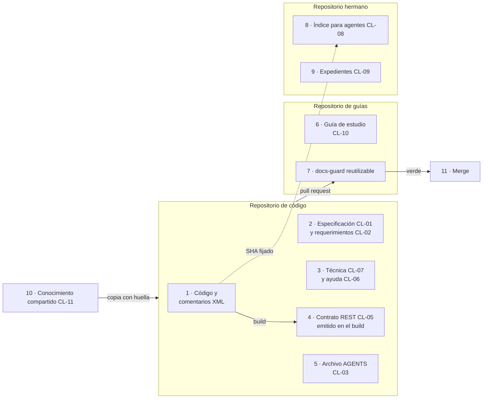
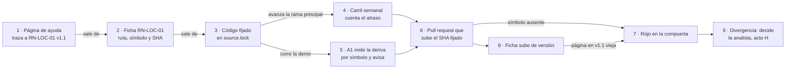
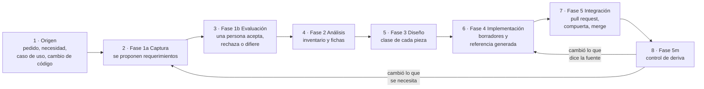
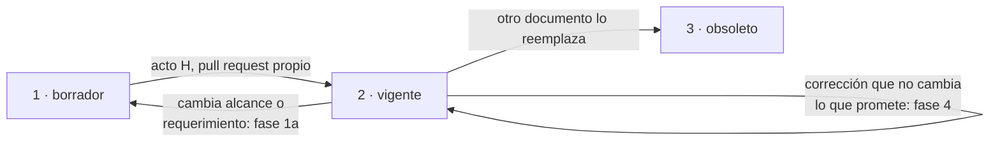
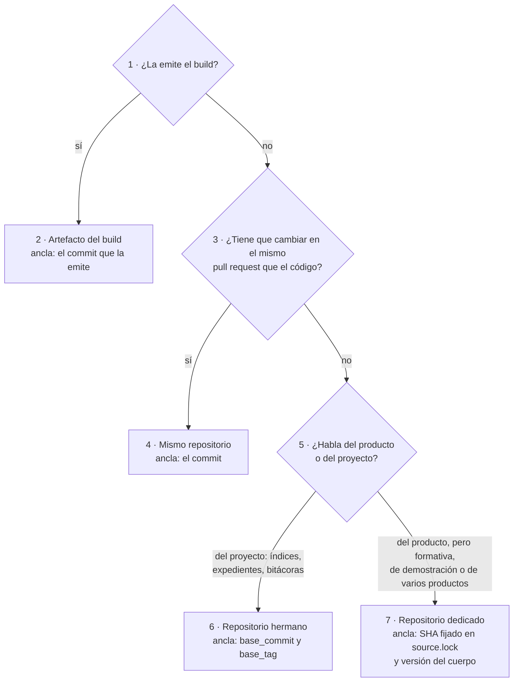

# DocsAsCode Developer Guide — Parte II. Diseñar el sistema documentador

[← Anterior](DocsAsCode-Developer-Guide-Parte-I.md) · [Índice general](DocsAsCode-Developer-Guide.md#índice-general) · [Siguiente →](DocsAsCode-Developer-Guide-Parte-III.md)

## Parte II. Diseñar el sistema documentador

La Parte I fijó el vocabulario; esta parte lo pone a trabajar sobre el objeto del libro. El capítulo 4 dice de qué
está hecho un sistema documentador: sus piezas, sus repositorios, su compuerta y el catálogo cerrado de catorce clases.
El capítulo 5 lo pone en movimiento y sigue a una pieza desde que alguien la necesita hasta que entra al repositorio.
El capítulo 6 resuelve las dos preguntas que el capítulo 5 deja abiertas en la fase de diseño: en qué repositorio vive
la pieza y contra qué versión del código vale. Los tres salen de los temas 01, 02 y 03 del cuerpo y de la sección 4
del Mapa; el colofón dice sobre qué estado de Lab-Documentos se editaron.

### 4. Qué es un sistema documentador

*Forma: explicación.* **Objetivos.** Al terminar el capítulo podés nombrar las piezas de un sistema documentador y
decir de qué fuente sale cada una, clasificar una pieza en el catálogo `CL-01` a `CL-14`, y levantar por comando el
inventario de un sistema real. Sostiene el objetivo `OBJ-SDEI-01`, que se comprueba con `EJR-SDEI-01`
([capítulo 16](DocsAsCode-Developer-Guide-Parte-V-b.md#16-ejercicios)).

**Requisitos previos.** El vocabulario del [capítulo 3](DocsAsCode-Developer-Guide-Parte-I.md#3-marco-de-referencia): escenarios `ESC-SDEI-n`, contextos
`CTX-SDEI-n` y actores `ACT-SDEI-n`. Del [capítulo 1](DocsAsCode-Developer-Guide-Parte-I.md#1-fundamentos-la-documentación-tratada-como-código): *docs as
code*, clases de intervención D/P/H, compuerta y traza.

**En tres líneas.** Un sistema documentador es la maquinaria que produce y mantiene la documentación, no la
documentación misma. Para cada pieza responde de dónde sale, contra qué versión vale, qué control la vigila y quién
decide. Sus piezas caen en un catálogo cerrado de catorce clases, y el inventario se levanta con un comando.

#### 4.1 Definición y qué no es

##### 4.1.1 La maquinaria detrás de lo que se lee

La documentación es lo que se lee. El **sistema documentador** es lo que hace que eso que se lee sea correcto, esté al
día y llegue a quien lo necesita: el conjunto de piezas documentales, fuentes de verdad, repositorios, anclas de
versión, compuertas, canales y actores (personas y agentes de IA) que producen y mantienen la documentación de un
sistema [Compilado: TEM-01-Sistema-Documentador.md, l. 38–41]. La forma que la industria adoptó para construirlo es
*docs as code*, que el capítulo 1 define con sus componentes ([Write the Docs, s. f.](DocsAsCode-Developer-Guide-Anexos.md#ref-writethedocs-sf);
[Winters et al., 2020](DocsAsCode-Developer-Guide-Anexos.md#ref-winters-2020)). Este capítulo no vuelve sobre la definición: la aplica.

Cinco términos sostienen lo que sigue y ya están definidos en el capítulo 1 y en el anexo A: **pieza documental**
(unidad que se escribe, se versiona y se valida por separado), **fuente de verdad** (el lugar del que sale lo que la
pieza afirma; si discrepan, manda la fuente), **clase de pieza** `CL-nn`, **compuerta** y **clase de intervención**
D/P/H [Compilado: TEM-01-Sistema-Documentador.md, l. 52–60]. De los cinco, el que más se malinterpreta es el último.
La clase D/P/H clasifica el **acto** de producir o cambiar una pieza, no a la persona: una decisión de arquitectura
tiene dos actos, la redacta un agente (P) y la acepta una persona (H), y el catálogo lo escribe así, «P redacta; H
acepta» [Compilado: TEM-01-Sistema-Documentador.md, l. 60].

##### 4.1.2 Cuatro preguntas por pieza

La documentación de software falla de maneras conocidas, y el capítulo 1 reúne la evidencia: contenido insuficiente,
información obsoleta, referencias a código que ya no existe ([Aghajani et al., 2019](DocsAsCode-Developer-Guide-Anexos.md#ref-aghajani-2019);
[Aghajani et al., 2020](DocsAsCode-Developer-Guide-Anexos.md#ref-aghajani-2020); [Tan et al., 2024](DocsAsCode-Developer-Guide-Anexos.md#ref-tan-2024)). Ninguna de esas fallas se arregla
escribiendo mejor una página. Se arregla con un sistema que sepa de dónde sale cada afirmación, que lo compruebe en
cada cambio y que diga quién decide cuando la página y el código discrepan
[Compilado: TEM-01-Sistema-Documentador.md, l. 64–72].

Ese es el trabajo del sistema documentador, y se resume en cuatro preguntas que tiene que poder contestar para cada
pieza [Compilado: TEM-01-Sistema-Documentador.md, l. 74–80]:

| Pregunta | Nombre de la respuesta | Dónde se desarrolla |
| --- | --- | --- |
| ¿De dónde sale lo que afirma? | Fuente de verdad | Sección 4.2 (columna «Dónde vive») y capítulo 5, fase 2 |
| ¿Contra qué versión del código vale? | Ancla de versión | [Capítulo 6](#6-topología-de-repositorios-y-versionado) |
| ¿Qué control detecta que dejó de valer? | Compuerta o aviso programado | Sección 4.2 (columna «Control») y [capítulo 9](DocsAsCode-Developer-Guide-Parte-IV.md#9-compuertas-de-calidad-y-ci) |
| ¿Quién puede cambiarla y quién decide si hay una divergencia? | Clase D/P/H y actor | Sección 4.2 (columna «Intervención») y sección 3.4 |

*Tabla 4.1. Las cuatro preguntas que un sistema documentador responde para cada pieza, y dónde las trata el libro.*

Una pieza que no puede contestar alguna de las cuatro tiene un hueco. Sin fuente, nadie sabe a quién creerle; sin
ancla, nadie sabe de qué versión habla; sin control, envejece en silencio; sin actor, una divergencia queda sin
dueño.

##### 4.1.3 Qué no es

Cuatro confusiones frecuentes, cada una con su porqué [Compilado: TEM-01-Sistema-Documentador.md, l. 133–143]:

- **No es un generador de sitios.** Mintlify, Docusaurus, MkDocs o DocFX son medios de una pieza, el sitio publicado.
  Un sistema documentador puede no tener sitio: el de este libro no lo tiene y se lee en el render del repositorio
  (`CTX-SDEI-1`).
- **No es una carpeta `docs/`.** Una carpeta sin fuente declarada, sin ancla y sin control es documentación sin
  sistema, y envejece sin que nadie lo note.
- **No es la wiki del equipo.** Lo que vive fuera del control de versiones no se revisa por pull request ni se ancla
  a una versión del código. Puede ser un canal; nunca la fuente.
- **No es una herramienta de IA.** Los agentes son actores con un rol acotado (clase P). El sistema funciona sin
  ellos; con ellos, la compuerta es lo que impide que un borrador equivocado entre.

#### 4.2 Arquitectura de referencia y catálogo de clases

##### 4.2.1 Tres repositorios y una compuerta

Las piezas de un sistema documentador se reparten, en el caso general, en tres repositorios: el del código, uno de
guías y un repositorio hermano `.Documentacion`. La figura 4.1 muestra el reparto y los tres caminos que importan: el
código emite la referencia en el build, el índice para agentes se ancla al código por SHA, y toda pieza entra por un
pull request que la compuerta revisa [Compilado: TEM-01-Sistema-Documentador.md, l. 84–109].



*Figura 4.1. Arquitectura de referencia. Mirá las tres flechas que salen del código: la del build (lo generado, clase
D), la punteada hacia el hermano (un ancla por SHA, no una copia) y la del pull request (la única puerta de entrada).*

Cada componente tiene una responsabilidad y, tan importante como ella, algo que no hace
[Compilado: TEM-01-Sistema-Documentador.md, l. 124–131]:

| Componente | Responsabilidad | Lo que no hace |
| --- | --- | --- |
| Repositorio de código | Fuente de verdad del comportamiento; emite la referencia (OpenAPI, XML) en el build | No aloja la guía de estudio |
| Repositorio de guías | Guarda el cuerpo de estudio, los ejemplos y el workflow reutilizable `docs-guard` | No copia el código: lo fija por SHA |
| Repositorio hermano `.Documentacion` | Índice para agentes, expedientes y bitácoras | No es un marco de especificación propio: es un índice |
| `docs-guard` | Corre las compuertas y devuelve un código de salida | No escribe, no tiene secretos, no invoca agentes |
| Persona del equipo | Decide lo de clase H y asienta por escrito la delegación del merge | No necesita aprobar cada pull request de clase D o P sin reserva |
| Agente de IA | Propone fichas, borradores, reindexado y correcciones (clase P) | No acepta decisiones de arquitectura ni decide divergencias |

*Tabla 4.2. Componentes de la arquitectura de referencia.*

La columna de la derecha es la que evita los errores de diseño más caros. Un repositorio de guías que copia el código
en lugar de fijarlo tiene dos fuentes de verdad; un `docs-guard` que invoca agentes deja de ser un control
determinista; un agente que acepta su propia decisión de arquitectura se saltea el único punto donde decide una
persona.

##### 4.2.2 El catálogo cerrado de catorce clases

Toda pieza del sistema cae en una de catorce clases. El catálogo es **cerrado**: una pieza nueva se clasifica en una
de ellas, y si no encaja en ninguna se abre una clase nueva por expediente, no se improvisa
[Compilado: 01-Mapa.md, l. 77–78]. La tabla 4.3 reproduce el catálogo con las cuatro respuestas de la sección 4.1.2
por clase: dónde vive (fuente y topología), su ancla, el control que la vigila y la clase de intervención.

| Clase | Artefacto | Dónde vive | Ancla | Control (bloquea salvo indicación) | Intervención | Capítulo |
| --- | --- | --- | --- | --- | --- | --- |
| CL-01 | Especificación: necesidad, caso de uso, regla, decisión de arquitectura | Repo de código; sin SDD, la ficha propia puede vivir en un repositorio dedicado con `source.lock` (la mini demo) | Commit y versión del ID | Esquema, enlaces, registro de IDs | P redacta; H acepta la decisión | 5 |
| CL-02 | Registro de requerimientos documentales | Con la especificación o en `docs/_requisitos.md` | Commit | Esquema del registro | P propone; H evalúa | 5 |
| CL-03 | `AGENTS.md` | Raíz de cada repositorio | Commit | Existe y sus enlaces resuelven; excluido del aviso AI-3 por huella | H | 7 |
| CL-04 | Referencia .NET (comentarios XML) | En el código | Commit | Build con avisos como error | D | 4, 9 |
| CL-05 | Contrato REST (`openapi.json`) | Emitido en el build | Commit | Diff del contrato | D | 9 |
| CL-06 | Ayuda al usuario final | Repo de la interfaz, o `Examples/` con `source.lock` | Commit y versión del ID trazado | Enlaces, `traces-resolve`, anti-inyección | P | 8 |
| CL-07 | Documentación técnica escrita | `docs/tecnica/` del código | Commit | Enlaces, frontmatter, mermaid | P | 4 |
| CL-08 | Índice interno para agentes (ia-db) | Repo hermano `.Documentacion` | `base_commit` y `base_tag` | Aviso programado de atraso | P | 7 |
| CL-09 | Expedientes, bitácoras y prompts | Repo hermano `.Documentacion` | Commit | Enlaces y barrido de datos privados | P actúa; H resuelve | — |
| CL-10 | Guía de estudio (este cuerpo y este libro) | Repositorio dedicado | Versión del cuerpo y etiqueta | `docs-guard` completo | P borrador; H vigente | — |
| CL-11 | Conocimiento compartido | Base de conocimiento común, copiado con huella | Versión y SHA-256 | Verificación de la copia; aviso si la base avanza | H | 10 |
| CL-12 | Proceso «Cómo intervenir» | Plantilla en el cuerpo; una instancia por proyecto | Versión de la plantilla | Bloques entradas, salidas y validaciones presentes | H | 12 |
| CL-13 | README y CHANGELOG | Mismo repositorio | Fecha o versión del paquete | Entrada en el pull request | P | 6 |
| CL-14 | Canales derivados para agentes | Artefacto del build del sitio | Versión del build | Reproducibilidad; anti-inyección | D | 7 |

*Tabla 4.3. Catálogo de clases de pieza [Compilado: 01-Mapa.md, l. 80–95]. La columna «Capítulo» reapunta la
columna «Tema» del Mapa a los capítulos del libro.*

`CL-14` está latente: no se activa mientras ningún escenario publique sitio (`CTX-SDEI-1`)
[Compilado: 01-Mapa.md, l. 97].

##### 4.2.3 Cómo se lee el catálogo

El catálogo responde una pregunta que nadie debería contestar caso por caso: quién puede cambiar una pieza. La clase
de intervención no se elige al escribir; la fija el catálogo para cada clase de pieza, y se conoce en la fase de
diseño del ciclo, cuando la pieza recibe su clase ([capítulo 5](#5-el-ciclo-documental), sección 5.1.1). Por eso un
cambio que toca un `AGENTS.md` lo fusiona una persona aunque lo haya propuesto un agente: `CL-03` es H
[Compilado: TEM-02-Ciclo-Documental.md, l. 66–68].

Leído por columnas, el catálogo también muestra el costo de cada clase. Las de ancla «Commit» viven junto a lo que
describen y no necesitan nada extra; `CL-08` y `CL-11` viven lejos y pagan con un aviso programado o una huella.
Las tres clases D (`CL-04`, `CL-05`, `CL-14`) son las que no se redactan: si una de ellas se escribe a mano, el
sistema tiene una fuente de más.

#### 4.3 Aplicación por escenario

El tronco es el mismo en los cuatro escenarios: piezas con fuente, ancla, control y actor. Cambian qué clases se
activan y qué fuente se genera [Compilado: TEM-01-Sistema-Documentador.md, l. 147–155]. Un proyecto con rasgos de
dos escenarios activa la unión de sus clases; la regla de composición y la fila «Clases activas por defecto» están en
la sección 3.2 (expediente 0003, decisión P-16).

| Escenario | Qué aporta pensar el sistema documentador | Piezas centrales | Fuente generada | Lo que más cuesta |
| --- | --- | --- | --- | --- |
| Corpus de guías (`ESC-SDEI-1`) | Que la guía misma tenga contrato (frontmatter), compuerta y versión, aunque no documente un producto | CL-10, CL-12, CL-02 | Ninguna: todo es prosa | Que el cuerpo no se contradiga: un dato en un solo documento |
| App sin roles (`ESC-SDEI-2`) | Separar lo que se genera del código (contrato REST) de lo que se escribe (ayuda, técnica) | CL-05, CL-06, CL-07, CL-02 | OpenAPI y comentarios XML | Que la ayuda diga el mismo número que el código |
| Panel con roles (`ESC-SDEI-3`) | Decidir qué ayuda ve cada rol sin duplicar páginas, y trazar cada página al caso de uso de su pantalla | CL-01, CL-06, CL-08 | OpenAPI y comentarios XML | La confidencialidad: el rol se decide en el servidor |
| Servicio con paquetes (`ESC-SDEI-4`) | Documentar varias líneas de versión que conviven, para integradores que no ven el código | CL-05, CL-11, CL-13 | API pública de los paquetes | Que cada línea tenga su documentación y su CHANGELOG |

*Tabla 4.4. El sistema documentador en cada escenario.*

Los contextos cambian una respuesta dentro de cada fila [Compilado: TEM-01-Sistema-Documentador.md, l. 159–164]:

| Contexto | Qué cambia en el sistema documentador |
| --- | --- |
| Con o sin sitio (`CTX-SDEI-1`) | Con sitio aparecen el build del sitio y los canales derivados para agentes (una página `.md` por página, `llms.txt`); sin sitio, el canal es el propio Markdown |
| Con o sin SDD (`CTX-SDEI-2`) | Con un marco de desarrollo guiado por especificación, la especificación ya es pieza y fuente; sin él, las reglas se escriben como fichas propias |
| Topología (`CTX-SDEI-3`) | Una pieza en otro repositorio que el código necesita un ancla fijada y un aviso de atraso |
| Organización del runner (`CTX-SDEI-4`) | Fuera de la organización del runner, la compuerta se copia con su huella en lugar de llamarse |

*Tabla 4.5. Lo que cambia cada contexto.*

#### 4.4 Ejemplos concretos

##### 4.4.1 Ensayo: inventario de un sistema documentador real

El inventario de un sistema documentador se hace por comando, no de memoria: así se puede repetir y comparar. El
ensayo lee el frontmatter de cada página del cuerpo con el mismo parser que usa la compuerta y cuenta las piezas por
tipo [Compilado: TEM-01-Sistema-Documentador.md, l. 210–217].

- **Precondición.** Python 3, un clon de Lab-Documentos y el guion `01-tem01-inventario.sh`, publicado en el
  repositorio hermano Lab-Documentos.Documentacion, expediente 0002 de DocAsCode, carpeta
  [`evidencia/E1-U4b/`](https://github.com/hdcm-dev/Lab-Documentos.Documentacion/tree/09a451867a05e7718d064067e4dc84377e042ffe/PROMPTs/DEVs/Enchacement/01-Replanteo-Y-Analisis/OUTPUTs/Expedientes/0002-Replanteo-Metodologia-DocAsCode/evidencia/E1-U4b)
  del commit `09a4518` (consultado el 2026-11-01).
- **Orden.** Se corre desde cualquier carpeta, con la ruta del clon como argumento.
- **Resultado esperado.** La lista de piezas por tipo, las piezas que no son prosa y los workflows que corren
  controles.

[Salida registrada: corrida del 2026-11-01 sobre `0bed863` de Lab-Documentos, publicada como
[U25](https://github.com/hdcm-dev/Lab-Documentos.Documentacion/tree/09a451867a05e7718d064067e4dc84377e042ffe/PROMPTs/DEVs/Enchacement/01-Replanteo-Y-Analisis/OUTPUTs/Expedientes/0003-Reedicion-DocsAsCode-Y-Especificacion/evidencia/U25)
del expediente 0003 (medida el 2026-11-01); recorte: la línea del commit y las rutas largas]

```text
$ bash 01-tem01-inventario.sh <clon de Lab-Documentos>
piezas .md con frontmatter, por doc_type:
  anexo                  7
  anexo-referencias      1
  ayuda (sin doc_id)     12
  ficha                  2
  guia-practica          5
  indice                 1
  mapa                   1
  marco-de-referencia    1
  proceso                2
  rrd                    1
  study-note             1
  tema                   7
  sin frontmatter (README de ejemplos): 1
piezas que no son prosa: Examples/MovilidadUrbana-Mini-Demo/contracts/openapi.json,
  Examples/MovilidadUrbana-Mini-Demo/source.lock, Examples/MovilidadUrbana-Mini-Demo/verificar.sh, …
workflows que corren compuertas: docs-enlaces-semanal.yml, docs-guard.yml, framework-concept-demo.yml,
  mini-demo-movilidad.yml
```

La salida histórica del 2026-10-27, sobre «PR #19, merge `e3841b6`» (equivalente de `080f158`), no tenía las líneas
`tema 7` ni `proceso 2`: los siete temas y los dos documentos de proceso se agregaron después
[Compilado: TEM-01-Sistema-Documentador.md, l. 219–222]. Sobre `00171bd`, el estado en el que se editó este
capítulo, la misma orden cuenta `rrd 2`: el pull request de coherencia del expediente 0003 sumó el registro de
requerimientos de la prueba de ayuda por rol [Salida registrada: corrida del 2026-11-01 sobre una copia de `00171bd`
hecha con `git archive`; única diferencia con la de `0bed863`].

Leída con el capítulo, la salida es un inventario por clase. El cuerpo de estudio (`indice`, `marco-de-referencia`,
`mapa`, `tema`, `anexo`) es `CL-10`. Las doce páginas de ayuda de las pruebas de concepto son `CL-06`. Los registros
`rrd` son `CL-02`, y las dos `ficha` son `CL-01` como fichas propias sin SDD, en un repositorio dedicado con
`source.lock`. El `openapi.json` es `CL-05` y el `source.lock` es su ancla
[Compilado: TEM-01-Sistema-Documentador.md, l. 243–245]. De los cuatro workflows, `docs-guard.yml` bloquea en cada
pull request, el de la mini demo bloquea en los pull requests que tocan la demo, el semanal sólo avisa y el cuarto es
la compuerta de la demo del Framework Concept, otra guía del mismo repositorio
[Compilado: ../../../.github/workflows/mini-demo-movilidad.yml, l. 17–23; ../../../.github/workflows/framework-concept-demo.yml, l. 1].

##### 4.4.2 Un cambio recorrido de punta a punta

MovilidadUrbana tiene un defecto real: la pantalla promete 60 caracteres para el nombre de una localidad y el campo
admite 80 [Compilado: TEM-01-Sistema-Documentador.md, l. 273]. La sección 3.6 usa el mismo caso para recorrer el
marco y el [capítulo 13](DocsAsCode-Developer-Guide-Parte-V-a.md#13-caso-de-estudio-la-mini-demo-movilidadurbana) lo corre; acá interesa cómo responde cada
pieza del sistema cuando alguien corrige el código.



*Figura 4.2. La cadena de fuentes y los controles. Las flechas 1 → 3 dicen quién manda; los nodos 4 y 5 sólo
avisan; el rojo (7) llega recién en el pull request que actualiza el SHA o la ficha.*

1. La ficha `RN-LOC-01` de la mini demo declara la regla y dónde se aplica en el código, con la forma
   `ruta#Símbolo@SHA`. La página de ayuda que menciona el límite lleva `traces: [RN-LOC-01@1.1]` en su frontmatter
   [Compilado: TEM-01-Sistema-Documentador.md, l. 276–278].
2. Si el código cambia en su repositorio, el sistema se entera en dos tiempos. El carril programado cuenta cada
   semana cuántos commits de atraso tiene el SHA fijado frente a la rama principal del código; la deriva por símbolo
   la mide el control A1 cuando corre el workflow de la demo, y sólo avisa. A1 no está programado: el workflow corre
   en los pull requests que tocan la demo o a mano, y esa deuda queda declarada hasta que un pull request lo programe
   o un folio decida no hacerlo [Compilado: 01-Mapa.md, l. 69; ../../../tools/docs-guard/semanal.sh, l. 14;
   ../../../.github/workflows/mini-demo-movilidad.yml, l. 9, 17–23] (expediente 0003, decisión P-18).
3. Cuando alguien actualiza el SHA fijado, la compuerta busca de nuevo cada ancla `ruta#Símbolo@SHA` y da **rojo**
   si el símbolo ya no está en ese SHA. Un agente (`ACT-SDEI-4`) propone actualizar la ficha y subir su versión, y la
   página que traza a la versión anterior queda en rojo hasta que alguien la revisa
   [Compilado: TEM-01-Sistema-Documentador.md, l. 280–282].
4. Ningún control lee el número «60» de la página y lo compara con el «80» del código. Lo que se automatiza es que
   la página quede marcada para revisar cuando la regla cambia [Compilado: TEM-01-Sistema-Documentador.md, l. 282–284].
5. Si el número correcto es 60 u 80 no lo decide nadie de la cadena técnica. Entre la página y la ficha manda la
   ficha; entre la ficha y el código, manda el código, porque la ficha describe lo que el código hace. Lo que esa
   cadena no resuelve es si el código hace lo que se quiso. Eso es una **divergencia** entre la letra (lo que la app
   promete), la intención (para qué) y el comportamiento (lo que el código hace), y la decide la analista
   (`ACT-SDEI-2`), acto de clase H. Después de su decisión se corrige el código o la pantalla, y la cadena vuelve a
   mandar [Compilado: TEM-01-Sistema-Documentador.md, l. 285–290].

##### 4.4.3 El caso de industria y las adopciones

El tema 01 trae además un caso de industria (el portal público de un proveedor de notificaciones) y una tabla de
adopciones públicas de las prácticas P1 a P3, con su ensayo fechado. Las dos cosas se cuentan una sola vez, en el
[capítulo 18](DocsAsCode-Developer-Guide-Parte-VI.md#18-el-sistema-documentador-en-la-industria) (secciones 18.1 y 18.2), donde el caso entra reverificado
(expediente 0003, decisiones P-03 y P-07).

#### 4.5 Preguntas guía

1. ¿Qué piezas documentales tiene tu sistema hoy, y de qué fuente de verdad sale cada una?
2. ¿Cuáles de esas piezas se pueden generar (clase D) y hoy se escriben a mano?
3. Si el código cambia mañana, ¿qué control se pondría en rojo, cuál sólo avisaría, y qué pieza quedaría
   desactualizada sin que nada lo detecte?
4. ¿Quién decide cuando una página y el código discrepan? ¿Está escrito en algún lado?
5. ¿Qué parte de tu sistema documentador depende de una herramienta que podrías cambiar sin perder las piezas?

[Compilado: TEM-01-Sistema-Documentador.md, l. 294–299; la pregunta 3 suma «cuál sólo avisaría», por la sección
4.4.2]

#### 4.6 Criterios de calidad

Los criterios generales de una guía están en el [anexo D](DocsAsCode-Developer-Guide-Anexos.md#d-criterios-de-calidad) (`CQ-01` a `CQ-14`); acá van los
propios del sistema documentador, con el `CQ-nn` que los comprueba cuando existe
[Compilado: TEM-01-Sistema-Documentador.md, l. 303–310].

| Criterio | Un sistema documentador bueno | Uno pobre | Se comprueba con |
| --- | --- | --- | --- |
| Fuente declarada | Cada pieza dice de dónde sale lo que afirma | Las páginas repiten datos del código sin decir de dónde | `CQ-01`, `CQ-11` |
| Referencia generada | Lo que puede salir del código sale del código (clase D) | La referencia de la API se copia a mano | Diff del contrato en la CI |
| Control por pieza | Toda clase activa tiene un control que la pone en rojo o un aviso programado | Hay piezas que ningún control mira | Columna «Control» del inventario (plantilla G.1) |
| Roles escritos | Está escrito qué decide cada actor y qué no | «Lo revisa alguien» | Tabla de actores de la sección 3.4 |
| Independencia de la herramienta | Las piezas son texto plano versionado; la herramienta se puede cambiar | El contenido vive dentro de un servicio que no exporta | Que el repositorio se lea sin el sitio |
| Inventario reproducible | El inventario sale de un comando | El inventario es una lista escrita a mano que envejece | Un ensayo como el de la sección 4.4.1 |

*Tabla 4.6. Criterios de calidad de un sistema documentador.*

#### 4.7 Anexo: plantilla de inventario

La plantilla comentada para inventariar el sistema documentador de un proyecto, una fila por pieza y con las
preguntas que guían cada campo, está en el [anexo G](DocsAsCode-Developer-Guide-Anexos.md#g-plantillas), G.1.

#### 4.8 Fuentes y observaciones

Fuentes primarias del capítulo, con fecha de consulta en el [anexo B](DocsAsCode-Developer-Guide-Anexos.md#b-referencias): Write the Docs (s. f.),
Winters et al. (2020), Aghajani et al. (2019 y 2020) y Tan et al. (2024). El capítulo de Winters et al. y los
resúmenes de los tres artículos se releyeron el 2026-10-27 para el tema 01
[Compilado: TEM-01-Sistema-Documentador.md, l. 341–344].

| Tipo | Observación |
| --- | --- |
| Hecho | Las cifras del inventario son de la corrida del 2026-11-01 sobre `0bed863`; cambian cuando el cuerpo suma piezas, como muestra la diferencia con `00171bd` (`rrd 2`) |
| Hecho | El workflow de la mini demo no corre por calendario: se dispara en los pull requests que tocan la demo, en `tools/docs-guard/` o en el propio workflow, y a mano. Por eso la deriva por símbolo es hoy un aviso a demanda, no programado |
| Interpretación | Que la columna «Lo que no hace» evite los errores más caros (sección 4.2.1) es una lectura de la arquitectura, no una medición |
| Criterio propio | La lectura por columnas del catálogo (sección 4.2.3) es una forma de estudiarlo que propone el libro; el catálogo no la prescribe |
| Deuda declarada | La clase de los workflows y de `tools/docs-guard/` en el catálogo no se votó en el expediente 0003 (resolución, §5.3): hoy no son ninguna de las catorce |

*Tabla 4.7. Observaciones del capítulo 4.*

#### Resumen del capítulo 4

Un sistema documentador es la maquinaria que produce y mantiene la documentación: piezas con fuente, ancla, control y
actor, repartidas en el repositorio del código, uno de guías y un hermano `.Documentacion`. Las piezas caen en un
catálogo cerrado de catorce clases que fija, para cada una, dónde vive, contra qué se ancla, qué control la vigila y
quién la puede cambiar. El inventario se levanta por comando. Cuando la cadena de fuentes no alcanza, porque el
código no hace lo que se quiso, decide una persona: la analista, en un acto de clase H.

### 5. El ciclo documental

*Forma: explicación.* **Objetivos.** Al terminar el capítulo podés ubicar cada decisión documental en su fase,
escribir un requerimiento documental con criterio Dado/Cuando/Entonces y decir quién lo acepta, y saber a qué fase
vuelve una pieza que derivó. Sostiene `OBJ-SDEI-05`, que se comprueba con `EJR-SDEI-05`
([capítulo 16](DocsAsCode-Developer-Guide-Parte-V-b.md#16-ejercicios)).

**Requisitos previos.** El [capítulo 4](#4-qué-es-un-sistema-documentador), en especial el catálogo de clases y la
clase de intervención D/P/H; el actor `ACT-SDEI-2` de la sección 3.4.

**En tres líneas.** El ciclo documental tiene cinco fases, y la primera se parte en captura (lo puede hacer un
agente) y evaluación (decide una persona). El mantenimiento no es una sexta fase: es un control de deriva dentro de la
quinta, que devuelve la pieza a la fase 1a o a la 4. Cada fase tiene entrada, salida, quien decide y un control.

#### 5.1 Definición: fases, RRD, estados y cláusulas

##### 5.1.1 Cinco fases, la primera partida en dos

El capítulo 4 mostró de qué está hecho un sistema documentador; el **ciclo documental** muestra cómo se mueve. Es la
secuencia de fases por la que pasa una pieza documental, con lo que entra y sale de cada fase, quién decide y qué
control comprueba la salida. Tiene cinco fases, y la primera se parte en dos porque junta trabajos de naturaleza
distinta: relevar lo que hace falta, que lo puede hacer un agente, y decidir qué se hace, que lo decide una persona
[Compilado: TEM-02-Ciclo-Documental.md, l. 37–40].



*Figura 5.1. Las fases del ciclo. Mirá las dos flechas que salen de 5m: el mantenimiento no agrega una fase, devuelve
la pieza a 1a o a 4 según qué cambió [Compilado: TEM-02-Ciclo-Documental.md, l. 42–55].*

A qué fase vuelve una pieza que derivó depende de qué cambió. Si cambió **lo que la audiencia necesita** (una tarea
nueva, una pantalla que desaparece, otra audiencia), vuelve a **1a**: hay que reescribir o agregar filas del registro
de requerimientos y que una persona las decida de nuevo. Si el requerimiento sigue igual y sólo cambió **lo que la
fuente dice** (un límite, un nombre de campo), vuelve a **4**: se corrige el texto contra la fuente nueva, sin pasar
por la evaluación [Compilado: TEM-02-Ciclo-Documental.md, l. 57–60].

La tabla 5.1 usa las clases de intervención de la sección 1.6. No son las clases de pieza `CL-nn`: una clase de pieza
dice qué es la pieza; una clase de intervención, quién la puede cambiar. «Sin reserva» quiere decir que nadie declaró
una duda que devuelva el merge a una persona [Compilado: TEM-02-Ciclo-Documental.md, l. 62–68].

| Fase | Entra | Sale | Decide una persona | Hace un agente | Control |
| --- | --- | --- | --- | --- | --- |
| 1a Captura | Pedido, necesidad, caso de uso, inventario de pantallas y endpoints | Filas del registro de requerimientos documentales (RRD) en `pendiente` | — | Releva audiencias, tareas y piezas; propone filas | Esquema del RRD |
| 1b Evaluación | Filas `pendiente` | Filas `aceptado`, `rechazado` o `diferido`, con quién decidió y cuándo | **Acepta, rechaza o difiere** cada fila (`ACT-SDEI-2`) | — | Toda fila tiene decisión y criterio Dado/Cuando/Entonces |
| 2 Análisis | RRD aceptado, código, especificación | Inventario hecho por comando; fichas de reglas y casos de uso | **Decide las divergencias** entre lo que la regla dice y lo que se quiso | Genera el inventario y redacta las fichas | `traces-resolve` sobre las fichas nuevas |
| 3 Diseño | Fichas, catálogo de clases | Clase asignada a cada pieza; decisión de arquitectura propuesta | **Acepta** la decisión de arquitectura | Redacta la decisión y las plantillas | La clase existe en el catálogo (tabla 4.3) |
| 4 Implementación | Diseño aceptado | Páginas en `borrador`; referencia emitida en el build | — | Redacta borradores | Grupos PR-1 a PR-7 de `docs-guard` |
| 5 Integración | Pull request con la compuerta | Merge; anclas fijadas | **Pasa a `vigente`**, etiqueta, publica; fusiona lo de clase H | Fusiona lo de clase D o P sin reserva, con la guarda | Guarda de merge, con la delegación asentada |
| 5m Control de deriva | Repositorios, `last_review` | Issue de aviso con lo que derivó | Prioriza el aviso | Propone la corrección (vuelve a 1a o a 4) | Carril programado semanal: atraso, frescura y deriva de copia fijada; A1 cuando corre la demo |

*Tabla 5.1. Fases del ciclo documental [Compilado: TEM-02-Ciclo-Documental.md, l. 70–78]. La celda «Control» de 5m
nombra lo que el carril mide, con los términos de la decisión P-13 del expediente 0003 (co-cambio propuesto).*

##### 5.1.2 Qué problema resuelve

Sin ciclo, la documentación se escribe cuando alguien se acuerda y se revisa cuando alguien se queja. El ciclo
resuelve tres cosas concretas [Compilado: TEM-02-Ciclo-Documental.md, l. 82–103].

**Que se escriba lo que hace falta y no otra cosa.** La norma ISO/IEC/IEEE 26514:2022 ordena el desarrollo de la
información para usuarios así: establecer qué información necesitan, decidir cómo presentarla, y recién después
prepararla y ponerla a disposición; y aclara que el diseño sigue a lo largo del ciclo de vida
([ISO/IEC/IEEE, 2022](DocsAsCode-Developer-Guide-Anexos.md#ref-iso-26514-2022)). El RRD de la fase 1 es la forma escrita de ese primer paso.

**Que la revisión exista y tenga etapas.** Entrevistas a 31 redactores técnicos distinguen cinco etapas de revisión:
autorrevisión, revisión técnica, revisión editorial, prueba de uso y realimentación después de publicar
([Bhat et al., 2026](DocsAsCode-Developer-Guide-Anexos.md#ref-bhat-2026)). GitLab, que documenta su producto en el mismo repositorio que el código, pide
la revisión del código, la de la persona redactora técnica y la de quien mantiene el proyecto antes del merge, y
alienta que la documentación vaya en el mismo merge request que el código que describe
([GitLab, s. f.](DocsAsCode-Developer-Guide-Anexos.md#ref-gitlab-sf)).

**Que lo que propone un agente no entre sin control.** Un estudio sobre 1997 pull requests de documentación encontró
que los agentes de IA presentan bastantes más que las personas en los repositorios estudiados, y que sus cambios
suelen integrarse con poca modificación humana posterior; los autores lo leen como una alerta sobre las prácticas de
revisión ([Yamasaki et al., 2026](DocsAsCode-Developer-Guide-Anexos.md#ref-yamasaki-2026)). Por eso el ciclo separa lo que el agente propone (1a, 2, 4) de
lo que una persona decide (1b, divergencias, decisiones de arquitectura, `vigente`), y pone una compuerta entre los
dos.

##### 5.1.3 El registro de requerimientos documentales

Un **requerimiento documental** es lo que una audiencia necesita lograr con la documentación (sección 3.1). El
**registro de requerimientos documentales** (RRD) los guarda como filas de una tabla, una por requerimiento: cada fila
nombra una sola audiencia, la tarea, la pieza que la resuelve, el criterio con el que se comprueba y la decisión de
una persona. El criterio se escribe con la forma Dado/Cuando/Entonces, un estilo que viene del desarrollo guiado por
comportamiento y que sirve para escribir una expectativa como ejemplo comprobable
([Fowler, 2013](DocsAsCode-Developer-Guide-Anexos.md#ref-fowler-2013)) [Compilado: TEM-02-Ciclo-Documental.md, l. 107–112].

| Si el proyecto… | El RRD vive en… |
| --- | --- |
| Tiene un marco de desarrollo guiado por especificación (`CTX-SDEI-2`) | Junto a la especificación de la unidad de entrega |
| No tiene marco de especificación | `docs/_requisitos.md` del árbol que documenta |
| Ofrece la documentación como función del producto (por ejemplo, ayuda en pantalla) | El requerimiento va en la necesidad o el caso de uso del producto, y el RRD lo referencia |

*Tabla 5.2. Dónde vive el RRD [Compilado: TEM-02-Ciclo-Documental.md, l. 114–118].*

Las columnas que la compuerta exige y su vocabulario están en el
[anexo C](DocsAsCode-Developer-Guide-Anexos.md#c-esquema-de-frontmatter-y-prefijos), sección del registro de requerimientos.

##### 5.1.4 Estados del documento

Todo documento lleva su estado en el frontmatter: `borrador` → `vigente` → `obsoleto`. Pasar a `vigente` es un acto
de una persona (clase H), en un pull request propio, y es el momento en que esa persona revisa la `description`. Un
documento `obsoleto` dice cuál lo reemplaza. El carril programado avisa cuando `last_review` tiene más de un año
[Compilado: TEM-02-Ciclo-Documental.md, l. 125–127].



*Figura 5.2. Estados de un documento. La flecha de 2 a 1 es la regla de criterio propio del párrafo siguiente: un
`vigente` no se vuelve `borrador` por corregir un número.*

Si un documento `vigente` deriva y vuelve al ciclo, la regla es esta **[criterio propio]**: una corrección que no
cambia lo que el documento promete (vuelve a la fase 4 para que un número siga a su fuente) se fusiona como cualquier
cambio de clase P y el documento sigue `vigente`; una que cambia su alcance o su requerimiento (vuelve a 1a) lo pasa
a `borrador` en ese mismo pull request, y volver a `vigente` es otro acto H
[Compilado: TEM-02-Ciclo-Documental.md, l. 129–132].

##### 5.1.5 Cláusulas con criterio

La metodología misma se escribe como **cláusulas** que se pueden verificar. Cada cláusula tiene identificador, fase,
a quién obliga, de dónde sale, su criterio Dado/Cuando/Entonces, el instrumento que la comprueba y su nivel (debe,
conviene, opcional) [Compilado: TEM-02-Ciclo-Documental.md, l. 136–138]. La sección 5.3.3 muestra una escrita; la
plantilla está en el anexo G.

##### 5.1.6 «Clara» e «integración»

Una metodología **clara** es una que un lector sin contexto recorre sin quedar con dudas que el texto no responde. Se
mide con la prueba de lectura P-LECT, cuyo umbral es cero dudas sin respuesta. **Integración** tiene dos acepciones
que no se mezclan: en el ciclo del código, pull request más CI (la fase 5); en el producto, la ayuda dentro de la
aplicación y los canales para agentes [Compilado: TEM-02-Ciclo-Documental.md, l. 142–145]. Cuando el libro dice
«integrar» sin más, habla de la primera.

##### 5.1.7 Qué no es

- **No es una cascada.** Las fases ordenan decisiones, no meses: un cambio chico recorre de 1a a 5 en un solo pull
  request. Lo que no se saltea es la decisión de la persona en 1b.
- **No es un proceso aparte del desarrollo.** La fase 5 es el mismo pull request y la misma CI que el código.
- **No es el ciclo de la especificación.** Cuando hay un marco de desarrollo guiado por especificación, la
  especificación tiene su propio ciclo; el documental lo usa como fuente y no lo reemplaza. Böckeler distingue tres
  niveles de ese marco: la especificación escrita antes de la tarea, la que se conserva para mantener la función, y
  la que pasa a ser la fuente principal y sólo se edita ella ([Böckeler, 2025](DocsAsCode-Developer-Guide-Anexos.md#ref-bockeler-2025)). Esa integración
  es el tema del [capítulo 10](DocsAsCode-Developer-Guide-Parte-IV.md#10-integración-con-un-marco-sdd).

[Compilado: TEM-02-Ciclo-Documental.md, l. 149–157]

#### 5.2 Aplicación por escenario

Las fases son las mismas en los cuatro escenarios; un escenario nunca agrega fases. Cambia de dónde salen los
requerimientos y qué tan pesada es cada fase [Compilado: TEM-02-Ciclo-Documental.md, l. 161–169]. En todos los
escenarios decide el rol `ACT-SDEI-2`; la columna de la derecha dice quién lo ocupa (expediente 0003, decisión P-17).

| Escenario | De dónde salen los requerimientos (1a) | Qué pesa más | Quién decide en 1b |
| --- | --- | --- | --- |
| Corpus de guías (`ESC-SDEI-1`) | Objetivos de aprendizaje y preguntas de quien estudia | Fase 4 (redacción) y la prueba de lectura | `ACT-SDEI-2`; ocupa el rol la responsable de la guía o quien el PO designe por delegación asentada |
| App sin roles (`ESC-SDEI-2`) | Pantallas, endpoints y defectos conocidos del código | Fase 2: fichas de reglas ancladas al SHA | Analista |
| Panel con roles (`ESC-SDEI-3`) | Casos de uso del marco de especificación, uno por pantalla y rol | Fase 3: qué rol ve qué ayuda | Analista, con el PO para la confidencialidad |
| Servicio con paquetes (`ESC-SDEI-4`) | Cambios del contrato público entre versiones | Fase 5: CHANGELOG y contrato por línea de versión | PO |

*Tabla 5.3. El ciclo en cada escenario.*

| Contexto | Qué cambia en el ciclo |
| --- | --- |
| Con SDD (`CTX-SDEI-2`) | El RRD vive con la especificación y los IDs de las trazas son los del proyecto (`CU-`, `RN-`) |
| Sin SDD (`CTX-SDEI-2`) | La fase 2 escribe fichas propias de reglas; el RRD va en `docs/_requisitos.md` |
| Pieza en otro repositorio (`CTX-SDEI-3`) | La fase 5m pesa más: el pull request del código no ve la página, y el atraso lo detecta el aviso programado |
| Con sitio (`CTX-SDEI-1`) | La fase 4 suma el build del sitio y los canales derivados |

*Tabla 5.4. Lo que cambia cada contexto [Compilado: TEM-02-Ciclo-Documental.md, l. 171–176].*

#### 5.3 Ejemplos concretos

##### 5.3.1 Una fila del RRD real de la mini demo

La mini demo de MovilidadUrbana tiene su RRD en `docs/_requisitos.md`. Su primera fila, recortada a las seis columnas
que exige la compuerta:

| ID | Audiencia | Tarea | Pieza | Criterio | Decisión |
| --- | --- | --- | --- | --- | --- |
| RD-01 | persona usuaria | Dar de alta una localidad sin que el nombre se rechace ni quede distinto de lo esperado | CL-06, `docs/ayuda/alta-de-localidad.md` | Dado el límite de cada regla, cuando la persona lee la ayuda, entonces cada número coincide con el de la ficha; instrumento: `traces-resolve` | aceptado |

*Tabla 5.5. La fila `RD-01` [Compilado: Examples/MovilidadUrbana-Mini-Demo/docs/_requisitos.md, l. 44; sin las
columnas «Fuente» y «Decide y fecha»].*

El instrumento del criterio no lee los números de la página. `traces-resolve` comprueba que la versión de la ficha a
la que traza la página (`RN-LOC-01@1.1`) sea la versión que la ficha declara. Si alguien cambia el límite en la
ficha, tiene que subir su versión, y la página queda en rojo hasta que alguien la revisa y traza a la versión nueva.
El criterio es comprobable en ese sentido: ningún cambio de la regla pasa sin que la página se revise
[Compilado: TEM-02-Ciclo-Documental.md, l. 189–192].

La columna «Decide y fecha» del archivo dice `mesa, 2026-10-27`. «La mesa» es el grupo de revisión del expediente
que diseñó esta guía, y decidió por **delegación escrita** del PO. Delegar una decisión de clase H también es un acto
H: lo hace la persona responsable, por escrito, en un lugar del repositorio que cualquiera puede leer, y con alcance
acotado; la responsabilidad sigue siendo suya. En Lab-Documentos la delegación del merge está escrita en el
[CHANGELOG](../../../CHANGELOG.md) (sección «Delegación del merge»), con fecha, quién decidió, la guarda que tiene
que pasar el pull request y dónde quedó asentada. Lo que una delegación no nombra sigue en la persona
[Compilado: TEM-02-Ciclo-Documental.md, l. 194–199].

Leída por fases, cada parte de la fila es la salida de una fase. La fila misma sale de 1a; su decisión `aceptado`,
de 1b; las fichas `RN-LOC-01` y `RN-LOC-02`, ancladas al código, de 2; la clase `CL-06` de la pieza, de 3; la página
con `traces: [RD-01, RN-LOC-01@1.1, RN-LOC-02@1.0]`, de 4; y el pull request con `docs-guard` en verde que la
fusionó, de 5 [Compilado: TEM-02-Ciclo-Documental.md, l. 201–205]. Si mañana el código cambia el límite, el aviso de
atraso del carril programado, o A1 cuando corre la demo, devuelve la pieza a 4: la tarea de la persona usuaria es la
misma y cambia el número. Si la pantalla de alta desapareciera, la devolvería a 1a.

##### 5.3.2 Ensayo: la evaluación deja huella y la compuerta la verifica

El ensayo arma un RRD de una fila dos veces. En la primera, la fila tiene un criterio sin la forma Dado/Cuando/Entonces
y una decisión fuera del vocabulario («ok»): la persona no decidió nada verificable. En la segunda, la misma fila
corregida [Compilado: TEM-02-Ciclo-Documental.md, l. 211–217].

- **Precondición.** Python 3, un clon de Lab-Documentos y el guion `02-tem02-rrd.sh`, en la misma carpeta
  `evidencia/E1-U4b/` del expediente 0002 que el ensayo de la sección 4.4.1.
- **Orden.** Se corre desde cualquier carpeta, con la ruta del clon como argumento.
- **Resultado esperado.** Rojo y verde.

[Salida registrada: corrida del 2026-11-01 sobre `0bed863` de Lab-Documentos, publicada como U25 del expediente
0003 (medida el 2026-11-01); sobre una copia de `00171bd` la salida es idéntica]

```text
$ bash 02-tem02-rrd.sh <clon de Lab-Documentos>
== caso rojo
_requisitos.md:19: ERROR rrd-decision: «ok» fuera de ['aceptado', 'diferido', 'pendiente', 'rechazado']
_requisitos.md:19: ERROR rrd-criterio: el criterio no tiene la forma Dado/Cuando/Entonces
== PR-2 esquema: ROJO (errores=2 avisos=0) archivos-con-frontmatter=1 sin-frontmatter-fuera-del-cuerpo=0 readme-del-cuerpo-sin-frontmatter=0
rc=1
== caso verde
== PR-2 esquema: verde (errores=0 avisos=0) archivos-con-frontmatter=1 sin-frontmatter-fuera-del-cuerpo=0 readme-del-cuerpo-sin-frontmatter=0
rc=0
```

La salida histórica del 2026-10-27, sobre «PR #19, merge `e3841b6`», da el mismo rojo y el mismo verde; la vigente
sólo suma el contador `readme-del-cuerpo-sin-frontmatter` en la línea de resumen
[Compilado: TEM-02-Ciclo-Documental.md, l. 219–222].

Lo que demuestra: la fase 1b no se puede cerrar con un «ok» ni con un criterio que no se pueda comprobar. Lo que no
demuestra: la compuerta no sabe si la fase 1b ocurrió. Una fila `pendiente` pasa, porque es un valor válido (la fila
espera su evaluación), y la compuerta no lee quién decidió. Que una persona decidió lo muestran la columna «Decide y
fecha» y la revisión del pull request; antes de pasar un documento a `vigente`, quien revisa comprueba que no quede
ninguna fila `pendiente` de la que dependa una página [Compilado: TEM-02-Ciclo-Documental.md, l. 236–240].

##### 5.3.3 Una cláusula escrita con la plantilla

[Fragmento ilustrativo: cláusula de esta guía escrita con la plantilla del anexo G; el prefijo `CLA-` no está
registrado]

| Campo | Valor |
| --- | --- |
| `id` | `CLA-1b-01` |
| `fase` | 1b Evaluación |
| `sujeto` | Analista (`ACT-SDEI-2`) |
| `obliga` | Toda fila del RRD tiene una decisión del vocabulario y quién la tomó |
| `origen` | Sección 5.1.1, tabla 5.1 |
| `dado/cuando/entonces` | Dado un RRD en un pull request, cuando corre la compuerta, entonces toda fila tiene decisión en `aceptado`, `rechazado`, `diferido` o `pendiente` |
| `instrumento` | `docs-guard`, grupo PR-2, regla `rrd-decision` |
| `nivel` | Debe |

*Tabla 5.6. Una cláusula de la metodología [Compilado: TEM-02-Ciclo-Documental.md, l. 246–255].*

La cláusula obliga a algo que el ensayo de la sección 5.3.2 comprueba: el instrumento nombrado es el mismo control
que dio rojo con el «ok». Una cláusula cuyo instrumento no existe es una intención, no una cláusula.

#### 5.4 Preguntas guía

1. ¿Qué audiencia necesita la pieza que vas a escribir, y qué tarea concreta le resuelve? Si nombrás dos audiencias,
   ¿son dos requerimientos?
2. ¿Quién ocupa el rol que decide en la fase 1b de tu proyecto? ¿Está escrito?
3. ¿Tu criterio Dado/Cuando/Entonces se puede comprobar con un instrumento, o sólo con una opinión?
4. Si el código cambia mañana, ¿qué control avisa que la pieza derivó, y a qué fase vuelve?
5. ¿Qué partes del ciclo puede hacer un agente en tu proyecto, y en qué punto exacto interviene una persona?

[Compilado: TEM-02-Ciclo-Documental.md, l. 259–264; las preguntas 2 y 4 nombran el rol y el control, por P-17 y
P-18]

#### 5.5 Criterios de calidad

| Criterio | Un ciclo bueno | Uno pobre | Se comprueba con |
| --- | --- | --- | --- |
| Requerimiento antes que página | Toda página responde a una fila del RRD | Páginas que nadie pidió y pedidos sin página | Trazas de cada página a su `RD-` |
| Criterio comprobable | Cada fila tiene Dado/Cuando/Entonces e instrumento | «La ayuda tiene que ser clara» | Regla `rrd-criterio` de PR-2 |
| Decisión con nombre | Cada fila dice quién decidió y cuándo | Filas aceptadas por nadie | Regla `rrd-decision` de PR-2 y la columna de quién decide |
| Persona en los puntos H | 1b, divergencias, arquitectura y `vigente` los decide una persona | Un agente acepta su propio requerimiento | Tabla 5.1; `CQ-14` |
| Deriva con retorno | Un aviso de deriva abre la corrección en 1a o 4 | El aviso se acumula en un issue que nadie mira | Issues del carril programado con su pull request |
| Claridad medida | La metodología pasa la prueba de lectura con cero dudas | «Se entiende» | P-LECT, `CQ-04` |

*Tabla 5.7. Criterios de calidad del ciclo documental [Compilado: TEM-02-Ciclo-Documental.md, l. 268–275].*

#### 5.6 Anexo: plantilla del RRD y de una cláusula

La plantilla comentada de un RRD con una cláusula de la metodología, y las preguntas que guían cada campo, está en
el [anexo G](DocsAsCode-Developer-Guide-Anexos.md#g-plantillas), G.2. Lleva las seis columnas que exige la compuerta más «Fuente» y «Decide y fecha», que
la compuerta no mira pero la revisión sí [Compilado: TEM-02-Ciclo-Documental.md, l. 319–322].

#### 5.7 Fuentes y observaciones

Fuentes primarias del capítulo, con fecha de consulta en el [anexo B](DocsAsCode-Developer-Guide-Anexos.md#b-referencias): ISO/IEC/IEEE (2022), GitLab
(s. f.), Bhat et al. (2026), Yamasaki et al. (2026), Fowler (2013) y Böckeler (2025). La página de la norma, la de
GitLab, el artículo de Böckeler y los resúmenes de Bhat et al. y Yamasaki et al. se releyeron el 2026-10-27 para el
tema 02 [Compilado: TEM-02-Ciclo-Documental.md, l. 339–342].

| Tipo | Observación |
| --- | --- |
| Hecho | El ensayo usa los controles `rrd-decision` y `rrd-criterio` de `docs-guard` tal como están en `0bed863` y en `00171bd`; la salida coincide con la de «PR #19, merge `e3841b6`» salvo un contador |
| Hecho | El estado inicial de una fila se llama `pendiente` porque es el valor que acepta la compuerta; el documento de integración del expediente 0002 lo llama «propuesto». Son el mismo estado |
| Hecho | La norma ISO/IEC/IEEE 26514 se cita por su página oficial de alcance; el texto completo de la norma no se consultó |
| Hecho | El carril programado mide atraso, frescura y deriva de copias fijadas; no mide deriva por símbolo. Esa la mide A1, que no está programado (sección 4.4.2) |
| Interpretación | Partir la fase 1 en captura y evaluación es una decisión del expediente 0002 de DocAsCode para separar lo que un agente puede proponer de lo que una persona decide; la norma no la parte |
| Criterio propio | La regla de estados para un `vigente` que deriva (sección 5.1.4) y el prefijo `CLA-` del ejemplo de cláusula; una metodología que adopte la plantilla registra su prefijo por pull request |

*Tabla 5.8. Observaciones del capítulo 5 [Compilado: TEM-02-Ciclo-Documental.md, l. 344–350].*

#### Resumen del capítulo 5

El ciclo documental ordena decisiones, no meses: captura y evaluación, análisis, diseño, implementación e
integración, con un control de deriva dentro de la integración que devuelve la pieza a 1a si cambió lo que se
necesita o a 4 si cambió lo que dice la fuente. El RRD es la forma escrita de la fase 1: una fila por requerimiento,
con criterio Dado/Cuando/Entonces y la decisión de una persona, y la compuerta rechaza un «ok». Lo que la compuerta no
puede ver, que alguien decidió de verdad, lo muestran la columna «Decide y fecha» y la revisión.

### 6. Topología de repositorios y versionado

*Forma: explicación.* **Objetivos.** Al terminar el capítulo podés ubicar una pieza nueva con una regla de tres
preguntas, elegir su ancla de versión (commit, SHA fijado o etiqueta), escribir una traza versionada, y decidir si
hace falta publicar varias versiones de la documentación. Sostiene `OBJ-SDEI-04`, que se comprueba con `EJR-SDEI-04`
([capítulo 16](DocsAsCode-Developer-Guide-Parte-V-b.md#16-ejercicios)).

**Requisitos previos.** Los capítulos [4](#4-qué-es-un-sistema-documentador) y [5](#5-el-ciclo-documental): la fase 3
asigna la clase de una pieza, y con la clase vienen su topología y su ancla.

**En tres líneas.** Toda pieza vive en algún repositorio y vale para algún estado del código. La topología dice dónde
y el ancla dice contra qué; si la pieza vive lejos del código, paga con un SHA fijado y un aviso de atraso. Una
traza `ID@MAYOR.MENOR` lleva el ancla al texto y pone en rojo la página cuando la regla cambia.

#### 6.1 Definición y regla para ubicar una pieza

##### 6.1.1 Cuatro topologías

La **topología** de una pieza dice dónde vive respecto del código que describe. Hay cuatro posibilidades
[Compilado: TEM-03-Topologia-Y-Versionado.md, l. 38–45]:

| Topología | Qué es | Ejemplo en el laboratorio |
| --- | --- | --- |
| Mismo repositorio | La pieza está en el repositorio del código, en una carpeta como `docs/` o `SDD/` | La especificación de Lab-Geometria |
| Repositorio hermano | Un repositorio `.Documentacion` con el mismo nombre que el de código, que guarda índices, expedientes y bitácoras | Lab-Documentos.Documentacion |
| Repositorio dedicado | Un repositorio cuyo producto es la documentación | Lab-Documentos, que guarda este libro |
| Artefacto del build | La pieza no se versiona como archivo de prosa: la emite el build del código | El contrato `openapi.json` emitido por la API |

*Tabla 6.1. Las cuatro topologías.*

Los controles que nombra este capítulo son parte de la compuerta (el carril PR) o del carril programado, definidos en
la sección 1.7. En Lab-Documentos la compuerta la corre el workflow `docs-guard`, con siete grupos más `autoprueba`;
`traces-resolve` es el control del grupo PR-5. El carril programado es otra corrida, semanal, que no bloquea: sólo
avisa con un issue. Localmente, todo se corre con `scripts/ci-local.sh` desde la raíz del repositorio
[Compilado: TEM-03-Topologia-Y-Versionado.md, l. 47–53]. El [capítulo 9](DocsAsCode-Developer-Guide-Parte-IV.md#9-compuertas-de-calidad-y-ci) desarrolla
los dos carriles.

##### 6.1.2 El ancla de versión

El **ancla de versión** es el dato que dice contra qué estado del código vale la pieza (sección 1.3.2). Hay cuatro, y
cada una tiene su ocasión y su verificación [Compilado: TEM-03-Topologia-Y-Versionado.md, l. 55–62]:

| Ancla | Cuándo se usa | Qué la verifica |
| --- | --- | --- |
| El commit | La pieza vive en el mismo repositorio que el código: el commit que la contiene es el ancla. Si el repositorio publica versiones, la etiqueta de cada una marca juntos el código y su documentación | Nada extra: el mismo pull request cambia las dos cosas |
| SHA fijado (`source.lock`, `base_commit`) | La pieza vive en otro repositorio que el código | La existencia del SHA bloquea; el atraso frente a la rama principal del código avisa |
| Etiqueta (`base_tag`, `v1.2.0`) | Hay una versión publicada con nombre | La etiqueta anotada; el CHANGELOG de esa versión |
| Versión del cuerpo | Una guía de estudio | El campo `version` del README del cuerpo, en SemVer, y una etiqueta anotada por versión |

*Tabla 6.2. Las cuatro anclas de versión.*

Un ancla sólo sirve si un control la puede leer. La tabla 6.3 dice dónde se escribe cada una y con qué forma
[Compilado: TEM-03-Topologia-Y-Versionado.md, l. 64–70]:

| Ancla | Dónde se escribe | Forma |
| --- | --- | --- |
| SHA fijado de una demo o una copia | Archivo `source.lock` junto a las piezas | Líneas `repo:` y `sha:` con el SHA completo (ejemplo en la sección 6.3.1) |
| `base_commit` y `base_tag` de un índice para agentes | En la cabecera de cada índice de la ia-db, en el repositorio hermano | Líneas `base_commit: <SHA>` y, si existe, `base_tag: <etiqueta>`; el carril programado las busca con esa forma |
| Etiqueta de una versión | En Git, como etiqueta anotada | `v1.2.0`, o `docs-guard-v1.0.0` para una herramienta |

*Tabla 6.3. Dónde y cómo se escribe cada ancla.*

La forma importa al pie de la letra. El carril programado busca `base_commit` con una expresión que admite espacios
y comillas dobles entre el nombre, los dos puntos y el SHA, pero no comillas invertidas
[Compilado: ../../../tools/docs-guard/semanal.sh, l. 107–108]. Un índice que escribe el SHA como código en línea
queda fuera del aviso; la sección 6.7 registra un caso real.

**Cuándo SHA y cuándo etiqueta.** El SHA es obligatorio siempre que la pieza vive en otro repositorio: es lo único que
no se mueve. La etiqueta se agrega cuando existe una que contiene exactamente el código que se documenta, porque le
dice a una persona qué versión es («la 1.2.0») sin que tenga que buscar el SHA. Con las dos, la compuerta verifica el
SHA y la etiqueta es para quien lee. Sin etiqueta, va sólo el SHA [Compilado: TEM-03-Topologia-Y-Versionado.md,
l. 72–75].

Para las versiones con nombre, el cuerpo usa SemVer: mayor, menor y parche, donde la mayor sube con un cambio que
rompe a quien depende de la versión anterior ([Preston-Werner, s. f.](DocsAsCode-Developer-Guide-Anexos.md#ref-prestonwerner-sf)). El historial legible
de cada versión va en un CHANGELOG: una lista curada y en orden cronológico de los cambios notables, escrita para
personas, con la versión más reciente arriba y su fecha ([Lacan, s. f.](DocsAsCode-Developer-Guide-Anexos.md#ref-lacan-sf))
[Compilado: TEM-03-Topologia-Y-Versionado.md, l. 77–81].

##### 6.1.3 La traza y el registro de IDs

La **traza** lleva el ancla al texto. Una página que depende de una regla declara `traces: [RN-LOC-01@1.1]`: el
identificador apunta a la ficha, no a la ruta, y `@1.1` dice contra qué versión de la ficha vale la página. La
compuerta busca el identificador en un **registro de IDs** que arma sola con los `doc_id` y los encabezados del
repositorio: una ficha declara su regla con un encabezado que empieza con el identificador y, debajo, una línea con
su versión (`# RN-LOC-01 — Largo del nombre de la localidad` y `**Versión:** 1.1`)
[Compilado: TEM-03-Topologia-Y-Versionado.md, l. 83–88]. El detalle de la forma está en el
[anexo C](DocsAsCode-Developer-Guide-Anexos.md#c-esquema-de-frontmatter-y-prefijos).

El registro es uno para todo el repositorio. Por eso los identificadores de este cuerpo llevan su `corpus_id`
(`TEM-SDEI-03`, no `TEM-03`): otras guías del mismo repositorio ya chocaron en él, `MARCO-CONVENCIONES` está declarado
cuatro veces, y una traza a un ID declarado dos veces es ambigua [Compilado: TEM-03-Topologia-Y-Versionado.md,
l. 88–91]. Por la misma razón el libro nunca abre un encabezado con un ID que declara otro documento: lo pone entre
paréntesis, después del número de sección (prólogo, sección P.4).

##### 6.1.4 Qué problema resuelve

La documentación que vive lejos del código envejece sin que nadie lo note: en más de 3000 proyectos de GitHub, la
mayoría tuvo en algún momento al menos una referencia en la documentación a un elemento de código ya borrado
([Tan et al., 2024](DocsAsCode-Developer-Guide-Anexos.md#ref-tan-2024)). La topología decide si esa deriva es **imposible** (mismo repositorio y mismo
pull request), **detectable** (SHA fijado y aviso programado) o **invisible** (otro repositorio sin ancla)
[Compilado: TEM-03-Topologia-Y-Versionado.md, l. 95–99].

Resuelve además una pregunta que se repite: ¿hay que publicar varias versiones de la documentación? Docusaurus, que
implementa el versionado de documentación (`docs:version 1.1.0` copia la carpeta de documentos a una carpeta
versionada), advierte que la mayoría de las veces no hace falta, porque alarga el build y agrega complejidad
([Docusaurus, s. f.](DocsAsCode-Developer-Guide-Anexos.md#ref-docusaurus-sf)). Hace falta cuando conviven en uso versiones distintas del producto
[Compilado: TEM-03-Topologia-Y-Versionado.md, l. 101–105].

##### 6.1.5 La regla para ubicar una pieza

La pregunta que separa las topologías es una: **¿la pieza tiene que cambiar en el mismo pull request que el código
que describe?** Backstage formula el caso afirmativo: quien desarrolla escribe la documentación en Markdown, que vive
junto a su código ([Backstage, s. f.](DocsAsCode-Developer-Guide-Anexos.md#ref-backstage-sf)). En el otro extremo, una pieza que habla *del* proyecto y
no *del* producto (un índice para agentes, un expediente, una guía para trabajar en ese proyecto) tiene otro ritmo y
otros autores, y va afuera [Compilado: TEM-03-Topologia-Y-Versionado.md, l. 109–113].



*Figura 6.1. Tres preguntas ubican cualquier pieza. La primera saca lo generado; la segunda, lo que va con el código;
la tercera reparte lo que queda entre el hermano y un repositorio dedicado
[Compilado: TEM-03-Topologia-Y-Versionado.md, l. 115–128].*

La rama más fina es la última. Va a un repositorio dedicado lo que habla del producto pero no puede cambiar en su
pull request: una guía de estudio sobre un tema que sirve a varios proyectos, como este libro; una demostración
escrita desde afuera; una pieza que sirve a varios productos.

##### 6.1.6 Qué no es

- **No es una preferencia de orden.** Ubicar una pieza en otro repositorio tiene un costo: hay que fijar un ancla y
  vigilar su atraso. Si no se paga ese costo, la pieza envejece.
- **No es versionar por las dudas.** Publicar varias versiones de la documentación responde a versiones del producto
  que conviven en uso, no a la cantidad de commits. Un producto con un solo despliegue vivo tiene una sola versión
  que documentar.
- **No es apuntar a la rama principal.** Una cita a otro repositorio por su rama principal cambia de significado con
  cada commit; las citas entre repositorios van por SHA o por etiqueta.

[Compilado: TEM-03-Topologia-Y-Versionado.md, l. 132–138]

#### 6.2 Aplicación por escenario

| Escenario | Topología dominante | Ancla | Qué aporta decidirlo bien |
| --- | --- | --- | --- |
| Corpus de guías (`ESC-SDEI-1`) | Repositorio dedicado | Versión del cuerpo en el README y una etiqueta por versión | Que una cita a la guía diga a qué versión se refiere |
| App sin roles (`ESC-SDEI-2`) | La ayuda y la técnica, en el repositorio de la app; en la mini demo de este laboratorio, en un repositorio dedicado con `source.lock` | Commit, o SHA fijado en la demo | Que la ayuda diga lo mismo que el código del SHA que documenta |
| Panel con roles (`ESC-SDEI-3`) | Especificación y manual por rol en el repositorio del código; índices para agentes y guías para trabajar en ese proyecto, en el hermano | Las piezas del repositorio del código, el commit, y la etiqueta de cada versión publicada marca código y documentación juntos; los índices del hermano, `base_commit` (SHA) y `base_tag` | Que una pantalla y su ayuda cambien en el mismo pull request |
| Servicio con paquetes (`ESC-SDEI-4`) | Mismo repositorio, con una línea de documentación por línea de versión del paquete | El commit; además, la etiqueta de cada versión publicada del paquete (`v1.4.2`), que congela código y documentación de esa línea | Que quien integra la versión 1 no lea la documentación de la 2 |

*Tabla 6.4. Topología y ancla en cada escenario [Compilado: TEM-03-Topologia-Y-Versionado.md, l. 142–147].*

| Contexto | Qué cambia |
| --- | --- |
| Mismo, hermano o dedicado (`CTX-SDEI-3`) | Es el contexto de este capítulo: decide si el ancla es el commit o un SHA fijado |
| Con sitio (`CTX-SDEI-1`) | Una sola versión publicada (la de la rama principal) con un sello por página, salvo que convivan versiones del producto |
| Con SDD (`CTX-SDEI-2`) | Los IDs de las trazas y su versión los define el registro del marco de especificación del proyecto |
| Fuera de la organización del runner (`CTX-SDEI-4`) | La compuerta se copia con su huella (SHA-256): la copia es otra pieza con ancla propia |

*Tabla 6.5. Lo que cambia cada contexto [Compilado: TEM-03-Topologia-Y-Versionado.md, l. 149–154].*

#### 6.3 Ejemplos concretos

##### 6.3.1 Un SHA fijado real: el `source.lock` de la mini demo

La mini demo de MovilidadUrbana documenta una app cuyo código vive en otro repositorio. No lo copia: lo fija.

[Compilado: Examples/MovilidadUrbana-Mini-Demo/source.lock, l. 4–7]

```text
repo: https://github.com/hdcm-dev/Lab-E2E.WebBlazor.git
sha: 8fb4c3a8b1cc629027f456c7c3ce19e041164c06
comparar: main
rutas: src/MovilidadUrbana.ApiWeb src/MovilidadUrbana.MAUI
```

Contra ese SHA, las fichas de reglas resuelven sus anclas `ruta#Símbolo@SHA` y la compuerta da verde. Contra `main`
del código, el carril programado cuenta los commits de atraso del SHA, y el control A1 del workflow de la demo mide
la deriva por símbolo cuando ese workflow corre; los dos sólo avisan. Cambiar el SHA es un pull request que actualiza,
en el mismo cambio, el contrato y las anclas de las fichas [Compilado: TEM-03-Topologia-Y-Versionado.md, l. 172–174,
con la corrección propuesta como co-cambio; Examples/MovilidadUrbana-Mini-Demo/source.lock, l. 1–3].

##### 6.3.2 Ensayo: la traza desfasada y el ID ambiguo

El ensayo arma una página de ayuda y una ficha de regla en una carpeta temporal y corre el control `traces-resolve`
en tres casos: (1) la ficha subió a la versión 1.1 y la página sigue trazando a `@1.0`; (2) la página traza a `@1.1`;
(3) otro documento declara el mismo identificador [Compilado: TEM-03-Topologia-Y-Versionado.md, l. 214–224].

- **Precondición.** Python 3, un clon de Lab-Documentos y el guion `03-tem03-ancla.sh`, en la carpeta
  `evidencia/E1-U4b/` del expediente 0002 (sección 4.4.1).
- **Orden.** Se corre desde cualquier carpeta, con la ruta del clon como argumento.
- **Resultado esperado.** Rojo, verde, rojo.

[Salida registrada: corrida del 2026-11-01 sobre `0bed863` de Lab-Documentos, publicada como U25 del expediente
0003 (medida el 2026-11-01); sobre una copia de `00171bd` la salida es idéntica]

```text
$ bash 03-tem03-ancla.sh <clon de Lab-Documentos>
== caso 1: la página traza a @1.0 y la ficha está en 1.1
ayuda.md:1: ERROR traza-version-desfasada: DEMO-TEM03-01@1.0: la declaración está en 1.1
anclas: 2 fichas sin --fuente; sus anclas las verifica el workflow de su source.lock
== PR-5 traces-resolve: ROJO (errores=1 avisos=0) trazas=2 resueltas=1 ids-duplicados=0 anclas=0 anclas-resueltas=0
rc=1
== caso 2: la página traza a @1.1
anclas: 2 fichas sin --fuente; sus anclas las verifica el workflow de su source.lock
== PR-5 traces-resolve: verde (errores=0 avisos=0) trazas=2 resueltas=2 ids-duplicados=0 anclas=0 anclas-resueltas=0
rc=0
== caso 3: el ID se declara en dos documentos
ayuda.md:1: ERROR traza-ambigua: DEMO-TEM03-01@1.1: declarado 2 veces (fichas.md, otra-guia.md)
fichas.md:17: ERROR id-duplicado: DEMO-TEM03-01: también declarado en otra-guia.md:17
fichas.md:1: ERROR traza-ambigua: DEMO-TEM03-01: declarado 2 veces (fichas.md, otra-guia.md)
otra-guia.md:17: ERROR id-duplicado: DEMO-TEM03-01: también declarado en fichas.md:17
otra-guia.md:1: ERROR traza-ambigua: DEMO-TEM03-01: declarado 2 veces (fichas.md, otra-guia.md)
anclas: 3 fichas sin --fuente; sus anclas las verifica el workflow de su source.lock
== PR-5 traces-resolve: ROJO (errores=5 avisos=0) trazas=3 resueltas=0 ids-duplicados=2 anclas=0 anclas-resueltas=0
rc=1
```

La salida histórica del 2026-10-27, sobre «PR #19, merge `e3841b6`», daba en el caso 3 `errores=3`: los dos
`id-duplicado` que suma la vigente son del control que entró después
[Compilado: TEM-03-Topologia-Y-Versionado.md, l. 226–228].

Lo que demuestra: el ancla de versión no es decorativa. Si quien cambia la regla sube su versión, toda página que la
cita queda en rojo en ese mismo pull request hasta que alguien la revisa. Y un identificador repetido en el
repositorio rompe todas las trazas que lo usan, que es la razón de calificar los IDs con el `corpus_id`
[Compilado: TEM-03-Topologia-Y-Versionado.md, l. 245–247].

##### 6.3.3 Lab-Geometria: por qué la separación que ya tiene es la correcta

Aplicada a Lab-Geometria (`ESC-SDEI-3`), la regla de la sección 6.1.5 confirma la separación que el proyecto ya
tiene. La especificación y el manual del panel por rol van en el repositorio del código, porque describen pantallas
que cambian en el mismo pull request. Los índices para agentes, los análisis y las guías de estudio de ese proyecto
van en el hermano `.Documentacion`, porque hablan del proyecto y no se despliegan con él. Como el panel tiene un único
despliegue vivo, una sola versión de la documentación alcanza [Compilado: TEM-03-Topologia-Y-Versionado.md,
l. 251–255]. El [capítulo 10](DocsAsCode-Developer-Guide-Parte-IV.md#10-integración-con-un-marco-sdd) muestra la traza contra su especificación.

##### 6.3.4 Las adopciones públicas

El tema 03 apoya sus prácticas P4 a P6 (documentación junto al código, rama por versión, copias versionadas sólo si
conviven versiones) en adopciones públicas con fecha. Esa tabla y su ensayo se cuentan, junto con las de P1 a P3, en
el [capítulo 18](DocsAsCode-Developer-Guide-Parte-VI.md#18-el-sistema-documentador-en-la-industria), sección 18.2. Las tres prácticas no compiten: P4 es el
valor por defecto, y P5 y P6 son el precio de salir de él cuando el producto tiene versiones que conviven
[Compilado: TEM-03-Topologia-Y-Versionado.md, l. 191–192].

#### 6.4 Preguntas guía

1. ¿La pieza que vas a escribir tiene que cambiar en el mismo pull request que el código? Si sí, ¿por qué estaría en
   otro repositorio?
2. Si la pieza vive en otro repositorio, ¿qué SHA o etiqueta fija el código que describe, y qué control avisa cuando
   ese código avanza?
3. ¿Conviven hoy en uso dos versiones de tu producto? Si no, ¿qué ganarías publicando dos versiones de la
   documentación?
4. ¿Tus citas a otros repositorios van por SHA o etiqueta, o por la rama principal?
5. ¿Los identificadores de tu repositorio son únicos? ¿Qué pasa con tus trazas si otra guía declara el mismo ID?

[Compilado: TEM-03-Topologia-Y-Versionado.md, l. 259–266]

#### 6.5 Criterios de calidad

| Criterio | Una topología buena | Una pobre | Se comprueba con |
| --- | --- | --- | --- |
| Ubicación justificada | Cada pieza fuera del repositorio del código tiene un motivo («habla del proyecto», «sirve a varios productos») | Piezas en otro repositorio por costumbre | La regla de la sección 6.1.5 |
| Ancla presente | Toda pieza fuera del repositorio del código tiene un SHA o una etiqueta fijados | Documentación externa que no dice qué versión describe | Existencia de `source.lock` o `base_commit`; bloquea |
| Atraso vigilado | Un aviso programado compara el ancla con la rama principal | El atraso se descubre cuando alguien se queja | Carril programado semanal |
| Trazas versionadas | Las páginas trazan a `ID@MAYOR.MENOR` y la ficha sube la versión cuando cambia lo que promete | Trazas sin versión a reglas que cambian | `traces-resolve` (PR-5); `CQ-03` |
| IDs únicos | Identificadores calificados por cuerpo o proyecto | IDs cortos que chocan con otras guías | Regla `traza-ambigua` de PR-5 |
| Versionado proporcional | Una versión publicada salvo que convivan versiones del producto; CHANGELOG por versión | Varias versiones publicadas de un producto con un solo despliegue | Contar las versiones en uso antes de versionar |

*Tabla 6.6. Criterios de calidad de la topología y el versionado [Compilado: TEM-03-Topologia-Y-Versionado.md,
l. 270–277].*

#### 6.6 Anexo: plantilla de topología y ancla

La plantilla comentada para registrar la topología y el ancla de una pieza nueva, que se completa en la fase 3 y va
en la descripción del pull request que agrega la pieza, está en el [anexo G](DocsAsCode-Developer-Guide-Anexos.md#g-plantillas), G.3, con el caso de la
ayuda de la mini demo ya llenado [Compilado: TEM-03-Topologia-Y-Versionado.md, l. 281–284].

#### 6.7 Fuentes y observaciones

Fuentes primarias del capítulo, con fecha de consulta en el [anexo B](DocsAsCode-Developer-Guide-Anexos.md#b-referencias): Preston-Werner (s. f.), Lacan
(s. f.), Tan et al. (2024), Docusaurus (s. f.) y Backstage (s. f.). SemVer, Keep a Changelog, la página de versionado
de Docusaurus y la de TechDocs de Backstage se releyeron el 2026-10-27 para el tema 03
[Compilado: TEM-03-Topologia-Y-Versionado.md, l. 317–320].

| Tipo | Observación |
| --- | --- |
| Hecho | El registro de IDs es único para todo Lab-Documentos y otras guías ya chocaron en él: `MARCO-CONVENCIONES` está declarado como `doc_id` en cuatro guías de `Guides/`, y el Framework Concept tuvo que pasar sus temas al espacio propio `FC-TEM-nn`. Por eso este cuerpo usa `TEM-SDEI-nn` |
| Hecho | El índice para agentes de Lab-Documentos.Documentacion declara `base_commit` desde el 2026-10-27, pero entre comillas invertidas (`ia-db/README.md`, l. 122, en `e61c5df`, verificado el 2026-11-01); la expresión del carril programado no lo ve. El tema 03 todavía dice que ningún índice lo declara (co-cambio propuesto) |
| Interpretación | Que «mismo repositorio» sea la topología por defecto sale de la regla del mismo pull request y de Backstage; no hay una medición que compare topologías |
| Observación sobre la compuerta | `docs-guard` rechazaba `traces: []` como campo faltante, aunque el anexo del esquema admite la lista vacía; hoy lo acepta con el aviso `traces-vacio` (`tools/docs-guard/dg.py`, l. 345–350), que recomienda trazar al menos al `doc_id` del README del cuerpo |

*Tabla 6.7. Observaciones del capítulo 6 [Compilado: TEM-03-Topologia-Y-Versionado.md, l. 322–323, 325–328].*

#### Resumen del capítulo 6

Tres preguntas ubican cualquier pieza: si la emite el build, si cambia en el mismo pull request que el código, y si
habla del producto o del proyecto. Cada topología trae su ancla: el commit cuando la pieza vive con el código, un SHA
fijado cuando vive lejos, una etiqueta cuando hay una versión con nombre. La traza `ID@MAYOR.MENOR` lleva esa ancla al
texto, y el registro único de IDs obliga a calificarlos por cuerpo. Publicar varias versiones de la documentación
responde a versiones del producto que conviven, no a la cantidad de commits.

[← Anterior](DocsAsCode-Developer-Guide-Parte-I.md) · [Índice general](DocsAsCode-Developer-Guide.md#índice-general) · [Siguiente →](DocsAsCode-Developer-Guide-Parte-III.md)
