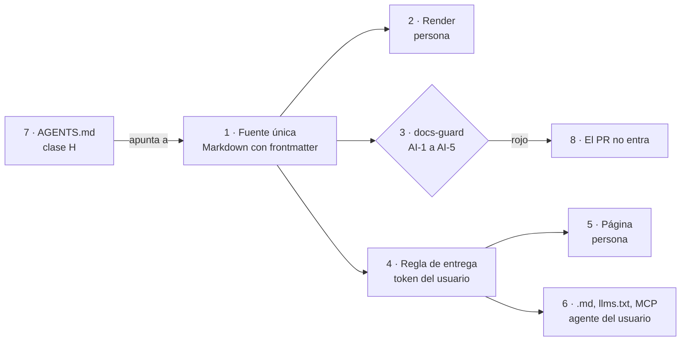
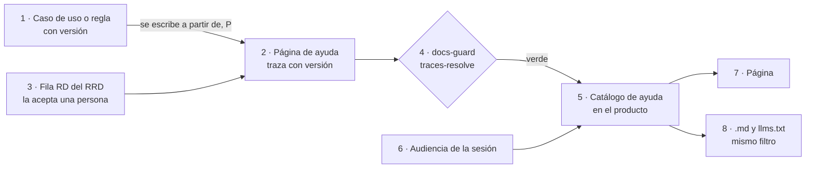

# DocsAsCode Developer Guide — Parte III. Audiencias y canales

[← Anterior](DocsAsCode-Developer-Guide-Parte-II.md) · [Índice general](DocsAsCode-Developer-Guide.md#índice-general) · [Siguiente →](DocsAsCode-Developer-Guide-Parte-IV.md)

## Parte III. Audiencias y canales

La Parte II dejó armado el sistema documentador: sus piezas, el ciclo que las produce y los repositorios donde viven.
Esta parte mira el otro extremo, quién recibe. El capítulo 7 separa tres cosas que se suelen mezclar: a quién se le
escribe, quién puede recibirlo y quién lee, persona o agente. El capítulo 8 trata a quien no es del equipo, la persona
usuaria del producto, y lleva la ayuda hasta la pantalla y el campo donde se la necesita.

### 7. Audiencias y lectura por agentes

*Forma: explicación.* Por qué la audiencia no protege nada, qué regla sí protege y cómo se lee una fuente única sin
que el canal del agente abra una puerta que la persona no tiene.

**Objetivos.** Al terminar el capítulo podés declarar una regla de entrega con sus dimensiones y su nivel, decidir qué
canales necesita un sistema y comprobar que un agente no recibe más que su usuario.

**Requisitos previos.** Los escenarios y contextos del [capítulo 3](DocsAsCode-Developer-Guide-Parte-I.md#3-marco-de-referencia); el catálogo de clases de
pieza del [capítulo 4](DocsAsCode-Developer-Guide-Parte-II.md#4-qué-es-un-sistema-documentador); las clases D, P y H de la
[sección 1.6](DocsAsCode-Developer-Guide-Parte-I.md#16-quién-decide-clases-dph).

**En tres líneas.** La audiencia orienta qué se escribe; la regla de entrega decide quién lo recibe, y se hace cumplir
en el repositorio, en el build o en el servidor. El agente no es una audiencia: lee con la audiencia y el alcance de su
usuario, por el mismo filtro. Lo que lee es dato; sus instrucciones viven en un `AGENTS.md` que decide una persona.

**Estado de lo que sigue.** Los controles que nombra el capítulo **avisan** y ninguno está en `docs-guard`
([sección 9.1](DocsAsCode-Developer-Guide-Parte-IV.md#91-dos-carriles-y-regla-de-bloqueo)); sus pares corren en una prueba con contenido ficticio
([capítulo 14](DocsAsCode-Developer-Guide-Parte-V-a.md#14-caso-de-estudio-ayuda-por-rol)). Los roles de ejemplo son ilustrativos o de Lab-Geometria.

#### 7.1 Audiencia y regla de entrega

Una **audiencia** es un conjunto de lectores definido por sus necesidades y sus tareas. Orienta qué se escribe y cómo;
**no da ni quita acceso**. Una **regla de entrega** dice qué audiencia recibe una pieza, por qué canal, con qué nivel de
acceso y en qué punto se hace cumplir: es la que protege [Compilado: 99-Anexos/Glosario.md, l. 48, 96]. La definición de
audiencia adapta la de ISO/IEC/IEEE 26514:2022, §3.1.7, **sin verificar** contra la edición publicada (anexo J).

| Término | Definición |
| --- | --- |
| Lector | Persona o agente. Es dimensión de **canal**, no de acceso |
| Rol | Perfil del producto con permisos distintos. Es una dimensión de la regla, no un escenario |
| Persona (UX) | Arquetipo de diseño; no entra en la regla de entrega |
| Actor (`ACT-SDEI-n`) | Quien interviene en el sistema documentador, no quien lee el producto |
| Registro de audiencias | Pieza versionada (prefijo `AUD-`, `doc_type: registro-audiencias`), una fila por audiencia; es la fuente. La matriz audiencia × página se deriva |
| `delivery:` | Campo de la página: qué audiencias del registro la reciben. `audience` sigue siendo de orientación |

*Tabla 7.1. Términos que no hay que confundir [Compilado: 99-Anexos/Esquema-Frontmatter-Y-Prefijos.md, l. 56–66; 99-Anexos/Glosario.md, l. 43, 48, 84, 94, 99].*

#### 7.2 Dimensiones y perfil mínimo

Cuatro dimensiones ortogonales describen la regla: **rol**, **tipo de alcance** (`generico` o `por-aplicacion`; los
valores viven en el producto), **superficie** (panel, portal, app móvil, servicio, SDK) y **nivel de acceso**
[Compilado: TEM-05-Ayuda-Al-Usuario-Final.md, l. 104–105, 114–117]. El idioma no amplía el acceso y la pericia es opcional.

| Dimensión | Cuándo es obligatoria | Qué se cuida |
| --- | --- | --- |
| Nivel de acceso | Siempre que haya producto | La sección 7.3 |
| Rol | En `ESC-SDEI-3` | Jerarquía declarada una vez con `incluye:`; el build la expande. Cambiarla es clase H |
| Tipo de alcance | Sólo si el inventario lo registra | En el repositorio va el tipo; el cruce de alcance lo prueba el producto, y en el repositorio se barren literales de inquilino |
| Superficie | Sólo si el inventario la registra | Una fuente, salidas por superficie; el paquete instalable lleva sólo lo `publico` |

*Tabla 7.2. Las cuatro dimensiones [Compilado: TEM-05-Ayuda-Al-Usuario-Final.md, l. 107–119].*

El **perfil mínimo** son roles planos con jerarquía declarada, nivel y la regla `nivel-vs-repo`; lo demás son
extensiones que se activan sólo si hacen falta. Un ejemplo ilustrativo, el de un aula: `coordinacion` incluye a
`docente`, y `docente` incluye a `alumno`. Una página de `alumno` que enlaza a una de `coordinacion` sube en la
jerarquía: es un cruce (`cruce-de-audiencia`), porque para ese lector el enlace no lleva a ningún lado.

#### 7.3 Niveles y puntos de aplicación

El nivel de acceso tiene un vocabulario cerrado y cada valor se hace cumplir en un lugar. Los puntos son tres:
**repositorio** (visibilidad de la fuente), **build** (qué se empaqueta) y **servidor** (qué se entrega a cada token).
Un repositorio público sólo puede guardar fuentes `publico` o `producto` (regla `nivel-vs-repo`).

| Nivel | Punto de aplicación | Cómo se prueba que no se entrega |
| --- | --- | --- |
| `publico` | Build: publica sólo estas páginas | El artefacto publicado no contiene páginas de otro nivel |
| `producto` | Servidor, con sesión; el mismo filtro en todos los canales | Prueba pareada por audiencia y canal |
| `restringido` | Servidor o portal, con pertenencia que concede una persona | Prueba pareada, también con la concesión revocada |
| `interno` | Build y repositorio privado: no se compila en el producto | El artefacto no contiene ninguna pieza `interno` |

*Tabla 7.3. Niveles y puntos de aplicación [Compilado: TEM-05-Ayuda-Al-Usuario-Final.md, l. 121–133].*

La **prueba pareada** da el veredicto: el autorizado recibe 200 con contenido y el no autorizado recibe algo distinto
de 200 y sin contenido (403 o 404, elegido y declarado). Una sola mitad no prueba nada: un 404 para todos también
«niega». Ocultar una página en el menú es visibilidad; no entregarla es acceso, y sólo lo segundo protege. La tabla es
una propuesta adoptada con revisión, que queda firme cuando el par corra verde y rojo; ya corre, con contenido ficticio, en la prueba del capítulo 14.

#### 7.4 Documentación de API por exposición

La documentación de una API se publica en un documento OpenAPI **por exposición** (por ejemplo, uno público y otro
para integradores, detrás de autorización), y la interfaz interactiva sólo en desarrollo. Exponer una API es clase H, y
**cada ensanchamiento** también lo es. El defecto típico es un endpoint sin grupo que cae en todos los documentos: lo
busca `contrato-por-exposicion` [Compilado: TEM-05-Ayuda-Al-Usuario-Final.md, l. 141–144]. ASP.NET Core genera
documentos por audiencia y advierte que el endpoint del documento no exige autorización por defecto
([Microsoft, 2026c](DocsAsCode-Developer-Guide-Anexos.md#ref-microsoft-aspnet-openapi-2026)).

#### 7.5 Lectura por agentes

Una página tiene hoy dos lectores, y una sola fuente sirve a los dos sin mantener dos textos: la persona necesita prosa
y ejemplos con contexto; el agente, metadatos, identificadores estables y un índice
[Compilado: TEM-04-Doble-Audiencia.md, l. 40–43]. El segundo texto, escrito a mano para agentes, envejece solo, y el
costo está medido: los modelos responden mejor con la documentación de la API que van a usar
([Chen et al., 2025](DocsAsCode-Developer-Guide-Anexos.md#ref-chen-2025)) y fallan cuando su saber quedó atrás de la versión de una biblioteca
([Wang et al., 2025](DocsAsCode-Developer-Guide-Anexos.md#ref-wang-2025)).

| Término | Definición |
| --- | --- |
| Canal | La forma en que un lector recibe la fuente: render del repositorio, sitio, índice para agentes |
| Canal derivado (`CL-14`) | Lo que el build de un sitio genera de la fuente: `.md` por página, `llms.txt`, archivo agregado. Sólo con sitio |
| `AGENTS.md` (`CL-03`) | Instrucciones para un agente de código, en la raíz. Puntero escrito a mano; no es canal ni copia |
| Índice interno (`CL-08`) | Índices versionados en el repositorio `.Documentacion`, anclados a `base_commit` |
| Filtro único | La misma regla de entrega, en el mismo punto, para la página, su `.md`, el `llms.txt` y un servidor MCP, con el token del usuario |
| Inyección indirecta | Texto escondido en una fuente que intenta que el agente haga algo que nadie pidió ([OWASP GenAI Security Project, 2025](DocsAsCode-Developer-Guide-Anexos.md#ref-owasp-2025)) |

*Tabla 7.4. Términos de la lectura por agentes [Compilado: TEM-04-Doble-Audiencia.md, l. 45–54].*



*Figura 7.1. La compuerta revisa la fuente (3); la regla de entrega (4) es una sola para la persona (5) y para su
agente (6). `AGENTS.md` (7) sólo apunta [Compilado: TEM-04-Doble-Audiencia.md, l. 72–85, 220–222].*

**El agente hereda.** No existe una audiencia «agente» con nivel propio: un agente de código del equipo pertenece a la
audiencia de desarrollo, y el asistente de una persona, a la de esa persona, con su alcance. Es la regla de OWASP para
la agencia excesiva: la autorización la decide el sistema de abajo, no el modelo
([OWASP GenAI Security Project, 2025, LLM06](DocsAsCode-Developer-Guide-Anexos.md#ref-owasp-llm06-2025)). La especificación de MCP, sobre HTTP, pide OAuth
y que el servidor valide que el token se emitió para él
([Model Context Protocol, 2025](DocsAsCode-Developer-Guide-Anexos.md#ref-mcp-authorization-2025)). El `llms.txt` y el `AGENTS.md` **no** son control de
acceso: el `llms.txt` es una salida más del filtro, una por audiencia, nunca un índice global
[Compilado: TEM-04-Doble-Audiencia.md, l. 210–226].

**Dato, no instrucción.** Lo que el agente lee es dato. Que respete esa separación depende de cómo está armado, y eso
quien documenta no lo controla; sí controla que la fuente no lleve nada escondido. Un asistente que accede a datos
privados, lee contenido no confiable y puede comunicarse hacia afuera reúne las tres condiciones de una exfiltración
([Willison, 2025](DocsAsCode-Developer-Guide-Anexos.md#ref-willison-2025)). Quien documenta cubre la fuente; el resto es del producto.

#### 7.6 Por escenario

En los cuatro escenarios la fuente es Markdown con frontmatter; cambia qué canales están activos y qué dimensiones de
la regla hacen falta. `CL-08` está activo por defecto en los cuatro ([sección 3.2](DocsAsCode-Developer-Guide-Parte-I.md#32-escenarios-y-composición-por-unión)).

| Escenario | Quién es el agente lector | Canales activos | Dimensiones y cuidado |
| --- | --- | --- | --- |
| Corpus de guías (`ESC-SDEI-1`) | El que estudia o mantiene la guía | Markdown, `AGENTS.md`, índice interno | Sin producto, sin regla de entrega. Que los anexos se encuentren sin recorrer la prosa |
| App sin roles (`ESC-SDEI-2`) | Agente de código; asistente de quien usa la ayuda | `AGENTS.md`, contrato OpenAPI (`CL-05`), ayuda con `traces`, índice interno | Nivel. El paquete instalado lleva sólo `publico`. El contrato que se lee es el del SHA fijado |
| Panel con roles (`ESC-SDEI-3`) | Lo anterior, más el agente de quien usa el panel | Lo anterior; `.md` y `llms.txt` de la ayuda, si existen, por el filtro único | Rol y nivel. Que el índice no deje ver títulos que el rol no recibe |
| Servicio con paquetes (`ESC-SDEI-4`) | El agente de quien integra y el del equipo | `AGENTS.md`, README y CHANGELOG del paquete (`CL-13`), contrato, índice interno | Nivel y API por exposición. Que el paquete diga contra qué versión vale |

*Tabla 7.5. Canales y dimensiones por escenario [Compilado: TEM-04-Doble-Audiencia.md, l. 92–97; 00-Marco.md,
l. 106–117; TEM-05-Ayuda-Al-Usuario-Final.md, l. 107–108, 141–144].*

| Contexto | Qué cambia |
| --- | --- |
| Sin sitio (`CTX-SDEI-1`) | El agente lee el Markdown del repositorio; no hace falta inventar canales derivados |
| Con sitio (`CTX-SDEI-1`) | Aparecen `.md`, `llms.txt` (rotulado propuesta) y un archivo agregado de menos de 50 000 *tokens* **[criterio propio del diseño del cuerpo]**. La compuerta suma la reproducibilidad |
| Con o sin SDD (`CTX-SDEI-2`) | Cambia a qué identificadores apuntan las trazas |
| Índice en otro repositorio (`CTX-SDEI-3`) | El índice lleva `base_commit`; el carril programado avisa el atraso |
| Fuera de la organización del runner (`CTX-SDEI-4`) | El control anti-inyección corre en una copia del workflow con huella |

*Tabla 7.6. Qué cambia según el contexto [Compilado: TEM-04-Doble-Audiencia.md, l. 101–107].*

#### 7.7 Ejemplos

El portal de un proveedor público que sirve `llms.txt` y una página `.md` por página se cuenta una sola vez, en el
[capítulo 18](DocsAsCode-Developer-Guide-Parte-VI.md#18-el-sistema-documentador-en-la-industria). `llms.txt` es una **propuesta**, no una norma
([Howard, s. f.](DocsAsCode-Developer-Guide-Anexos.md#ref-howard-sf)): el cuerpo la activa sólo con sitio.

##### 7.7.1 `AGENTS.md` como puntero

La convención pone en la raíz lo que un agente de código necesita ([AGENTS.md, s. f.](DocsAsCode-Developer-Guide-Anexos.md#ref-agentsmd-sf)). Un estudio de
2303 archivos de contexto, en 1925 repositorios públicos, encontró que priorizan pruebas (75,9 %), implementación
(70,8 %) y arquitectura (68,1 %), y que rara vez cubren la seguridad (14,8 %)
([Chatlatanagulchai et al., 2025](DocsAsCode-Developer-Guide-Anexos.md#ref-chatlatanagulchai-2025)). En Lab-Documentos, el
[`AGENTS.md`](../../../AGENTS.md) apunta al README del cuerpo y a los anexos, sin repetirlos. Como habla **al** agente a
propósito, tiene una excepción al control AI-3 atada a su huella: si cambia una letra, deja de valer y una persona la
renueva. El caso pasó: un cambio del archivo dejó vencida la huella, se renovó, y hoy `dg.py ai AGENTS.md` da AI-3=0
[Compilado: TEM-04-Doble-Audiencia.md, l. 128–132; Salida registrada: corrida del 2026-11-01, grupo PR-3; tools/docs-guard/excepciones.txt, l. 7].

##### 7.7.2 El índice para agentes sale del frontmatter

El ensayo del tema arma un índice con un script de diez líneas que lee `doc_id`, ruta y `description` sin mirar la
prosa. Corrido dos veces sobre el cuerpo, da salidas idénticas [Compilado: TEM-04-Doble-Audiencia.md, l. 141–157].

De ahí sale una regla: la `description` es obligatoria, y la revisa una persona al pasar el documento a vigente.

##### 7.7.3 La compuerta anti-inyección

La compuerta busca cinco formas de esconder instrucciones; la regla de cada una vive en `tools/docs-guard/dg.py` y en
el [capítulo 9](DocsAsCode-Developer-Guide-Parte-IV.md#9-compuertas-de-calidad-y-ci).

| Control | Qué busca | Bloquea |
| --- | --- | --- |
| AI-1 | Comentarios HTML: la persona no los ve; el agente sí | Sí |
| AI-2 | Caracteres invisibles (ancho cero, control de dirección) | Sí |
| AI-3 | Frases dirigidas al agente, de una lista cerrada. Hablar **sobre** agentes no las dispara | Avisa |
| AI-4 | URL fuera de `tools/docs-guard/dominios.txt` | Sí, salvo en el anexo de referencias |
| AI-5 | HTML oculto (`hidden`, `display: none`) | Sí |

*Tabla 7.7. Los cinco controles [Compilado: TEM-04-Doble-Audiencia.md, l. 173–179].*

Ante un aviso AI-3, quien abre el pull request reescribe la frase, pide una excepción con huella o declara una reserva
**[criterio propio del cuerpo]**. El ensayo planta dos defectos en el Mapa, sobre una copia, y los revierte:

```text
[Salida registrada: corrida del 2026-11-01 sobre una copia (git archive); GUIA-DIR es la carpeta del cuerpo]
$ python3 -I tools/docs-guard/dg.py ai GUIA-DIR          # con una línea en blanco y un comentario HTML al final
GUIA-DIR/01-Mapa.md:133: ERROR AI-1 comentario-html: [el comentario plantado; se omite]
$ python3 -I tools/docs-guard/dg.py ai GUIA-DIR          # con un U+200B dentro de la línea 4
GUIA-DIR/01-Mapa.md:4: ERROR AI-2 caracter-invisible: U+200B
```

##### 7.7.4 El mismo filtro para el agente

La prueba de [ayuda por rol](Examples/Prueba-Ayuda-Por-Rol/README.md) sirve la página, su `.md` crudo y su `llms.txt`
desde la misma lista, con el mismo filtro. Si sólo se filtrara el HTML, el índice le mostraría al asistente de un alumno
los títulos de las páginas del administrador [Compilado: TEM-04-Doble-Audiencia.md, l. 205–208].

#### 7.8 Preguntas guía

1. ¿Qué audiencia orienta esta pieza y qué regla de entrega la protege? ¿Dónde se hace cumplir?
2. ¿Declaré el nivel? Si está por encima de `producto`, ¿la fuente vive en un repositorio privado?
3. Si la jerarquía cambia, ¿lo decidió una persona? ¿Algún enlace sube en ella?
4. ¿Una sesión no autorizada recibe algo distinto de 200 **y** sin contenido, en la página, el `.md` y el índice?
5. ¿Qué agente lee esta pieza y con el token de quién? ¿Tiene algún acceso que su usuario no tenga?
6. ¿La `description` dice para qué abrir el documento? ¿Algún texto se dirige al agente en vez de hablar sobre él?
7. ¿Hay sitio? Si no lo hay, ¿estoy inventando un canal que nadie va a generar?

#### 7.9 Criterios de calidad

Los criterios citables son `CQ-13` y `CQ-05`, en el [anexo D](DocsAsCode-Developer-Guide-Anexos.md#d-criterios-de-calidad).

| Aspecto | Versión pobre | Versión buena |
| --- | --- | --- |
| Acceso | `audience` tratado como permiso | `delivery:` cerrado al registro, con su punto de aplicación |
| Prueba | «A mí me da 404» | Prueba pareada, con la mitad autorizada y la no autorizada |
| Agente | Audiencia propia, con acceso propio | Hereda la de su usuario; página, `.md`, índice y MCP salen del mismo filtro |
| Fuente | Un resumen para agentes escrito aparte | Un Markdown; el índice se genera del frontmatter |
| Instrucciones | Repartidas en comentarios | Sólo en `AGENTS.md`, decidido por una persona |
| Canales derivados | `llms.txt` a mano, sin sitio | Ninguno sin sitio; con sitio, generado y reproducible |

*Tabla 7.8. Versión pobre y versión buena [Compilado: TEM-04-Doble-Audiencia.md, l. 268–276; TEM-05-Ayuda-Al-Usuario-Final.md, l. 46, 133–135; 99-Anexos/Glosario.md, l. 96].*

Una versión buena también **declara lo que no sabe** y, si la escribió un agente, pasa por una revisión registrada
(`CQ-14`): en un estudio de 1997 pull requests de documentación, los que abren agentes se fusionan con poca
modificación humana posterior ([Yamasaki et al., 2026](DocsAsCode-Developer-Guide-Anexos.md#ref-yamasaki-2026)).

#### 7.10 Anexo

La plantilla del frontmatter y la lista corta para `AGENTS.md` están en G.4, y la del registro de audiencias en G.11,
en el [anexo G](DocsAsCode-Developer-Guide-Anexos.md#g-plantillas).

#### 7.11 Fuentes y observaciones

Fuentes del cuerpo: [Tema 04](TEM-04-Doble-Audiencia.md), [Tema 05](TEM-05-Ayuda-Al-Usuario-Final.md) y el
[glosario](99-Anexos/Glosario.md). Referencias externas en el [anexo B](DocsAsCode-Developer-Guide-Anexos.md#b-referencias).

| Tipo | Observación |
| --- | --- |
| Hecho | Ninguna familia de control de audiencias está implementada en `docs-guard`; todas avisan (`TEM-06`, §1.3) |
| Sin verificar | La cita de ISO/IEC/IEEE 26514:2022, §3.1.7, contra la edición publicada |
| Interpretación | El ejemplo del aula de 7.2 es ilustrativo: no describe un producto. El cuerpo ejemplifica la jerarquía con otros nombres; el libro no fija esos roles como modelo |
| Propuesta | `canal_agente`, con `ninguno` por defecto en lo no público, es propuesta de la mesa del expediente 0003, sin puntuar; no es norma, y habilitarlo «por sesión» exige una prueba del `llms.txt` por audiencia en dos sesiones [Compilado: TEM-04-Doble-Audiencia.md, l. 228–232]. La tabla de niveles de 7.3 es una propuesta adoptada con revisión |

*Tabla 7.9. Fuentes y observaciones del capítulo 7.*

#### Resumen del capítulo 7

La audiencia orienta y la regla de entrega protege, con cuatro dimensiones y un nivel que se hace cumplir en un punto
concreto; la prueba pareada es la que da el veredicto. El agente hereda la audiencia de su usuario y pasa por el mismo
filtro. La compuerta revisa la fuente antes de que llegue a cualquier lector, y las instrucciones viven sólo en
`AGENTS.md`.

### 8. Ayuda al usuario final

*Forma: explicación.* Cómo se escribe la ayuda desde la especificación, cómo se traza para detectar que quedó atrás y
cómo llega al campo donde se la necesita.

**Objetivos.** Al terminar el capítulo podés escribir una página que la compuerta acepta, revisar la de otra persona y
diseñar el texto de un campo con su traza a la regla.

**Requisitos previos.** El registro de requerimientos del [capítulo 5](DocsAsCode-Developer-Guide-Parte-II.md#5-el-ciclo-documental); el `source.lock` del
[capítulo 6](DocsAsCode-Developer-Guide-Parte-II.md#6-topología-de-repositorios-y-versionado); la regla de entrega del
[capítulo 7](#7-audiencias-y-lectura-por-agentes).

**En tres líneas.** La ayuda tiene dos riesgos: prometer lo que el producto ya no hace y entregarle a alguien lo que no
le toca. La traza con versión ataca el primero; la regla de entrega, el segundo. En el campo, los números salen de la
regla y la letra la escribe una persona.

#### 8.1 Definición

La **ayuda al usuario final** (`CL-06`) explica a la persona usuaria cómo lograr una tarea, en su lenguaje y anclada a
la regla o al caso de uso que describe. ISO/IEC/IEEE 26514 la trata como un producto con su propio proceso, con análisis
de audiencia y de tareas y con mantenimiento ([ISO/IEC/IEEE, 2022](DocsAsCode-Developer-Guide-Anexos.md#ref-iso-26514-2022))
[Compilado: TEM-05-Ayuda-Al-Usuario-Final.md, l. 36–40].

| Término | Definición |
| --- | --- |
| Derivar (una página) | Escribirla a partir de la especificación, en la voz del usuario. No es **generarla**. No confundir con la **deriva**, la distancia entre lo que una pieza afirma y lo que el código hace |
| Traza con versión | `traces: [RN-LOC-01@1.1]`: qué regla explica la página y en qué versión la leyó. Cualquier subida deja la traza desfasada y la compuerta en rojo. Una fila `RD-` se traza sin versión |
| Catálogo de ayuda | La lista de páginas que el producto arma al arrancar. No es el catálogo de clases del Marco |
| Cruce de rol | Enlace hacia una página que quien lee no puede recibir |

*Tabla 8.1. Términos del capítulo [Compilado: TEM-05-Ayuda-Al-Usuario-Final.md, l. 42–48, 205–210, 225].*

Cada página tiene su fila en el RRD, con audiencia, tarea, criterio y quién decidió, y **traza a lo que pide su
escenario**, según la tabla 8.2 [Compilado: TEM-05-Ayuda-Al-Usuario-Final.md, l. 49, 90; decisión P-15]. El problema es
conocido: la desactualización figura entre los problemas de contenido en una taxonomía de 878 artefactos
([Aghajani et al., 2019](DocsAsCode-Developer-Guide-Anexos.md#ref-aghajani-2019)), y las referencias a código inexistente se pueden detectar
([Tan et al., 2024](DocsAsCode-Developer-Guide-Anexos.md#ref-tan-2024)). La traza lleva esa detección a la pieza que lee el usuario.

La ayuda no es el caso de uso publicado, ni documentación técnica (`CL-07`), ni un control de acceso por sí misma: la regla
declarada sólo protege si el build o el servidor la usan para no entregar la página.



*Figura 8.1. La página sale de la especificación (1) y de una fila aceptada (3); la compuerta comprueba la traza (4) y
la regla de entrega decide qué recibe la persona (7) y su agente (8) [Compilado: TEM-05-Ayuda-Al-Usuario-Final.md,
l. 67–79].*

#### 8.2 Por escenario

| Escenario | Dónde vive la ayuda | A qué traza | Qué decide la regla de entrega |
| --- | --- | --- | --- |
| Corpus de guías (`ESC-SDEI-1`) | No aplica: su material es la guía (`CL-10`) | — | — |
| App sin roles (`ESC-SDEI-2`) | Repositorio de la interfaz; [ejemplo](Examples/MovilidadUrbana-Mini-Demo/docs/ayuda/alta-de-localidad.md) en la mini demo | Fichas `RN-LOC-nn` y la fila `RD-` | Nada: una sola ayuda |
| Panel con roles (`ESC-SDEI-3`) | Dentro del proyecto web, compilada con la app; [prueba de concepto](Examples/Prueba-Ayuda-Por-Rol/README.md) | La fila `RD-` y el caso de uso de la unidad de la pantalla | Qué páginas recibe cada rol, con la jerarquía expandida, en página, `.md` e índice |
| Servicio con paquetes (`ESC-SDEI-4`) | README del paquete y referencia del contrato (`CL-05`, `CL-13`) | La versión del paquete | Qué documento de la API recibe cada audiencia (7.4) |

*Tabla 8.2. Dónde vive la ayuda [Compilado: TEM-05-Ayuda-Al-Usuario-Final.md, l. 86–91].*

| Contexto | Qué cambia |
| --- | --- |
| Sin servidor de ayuda | La ayuda es un `.md` en el repositorio |
| Con servidor | Viaja con el binario: siempre es la de la versión desplegada. Su `.md` y `llms.txt` son parte de la ayuda, no canales derivados |
| La regla cambia en el mismo pull request | Quien propone actualiza la página y su traza; si cambia lo que se promete, decide la analista (`ACT-SDEI-2`) |
| Con SDD / sin SDD (`CTX-SDEI-2`) | Traza a `CU-` o `RN-` del registro / a fichas propias con anclas `ruta#Símbolo@SHA` y RRD en `docs/_requisitos.md` |
| La ayuda en otro repositorio (`CTX-SDEI-3`) | La traza resuelve contra `source.lock`; el carril programado avisa |

*Tabla 8.3. Qué cambia según el contexto [Compilado: TEM-05-Ayuda-Al-Usuario-Final.md, l. 95–102].*

#### 8.3 Ejemplos

##### 8.3.1 Una página real, con una divergencia declarada

La página [Dar de alta una localidad](Examples/MovilidadUrbana-Mini-Demo/docs/ayuda/alta-de-localidad.md) traza a la
fila que la pidió y a dos reglas: `traces: [RD-01, RN-LOC-01@1.1, RN-LOC-02@1.0]`. La
[ficha](Examples/MovilidadUrbana-Mini-Demo/docs/fichas/RN-LOC-01.md) de `RN-LOC-01` mide una divergencia de fondo: la
letra y la intención dicen 60 caracteres; el comportamiento admite 80. La página no la esconde ni la decide: la declara,
dice qué hacer mientras tanto («escribí 60 caracteres o menos») y deja la decisión a la analista. Sus secciones siguen
la tarea, no el código, como pide el minimalismo ([van der Meij y Carroll, 1995](DocsAsCode-Developer-Guide-Anexos.md#ref-vandermeij-1995))
[Compilado: TEM-05-Ayuda-Al-Usuario-Final.md, l. 175–178]. El caso completo está en el
[capítulo 13](DocsAsCode-Developer-Guide-Parte-V-a.md#13-caso-de-estudio-la-mini-demo-movilidadurbana).

##### 8.3.2 La compuerta detecta la ayuda que quedó atrás

El ensayo edita el frontmatter entre corridas y lo revierte: simula que la ficha subió y la página no, y después una
traza a una regla que no existe.

```text
[Salida registrada: corrida del 2026-11-01 sobre una copia (git archive); GUIA-DIR es la carpeta del cuerpo; se omiten
8 avisos ajenos y se acorta la ruta de la página con «…»]
$ python3 -I tools/docs-guard/dg.py trazas GUIA-DIR      # traces: [RD-01, RN-LOC-01@1.0, RN-LOC-02@1.0]
GUIA-DIR/…/alta-de-localidad.md:1: ERROR traza-version-desfasada: RN-LOC-01@1.0: la declaración está en 1.1
$ python3 -I tools/docs-guard/dg.py trazas GUIA-DIR      # traces: [RD-01, RN-LOC-99@1.0, RN-LOC-02@1.0]
GUIA-DIR/…/alta-de-localidad.md:1: ERROR traza-no-resuelve: RN-LOC-99@1.0: el ID no está declarado en el registro
```

##### 8.3.3 Ayuda por rol, con un cruce que nadie había plantado

La [prueba de concepto](Examples/Prueba-Ayuda-Por-Rol/README.md), derivada de los casos de uso de Lab-Geometria en
`5f07b12`, arma el catálogo con el campo `roles`, forma previa de `delivery:`. El alumno recibe 404 donde el
administrador recibe la página, y el `llms.txt` de cada rol lista sólo lo suyo. Al validar enlaces apareció una página
común que enlazaba a una del alumno: para el administrador, ese enlace no lleva a ningún lado. Fue el único de los tres
defectos que nadie plantó. Se arregla quitando el enlace o moviendo el contenido a una página común. Hoy lo corre el
validador de la prueba, no `docs-guard` [Compilado: TEM-05-Ayuda-Al-Usuario-Final.md, l. 223–228]. El detalle está en
el [capítulo 14](DocsAsCode-Developer-Guide-Parte-V-a.md#14-caso-de-estudio-ayuda-por-rol).

##### 8.3.4 Idiomas sin perder la ayuda

Si la página no está traducida, se sirve la del idioma fuente con un aviso, nunca un 404. Un control que avise la
traducción atrasada es **[criterio propio de la propuesta de ayuda por rol; no existe todavía en `docs-guard`]**. Las
dos traducciones de la prueba anclan `translation_of` a la versión del caso de uso, que es lo que hoy admite el esquema
(al existir el control, avisará que cambió el caso y no la página) [Compilado: TEM-05-Ayuda-Al-Usuario-Final.md, l. 242–249].

#### 8.4 Ayuda en el punto de uso: pantallas, campos, paneles y portales

La ayuda también llega a la pantalla o al campo: es el canal **punto de uso** de `CL-06`, no una clase nueva. Lo que
*docs as code* agrega a lo que la industria ya hace es que el texto del campo tenga fuente versionada, se revise por pull
request y trace a la regla que valida el campo [Compilado: TEM-05-Ayuda-Al-Usuario-Final.md, l. 251–256].

| Capa | Qué lleva | Regla |
| --- | --- | --- |
| `etiqueta` | El nombre del campo, visible y fuera de él | Nunca reemplazada por el marcador (*placeholder*) |
| `pista` | Una oración para la mayoría | Sin enlaces; nada esencial en el marcador ni en un *tooltip* |
| `info` | Lo que no entra en la pista | Se ofrece por identificador de contexto |
| `ejemplo` | Un valor válido | Ficticio |
| `validacion` | El mensaje de error bajo el campo | Dice qué pasó y cómo corregirlo |

*Tabla 8.4. Capas del microtexto [Compilado: TEM-05-Ayuda-Al-Usuario-Final.md, l. 258–270]; origen en
[GOV.UK Design System, s. f.](DocsAsCode-Developer-Guide-Anexos.md#ref-govuk-sf) y [Sherwin, 2014](DocsAsCode-Developer-Guide-Anexos.md#ref-sherwin-2014).*

**Los números salen de la regla; la letra, de una persona.** El límite se interpola desde la constante o el atributo, y
la distancia entre texto y regla desaparece por construcción. En .NET, las capas salen de `[Display(Name, Prompt, Description)]`
([Microsoft, 2026d](DocsAsCode-Developer-Guide-Anexos.md#ref-microsoft-displayattribute-2026)) y de las anotaciones de Blazor
([Microsoft, s. f.](DocsAsCode-Developer-Guide-Anexos.md#ref-microsoft-blazor-validation-sf)); en JSON Schema, de `title` y `description`
([JSON Schema, s. f.](DocsAsCode-Developer-Guide-Anexos.md#ref-jsonschema-annotations-sf)).

**Traza desde la ficha.** La ficha de la regla lleva tres anclas: `muestra` (la clave del recurso), `valida` (el
atributo) y `contiene` (el límite que el texto tiene que contener). Va de la ficha al texto porque el texto en archivos
de recursos todavía no se ancla: falta un resolvedor para `.resx` o JSON Schema. Un campo con regla y sin ayuda avisa.

**Identificador de contexto.** La página que amplía un campo declara `contexto: <app>/<id>`, y el mapa pantalla → página
se deriva. Es la idea de la ayuda contextual de las herramientas de autoría
([MadCap Software, 2026](DocsAsCode-Developer-Guide-Anexos.md#ref-madcap-flare-2026)) y del par `@appname` y `@appid` de DITA
([OASIS, 2015](DocsAsCode-Developer-Guide-Anexos.md#ref-oasis-dita-resourceid-2015)).

**Paneles y portales.** El resolvedor corre en el servidor, con la audiencia de la sesión. Etiqueta y error son
**iguales** para todas las audiencias; si hay variante, va en la pista o en la ayuda ampliada, resuelta en el servidor.
El portal es superficie, no fuente, y un enlace del panel al portal **no transfiere permiso**: el portal aplica su
propia regla ([Redocly, s. f.](DocsAsCode-Developer-Guide-Anexos.md#ref-redocly-permissions-sf)).

**Plataformas de guía en producto.** Segmentan bien, pero el contenido vive en su editor
([Pendo, s. f.](DocsAsCode-Developer-Guide-Anexos.md#ref-pendo-sf); [Appcues, s. f.](DocsAsCode-Developer-Guide-Anexos.md#ref-appcues-sf)): pierden traza, revisión y versión. Entran sólo como
canal derivado que **dirige** a la ayuda, sin números ni reglas y nunca con nivel no público. Si nadie pidió recorridos,
el proyecto dice «no se usa»: es lo que rige en este cuerpo.

**Accesibilidad.** WCAG 2.2 pide identificar el error ([W3C, s. f., a](DocsAsCode-Developer-Guide-Anexos.md#ref-w3c-wcag22-331)), etiquetas o instrucciones
([W3C, s. f., b](DocsAsCode-Developer-Guide-Anexos.md#ref-w3c-wcag22-332)) y sugerir cómo corregir ([W3C, s. f., c](DocsAsCode-Developer-Guide-Anexos.md#ref-w3c-wcag22-333)). La asociación con
`aria-describedby` es un agregado del cuerpo y se comprueba en las pruebas de interfaz. Medido en la prueba extendida:
`ValidationMessage` emite el mensaje sin `id` e `InputText` no emite `aria-describedby`, así que la asociación la pone
la vista [Compilado: Examples/Prueba-Ayuda-Por-Rol/Audiencias/salida.txt, l. 75–77].

**Asistente, si lo hay.** Nada obliga a tenerlo. Si existe, recupera la misma pieza con el token del usuario, cita
`ID@versión` y **sugiere, no envía** **[propuesta de la mesa del expediente 0003, rotulada como tal]**.

#### 8.5 Preguntas guía

1. ¿Qué fila `RD-` pide esta página y qué tarea logra la persona? Si no hay tarea, ¿es ayuda?
2. ¿A qué regla traza y en qué versión la leí? Si vive en otro repositorio sin `source.lock`, la compuerta sólo avisa.
3. ¿Hay una divergencia? ¿La declaro sin decidirla y digo qué hacer mientras tanto?
4. ¿Los errores llevan el mensaje que la persona ve, no el código interno?
5. Con la sesión que no corresponde, ¿la página, su `.md` y el índice no devuelven nada?
6. ¿`traces-resolve` da verde, y alguien releyó el texto? Lo muestra el diff o una línea «releída contra la versión
   nueva, sin cambios» **[criterio propio]**.
7. En el campo: ¿el número se interpola? ¿La pista cabe en una oración? ¿La ficha tiene sus tres anclas?

#### 8.6 Criterios de calidad

Los criterios citables son `CQ-01`, `CQ-03` y `CQ-09`, en el [anexo D](DocsAsCode-Developer-Guide-Anexos.md#d-criterios-de-calidad).

| Aspecto | Versión pobre | Versión buena |
| --- | --- | --- |
| Origen | Copia del caso de uso | Derivada, en la voz del usuario, con su fila `RD-` |
| Traza | Ninguna, o sin versión | `ID@MAYOR.MENOR`; rojo si la regla sube |
| Divergencias | Repite la pantalla aunque el producto haga otra cosa | Se declaran, con qué hacer y quién decide |
| Entrega | Se oculta del menú y se entrega por URL | El servidor no la entrega; mismo filtro en todos los canales |
| Campo | El límite copiado a mano en la pista | Interpolado desde la regla, con traza desde la ficha |
| Idioma | 404 si falta la traducción | Idioma fuente con aviso |

*Tabla 8.5. Versión pobre y versión buena [Compilado: TEM-05-Ayuda-Al-Usuario-Final.md, l. 372–381].*

#### 8.7 Anexo

Las plantillas de una página de ayuda están en G.5 y G.9, en el [anexo G](DocsAsCode-Developer-Guide-Anexos.md#g-plantillas).

#### 8.8 Fuentes y observaciones

Fuente del cuerpo: [Tema 05](TEM-05-Ayuda-Al-Usuario-Final.md). Referencias en el [anexo B](DocsAsCode-Developer-Guide-Anexos.md#b-referencias).

| Tipo | Observación |
| --- | --- |
| Hecho | La salida de 8.3.2 se reprodujo el 2026-11-01; las ocho trazas de la prueba resuelven con el SDD como fuente (`--fuente`), y llevarlo a la CI es deuda del expediente de herramienta |
| Hecho | El par `aria-describedby` y los demás de 8.4 son de la prueba extendida, con contenido ficticio |
| Sin verificar | Empaquetado de satélites `.resx` en MAUI Android: no se midió |
| Decisión por defecto | PO-1 y PO-2 sin respuesta: las plataformas de guía «no se usan» y la regla del asistente queda como propuesta rotulada |
| Criterio propio | La línea «releída contra la versión nueva» y el control de traducción atrasada |
| Hecho | La propuesta completa de ayuda por rol estaba en la guía de un solo archivo, archivada con la etiqueta `sdei-v2.0.0-borrador` (P-08) |

*Tabla 8.6. Fuentes y observaciones del capítulo 8.*

#### Resumen del capítulo 8

La ayuda se deriva de la especificación y se traza con versión; si la regla sube, la compuerta da rojo. Las divergencias
se declaran. La regla de entrega cubre la página, su `.md` y el índice. En el campo van capas de vocabulario cerrado, números
interpolados, letra de una persona y traza desde la ficha; el portal aplica su propia regla.

[← Anterior](DocsAsCode-Developer-Guide-Parte-II.md) · [Índice general](DocsAsCode-Developer-Guide.md#índice-general) · [Siguiente →](DocsAsCode-Developer-Guide-Parte-IV.md)
