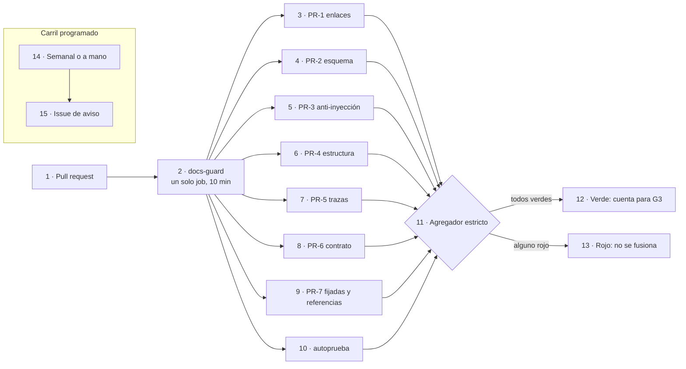
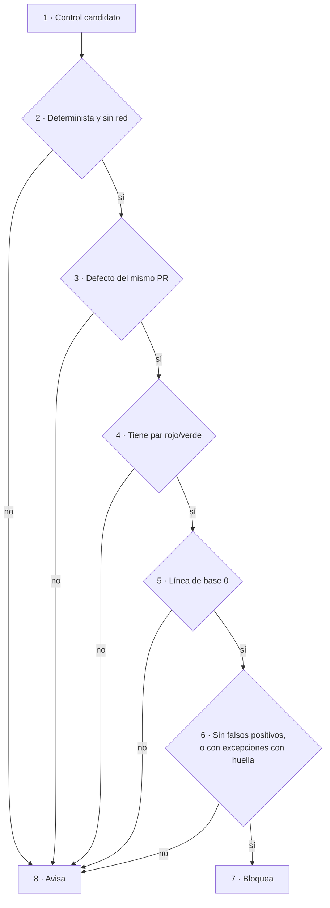
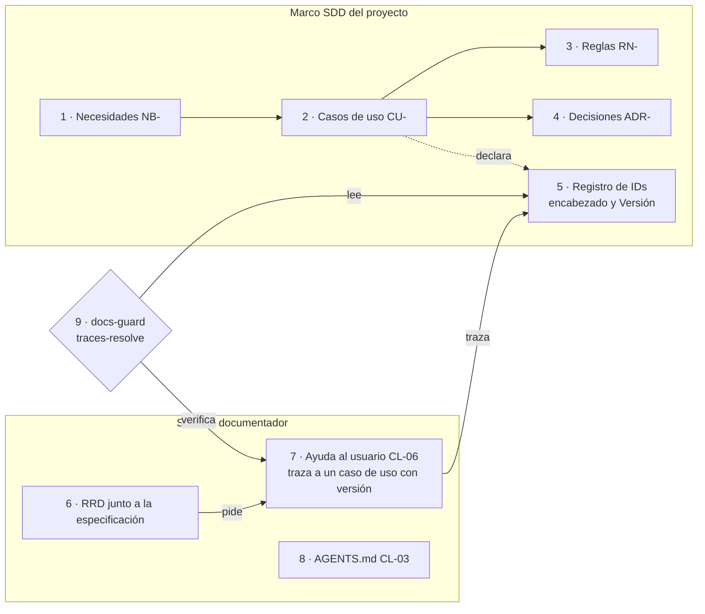
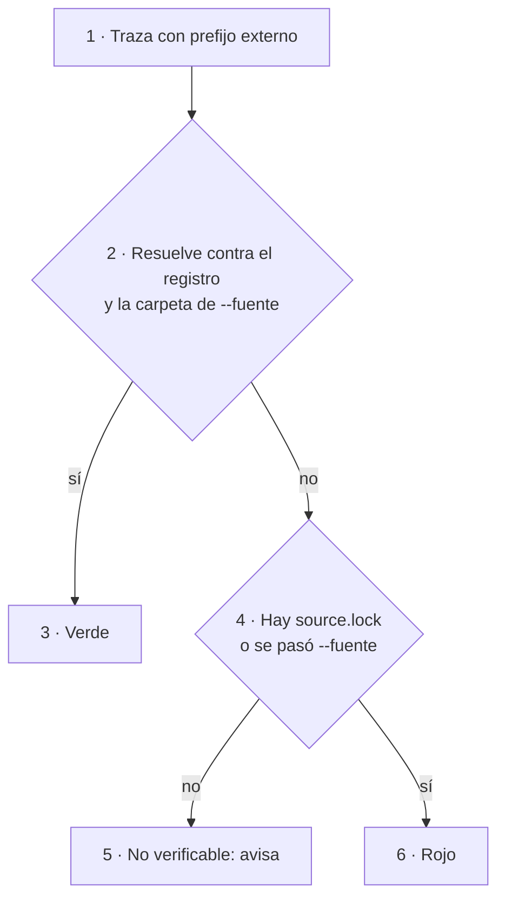
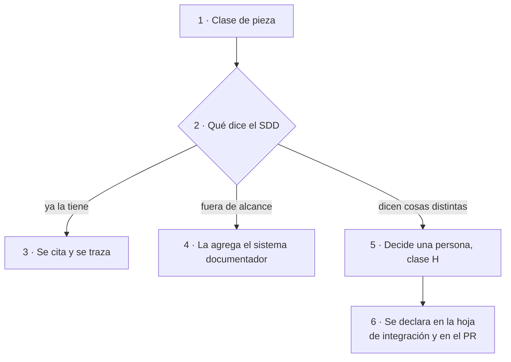

# DocsAsCode Developer Guide — Parte IV. Verificar e integrar

[← Anterior](DocsAsCode-Developer-Guide-Parte-III.md) · [Índice general](DocsAsCode-Developer-Guide.md#índice-general) · [Siguiente →](DocsAsCode-Developer-Guide-Parte-V-a.md)

## Parte IV. Verificar e integrar

Las partes II y III enseñaron a diseñar las piezas y a escribirlas para sus lectores. Esta parte trata de lo que las
mantiene en pie cuando el código y la especificación se mueven. El capítulo 9 explica la compuerta: qué controles
corren en cada pull request, cuáles bloquean y cuáles sólo avisan, y cómo se prueba que la compuerta misma funciona.
El capítulo 10 lleva esa compuerta a un proyecto que ya tiene un marco de desarrollo guiado por especificación, para
que la documentación trace a los identificadores que ese marco declara en lugar de inventar los suyos.

### 9. Compuertas de calidad y CI

*Forma: explicación.* Una documentación que se escribe como código se verifica como código: en cada pull request
corre un conjunto de controles que termina con un código de salida, y si alguno da rojo, el cambio no entra
[Compilado: TEM-06-Compuertas-Y-CI.md, l. 17–19].

**Objetivos.** Al terminar el capítulo podés decidir, para un control nuevo, si tiene que bloquear o sólo avisar;
leer el resultado de una corrida para saber qué arreglar; y explicar por qué un pull request que llega desde un fork
no se fusiona solo [Compilado: TEM-06-Compuertas-Y-CI.md, l. 20–21, 196–205].

**Requisitos previos.** Las definiciones de control, compuerta, compuerta de escalón, traza y carril programado de
[1.3.3](DocsAsCode-Developer-Guide-Parte-I.md#133-traza-y-registro-de-identificadores) y [1.7](DocsAsCode-Developer-Guide-Parte-I.md#17-verificar-en-vez-de-confiar); los escenarios y contextos de [3.2](DocsAsCode-Developer-Guide-Parte-I.md#32-escenarios-y-composición-por-unión) y
[3.3](DocsAsCode-Developer-Guide-Parte-I.md#33-contextos); las clases de intervención D/P/H de [1.6](DocsAsCode-Developer-Guide-Parte-I.md#16-quién-decide-clases-dph). Para el detalle de dos
grupos de controles conviene haber leído el [capítulo 7](DocsAsCode-Developer-Guide-Parte-III.md#7-audiencias-y-lectura-por-agentes) (anti-inyección) y el
[capítulo 8](DocsAsCode-Developer-Guide-Parte-III.md#8-ayuda-al-usuario-final) (trazas de la ayuda).

**En tres líneas.** El carril PR corre todos los grupos de controles y un agregador estricto decide; el carril
programado sólo avisa. Un control bloquea únicamente si cumple las cinco condiciones de la regla de bloqueo. Cada
control tiene su par rojo/verde, y la compuerta se prueba a sí misma en cada corrida.

#### 9.1 Dos carriles y regla de bloqueo

Lab-Documentos tiene dos workflows para la documentación. Los controles del carril PR viven en uno solo,
reutilizable, `docs-guard`, que otros repositorios de la misma organización llaman; el carril programado es otro
workflow del mismo repositorio, `docs-enlaces-semanal`. Los controles propios están en un script de Python con
biblioteca estándar, `tools/docs-guard/dg.py` [Compilado: TEM-06-Compuertas-Y-CI.md, l. 36–39]. Las herramientas
externas son medios de un control y no tema: lychee verifica enlaces; markdownlint, la estructura del Markdown, y un
parser de mermaid, los diagramas [Compilado: TEM-06-Compuertas-Y-CI.md, l. 84–86].

##### 9.1.1 Qué problema resuelve y qué no es

La práctica *docs as code* trata la documentación con las mismas herramientas que el código, pruebas automáticas
incluidas, y señala que se puede bloquear el merge de una función que no trae su documentación
([Write the Docs, s. f.](DocsAsCode-Developer-Guide-Anexos.md#ref-writethedocs-sf)). La experiencia de Google es que la documentación tiene que estar bajo
control de versiones, tener dueño claro y pasar revisión, porque la que no tiene dueño se vuelve obsoleta
([Winters et al., 2020](DocsAsCode-Developer-Guide-Anexos.md#ref-winters-2020)). La compuerta convierte esas intenciones en algo que se comprueba en cada
cambio [Compilado: TEM-06-Compuertas-Y-CI.md, l. 51–56].

La compuerta no es un juicio de calidad completo: automatiza lo que se puede contar (enlaces, esquema, trazas,
referencias); la claridad se mide con una prueba de lectura, y la corrección, con revisión. Tampoco es un lugar para
controles que «casi siempre» aciertan, porque uno con falsos positivos que bloquea enseña a ignorarla. Y no es un
agente: el job no tiene secretos ni invoca modelos de lenguaje [Compilado: TEM-06-Compuertas-Y-CI.md, l. 58–64].

##### 9.1.2 Definiciones del capítulo

*Control*, *compuerta* y *carril programado* se definieron en [1.7](DocsAsCode-Developer-Guide-Parte-I.md#17-verificar-en-vez-de-confiar) y no se repiten. Un control
termina con un código de salida, 0 si está en orden y 1 si bloquea [Compilado: TEM-06-Compuertas-Y-CI.md, l. 35];
la compuerta es el carril PR entero ([Marco §1](00-Marco.md#1-definiciones)). Los términos que siguen son propios
de este capítulo.

*Tabla 9.1. Términos del capítulo 9 [Compilado: TEM-06-Compuertas-Y-CI.md, l. 41–49, 220–221].*

| Término | Definición |
| --- | --- |
| Carril PR | Los controles que corren en cada pull request y **bloquean** el merge si dan rojo. Grupos `PR-1` a `PR-7` |
| Regla de bloqueo | Las cinco condiciones que un control tiene que cumplir para bloquear; si falla una, avisa (9.1.4) |
| Par rojo/verde | Dos fixtures por control: uno con el defecto, que tiene que dar rojo, y otro sin él, que tiene que dar verde. Es la prueba negativa de la compuerta |
| Línea de base | Cantidad de hallazgos de un control sobre lo que vigila, medida antes de que empiece a bloquear |
| Guarda de merge (G1–G4) | Lo que se comprueba antes de fusionar un pull request sin intervención humana: G1 abierto con la misma cabeza, G2 sin conflictos, G3 al menos una corrida de controles y todas en éxito, G4 sin reserva. No se confunde con los grupos `PR-n` |
| Cuerpo nuevo y heredado | Un cuerpo nuevo es una carpeta cuyo `README.md` declara `corpus_id`, como el SDEI. Lo heredado son las demás guías del repositorio, escritas antes del contrato de frontmatter: ahí los mismos defectos avisan |
| Agregador estricto | Último paso del job: mira el resultado de cada grupo y da rojo si alguno falló |

##### 9.1.3 Los dos carriles

El carril PR corre todos los grupos aunque uno falle, uno detrás de otro dentro del mismo job, para que el pull
request vea todos sus defectos en una sola corrida; al final decide el agregador. El carril programado corre los
lunes, o a mano desde la pestaña de Actions, y no bloquea: abre o actualiza un único issue en Lab-Documentos, que
prioriza una persona [Compilado: TEM-06-Compuertas-Y-CI.md, l. 44, 80–82]. El runner es **efímero**: cada job
arranca de cero, salvo una caché de herramientas [Compilado: TEM-06-Compuertas-Y-CI.md, l. 85–86].



*Figura 9.1. Los dos carriles. Del 2 al 13, el carril PR: siete grupos más `autoprueba` y un agregador que decide. El
14 y el 15, el carril programado, que escribe un issue y nunca bloquea.*

*Tabla 9.2. Grupos del carril PR [Compilado: TEM-06-Compuertas-Y-CI.md, l. 88–97; tools/docs-guard/README.md,
l. 81–91].*

| Grupo | Controles | Bloquea |
| --- | --- | --- |
| `PR-1` | Enlaces internos y anclas (lychee sin red, con fragmentos); enlaces relativos que salen del repositorio | Sí |
| `PR-2` | Frontmatter contra su esquema, registro cerrado de prefijos, esquema del registro de requerimientos | Sí; un archivo sin frontmatter sólo bloquea dentro de un cuerpo nuevo |
| `PR-3` | Anti-inyección AI-1 a AI-5 (detalle en el [capítulo 7](DocsAsCode-Developer-Guide-Parte-III.md#7-audiencias-y-lectura-por-agentes)) | Sí, salvo AI-3, que avisa en todo el cuerpo, y AI-4, que avisa sólo dentro del anexo de referencias |
| `PR-4` | Markdown estructural (sin la regla de largo de línea), mermaid que parsea y `mermaid-arroba`: una arroba seguida de un nombre con punto dentro de una etiqueta mermaid | Sí |
| `PR-5` | `traces-resolve`: cada `ID@versión` contra el registro generado de los encabezados (detalle en el [capítulo 8](DocsAsCode-Developer-Guide-Parte-III.md#8-ayuda-al-usuario-final)) | Sí |
| `PR-6` | Diff del contrato OpenAPI, si la carpeta tiene un `contracts/openapi.json` | Sí |
| `PR-7` | Fijadas y referencias: piezas fijadas con su SHA-256; `reflint` sobre las entradas del anexo de referencias; `url-fecha`: toda URL y toda cita por dominio en un code span lleva, en su mismo párrafo o fila, la fecha de consulta o la cita enlazada al anexo | Sí; `reflint` y `url-fecha` avisan en lo heredado, y `url-fecha` también en un documento `obsoleto` |
| `avisos` | `url-fecha` sobre lo heredado y `cita-linea` (ruta del workspace sin línea) | No: avisa siempre y no entra al agregador |

`PR-6` es la única fila donde la compuerta compara contra algo que no escribió
una persona. Como `docs-guard` no compila, el contrato que emitió el código, `contracts/.generado/openapi.json`, llega
de una de dos formas: está en el árbol del pull request, porque el build lo escribió y se versionó en el mismo
cambio, o el `source.lock` de la carpeta tiene una línea `workflow:` que nombra otro workflow del repositorio, que
compila, extrae y compara. Ese otro workflow es otro check del pull request, y la guarda G3 lo exige en verde como a
`docs-guard`. Sin ninguna de las dos, `PR-6` da rojo por falta de extracción; la mini demo usa la segunda forma, con
`mini-demo-movilidad`. Cualquier operación nueva, quitada o cambiada da rojo, rompa o no la compatibilidad: un cambio
legítimo de la API actualiza el contrato versionado en el mismo pull request, y el diff queda a la vista de quien
revisa [Compilado: TEM-06-Compuertas-Y-CI.md, l. 95].

*Tabla 9.3. Controles del carril programado [Compilado: TEM-06-Compuertas-Y-CI.md, l. 99–105;
tools/docs-guard/semanal.sh, l. 11–17].*

| Control | Qué detecta |
| --- | --- |
| Enlaces con red sobre el árbol armado (los repositorios públicos de la organización, clonados juntos según una tabla versionada) | Enlaces entre repositorios y externos rotos |
| Atraso de `base_commit` y de `source.lock` | Índices o demos que quedaron atrás de la rama principal del código; un commit ya cuenta y el informe da cuántos |
| Deriva de copias fijadas | Conocimiento copiado cuya huella ya no coincide con la de su fuente |
| Frescura | `last_review` de más de 365 días |
| Línea de base de AI-3 | Cuántos avisos AI-3 quedan con las excepciones vigentes: cuándo AI-3 puede pasar a bloquear |

El carril programado mide atraso, no deriva por símbolo. Cuenta cuántos commits tiene el SHA fijado detrás de la
rama principal; si el método que una ficha cita cambió, eso lo mide A1 cuando corre la demo. A1 no está programado:
es deuda declarada, y se cierra con el pull request que lo programe o con el folio que decida no hacerlo
[Compilado: 00-Marco.md, l. 200–204]. La [sección 17.3](DocsAsCode-Developer-Guide-Parte-V-b.md#173-carril-programado-aplicado-al-libro) aplica este carril
al propio libro.

##### 9.1.4 La regla de bloqueo

Un control bloquea sólo si cumple **las cinco** condiciones; si falla una, avisa
[Compilado: TEM-06-Compuertas-Y-CI.md, l. 109–117]:

1. es determinista y no usa red;
2. el defecto lo introduce el mismo pull request;
3. tiene prueba negativa (par rojo/verde);
4. su línea de base sobre lo que vigila es 0;
5. no tiene falsos positivos conocidos, o los canaliza por excepciones con huella que aprueba una persona: una línea
   `sha256 ruta control` en `tools/docs-guard/excepciones.txt`. Agregarla es de clase H, así que un agente no la
   agrega en su propio pull request.



*Figura 9.2. La regla de bloqueo como árbol de decisión. Basta un «no» en cualquiera de las cinco preguntas para que
el control sólo avise.*

La regla explica cada excepción de la tabla 9.2, y conviene leerla así, condición por condición. Los enlaces externos
usan red (falla la 1): van al carril programado. La frescura no depende del pull request (falla la 2): avisa. AI-3
busca frases dirigidas al agente y tiene falsos positivos en textos que explican cómo se arma un agente; se podrían
canalizar con excepciones con huella, pero no se aprobaron todas, así que su línea de base con excepciones no es 0
(falla la 4) y avisa hasta que lo sea. AI-4 avisa en el anexo de referencias porque ahí citar dominios fuera de la
lista es su función: todo hallazgo sería un falso positivo (falla la 5). `reflint` sobre las guías viejas tiene línea
de base alta (falla la 4) y bloquea sólo en un cuerpo nuevo [Compilado: TEM-06-Compuertas-Y-CI.md, l. 139–147].

Un archivo está en un cuerpo nuevo si su carpeta, o una carpeta superior dentro del repositorio, tiene un `README.md`
con `corpus_id` en el frontmatter. Un repositorio que adopta la compuerta por primera vez mide antes su línea de
base: si da hallazgos, los sanea antes de llamar al workflow, o lo llama sólo sobre una carpeta ya limpia, con el
parámetro `ruta` [Compilado: TEM-06-Compuertas-Y-CI.md, l. 119–120, 145–146].

##### 9.1.5 Familias de controles de audiencias y ayuda

La regla de entrega y la ayuda en el punto de uso traen controles nuevos. Todos nacen **avisando**: ninguno tiene su par
corrido en `autoprueba` (falla la condición 3) y **ninguno está implementado** en `docs-guard`; la tabla fija sus
nombres. Pasan a bloquear de a uno, por el expediente de herramienta, cuando su par corre en `autoprueba` y su línea de base da 0 [Compilado: TEM-06-Compuertas-Y-CI.md, l. 149–174].

| Control | Qué detecta | Dónde corre | Estado |
| --- | --- | --- | --- |
| `audiencia-vocabulario` | Un valor de `delivery:` fuera del registro | `docs-guard` | Avisa |
| `delivery-clave-cercana` | `audiencias:`, `audiences:` y variantes | `docs-guard` | Avisa |
| `nivel-vs-repo` | Nivel mayor que `producto` en un repositorio público | `docs-guard` | Avisa |
| `cruce-de-audiencia` | Enlace que sube en la jerarquía expandida | `docs-guard` | Avisa |
| `indice-sin-fuga` | Página no pública en un índice público o en `llms.txt` | `docs-guard`, sobre la salida del build | Avisa |
| `paquete-sin-fuga` | Clave o página no pública en el paquete instalable | Build del producto | Avisa |
| `ampliacion-de-acceso` | Cambio que ensancha un nivel o una exposición | Guarda de merge, reserva H | Avisa |
| `contrato-por-exposicion` | Endpoint sin grupo en todos los documentos OpenAPI | Producto | Avisa |
| `contexto-resuelve` | `contexto:` sin página, o página huérfana | `docs-guard` | Avisa |
| `anclas` extendidas | Traza `muestra`, `valida` y `contiene` del microtexto | `docs-guard` y producto | Avisa |
| `traduccion-atrasada` | Traducción con versión menor que su fuente | `docs-guard` | Avisa siempre |
| `anti-inyeccion-en-recursos` | AI-1 a AI-5 sobre recursos de microtexto | `docs-guard` | Avisa |
| Pruebas de entrega pareadas | 200 con contenido al autorizado; distinto de 200 y sin contenido al otro | CI del producto | Avisa |

*Tabla 9.4. Familias de controles y su estado [Compilado: TEM-06-Compuertas-Y-CI.md, l. 156–170].*

`traduccion-atrasada` avisa siempre porque el defecto no lo introduce el pull request que cambia la fuente (falla la
condición 2).

#### 9.2 Las compuertas por escenario

El tronco es el mismo en los cuatro escenarios de [3.2](DocsAsCode-Developer-Guide-Parte-I.md#32-escenarios-y-composición-por-unión): el carril PR con su
agregador y el carril programado. Cambia qué grupos tienen material sobre el que actuar y dónde corre la compuerta
[Compilado: TEM-06-Compuertas-Y-CI.md, l. 178–180].

*Tabla 9.5. Grupos con más peso por escenario [Compilado: TEM-06-Compuertas-Y-CI.md, l. 182–187].*

| Escenario | Grupos con más peso | Lo particular |
| --- | --- | --- |
| Corpus de guías (`ESC-SDEI-1`) | `PR-1`, `PR-2`, `PR-3`, `PR-4`, `PR-7` (`reflint`) | El cuerpo nuevo endurece la compuerta: todo archivo exige frontmatter y `reflint` bloquea |
| App sin roles (`ESC-SDEI-2`) | `PR-5`, `PR-6` | `PR-5` resuelve las trazas de nivel 1 (`ID@versión`) contra el registro. Las anclas de nivel 2 de las fichas (`ruta#Símbolo@SHA`) necesitan el código: las verifica, y bloquea, el workflow de la mini demo (`mini-demo-movilidad`), que baja el código en el SHA de `source.lock`; `docs-guard` no baja código |
| Panel con roles (`ESC-SDEI-3`) | `PR-5` contra el registro del SDD; las pruebas de acceso por rol | El cruce de rol y el «404 para el rol que no corresponde» son pruebas del producto, no de `docs-guard` |
| Servicio con paquetes (`ESC-SDEI-4`) | `PR-6`, con comparación de contratos entre líneas de versión; `PR-7` (copias fijadas) | Corre en otra organización: una copia del workflow con huella en su propio runner |

##### 9.2.1 Por contexto

*Tabla 9.6. Qué cambia en la compuerta según el contexto [Compilado: TEM-06-Compuertas-Y-CI.md, l. 189–194].*

| Contexto | Qué cambia en la compuerta |
| --- | --- |
| Con sitio (`CTX-SDEI-1`) | Se suma el build del sitio con avisos como error y la reproducibilidad de los canales derivados |
| Pieza en otro repositorio (`CTX-SDEI-3`) | El defecto ya no lo introduce el mismo pull request (falla la condición 2): el atraso se avisa en el carril programado |
| Dentro de la organización del runner (`CTX-SDEI-4`) | El repositorio llama `uses: <dueño>/Lab-Documentos/.github/workflows/docs-guard.yml@<SHA>` y pasa `ruta` (la carpeta a verificar) y `herramientas-ref`. El workflow baja los scripts de Lab-Documentos en `herramientas-ref`; por eso va el mismo SHA que en `uses:`, para que el workflow y sus scripts sean de la misma versión |
| Fuera de la organización del runner (`CTX-SDEI-4`) | Copia sólo el `.yml` (los scripts los sigue bajando de Lab-Documentos, que es público, por SHA) y anota su SHA-256 como pieza fijada; `PR-7` comprueba en ese repositorio que la copia no cambió, y el carril programado de su organización avisa si el original avanzó |

La etiqueta de runner no es parte de la compuerta: la fija el caso, por plataforma (Linux; Mac para iOS). En
Lab-Documentos es la de `.github/workflows/docs-guard.yml:60` [Compilado: 00-Marco.md, l. 150–152].

##### 9.2.2 Seguridad del runner

El runner es propio (`self-hosted`) y efímero. El workflow declara permisos de sólo lectura; no usa
`pull_request_target`, el disparador que corre con los permisos y secretos del repositorio destino aunque el código
venga de un fork; fija cada action por SHA, para que una etiqueta movida no cambie lo que corre; y tiene una guarda
`if:` que no corre pull requests que vienen de un fork [Compilado: TEM-06-Compuertas-Y-CI.md, l. 196–199].

De ahí sale una consecuencia que sorprende la primera vez. Un job salteado no es una corrida en éxito para la guarda
de merge, porque G3 exige al menos una; un cambio que llega desde un fork no se fusiona solo, y alguien con permiso lo
lleva a una rama del repositorio y abre el pull request desde ahí **[criterio propio del cuerpo]**
[Compilado: TEM-06-Compuertas-Y-CI.md, l. 199–201]. Para un merge que hace una persona, el bloqueo lo impone la
protección de rama del alojamiento, si existe, con `docs-guard` como check obligatorio (acto H); si no existe, lo
cumple la persona.

La guarda `if:` es higiene, no barrera. El archivo del workflow que corre en un pull request desde un fork viene del
propio pull request, y puede no tenerla. La barrera es de la organización: aprobación obligatoria de las corridas de
forks y un grupo de runners limitado a los repositorios elegidos, dos actos de una persona (clase H)
[Compilado: TEM-06-Compuertas-Y-CI.md, l. 201–205].

#### 9.3 Ejemplos de compuerta

La compuerta de un proyecto grande, que en la fuente abre esta sección, se cuenta en
[18.3](DocsAsCode-Developer-Guide-Parte-VI.md#183-compuertas-de-proyectos-grandes), junto con los demás casos de la industria. Acá quedan los ejemplos de
este repositorio.

##### 9.3.1 La compuerta de Lab-Documentos

`docs-guard` es un solo job con un paso por grupo. Cada paso lleva `continue-on-error: true` y un `id`; el último
paso, el agregador, mira el resultado de cada `id` y da rojo si alguno falló. El encabezado del job fija los
permisos, la concurrencia (una corrida nueva del mismo pull request cancela la anterior), la guarda contra forks, el
runner y el tiempo máximo [Compilado: TEM-06-Compuertas-Y-CI.md, l. 220–223]:

```yaml
# [Compilado: .github/workflows/docs-guard.yml en 00171bd, l. 50-61: permissions: l. 50, runs-on: l. 60,
#  timeout-minutes: l. 61; la etiqueta de runner va como parámetro, <etiqueta-de-runner>]
permissions:
  contents: read

concurrency:
  group: docs-${{ github.workflow }}-${{ github.ref }}
  cancel-in-progress: ${{ github.event_name == 'pull_request' }}

jobs:
  docs-guard:
    if: github.event_name != 'pull_request' || github.event.pull_request.head.repo.full_name == github.repository
    runs-on: <etiqueta-de-runner>
    timeout-minutes: 10
```

En local, `scripts/ci-local.sh` da los mismos pasos en el mismo orden. El script recibe el paso y la carpeta
(`scripts/ci-local.sh todo <carpeta>`, por defecto la del cuerpo SDEI) y su paso `herramientas` baja lychee,
markdownlint y el parser de mermaid con las mismas versiones y SHA-256 que la CI. Esa equivalencia es la que permite
que el paso «validar» del proceso de intervención ([capítulo 12](DocsAsCode-Developer-Guide-Parte-V-a.md#12-cómo-intervenir-el-proceso-en-cinco-pasos)) use
el mismo comando que la CI: si da verde en local, da verde en el pull request
[Compilado: TEM-06-Compuertas-Y-CI.md, l. 242–246].

##### 9.3.2 Ensayo: un defecto, una línea roja

El ensayo corre la compuerta entera sobre la carpeta del cuerpo, planta un defecto (un enlace a un ancla que no
existe en el mismo tema) y vuelve a correr el grupo de enlaces. **Qué demuestra:** que un solo defecto basta para que
el grupo, y con él el agregador, dé rojo, y que la salida dice dónde está. **Precondiciones:** un árbol de
Lab-Documentos en `00171bd` y las herramientas que baja el paso `herramientas`. **Resultado:** verde sin el defecto;
código de salida 1 con él.

```text
[Salida registrada: corrida del 2026-11-01 sobre una copia de Lab-Documentos en 00171bd; recortada, sin íconos]
$ scripts/ci-local.sh todo
== agregador docs-guard
  enlaces      verde
  esquema      verde
  ai           verde
  estructura   verde
  trazas       verde
  contrato     verde
  fijadas      verde
  autoprueba   verde
== docs-guard: verde
$ scripts/ci-local.sh enlaces      # con un enlace a #9-no-existe al final de TEM-06
[ERROR] file:///…/TEM-06-Compuertas-Y-CI.md#9-no-existe | Cannot find fragment
673 Total (in 0s)  613 OK  1 Error  59 Excluded
$ echo $?
1
```

La fuente registra la misma corrida el 2026-10-27, en la rama del tema, con 543 enlaces en total y 53 excluidos
[Compilado: TEM-06-Compuertas-Y-CI.md, l. 254–270]. La diferencia de cantidades es el crecimiento del cuerpo entre
las dos fechas; el comportamiento (una línea roja, código 1) es el mismo.

El paso `autoprueba` es la prueba de la prueba: corre cada control sobre su par rojo/verde y sobre un fixture
permanente con las cinco formas de inyección, que **tiene** que dar rojo en cada corrida. Si alguna vez da verde, el
control anti-inyección dejó de funcionar, y la compuerta lo dice [Compilado: TEM-06-Compuertas-Y-CI.md, l. 273–275].

##### 9.3.3 Un control que no cumple la regla

En el cuerpo SDEI, `reflint` exige año, título en cursiva y fecha de consulta en cada referencia. Sobre las guías
viejas del repositorio, que no seguían esa norma, la línea de base no era 0. En lugar de bloquear todo el repositorio
o apagar el control, se lo hizo bloquear sólo donde la línea de base es 0 (el cuerpo nuevo) y avisar en el resto. El
carril programado mide la línea de base de AI-3 cada semana, para saber cuándo puede pasar a bloquear
[Compilado: TEM-06-Compuertas-Y-CI.md, l. 279–282].

La corrida del 2026-11-01 mostró por qué la quinta condición pide excepciones *con huella*. AI-3 dio un aviso
en `AGENTS.md:17`, el puntero para agentes de la raíz, que estaba exceptuado de AI-3 por diseño; la huella registrada en
`excepciones.txt` ya no coincidía con la del archivo, que cambió después de que se aprobara la excepción
[Salida registrada: corrida del 2026-11-01, grupo PR-3; tools/docs-guard/excepciones.txt en 00171bd]. La excepción
dejó de valer sola, que es lo que tiene que pasar: renovarla es de clase H. La huella ya se renovó y hoy da AI-3=0.

#### 9.4 Preguntas guía para diseñar un control y leer una corrida

Para **diseñar** un control nuevo [Compilado: TEM-06-Compuertas-Y-CI.md, l. 286–293]:

1. ¿El defecto que detecta lo introduce el mismo pull request, o aparece solo con el tiempo?
2. ¿Corre sin red y da siempre el mismo resultado sobre el mismo árbol?
3. ¿Cuál es su par rojo/verde? ¿Lo agregué a `autoprueba`?
4. ¿Cuántos hallazgos da hoy sobre lo que va a vigilar? Si no son 0, ¿saneo primero o lo dejo como aviso?
5. ¿Tiene falsos positivos conocidos? ¿Hay un mecanismo de excepciones con huella que apruebe una persona?
6. ¿Está en `ci-local.sh` y en el workflow, en el mismo orden?

Para **leer** una corrida [Compilado: TEM-06-Compuertas-Y-CI.md, l. 295–304]:

1. ¿Qué grupo dio rojo, en qué archivo y en qué línea? Los controles de `dg.py` escriben
   `ruta:línea: ERROR regla: detalle`; lychee da la ruta y el ancla, sin línea.
2. ¿Es un error o un aviso? Un aviso se escribe `ruta:línea: aviso regla: detalle`, se cuenta en `avisos=n` del
   resumen del grupo y no cambia su resultado: un grupo con avisos y sin errores sigue en verde. Los «excluidos» de
   lychee son enlaces externos, que el carril PR no verifica porque usan red. Los avisos del carril PR quedan en la
   salida del job y los revisa quien abre el pull request; sólo la línea de base de AI-3 llega, además, al issue
   semanal. Es un límite conocido de esta compuerta.
3. Si es de `autoprueba`, ¿qué control dejó de detectar su defecto?

#### 9.5 Criterios de calidad de una compuerta

Los criterios del [anexo D](DocsAsCode-Developer-Guide-Anexos.md#d-criterios-de-calidad) que la compuerta automatiza son `CQ-03`, `CQ-05`, `CQ-11`,
`CQ-13` y `CQ-14`; la [lista de verificación](DocsAsCode-Developer-Guide-Anexos.md#e-lista-de-verificación) dice qué ítem `VER-*` cubre cada uno
[Compilado: TEM-06-Compuertas-Y-CI.md, l. 308–310]. La tabla siguiente no los repite: concreta qué distingue una
compuerta buena de una pobre.

*Tabla 9.7. Compuerta pobre y compuerta buena [Compilado: TEM-06-Compuertas-Y-CI.md, l. 312–320].*

| Aspecto | Compuerta pobre | Compuerta buena |
| --- | --- | --- |
| Qué bloquea | Todo lo que encuentra, incluidos controles con red o con falsos positivos | Sólo lo que cumple las cinco condiciones; el resto avisa |
| Prueba de la compuerta | Ninguna: nadie sabe si un control sigue detectando | Par rojo/verde por control y un fixture permanente en rojo |
| Resultado | Se corta en el primer error | Corre todos los grupos y un agregador decide |
| Local y CI | Comandos distintos | `ci-local.sh` con los mismos pasos y el mismo orden |
| Herramientas | Versiones flotantes | Versión y SHA-256 fijos; actions fijadas por SHA |
| Seguridad | Permisos amplios, secretos en el job, corre forks | Sólo lectura, sin secretos, sin forks; la barrera real en la organización |
| Aviso | Un aviso en la salida que nadie lee | El carril programado abre o actualiza un único issue |

#### 9.6 Plantilla para dar de alta un control

La plantilla comentada para dar de alta un control nuevo, una fila por pregunta que su pull request tiene que
responder, con `url-fecha` como ejemplo trabajado, está en el [anexo G](DocsAsCode-Developer-Guide-Anexos.md#g-plantillas), sección G.6.

#### 9.7 Fuentes y observaciones del capítulo 9

Fuentes primarias, con fecha de consulta en el [anexo B](DocsAsCode-Developer-Guide-Anexos.md#b-referencias): Write the Docs (s. f.) y Winters et al.
(2020). El caso de GitLab que la fuente cita en este tema se trata en el capítulo 18.

*Tabla 9.8. Hechos, interpretaciones y criterio propio del capítulo 9.*

| Tipo | Observación |
| --- | --- |
| Hecho | El bloque del workflow se cita de `docs-guard.yml` en `00171bd`, l. 50–61; la fuente lo cita del commit `4750354`, con las mismas líneas. La etiqueta de runner va como parámetro, porque la fija el caso por plataforma |
| Hecho | El ensayo de 9.3.2 se repitió el 2026-11-01 sobre una copia de Lab-Documentos en `00171bd`: verde sin el defecto, código 1 con él (673 enlaces, 1 error) |
| Hecho | En esa corrida, AI-3 avisó en `AGENTS.md:17` porque la huella de su excepción no coincidía con el archivo vigente |
| Interpretación | La diferencia de cantidades entre la corrida del 2026-10-27 y la del 2026-11-01 se debe al crecimiento del cuerpo, no a un cambio del control |
| Criterio propio | Un cambio que llega desde un fork no se fusiona solo: alguien con permiso lo lleva a una rama del repositorio y abre el pull request desde ahí (de la fuente, l. 174) |

#### 9.8 Resumen del capítulo 9

La compuerta separa dos carriles. El carril PR corre siete grupos más `autoprueba` en un solo job y un agregador
estricto decide; el carril programado usa red, mide atraso, deriva de copias fijadas y frescura, y sólo escribe un
issue. Que un control bloquee lo decide la regla de cinco condiciones, y cada excepción de la tabla de grupos se
explica por la condición que falla. La compuerta se prueba a sí misma con pares rojo/verde y un fixture permanente en
rojo; la seguridad real del runner es de la organización, no del archivo del workflow. El
[capítulo 10](#10-integración-con-un-marco-sdd) lleva esta compuerta a un proyecto con su propio marco SDD.

### 10. Integración con un marco SDD

*Forma: explicación.* Cuando un proyecto se desarrolla con un marco de **desarrollo guiado por especificación** (SDD,
*spec-driven development*), la especificación ya tiene dónde vivir, con qué identificadores y con qué reglas. Este
capítulo enseña a encajar el sistema documentador dentro de ese marco: qué piezas toma del SDD, cuáles agrega y qué
controles las mantienen de acuerdo, sin escribir dos veces lo mismo [Compilado: TEM-07-Marco-SDD.md, l. 17–20].

**Objetivos.** Al terminar podés decidir qué pertenece al SDD y qué al sistema documentador para una clase de pieza
dada; preparar la fuente del registro de IDs de un SDD que guarda versiones congeladas; y repetir el ensayo de trazas
contra un SDD real [Compilado: TEM-07-Marco-SDD.md, l. 20–22].

**Requisitos previos.** El ciclo documental y el registro de requerimientos documentales del
[capítulo 5](DocsAsCode-Developer-Guide-Parte-II.md#5-el-ciclo-documental); la ayuda por rol del [capítulo 8](DocsAsCode-Developer-Guide-Parte-III.md#8-ayuda-al-usuario-final); la compuerta y la
regla de bloqueo del [capítulo 9](#9-compuertas-de-calidad-y-ci); los actores de [3.4](DocsAsCode-Developer-Guide-Parte-I.md#34-actores).

**En tres líneas.** Integrar con un SDD quiere decir trazar a sus IDs, poner el RRD junto a la especificación y
resolver las trazas contra el registro del SDD en una versión fija. Lo que el SDD ya tiene se cita; lo que declara
fuera de alcance se agrega; si dicen cosas distintas, decide una persona.

**Estado.** El sistema documentador se pone a prueba en tres escalones: el 1 es el cuerpo SDEI con su mini demo; el 2,
una prueba piloto sobre Lab-Geometria, el primer proyecto con SDD que adopta la compuerta en su propia CI; el 3, `{servicio-privado}`. La
fuente de este capítulo queda en `borrador` hasta que el escalón 2 pase su compuerta de escalón, con la compuerta
corriendo en la CI de Lab-Geometria: sus reglas salen del diseño y de un ensayo sobre el SDD real de ese proyecto,
pero todavía no corrieron en una CI de proyecto [Compilado: TEM-07-Marco-SDD.md, l. 24–28]. Lab-Geometria, IA.SDD y
Lab-Documentos son públicos; `{servicio-privado}` es privado y se nombra por su alias [Compilado: TEM-07-Marco-SDD.md, l. 30–31].

#### 10.1 Definición de la integración con un SDD

##### 10.1.1 Qué es un marco SDD

Un **marco SDD** es un método y un conjunto de reglas donde la especificación (necesidades, casos de uso, reglas de
negocio, decisiones de arquitectura) se escribe antes que el código y es el referente contra el que se contrasta lo
que se construye. La industria todavía no fijó el término. Böckeler distingue tres grados: la especificación que
guía una tarea y se descarta (*spec-first*), la que se conserva para mantener la funcionalidad (*spec-anchored*) y la
que es la única fuente que una persona edita (*spec-as-source*); advierte que la mayoría de las herramientas sólo
cubre el primero ([Böckeler, 2025](DocsAsCode-Developer-Guide-Anexos.md#ref-bockeler-2025)). Thoughtworks ubica el SDD en el anillo «evaluar» de su radar, no
en «adoptar» ([Thoughtworks, 2025](DocsAsCode-Developer-Guide-Anexos.md#ref-thoughtworks-2025)) [Compilado: TEM-07-Marco-SDD.md, l. 47–53]. La idea de
la especificación como fuente se presentó en [1.8](DocsAsCode-Developer-Guide-Parte-I.md#18-la-especificación-como-fuente); acá se vuelve operativa.

##### 10.1.2 Las tres cosas que quiere decir integrar

**Integrar el sistema documentador con un marco SDD** quiere decir tres cosas, y sólo tres
[Compilado: TEM-07-Marco-SDD.md, l. 55–63]:

1. Las piezas documentales **trazan** a los identificadores que el SDD ya declara, en lugar de inventar los suyos.
2. El **registro de requerimientos documentales** (RRD) vive junto a la especificación, no en un archivo aparte.
3. La compuerta `docs-guard` **resuelve** esas trazas contra el registro de IDs del SDD tomado en una versión fija:
   un SHA, o una etiqueta, que en Git apunta a un SHA. Cuál de los dos usa cada escenario lo dice 10.2.

Lo que el SDD no cubre lo agrega el sistema documentador como clases de pieza propias, con el mismo frontmatter y la
misma compuerta.



*Figura 10.1. La especificación declara los IDs (flecha punteada); el sistema documentador traza a ellos y
`docs-guard` comprueba cada traza contra el registro (flechas llenas, dependencias). Basada en la figura de la fuente
[Compilado: TEM-07-Marco-SDD.md, l. 101–122].*

##### 10.1.3 Qué problema resuelve y qué no es

Sin integración, un proyecto con SDD termina con dos fuentes que dicen lo mismo: el caso de uso en la especificación
y una página de ayuda que lo repite con otras palabras. Cuando el caso de uso cambia, la página no se entera. La
investigación sobre documentación lo mide desde hace años: las referencias desactualizadas al código son uno de los
defectos más comunes de la documentación de repositorios ([Tan et al., 2024](DocsAsCode-Developer-Guide-Anexos.md#ref-tan-2024)). Con la traza
`traces: [CU-08002@1.11]`, la página declara de qué versión del caso de uso depende, y la compuerta da rojo cuando
esa versión deja de existir [Compilado: TEM-07-Marco-SDD.md, l. 67–72].

*Tabla 10.1. Lo que la integración no es [Compilado: TEM-07-Marco-SDD.md, l. 76–81].*

| No es… | Por qué |
| --- | --- |
| Un reemplazo de la norma del SDD | El sistema documentador no redefine las categorías del SDD ni sus reglas: las cita. Si una regla del cuerpo choca con la del SDD, rige la del SDD dentro de su repositorio y la diferencia se declara en la hoja de integración del proyecto (campo «Norma que no se toca», 10.6) y en el pull request que la aplica |
| Un generador de especificaciones | No escribe casos de uso ni decisiones de arquitectura; documenta para audiencias que el SDD no atiende |
| Una sola herramienta | Spec Kit ([GitHub, 2026](DocsAsCode-Developer-Guide-Anexos.md#ref-github-2026)) y Kiro ([Kiro, s. f.](DocsAsCode-Developer-Guide-Anexos.md#ref-kiro-sf)) son marcos SDD con flujos de comandos; el laboratorio tiene dos marcos propios. Las reglas de este capítulo valen para cualquiera que tenga un registro de IDs estable |
| Obligatorio | Un proyecto sin SDD usa la rama «sin SDD» de `CTX-SDEI-2`: RRD en `docs/_requisitos.md` y fichas propias, como muestra la mini demo del [capítulo 13](DocsAsCode-Developer-Guide-Parte-V-a.md#13-caso-de-estudio-la-mini-demo-movilidadurbana) |

##### 10.1.4 Definiciones del capítulo

*Traza* y *registro de IDs* en su forma general se definieron en
[1.3.3](DocsAsCode-Developer-Guide-Parte-I.md#133-traza-y-registro-de-identificadores); la
especificación y el SDD, en [1.8](DocsAsCode-Developer-Guide-Parte-I.md#18-la-especificación-como-fuente). Los términos que siguen son los que
este capítulo necesita para hablar de un SDD concreto.

*Tabla 10.2. Términos del capítulo 10 [Compilado: TEM-07-Marco-SDD.md, l. 85–99].*

| Término | Definición |
| --- | --- |
| Escalón | Etapa de prueba del sistema documentador con su propia compuerta de escalón, el hito que la cierra: 1, el cuerpo SDEI y la mini demo; 2, la prueba piloto en Lab-Geometria; 3, `{servicio-privado}` |
| Marco SDD y proyecto destino | El marco es un repositorio con las reglas y los orquestadores (IA.SDD); el proyecto destino es el que aplica el marco y guarda su especificación generada (Lab-Geometria, en `SDD/Docs/`). Las trazas resuelven contra el proyecto destino, no contra el marco |
| Categoría (IA.SDD) | Cada una de las doce carpetas numeradas de la especificación generada: 01 necesidades, 02 especificación funcional, 05 arquitectura, 10 ejemplos, 11 documentación de entrega, entre otras |
| Unidad de entrega (IA.SDD) | Parte del producto que se construye y se entrega por separado, con su propia especificación (en Lab-Geometria, la API y el front web). Una pantalla pertenece a la unidad del front que la dibuja |
| Cuerpos de la categoría 11 | La documentación de entrega de IA.SDD se arma por rol de intervención: integrador (usa la unidad desde otro sistema), mantenedor (cambia su código), operador (la despliega y la sostiene) |
| Registro de IDs del SDD | Lista de identificadores que la especificación declara, cada uno una sola vez y con su versión. En los marcos del laboratorio, el ID abre el encabezado del documento (`# CU-08002 — …`) y la versión va en una línea `**Versión:** 1.11` |
| Versión congelada | Copia de un documento tal como estaba en una versión anterior, guardada para reconstruir la historia (en los marcos del laboratorio, carpetas `_legacy/`). Repite el ID del documento vigente |
| Decisión de arquitectura (ADR) | Registro corto de una decisión con contexto, decisión, estado y consecuencias. Se numera, no se borra, y cuando otra la reemplaza queda marcada como reemplazada ([Nygard, 2011](DocsAsCode-Developer-Guide-Anexos.md#ref-nygard-2011)) |
| Conocimiento compartido (`CL-11`) | Documento de una base de conocimiento común que varios proyectos copian, fijado con su SHA-256 (su **huella**) para comprobar que no cambió. Hoy el marco de referencia lo activa sólo en `ESC-SDEI-1` y `ESC-SDEI-4`; si se activa en `ESC-SDEI-3` lo decide el escalón 2 (10.2.3) |
| Lección de decisión | Registro de una decisión que un agente resolvió sin que la persona responsable tuviera que decidirla, con el nivel donde se resolvió (N1, análisis previo de un agente; N2, mesa de agentes que deliberan) o donde se elevó (N3, consulta a la persona con una sugerencia), la regla aplicada, la evidencia y el resultado. Sólo cubre lo que no es de clase H |
| Prefijo externo | Prefijo del registro cerrado del cuerpo (`CU`, `RN`, `ADR`, `NB`, `RF`…) pensado para IDs que declara el sistema que se documenta. Cómo se resuelve lo muestra la figura 10.2 |
| Orquestador | El agente o la persona que conduce las fases del SDD, despacha el trabajo y decide cuándo se pasa de una fase a la siguiente |

Las fichas `RN-LOC-nn` de la mini demo usan un prefijo externo, pero se declaran en Lab-Documentos, así que resuelven
contra el registro propio [Compilado: TEM-07-Marco-SDD.md, l. 98; tools/docs-guard/README.md, l. 102–105].



*Figura 10.2. Cómo resuelve `dg.py` una traza con prefijo externo: el registro es el del repositorio más la carpeta de
`--fuente`, y el `source.lock` se busca en la carpeta de la página o más arriba. El aviso del 5 no es un verde: dice
que la compuerta no tiene contra qué comprobar.*

#### 10.2 La integración por escenario y las lecciones de decisión

Los cuatro escenarios son los de [3.2](DocsAsCode-Developer-Guide-Parte-I.md#32-escenarios-y-composición-por-unión). Lo que cambia entre ellos es si hay
SDD, de quién es la norma y dónde corre la compuerta [Compilado: TEM-07-Marco-SDD.md, l. 126–127].

*Tabla 10.3. La integración en cada escenario [Compilado: TEM-07-Marco-SDD.md, l. 129–134].*

| Escenario | ¿Hay SDD? | Qué toma del SDD | Qué agrega el sistema documentador | Contra qué resuelve la traza |
| --- | --- | --- | --- | --- |
| Corpus de guías (`ESC-SDEI-1`) | No | Nada | Todo el cuerpo (CL-10) y el proceso «Cómo intervenir» (CL-12). Una guía que cita un SDD de otro proyecto lo hace con un enlace permanente al SHA, no con una traza | El registro del propio repositorio (`doc_id` y encabezados) |
| App sin roles (`ESC-SDEI-2`) | No | — | RRD en `docs/_requisitos.md`, fichas provisionales `RN-LOC-nn`, ayuda, técnica y contrato | Las trazas de nivel 1 (`RN-LOC-01@1.0`), contra las fichas del propio repositorio; las anclas de nivel 2 de cada ficha (`ruta#Símbolo@SHA`), contra el código en el SHA de `source.lock` |
| Panel con roles (`ESC-SDEI-3`) | Sí: Lab-Geometria usa el marco IA.SDD | Casos de uso de cada unidad de entrega, reglas, ADR, la categoría 11 de documentación de entrega | Ayuda al usuario final por rol (CL-06): el marco la declara fuera de su alcance. RRD junto a la especificación | El SHA del proyecto (la etiqueta, cuando la hay, sólo nombra ese SHA), **sin** las versiones congeladas |
| Servicio con paquetes (`ESC-SDEI-4`) | Sí: `{servicio-privado}`, que lleva su norma y su especificación en el mismo repositorio (marco y proyecto destino a la vez) | Su registro de IDs y su vía para cambiar la norma | Contrato de los paquetes, README y CHANGELOG por línea, conocimiento compartido copiado con huella (CL-11) | La etiqueta de cada línea de versión |

##### 10.2.1 Por contexto

Tres contextos del marco de referencia cambian la respuesta dentro de un escenario con SDD
[Compilado: TEM-07-Marco-SDD.md, l. 136–142].

*Tabla 10.4. Contextos que cambian la integración.*

| Contexto | Cambia | Regla |
| --- | --- | --- |
| Con SDD (`CTX-SDEI-2`) | Dónde vive el RRD y qué prefijos usan las trazas | El RRD va con la especificación, como un archivo `doc_type: rrd` del proyecto destino; agregarlo es contenido del proyecto (clase P, por pull request), no un cambio a la norma del marco. La carpeta exacta en Lab-Geometria la fija el escalón 2. Las trazas usan `CU-`, `RN-`, `ADR-` del SDD, que son prefijos externos |
| Documentación en otro repositorio (`CTX-SDEI-3`) | El ancla | Si la página vive fuera del repositorio del SDD, la traza resuelve contra un SHA fijado y el atraso lo avisa el carril programado |
| Fuera de la organización del runner (`CTX-SDEI-4`) | De dónde sale la compuerta | `{servicio-privado}` vive en otra organización de GitHub, con su propio runner, y no puede llamar al workflow reutilizable: copia `docs-guard.yml` con su huella y lo corre en el runner de su organización |

##### 10.2.2 Una regla que no cambia y la frontera por clase

Un escenario sólo activa, quita o sustituye clases de pieza y controles; nunca agrega fases al ciclo documental del
[capítulo 5](DocsAsCode-Developer-Guide-Parte-II.md#5-el-ciclo-documental) (1a captura y 1b evaluación de requerimientos, 2 análisis, 3 diseño,
4 implementación, 5 integración). Si un SDD tiene una fase que el ciclo no tiene, la documentación se engancha en la
fase del ciclo donde se escribe el código o el texto. El plan de sprint de IA.SDD no agrega una fase, porque la
documentación de cada incremento se actualiza en la fase 4, dentro del mismo pull request
[Compilado: TEM-07-Marco-SDD.md, l. 144–148].

La frontera entre el SDD y el sistema documentador se decide clase por clase, con una sola pregunta
**[criterio propio del cuerpo]** [Compilado: TEM-07-Marco-SDD.md, l. 150–156]. Si la clase ya existe en el SDD, el
sistema documentador la **cita**; si el SDD la declara fuera de alcance, la **agrega**; si las dos existen y dicen
cosas distintas, decide una persona (clase H). Qué persona decide lo dice la tabla de actores de [3.4](DocsAsCode-Developer-Guide-Parte-I.md#34-actores): una
divergencia entre especificación e intención, la analista; un cambio de norma, la persona responsable del producto.
La diferencia se declara en la hoja de integración del proyecto y en el pull request.



*Figura 10.3. La frontera en una línea por clase. Las ramas 3 y 4 no necesitan a nadie; la 5 siempre.*

La tabla 10.5 nombra sólo las clases donde la frontera se discute en `ESC-SDEI-3`. Las demás clases activas de ese
escenario (CL-02, CL-04, CL-05, CL-08) no tienen par en el SDD o salen del build, y el sistema documentador las trata
como en cualquier escenario.

*Tabla 10.5. La frontera en IA.SDD [Compilado: TEM-07-Marco-SDD.md, l. 158–166].*

| Clase | En IA.SDD (`ESC-SDEI-3`) | Sistema documentador |
| --- | --- | --- |
| CL-01 Especificación | Categorías 01, 02 y 05 | Cita y traza |
| CL-03 `AGENTS.md` | Lo emite la consolidación de cierre de la categoría 11 | Exige que exista y que sus enlaces resuelvan |
| CL-06 Ayuda al usuario final | Fuera de alcance («esta categoría no documenta al usuario final no técnico») | Agrega, con `traces` al caso de uso de la unidad |
| CL-07 Documentación técnica | Categoría 11, cuerpos integrador, mantenedor y operador | Cita; no reescribe esos archivos ni los pasa por la compuerta: los gobierna la norma del SDD, con su propia auditoría (10.3.2). Si el escalón 2 decide que entren a la compuerta, el frontmatter lo agrega el propio proyecto en su pull request, como contenido suyo |

La cita de la categoría 11 sale de las reglas de IA.SDD, en su tabla de fronteras: IA.SDD en `bac7e48`,
`SDD/Devs/Rules/Rules-Documentacion.md`, l. 102, consultado el 2026-10-27 [Compilado: TEM-07-Marco-SDD.md,
l. 165–166].

##### 10.2.3 Las lecciones de decisión, dentro del marco

Un SDD operado por agentes toma decisiones a cada paso: qué prefijo usar, si una divergencia es de forma o de fondo,
si un cambio necesita a la persona responsable. El diseño del sistema documentador separa esas decisiones en dos
capas **[criterio propio del diseño del sistema documentador, en borrador hasta el escalón 2]**
[Compilado: TEM-07-Marco-SDD.md, l. 170–172].

*Tabla 10.6. Las dos capas de las lecciones de decisión [Compilado: TEM-07-Marco-SDD.md, l. 180–185].*

| Capa | Qué es | Clase | Dónde |
| --- | --- | --- | --- |
| A | Un conocimiento compartido (CL-11) que registra y destila lecciones de decisión (decisión, nivel, regla, evidencia, resultado, lección). No redefine qué se puede decidir sin la persona: cita las reglas de cada marco que ya lo dicen | P | La base de conocimiento común del laboratorio, copiada con huella a la carpeta de conocimiento de cada SDD |
| B | Una línea en la norma de cada orquestador que manda a consultar la capa A antes de preguntar | H | La norma de cada SDD, por su propia vía de cambio |

La capa B cambia una norma ajena; por eso es de clase H y la decide la persona responsable de cada SDD, no el cuerpo
SDEI.

Lo que existe hoy está medido, y no coincide del todo con el diseño. En IA.SDD, en `bac7e48`, hay un conocimiento de
lógica de decisión 1.0 (`Conocimiento/Knowledge-Logica-De-Decision.md`) que registra lecciones (§3.9, con la forma de
§5.3), y dos líneas de norma mandan correrlo antes de detenerse (`SDD/Devs/Orchestrator/Master-Prompt.md`, l. 1025, y
`SDD/Devs/Rules/Mesa-Rules.md`, l. 570). Su lección registra pregunta, análisis, salida y regla: no tiene los campos
«evidencia» ni «resultado» que la tabla 10.6 pide a la capa A. En Lab-Geometria (`5f07b12`) no hay copia, sólo una
aplicación citada (`ADR-10010`, l. 8 y 61). Si esas piezas son las capas A y B de este diseño lo decide el escalón 2
[Compilado: TEM-07-Marco-SDD.md, l. 172–178; medido el 2026-11-01].

#### 10.3 Ejemplos de integración

##### 10.3.1 Resolver una traza contra el SDD real de Lab-Geometria

Una página de ayuda de Lab-Geometria traza al contrato de administración de cuentas: `traces: [CU-08002@1.11]`. El
ensayo comprueba qué hace `traces-resolve` con esa traza según qué parte del SDD se le dé como registro. **Qué
demuestra:** que la fuente del registro decide el resultado, y que un SDD con versiones congeladas hace ambigua toda
traza a un documento con historia. **Precondiciones:** un clon descartable de Lab-Documentos, red para clonar
Lab-Geometria y Python 3. **Resultado:** la tabla 10.7.

La página de ensayo vive fuera del repositorio del SDD, como la mini demo vive fuera del de MovilidadUrbana: por eso
el SDD se baja en un SHA fijado y entra por `--fuente`. La herramienta es `tools/docs-guard/dg.py`; su subcomando
`trazas` es el control `traces-resolve` del grupo PR-5. Recibe la carpeta con las páginas que se verifican, `--raiz`
(la raíz contra la que arma su propio registro) y `--fuente` (una carpeta más cuyos IDs suma al registro: acá, el SDD
del proyecto) [Compilado: TEM-07-Marco-SDD.md, l. 191–201]. El guion se corre desde la raíz de un clon descartable
de Lab-Documentos:

```bash
# [Compilado: TEM-07-Marco-SDD.md, l. 205-224; la dirección de clonado de Lab-Geometria va en la variable REPO_LG]
set -u
REPO_LG='<dirección de clonado de Lab-Geometria>'
git checkout --quiet e3841b6                                            # el dg.py con el que se corrió
E=/tmp/ensayo; rm -rf "$E"; mkdir -p "$E/geo"
git clone --quiet --filter=blob:none "$REPO_LG" "$E/clon"
git -C "$E/clon" archive 5f07b12 SDD/Docs | tar -x -C "$E/geo"          # el SDD entero, en el SHA fijado
cp -r "$E/geo" "$E/geo-vigente"
find "$E/geo-vigente" -type d -name _legacy -prune -exec rm -rf {} +    # el mismo SDD sin versiones congeladas
pagina() {  # pagina CASO TRAZA: una carpeta con una sola página de ayuda que lleva esa traza
  mkdir -p "$E/p-$1"
  printf -- '---\ndoc_id: GP-ENSAYO-%s\ndoc_type: guia-practica\ntitle: Página de ayuda de ensayo\ndescription: Página mínima que traza a un caso de uso del SDD de Lab-Geometria.\nstatus: borrador\norigin: ia-assisted\nconfidence: media\nowner: ensayo\nlast_review: 2026-10-27\naudience: [humano]\ntraces: [%s]\n---\n# Ensayo\n' "$1" "$2" > "$E/p-$1/ayuda.md"
}
caso() {    # caso CASO TRAZA FUENTE
  pagina "$1" "$2"
  python3 -I tools/docs-guard/dg.py trazas "$E/p-$1" --raiz "$E/p-$1" --fuente "$E/$3"; echo "caso $1: exit=$?"
}
caso A CU-08002@1.11 geo
caso B CU-08002@1.11 geo-vigente
caso C CU-08002@1.10 geo-vigente
caso D CU-03         geo-vigente
```

El `dg.py` es el de Lab-Documentos en «PR #19, merge `e3841b6`», equivalente de `080f158`, anterior a la reescritura
de la historia; el árbol de `tools/docs-guard` es idéntico en los dos [Compilado: TEM-07-Marco-SDD.md, l. 193–194].

*Tabla 10.7. Los cuatro casos del ensayo [Compilado: TEM-07-Marco-SDD.md, l. 227–232].*

| Caso | Traza | Registro | Resultado | Por qué |
| --- | --- | --- | --- | --- |
| A | `CU-08002@1.11` | Todo `SDD/Docs` | Rojo, `traza-ambigua` | El ID está declarado 3 veces: el vigente y dos versiones congeladas en `_legacy/` |
| B | `CU-08002@1.11` | `SDD/Docs` sin `_legacy/` | Verde | Una sola declaración, con `**Versión:** 1.11` |
| C | `CU-08002@1.10` | `SDD/Docs` sin `_legacy/` | Rojo, `traza-version-desfasada` | La página quedó atrás de la especificación: hay que revisarla |
| D | `CU-03` | `SDD/Docs` sin `_legacy/` | Rojo, `traza-no-resuelve` | `CU-03` sólo existe en versiones congeladas: el SDD renumeró sus casos de uso |

```text
[Salida registrada: ensayo del 2026-10-27, recortada a una línea por caso (TEM-07, l. 249-254); repetida el
 2026-11-01 sobre LG 5f07b12 con el dg.py de e3841b6 y con el de 00171bd: los mismos cuatro resultados]
caso A  ERROR traza-ambigua: CU-08002@1.11: declarado 3 veces    PR-5 traces-resolve: ROJO
caso B  PR-5 traces-resolve: verde (errores=0 avisos=0) trazas=1 resueltas=1
caso C  ERROR traza-version-desfasada: CU-08002@1.10: la declaración está en 1.11
caso D  ERROR traza-no-resuelve: CU-03: el ID no está declarado en el registro
```

Sobre el árbol completo, el registro tiene 829 IDs y 355 de ellos están declarados más de una vez. Sin `_legacy/`
quedan 715 IDs y 52 repetidos, ninguno con prefijo `CU`, `RN`, `ADR`, `NB` o `RF`: los repetidos son rótulos locales
de listas (`H-01`, `N-01`, `BT-01`) que una página no traza [Compilado: TEM-07-Marco-SDD.md, l. 234–236]. **La
lección del ensayo:** al integrar con un SDD que guarda versiones congeladas, la fuente del registro excluye esas
carpetas; si no, toda traza a un documento con historia da rojo por ambigüedad.

##### 10.3.2 Cómo pasa el ensayo a la CI

El ensayo corre a mano. Llevarlo a la CI tiene dos casos, y ninguno tiene todavía un workflow escrito
**[criterio propio del cuerpo; se diseña y se confirma en el escalón 2]** [Compilado: TEM-07-Marco-SDD.md,
l. 240–241].

*Tabla 10.8. Lo que falta para que la compuerta resuelva contra el SDD [Compilado: TEM-07-Marco-SDD.md,
l. 243–246].*

| Dónde vive la página | Ancla | Qué falta |
| --- | --- | --- |
| En otro repositorio que el SDD (como el ensayo) | El SHA del SDD, guardado en un `source.lock` junto a las páginas | Un paso del workflow que, como el guion, baje el SDD con `git archive`, borre `_legacy/` y pase la carpeta en `--fuente`. La mini demo ya hace lo mismo con el código de MovilidadUrbana en su propio workflow, `mini-demo-movilidad.yml` |
| En el mismo repositorio que el SDD (lo previsto para Lab-Geometria) | El commit del pull request: no hace falta `source.lock` ni `git archive` | Dos cambios a `dg.py`: una opción para excluir carpetas, porque hoy arma el registro con todo el repositorio, `_legacy/` incluido; y una forma de declarar que los prefijos externos se resuelven contra el propio repositorio |

El segundo caso es el que importa para Lab-Geometria, y conviene ver por qué no alcanza con lo que hay. Sin
`source.lock` ni `--fuente`, una traza `CU-` que no resuelve, hoy, sólo **avisa** (figura 10.2). Pasar el propio
`SDD/Docs` en `--fuente` tampoco sirve: `dg.py` lo leería dos veces y volvería ambiguo cada ID. Hasta que estén los
dos cambios, la compuerta no cumple en ese proyecto la promesa de 10.1.3: una traza a un documento con versiones
congeladas da ambigua, y una a un ID que desapareció sólo avisa [Compilado: TEM-07-Marco-SDD.md, l. 246].

`docs-guard` verifica las carpetas que el workflow le pasa, no el repositorio entero. En Lab-Geometria se le pasan sólo
las del sistema documentador (la ayuda, el RRD): los documentos del SDD sirven de registro, pero su frontmatter no se
controla, y un documento sin frontmatter fuera de un cuerpo nuevo sólo avisa
[Compilado: TEM-07-Marco-SDD.md, l. 256–259].

##### 10.3.3 Lo que el SDD no cubre: la ayuda al usuario final

Las reglas de documentación de IA.SDD organizan su cuerpo de entrega por rol de intervención (integrador,
mantenedor, operador) y declaran fuera de alcance al usuario final no técnico. Lab-Geometria, que usa ese marco, tiene
alumnos y docentes que usan el panel. El hueco lo cubre el sistema documentador con la ayuda por rol (CL-06,
[capítulo 8](DocsAsCode-Developer-Guide-Parte-III.md#8-ayuda-al-usuario-final)): una página por tarea, con `traces` al caso de uso de la unidad que contiene
la pantalla [Compilado: TEM-07-Marco-SDD.md, l. 263–266].

La regla es una sola. La ayuda de la pantalla traza al caso de uso de su unidad, el front; si ese caso usa una operación de otra
unidad, la API, es el caso de uso del front el que cita a la API, no la página de ayuda. Cómo se sirve esa ayuda según
el rol lo muestra la prueba de concepto del [capítulo 14](DocsAsCode-Developer-Guide-Parte-V-a.md#14-caso-de-estudio-ayuda-por-rol)
[Compilado: TEM-07-Marco-SDD.md, l. 266–269].

##### 10.3.4 Las fases de Spec Kit y de Kiro

Los dos marcos SDD públicos más citados separan la especificación en fases con un artefacto por fase. Kiro genera
`requirements.md` (historias y criterios de aceptación), `design.md` (arquitectura, flujos, manejo de errores) y
`tasks.md` (tareas discretas con estado) ([Kiro, s. f.](DocsAsCode-Developer-Guide-Anexos.md#ref-kiro-sf)). Spec Kit encadena comandos para los principios
del proyecto, la especificación, el plan técnico, las tareas, la implementación y una verificación final que se repite
hasta que converge ([GitHub, 2026](DocsAsCode-Developer-Guide-Anexos.md#ref-github-2026)) [Compilado: TEM-07-Marco-SDD.md, l. 273–277]. El lugar de estos
marcos entre las tendencias de la industria se trata en [18.5](DocsAsCode-Developer-Guide-Parte-VI.md#185-tendencias).

Ninguno de los dos trae un registro de IDs versionados como el de los marcos del laboratorio. Para integrarlos con
este sistema documentador, el proyecto tiene que elegir antes qué encabezado declara el ID y dónde va la versión; sin
eso, `traces-resolve` no tiene contra qué resolver. `dg.py` acepta cualquier nivel de encabezado que empiece con el
ID (`# RF-01 — …` o `### RF-01 — …`), así que un `requirements.md` con varios requisitos los declara con un
encabezado cada uno. Esa elección es de clase H y la toma la persona responsable del proyecto: es una convención del
proyecto sobre sus propios artefactos, no un cambio a la herramienta, que no trae una norma propia que respetar
[Compilado: TEM-07-Marco-SDD.md, l. 278–284].

#### 10.4 Preguntas guía para integrar con un SDD

Estas preguntas se contestan antes de escribir la primera página que trace a la especificación
[Compilado: TEM-07-Marco-SDD.md, l. 288–295]:

1. ¿El proyecto tiene un marco SDD? Si lo tiene, ¿qué encabezado declara un ID y dónde va su versión?
2. ¿El SDD guarda versiones congeladas? ¿Qué carpetas hay que excluir de la fuente del registro?
3. Para la pieza que vas a escribir, ¿el SDD ya la tiene (la citás), la declara fuera de alcance (la agregás) o dicen
   cosas distintas (decide una persona)?
4. ¿A qué caso de uso traza la página, y es el de la unidad que contiene la pantalla o el de otra?
5. ¿Dónde vive el RRD del proyecto y quién acepta cada fila?
6. ¿La compuerta corre en el runner de la organización del proyecto o hay que copiar el workflow con su huella?
7. Si el cambio toca la norma del SDD, ¿quién lo decide y por qué vía se propone?

#### 10.5 Criterios de calidad de la integración

Los criterios generales de una guía están en el [anexo D](DocsAsCode-Developer-Guide-Anexos.md#d-criterios-de-calidad); los de este capítulo los
concretan para la integración con un SDD [Compilado: TEM-07-Marco-SDD.md, l. 308–309].

*Tabla 10.9. Integración buena e integración pobre [Compilado: TEM-07-Marco-SDD.md, l. 299–306].*

| Criterio | Versión buena | Versión pobre |
| --- | --- | --- |
| Una sola fuente | La página traza a `CU-08002@1.11` y no repite el caso de uso | La página copia los pasos del caso de uso con otras palabras |
| Registro resoluble | La fuente del registro excluye las versiones congeladas y toda traza da verde o un rojo que se explica | La compuerta da `traza-ambigua` en cada página y alguien apaga el control |
| Frontera declarada | Cada clase de pieza dice si la cita del SDD, la agrega o la decide una persona | Hay ayuda al usuario en la categoría técnica del SDD y técnica en la ayuda |
| Norma respetada | Un cambio a la norma del SDD va por la vía de ese SDD, como clase H | El cuerpo «corrige» una regla del SDD en su propio texto |
| Ancla explícita | La traza a una pieza que cambia de contenido (un caso de uso, una regla) lleva versión (`@MAYOR.MENOR`) y la fuente está fijada a un SHA; la traza a un documento de estructura, como el marco de referencia, puede ir sin versión | La traza apunta a la rama principal del SDD y cambia sin aviso |
| Decisiones registradas | Lo que un agente resolvió sin preguntar queda como lección con regla y evidencia | La misma duda vuelve a la persona responsable en cada pull request |

#### 10.6 Hoja de integración con un SDD

Se completa una hoja de integración por proyecto, antes de la primera página que trace a la especificación. No es
un archivo aparte: es una sección más de la instancia de «Cómo intervenir» del proyecto
([capítulo 12](DocsAsCode-Developer-Guide-Parte-V-a.md#12-cómo-intervenir-el-proceso-en-cinco-pasos)), y la de Lab-Documentos es
[Cómo intervenir en Lab-Documentos](Examples/Como-Intervenir-Lab-Documentos.md)
[Compilado: TEM-07-Marco-SDD.md, l. 313–316]. Sus diez campos, con la pregunta que guía cada uno, están en el
[anexo G](DocsAsCode-Developer-Guide-Anexos.md#g-plantillas), sección G.7.

#### 10.7 Fuentes y observaciones del capítulo 10

Fuentes primarias, con fecha de consulta en el [anexo B](DocsAsCode-Developer-Guide-Anexos.md#b-referencias): Böckeler (2025), GitHub (2026), Kiro
(s. f.), Nygard (2011), Tan et al. (2024) y Thoughtworks (2025). IA.SDD y Lab-Geometria se citan por SHA.

*Tabla 10.10. Hechos, interpretaciones y criterio propio del capítulo 10.*

| Tipo | Observación |
| --- | --- |
| Hecho | El ensayo de trazas se corrió el 2026-10-27 sobre Lab-Geometria en `5f07b12`, con el `dg.py` de «PR #19, merge `e3841b6`»; la fuente lo repitió el 2026-11-01 en un clon nuevo, y esta edición otra vez el mismo día, también con el `dg.py` de `00171bd`: los mismos cuatro resultados |
| Hecho | El conocimiento de lógica de decisión de IA.SDD y las dos líneas de norma que mandan correrlo se midieron en `bac7e48` el 2026-11-01 |
| Hecho | Las cifras del registro (829 IDs y 355 repetidos; 715 y 52 sin `_legacy/`) son de la fuente; esta edición no las volvió a contar |
| Interpretación | Mientras `dg.py` no excluya carpetas ni resuelva prefijos externos contra el propio repositorio, la compuerta no cumple en Lab-Geometria la promesa de 10.1.3 |
| Criterio propio | La frontera en una línea por clase: el sistema documentador cita lo que el SDD ya tiene y agrega lo que el SDD declara fuera de alcance |
| Criterio propio | Las capas A y B de las lecciones de decisión y el paso del ensayo a la CI están en borrador hasta el escalón 2 |

#### 10.8 Resumen del capítulo 10

Integrar con un SDD son tres cosas: trazar a sus IDs, poner el RRD junto a la especificación y resolver las trazas
contra su registro en una versión fija. La frontera se decide por clase y en una línea: se cita lo que el SDD ya
tiene, se agrega lo que declara fuera de alcance y decide una persona cuando dicen cosas distintas. El ensayo sobre
Lab-Geometria enseña que la fuente del registro decide el resultado: con las versiones congeladas adentro, toda traza
a un documento con historia da ambigua. Falta que la CI del proyecto haga lo que el guion hace a mano, y eso, como las lecciones de
decisión, lo resuelve el escalón 2. La parte V pasa de los temas a la práctica, empezando por el
[capítulo 11](DocsAsCode-Developer-Guide-Parte-V-a.md#11-estoy-acá-qué-aplico).

[← Anterior](DocsAsCode-Developer-Guide-Parte-III.md) · [Índice general](DocsAsCode-Developer-Guide.md#índice-general) · [Siguiente →](DocsAsCode-Developer-Guide-Parte-V-a.md)
