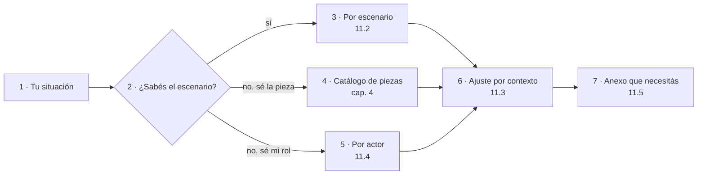
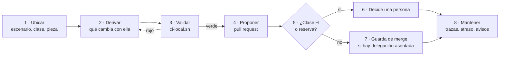
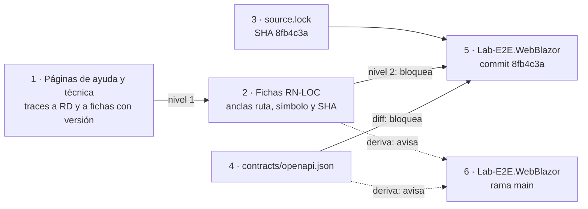
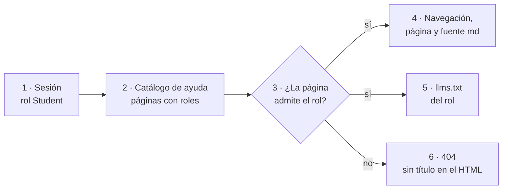

# DocsAsCode Developer Guide — Parte V. Práctica (capítulos 11 a 14)

[← Anterior](DocsAsCode-Developer-Guide-Parte-IV.md) · [Índice general](DocsAsCode-Developer-Guide.md#índice-general) · [Siguiente →](DocsAsCode-Developer-Guide-Parte-V-b.md)

## Parte V. Práctica

Las partes I a IV explican el método; esta lo pone a trabajar. Los capítulos 11 a 14 son la mitad que se usa con un
problema en la mano: dónde entrar según la situación (11), cómo hacer un cambio sin romper nada (12) y dos casos que
corren de verdad, la mini demo MovilidadUrbana (13) y la prueba de ayuda por rol (14). Los capítulos 15 a 17 completan
la parte con la decisión entre alternativas, los ejercicios y el mantenimiento.

### 11. Estoy acá: qué aplico

*Forma: referencia.* El capítulo es una tabla de entrada: no se lee de corrido, se busca la fila propia.
**Objetivos.** Al terminarlo podés ubicar tu situación por escenario, por contexto o por actor, y salir con la pieza
que tenés que producir, el control que la va a revisar, el capítulo que la explica y el anexo que necesitás.

Quien llega con un problema concreto («tengo que documentar una API», «una página de ayuda quedó desactualizada»,
«soy un agente y tengo que proponer una página») no necesita el recorrido completo para empezar. Este capítulo
traslada el Mapa del cuerpo a las secciones del libro y usa el vocabulario del [capítulo 3](DocsAsCode-Developer-Guide-Parte-I.md#3-marco-de-referencia):
escenarios `ESC-SDEI-n`, contextos `CTX-SDEI-n` y actores `ACT-SDEI-n` [Compilado: 01-Mapa.md, l. 17–20]. El catálogo
de las catorce clases de pieza, que el Mapa también trae, está en el [capítulo 4](DocsAsCode-Developer-Guide-Parte-II.md#4-qué-es-un-sistema-documentador),
porque es la arquitectura del sistema documentador y no una vía de entrada.

#### 11.1 Cómo se usa

Se entra por la tabla que corresponde a lo que ya se sabe, se ajusta por contexto y se sale por un anexo.



*Figura 11.1. Tres puertas de entrada (2 a 5) que convergen en el ajuste por contexto (6) y terminan en un anexo (7).
Redibujada de [01-Mapa.md](01-Mapa.md), l. 34–44, con las secciones del libro.*

Las tablas que siguen conservan las celdas del Mapa y cambian sólo dos columnas: «Tema» pasa a «Capítulo» y «Anexo»
apunta a los anexos del libro. Si una celda de este capítulo y la del Mapa dicen cosas distintas, vale el Mapa
([P.5](DocsAsCode-Developer-Guide-Parte-0.md#p5-relación-con-el-cuerpo)).

#### 11.2 Por escenario

| Estoy en… | Lo primero que aplico | Piezas que activo | Control que me revisa | Capítulo | Anexo |
| --- | --- | --- | --- | --- | --- |
| `ESC-SDEI-1` Corpus de guías: escribo o cambio una guía | El frontmatter de diez campos y la estructura de seis secciones por tema | CL-10 guía; CL-12 si escribo un proceso | `docs-guard` completo: esquema, enlaces, anti-inyección, mermaid, referencias | [9](DocsAsCode-Developer-Guide-Parte-IV.md#9-compuertas-de-calidad-y-ci) | [C](DocsAsCode-Developer-Guide-Anexos.md#c-esquema-de-frontmatter-y-prefijos), [B](DocsAsCode-Developer-Guide-Anexos.md#b-referencias), [E](DocsAsCode-Developer-Guide-Anexos.md#e-lista-de-verificación) |
| `ESC-SDEI-2` App sin roles: documento una app y su API | Fijo el SHA del código en `source.lock`; escribo las reglas como fichas y la ayuda con `traces` | CL-02, CL-05, CL-06, CL-07 | `traces-resolve` contra el SHA; diff del contrato OpenAPI | [6](DocsAsCode-Developer-Guide-Parte-II.md#6-topología-de-repositorios-y-versionado), [8](DocsAsCode-Developer-Guide-Parte-III.md#8-ayuda-al-usuario-final); caso resuelto en el [13](#13-caso-de-estudio-la-mini-demo-movilidadurbana) | [C](DocsAsCode-Developer-Guide-Anexos.md#c-esquema-de-frontmatter-y-prefijos) (trazas), [F](DocsAsCode-Developer-Guide-Anexos.md#f-patrones-de-ejemplos) |
| `ESC-SDEI-3` Panel con roles: agrego ayuda a una pantalla | Trazo la ayuda al caso de uso de la unidad de la pantalla; el rol decide qué se sirve | CL-01, CL-06, CL-08 | `traces-resolve`; cruce de rol en las pruebas de acceso | [8](DocsAsCode-Developer-Guide-Parte-III.md#8-ayuda-al-usuario-final), [10](DocsAsCode-Developer-Guide-Parte-IV.md#10-integración-con-un-marco-sdd); caso resuelto en el [14](#14-caso-de-estudio-ayuda-por-rol) | [Cap. 15](DocsAsCode-Developer-Guide-Parte-V-b.md#15-decidir-entre-alternativas) si el cambio supera una norma del proyecto |
| `ESC-SDEI-4` Servicio con paquetes: publico una versión | Actualizo README y CHANGELOG del paquete; reviso el contrato contra la línea anterior | CL-05, CL-11, CL-13 | Diff del contrato; copias fijadas de conocimiento verificadas por huella | [6](DocsAsCode-Developer-Guide-Parte-II.md#6-topología-de-repositorios-y-versionado), [10](DocsAsCode-Developer-Guide-Parte-IV.md#10-integración-con-un-marco-sdd) | [A](DocsAsCode-Developer-Guide.md#a-glosario-índice) (ancla de versión, copia fijada) |

*Tabla 11.1. Entrada por escenario [Compilado: 01-Mapa.md, l. 54–59]; columnas «Capítulo» y «Anexo» reapuntadas al
libro.*

«Piezas que activo» es lo que toca quien hace ese trabajo, no la lista de clases activas del escenario, que explica
la [sección 3.2](DocsAsCode-Developer-Guide-Parte-I.md#32-escenarios-y-composición-por-unión).

#### 11.3 Por contexto

Un contexto cruza los cuatro escenarios y cambia una sola respuesta [Compilado: 00-Marco.md, l. 128]. Tres filas no son
contextos del Marco: son la situación más frecuente de quien interviene, una página que quedó atrás porque el código
cambió, partida según dónde vive la página.

| Si además… | Cambia | Aplico | Anexo |
| --- | --- | --- | --- |
| `CTX-SDEI-1` hay sitio publicado | Aparecen los canales derivados para agentes y el build del sitio entra a la compuerta | Una página `.md` por página publicada y `llms.txt` rotulado como propuesta | [A](DocsAsCode-Developer-Guide.md#a-glosario-índice) (canal derivado) |
| `CTX-SDEI-1` no hay sitio | El render del repositorio es el canal; no hay build que verificar | Markdown con frontmatter y `AGENTS.md` | [C](DocsAsCode-Developer-Guide-Anexos.md#c-esquema-de-frontmatter-y-prefijos) |
| `CTX-SDEI-2` el proyecto tiene SDD | El registro de requerimientos documentales va con la especificación; los IDs son los del SDD | Trazas a `CU-`, `RN-` del registro del proyecto | [Cap. 16](DocsAsCode-Developer-Guide-Parte-V-b.md#16-ejercicios) (`EJR-SDEI-05`) |
| `CTX-SDEI-2` el proyecto no tiene SDD | El registro va en `docs/_requisitos.md`; las reglas son fichas propias | Tabla `ID \| Audiencia \| Tarea \| Pieza \| Criterio \| Decisión` | [C](DocsAsCode-Developer-Guide-Anexos.md#c-esquema-de-frontmatter-y-prefijos) (registro de requerimientos) |
| `CTX-SDEI-3` la pieza vive en otro repositorio que el código | El ancla deja de ser el commit: es un SHA fijado | `source.lock` o `base_commit`. Un aviso programado cuenta cuántos commits de atraso tiene el SHA fijado frente a la rama principal; la deriva por símbolo la mide A1 cuando corre la demo. Deuda: A1 no está programado; se cierra con el PR que lo programe o con el folio que decida no hacerlo | [A](DocsAsCode-Developer-Guide.md#a-glosario-índice) (ancla de versión) |
| El código cambió y una página que lo describe quedó desactualizada, en el **mismo** repositorio | Quien cambia el código sube la versión de la ficha de la regla (de 1.0 a 1.1); la página traza a `@1.0` | `traces-resolve` da rojo en ese mismo pull request hasta que la página se revisa y traza a `@1.1`. La revisa quien propone el cambio (un agente o una persona, clase P); si el cambio altera lo que la regla promete, decide la analista. Si nadie sube la versión de la ficha, hoy ningún control lo detecta: lo cubre la revisión del pull request (`CQ-03` es parcial en este punto) | [C](DocsAsCode-Developer-Guide-Anexos.md#c-esquema-de-frontmatter-y-prefijos) (trazas) |
| El código cambió y la página vive en **otro** repositorio (`CTX-SDEI-3`) | El pull request del código no ve la página | El carril programado avisa el atraso del SHA fijado; la deriva por símbolo la mide A1 cuando corre la demo (deuda: A1 no está programado); un agente propone actualizar la ficha y el SHA fijado; una persona decide si la regla cambió | [Cap. 16](DocsAsCode-Developer-Guide-Parte-V-b.md#16-ejercicios) (`EJR-SDEI-04`) |
| El código cambió y la página desactualizada **no traza** a ninguna ficha (por ejemplo, una página técnica `CL-07` que describe la arquitectura) | Ningún control la conecta con el cambio | Se agrega la traza a la ficha o al requerimiento de los que depende, con versión, para que el próximo cambio la ponga en rojo; mientras no la tenga, la revisión del pull request del código es la única defensa | [C](DocsAsCode-Developer-Guide-Anexos.md#c-esquema-de-frontmatter-y-prefijos) (trazas) |
| `CTX-SDEI-4` el repositorio está fuera de la organización del runner | No puede llamar al workflow reutilizable | Copia del workflow con huella, en el runner propio | [Cap. 15](DocsAsCode-Developer-Guide-Parte-V-b.md#15-decidir-entre-alternativas) |

*Tabla 11.2. Entrada por contexto y por cambio de código [Compilado: 01-Mapa.md, l. 63–73]; columna «Anexo»
reapuntada al libro.*

Las tres filas de «el código cambió» son la lección del capítulo: en el mismo repositorio el rojo llega en el mismo
pull request; en otro, sólo un aviso de atraso; sin traza, nada. La [sección 13.5](#135-cuando-el-código-cambia) mide
la segunda.

#### 11.4 Por actor

| Soy… | Lo que me toca | Lo que no me toca | Empiezo por |
| --- | --- | --- | --- |
| `ACT-SDEI-1` PO | Decidir lo de clase H; asentar por escrito la delegación del merge; pasar a vigente | Fusionar cada pull request sin reserva | [Cap. 15](DocsAsCode-Developer-Guide-Parte-V-b.md#15-decidir-entre-alternativas), quién decide |
| `ACT-SDEI-2` Analista | Evaluar el registro de requerimientos; decidir divergencias entre letra e intención | Elegir herramientas | [Cap. 16](DocsAsCode-Developer-Guide-Parte-V-b.md#16-ejercicios) (`EJR-SDEI-05`) |
| `ACT-SDEI-3` Desarrollo | Comentarios XML, contrato emitido, documentación técnica | La ayuda al usuario final | [Cap. 4](DocsAsCode-Developer-Guide-Parte-II.md#4-qué-es-un-sistema-documentador), clases CL-04, CL-05 y CL-07 |
| `ACT-SDEI-4` Agente de IA | Proponer páginas, fichas y correcciones que pasen la compuerta | Lo de clase H | [C](DocsAsCode-Developer-Guide-Anexos.md#c-esquema-de-frontmatter-y-prefijos), [E](DocsAsCode-Developer-Guide-Anexos.md#e-lista-de-verificación) |
| `ACT-SDEI-5` Estudiante o docente | Recorrer la ruta «aprender»; quien enseña, además, evaluar las guías con criterios | El contenido normativo | [Cap. 3](DocsAsCode-Developer-Guide-Parte-I.md#3-marco-de-referencia), [cap. 16](DocsAsCode-Developer-Guide-Parte-V-b.md#16-ejercicios); quien enseña, [D](DocsAsCode-Developer-Guide-Anexos.md#d-criterios-de-calidad) |
| `ACT-SDEI-6` Persona usuaria | Leer la ayuda del producto | — | La ayuda de su producto, no este libro |

*Tabla 11.3. Entrada por actor [Compilado: 01-Mapa.md, l. 101–108]; columna «Empiezo por» reapuntada al libro. Las
responsabilidades de cada actor las define la [sección 3.4](DocsAsCode-Developer-Guide-Parte-I.md#34-actores).*

#### 11.5 Qué anexo necesito

| Necesito… | Anexo del libro | Fuente en el cuerpo |
| --- | --- | --- |
| Escribir un frontmatter válido o elegir un prefijo de ID | [C. Esquema de frontmatter y prefijos](DocsAsCode-Developer-Guide-Anexos.md#c-esquema-de-frontmatter-y-prefijos) | `ANX-SDEI-ESQUEMA` |
| Saber qué significa una sigla o un término | [A. Glosario-índice](DocsAsCode-Developer-Guide.md#a-glosario-índice) | `ANX-SDEI-GLOSARIO` |
| Citar una fuente o encontrar la referencia completa de una cita | [B. Referencias](DocsAsCode-Developer-Guide-Anexos.md#b-referencias) | `ANX-SDEI-REFERENCIAS` |
| Evaluar si una guía es buena | [D. Criterios de calidad](DocsAsCode-Developer-Guide-Anexos.md#d-criterios-de-calidad) | `ANX-SDEI-CQ` |
| Escribir un ejemplo o material de consulta | [F. Patrones de ejemplos](DocsAsCode-Developer-Guide-Anexos.md#f-patrones-de-ejemplos) | `ANX-SDEI-PE` |
| Revisar una guía antes de pasarla a vigente | [E. Lista de verificación](DocsAsCode-Developer-Guide-Anexos.md#e-lista-de-verificación) | `ANX-SDEI-VER` |
| Una plantilla para la pieza que tengo que producir | [G. Plantillas](DocsAsCode-Developer-Guide-Anexos.md#g-plantillas) | Anexos de `TEM-01` a `TEM-07`; [Como-Intervenir.md](Examples/Como-Intervenir.md) §8 |
| Elegir entre alternativas de diseño | [Capítulo 15](DocsAsCode-Developer-Guide-Parte-V-b.md#15-decidir-entre-alternativas) | `ANX-SDEI-DECIDIR` |
| Comprobar que aprendí | [Capítulo 16](DocsAsCode-Developer-Guide-Parte-V-b.md#16-ejercicios) y [H. Claves](DocsAsCode-Developer-Guide-Anexos.md#h-claves-de-los-ejercicios) | `ANX-SDEI-EJERCICIOS` |
| Escribir la ayuda de un campo: etiqueta, pista, error, `contexto:` y traza desde la ficha | [Sección 8.4](DocsAsCode-Developer-Guide-Parte-III.md#84-ayuda-en-el-punto-de-uso-pantallas-campos-paneles-y-portales) (no es un anexo: es la sección del capítulo) | `TEM-SDEI-05` |
| Saber de qué archivo y línea del cuerpo sale una sección | [I. Correspondencia](DocsAsCode-Developer-Guide-Anexos.md#i-correspondencia) | Colofón |

*Tabla 11.4. Lo que se busca y dónde está [Compilado: 01-Mapa.md, l. 112–122]. Las filas de plantillas y de
correspondencia son del libro: el cuerpo no tiene un anexo para cada una.*

#### 11.6 Preguntas guía

1. ¿Por qué tabla entraste y qué fila describe tu situación?
2. ¿Qué control de la compuerta va a mirar la pieza que vas a producir, y qué tendría que estar mal para que dé rojo?
3. Si la pieza no encaja en ninguna clase del catálogo, ¿quién decide abrir una nueva? [Compilado: 01-Mapa.md, l. 126–128]
4. El código cambió en otro repositorio y tu página traza a una ficha: ¿qué te avisa, cuándo, y qué no te avisa?

#### 11.7 Resumen

Tres puertas (escenario, pieza, actor), un ajuste por contexto y una salida por anexo. El capítulo no agrega reglas:
traslada las del Mapa a los capítulos del libro. La fila que más se usa es la del código que cambió, y la respuesta
depende de dónde vive la página: rojo en el mismo pull request, aviso de atraso si vive en otro repositorio, silencio
si no traza a nada.

### 12. Cómo intervenir: el proceso en cinco pasos

*Forma: guía práctica.* Una tarea, en orden, con lo que entra, lo que sale y cómo se comprueba cada paso.
**Objetivos.** Al terminarlo podés llevar un cambio de documentación desde el pedido hasta el merge sin dejar piezas
derivadas atrás, correr la compuerta en local antes de proponer, y saber quién fusiona según la clase del cambio.

La plantilla del proceso dice cómo cambiar la documentación de un proyecto sin romperla: dónde está la pieza que hay
que tocar, qué se deriva de qué, cómo se valida en local, cómo se propone y qué queda para después. Cada proyecto la
completa en **una instancia de una página** con sus rutas, su compuerta y quién decide
[Compilado: Examples/Como-Intervenir.md, l. 17–21]. Es la entrada de la ruta «intervenir»
([P.3](DocsAsCode-Developer-Guide-Parte-0.md#p3-rutas-de-lectura)).

Cada paso trae tres bloques pensados para un agente: `entradas`, lo que necesita tener antes de empezar; `salidas`,
lo que deja hecho; y `validaciones`, cómo se comprueba que terminó bien, con un comando o una condición que da sí o
no. Una persona lee la prosa; un agente puede ejecutar los bloques [Compilado: Examples/Como-Intervenir.md,
l. 23–25]. El libro los reproduce tal como están en la plantilla.

#### 12.1 Definiciones

| Término | Definición |
| --- | --- |
| Intervención | Cualquier cambio a una pieza documental de un proyecto: agregar, corregir, mover o retirar |
| Instancia | La página de un proyecto que completa la plantilla. Traza a la plantilla y a la versión del cuerpo (`traces: [GP-SDEI-INTERVENIR, IDX-SDEI@2.0]`): si el cuerpo pasa a otra versión mayor o menor, la compuerta pide revisar la instancia |
| Pieza derivada | Pieza que sale de otra por un paso mecánico (el contrato OpenAPI del build) o que depende de otra por una traza (la ayuda que traza a una regla) |
| Reserva | Una duda declarada en el pull request que impide fusionarlo sin una persona |

*Tabla 12.1. Términos del proceso [Compilado: Examples/Como-Intervenir.md, l. 40–45]. Las clases de intervención D, P
y H las define la [sección 1.6](DocsAsCode-Developer-Guide-Parte-I.md#16-quién-decide-clases-dph).*

#### 12.2 El proceso de un vistazo



*Figura 12.1. Los cinco pasos (1 a 4 y 8). El rojo de la validación vuelve a derivar, no a proponer; la clase de
intervención (5) decide quién fusiona. Redibujada de [Como-Intervenir.md](Examples/Como-Intervenir.md), l. 49–60.*

#### 12.3 Paso 1: ubicar

Se busca la situación en el Mapa ([capítulo 11](#11-estoy-acá-qué-aplico)): el escenario del proyecto, la clase de
pieza (`CL-nn`) y el archivo concreto. Si la pieza no encaja en ninguna clase del catálogo, no se improvisa: se abre
una clase nueva por expediente [Compilado: Examples/Como-Intervenir.md, l. 66–79].

```yaml
entradas:
  - el pedido de cambio (issue, requerimiento documental RD-nn o hallazgo del carril programado)
  - el Mapa del cuerpo (01-Mapa.md) y la instancia de este proceso en el proyecto
salidas:
  - escenario (ESC-SDEI-n), clase de pieza (CL-nn) y clase de intervención (D, P o H)
  - ruta del archivo a tocar y su doc_id
validaciones:
  - la clase existe en el catálogo del Mapa §4
  - si la clase es H, el paso 4 va a una persona y no a la guarda de merge
```

#### 12.4 Paso 2: derivar

Se listan las piezas que dependen de la que se toca y las que la producen. Si se sube la versión de una ficha, las
páginas que trazan a la versión anterior se revisan en el mismo pull request; si la pieza sale del build, se regenera,
no se edita a mano [Compilado: Examples/Como-Intervenir.md, l. 83–97].

```yaml
entradas:
  - la pieza ubicada en el paso 1
  - el registro de IDs (doc_id y encabezados con ID) del repositorio
salidas:
  - lista de piezas que trazan a la pieza tocada (grep de su ID en los frontmatter)
  - el cambio hecho en la pieza y en cada pieza derivada
validaciones:
  - ninguna página traza a una versión que ya no existe
  - ninguna pieza de clase D se editó a mano
```

Para la ficha `RN-LOC-01` de la mini demo, `grep -rl 'RN-LOC-01@'` sobre su carpeta `docs/` devuelve cuatro
archivos: la ayuda, el registro y las dos páginas técnicas [Salida registrada: corrida del 2026-11-01 en
Lab-Documentos `00171bd`]. Son los que se releen si la ficha sube de versión.

#### 12.5 Paso 3: validar

Se corre la compuerta en local, con el mismo guion que corre la CI, desde la raíz del repositorio [Compilado:
Examples/Como-Intervenir.md, l. 101–105]:

```bash
scripts/ci-local.sh todo <carpeta-del-cuerpo-o-del-ejemplo>
```

El guion corre los siete grupos de `docs-guard` más `autoprueba` (PR-1 enlaces, PR-2 esquema, PR-3 anti-inyección,
PR-4 estructura y mermaid, PR-5 trazas, PR-6 contrato y PR-7 fijadas y referencias, con `reflint` y `url-fecha`) y
termina en verde, con código 0, o en rojo. Un grupo suelto se corre con su nombre (`scripts/ci-local.sh trazas
<carpeta>`). Si el proyecto no tiene el guion, su instancia nombra el equivalente [Compilado:
Examples/Como-Intervenir.md, l. 107–111]. Qué mira cada grupo lo explica el
[capítulo 9](DocsAsCode-Developer-Guide-Parte-IV.md#9-compuertas-de-calidad-y-ci). Bloques del paso [Compilado: Examples/Como-Intervenir.md, l. 113–122]:

```yaml
entradas:
  - el árbol de trabajo con el cambio del paso 2
  - scripts/ci-local.sh (o el guion equivalente que nombra la instancia)
salidas:
  - la salida de scripts/ci-local.sh todo, recortada a las líneas de resumen de cada grupo
validaciones:
  - scripts/ci-local.sh todo termina con código 0
  - el agregador no muestra ningún grupo en ROJO
```

#### 12.6 Paso 4: proponer

Se abre un pull request desde una rama propia. La descripción dice qué se cambió, qué piezas derivadas se tocaron, la
salida recortada del paso 3 y, si la hay, la reserva. Quién fusiona depende de la clase: D y P sin reserva los fusiona el
agente que los abrió, después de pasar la guarda, **sólo** si la persona responsable dejó asentada por escrito la
delegación del merge en el repositorio; H, o cualquier pull request con reserva, lo decide una persona [Compilado:
Examples/Como-Intervenir.md, l. 126–142].

```yaml
entradas:
  - la rama con el cambio validado
  - la delegación del merge asentada en el repositorio (si la hay)
salidas:
  - el pull request con descripción, salida del paso 3 y reservas
  - el merge (por la guarda o por la persona) o el pedido de decisión
validaciones:
  - la CI del pull request terminó en verde en la cabeza de la rama
  - el pull request está abierto, sin conflictos y sin reserva antes de fusionar por la guarda
  - quien verifica no es quien redactó
```

Que quien verifica no sea quien redactó es la regla que el [capítulo 5](DocsAsCode-Developer-Guide-Parte-II.md#5-el-ciclo-documental) desarrolla para todo
el ciclo documental.

#### 12.7 Paso 5: mantener

Después del merge quedan dos cosas: el carril programado, que una vez por semana avisa de enlaces externos rotos,
anclas atrasadas y documentos sin revisar desde hace más de un año, y la próxima intervención, que vuelve al paso 1
[Compilado: Examples/Como-Intervenir.md, l. 146–158].

```yaml
entradas:
  - el merge del paso 4
  - el issue que abre o actualiza el carril programado
salidas:
  - cada aviso atendido con una intervención nueva o cerrado con su motivo
validaciones:
  - ningún documento del cuerpo tiene last_review de hace más de 365 días sin un aviso abierto
  - las anclas entre repositorios apuntan a un SHA que existe
```

#### 12.8 La instancia de Lab-Documentos

Una instancia ocupa una página y responde, con datos del proyecto, seis preguntas: escenario, dónde vive cada pieza,
guion de validación, compuerta en la CI, quién decide y excepciones [Compilado: Examples/Como-Intervenir.md,
l. 162–172]. La plantilla comentada, con la pregunta que guía cada campo, está en G.8 del
[anexo G](DocsAsCode-Developer-Guide-Anexos.md#g-plantillas). Así la completa Lab-Documentos:

| Campo | Lab-Documentos |
| --- | --- |
| Escenario | `ESC-SDEI-1` Corpus de guías. Clases activas por defecto: CL-02, CL-03, CL-08 a CL-13 (tabla de parámetros del Marco) |
| Dónde vive cada pieza | Guías en `Guides/` y `Concepts/`; este cuerpo en `Guides/Documentacion-Tecnica/Sistema-De-Documentacion-E-Integracion/`; ejemplos en su `Examples/`; controles en `tools/docs-guard/`; expedientes e índices en el repositorio hermano Lab-Documentos.Documentacion |
| Guion de validación | `scripts/ci-local.sh todo <carpeta>` desde la raíz del repositorio. Sin `<carpeta>`, verifica este cuerpo. Requiere bash, curl, Python 3 y Node.js |
| Compuerta en la CI | `.github/workflows/docs-guard.yml` en cada pull request, en el runner con la etiqueta que fija el caso, por plataforma (Linux; Mac para iOS); en este repositorio, la de `.github/workflows/docs-guard.yml:60`; `docs-enlaces-semanal.yml` como carril programado |
| Quién decide | Hay delegación del merge asentada en el [CHANGELOG](../../../CHANGELOG.md): D y P sin reserva los fusiona el agente por la guarda. Lo de clase H (pasar a `vigente`, etiquetar, cambiar un workflow) lo decide la persona responsable del producto |
| Excepciones | Ninguna respecto de la plantilla |

*Tabla 12.2. Instancia de la plantilla para Lab-Documentos [Compilado: Examples/Como-Intervenir-Lab-Documentos.md,
l. 27–34]. La etiqueta del runner no se escribe: la fija el workflow (expediente 0003, P-11).*

Para los ejemplos de `Examples/`, el paso 3 usa la carpeta del ejemplo y suma lo suyo: `verificar.sh` y el workflow
`mini-demo-movilidad.yml` en la mini demo (capítulo 13); el devcontainer y un recorrido por rol en la ayuda por rol
(capítulo 14) [Compilado: Examples/Como-Intervenir-Lab-Documentos.md, l. 38–44].

#### 12.9 Un recorrido completo, con un cambio real

El caso que sigue es un cambio que se hizo, no uno inventado para el libro (`PE-02`, ejemplo trabajado antes del
ejercicio; [Sweller y Cooper, 1985](DocsAsCode-Developer-Guide-Anexos.md#ref-sweller-1985)). El tutorial de la mini demo citaba como ejemplo de rojo la
línea `RN-LOC-01.md:62: ERROR ancla-valor-distinto`, y la línea real de ese error en la ficha negativa es la 63. La
corrección entró en Lab-Documentos con el commit `b53e27a`, dentro del pull request #43 (merge `00171bd`). La tabla
reconstruye los pasos a partir del diff y de las fuentes; la clasificación de cada paso es **[criterio propio]**.

| Paso | Qué corresponde en este caso |
| --- | --- |
| 1. Ubicar | Escenario `ESC-SDEI-1`: el README de la demo es parte del cuerpo; pieza: el tutorial de la mini demo, `doc_id: DEMO-MU-00`; intervención de clase P: corrige un dato y no cambia lo que una regla promete |
| 2. Derivar | La cifra sale de la ficha negativa, que no cambia, y ninguna página traza al tutorial a nivel de línea: derivadas, ninguna. La misma cifra aparece en la historia de la ficha, que ya decía `:63`. Lo que el paso no miró fue el resto de la línea: la ruta quedó como `docs/fichas/RN-LOC-01.md`, la ficha 1.1, cuya línea 63 está en blanco |
| 3. Validar | `scripts/ci-local.sh todo` sobre el cuerpo; para el dato mismo, `verificar.sh`: su control C4 imprime el rojo esperado en `RN-LOC-01.md:63` (corrida de la sección 13.3) |
| 4. Proponer | El cambio viajó en un pull request de varios ajustes del expediente 0003; la descripción lista cada uno con su identificador (AC-25 para este) |
| 5. Mantener | Queda pendiente la ruta: `b53e27a` corrigió el número y no el archivo, y lo completa el co-cambio que viaja con el pull request de este libro (el README de la demo, l. 115; sección 13.3). Si la ficha negativa cambiara de forma, C4 exige que siga dando rojo por las mismas dos anclas |

*Tabla 12.3. Los cinco pasos aplicados a la corrección de una línea citada. Fuentes: diff de `b53e27a` sobre el
[README de la mini demo](Examples/MovilidadUrbana-Mini-Demo/README.md), l. 115; historia de la ficha [Compilado:
Examples/MovilidadUrbana-Mini-Demo/docs/fichas/RN-LOC-01.md, l. 70–74]; condición de C4 [Compilado:
Examples/MovilidadUrbana-Mini-Demo/verificar.sh, l. 119–131].*

El caso es chico a propósito: ningún control lee la prosa del tutorial, así que sólo el paso 2 («¿qué más dice esta
cifra?») evitó dos versiones distintas del mismo hecho. Y el mismo caso muestra el límite: `b53e27a` arregló el número
y dejó la ruta apuntando a `docs/fichas/` en lugar de la ficha negativa de
`tools/docs-guard/fixtures/anclas/real-rn-loc-01/`. Ni `ci-local.sh` ni C4 lo vieron, porque ninguno lee la prosa; el
verde del paso 3 no alcanza. El paso 2 tiene que preguntar por la línea entera, no sólo por la cifra que se cambia.

#### 12.10 Preguntas guía

1. Tu cambio sube la versión de una ficha: ¿qué búsqueda hacés en el paso 2 y qué tiene que dar para seguir?
2. La compuerta local da verde y la del pull request da rojo: ¿qué paso de la plantilla miente, y qué revisás primero?
3. Un cambio de clase P no tiene reserva, pero el repositorio no tiene delegación asentada: ¿quién fusiona?
4. ¿Qué seis preguntas tiene que responder la instancia de tu proyecto, y cuál de ellas no podés contestar todavía?

#### 12.11 Resumen

Cinco pasos con bloques que un agente puede ejecutar: ubicar con el Mapa, derivar con una búsqueda del ID, validar con
el guion de la CI, proponer con la salida y las reservas, y mantener atendiendo los avisos. El rojo vuelve a derivar.
Quién fusiona lo decide la clase del cambio y una delegación escrita, nunca la comodidad. Cada proyecto completa la
plantilla en una instancia de una página; la de Lab-Documentos es la tabla 12.2.

### 13. Caso de estudio: la mini demo MovilidadUrbana

*Forma: tutorial.* El capítulo se hace con un clon de Lab-Documentos abierto: se corre la verificación, se recorre el
tutorial de una pantalla nueva y se lee el caso real que dio origen a la demo.
**Objetivos.** Al terminarlo podés correr la verificación de la demo e interpretar cada control, documentar una
pantalla nueva con su fila del registro, sus fichas y su página, y explicar qué pasa cuando el código del otro
repositorio cambia.

La mini demo documenta una app real, MovilidadUrbana.MAUI, del repositorio público Lab-E2E.WebBlazor, **desde otro
repositorio**: no copia el código y tiene una compuerta que da rojo cuando lo escrito deja de coincidir con lo que el
código hace. Es el ejemplo del escalón 1 del sistema documentador: audiencias sin roles, fuente generada del SHA,
ancla SHA entre repositorios con aviso de deriva y trazas de dos niveles [Compilado:
Examples/MovilidadUrbana-Mini-Demo/README.md, l. 17–20]. En el Marco es el ejemplo de `ESC-SDEI-2`, la app cliente
sin roles ([sección 3.2](DocsAsCode-Developer-Guide-Parte-I.md#32-escenarios-y-composición-por-unión)). El límite de 60 u 80 caracteres que aparece en
13.6 es el problema conductor de todo el libro (`PE-01`; [Merrill, 2002](DocsAsCode-Developer-Guide-Anexos.md#ref-merrill-2002)).

#### 13.1 Qué hay y qué significa cada pieza

La demo trae su propio vocabulario, que el resto del libro reutiliza. Los términos generales (traza, ficha, atraso,
deriva) los define la Parte I y los recoge el [anexo A](DocsAsCode-Developer-Guide.md#a-glosario-índice); acá van los que nacen en la demo.

| Término | Significado |
| --- | --- |
| `source.lock` | Archivo que fija el repositorio y el SHA del código que se documenta. Todo lo que la demo afirma se comprueba contra ese commit |
| Ancla | `ruta#Símbolo@SHA`: dónde se declara, se muestra, se verifica o se aplica una regla. Con una afirmación (`= 60`, `contiene …`) que la compuerta comprueba |
| Traza de nivel 1 | Página → ficha: el ID existe y la versión coincide |
| Traza de nivel 2 | Ficha → código: cada ancla resuelve en el SHA y cumple su afirmación |

*Tabla 13.1. Términos propios de la demo [Compilado: Examples/MovilidadUrbana-Mini-Demo/README.md, l. 37–42].*

| Pieza | Clase | Para quién | Qué es |
| --- | --- | --- | --- |
| `source.lock` | — | todos | Repositorio, SHA, rutas y proyecto de la API |
| `verificar.sh` | — | desarrollo, CI | Baja el código, extrae el contrato y corre los controles |
| `contracts/openapi.json` | CL-05 | desarrollo | Contrato de la API extraído en ejecución del SHA |
| `docs/_requisitos.md` | CL-02 (RRD) | analista, PO | Qué documentación hace falta y cómo se comprueba |
| `docs/fichas/RN-LOC-01.md` | CL-01 (ficha propia, sin SDD) | analista | Largo del nombre (con divergencia 60/80) |
| `docs/fichas/RN-LOC-02.md` | CL-01 (ficha propia, sin SDD) | analista | Localidad única por nombre y provincia |
| `docs/ayuda/alta-de-localidad.md` | CL-06 | persona usuaria | Cómo dar de alta una localidad |
| `docs/tecnica/arquitectura.md` | CL-07 | desarrollo | Capas y dónde vive cada regla |
| `docs/tecnica/compilar-y-primer-pedido.md` | CL-07 | desarrollo | Compilar la API, pedir el contrato, primer alta |

*Tabla 13.2. Las piezas de la carpeta `Examples/MovilidadUrbana-Mini-Demo/` [Compilado:
Examples/MovilidadUrbana-Mini-Demo/README.md, l. 51–61]. Fuera de la carpeta, en la raíz de Lab-Documentos, viven el
workflow `mini-demo-movilidad.yml` y la prueba negativa permanente `tools/docs-guard/fixtures/anclas/real-rn-loc-01/`
(l. 63–64).*

El `source.lock` es el ancla de versión del escenario: seis líneas que dicen el repositorio, el SHA completo, la rama
de comparación (`main`), las dos rutas que se bajan, el proyecto de la API y cómo se pide el contrato (`GET
/openapi/v1.json`) [Compilado: Examples/MovilidadUrbana-Mini-Demo/source.lock, l. 4–9].

#### 13.2 Cómo funciona



*Figura 13.1. Lo que vive en Lab-Documentos (1 a 4) se comprueba contra el commit fijado (5) y bloquea; contra la rama
principal (6) sólo avisa. Redibujada de [README de la mini demo](Examples/MovilidadUrbana-Mini-Demo/README.md),
l. 68–84.*

La compuerta tiene dos partes, y conviene no confundirlas: una corre en todo pull request del repositorio, la otra sólo
cuando el cambio toca la demo o los controles.

| Dónde corre | Qué comprueba | Bloquea |
| --- | --- | --- |
| `docs-guard` (cada PR) | Enlaces, frontmatter, RRD, anti-inyección, estructura, trazas de nivel 1 | Sí |
| `mini-demo-movilidad` (cada PR que toca la demo o `tools/docs-guard/`) | C1 contrato = extraído del SHA; C2 un contrato con una operación plantada da rojo; C3 trazas de nivel 1 y 2 contra el SHA; C4 la ficha RN-LOC-01 sin corregir da rojo; A1 deriva contra `main` | C1 a C4 sí; A1 sólo avisa |

*Tabla 13.3. Las dos partes de la compuerta de la demo [Compilado: Examples/MovilidadUrbana-Mini-Demo/README.md,
l. 88–91].*

C2 y C4 son controles del control: dan verde cuando el rojo esperado aparece. C2 planta una operación que el contrato
versionado no tiene y exige que el diff la vea; C4 corre la ficha 1.0, la que copió la promesa de la pantalla, y exige
rojo exactamente por las dos anclas del defecto real, no por otro hallazgo [Compilado:
Examples/MovilidadUrbana-Mini-Demo/verificar.sh, l. 112–132]. Sin ellos, un `verificar.sh` que no comprobara nada
también daría verde.

#### 13.3 Correr la verificación

Requisitos: bash, git, curl, Python 3, el SDK de .NET 10 y Node.js para `docs-guard`. Desde la raíz de
Lab-Documentos [Compilado: Examples/MovilidadUrbana-Mini-Demo/README.md, l. 95–101]:

```bash
DEMO=Guides/Documentacion-Tecnica/Sistema-De-Documentacion-E-Integracion/Examples/MovilidadUrbana-Mini-Demo
scripts/ci-local.sh todo "$DEMO"     # docs-guard sobre la demo
"$DEMO/verificar.sh"                 # contrato, anclas y deriva contra el código
```

`verificar.sh` hace tres cosas en orden. Baja con `git archive` sólo las rutas de `source.lock` del SHA fijado y de la
rama de comparación; compila la API de cada árbol, la arranca y le pide el contrato en ejecución; y corre los cinco
controles con un agregador estricto [Compilado: Examples/MovilidadUrbana-Mini-Demo/verificar.sh, l. 5–17]. La carpeta
de trabajo es `$TRABAJO` y, si no está definida, `$RUNNER_TEMP`, `$TMPDIR` o `/tmp` más `/mini-demo-movilidad` (l. 29).

Para este libro, la verificación se corrió entera, en un contenedor efímero con el SDK de .NET:

```text
== fuente: https://github.com/hdcm-dev/Lab-E2E.WebBlazor.git @ 8fb4c3a8b1cc629027f456c7c3ce19e041164c06 y main
  8fb4c3a8b1cc629027f456c7c3ce19e041164c06 -> 8fb4c3a8b1cc629027f456c7c3ce19e041164c06 (103 archivos)
  main -> 59399ba6678c56c3219988a5f9666fc4e0047160 (103 archivos)
== C1 contrato: contracts/openapi.json frente al extraído de 8fb4c3a8b1cc629027f456c7c3ce19e041164c06
  ok    C1: verde (rc=0)
== C2 plantado: una operación de más tiene que dar exit 1
    <trabajo>/plantado.json:1: ERROR operacion-nueva: GET /api/v1/plantada no está en el contrato versionado
    == PR-6 contrato: ROJO (errores=1 avisos=0) operaciones=8
  ok    C2: rojo (rc=1)
== C3 trazas: traces-resolve y anclas contra 8fb4c3a8b1cc629027f456c7c3ce19e041164c06
    == PR-5 traces-resolve: verde (errores=0 avisos=0) trazas=17 resueltas=17 ids-duplicados=0 anclas=10 anclas-resueltas=10
== C4 negativa: RN-LOC-01 sin corregir (defecto real 60/80) tiene que dar rojo
    RN-LOC-01.md:62: ERROR ancla-no-contiene: LocalidadRules.NombreValido no contiene «LargoMaximoDelNombre»
    RN-LOC-01.md:63: ERROR ancla-valor-distinto: NombreEntry.MaxLength: la ficha afirma 60 y el código tiene 80
    == PR-5 traces-resolve: ROJO (errores=2 avisos=0) trazas=1 resueltas=1 ids-duplicados=0 anclas=6 anclas-resueltas=4
  ok    C4: rojo por el defecto real 60/80 (rc=1, 2 anclas)
== A1 deriva contra main (avisa, no bloquea)
  contrato: sin deriva frente a main (59399ba6678c56c3219988a5f9666fc4e0047160)
  anclas: sin deriva frente a main (59399ba6678c56c3219988a5f9666fc4e0047160)
== agregador mini demo
  C1  verde
  C2  verde
  C3  verde
  C4  verde
== mini demo: verde
== tiempo de pared: 58 s
```

[Salida registrada: corrida del 2026-11-01 de `verificar.sh` en Lab-Documentos `00171bd`, contenedor
`mcr.microsoft.com/dotnet/sdk:10.0` (SDK 10.0.403) con python3 instalado en el contenedor (3.12.3; la imagen no lo
trae y `verificar.sh` lo necesita); código de salida 0. Recorte: la salida de
compilación y extracción del contrato en los dos árboles (5 rutas, 8 operaciones, OpenAPI 3.1.1; 36 s y 7 s), el resumen de C1, la línea «ok» de C3 y el
resumen de A1; la carpeta de trabajo se escribe `<trabajo>`]

Tres números de esa salida merecen lectura. **C3 resuelve 17 trazas y 10 anclas**: las anclas son las seis de
`RN-LOC-01` y las cuatro de `RN-LOC-02`. **C4 cita las líneas 62 y 63** de la ficha negativa, las dos anclas que la
versión 1.0 afirmaba mal (13.6). **A1 no encontró deriva** frente a `main`, aunque `main` no es el SHA fijado; la
sección 13.5 explica por qué las dos cosas son ciertas a la vez.

Si un control da rojo, la línea anterior al agregador dice qué archivo y qué fila [Compilado:
Examples/MovilidadUrbana-Mini-Demo/README.md, l. 114]. El ejemplo es el de C4 en la salida de arriba: `RN-LOC-01.md:63`
es la fila «aplica» de la ficha negativa, en `tools/docs-guard/fixtures/anclas/real-rn-loc-01/`, no de la ficha 1.1
de `docs/fichas/`.

#### 13.4 Tutorial: documentar una pantalla nueva

El ejemplo trabajado es la pantalla **Encuesta**, para la persona usuaria; los pasos valen para cualquier pantalla
[Compilado: Examples/MovilidadUrbana-Mini-Demo/README.md, l. 119–120]. Vas a producir cuatro cosas, en este orden:
una fila del registro, una ficha por regla, la página y el cambio propuesto. Es el proceso del
[capítulo 12](#12-cómo-intervenir-el-proceso-en-cinco-pasos) aplicado a una pantalla.

##### 13.4.1 Agregar la fila al registro

En `docs/_requisitos.md`, una fila nueva con el número siguiente y las mismas ocho columnas de la tabla: `ID`,
`Audiencia`, `Tarea`, `Pieza`, `Fuente`, `Criterio`, `Decisión` y `Decide y fecha`. La compuerta exige seis (`ID`,
`Audiencia`, `Tarea`, `Pieza`, `Criterio`, `Decisión`); las otras dos se completan igual [Compilado:
Examples/MovilidadUrbana-Mini-Demo/README.md, l. 124–126]. Las reglas de cada celda están en la fuente (l. 128–135); la
que más errores provoca es la de **Decisión**: quien escribe no decide, así que una fila nueva va como `pendiente`, con
quién la va a decidir y sin fecha.

```text
| RD-05 | persona usuaria | Completar el paso 1 de la encuesta | CL-06, [`docs/ayuda/encuesta.md`](ayuda/encuesta.md) | `RN-ENC-01@1.0`, `RN-ENC-02@1.0`, … (una por regla) | Dado el paso 1 de la encuesta, cuando la persona lee la ayuda, entonces cada número coincide con el de la ficha; instrumento: `traces-resolve` | pendiente | PO, pendiente |
```

[Compilado: Examples/MovilidadUrbana-Mini-Demo/README.md, l. 138]

##### 13.4.2 Escribir una ficha por regla

**Cada regla de la pantalla lleva su ficha** en `docs/fichas/`, tenga número o no: un mínimo, un rango, un formato, una
unicidad, que un campo sea obligatorio o que su valor tenga que salir de una lista. Las restricciones sobre un mismo
campo van en una sola ficha, aunque cada una se compruebe por un camino distinto: los caminos son filas de la tabla de
anclas. Los textos de navegación («Paso 1 de 3», títulos, botones) no son reglas [Compilado:
Examples/MovilidadUrbana-Mini-Demo/README.md, l. 143–151]. El modelo para copiar es `RN-LOC-02.md`: frontmatter con
`doc_type: ficha` y `traces: [RD-04]`, encabezado `# RN-XXX-nn — Nombre`, la línea `**Versión:** 1.0`, la tabla de la
ficha y la tabla de anclas (l. 155–158).

La ficha tiene catorce campos, en este orden: Id, Enunciado atómico, Ancla, Letra, Intención, ¿Divergen?, Especie,
Momento, Quién la verifica hoy, Dueño, Depende de, Grado de certeza, Prueba y Propuesta. Cinco de ellos tienen valores
cerrados, y la fuente los define uno por uno: no los resumas, copiá la tabla [Compilado:
Examples/MovilidadUrbana-Mini-Demo/README.md, l. 164–189]. La distinción que más pesa es la de **¿Divergen?**:

| Valor | Cuándo |
| --- | --- |
| Leve | La letra y el código difieren en algo que no cambia qué se acepta, qué se rechaza ni qué se guarda |
| De fondo | La letra promete algo que cambia alguna de esas tres cosas, como el 60/80 |
| Silencio | La letra no promete nada sobre algo que el código hace: no hay divergencia; va como dato debajo de la tabla |

*Tabla 13.4. Los valores de «¿Divergen?», recortados de la tabla de valores cerrados [Compilado:
Examples/MovilidadUrbana-Mini-Demo/README.md, l. 185]; los ejemplos completos de cada valor están en la fuente.*

La tabla de anclas lleva el encabezado `| Rol | Ancla | Afirma |`. El símbolo se escribe `Clase.Miembro` en un `.cs` y
`Elemento.Atributo` en un `.xaml`, con el elemento nombrado por `x:Name` o por `AutomationId`; la columna **Afirma**
lleva `` = `16` ``, `` contiene `texto` `` o `` no contiene `texto` `` [Compilado:
Examples/MovilidadUrbana-Mini-Demo/README.md, l. 195–204]. Un mensaje que el código arma con valores se ancla con
`contiene` y el texto copiado tal como está en el código, llaves incluidas; los números, aparte, con `=` sobre sus
constantes (l. 206–213).

Escribí en la ficha lo que **el código hace**. Si diverge de lo que la pantalla promete, marcá «¿Divergen?» como «De
fondo» y dejá la decisión en la propuesta: no la decidas vos [Compilado: Examples/MovilidadUrbana-Mini-Demo/README.md,
l. 215–217]. Para buscar un símbolo, el código del SHA ya está en `$TRABAJO/sha/` después de `verificar.sh fuente`.

##### 13.4.3 Escribir la página

La página va en `docs/ayuda/encuesta.md` con el frontmatter de diez campos más `description`; el ejemplo del tutorial,
con un comentario por campo, está en la fuente (l. 225–239) y el contrato completo, en el
[anexo C](DocsAsCode-Developer-Guide-Anexos.md#c-esquema-de-frontmatter-y-prefijos). Lo que cambia respecto de una página cualquiera es la última línea:

```yaml
traces: [RD-05, RN-ENC-01@1.0, RN-ENC-02@1.0]
```

[Compilado: Examples/MovilidadUrbana-Mini-Demo/README.md, l. 237]

El cuerpo sigue a `alta-de-localidad.md`: un solo título, índice, qué se carga, pasos, qué pide cada campo y qué hacer
cuando la app no acepta un dato. La ayuda trata de vos, aunque la app trate de usted (l. 241–244). Tres decisiones de
contenido tienen regla propia (l. 246–258): la ficha lleva cada regla que la página explica, no los datos de ejemplo;
la página cuenta una divergencia leve sólo si la persona la va a notar, y toda divergencia de fondo que pueda notar;
y nombra los límites que el código aplica, aunque la pantalla no los prometa, y las dos cosas si se contradicen.

La página real aplica la tercera: dice que la pantalla promete 60 y el campo deja 80, y le da a la persona una
conducta segura mientras no se decide, «escribí 60 caracteres o menos» [Compilado:
Examples/MovilidadUrbana-Mini-Demo/docs/ayuda/alta-de-localidad.md, l. 55–58]. El
[capítulo 8](DocsAsCode-Developer-Guide-Parte-III.md#8-ayuda-al-usuario-final) la analiza como página de ayuda.

##### 13.4.4 Validar

Los dos guiones de 13.3 tienen que terminar en verde. El final de `ci-local.sh`, si todo está bien, nombra los ocho
grupos (siete más `autoprueba`) y el veredicto `== docs-guard: verde` [Compilado:
Examples/MovilidadUrbana-Mini-Demo/README.md, l. 269–280]. Para revisar sólo trazas y anclas, sin compilar ni tener
.NET, con el código ya bajado, alcanza `python3 -I tools/docs-guard/dg.py trazas --fuente "$TRABAJO/sha" "$DEMO"`
(l. 287).

| Mensaje | Causa | Arreglo |
| --- | --- | --- |
| `traza-no-resuelve: RD-05` | La fila no está en el RRD o el ID está mal escrito | Agregar la fila (13.4.1) |
| `traza-version-desfasada` | La página traza `@1.0` y la ficha está en otra versión | Releer la página contra la ficha y actualizar la traza |
| `ancla-sin-simbolo` | El símbolo no existe en el SHA, o es una forma que la compuerta no entiende | Buscarlo en `$TRABAJO/sha/`; revisar mayúsculas y la clase |
| `ancla-valor-distinto` | El código tiene otro valor que el que afirma la ficha | Escribir lo que el código hace (13.4.2) |
| `prefijo` | El `doc_id` no usa un prefijo registrado | Usar `DEMO-MU-nn` |
| `rrd-criterio` | Falta Dado, Cuando o Entonces en el criterio | Reescribir el criterio |

*Tabla 13.5. Errores frecuentes y su arreglo (`PE-05`, error previsto y recuperación) [Compilado:
Examples/MovilidadUrbana-Mini-Demo/README.md, l. 292–299]; las remisiones apuntan a las subsecciones del libro.*

##### 13.4.5 Proponer el cambio

Además de las piezas nuevas, el mismo cambio toca tres lugares: la tabla de piezas del README de la demo suma una fila
por pieza; la tabla «Dónde vive cada regla» de `arquitectura.md` suma una fila por regla, y su `traces` y la columna
Fuente de RD-03 suman las fichas nuevas con su versión; el `CHANGELOG.md` de Lab-Documentos suma una entrada propia
arriba de todo, nunca agregada a la de otro cambio [Compilado: Examples/MovilidadUrbana-Mini-Demo/README.md,
l. 303–314]. Agregar una fuente a una fila ya decidida no la reabre; cambiar su tarea o su criterio sí: vuelve a
`pendiente` (l. 310–311). Después, una rama `demo-mu/<pantalla>`, un commit que diga qué pantalla se documentó y un
pull request contra `main` (l. 326–334).

En el pull request corren `docs-guard` y `mini-demo-movilidad` en el runner con la etiqueta que fija el caso;
se fusiona sólo con los dos en verde. El cuerpo lleva qué pantalla se documentó, las piezas nuevas y cambiadas, las
divergencias que quedan para decidir con su ficha, los supuestos y el final de las dos salidas (l. 337–340). Lo que
**no** se toca: `verificar.sh`, el workflow y `source.lock`, porque C3 lee todas las fichas sin configurar nada; el
`traces` del README de la demo; y el `last_review` de los archivos que no se releyeron (l. 342–345).

##### 13.4.6 Cuando el tutorial no cubre un caso

Ningún tutorial cubre todos los casos de una pantalla real, y la clasificación fina de una regla está fuera de su
alcance. Ante un caso que el tutorial no prevé: se resuelve por analogía con la pieza modelo más parecida; si el caso
es sobre lo que el código hace y la letra promete, se escribe lo que el código hace y no se decide la divergencia; y se
anota en el pull request, en una sección «Supuestos», con el caso, lo que se eligió y por qué. Quien revisa decide si
el supuesto queda o si el tutorial suma la respuesta [Compilado: Examples/MovilidadUrbana-Mini-Demo/README.md,
l. 349–356].

La sección «Supuestos» vuelve aprendible el tutorial: cada caso sin resolver queda escrito donde el próximo lo
encuentra. **[criterio propio]**

#### 13.5 Cuando el código cambia

Mientras `source.lock` no cambie, nada de lo que pase en el otro repositorio pone la demo en rojo: sólo aparece el
aviso de deriva (A1) en el registro de la corrida [Compilado: Examples/MovilidadUrbana-Mini-Demo/README.md,
l. 360–361]. Para actualizar la demo a un código nuevo:

1. Cambiar `sha:` en `source.lock`.
2. Correr `verificar.sh`. Las anclas que ya no se cumplen dan rojo y dicen cuál.
3. Corregir cada ficha y subir su versión (`1.1` → `1.2`); `traces-resolve` marca entonces las páginas con traza
   desfasada, que se releen y se actualizan.
4. Si C1 da rojo, revisar el diff y reemplazar `contracts/openapi.json` por el extraído (queda en
   `$TRABAJO/sha/openapi.json`).

Todo eso va en un mismo pull request [Compilado: Examples/MovilidadUrbana-Mini-Demo/README.md, l. 363–370].

La corrida de 13.3 sirve para separar dos medidas que el libro distingue: **atraso** y **deriva**. El SHA fijado
(`8fb4c3a`, del 2026-09-18) está **2 commits** detrás de `main` (`59399ba`, del 2026-10-27), y esos dos commits no
tocan ninguna de las dos rutas que fija `source.lock`; por eso A1 dio «sin deriva» en el contrato y en las diez anclas.
Atraso distinto de cero y deriva cero a la vez no es una contradicción: el atraso cuenta commits; la deriva compara lo
que la pieza afirma con lo que el código hace [Salida registrada: corrida del 2026-11-01 sobre un clon parcial de
Lab-E2E.WebBlazor; `git rev-list --count 8fb4c3a..origin/main` da 2 y `git diff --stat` en las dos rutas, vacío].

El aviso de A1 corre hoy sólo cuando corre la demo, en un pull request que la toca: A1 no está programado y esa
deuda está declarada en el cuerpo, con su evento de cierre [Compilado: 01-Mapa.md, l. 69]. El
[capítulo 17](DocsAsCode-Developer-Guide-Parte-V-b.md#17-mantener-el-libro-el-cuerpo-y-el-conocimiento) la retoma para el libro.

#### 13.6 El caso real: RN-LOC-01 y el 60/80

Al derivar la ayuda desde el código apareció un defecto: la pantalla promete «Entre 3 y 60 caracteres», el campo deja
escribir 80 y la app guarda nombres de más de 60. La primera versión de la ficha (1.0) copió la promesa de la pantalla
y la compuerta dio rojo en dos anclas. La 1.1 dice lo que el código hace y deja la decisión a una persona: elegir entre
60 y 80 es una divergencia entre letra e intención, y no se resuelve documentando [Compilado:
Examples/MovilidadUrbana-Mini-Demo/README.md, l. 374–377].

La ficha 1.1 hace visible cada lugar donde vive la regla. Seis anclas, y cada una afirma algo comprobable:

| Rol | Ancla (en `8fb4c3a`) | Afirma |
| --- | --- | --- |
| declara | `LocalidadRules.LargoMaximoDelNombre` | = `60` |
| declara | `LocalidadRules.LargoMinimoDelNombre` | = `3` |
| muestra | `LocalidadPolicy.RequisitoDelNombre` | contiene `LargoMaximoDelNombre` |
| verifica | `LocalidadRules.NombreValido` | no contiene `LargoMaximoDelNombre` |
| aplica | `NombreEntry.MaxLength` (en `LocalidadEditorPage.xaml`) | = `80` |
| persiste | `AppDbContext.OnModelCreating` | contiene `l.Nombre).HasMaxLength(60)` |

*Tabla 13.6. Las anclas de la ficha 1.1, con el símbolo sin la ruta [Compilado:
Examples/MovilidadUrbana-Mini-Demo/docs/fichas/RN-LOC-01.md, l. 55–62].*

Leída de arriba abajo, la tabla cuenta el defecto sin prosa: el dominio declara 60, la pantalla lo muestra, el servicio
**no** lo verifica (sólo mira el mínimo), el campo aplica 80 y la base declara 60, que SQLite no aplica [Compilado:
Examples/MovilidadUrbana-Mini-Demo/docs/fichas/RN-LOC-01.md, l. 39]. La versión 1.0 afirmaba lo contrario en las filas
«verifica» y «aplica», y esas son exactamente las dos líneas rojas que C4 sigue exigiendo en cada corrida (13.3).

La regla que sale del caso, tal como la escribe la demo: **lo que la ayuda afirma se verifica contra el
comportamiento; si diverge, se documenta lo que hace y se avisa**. La ayuda lo dice en lenguaje llano (13.4.3) y la
ficha 1.0 se conserva como prueba negativa permanente [Compilado: Examples/MovilidadUrbana-Mini-Demo/README.md,
l. 379–382]. La propuesta de la ficha, que compare también el máximo y que el campo use 60, es para el dueño del código
y la decide una persona (`ACT-SDEI-2`, [sección 3.4](DocsAsCode-Developer-Guide-Parte-I.md#34-actores)) [Compilado:
Examples/MovilidadUrbana-Mini-Demo/docs/fichas/RN-LOC-01.md, l. 47].

#### 13.7 Límites de la demo

| Límite | Por qué |
| --- | --- |
| No hay roles ni confidencialidad | La app móvil no tiene roles; la ayuda por rol se demostró aparte ([capítulo 14](#14-caso-de-estudio-ayuda-por-rol)) |
| Los IDs `RN-LOC-nn` son provisionales | MovilidadUrbana no tiene registro de reglas; los asigna la demo |
| Las páginas no se publican en un sitio | Se leen como `.md` en el repositorio |
| No se modifica el código | Si el repositorio del código abre un expediente que lo autorice, la documentación pasa a vivir junto al código |
| La clasificación fina de una regla queda fuera de alcance | El tutorial resume el método de deducción de reglas y no lo enseña; los casos de borde se resuelven por 13.4.6 y quedan como supuestos |
| Las fichas anclan sólo la app móvil | MovilidadUrbana tiene tres aplicaciones (web, API y móvil), cada una con sus capas; la copia de la regla en la API no tiene ancla, así que un cambio ahí no da rojo |

*Tabla 13.7. Límites de la demo [Compilado: Examples/MovilidadUrbana-Mini-Demo/README.md, l. 386–392]; la última fila
sale del Marco [Compilado: 00-Marco.md, l. 85–88] y de la página de arquitectura de la demo [Compilado:
Examples/MovilidadUrbana-Mini-Demo/docs/tecnica/arquitectura.md, l. 61–63].*

La última fila es el hueco de la tabla 11.2, la página que no traza a ninguna ficha, visto desde el código: si alguien cambiara
sólo la copia de la regla en la API, ninguna ancla lo notaría. Lo que no está anclado no da rojo.

#### 13.8 Preguntas guía

1. En la salida de 13.3, ¿por qué C2 y C4 dan rojo y el agregador los marca en verde? ¿Qué pasaría si C4 diera verde?
2. Tu pantalla nueva tiene un campo de edad «entre 16 y 110» que el código guarda como entero: ¿cuántas fichas
   escribís, y por qué una sola?
3. La letra de la pantalla promete algo que el código no hace: ¿qué escribe la ficha, qué escribe la página y quién
   decide?
4. Alguien cambia la constante en la copia de la API y no en la app móvil: ¿qué control lo detecta hoy?
5. `main` del otro repositorio está diez commits adelante del SHA fijado: ¿eso basta para que la demo esté
   desactualizada? ¿Qué medida lo dice?

#### 13.9 Resumen

La demo documenta un código ajeno sin copiarlo: `source.lock` fija el commit, las fichas anclan cada lugar donde vive
una regla y la compuerta compara lo escrito con lo que el código hace. Dos de sus controles existen para probar que los
otros todavía muerden. El tutorial convierte una pantalla en una fila del registro, una ficha por regla y una página
trazada con versión. El caso 60/80 deja la regla del libro: se documenta lo que el código hace, se declara la
divergencia y decide una persona. Atraso y deriva son medidas distintas, y la corrida del 2026-11-01 lo muestra con 2
commits de atraso y cero deriva.

### 14. Caso de estudio: ayuda por rol

*Forma: guía práctica.* El capítulo levanta la prueba de concepto y comprueba, petición por petición, que cada rol
recibe sólo su ayuda.
**Objetivos.** Al terminarlo podés explicar qué demuestra la prueba de concepto y qué no, correr la consola y leer sus
tres fallas, levantar el panel web con versiones fijas, validar por HTTP que el servidor no entrega la ayuda de otro
rol y leer los ocho pares de la prueba extendida.

El [capítulo 8](DocsAsCode-Developer-Guide-Parte-III.md#8-ayuda-al-usuario-final) explica la ayuda al usuario final y por qué, en un panel con roles, el
problema es de acceso y no de visibilidad. Este capítulo es la parte que se ejecuta: la prueba vive en
`Examples/Prueba-Ayuda-Por-Rol/` y es el ejemplo de `ESC-SDEI-3`, panel con roles, en la tabla de aplicación por
escenario del tema de ayuda [Compilado: TEM-05-Ayuda-Al-Usuario-Final.md, l. 90].

#### 14.1 La prueba de concepto

La prueba tiene tres carpetas. `Consola/` es el motor aislado: catálogo, filtro por rol, `llms.txt` y
validador, con dos defectos plantados y un tercero que encontró el validador. `Web/` es un panel Blazor (.NET 10,
render estático de servidor) con ingreso simulado por rol, ayuda contextual, 404 por rol, fuente `.md`, `llms.txt` y
dos idiomas. El entorno es un devcontainer con la imagen `mcr.microsoft.com/devcontainers/dotnet:1-10.0` y el puerto
5190; las capturas de `capturas/` son del 2026-09-19 [Compilado: Examples/Prueba-Ayuda-Por-Rol/README.md, l. 5–11].

No es código de Lab-Geometria, pero su ayuda deriva de él: el contenido de `Web/Ayuda/` sale de los casos de uso de la
unidad Web de ese proyecto en el SHA `5f07b12`, cada página lo declara en `traces` y tiene su fila en el registro de
requerimientos de la prueba, con el rango `RD-21` a `RD-27` [Compilado: Examples/Prueba-Ayuda-Por-Rol/README.md,
l. 13].

| Fila | Audiencia | Tarea | Fuente |
| --- | --- | --- | --- |
| RD-21 | alumno y administrador | Ingresar al laboratorio con correo y contraseña | `CU-10002@1.5` |
| RD-22 | alumno y administrador | Cambiar la contraseña propia, también cuando el cambio es obligatorio | `CU-10003@1.5` |
| RD-23 | alumno | Enviar un trabajo, con la previsualización optativa, y leer las observaciones | `CU-10005@1.2` |
| RD-24 | alumno | Consultar los trabajos propios y abrir uno | `CU-10006@1.1`, `CU-10007@1.3` |
| RD-25 | administrador | Habilitar, bloquear, rehabilitar y dar de baja cuentas, sabiendo que la baja borra los trabajos | `CU-10004@1.9` |
| RD-26 | administrador | Resetear la contraseña de un alumno | `CU-10004@1.9` |
| RD-27 | administrador | Dar desenlace a un trabajo pendiente | `CU-10009@1.1` |

*Tabla 14.1. Las siete páginas en castellano y el caso de uso al que traza cada una; las siete filas están aceptadas
por la mesa del expediente 0003, el 2026-11-01 [Compilado: Examples/Prueba-Ayuda-Por-Rol/_requisitos.md, l. 49–55].*

Una página de ayuda de la prueba es Markdown con un frontmatter liviano, distinto del de diez campos: `title`,
`description`, `roles` (por ejemplo, `[Student]`), `order`, `topic` y `traces` al caso de uso con su versión
(`[CU-10005@1.2]`) [Compilado: Examples/Prueba-Ayuda-Por-Rol/Web/Ayuda/es/alumno/enviar-un-trabajo.md, l. 2–7].

El vínculo con la fila `RD-` va en la columna «Pieza» del registro y no en `traces` de la página, porque el esquema de
las páginas de ayuda sólo admite trazas con versión y las filas `RD-` no la tienen [Compilado:
Examples/Prueba-Ayuda-Por-Rol/_requisitos.md, l. 27–30]. En la compuerta del repositorio, esas trazas a casos de uso
quedan como aviso «no verificable»: la carpeta no tiene `source.lock`, porque todavía no hay un trabajo de la CI que
baje Lab-Geometria en ese SHA. A mano, con el SDD de la unidad como fuente, las ocho resuelven (l. 64–67).



*Figura 14.1. Un solo filtro (3) decide la navegación, la página, su fuente `.md` y el índice para agentes; lo que no
pasa el filtro no se entrega (6), no se esconde. Elaborada a partir de [Compilado: TEM-05-Ayuda-Al-Usuario-Final.md,
l. 205–227] y de [Compilado: Examples/Prueba-Ayuda-Por-Rol/README.md, l. 39–47].*

La tercera carpeta, `Audiencias/`, es la **prueba extendida**: lleva el catálogo a la regla de entrega. **Todo su
contenido es ficticio** y no describe ningún producto real: sus nombres de audiencias y sus aplicaciones `app-a` y `app-b`
son inventados y no son un modelo para copiar. Declara un registro con una jerarquía de tres roles y dos audiencias
aparte, dos alcances (panel y paquete), dos documentos OpenAPI y un formulario. Como el repositorio es público, lo
`restringido` y lo `interno` no existen como archivo: se plantan en memoria al correr
[Compilado: Examples/Prueba-Ayuda-Por-Rol/README.md, l. 8, 66–88]. Sus cinco páginas tienen filas propias en el registro, `RD-28` a `RD-32`, con audiencias de `AUD-DEMO-AYR` y sin traza a casos de uso [Compilado: Examples/Prueba-Ayuda-Por-Rol/_requisitos.md, l. 35–37].

#### 14.2 Qué probar y la consola

Con el panel arriba, siete acciones comprueban lo que la prueba promete:

| Acción | Resultado esperado |
| --- | --- |
| Entrar como **Alumno** | Panel con *Enviar un trabajo*, *Mis trabajos* y *Tu contraseña*, cada uno con su «¿Cómo se hace?» |
| Entrar como **Administrador** | Panel con *Cuentas*, *Reseteo*, *Revisión* y *Tu contraseña* |
| Alumno pide `/ayuda/administrador/gobernar-las-cuentas` | `404`. El HTML no contiene ni el título de la página |
| `/ayuda/llms.txt` | Sólo las páginas del rol de la sesión |
| `/ayuda/alumno/enviar-un-trabajo.md` | El Markdown fuente, con su frontmatter |
| Selector **EN** | Interfaz en inglés; dos páginas traducidas; el resto en español con aviso y marca `es` en la navegación |
| Sin sesión, `/ayuda` | `302` a `/ingresar` |

*Tabla 14.2. Qué probar en el panel web [Compilado: Examples/Prueba-Ayuda-Por-Rol/README.md, l. 39–47].*

La consola corre en un contenedor del SDK, sin devcontainer:

```bash
docker run --rm -u $(id -u):$(id -g) -e HOME=/tmp -v "$PWD/Consola":/w -w /w \
  mcr.microsoft.com/dotnet/sdk:10.0 dotnet run
```

[Compilado: Examples/Prueba-Ayuda-Por-Rol/README.md, l. 52–53]

Su salida registrada termina en rojo **a propósito**. Dos de las tres fallas estaban plantadas; la tercera la encontró
el validador:

```text
FALLA enlace roto: administrador/habilitar-cuentas → ../comun/no-existe.md
FALLA cruce de rol: alumno/entregar-trabajo → administrador/habilitar-cuentas; Student no puede verla
FALLA cruce de rol: comun/ingresar → alumno/entregar-trabajo; Administrator no puede verla

Validador: 3 fallas
[exit=1]
```

[Compilado: Examples/Prueba-Ayuda-Por-Rol/Consola/salida.txt, l. 48–53]

La tercera es la que enseña. Una página común enlazaba a una del alumno: para el administrador, ese enlace no lleva a
ningún lado. Es un **cruce de rol**, y nadie lo había plantado [Compilado: Examples/Prueba-Ayuda-Por-Rol/README.md,
l. 58–62]. Hoy no es un control de `docs-guard`: lo corre el validador de la prueba, y en un panel real va en las
pruebas del producto [Compilado: TEM-05-Ayuda-Al-Usuario-Final.md, l. 223–227]. Cómo se arregla lo explica la
[sección 8.3.3](DocsAsCode-Developer-Guide-Parte-III.md#833-ayuda-por-rol-con-un-cruce-que-nadie-había-plantado).

También son deliberados el `<script>` de la consola, que sale escapado, y dos enlaces de `Web/Ayuda/en/` a páginas
sin traducción, que el panel resuelve sirviendo la página en español con un aviso [Compilado:
Examples/Prueba-Ayuda-Por-Rol/README.md, l. 64, 111].

La prueba extendida corre con el mismo contenedor, sobre `Audiencias/`. Cada control corre dos veces, tal cual (verde)
y con un defecto plantado (rojo), y la consola sale con 0 sólo si los ocho pares se comportan así:

| Id | Control | Mitad roja: qué se planta |
| --- | --- | --- |
| E-1 | `cruce-de-audiencia` | Una página del rol de base que enlaza a una del rol de arriba |
| E-2 | Prueba pareada de alcance | Un servidor que ignora la aplicación de la sesión |
| E-3 | `paquete-sin-fuga` | Una clave `restringido` en el `.resources` del paquete |
| E-4a | `contrato-por-exposicion` | Un endpoint sin grupo: cae en los dos documentos |
| E-4b | Prueba pareada 200 / distinto de 200 | El documento de integradores sin autorización |
| E-5a | `anclas` | La regla sube a 100 y el texto quedó copiado con 80 |
| E-5b | `aria-describedby` | El campo sin el atributo |
| E-6 | `nivel-vs-repo` | Una página de nivel `interno` en el repositorio público |

*Tabla 14.3. Los ocho pares [Compilado: Examples/Prueba-Ayuda-Por-Rol/README.md, l. 91–100]. La corrida registrada
termina con `Validador: 8/8 pares` y `[exit=0]` [Compilado: Examples/Prueba-Ayuda-Por-Rol/Audiencias/salida.txt,
l. 92–93].*

Dos límites. Los ocho pares son controles de la prueba, no de `docs-guard` ([9.1.5](DocsAsCode-Developer-Guide-Parte-IV.md#915-familias-de-controles-de-audiencias-y-ayuda)).
Y el paquete de E-3 es una carpeta que simula la app instalada: el empaquetado de satélites `.resx` en MAUI Android no
se midió. La ayuda responde 404 a quien no la recibe; el documento de integradores, 401 sin sesión y 403 sin el rol.

#### 14.3 Levantar y publicar

El procedimiento es la guía práctica genérica de `Examples/Lanzar-Example.md`, reescrita para que cualquiera la corra
sin datos de un entorno en particular: versiones fijas, variables explicadas y una remisión al tema de ayuda
(expediente 0003, P-06). Su objetivo es dejar corriendo el panel web y ver con peticiones HTTP que cada rol recibe
sólo su ayuda; el ingreso es simulado y la prueba no tiene datos reales [Compilado: Examples/Lanzar-Example.md,
l. 34–36].

##### 14.3.1 Prerrequisitos y variables

Hacen falta un clon de Lab-Documentos, Docker, Node.js con `npx` y `curl` [Compilado: Examples/Lanzar-Example.md,
l. 40–45]. Las variables no se suponen: cada una dice de dónde sale.

| Variable | Qué es | De dónde sale |
| --- | --- | --- |
| `$LD` | Raíz del clon de Lab-Documentos | La ruta donde quien ejecuta tiene el clon; se pregunta o se busca, no se supone |
| `$P` | Carpeta de la prueba | `$LD/Guides/Documentacion-Tecnica/Sistema-De-Documentacion-E-Integracion/Examples/Prueba-Ayuda-Por-Rol` |
| `$CID` | Identificador del contenedor del devcontainer | Campo `containerId` de la salida del paso 1 |
| `$W` | Carpeta de trabajo dentro del contenedor | Campo `remoteWorkspaceFolder` de la salida del paso 1 |
| `$U` | URL base del panel | `http://localhost:5190`, o la URL del túnel si se hace el paso 5 |

*Tabla 14.4. Variables del procedimiento [Compilado: Examples/Lanzar-Example.md, l. 52–58]. Versiones fijas: CLI de
devcontainers `@devcontainers/cli@0.89.0`; imagen del túnel `cloudflare/cloudflared:2026.10.5` (l. 62–65).*

##### 14.3.2 Pasos

Se ejecutan en orden y cada uno se verifica antes del siguiente; si uno falla, se detiene el procedimiento y se busca la causa en la
tabla 14.6 (`PE-06`, instrucciones probadas en contenedor).

**Paso 1. Levantar el devcontainer.** Desde `$P`, `npx -y @devcontainers/cli@0.89.0 up --workspace-folder .`. La
salida es un JSON con `"outcome":"success"`, `containerId` (es `$CID`) y `remoteWorkspaceFolder` (es `$W`)
[Compilado: Examples/Lanzar-Example.md, l. 73–79].

**Paso 2. Compilar.** Con el mismo CLI, `exec` y `dotnet build Web/AyudaDemo.Web.csproj -nologo -v q`. Esperado:
`0 Error(s)` (l. 83–88).

**Paso 3. Lanzar la app desacoplada de la sesión, en `Production`.** La app no se lanza como proceso en segundo plano
de la terminal o del agente, porque al cerrarse la sesión muere; se lanza con `setsid nohup` dentro del contenedor:

```bash
docker exec "$CID" pkill -f AyudaDemo.Web || true
docker exec -d -u vscode -w "$W/Web" \
  -e ASPNETCORE_URLS=http://0.0.0.0:5190 -e ASPNETCORE_ENVIRONMENT=Production -e DOTNET_CLI_TELEMETRY_OPTOUT=1 \
  "$CID" sh -c 'setsid nohup dotnet run --no-build --project AyudaDemo.Web.csproj --no-launch-profile > /tmp/ayuda-demo.log 2>&1 &'
```

[Compilado: Examples/Lanzar-Example.md, l. 92–102]

Se espera hasta 30 s y se comprueba que `/ingresar` responde `200` y que el registro de la app tiene las líneas del
catálogo y del entorno (l. 104–109).

**Paso 4. Validar por HTTP** con `U=http://localhost:5190` (14.3.3).

**Paso 5, opcional. Mostrarla afuera por un túnel temporal.** Sólo si alguien que no está en la máquina tiene que
verla, y sólo con la app en `Production`. El túnel rápido no pide cuenta ni DNS, su URL cambia cada vez que se recrea
y el paso no toca otros contenedores ni túneles: sólo el que crea, por su nombre [Compilado:
Examples/Lanzar-Example.md, l. 113–125]. **NO VERIFICADO** en la corrida de 14.3.3: publicaría la app en una URL
abierta.

##### 14.3.3 Resultado y validaciones

El panel responde en `$U`, el registro dice `Catálogo de ayuda: 9 páginas, validador con 0 fallas` (siete páginas en
castellano y dos traducciones) y `Hosting environment: Production`, y cada rol ve sólo su ayuda [Compilado:
Examples/Lanzar-Example.md, l. 129–130]. Las validaciones van en una sesión de alumno, con la cookie guardada entre
peticiones:

| Petición | Esperado | Qué comprueba |
| --- | --- | --- |
| `GET $U/ingresar` | `200` | Que la app está arriba |
| `GET $U/entrar/Student` (guardar la cookie) | `302` | El ingreso simulado del alumno |
| `GET $U/ayuda/alumno/enviar-un-trabajo` | `200` | La ayuda del propio rol |
| `GET $U/ayuda/administrador/gobernar-las-cuentas` | `404` | Que el servidor no entrega la ayuda de otro rol |
| `GET $U/ayuda/llms.txt` | `200`, cuatro entradas, ninguna de administrador | El mismo filtro en el canal para agentes |

*Tabla 14.5. Validaciones por HTTP [Compilado: Examples/Lanzar-Example.md, l. 136–142].*

Toda afirmación sobre la prueba sale de una validación hecha en esa misma corrida: no se dice «arriba» sin el `200` (l.
144). La corrida que comprobó el procedimiento saneado (el tool-prompt de Lab-Documentos.Documentacion, con los mismos
comandos que esta guía), el 2026-11-01, dio exactamente los cinco códigos esperados y este índice para el alumno:

```text
GET /ingresar -> 200
GET /entrar/Student -> 302
GET /ayuda/alumno/enviar-un-trabajo -> 200
GET /ayuda/administrador/gobernar-las-cuentas -> 404
GET /ayuda/llms.txt -> 200
# Ayuda de la Fábrica de Geometría — Student
- [Ingresar al laboratorio](/ayuda/comun/ingresar.md): Entrar con tu correo y tu contraseña.
- [Cambiar la contraseña](/ayuda/comun/cambiar-la-contrasena.md): Cuándo el laboratorio te la pide y cómo se cambia.
- [Enviar un trabajo](/ayuda/alumno/enviar-un-trabajo.md): Pegar la salida de tu programa y leer las observaciones.
- [Mis trabajos](/ayuda/alumno/consultar-mis-trabajos.md): Tus envíos, su estado y el desenlace de la revisión.
```

[Salida registrada: corrida del 2026-11-01 (20:10 a 20:12 UTC) del tool-prompt saneado de Lab-Documentos.Documentacion
(`Lanzar-Example.md` de la guía 14, en sus `OUTPUTs/Tool-Prompts/`), con los mismos comandos que
`Examples/Lanzar-Example.md`; sólo cambia la numeración: en el tool-prompt el túnel es el paso 4 y en la guía, el 5;
sobre un clon temporal de Lab-Documentos en `0bed863`, antes de que `b791f50` reescribiera la guía, con
`@devcontainers/cli@0.89.0` y `cloudflared:2026.10.5`; evidencia `P-06` del expediente 0003 en
Lab-Documentos.Documentacion, merge `e61c5df`. Recorte: pasos 1 a 3 y la bajada; el paso del túnel no se corrió]

Cuatro entradas y ninguna de administrador: el mismo filtro que decide el 404 decide qué ve un agente que lee el
índice. Es el punto que el [capítulo 7](DocsAsCode-Developer-Guide-Parte-III.md#7-audiencias-y-lectura-por-agentes) llama filtro único y que acá se comprueba con un
`curl`.

##### 14.3.4 Errores frecuentes y bajada

| Si ves | Causa probable | Qué hacer |
| --- | --- | --- |
| El paso 1 corta por tiempo | La imagen base todavía se está bajando | Bajarla aparte (`docker pull mcr.microsoft.com/devcontainers/dotnet:1-10.0`) y repetir el paso 1 |
| `curl` devuelve `000` o el puerto no responde | La app no terminó de arrancar, o murió con la sesión | Mirar `/tmp/ayuda-demo.log` en el contenedor; relanzar el paso 3 con `setsid nohup` |
| `Hosting environment: Development` | Faltó `ASPNETCORE_ENVIRONMENT=Production` | Relanzar el paso 3; nunca exponer la app en `Development`, que muestra trazas internas |
| `0 Error(s)` no aparece en el paso 2 | El código de la prueba no compila | Reportarlo; la guía lanza la prueba, no la modifica |

*Tabla 14.6. Errores frecuentes (`PE-05`) [Compilado: Examples/Lanzar-Example.md, l. 148–155]; la fuente trae dos
filas más, sobre devcontainers huérfanos y la URL del túnel.*

El caso de la primera fila se dio en la corrida de 14.3.3: el primer intento cortó por tiempo mientras la imagen bajaba (evidencia
`P-06`, «Incidencias»). Para bajar la prueba se borra el túnel por su nombre y se detiene la app con `pkill`; el
devcontainer se conserva parado [Compilado: Examples/Lanzar-Example.md, l. 159–165].

#### 14.4 Preguntas guía

1. ¿Qué diferencia hay entre ocultar la página de administrador en la navegación y devolver 404? ¿Cuál de las dos
   validaciones de la tabla 14.5 lo comprueba?
2. El validador de la consola encontró un cruce de rol que nadie plantó: ¿en qué pruebas iría ese control en un panel
   real, y por qué no en `docs-guard`?
3. Una página traza a `CU-10005@1.2` y el caso de uso pasa a 1.3: ¿qué avisa hoy la compuerta, y qué haría falta para
   que diera rojo?
4. ¿Por qué el procedimiento fija la versión del CLI y de la imagen del túnel en lugar de usar la última?

#### 14.5 Resumen

La prueba de concepto demuestra, con un panel que corre, que la ayuda por rol se resuelve en el servidor: un solo
filtro decide navegación, página, fuente `.md` y `llms.txt`, y lo que no pasa no se entrega. Sus siete páginas trazan a
casos de uso de Lab-Geometria en un SHA fijo, con su registro `RD-21` a `RD-27`. La consola falla a propósito y una de
sus fallas, el cruce de rol, la encontró el validador. El procedimiento de 14.3 levanta el panel con versiones fijas, y su
corrida del 2026-11-01 dio los cinco códigos esperados; el túnel queda sin verificar.

[← Anterior](DocsAsCode-Developer-Guide-Parte-IV.md) · [Índice general](DocsAsCode-Developer-Guide.md#índice-general) · [Siguiente →](DocsAsCode-Developer-Guide-Parte-V-b.md)
