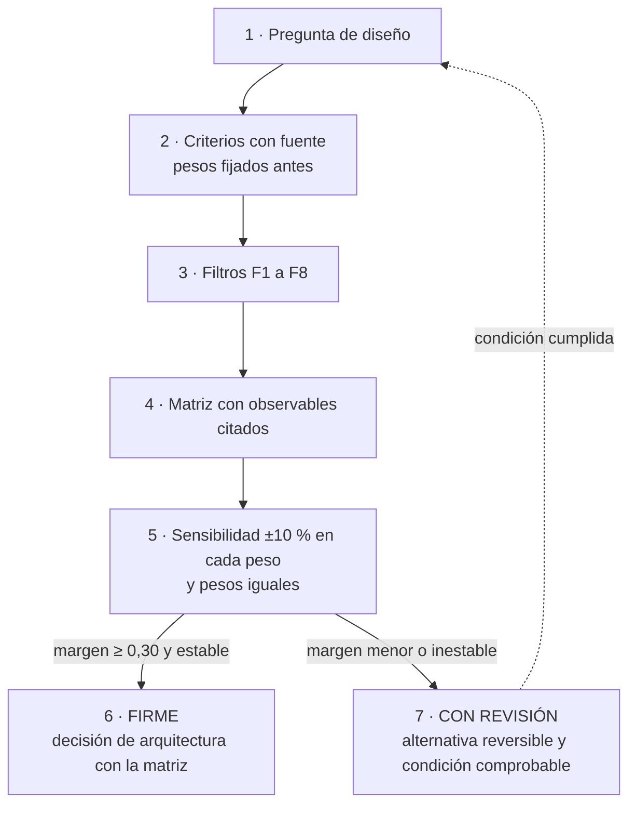
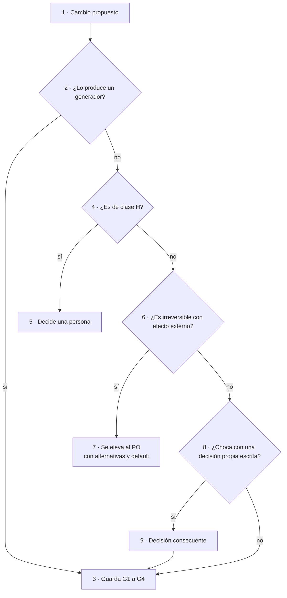
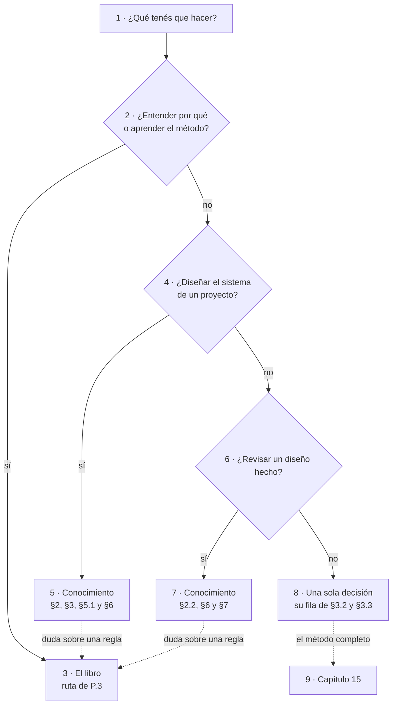

# DocsAsCode Developer Guide — Parte V. Práctica (capítulos 15 a 17)

## Parte V. Práctica (continuación)

[← Anterior](DocsAsCode-Developer-Guide-Parte-V-a.md) · [Índice general](DocsAsCode-Developer-Guide.md#índice-general) · [Siguiente →](DocsAsCode-Developer-Guide-Parte-VI.md)

### 15. Decidir entre alternativas

*Forma: explicación.* Por qué una decisión de diseño documental se toma con criterios, escala y regla de firmeza, y
cómo se lee una matriz trabajada.
**Objetivos.** Al terminarlo podés comparar alternativas de diseño con criterios que tienen fuente, puntuar cada
celda citando su observable, decir si la decisión es firme o lleva condición de revisión, y saber quién la cierra.

Diseñar un sistema documentador obliga a elegir: un repositorio dedicado o el mismo del código, un generador de sitio
o ninguno, un control que bloquea o uno que avisa. Sin una regla estable, cada sistema nuevo reabre el mismo debate
[Compilado: 99-Anexos/Como-Decidir.md, l. 17–20]. Este capítulo es la pieza de «métodos y marcos» que pide el Profile de guía de
estudio: enfoques alternativos y criterios para elegir entre ellos.

#### 15.1 Definiciones del método de decisión

| Término | Definición |
| --- | --- |
| Criterio (`K`) | Dimensión por la que se compara toda alternativa de una pregunta de diseño |
| Peso | Fracción de importancia de un criterio; los pesos suman 1 |
| Escala anclada | Escala de 1 a 5 en la que cada punto tiene un observable; sin observable, la celda queda «s/d» |
| Filtro duro | Restricción que excluye una alternativa antes de puntuar; no se compensa con puntaje |
| Margen | Diferencia de puntaje ponderado entre la primera y la segunda alternativa admitidas |
| Decisión firme | Margen de 0,30 o más, y el ganador no cambia al mover ±10 % cualquier peso |
| Decisión con revisión | Margen menor o ganador inestable: se toma la alternativa reversible y se escribe una condición de revisión comprobable |

*Tabla 15.1. Términos del método [Compilado: 99-Anexos/Como-Decidir.md, l. 34–42]. El anexo A los registra.*

#### 15.2 Los criterios

Simplicidad, practicidad y escalabilidad son los tres que el pedido del caso exige mostrar. Audiencia, coherencia con
los marcos existentes y deriva entre documentación y código salen del mismo pedido. El costo de adopción es
**[criterio propio]** y por eso pesa menos [Compilado: 99-Anexos/Como-Decidir.md, l. 46–48].

| K | Criterio | Qué mide | Fuente de industria |
| --- | --- | --- | --- |
| K1 | Simplicidad | Cuántas piezas, herramientas o reglas nuevas agrega | [Böckeler, 2025](DocsAsCode-Developer-Guide-Anexos.md#ref-bockeler-2025): la crítica al exceso de ceremonia |
| K2 | Practicidad | Si funciona hoy con lo que hay, sin pasos humanos ni permisos extra, y si está medido | [GitLab, s. f.](DocsAsCode-Developer-Guide-Anexos.md#ref-gitlab-sf); [Write the Docs, s. f.](DocsAsCode-Developer-Guide-Anexos.md#ref-writethedocs-sf) |
| K3 | Escalabilidad | Cuánto cuesta aplicarlo a un sistema nuevo | [Backstage, s. f.](DocsAsCode-Developer-Guide-Anexos.md#ref-backstage-sf) |
| K4 | Costo de adopción | Migración, dependencias y operación para un equipo chico | [Docusaurus, s. f.](DocsAsCode-Developer-Guide-Anexos.md#ref-docusaurus-sf) |
| K5 | Doble audiencia | Si la misma fuente sirve a personas y a agentes, con verificación | [AGENTS.md, s. f.](DocsAsCode-Developer-Guide-Anexos.md#ref-agentsmd-sf); [Howard, s. f.](DocsAsCode-Developer-Guide-Anexos.md#ref-howard-sf); [OWASP, 2025](DocsAsCode-Developer-Guide-Anexos.md#ref-owasp-2025) |
| K6 | Coherencia con los marcos SDD | Si reutiliza un mecanismo ya catalogado o lo contradice | [Thoughtworks, 2025](DocsAsCode-Developer-Guide-Anexos.md#ref-thoughtworks-2025) |
| K7 | Riesgo de deriva (alto = riesgo bajo) | Si la deriva entre documentación y código se detecta, cuándo y cómo | [Winters et al., 2020](DocsAsCode-Developer-Guide-Anexos.md#ref-winters-2020); [Tan et al., 2024](DocsAsCode-Developer-Guide-Anexos.md#ref-tan-2024); [DORA, s. f.](DocsAsCode-Developer-Guide-Anexos.md#ref-dora-sf) |

*Tabla 15.2. Los siete criterios y la fuente que sostiene cada uno [Compilado: 99-Anexos/Como-Decidir.md, l. 50–58].*

#### 15.3 La escala anclada

| Punto | K1 Simplicidad | K2 Practicidad | K3 Escalabilidad | K4 Costo | K5 Doble audiencia | K6 Coherencia SDD | K7 Deriva |
| --- | --- | --- | --- | --- | --- | --- | --- |
| 5 | Ninguna pieza nueva | Funciona hoy y está medido | Un sistema nuevo = una fila o un parámetro | Menos de una hora, sin migración | Una sola fuente sirve a los dos, con verificación | Reusa un mecanismo catalogado tal cual | Se detecta de forma determinista en el PR |
| 4 | Una pieza nueva (archivo, campo) | Medido en copia o con un acto humano | Una configuración por sistema | Un PR mecánico | Sirve a los dos con un paso extra | Compatible sin cambiar norma | Se detecta en un aviso programado |
| 3 | Dos o tres piezas | Paso sin medir | Adaptación por sistema | Migración de muchos archivos | Sirve bien a una audiencia | Neutral | Se detecta a mano |
| 2 | Herramienta o servicio nuevo | Exige otro repo, otro expediente o decisión del PO | Rehacer parte por sistema | Toolchain nuevo, cientos de MB | Una audiencia queda mal servida | Choca con una regla local | Se detecta tarde |
| 1 | Infraestructura nueva | Bloqueado | Rehacer todo por sistema | Compra u operación permanente | Perjudica a una audiencia | Contradice una norma (exige apartamiento) | Invisible |

*Tabla 15.3. La escala anclada: cada punto, su observable [Compilado: 99-Anexos/Como-Decidir.md, l. 62–68].*

La escala sirve si la celda dice por qué. «K1 = 4 porque agrega un archivo» se puede discutir; «K1 = 4» solo, no
[Compilado: 99-Anexos/Como-Decidir.md, l. 70]. Eso deja revisar la matriz celda por celda: no es una votación.

#### 15.4 Pesos, filtros y regla de firmeza

K1, K2, K3, K5, K6 y K7 pesan 0,15 cada uno; K4, 0,10. El pedido no ordena los seis primeros, así que el reparto es
igual (razón insuficiente), y K4 pesa menos porque no tiene origen en el pedido. Los pesos se fijan **antes** de
puntuar y se guarda su huella; si se fijan después, el resultado se contrasta con pesos iguales
[Compilado: 99-Anexos/Como-Decidir.md, l. 74–76]. Un filtro duro actúa antes que la escala: la alternativa que lo
viola no se puntúa.

| Filtro | Excluye la alternativa que… |
| --- | --- |
| F1 | no corre en el runner con la etiqueta que fija el caso, por plataforma (Linux; Mac para iOS); en este repositorio, la del workflow `docs-guard` |
| F2 | escribe rutas del equipo, usuarios o hosts en lo versionado |
| F3 | nombra un repositorio privado (se usa su alias) |
| F4 | modifica material del dueño del caso sin mandato |
| F5 | se aparta de un conocimiento compartido sin dejar ficha del apartamiento |
| F6 | ignora un estándar de industria aplicable que se relevó |
| F7 | reduce la arquitectura documental a la elección de una herramienta |
| F8 | no aplica el Profile de guía de estudio |

*Tabla 15.4. Filtros duros [Compilado: 99-Anexos/Como-Decidir.md, l. 80–89]; la etiqueta de runner la fija el
workflow (P-11). F1 y F8 son parámetros de este laboratorio: [17.4](#174-de-la-explicación-al-conocimiento) los
generaliza.*

*Figura 15.1. De la pregunta a la decisión. Una decisión con revisión (7) vuelve a la pregunta (1) cuando se cumple
su condición. Redibujada de [Como-Decidir.md](99-Anexos/Como-Decidir.md), l. 93–102.*

Con varios evaluadores, el expediente 0003 exigió además para FIRME una ventaja de tres o más puntos de celda, el
ruido medido entre ellos (regla R-06) **[criterio propio del refutador, adoptado por el jurado]**. Su resolución,
en Lab-Documentos.Documentacion, commit `e61c5df`, se cita en adelante como «resolución del 0003» [Compilado:
PROMPTs/DEVs/Enchacement/01-Replanteo-Y-Analisis/OUTPUTs/Expedientes/0003-Reedicion-DocsAsCode-Y-Especificacion/actuaciones/099-resolucion.md, l. 143].

#### 15.5 Una matriz trabajada

La pregunta que dio forma al cuerpo sirve de ejemplo trabajado (`PE-02`): ¿la guía del sistema documentador es un
cuerpo de varios documentos o un archivo único? [Compilado: 99-Anexos/Como-Decidir.md, l. 108–109].

| Alternativa | K1 | K2 | K3 | K4 | K5 | K6 | K7 | Total | Filtro |
| --- | --- | --- | --- | --- | --- | --- | --- | --- | --- |
| **A** Cuerpo documental: README, Marco, Mapa, siete temas, ejemplos y anexos | 3 | 4 | 5 | 3 | 5 | 5 | 4 | **4,20** | Pasa |
| B Enriquecer el archivo único | 5 | 4 | 2 | 5 | 4 | 2 | 3 | 3,50 | **Excluida por F8**: el Profile pide un documento por tema |
| C Archivo único más satélites por escenario | 3 | 3 | 3 | 3 | 3 | 2 | 2 | 2,70 | Pasa |

*Tabla 15.5. La matriz del cuerpo [Compilado: 99-Anexos/Como-Decidir.md, l. 111–115].*

El total de A es 0,15 × (3 + 4 + 5 + 5 + 5 + 4) + 0,10 × 3 = 0,15 × 26 + 0,30 = 4,20. Los puntos los fijó la mesa del
expediente 0002; la lectura de algunas celdas la reconstruye el anexo con la escala de 15.3 **[criterio propio del
anexo]** [Compilado: 99-Anexos/Como-Decidir.md, l. 117–120]:

| Celda | Observable que la justifica |
| --- | --- |
| A · K1 = 3 | Agrega varias piezas (README, Marco, Mapa, anexos) aunque reusa la estructura de seis secciones del Profile |
| A · K3 = 5 | Un sistema nuevo es una fila en las tablas del Marco y del Mapa |
| A · K6 = 5 | Reusa tal cual el Profile de guía de estudio |
| B · K3 = 2 | Cada sistema nuevo obliga a rehacer secciones de un archivo que ya mezcla los cuatro escenarios |
| C · K7 = 2 | Los satélites repiten contenido del archivo central y la deriva entre ellos se nota tarde |

*Tabla 15.6. Celdas leídas contra la escala [Compilado: 99-Anexos/Como-Decidir.md, l. 122–128].*

Con B excluida, el margen de A sobre C es 1,50. Moviendo ±10 % cada peso y renormalizando, el margen mínimo es 1,48;
con pesos iguales, A da 4,14 y C, 2,71. El ganador no cambia: la decisión es **FIRME**. Aun sin el filtro F8, A le
gana a B por 0,66 en el peor caso de la sensibilidad [Compilado: 99-Anexos/Como-Decidir.md, l. 130–134]. Esta
edición repitió el cálculo con Python 3, sin dependencias, y obtuvo las mismas cifras (margen mínimo de A sobre C,
1,477) [Salida registrada: corrida del 2026-11-01; anexo J].

#### 15.6 Quién decide

Una decisión bien tomada puede no ser de quien la tomó. La regla depende de la clase de intervención y de si el efecto
se puede deshacer [Compilado: 99-Anexos/Como-Decidir.md, l. 138–139].

| Situación | Clase | Quién decide | Cómo entra |
| --- | --- | --- | --- |
| La produce un generador determinista (contrato emitido, índice generado) | D | El generador; la compuerta lo verifica | Pull request por la guarda G1–G4, sin reserva |
| Un agente o una persona propone una página, una ficha, una corrección | P | Quien propone, con la compuerta en verde | Pull request por la guarda G1–G4 si la delegación del merge está asentada por escrito en el repositorio |
| Aceptar una decisión de arquitectura, pasar a vigente, etiquetar, publicar, cambiar `AGENTS.md` o un conocimiento compartido | H | Una persona | La persona fusiona o aprueba |
| Lo aditivo y reversible que choca con una decisión propia ya escrita | P | Quien propone, con un análisis | Se escribe una decisión consecuente que ratifica o ajusta la anterior, y se sigue |
| Lo irreversible con consecuencia fuera del repositorio (configuración de la organización, publicación de paquetes, compras) | H | La persona responsable del producto | Se le eleva con alternativas y una opción por defecto |

*Tabla 15.7. Quién cierra cada decisión [Compilado: 99-Anexos/Como-Decidir.md, l. 141–147]. Las clases D, P y H
las define la [sección 1.6](DocsAsCode-Developer-Guide-Parte-I.md#16-quién-decide-clases-dph).*

*Figura 15.2. Lo que se puede deshacer y no es de clase H lo cierra la guarda (3); sólo lo de clase H (5) y lo
irreversible con efecto externo (7) llegan a una persona. Redibujada de
[Como-Decidir.md](99-Anexos/Como-Decidir.md), l. 149–161.*

#### 15.7 Preguntas guía del capítulo 15

Las del anexo, que el ejercicio `EJR-SDEI-03` pone a prueba ([16.4](#164-ejercicio-3-decidir-con-la-escala-ejr-sdei-03))
[Compilado: 99-Anexos/Como-Decidir.md, l. 168–172]:

1. ¿Qué alternativas reales tiene tu pregunta, y alguna cae por un filtro antes de puntuar?
2. ¿Qué observable de la escala justifica cada celda que pusiste?
3. ¿Tu decisión sigue ganando con pesos iguales? Si no, ¿qué condición comprobable la haría revisar?
4. ¿Tu cambio es reversible? Si no lo es y tiene efecto fuera del repositorio, ¿a quién se lo elevás y con qué opción
   por defecto?

#### 15.8 Resumen del capítulo 15

Siete criterios con fuente, una escala cuyos puntos tienen observable, pesos fijados antes y ocho filtros que
excluyen sin compensar. Firme es un margen de 0,30 o más que resiste ±10 % en cada peso; si no, la alternativa reversible
con condición de revisión. Quién cierra la decisión depende de la clase y de si el efecto se puede deshacer.

### 16. Ejercicios

*Forma: tutorial.* Cinco tareas cortas, cada una después de un caso resuelto.
**Objetivos.** Al terminarlo comprobaste, con un caso distinto del trabajado, que podés ubicar un sistema, escribir un
frontmatter, decidir con la escala, encontrar qué aplicar y redactar un requerimiento documental.

Cada ejercicio comprueba un objetivo de [P.2](DocsAsCode-Developer-Guide-Parte-0.md#p2-objetivos-de-aprendizaje) con el patrón «ejemplo trabajado,
después ejercicio» (`PE-02`): cambia el sistema del caso resuelto y mantiene la estructura. Las claves, para después
de intentar, están en el [anexo H](DocsAsCode-Developer-Guide-Anexos.md#h-claves-de-los-ejercicios) [Compilado: 99-Anexos/Ejercicios.md, l. 17–19].

#### 16.1 Cómo se usan los ejercicios

| Ejercicio | Objetivo | Ejemplo trabajado previo | Tiempo estimado |
| --- | --- | --- | --- |
| `EJR-SDEI-01` | `OBJ-SDEI-01` | [3.6 Un caso que recorre el marco](DocsAsCode-Developer-Guide-Parte-I.md#36-un-caso-que-recorre-el-marco) | 15 min |
| `EJR-SDEI-02` | `OBJ-SDEI-02` | [C.6 Un frontmatter completo y sus errores](DocsAsCode-Developer-Guide-Anexos.md#c6-un-frontmatter-completo-y-sus-errores) | 15 min |
| `EJR-SDEI-03` | `OBJ-SDEI-03` | [15.5 Una matriz trabajada](#155-una-matriz-trabajada) | 30 min |
| `EJR-SDEI-04` | `OBJ-SDEI-04` | [11.2](DocsAsCode-Developer-Guide-Parte-V-a.md#112-por-escenario) y [11.3](DocsAsCode-Developer-Guide-Parte-V-a.md#113-por-contexto) | 10 min |
| `EJR-SDEI-05` | `OBJ-SDEI-05` | [C.5 Registro de requerimientos documentales](DocsAsCode-Developer-Guide-Anexos.md#c5-registro-de-requerimientos-documentales) | 15 min |

*Tabla 16.1. Ejercicio, objetivo y caso resuelto [Compilado: 99-Anexos/Ejercicios.md, l. 29–35]; la columna del
ejemplo apunta a las secciones del libro que traen el mismo caso.*

Los tiempos son **[criterio propio]** del cuerpo: sirven para planificar una clase, no para evaluar
[Compilado: 99-Anexos/Ejercicios.md, l. 37].

#### 16.2 Ejercicio 1: ubicar un sistema (`EJR-SDEI-01`)

Una cátedra arma una aplicación web donde los alumnos entregan trabajos y los docentes los corrigen; cada rol ve
pantallas distintas. El equipo usa un marco SDD con casos de uso numerados. No hay sitio de documentación publicado
[Compilado: 99-Anexos/Ejercicios.md, l. 43–48].

1. ¿En qué escenario del Marco está?
2. ¿Qué dos contextos fijan las respuestas en este caso, y en qué rama de cada uno cae?
3. Nombrá tres clases de pieza que se activan y una que queda latente, con el motivo.

#### 16.3 Ejercicio 2: escribir un frontmatter (`EJR-SDEI-02`)

Escribí el frontmatter de una página nueva del cuerpo: un anexo con plantillas de registro de requerimientos, que
redactó un agente y que todavía no revisó nadie. Después respondé: si borrás la línea `confidence`, ¿qué grupo de la
compuerta da rojo y con qué regla? [Compilado: 99-Anexos/Ejercicios.md, l. 52–54].

#### 16.4 Ejercicio 3: decidir con la escala (`EJR-SDEI-03`)

Un equipo duda entre dos formas de publicar la ayuda al usuario de una app sin roles [Compilado:
99-Anexos/Ejercicios.md, l. 58–65; las secciones del capítulo 15 reemplazan las del anexo]:

- **X**: las páginas de ayuda en Markdown dentro del repositorio del código, servidas por la propia app.
- **Y**: un sitio aparte, generado con un generador de sitios estáticos, en un repositorio dedicado.

1. Puntuá X e Y en K1 a K7 con la escala anclada de 15.3, citando el observable de cada celda.
2. Calculá los totales con los pesos de 15.4.
3. ¿Alguna cae por un filtro? ¿La decisión es firme?

#### 16.5 Ejercicio 4: encontrar qué aplicar (`EJR-SDEI-04`)

En MovilidadUrbana se renombró el método que valida el largo del nombre de una localidad. Una página de ayuda de la
demostración traza a la ficha de esa regla, y la demostración fija el código en un `source.lock`. Usando sólo el
[capítulo 11](DocsAsCode-Developer-Guide-Parte-V-a.md#11-estoy-acá-qué-aplico), que trae el Mapa del cuerpo [Compilado: 99-Anexos/Ejercicios.md, l. 69–74]:

1. ¿Por qué tabla entrás y qué fila aplicás?
2. ¿Qué control detecta el cambio, y bloquea o avisa? ¿Por qué?
3. ¿Quién actualiza la ficha y quién decide si el número de la regla sigue siendo el correcto?

#### 16.6 Ejercicio 5: redactar un requerimiento documental (`EJR-SDEI-05`)

Un docente pide que la guía explique cómo se corre la compuerta en local. Redactá la fila del registro de
requerimientos documentales: audiencia, tarea, pieza, criterio Dado/Cuando/Entonces y decisión. ¿Quién la acepta?
[Compilado: 99-Anexos/Ejercicios.md, l. 78–79].

#### 16.7 Preguntas guía del capítulo 16

1. ¿Qué tienen en común el caso resuelto y el ejercicio, y qué cambió? Si no lo podés decir, volvé al caso.
2. En los ejercicios 2 y 3, con varias respuestas válidas, ¿qué observable o regla citás para defender la tuya?

#### 16.8 Resumen del capítulo 16

Cinco ejercicios, uno por objetivo, cada uno después de su caso resuelto y con la clave aparte en el anexo H. Dos
tienen varias respuestas válidas: se corrigen por la cita del observable o de la regla, no por coincidir con la clave.

### 17. Mantener el libro, el cuerpo y el conocimiento

*Forma: guía práctica.* Corregir, versionar, vigilar y elegir entre el libro y el conocimiento.
**Objetivos.** Al terminarlo podés llevar una corrección a la fuente y al libro en el mismo pull request, medir si un
capítulo quedó atrás, decir qué versión manda en cada pieza y elegir entre el libro y el conocimiento según la tarea.

Tres piezas se mantienen juntas: el cuerpo, que es la fuente; este libro, que lo reúne; y el conocimiento de
especificación, que destila de él lo necesario para diseñar otro sistema documentador. Las reglas son del expediente
0003 («resolución del 0003», 15.4).

#### 17.1 Precedencia y co-cambio

Manda la fuente; el libro cita reglas y umbrales por su identificador; una corrección de fondo va también a la
fuente en el mismo pull request (co-cambio); el colofón da el SHA de cada capítulo (P-01, CON REVISIÓN)
[Compilado: resolución del 0003, l. 107]. [P.5](DocsAsCode-Developer-Guide-Parte-0.md#p5-relación-con-el-cuerpo) enuncia las reglas; este es el
procedimiento:

1. **Ubicar.** El [anexo I](DocsAsCode-Developer-Guide-Anexos.md#i-correspondencia) da, por sección del libro, la fuente y su línea. Si la sección no
   tiene fuente (texto rotulado **[criterio propio]**), la corrección es sólo del libro.
2. **Corregir la fuente**, con la forma de ese documento.
3. **Llevar al capítulo** la corrección; si las líneas se movieron, se actualiza el rango de su `[Compilado: …]`.
4. **Medir.** Desde la raíz de Lab-Documentos, `git diff --stat <sha-del-colofón>..HEAD -- <fuentes>` lista las fuentes
   del capítulo que cambiaron desde la edición; la salida esperada después del paso 3 es sólo lo que tocó este cambio.
5. **Proponer.** La descripción del pull request lista cada co-cambio con su fuente y línea.

Repetir el texto de las fuentes choca con la regla de que un dato vive en un solo documento; el expediente lo admitió
como excepción declarada, con el SHA por capítulo y el control de co-cambio como compromiso
[Compilado: resolución del 0003, l. 265, 502]. P-01 se reabre sólo si un guion de ensamblado con reescritura de
enlaces se mide verde y en menos de 150 líneas.

#### 17.2 Versión y estados

| Pieza | Dónde vive la versión | Cómo sube | Quién la mueve |
| --- | --- | --- | --- |
| Cuerpo `SDEI` | `version` del README, SemVer; hoy `2.0.0-borrador.2` | Al pasar los documentos a `vigente`, la persona responsable del producto fija `2.0.0` y la marca con una etiqueta anotada | Clase H |
| Libro (`DOC-SDEI-LIBRO`) | La edición de la portada, igual a la versión del cuerpo; el SHA de cada capítulo, en el colofón | Con el cuerpo: no tiene versión propia | Sigue al cuerpo |
| Conocimiento (`ANX-SDEI-ESPECIFICACION`) | `**Versión:**` de su cabecera, `1.4`; el `version` del frontmatter la repite | Las correcciones que dejan los ensayos suben la cifra menor | Su autor propone; pasar a vigente, clase H |

*Tabla 17.1. Tres líneas de versión [Compilado: README.md, l. 3, 22, 160–165; resolución del 0003, l. 108, 114, 129, 192;
Conocimientos/knowledge-DocsAsCode-Designing-Specification.md, cabecera y §10].*

El conocimiento es la única pieza con `version` propia en un documento que no es el README. La convención del cuerpo
lo recoge como salvedad («`corpus_id` y `version` sólo en el README, salvo el conocimiento de `Conocimientos/`, cuyo `version` repite su `**Versión:**`») [Compilado: 00-Marco.md, l. 178], y la excepción la
decidió el expediente (P-23): «Manda `**Versión:**`; `version` del frontmatter la repite»
[Compilado: resolución del 0003, l. 129]. Los estados son los de [P.6](DocsAsCode-Developer-Guide-Parte-0.md#p6-versión-estado-y-origen): `borrador`,
`vigente`, `obsoleto`; pasar a vigente es un acto de una persona [Compilado: 00-Marco.md, l. 186].
La guía de un solo archivo se archiva con el libro (P.6): los enlaces a «la versión archivada» apuntan a la etiqueta
anotada `sdei-v2.0.0-borrador`, creada antes de borrar esa guía [Compilado: resolución del 0003, l. 114].

#### 17.3 Carril programado aplicado al libro

El carril programado corre una vez por semana, o a mano, y sólo avisa: abre o actualiza un único issue
[Compilado: TEM-06-Compuertas-Y-CI.md, l. 44]. Verifica la carpeta `Guides` de Lab-Documentos por defecto, así que el
libro entra sin configurar nada [Compilado: tools/docs-guard/semanal.sh, l. 9, 21]. Lo que cada control hace con él:

| Control | Qué mira en el libro | Qué no ve |
| --- | --- | --- |
| Enlaces con red, con fragmentos | Enlaces relativos y anclas internas rotas; el libro no lleva URL externas, que viven en `99-Anexos/Referencias.md` | — |
| Atraso de `base_commit` y `source.lock` | Nada: el libro no declara ninguno | El SHA del colofón, porque el control busca sólo esas dos claves |
| Deriva de copias fijadas | Nada mientras el conocimiento no se copie a otra base | — |
| Frescura | `last_review` del libro con más de 365 días | — |
| Línea de base de AI-3 | Frases dirigidas al agente en el libro | — |

*Tabla 17.2. El carril programado sobre el libro [Compilado: tools/docs-guard/semanal.sh, l. 11–17, 66–68, 107–108,
123, 131]. La columna «Qué no ve» es lectura de esta edición sobre el guion **[criterio propio]**.*

El hueco de la segunda fila lo cubre el paso 4 de 17.1, en el pull request. Llevarlo al carril sería un cambio de
herramienta, que el expediente 0003 dejaría para un expediente propio, como hizo con `dg.py` (P-04) y con la deriva
por símbolo (P-13) **[criterio propio]** [Compilado: resolución del 0003, l. 110, 119].

El carril mide **atraso**, no deriva por símbolo: cuenta cuántos commits tiene un SHA fijado detrás de la rama
principal. Si el método que una ficha cita cambió, eso lo mide A1 cuando corre la demo. A1 no está programado; es
deuda declarada, que se cierra con el pull request que lo programe o con el folio que decida no hacerlo (P-18)
[Compilado: 00-Marco.md, l. 200–204; 01-Mapa.md, l. 69]. Si la deuda se cierra, cambian a la vez esas fuentes y el
[capítulo 13](DocsAsCode-Developer-Guide-Parte-V-a.md#13-caso-de-estudio-la-mini-demo-movilidadurbana), que repite la frase.

#### 17.4 De la explicación al conocimiento

El libro explica: por qué existe cada regla, cómo se aplicó en casos reales, qué ensayos la sostienen. El
conocimiento de especificación especifica: qué hay que decidir para diseñar el sistema documentador de un proyecto,
qué artefactos deja ese diseño y cómo se comprueba que quedó bien. Lo puede aplicar una persona o un agente que no
conoce este laboratorio; el conocimiento deja afuera la explicación y remite a esta sección
[Compilado: Conocimientos/knowledge-DocsAsCode-Designing-Specification.md, §0; resolución del 0003, l. 333–334].

##### 17.4.1 Dos piezas, dos usos

| Rasgo | Libro | Conocimiento de especificación |
| --- | --- | --- |
| Para qué | Aprender el método y formar criterio | Diseñar o revisar el sistema documentador de un proyecto |
| Forma | Partes, capítulos, ejemplos, ejercicios; Diátaxis por capítulo | Cabecera de once campos y secciones 0 a 10; tablas, decisiones `D-01`…`D-18`, criterios `DE-1`…`DE-32` |
| Normativo | No: cita las reglas del cuerpo | Sólo su §6; el resto es contrato de uso; es consultivo |
| Alcance | Este cuerpo, con su laboratorio y sus casos | Cualquier proyecto en Git con pull requests y CI; neutral respecto de un marco de especificación concreto |
| Cómo se carga | Se lee por rutas ([P.3](DocsAsCode-Developer-Guide-Parte-0.md#p3-rutas-de-lectura)) | Por secciones, según su mapa de carga |

*Tabla 17.3. El libro y el conocimiento, rasgo por rasgo [Compilado: Conocimientos/knowledge-DocsAsCode-Designing-Specification.md,
§0, §1, §3.2, §6, §8; resolución del 0003, l. 108, 128–130].*

##### 17.4.2 Qué parte del libro destila el conocimiento

El conocimiento no se deriva del libro sino de las mismas fuentes: declara su origen, documento por documento, como
«derivado de Lab-Documentos» en un SHA, y conserva sólo las tablas normativas y las reglas con nombre
[Compilado: Conocimientos/knowledge-DocsAsCode-Designing-Specification.md, §9]. Por eso cada sección suya tiene su
explicación en un capítulo del libro:

| Sección del conocimiento | Qué conserva | Dónde se explica en el libro |
| --- | --- | --- |
| §0 Terminología mínima | Un sentido por término | [1.3](DocsAsCode-Developer-Guide-Parte-I.md#13-fuente-de-verdad-traza-y-ancla-de-versión), [1.6](DocsAsCode-Developer-Guide-Parte-I.md#16-quién-decide-clases-dph), [3.1](DocsAsCode-Developer-Guide-Parte-I.md#31-definiciones-del-marco), [anexo A](DocsAsCode-Developer-Guide.md#a-glosario-índice) |
| §2.1 Catálogo `CL-01`…`CL-14` | Las clases de pieza | [4.2](DocsAsCode-Developer-Guide-Parte-II.md#42-arquitectura-de-referencia-y-catálogo-de-clases) |
| §2.2 Invariantes `I-01`…`I-25` y regla de bloqueo | Lo que vale en cualquier proyecto | [3.5](DocsAsCode-Developer-Guide-Parte-I.md#35-convenciones), [cap. 5](DocsAsCode-Developer-Guide-Parte-II.md#5-el-ciclo-documental), [6.1](DocsAsCode-Developer-Guide-Parte-II.md#61-definición-y-regla-para-ubicar-una-pieza), [9.1.4](DocsAsCode-Developer-Guide-Parte-IV.md#914-la-regla-de-bloqueo) |
| §2.3 Apéndice por escenario | Los valores por tipo de sistema | [3.2](DocsAsCode-Developer-Guide-Parte-I.md#32-escenarios-y-composición-por-unión) |
| §3.1–§3.2 Procedimiento y decisiones | Qué decidir y en qué orden | Caps. [3](DocsAsCode-Developer-Guide-Parte-I.md#3-marco-de-referencia) a [10](DocsAsCode-Developer-Guide-Parte-IV.md#10-integración-con-un-marco-sdd); entrada por el [11](DocsAsCode-Developer-Guide-Parte-V-a.md#11-estoy-acá-qué-aplico) |
| §3.3 Cómo decidir | Criterios, escala, pesos, filtros, firmeza | [Capítulo 15](#15-decidir-entre-alternativas) |
| §3.4 Proyecto nuevo o existente | Línea de base antes de bloquear | [Cap. 9](DocsAsCode-Developer-Guide-Parte-IV.md#9-compuertas-de-calidad-y-ci) |
| §3.6 Público y privado | Alias y barrido | [P.4](DocsAsCode-Developer-Guide-Parte-0.md#p4-convenciones) |
| §5 Esqueletos | Ficha de diseño, frontmatter, RRD, instancia, workflow | [Anexo G](DocsAsCode-Developer-Guide-Anexos.md#g-plantillas), [anexo C](DocsAsCode-Developer-Guide-Anexos.md#c-esquema-de-frontmatter-y-prefijos) |
| §6–§7 Criterios y anti-patrones | Cómo se comprueba un diseño | [Anexo D](DocsAsCode-Developer-Guide-Anexos.md#d-criterios-de-calidad), [anexo E](DocsAsCode-Developer-Guide-Anexos.md#e-lista-de-verificación) para guías; caps. 6 y 9 para los anti-patrones |

*Tabla 17.4. Del conocimiento al libro. Las secciones del conocimiento son las de su índice; los destinos son
**[criterio propio]** de esta edición, por correspondencia de contenido.*

Sólo en el libro queda la mitad explicativa: qué problema resuelve cada tema y qué no es, ejemplos, ensayos, preguntas
guía, la industria del [capítulo 18](DocsAsCode-Developer-Guide-Parte-VI.md#18-el-sistema-documentador-en-la-industria), los ejercicios y la matriz de 15.5.

Destilar también es generalizar. Lo que en el cuerpo es un dato de este laboratorio, en el conocimiento pasa a ser
una decisión del proyecto que lo aplica:

| En el cuerpo y en el libro | En el conocimiento |
| --- | --- |
| F1: la etiqueta de runner del caso | La etiqueta que fija **el proyecto**, por plataforma; parámetro `{etiqueta-runner}` (P-11) |
| F8: el Profile de guía de estudio | El perfil de documentación que el proyecto fijó, si enseña (decisión `D-15`) |
| F3: nombrar un repositorio privado | Invariante `I-09`, no un filtro |
| Rioplatense con voseo | Idioma y estilo del proyecto (`D-16`) |
| Marco SDD, `CTX-SDEI-2` | «Marco de especificación del proyecto»; la sigla no aparece (P-24) |
| El servicio privado por su alias | «Servicio con paquetes», sin un alias que contenga la sigla |

*Tabla 17.5. Parámetros del laboratorio y su forma general [Compilado:
Conocimientos/knowledge-DocsAsCode-Designing-Specification.md, §2.3, §3.2, §3.3, §3.6, §7; resolución del 0003, l. 117, 130, 365].*

##### 17.4.3 Cuándo usar cada uno

*Figura 17.1. El libro forma (3); el conocimiento se carga por secciones según la tarea (5, 7, 8) y vuelve al libro
cuando hace falta el porqué. Las secciones salen del mapa de carga del conocimiento, §0.*

Para cambiar este mismo cuerpo rige el [capítulo 12](DocsAsCode-Developer-Guide-Parte-V-a.md#12-cómo-intervenir-el-proceso-en-cinco-pasos)
**[criterio propio]**; el conocimiento diseña el sistema de **otro** proyecto, y copiarle los parámetros del
laboratorio es uno de sus anti-patrones [Compilado: Conocimientos/knowledge-DocsAsCode-Designing-Specification.md, §7].

##### 17.4.4 Mantener los dos juntos

Una corrección de fondo en una fuente va al capítulo (17.1) y al conocimiento si esa fuente está en su origen, con
subida de la cifra menor. Antes de su pull request, el conocimiento pasa la compuerta, `mermaid.sh` y dos cuentas en
0: la sigla del marco de especificación y lo privado [Compilado: resolución del 0003, l. 375–376].

La versión actual del conocimiento es la `1.4`, con el rótulo **«borrador ensayado, no probado»**: se ensayó en cuatro
rondas y en la última ninguna de las ocho corridas válidas pasó la métrica; quedan abiertos cuatro defectos P0. Se publicó
así por decisión de la persona responsable del producto. Se usa como guía con criterio, no como procedimiento validado
(`EXP0003-F208`, enmendado por `EXP0003-F209`). Los resultados están en el
[capítulo 18](DocsAsCode-Developer-Guide-Parte-VI.md#18-el-sistema-documentador-en-la-industria) y en el [anexo J](DocsAsCode-Developer-Guide-Anexos.md#j-marcas-de-estado-y-ensayos-fechados). Copiarlo a la base de conocimientos de la organización espera la
decisión de la persona responsable del producto [Compilado: resolución del 0003, l. 483].

#### 17.5 Preguntas guía del capítulo 17

1. Encontraste en el capítulo 9 una cifra distinta de la de su tema: ¿qué corregís primero, y qué comando muestra
   después que el capítulo quedó al día?
2. ¿Qué versión citás del conocimiento: la del README del cuerpo o la de su cabecera? ¿Por qué?
3. Un agente va a diseñar la documentación de un proyecto nuevo: ¿qué secciones del conocimiento carga, y cuándo
   vuelve al libro?

#### 17.6 Resumen del capítulo 17

Una corrección va primero al cuerpo y después al capítulo, en un solo pull request; `git diff --stat` contra el SHA
del colofón dice si un capítulo quedó atrás, cosa que el carril programado no ve. El libro sigue la versión del
cuerpo y el conocimiento tiene la suya. El libro forma; el conocimiento destila de las mismas fuentes lo necesario
para diseñar el sistema de otro proyecto, generaliza los parámetros del laboratorio y sigue siendo un borrador ensayado, no probado.

[← Anterior](DocsAsCode-Developer-Guide-Parte-V-a.md) · [Índice general](DocsAsCode-Developer-Guide.md#índice-general) · [Siguiente →](DocsAsCode-Developer-Guide-Parte-VI.md)
