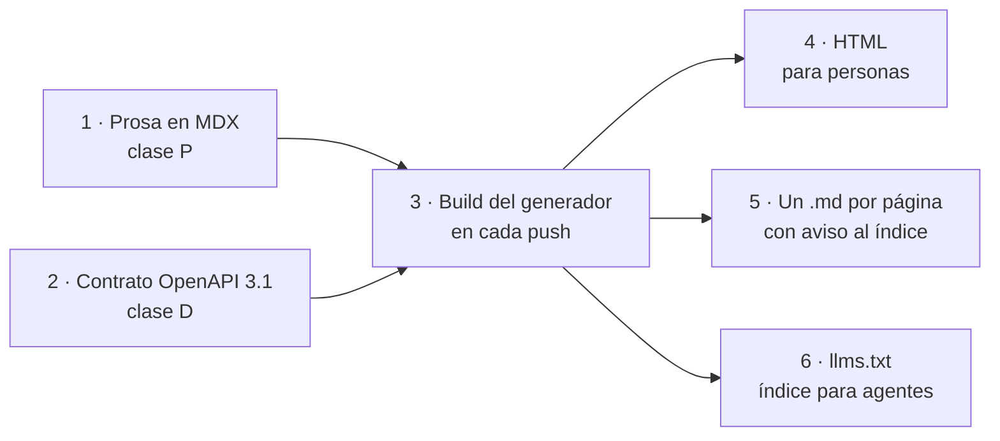
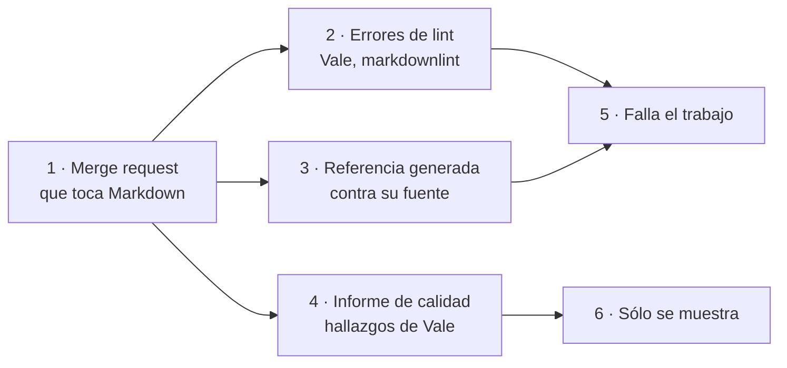

# DocsAsCode Developer Guide — Parte VI. Industria

[← Anterior](DocsAsCode-Developer-Guide-Parte-V-b.md) · [Índice general](DocsAsCode-Developer-Guide.md#índice-general) · [Siguiente →](DocsAsCode-Developer-Guide-Anexos.md)

## Parte VI. Industria

Las cinco partes anteriores describen un sistema documentador desde adentro: qué piezas tiene, quién las decide, qué
las verifica. Esta parte lo mira desde afuera, en proyectos que nadie del laboratorio controla. El capítulo 18 junta
un caso de punta a punta, las adopciones públicas de las prácticas que el cuerpo recomienda, la compuerta de un
proyecto grande, las normas que se pueden citar y lo que está cambiando. Todo hecho de industria lleva fecha de
consulta, porque los sitios cambian: el caso de la sección 18.1 cambió tres de sus cinco cifras en siete semanas.

### 18. El sistema documentador en la industria

*Forma: explicación.* **Requisitos previos:** los capítulos 4 (qué es un sistema
documentador), 7 (audiencias y lectura por agentes) y 9 (compuertas); para 18.6, el capítulo 17.

**Objetivos.** Al terminar este capítulo podés:

1. Descomponer un portal de documentación ajeno en piezas, fuentes de verdad y clases D/P/H, a partir de lo que el
   propio sitio responde.
2. Reverificar un caso de industria con un método de conteo declarado y distinguir el patrón, que dura, de las cifras,
   que se fechan.
3. Leer una tabla de adopciones como prueba de presencia y de actividad, no de efectividad.
4. Comparar la compuerta de un proyecto grande con los dos carriles del capítulo 9.
5. Separar una norma citable de una propuesta y de una tendencia de proveedor.

**Cómo se leen las cifras de este capítulo.** Cada dato de un sitio o de un repositorio ajeno dice cuándo se midió y
con qué comando. El argumento se apoya en el patrón; las cifras van como datos fechados («al 2026-11-01») y se
pueden repetir con el ensayo de cada sección. Las direcciones consultadas están en el anexo B, con su fecha, y no en
el texto (regla de dominios de la compuerta, capítulo 9).

#### 18.1 El portal de un proveedor público de notificaciones, reverificado

OneSignal es un proveedor público y externo de mensajería (push, correo, SMS y mensajes dentro de la app). Su índice
para agentes lo describe como una plataforma que envía todo eso «via a single API, Journey Builder, and a dashboard»
([OneSignal, s. f., b](DocsAsCode-Developer-Guide-Anexos.md#ref-onesignal-llms-sf)). El cuerpo lo analizó por primera vez el 2026-09-16, en la guía de un
solo archivo que este libro reemplaza [Compilado: Sistema-Documentador-Tecnico-Guide.md, l. 99–171], y lo usó como
caso en dos temas [Compilado: TEM-01-Sistema-Documentador.md, l. 168–183; TEM-04-Doble-Audiencia.md, l. 111–119].
Este libro lo trae reverificado el 2026-11-01, como decidió la mesa del expediente 0003 (P-07).

Una advertencia antes de leerlo: el portal es la documentación de **quien integra** (la referencia de una API y de sus
SDK), no ayuda al usuario final. Sirve como ejemplo del patrón de entrega, no como modelo de página de ayuda; el
modelo de ayuda por rol está en el capítulo 8 y en la prueba de concepto del capítulo 14.

##### 18.1.1 Qué se verificó y cómo se contó

La reverificación repite cada afirmación de la consulta original contra la respuesta del sitio, con un comando por
afirmación. El cambio más visible es de método: la consulta original habló de «170 páginas» del índice para agentes
sin decir cómo las contó, y dos comisiones de la mesa contaron el mismo archivo el mismo día con dos comandos
distintos y obtuvieron 179 y 159 (P-07). Las dos cifras son correctas; miden cosas distintas. Por eso este libro declara el
método antes de dar el número.

| Afirmación | Al 2026-09-16 | Al 2026-11-01 | Método de conteo |
| --- | --- | --- | --- |
| Generador declarado en la página HTML de referencia «Create user» | Mintlify | Mintlify (la etiqueta suma un atributo `data-mint-head`) | `grep -o -i '<meta[^>]*generator[^>]*>'` |
| Apariciones de `mintlify` en esa página | 1133 | 206 | `grep -o -i mintlify \| wc -l` |
| La misma página con `.md` al final | 200 `text/markdown`, 920 líneas | 200 `text/markdown; charset=utf-8`, 834 líneas; abre con un aviso que remite al índice para agentes | `wc -l` |
| Contrato embebido en el `.md` | `openapi: 3.1.0`, versión `'11.6'`, en la línea 60 | Igual, líneas 60 a 63 | `grep -n '^openapi:'` |
| Contrato completo en `/openapi.json` | OpenAPI 3.1.0, versión 11.6 | Igual; declara 48 rutas | `json.load` y `len(paths)` |
| Índice para agentes `/llms.txt` | 200 `text/plain`, «170 páginas» | 200 `text/plain`; **179 entradas** | Entrada = línea que empieza con `- [` (`grep -c '^- \['`) |
| Mismo contenido en el subdominio del generador | 200, mismo contenido | 200; el contenido no se comparó | `curl -L -w '%{http_code}'` |

*Tabla 18.1. El caso del portal, afirmación por afirmación, en la consulta original y en la del 2026-11-01. Cambiaron
tres cifras de cinco; no cambió ninguna afirmación sobre el patrón.*

Las 179 entradas del índice se reparten así: 71 apuntan a la referencia de la API (`/reference/`), 86 a guías
(`/docs/`), 16 a subíndices por idioma (`/_llms/`) y 6 a otras cosas (el registro de cambios, las versiones de los
SDK, el contrato, el blog y dos redes). Si en vez de entradas se cuentan las líneas que contienen `.md`, el resultado
es 159: los subíndices terminan en `.txt` y quedan afuera. Ninguna de las dos cuentas es «páginas»: los subíndices
declaran por su cuenta 201 páginas de guías en inglés y más de 300 por idioma traducido.

El ensayo que produce la columna del 2026-11-01 se corre desde cualquier carpeta vacía; `BASE` es la raíz del portal
que figura en el anexo B ([OneSignal, s. f., a](DocsAsCode-Developer-Guide-Anexos.md#ref-onesignal-sf)).

```text
BASE=<raíz del portal, anexo B>
curl -sS -L -o pagina.html "$BASE/reference/create-user"
curl -sS -L -o pagina.md -D pagina.md.h "$BASE/reference/create-user.md"
curl -sS -L -o llms.txt "$BASE/llms.txt"
curl -sS -L -o openapi.json "$BASE/openapi.json"
grep -o -i '<meta[^>]*generator[^>]*>' pagina.html
grep -o -i mintlify pagina.html | wc -l
wc -l < pagina.md
grep -n '^openapi:\|^  version:' pagina.md
grep -c '^- \[' llms.txt
grep '^- \[' llms.txt | grep -c '/reference/'
grep '^- \[' llms.txt | grep -c '/docs/'
grep -c '\.md' llms.txt
```

[Fragmento ilustrativo: los comandos de la reverificación del 2026-11-01, con la dirección reemplazada por `BASE`]

```text
<meta data-mint-head name="generator" content="Mintlify">
206
834
60:openapi: 3.1.0
63:  version: '11.6'
179
71
86
159
```

[Salida registrada: corrida del 2026-11-01 a las 21:31 UTC; huellas de los archivos bajados y encabezados de
respuesta en el anexo J]

##### 18.1.2 El patrón: dos fuentes, un build, tres salidas

Leído con el capítulo 4, el portal se descompone en cuatro piezas con dos fuentes de verdad
[Compilado: TEM-01-Sistema-Documentador.md, l. 174–179]:

| Pieza | Fuente de verdad | Cómo se produce | Clase |
| --- | --- | --- | --- |
| Guías y conceptos | Archivos MDX (Markdown con componentes) en un repositorio | Los escriben personas | P |
| Referencia de cada operación | El contrato `openapi.json` 3.1 | Se genera del contrato | D |
| Sitio HTML | El repositorio entero | Un *push* a la rama de producción dispara el build en el generador | D |
| Salida para agentes | El mismo build | Un `.md` por página y el índice `llms.txt` | D |

*Tabla 18.2. Piezas del portal, con su fuente y su clase. La única pieza de clase P es la prosa.*

El generador documenta las dos mitades del mecanismo. Para la referencia, se nombran uno o más contratos OpenAPI en
la navegación del sitio y el generador crea una página por operación; una página MDX con prosa propia se engancha a
una operación con el campo `openapi` de su frontmatter ([Mintlify, s. f., a](DocsAsCode-Developer-Guide-Anexos.md#ref-mintlify-openapi-sf)). Para los
agentes, el generador publica por su cuenta un `llms.txt` en la raíz que lista todas las páginas, y un `llms-full.txt` con el
sitio entero en un archivo ([Mintlify, s. f., b](DocsAsCode-Developer-Guide-Anexos.md#ref-mintlify-llmstxt-sf)). Las dos salidas son de clase D: nadie las
escribe.



*Figura 18.1. El portal reverificado: dos fuentes con ritmos distintos, un build y tres salidas que nadie escribe a
mano.*

Lo que la consulta del 2026-11-01 agregó al caso es un detalle de lectura por agentes que la original no vio. La
respuesta del `.md` trae un encabezado HTTP `x-llms-txt: /llms.txt` y otro `x-robots-tag: noindex`: el `.md` le
señala el índice al agente por el encabezado y por el aviso de sus primeras líneas, y les pide a los buscadores que no
lo indexen. Es la fuente única del capítulo 7 aplicada por un proveedor comercial.

##### 18.1.3 La lección, y cuánto dura

La lección no es la herramienta. Es que la prosa y el contrato son dos fuentes con dos ritmos, y que separar la
referencia generada de las guías escritas es la distinción entre referencia y explicación de Diátaxis ([Procida, s. f.](DocsAsCode-Developer-Guide-Anexos.md#ref-procida-sf)). Que esa separación sea «la decisión
que más simplifica el mantenimiento» es una interpretación del cuerpo, no una medición
[Compilado: TEM-01-Sistema-Documentador.md, l. 181–183, 350].

La reverificación también muestra cuánto dura cada parte del caso. El patrón (fuente servida como Markdown, contrato
embebido, generador declarado, índice para agentes) siguió igual; tres de cinco cifras cambiaron en siete semanas. La
mesa fijó una condición para que el libro no envejezca en silencio: si, al publicarse, la consulta tiene más de 90 días,
se repite en el mismo pull request (P-07). La marca queda en el anexo J.

#### 18.2 Adopciones públicas por práctica, con fecha

El cuerpo apoya cada práctica que recomienda en al menos dos proyectos públicos que la sostienen hoy. La prueba es el
último commit que tocó la ruta que materializa la práctica, consultado con la API pública de GitHub, dentro de una
ventana de 24 meses; el umbral de 24 meses y el de dos adopciones son **[criterio propio del plan]** del expediente
0002, sin fuente externa [Compilado: TEM-01-Sistema-Documentador.md, l. 188–191, 351]. Los temas 01 y 03 midieron
el 2026-10-27 [Compilado: TEM-01-Sistema-Documentador.md, l. 186–206; TEM-03-Topologia-Y-Versionado.md, l. 176–193].
La tabla siguiente repite la consulta el 2026-11-01.

| Práctica | Adopción | Ruta | Commit y fecha al 2026-10-27 | Commit y fecha al 2026-11-01 |
| --- | --- | --- | --- | --- |
| P1. La documentación vive en Git y cambia por pull request | GitHub ([GitHub, 2026a](DocsAsCode-Developer-Guide-Anexos.md#ref-github-docs-2026)) | `content/` | `ee20fda`, 2026-10-27 | `33b1f4a`, 2026-10-31 |
| | Kubernetes ([Kubernetes, 2026](DocsAsCode-Developer-Guide-Anexos.md#ref-kubernetes-website-2026)) | `content/en/` | `ed70e31`, 2026-10-26 | `6dbc6e1`, 2026-11-01 |
| | Microsoft Azure ([Microsoft, 2026a](DocsAsCode-Developer-Guide-Anexos.md#ref-microsoft-azure-docs-2026)) | `articles/` | `d7e590b`, 2026-10-27 | `c96c090`, 2026-10-31 |
| P2. La referencia de la API sale de un contrato OpenAPI versionado | GitHub ([GitHub, 2026b](DocsAsCode-Developer-Guide-Anexos.md#ref-github-openapi-2026)) | `descriptions/` | `a5c38c1`, 2026-10-27 | `e85aa3d`, 2026-10-31 |
| | Stripe ([Stripe, 2026](DocsAsCode-Developer-Guide-Anexos.md#ref-stripe-openapi-2026)) | `openapi/` | `a6cd987`, 2026-10-26 | `aab1dee`, 2026-10-29 |
| P3. La CI revisa la prosa con un linter además de los enlaces | Mintlify ([Mintlify, 2026](DocsAsCode-Developer-Guide-Anexos.md#ref-mintlify-docs-2026)) | `.vale.ini` | `4a8f15c`, 2026-08-14 | Igual |
| | Red Hat OpenShift ([Red Hat, 2026](DocsAsCode-Developer-Guide-Anexos.md#ref-redhat-openshift-docs-2026)) | `.vale.ini` | `df83131`, 2026-08-25 | Igual |
| | Grafana ([Grafana Labs, 2026](DocsAsCode-Developer-Guide-Anexos.md#ref-grafana-2026)) | `.vale.ini` | `5427e8d`, 2026-08-03 | Igual |
| P4. La documentación del producto vive en el mismo repositorio que su código | Backstage ([Backstage, 2026](DocsAsCode-Developer-Guide-Anexos.md#ref-backstage-2026)) | `docs/` | `82079b4`, 2026-10-27 | `f81ca4e`, 2026-10-31 |
| | Grafana ([Grafana Labs, 2026](DocsAsCode-Developer-Guide-Anexos.md#ref-grafana-2026)) | `docs/sources/` | `7b102dd`, 2026-10-27 | `a9c678d`, 2026-10-30 |
| P5. Documentación en repositorio separado, una rama por versión del producto | Kubernetes ([Kubernetes, 2026](DocsAsCode-Developer-Guide-Anexos.md#ref-kubernetes-website-2026)) | ramas `release-1.*` | 33, la última `release-1.36` | Igual |
| | Istio ([Istio, 2026](DocsAsCode-Developer-Guide-Anexos.md#ref-istio-2026)) | ramas `release-1.*` | 33, la última `release-1.31`; `content/` en `2100f40`, 2026-10-27 | Igual; `content/` en `5453c1c`, 2026-10-29 |
| P6. Copias versionadas sólo cuando conviven versiones | Docusaurus ([Docusaurus, 2026](DocsAsCode-Developer-Guide-Anexos.md#ref-docusaurus-2026)) | `website/versioned_docs/` | `206e741`, 2026-10-16; doce versiones | `c5bc92e`, 2026-10-29; doce versiones, de la 2.x a la 3.10.2 |
| | Jest ([Jest, 2026](DocsAsCode-Developer-Guide-Anexos.md#ref-jest-2026)) | `website/versioned_docs/` | `ea7258e`, 2026-08-31; cuatro versiones | Igual |

*Tabla 18.3. Las seis prácticas con su evidencia en dos fechas. Todas las filas siguen dentro de la ventana de 24
meses.*

Tres lecturas salen de comparar las columnas. La primera: en cinco días cambiaron nueve de los catorce commits consultados y
ninguna conclusión, que es lo que se espera de una prueba de presencia; por eso la tabla cita el commit y no la rama. La
segunda: la fila de Docusaurus, que la corrida del guion del 2026-11-01 dejó en «no reproducido» porque el repositorio
se mudó de organización [Compilado: TEM-03-Topologia-Y-Versionado.md, l. 188, 194–197], se reproduce si la consulta
sigue la redirección: la API responde desde la organización nueva, con doce versiones publicadas. La tercera, que el
propio cuerpo ya escribe: la tabla prueba que la práctica está materializada y viva, no que sea la mejor ni cuánto
rinde [Compilado: TEM-01-Sistema-Documentador.md, l. 204–206].

```text
API=<API pública de GitHub, anexo B>
curl -sS -L "$API/repos/<dueño>/<repositorio>/commits?path=<ruta>&per_page=1"
git ls-remote --heads <repositorio> 'release-1.*' | wc -l
```

[Fragmento ilustrativo: las dos consultas de la columna del 2026-11-01; `-L`, que sigue la redirección, es lo que el
guion `04-adopciones.sh` del expediente 0002 no hace y lo que recupera la fila de Docusaurus]

Los commits dicen que la práctica existe; no dicen por qué un equipo la eligió. Para eso sirven los relatos de
migración. Twilio cuenta que su equipo de documentación «decided to embrace the Docs as Code philosophy» para más de
5000 páginas y casi 20 000 ejemplos de código en nueve lenguajes, que escribe en MDX y que, al pasar a OpenAPI,
empezó a generar los ejemplos desde el contrato ([Molina y Christensen, 2024](DocsAsCode-Developer-Guide-Anexos.md#ref-molina-2024)): el mismo patrón de
18.1, contado por quien lo adoptó. Stripe creó Markdoc, un marco de autoría basado en Markdown, «to power our public
docs» ([Markdoc, s. f.](DocsAsCode-Developer-Guide-Anexos.md#ref-markdoc-sf)). Write the Docs enlaza desde su definición de *docs as code* charlas de
adopción de Google (2015), Rackspace y Capital One (2016), F5 (2017), el Servicio Digital del Gobierno británico (2019)
y Amazon Web Services (2022), entre otras ([Write the Docs, s. f.](DocsAsCode-Developer-Guide-Anexos.md#ref-writethedocs-sf)); el libro no las resume
porque no las abrió.

#### 18.3 Compuertas de proyectos grandes

GitLab documenta en público qué controles corren sobre su documentación en cada merge request que toca Markdown
([GitLab, s. f., b](DocsAsCode-Developer-Guide-Anexos.md#ref-gitlab-testing-sf)). El tema 06 lo usó como caso de compuerta grande
[Compilado: TEM-06-Compuertas-Y-CI.md, l. 209–216]. Releída el 2026-11-01, la página da más detalle y corrige una
afirmación del cuerpo.

| Trabajo de GitLab | Qué revisa | Qué dice la página del resultado | Análogo en el capítulo 9 |
| --- | --- | --- | --- |
| `docs-lint markdown` | Vale, markdownlint y controles propios (frontmatter, nombres de archivo) | Falla si un linter reporta errores, también los de Vale | Carril PR, estructura |
| `docs-lint links` | Enlaces relativos y anclas; los que requieren red se omiten | Informa los problemas; no dice si falla | Carril PR sin red; los externos, al carril programado |
| `docs-lint mermaid` | Diagramas mermaid que no parsean | El guion devuelve error; no dice qué hace el trabajo | Carril PR, estructura |
| `docs-lint redirects` | Archivos borrados o renombrados sin redirección | No lo dice | Sin análogo: el cuerpo no publica sitio (`CTX-SDEI-1`) |
| `graphql-verify` | Referencia generada de GraphQL desactualizada respecto de su fuente | Falla | Trazas y anclas: lo generado contra su fuente |
| `docs code_quality` | Vale, como informe de calidad | «does not block merge requests» | Aviso |

*Tabla 18.4. Algunos trabajos de documentación de GitLab al 2026-11-01. La tercera columna dice sólo lo que la página
afirma; donde calla, el libro no completa. La columna de la derecha es **[criterio propio]**: una lectura, no una
equivalencia declarada por GitLab.*

La corrección es esta. El cuerpo dice que en GitLab el lint de estilo de prosa «es informativo y no bloquea»
[Compilado: TEM-06-Compuertas-Y-CI.md, l. 215–216]. Al 2026-11-01, Vale corre en dos trabajos: sus errores hacen
fallar `docs-lint markdown` y sus hallazgos en `docs code_quality` sólo se muestran. La separación entre
bloquear y avisar sigue en pie, pero pasa por el nivel del hallazgo y no por la herramienta. El libro anota el cambio
como co-cambio para `TEM-06`. La regla de bloqueo del cuerpo no cambia: un control bloquea sólo si cumple las cinco
condiciones de la [sección 9.1.4](DocsAsCode-Developer-Guide-Parte-IV.md#914-la-regla-de-bloqueo); este capítulo las cita por su sección y no las repite.

El mismo proyecto fija dónde viaja la documentación. Su flujo pide que, cuando se pueda, el merge request del código
incluya la documentación; no es obligatorio en general, pero sí para las funciones marcadas con la etiqueta de
documentación y para los equipos que lo adoptan; y la documentación forma parte de su definición de «terminado»
([GitLab, s. f., a](DocsAsCode-Developer-Guide-Anexos.md#ref-gitlab-sf)). La guía de buenas prácticas de documentación de Google dice lo mismo con menos
matices: «Change your documentation in the same CL as the code change», y agrega que «Dead docs are bad»
([Google, s. f.](DocsAsCode-Developer-Guide-Anexos.md#ref-google-docguide-sf)).



*Figura 18.2. Los trabajos de GitLab cuyo resultado la página declara, al 2026-11-01: el mismo linter hace fallar
un trabajo por sus errores y sólo muestra sus hallazgos en otro.*

Hay un segundo ejemplo en la tabla 18.3: el repositorio de la documentación de GitHub verifica enlaces con un workflow
diario (`link-check-daily.yml`, sin cambios desde el commit `7abf80d` del 2026-01-26). Un control con red que corre
por calendario y no en cada pull request es lo que el cuerpo llama carril programado (capítulo 9).

Los portales también son compuertas de entrega. Azure API Management gobierna con grupos qué productos ve cada quien en
su portal ([Microsoft, s. f., b](DocsAsCode-Developer-Guide-Anexos.md#ref-microsoft-apim-groups-sf)); Redocly declara permisos por página, con redirección al
ingreso sin sesión ([Redocly, s. f.](DocsAsCode-Developer-Guide-Anexos.md#ref-redocly-permissions-sf)); Mintlify trae autenticación propia
([Mintlify, s. f., c](DocsAsCode-Developer-Guide-Anexos.md#ref-mintlify-auth-sf)). Y ASP.NET Core genera documentos OpenAPI por audiencia, con la advertencia
de que el endpoint del documento no exige autorización por defecto
([Microsoft, 2026c](DocsAsCode-Developer-Guide-Anexos.md#ref-microsoft-aspnet-openapi-2026)). Es la forma que el capítulo 7 llama API por exposición.

#### 18.4 Normas y estándares

Una norma, un marco y una propuesta no obligan igual, y la tabla los separa. El criterio para entrar en esta sección
es haber abierto la ficha oficial el 2026-11-01.

| Fuente | Qué es | Qué afirma la ficha, al 2026-11-01 | Dónde la usa el libro |
| --- | --- | --- | --- |
| ISO/IEC/IEEE 26514:2022 ([ISO/IEC/IEEE, 2022](DocsAsCode-Developer-Guide-Anexos.md#ref-iso-26514-2022)) | Norma internacional | «Design and development of information for users»; publicada en 2022-01, primera edición, vigente; cubre el proceso de desarrollo de la información para usuarios de software | Capítulos 5, 7 y 8. La definición de audiencia de su §3.1.7 está **sin verificar** contra la edición publicada |
| ISO/IEC/IEEE 26515:2018 ([ISO/IEC/IEEE, 2018](DocsAsCode-Developer-Guide-Anexos.md#ref-iso-26515-2018)) | Norma internacional | «Developing information for users in an agile environment»; publicada en 2018-12, segunda edición; revisada y confirmada en 2024, sigue vigente | Capítulo 5: el ciclo documental iterativo **[criterio propio]** |
| IEC/IEEE 82079-1:2019 ([IEC, 2019](DocsAsCode-Developer-Guide-Anexos.md#ref-iec-82079-2019)) | Norma internacional, conjunta de IEC, IEEE e ISO | «Preparation of information for use (instructions for use) of products»; edición 2.0 del 2019-05-16 | Contexto del capítulo 8: es la norma general de información para el uso; 26514 es la de software **[criterio propio]** |
| Diátaxis ([Procida, s. f.](DocsAsCode-Developer-Guide-Anexos.md#ref-procida-sf)) | Marco de organización, no norma | Cuatro necesidades y cuatro formas: tutoriales, guías prácticas, referencia y explicación; la página no nombra autor | Rótulo de cada capítulo de este libro |
| *Docs as code* ([Write the Docs, s. f.](DocsAsCode-Developer-Guide-Anexos.md#ref-writethedocs-sf)) | Definición de una comunidad | Escribir la documentación «with the same tools as code»: gestor de incidencias, Git, marcado en texto plano, revisión y pruebas automáticas | Capítulo 1 |
| `llms.txt` ([Howard, s. f.](DocsAsCode-Developer-Guide-Anexos.md#ref-howard-sf)) | Propuesta | Un archivo Markdown en la raíz del sitio; sólo el título H1 es obligatorio; publicada el 2024-09-03 | Capítulo 7, sólo con sitio |
| `AGENTS.md` ([AGENTS.md, s. f.](DocsAsCode-Developer-Guide-Anexos.md#ref-agentsmd-sf)) | Formato abierto | «A simple, open format for guiding coding agents» | Capítulo 7 |
| DITA 1.3, `<resourceid>` ([OASIS, 2015](DocsAsCode-Developer-Guide-Anexos.md#ref-oasis-dita-resourceid-2015)) | Estándar de OASIS | `@appid` es único junto con `@appname` | Sección 8.4, identificador de contexto |
| APA 7 ([APA, 2020](DocsAsCode-Developer-Guide-Anexos.md#ref-apa-2020)) | Norma de citación | Ficha sin consultar en línea; el cuerpo la marca P | Anexo B |

*Tabla 18.5. Normas, marcos y propuestas que el libro cita, con su naturaleza. Una propuesta no obliga; el cuerpo la
rotula así y la activa sólo en el contexto que corresponde.*

De la familia ISO/IEC/IEEE 265xx, el libro cita sólo lo que abrió. La 26515 entró porque su ficha de comité
respondió el 2026-11-01. Las 26511, 26512 y 26513 aparecen en buscadores asociadas a temas del cuerpo, pero sus fichas
no se abrieron. Hasta abrir cada una, el libro no las cita: es la regla de evidencia del capítulo 2 aplicada al propio
libro. Por la misma regla, el atributo `@audience` de DITA, que la mesa nombró, queda sin citar: su página no se abrió.

#### 18.5 Tendencias

Las tendencias de esta sección tienen fuente abierta y fecha, pero no todas tienen el mismo peso: algunas son datos
de un proveedor sobre sus propios clientes. Cada fila de la tabla 18.6 dice de dónde sale.

##### 18.5.1 Los agentes ya son lectores medidos

GitBook midió el tráfico de todos los sitios publicados con su plataforma durante doce meses: los lectores de IA
pasaron de alrededor del 9 % del tráfico en enero de 2025 a cerca del 41 o 42 % a fin de año, y a principios de 2026
los humanos seguían siendo el 60 % de las vistas ([GitBook, 2026a](DocsAsCode-Developer-Guide-Anexos.md#ref-gitbook-2026a)). Su encuesta *State of Docs
2026*, con más de 1100 respuestas, dice que el 76 % usa IA con regularidad en su trabajo de documentación, que el 70 %
de los equipos la tiene en cuenta al decidir la arquitectura de la información y que el 56 % de quienes la usan
escribe menos y revisa más ([GitBook, 2026b](DocsAsCode-Developer-Guide-Anexos.md#ref-gitbook-2026b)). Las dos fuentes son de un proveedor comercial y de
su base de clientes: sirven como tendencia, no como medición independiente. Las dos páginas muestran además una fecha
de metadatos (2026-10-30) distinta de la del encabezado; el libro usa la del encabezado.

Para el sistema documentador, el dato cambia el estatus de la lectura por agentes del capítulo 7: deja de ser una
previsión de diseño y pasa a ser tráfico medido. El 56 % que revisa más también coincide con la división del trabajo que el
cuerpo prescribe: el agente propone, una persona decide **[criterio propio]**.

##### 18.5.2 Canales para agentes que genera la herramienta

Los canales para agentes se están volviendo productos de la herramienta y no del autor. El generador de 18.1 publica
el `llms.txt` sin que nadie lo escriba (sección 18.1.2). `AGENTS.md` declara más de 60 000 proyectos de código
abierto que lo usan y pasó a la administración de la Agentic AI Foundation, bajo la Linux Foundation
([AGENTS.md, s. f.](DocsAsCode-Developer-Guide-Anexos.md#ref-agentsmd-sf)). GitHub Copilot admite varios `AGENTS.md` en un repositorio y da precedencia
al más cercano en el árbol ([GitHub, s. f.](DocsAsCode-Developer-Guide-Anexos.md#ref-github-copilot-agents-sf)); un cuerpo documental puede tener el suyo
sin pisar el de la raíz **[criterio propio]**. Y Microsoft Learn sirve su documentación por un servidor MCP remoto,
sin autenticación, que permite buscar, traer un artículo entero y buscar ejemplos de código, sobre un servicio que se
refresca de forma incremental y por completo una vez por día ([Microsoft, 2026b](DocsAsCode-Developer-Guide-Anexos.md#ref-microsoft-learn-mcp-2026)).

Ese último es un tercer canal que el cuerpo no trata: además del Markdown y del índice, la documentación servida por
protocolo. El libro lo registra como tendencia; no es requisito de ningún escenario.

##### 18.5.3 Especificación antes que código

El desarrollo guiado por especificación (SDD, capítulo 10) entró al radar de Thoughtworks en noviembre de 2025, en el
anillo «Assess», como «an emerging approach to AI-assisted coding workflows»; al 2026-11-01 la ficha avisa que ya no
figura en la edición vigente del radar ([Thoughtworks, 2025](DocsAsCode-Developer-Guide-Anexos.md#ref-thoughtworks-2025)). Böckeler comparó tres
herramientas y distinguió tres niveles: la especificación escrita primero, la que se conserva después de terminar la
tarea y la que es la fuente principal a lo largo del tiempo; a Kiro y a Spec Kit los lee como de especificación
primero ([Böckeler, 2025](DocsAsCode-Developer-Guide-Anexos.md#ref-bockeler-2025)). Kiro genera `requirements.md`, `design.md` y `tasks.md`
([Kiro, s. f.](DocsAsCode-Developer-Guide-Anexos.md#ref-kiro-sf)). Spec Kit publicó la versión 1.2.5, fechada el 28 de
octubre en su página de versiones, que no muestra el año; el cuerpo cita la 1.2.4
[Compilado: TEM-07-Marco-SDD.md, l. 273–277] ([GitHub, 2026c](DocsAsCode-Developer-Guide-Anexos.md#ref-github-2026)).

Lo que el capítulo 10 agrega a esa tendencia no cambia: ninguna de las dos herramientas trae un registro de
identificadores versionados, y elegir qué encabezado declara el ID y dónde va la versión es un acto de clase H del
proyecto [Compilado: TEM-07-Marco-SDD.md, l. 278–284].

##### 18.5.4 Herramientas que se retiran

Material for MkDocs, un tema de sitio para el generador MkDocs, anuncia en su portada el fin de vida para el 5
de mayo de 2027 y nombra a Zensical como sucesor ([Material for MkDocs, s. f.](DocsAsCode-Developer-Guide-Anexos.md#ref-mkdocs-material-sf)). Para un
sistema documentador la consecuencia es de diseño: el método no se ata a un generador, y si el libro nombra uno lo
hace como ejemplo y con fecha **[criterio propio]**. Este libro no publica sitio (decisión P-19 del expediente 0003).

| Tendencia | Fuente y fecha | Peso | Capítulo que toca |
| --- | --- | --- | --- |
| Lectores de IA medidos en el tráfico | GitBook, 2026-02-04 y 2026-03-18 | Dato de proveedor | 7 |
| Índices para agentes generados por la herramienta | Mintlify; portal de 18.1 | Hecho verificado | 7 |
| `AGENTS.md` bajo una fundación neutral | AGENTS.md; GitHub Copilot | Hecho verificado | 7 |
| Documentación servida por MCP | Microsoft Learn, ficha del 2026-05-05 | Hecho verificado | 7 |
| Especificación como fuente | Thoughtworks 2025; Böckeler 2025; Kiro; Spec Kit 1.2.5 | Hecho verificado; el nivel de cada herramienta es lectura de Böckeler | 10 |
| Fin de vida de un tema de sitio | Material for MkDocs | Hecho verificado | 6 |

*Tabla 18.6. Tendencias con fuente abierta al 2026-11-01. «Peso» separa el dato de proveedor del hecho verificado.*

##### 18.5.5 Guía en producto y centros de ayuda segmentados

Las plataformas de guía en producto dirigen recorridos y *tooltips* por segmentos de usuario, y el contenido vive en su
editor ([Pendo, s. f.](DocsAsCode-Developer-Guide-Anexos.md#ref-pendo-sf); [Appcues, s. f.](DocsAsCode-Developer-Guide-Anexos.md#ref-appcues-sf)). Los centros de ayuda embebidos sugieren
artículos por búsqueda, dirección o etiquetas ([Zendesk, s. f.](DocsAsCode-Developer-Guide-Anexos.md#ref-zendesk-helpcenter-sf)). Ganan en segmentación y
pierden traza, revisión y versión; por eso la [sección 8.4](DocsAsCode-Developer-Guide-Parte-III.md#84-ayuda-en-el-punto-de-uso-pantallas-campos-paneles-y-portales)
los admite sólo como canal que dirige **[decisión de la mesa del expediente 0003]**.

#### 18.6 Aplicaciones propias: Lab-Geometria y {servicio-privado}

El conocimiento de especificación se ensayó con aplicadores sin contexto, contra oráculos sellados antes de correr. El
resultado es **negativo y se cuenta así**: el conocimiento 1.4 lleva el rótulo «borrador ensayado, no probado» y este libro
no afirma más que eso. Las cifras salen de `EXP0003-F208`, enmendado por `EXP0003-F209`, en Lab-Documentos.Documentacion.

| Ronda | Corridas | Anuladas | Pasan | Causa dominante |
| --- | --- | --- | --- | --- |
| 1 | 6 | 0 | 0 | Discrepancias con el oráculo y artefactos |
| 2 | 8 | 2 | 1, con reserva | Discrepancias, clase H y artefactos |
| 3 | 8 | 5 | 0 | Filas de audiencia, clase H y aislamiento |
| 4 | 8 | 0 | 0 | Discrepancias heredadas y de audiencia |

*Tabla 18.7. Las cuatro rondas de ensayo (`EXP0003-F208`, §4).*

| Caso | Conocimiento | Discrepancias heredadas, r1 y r2 (umbral) | De audiencia, r1 y r2 (umbral) | ¿Alcanza solo? |
| --- | --- | --- | --- | --- |
| C0, Lab-Documentos | 1.2 | 10 y 5 (3) | no aplica | No |
| C1, Lab-Geometria (`ESC-SDEI-3`) | 1.4 | 7 y 8 (3) | 1 y 3 (1) | No, cerca |
| C2, `{servicio-privado}`, sólo cifras | 1.4 | 10 y 9 (3) | 15 y 11 (2) | No |
| C3a, proyecto nuevo | 1.4 | 5 y 8 (3) | 2 y 7 (1) | No |

*Tabla 18.8. Ronda 4, ocho corridas válidas bajo aislamiento total, ninguna pasa (`EXP0003-F208`, §2 y §7).*

**Hecho.** Ningún caso tiene una corrida que pase y quedan abiertos cuatro defectos P0 de la 1.4: sin una regla
obligatoria, una decisión de clase H abierta frena los artefactos (C1 K4-01); sin el repositorio del código, D-18 queda
entero pendiente (C2 K4-01); la fila H de exponer una API admite el valor «pendiente» (C2 K4-02); y el alcance con
autorización en un repositorio ajeno queda sin activar (C3a K4-01). **Interpretación.** El error es estable entre
corridas: lo explican defectos del conocimiento, no la varianza. La 1.4 mejora frente a la 1.2 en clase H e invenciones,
y no mejora en discrepancias. **Sin probar.** La mitad «proyectos nuevos»: el libro no afirma que el material alcance
para un proyecto nuevo. Una ronda 5, si se abre, se sella en un folio previo propio.

Dos reglas siguen vigentes: los resultados de Geometría entran al escalón 2 como evidencia citada (P-28), y de
`{servicio-privado}` el libro publica cifras y nada más (P-27).

#### 18.7 Preguntas guía del capítulo 18

1. Elegí un portal de documentación que uses. ¿Qué piezas tiene, cuál es la fuente de verdad de cada una y cuáles
   son de clase D? ¿Lo podés afirmar con lo que el sitio responde, o lo estás suponiendo?
2. Si tuvieras que citar una cifra de ese portal, ¿con qué comando la contarías, y qué otro comando daría otra cifra
   igual de correcta?
3. ¿Qué parte de tu caso es patrón y qué parte es cifra? ¿Cuál de las dos sostiene tu argumento?
4. En la tabla 18.3, ¿qué tendría que pasar para que una práctica saliera de la ventana de 24 meses, y qué probaría
   eso?
5. En tu compuerta, ¿qué control bloquea por la herramienta y cuál por el nivel del hallazgo, como Vale en GitLab?
6. ¿Qué fuente de este capítulo es norma, cuál marco, cuál propuesta y cuál dato de proveedor? ¿Cambia eso cómo la
   citás?

#### 18.8 Resumen del capítulo 18

El caso del portal del proveedor público sigue en pie al 2026-11-01: prosa en MDX y un contrato OpenAPI 3.1 entran a
un build que da HTML para personas y `.md` más `llms.txt` para agentes. Cambiaron tres de cinco cifras en siete
semanas y apareció un encabezado que ofrece el índice al agente; por eso el argumento se apoya en el patrón y las
cifras van fechadas con su método. Las seis prácticas de adopción siguen vivas en catorce filas, y la de Docusaurus se
reproduce siguiendo la redirección. GitLab hace fallar un trabajo por los errores de su linter de prosa y sólo muestra el resto, lo que
corrige una frase del tema 06. Sólo se citan las normas cuya ficha se abrió. Las tendencias con fuente son tres: los
agentes como lectores medidos, los canales para agentes que genera la herramienta y la especificación antes que el
código. La sección 18.6 cuenta un resultado negativo: el conocimiento sigue siendo un borrador ensayado, no probado.

[← Anterior](DocsAsCode-Developer-Guide-Parte-V-b.md) · [Índice general](DocsAsCode-Developer-Guide.md#índice-general) · [Siguiente →](DocsAsCode-Developer-Guide-Anexos.md)
