# DocsAsCode Developer Guide

## Índice general

- [Preliminares](#preliminares)
  - [Portada y colofón](#portada-y-colofón)
- [Prólogo](#prólogo)
  - [P. Cómo usar este libro](#p-cómo-usar-este-libro)
- [Parte I. Fundamentos](#parte-i-fundamentos)
  - [1. Fundamentos: la documentación tratada como código](#1-fundamentos-la-documentación-tratada-como-código)
  - [2. Fundamentos didácticos y de evidencia](#2-fundamentos-didácticos-y-de-evidencia)
  - [3. Marco de referencia](#3-marco-de-referencia)
- [Parte II. Diseñar el sistema documentador](#parte-ii-diseñar-el-sistema-documentador)
  - [4. Qué es un sistema documentador](#4-qué-es-un-sistema-documentador)
  - [5. El ciclo documental](#5-el-ciclo-documental)
  - [6. Topología de repositorios y versionado](#6-topología-de-repositorios-y-versionado)
- [Parte III. Audiencias y canales](#parte-iii-audiencias-y-canales)
  - [7. Audiencias y lectura por agentes](#7-audiencias-y-lectura-por-agentes)
  - [8. Ayuda al usuario final](#8-ayuda-al-usuario-final)
- [Parte IV. Verificar e integrar](#parte-iv-verificar-e-integrar)
  - [9. Compuertas de calidad y CI](#9-compuertas-de-calidad-y-ci)
  - [10. Integración con un marco SDD](#10-integración-con-un-marco-sdd)
- [Parte V. Práctica](#parte-v-práctica)
  - [11. Estoy acá: qué aplico](#11-estoy-acá-qué-aplico)
  - [12. Cómo intervenir: el proceso en cinco pasos](#12-cómo-intervenir-el-proceso-en-cinco-pasos)
  - [13. Caso de estudio: la mini demo MovilidadUrbana](#13-caso-de-estudio-la-mini-demo-movilidadurbana)
  - [14. Caso de estudio: ayuda por rol](#14-caso-de-estudio-ayuda-por-rol)
  - [15. Decidir entre alternativas](#15-decidir-entre-alternativas)
  - [16. Ejercicios](#16-ejercicios)
  - [17. Mantener el libro, el cuerpo y el conocimiento](#17-mantener-el-libro-el-cuerpo-y-el-conocimiento)
- [Parte VI. Industria](#parte-vi-industria)
  - [18. El sistema documentador en la industria](#18-el-sistema-documentador-en-la-industria)
- [Anexos](#anexos)
  - [A. Glosario-índice](#a-glosario-índice)
  - [B. Referencias](#b-referencias)
  - [C. Esquema de frontmatter y prefijos](#c-esquema-de-frontmatter-y-prefijos)
  - [D. Criterios de calidad](#d-criterios-de-calidad)
  - [E. Lista de verificación](#e-lista-de-verificación)
  - [F. Patrones de ejemplos](#f-patrones-de-ejemplos)
  - [G. Plantillas](#g-plantillas)
  - [H. Claves de los ejercicios](#h-claves-de-los-ejercicios)
  - [I. Correspondencia](#i-correspondencia)
  - [J. Marcas de estado y ensayos fechados](#j-marcas-de-estado-y-ensayos-fechados)

## Preliminares

### Portada y colofón

*Forma: referencia.* Qué nombre tiene la obra, qué edición es, contra qué estado de sus fuentes vale y cómo se cita.

#### Portada

**DocsAsCode Developer Guide**

*Guía de estudio del sistema de documentación e integración (SDEI): diseñar, verificar y mantener la documentación de
un sistema de software tratada como código.*

El título lo fija el nombre del archivo que pidió la persona responsable del producto; el subtítulo repite el título
del cuerpo del que sale el libro ([README](README.md), l. 17). Tres nombres conviven en estas páginas y nombran cosas
distintas: **DocsAsCode** es el método; **SDEI** es este cuerpo; **sistema documentador** es lo que el método
construye. El anexo A registra los tres con su definición.

Edición `2.0.0-borrador.2`, del 2026-11-04, en Lab-Documentos. Es un borrador: sigue la versión del cuerpo y pasa a
vigente con él (P.6).

#### Colofón

Este libro es una edición de lectura: reúne y ordena los documentos del cuerpo SDEI, que siguen siendo la fuente.
Cada fila dice sobre qué estado de Lab-Documentos se editó, para que la distancia con las fuentes se pueda medir: la
regla de ancla de versión que el libro enseña, aplicada a sí mismo (P.5).

| Capítulos | Fuentes principales en el cuerpo | SHA de Lab-Documentos |
| --- | --- | --- |
| Preliminares y prólogo | `README.md`; `00-Marco.md` §5; `99-Anexos/Patrones-De-Ejemplos.md` §2 | `31660d3` |
| 1 a 3 (Parte I) | Definiciones de `TEM-01` a `TEM-07`; `00-Marco.md`; `01-Mapa.md` §5, §7; `99-Anexos/Referencias.md`, `Patrones-De-Ejemplos.md`, `Criterios-De-Calidad.md` | `31660d3` |
| 4 a 6 (Parte II) | `TEM-01-Sistema-Documentador.md`, `TEM-02-Ciclo-Documental.md`, `TEM-03-Topologia-Y-Versionado.md`; `01-Mapa.md` §4 | `31660d3` |
| 7 y 8 (Parte III) | `TEM-04-Doble-Audiencia.md`, `TEM-05-Ayuda-Al-Usuario-Final.md` | `31660d3` |
| 9 y 10 (Parte IV) | `TEM-06-Compuertas-Y-CI.md`, `TEM-07-Marco-SDD.md` | `31660d3` |
| 11 a 14 (Parte V) | `01-Mapa.md`; `Examples/Como-Intervenir.md`, `Examples/Como-Intervenir-Lab-Documentos.md`, `Examples/MovilidadUrbana-Mini-Demo/README.md`, `Examples/Prueba-Ayuda-Por-Rol/README.md`, `Examples/Lanzar-Example.md` | `31660d3` |
| 15 a 17 (Parte V) | `99-Anexos/Como-Decidir.md`, `99-Anexos/Ejercicios.md`; `README.md` §5–§6; `Conocimientos/knowledge-DocsAsCode-Designing-Specification.md` | `31660d3` |
| 18 (Parte VI) | Casos de `TEM-01`, `TEM-03`, `TEM-04`, `TEM-06` y `TEM-07`; `99-Anexos/Referencias.md` §4–§8 | `31660d3` |
| Anexos B a H | `99-Anexos/Referencias.md`, `Esquema-Frontmatter-Y-Prefijos.md`, `Criterios-De-Calidad.md`, `Lista-De-Verificacion.md`, `Patrones-De-Ejemplos.md`, `Ejercicios.md` §3; anexos de `TEM-01` a `TEM-07` | `31660d3` |
| Anexos A, I y J | `99-Anexos/Glosario.md`; este colofón; ensayos fechados de los temas y evidencia del expediente 0003 en Lab-Documentos.Documentacion | `31660d3` |

*Tabla 0.1. Capítulos, fuentes y estado de Lab-Documentos sobre el que se editaron, agrupados como se redactaron.
Rutas relativas a la carpeta del cuerpo; el anexo I baja la correspondencia a sección y línea.*

Para saber si una fuente cambió después de esta edición alcanza un comando, corrido desde la raíz de Lab-Documentos:

```text
git diff --stat <sha-del-colofón>..HEAD -- <fuentes>
```

[Fragmento ilustrativo: comando de la decisión P-01 del expediente 0003, con el SHA y las rutas de la fila] Una salida
vacía dice que el capítulo sigue al día; una con archivos, que la fuente se movió y el capítulo puede haber quedado
atrás. Manda la fuente (P.5).

#### Cómo citar este libro

La forma sigue APA 7 adaptada al castellano, la norma de citación del cuerpo
([Referencias](99-Anexos/Referencias.md#1-norma-de-citación); [APA, 2020](#ref-apa-2020)). Se cita por el commit de la
edición, nunca por la rama principal, como cualquier fuente en Git:

```text
Lab-Documentos. (2026). DocsAsCode Developer Guide: guía de estudio del sistema de documentación
e integración (ed. 2.0.0-borrador.2, commit 31660d3) [Guía de estudio]. GitHub.
```

[Fragmento ilustrativo: plantilla de la cita, con el año y el commit de esta edición; se agrega el enlace permanente al
archivo en ese commit] Tomar al repositorio como autor institucional es **[criterio propio]**: el campo `owner` del
cuerpo nombra al repositorio.

## Prólogo

### P. Cómo usar este libro

*Forma: referencia.* El prólogo no enseña el método; dice cómo está hecho el libro y por dónde entrar.
**Objetivos.** Al terminarlo podés elegir tu ruta de lectura, reconocer cada marca y cada cita del texto, y saber qué
hacer cuando el libro y su fuente no dicen lo mismo.

#### P.1 Qué es y a quién sirve

Un **sistema documentador** es el conjunto de piezas, fuentes de verdad, repositorios, anclas de versión, compuertas,
canales y actores (personas y agentes) que producen y mantienen la documentación de un sistema de software. Este
libro enseña a diseñarlo, a hacerlo funcionar dentro del ciclo de desarrollo y a intervenir en uno que ya existe, con
la documentación tratada como código (*docs as code*): Markdown versionado en Git, revisado por pull request y
verificado por la integración continua [Compilado: README.md, l. 38–42].

Tiene tres lectores, y desde esta edición un cuarto. Quien **estudia** el tema recorre los conceptos en orden y
termina con criterio para elegir piezas, repositorios y controles. La **persona del equipo** que tiene que tocar la
documentación de un proyecto concreto entra por su situación y sale con los pasos y la plantilla. Un **agente** de IA
que trabaja sobre un repositorio encuentra las convenciones, el contrato de frontmatter y los anexos de referencia
sin recorrer la prosa [Compilado: README.md, l. 44–47]. El cuarto **escribe la ayuda de un producto**, la única pieza
del cuerpo que lee la persona usuaria; por el Marco, la propone un agente y la decide una analista (`ACT-SDEI-4` y
`ACT-SDEI-2`, [Marco §4](00-Marco.md#4-actores)).

No es la documentación de un producto ni el manual de una herramienta. lychee, markdownlint, mermaid o DocFX aparecen
como medios de un control, no como tema [Compilado: README.md, l. 49–50].

#### P.2 Objetivos de aprendizaje

Los objetivos son los del cuerpo y son observables: cada uno se comprueba con un ejercicio del
[capítulo 16](#16-ejercicios), cuyas claves están en el [anexo H](#h-claves-de-los-ejercicios).

| Id | Al terminar, podés… | Se comprueba con |
| --- | --- | --- |
| `OBJ-SDEI-01` | Ubicar un sistema en uno de los cuatro escenarios del marco y decir qué clases de pieza documental le corresponden | `EJR-SDEI-01` |
| `OBJ-SDEI-02` | Escribir el frontmatter de una página nueva (diez campos más `description`, [anexo C](#c-esquema-de-frontmatter-y-prefijos)) y anticipar qué control de la compuerta la rechazaría si le faltara un campo | `EJR-SDEI-02` |
| `OBJ-SDEI-03` | Elegir entre dos alternativas de diseño documental con la escala anclada, y decir si la decisión es firme | `EJR-SDEI-03` |
| `OBJ-SDEI-04` | Encontrar en el Mapa qué aplicar ante una situación concreta (un cambio de código que deja desactualizada una página) | `EJR-SDEI-04` |
| `OBJ-SDEI-05` | Redactar un requerimiento documental con criterio Dado/Cuando/Entonces y decir quién lo acepta | `EJR-SDEI-05` |

*Tabla P.1. Objetivos de aprendizaje [Compilado: README.md, l. 57–63].*

#### P.3 Rutas de lectura

El cuerpo se leía por tres rutas, todas desde su README ([README §3](README.md#3-rutas-de-lectura)). El libro las
conserva, las reapunta a sus capítulos y suma dos: leer de corrido y escribir la ayuda de un producto.

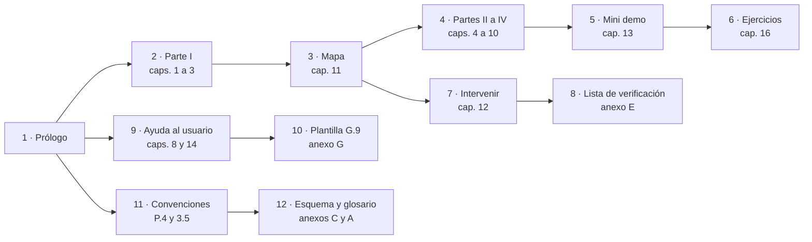

*Figura P.1. Rutas «aprender» (2 a 6), «intervenir» (3, 7, 8), «escribo la ayuda» (9, 10) y «agente» (11, 12).*

| Ruta | Para quién | Recorrido | Sale con |
| --- | --- | --- | --- |
| **Aprender** | Quien estudia el tema desde cero | Caps. [1](#1-fundamentos-la-documentación-tratada-como-código) a [3](#3-marco-de-referencia) → [cap. 11](#11-estoy-acá-qué-aplico), leído entero como panorama → caps. 4 a 10 en orden → [cap. 13](#13-caso-de-estudio-la-mini-demo-movilidadurbana) → [cap. 16](#16-ejercicios) | `OBJ-SDEI-01` a `OBJ-SDEI-05` |
| **Intervenir** | La persona del equipo que tiene que cambiar la documentación de un proyecto; quien recién llega hace su primer cambio por acá y vuelve a los temas cuando necesita el porqué | [Cap. 11](#11-estoy-acá-qué-aplico), fila de su escenario → [cap. 12](#12-cómo-intervenir-el-proceso-en-cinco-pasos) y la instancia de su proyecto (anexo G) → [anexo E](#e-lista-de-verificación); para ver cómo se verifica una página en la CI, [cap. 9](#9-compuertas-de-calidad-y-ci) | Un pull request que la compuerta acepta |
| **Agente** | Un agente de IA que trabaja sobre el repositorio | `AGENTS.md` en la raíz del repositorio → este prólogo, [P.4](#p4-convenciones) → [3.5](#35-convenciones) → [anexo C](#c-esquema-de-frontmatter-y-prefijos) → [anexo A](#a-glosario-índice) | Las reglas para producir una página que pasa la compuerta |
| **Escribo la ayuda de un producto** | Quien redacta o propone ayuda dentro del producto | [Cap. 8](#8-ayuda-al-usuario-final) → [cap. 14](#14-caso-de-estudio-ayuda-por-rol) → [anexo C](#c-esquema-de-frontmatter-y-prefijos) → G.9 en el [anexo G](#g-plantillas), en la variante que corresponda | Una página de ayuda trazada a su regla |
| **De corrido** | Quien lee el libro como obra | Prólogo, partes I a VI en orden; los anexos, como consulta | El método completo, en el orden en que se construye |

*Tabla P.2. Rutas de lectura: las tres primeras, de [README](README.md), l. 94–96; las otras dos, de la decisión P-03.*

Cada capítulo abre con una línea que dice su forma según Diátaxis, que separa cuatro necesidades del lector con
cuatro formas de documento ([Procida, s. f.](#ref-procida-sf)): tutorial (13 y 16), guía práctica (12, 14 y 17),
referencia (preliminares, prólogo, 3, 11 y los anexos) y explicación (1, 2, 4 a 10, 15 y 18). El rótulo orienta la
lectura; no clasifica el contenido como norma.

#### P.4 Convenciones

Las convenciones son las del cuerpo ([Marco §5](00-Marco.md#5-convenciones)) y las explica la
[sección 3.5](#35-convenciones); acá van las que necesitás para leer el libro.

| Qué ves | Qué significa | Fuente |
| --- | --- | --- |
| `[Autor, año]` enlazado a un ancla `ref-…` | Cita bibliográfica en APA 7 con fecha de consulta; lleva a su entrada del [anexo B](#b-referencias) | [Marco](00-Marco.md), l. 172 |
| `[Compilado: ruta, l. x–y]` | El fragmento o la frase sale de ese archivo del repositorio, en esas líneas; la ruta es relativa a la carpeta del cuerpo | [Patrones](99-Anexos/Patrones-De-Ejemplos.md#2-marcas-de-procedencia), l. 51 |
| `[Salida registrada: corrida del AAAA-MM-DD; recorte]` | Salida de un comando que se corrió, con fecha y lo que se omitió | [Patrones](99-Anexos/Patrones-De-Ejemplos.md#2-marcas-de-procedencia), l. 54 |
| `[Fragmento ilustrativo: motivo]` | Muestra una forma y no corre tal cual; con «contraejemplo», muestra lo que no conviene | [Patrones](99-Anexos/Patrones-De-Ejemplos.md#2-marcas-de-procedencia), l. 52–53 |
| **[criterio propio]** | Lo que no sale de una fuente, separado de los hechos | [Marco](00-Marco.md), l. 173 |
| **NO VERIFICADO**, **HISTÓRICO (fecha)**, **ESPECULACIÓN** | Marcas de estado: un dato sin comprobar, un hecho que valió en esa fecha, una conjetura. Todas están listadas en el [anexo J](#j-marcas-de-estado-y-ensayos-fechados) con su sección | Expediente 0003, plan del libro |
| `` #### 3.2.1 Título (`ESC-SDEI-1`) `` | En un encabezado, el número va primero y el identificador entre paréntesis: el que declara el ID es el documento fuente, no el libro | Expediente 0003, plan del libro |
| *Figura c.n.* y *Tabla c.n.* | Numeración por capítulo; el pie de figura dice qué mirar | [Marco](00-Marco.md), l. 174; expediente 0003, P-03 |
| `{servicio-privado}`, `{etiqueta-runner}` | Alias de lo privado: el servicio de repositorio privado y la etiqueta de los runners; no se escriben rutas del equipo, direcciones IP, hosts ni usuarios | [Marco](00-Marco.md), l. 177; expediente 0003, P-11 |

*Tabla P.3. Convenciones de lectura.*

La lengua sigue una jerarquía de tres niveles: primero las convenciones del cuerpo, voseo incluido; después, para la
lengua, la *Ortografía de la lengua española* ([RAE y ASALE, 2010](#ref-rae-asale-2010)) y el *Diccionario
panhispánico de dudas* ([RAE y ASALE, 2005](#ref-rae-asale-2005)); por último, la *Spanish (Neutral) Style Guide*
([Microsoft, 2021](#ref-microsoft-spanish-neutral-2021)), tomada por la lengua y no por su alcance. Si chocan, manda
el primer nivel [Compilado: 00-Marco.md, l. 189]. El choque más frecuente es el tratamiento: esa guía usa «tú» o
«usted», y el cuerpo usa «vos».

#### P.5 Relación con el cuerpo

El cuerpo va de lo general a lo particular: el Marco fija una sola vez el vocabulario, el Mapa lo cruza con las
situaciones del lector, cada tema sigue seis secciones más «Fuentes y observaciones», y los anexos guardan el
material de consulta [Compilado: README.md, l. 135–140]. El libro respeta ese orden y lo vuelve lectura continua.
No lo reemplaza.

La relación tiene tres reglas, que decidió el expediente 0003 (decisión P-01, con condición de revisión):

1. **Manda la fuente.** Si el libro y un documento del cuerpo dicen cosas distintas, vale el documento. El libro
   no reformula reglas ni umbrales: los cita con su identificador y enlaza a la fuente.
2. **Co-cambio.** Una corrección de fondo hecha en el libro se aplica también en la fuente, en el mismo pull request.
3. **SHA por capítulo.** El colofón dice sobre qué estado de Lab-Documentos se editó cada capítulo; el pull request
   que toca libro o fuentes prueba la distancia con el comando del colofón.

Ante una diferencia, corregí la fuente y llevá el cambio al capítulo en el mismo pull request; el
[capítulo 17](#171-precedencia-y-co-cambio) muestra el procedimiento.

#### P.6 Versión, estado y origen

La versión del cuerpo sigue SemVer y vive en su README. Es la 2 porque el cuerpo reemplazó a la guía de un solo
archivo, primera forma del mismo contenido **[criterio propio del plan de implementación]** [Compilado: README.md,
l. 160–161]. Esta edición lleva la versión `2.0.0-borrador.2`, la misma que declara el cuerpo; la guía de un
solo archivo se archiva en el mismo pull request, con la etiqueta anotada `sdei-v2.0.0-borrador` (expediente 0003,
decisión P-08).

| Si ves… | Significa | Qué hacer |
| --- | --- | --- |
| `status: borrador` | El texto puede cambiar sin aviso | Usarlo, pero no citarlo como norma |
| `status: vigente` | Una persona lo revisó y lo aprobó | Citarlo por `corpus_id/doc_id` |
| `status: obsoleto` | Lo reemplaza otro documento | Ir al reemplazo que indica |

*Tabla P.4. Estados de un documento [Compilado: README.md, l. 167–171].*

Pasar a vigente es un acto de una persona. Cuando están los siete temas y la revisión del escalón da su visto bueno,
alguien pasa cada documento a `vigente` en un pull request propio; después la persona responsable del producto fija
la versión en `2.0.0` y la marca con una etiqueta anotada [Compilado: README.md, l. 161–165].

El diseño del cuerpo sale del expediente 0002 de DocAsCode, en el repositorio hermano Lab-Documentos.Documentacion:
decisiones D27 (cuerpo documental y rutas), D28 (citación APA 7 con fecha de consulta), D09 (contrato de frontmatter y
prefijos) y D29 (objetivos y ejercicios como anexo) [Compilado: README.md, l. 175–178]. El libro responde al pedido
que abrió el expediente 0003, en el mismo repositorio: reunir los documentos en uno, revisarlo como un libro y
abrirlo con los fundamentos del método.

#### Preguntas guía del prólogo

1. ¿Cuál de las cinco rutas es la tuya, y en qué capítulo termina?
2. Entre una frase con `[Compilado: …]` y otra con **[criterio propio]**, ¿cuál verificás en el repositorio, y cómo?
3. El capítulo que leés dice un umbral distinto del de su tema fuente: ¿cuál vale y qué hacés con la diferencia?

#### Resumen del prólogo

El libro es una edición de lectura del cuerpo SDEI: reúne, ordena y cita, y la fuente manda. El colofón ancla cada
capítulo a un estado de Lab-Documentos y un `git diff --stat` dice si quedó atrás. Cinco rutas reparten la entrada;
las marcas de la tabla P.3 dicen de dónde sale cada afirmación.

## Parte I. Fundamentos

Esta parte reúne lo que el resto del libro da por sabido. El capítulo 1 explica de qué está hecho un sistema
documentador y por qué se lo trata como código; el capítulo 2, cómo se escribe una guía que enseñe y cómo se prueba lo
que afirma; el capítulo 3 fija el vocabulario estable (escenarios, contextos, actores y convenciones) que reaparece
en los dieciocho capítulos y en los anexos. Quien ya conoce *docs as code* puede saltar al capítulo 3, que es
referencia y se consulta; los capítulos 1 y 2 son explicación y se leen de corrido. Los capítulos de las partes II
a VI citan el marco del capítulo 3 por identificador y no vuelven a definir sus términos.

### 1. Fundamentos: la documentación tratada como código

*Forma: explicación.* **Requisitos previos:** ninguno; conviene saber qué es un pull request.

**Objetivos.** Al terminar este capítulo podés:

1. Explicar por qué la documentación de software envejece y qué cuatro preguntas responde un sistema documentador
   para cada pieza.
2. Definir *docs as code* y señalar cómo materializa este cuerpo cada uno de sus componentes.
3. Distinguir fuente de verdad, ancla de versión y traza, y decir qué control verifica cada una.
4. Separar deriva, atraso y divergencia, con el instrumento que mide cada una y quién decide.
5. Clasificar un acto de cambio como D, P o H y decir quién lo cierra.
6. Explicar por qué el texto que lee un agente se controla como superficie de ataque.

#### 1.1 El problema

La documentación de software falla de maneras conocidas y medidas. Un estudio que analizó 878 artefactos de cuatro
fuentes (listas de correo, Stack Overflow, gestores de incidencias y pull requests) armó una taxonomía de esos
problemas ([Aghajani et al., 2019](#ref-aghajani-2019)). Una encuesta posterior a 146 profesionales ubicó entre los que
más pesan el contenido insuficiente o inadecuado y la información obsoleta o ambigua
([Aghajani et al., 2020](#ref-aghajani-2020)). Y en más de 3000 proyectos de GitHub, la mayoría tuvo en algún momento
de su historia al menos una referencia en la documentación a un elemento de código que ya no existía
([Tan et al., 2024](#ref-tan-2024)). [Compilado: TEM-01-Sistema-Documentador.md, l. 64–70]

Ninguna de esas fallas se arregla escribiendo mejor una página. Una página bien escrita el lunes miente el jueves si
el código cambió y nadie lo notó. Lo que la arregla es un sistema que sepa de dónde sale cada afirmación, que lo
compruebe en cada cambio y que diga quién decide cuando la página y el código discrepan
[Compilado: TEM-01-Sistema-Documentador.md, l. 70–72]. Sin ese sistema, la documentación se escribe cuando alguien se
acuerda y se revisa cuando alguien se queja [Compilado: TEM-02-Ciclo-Documental.md, l. 82]. La experiencia de Google
apunta en la misma dirección: la documentación que no tiene dueño se vuelve obsoleta
([Winters et al., 2020](#ref-winters-2020)).

A ese sistema este libro lo llama **sistema documentador**: el conjunto de piezas documentales, fuentes de verdad,
repositorios, anclas de versión, compuertas, canales y actores (personas y agentes de IA) que producen y mantienen la
documentación de un sistema. La documentación es lo que se lee; el sistema documentador es lo que hace que lo que se
lee sea correcto, esté al día y llegue a quien lo necesita [Compilado: TEM-01-Sistema-Documentador.md, l. 38–41]. El
método con que se lo construye es *docs as code* (§1.2), y el cuerpo de guías del que sale este libro, `SDEI`, es una
aplicación de ese método a sí mismo [Compilado: README.md, l. 38–42].

Para cada pieza, un sistema documentador responde cuatro preguntas
[Compilado: TEM-01-Sistema-Documentador.md, l. 74–80]:

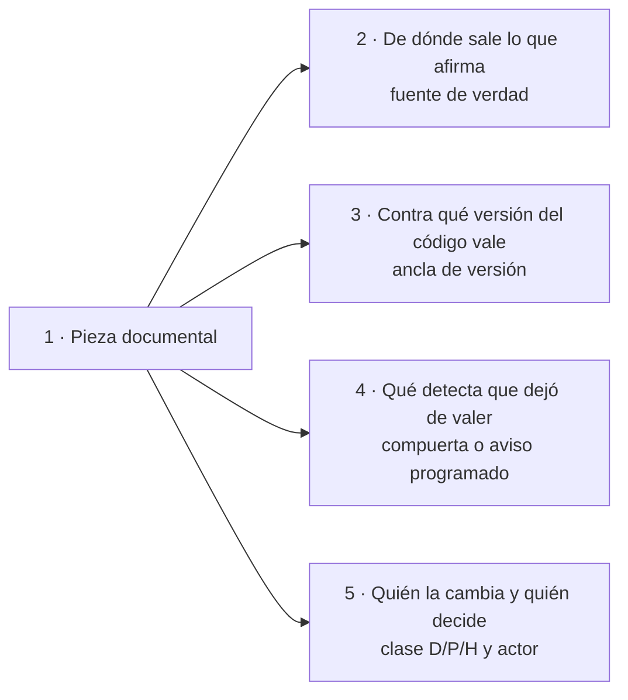

*Figura 1.1. Las cuatro preguntas que el sistema documentador responde para cada pieza. Las secciones 1.3, 1.6 y 1.7
desarrollan una o dos cada una.*

#### 1.2 Docs as code: definición y componentes

Write the Docs, la comunidad de referencia de quienes escriben documentación técnica, define *docs as code* (en
castellano, **documentación como código**) como escribir la documentación con las mismas herramientas que el código, y
enumera sus componentes: gestor de incidencias, control de versiones con Git, marcado en texto plano, revisión de
código y pruebas automatizadas ([Write the Docs, s. f.](#ref-writethedocs-sf)). El libro de ingeniería de software de
Google llega a lo mismo desde la práctica: la documentación está tan acoplada al código que conviene tratarla como
código, necesita dueño y, idealmente, vive bajo control de versiones junto al código que documenta
([Winters et al., 2020](#ref-winters-2020)). [Compilado: TEM-01-Sistema-Documentador.md, l. 43–50]

GitLab, que documenta su producto en el mismo repositorio que el código, lleva la idea al proceso: pide la revisión del
código, la de la persona redactora técnica y la de quien mantiene el proyecto antes del merge, y alienta que la
documentación vaya en el mismo merge request que el código que describe ([GitLab, s. f.](#ref-gitlab-sf))
[Compilado: TEM-02-Ciclo-Documental.md, l. 93–96]. Write the Docs agrega una consecuencia que en este libro es
central: con pruebas automáticas se puede bloquear el merge de una función que no trae su documentación
[Compilado: TEM-06-Compuertas-Y-CI.md, l. 51–53].

La definición operativa que usa el libro, y que el anexo A recoge, es esta: escribir la documentación en texto plano,
versionarla en Git, revisarla por pull request y verificarla en la integración continua (CI), con las mismas
herramientas que el código [Compilado: 99-Anexos/Glosario.md, l. 69].

*Tabla 1.1. Los componentes de* docs as code *y la forma que toman en este cuerpo.*

| Componente | Qué aporta | Cómo lo materializa este cuerpo | Dónde se desarrolla |
| --- | --- | --- | --- |
| Marcado en texto plano | Un formato que se compara línea por línea y que leen personas y programas | Markdown con frontmatter de diez campos más `description` | Anexo C |
| Control de versiones | Historia, autoría y un estado del texto por cada estado del código | Git; el commit, un SHA fijado o una etiqueta como ancla de versión | Capítulo 6 |
| Revisión de código | Una segunda mirada antes de que el cambio entre | Pull request; la guarda de merge cuando hay delegación asentada | Capítulos 5 y 15 |
| Pruebas automatizadas | Un juicio repetible en cada cambio | La compuerta `docs-guard`, grupos PR-1 a PR-7 más `autoprueba` | Capítulo 9 |
| Gestor de incidencias | Un lugar donde queda lo que se detectó y nadie arregló todavía | El issue que abre o actualiza el carril programado | Capítulo 9 |

[Compilado: 00-Marco.md, l. 45, 52, 178; TEM-03-Topologia-Y-Versionado.md, l. 55–62; TEM-06-Compuertas-Y-CI.md, l. 44]

Una carpeta `docs/` en el repositorio no alcanza para hablar de *docs as code*: sin fuente declarada, sin ancla y sin
control es documentación sin sistema [Compilado: TEM-01-Sistema-Documentador.md, l. 138–139].

#### 1.3 Fuente de verdad, traza y ancla de versión

Estas ideas responden las dos primeras preguntas de la figura 1.1, y se definen con precisión porque las verifica un
control.

##### 1.3.1 Pieza documental y fuente de verdad

Una **pieza documental** es una unidad que se escribe, se versiona y se valida por separado: una página de ayuda, un
`AGENTS.md`, el `openapi.json`, un caso de uso [Compilado: TEM-01-Sistema-Documentador.md, l. 56;
99-Anexos/Glosario.md, l. 91]. Cada pieza pertenece a una **clase de pieza** (`CL-nn`), una categoría de un catálogo
cerrado de catorce que fija dónde vive la pieza, contra qué se ancla, qué control la revisa y quién interviene. Una
pieza nueva se clasifica en una de esas clases; si no encaja en ninguna, se abre una clase nueva por expediente, no se
improvisa [Compilado: 00-Marco.md, l. 40; 01-Mapa.md, l. 77–78]. El catálogo completo está en el capítulo 4.

La **fuente de verdad** es el lugar del que sale lo que una pieza afirma. Si la pieza y la fuente discrepan, manda la
fuente [Compilado: TEM-01-Sistema-Documentador.md, l. 57]. Para la referencia de una API, la fuente es el código que
la emite; para la ayuda que menciona una regla de negocio, es la ficha de esa regla. La regla obliga a declarar,
pieza por pieza, cuál es la fuente.

##### 1.3.2 Ancla de versión

El **ancla de versión** es el dato que dice contra qué estado del código vale una pieza: el commit, un SHA fijado
entre repositorios o una etiqueta [Compilado: 00-Marco.md, l. 42]. Una guía de estudio como esta suma una cuarta
forma, la versión del cuerpo en su README, en SemVer, con una etiqueta anotada por versión
[Compilado: TEM-03-Topologia-Y-Versionado.md, l. 62].

Qué ancla corresponde depende de dónde vive la pieza. Si vive en el mismo repositorio que el código, el commit que la
contiene es el ancla y el mismo pull request cambia las dos cosas. Si vive en otro repositorio, el SHA fijado es
obligatorio, porque es lo único que no se mueve; la etiqueta se agrega cuando existe una que contiene exactamente el
código documentado, para que una persona sepa qué versión es sin buscar el SHA
[Compilado: TEM-03-Topologia-Y-Versionado.md, l. 59–60, 72–75]. Las versiones con nombre siguen SemVer: mayor, menor
y parche, y la mayor sube con un cambio que rompe a quien depende de la versión anterior
([Preston-Werner, s. f.](#ref-prestonwerner-sf)). El historial legible de cada versión va en un CHANGELOG, escrito
para personas, con la versión más reciente arriba y su fecha ([Lacan, s. f.](#ref-lacan-sf))
[Compilado: TEM-03-Topologia-Y-Versionado.md, l. 77–81]. El capítulo 6 trata dónde se escribe cada ancla para que la
compuerta la lea.

##### 1.3.3 Traza y registro de identificadores

Una **traza** es la declaración, en el frontmatter, de que un documento depende de otro identificador: si el
identificador cambia de versión o desaparece, el documento hay que revisarlo. Tiene dos formas, `traces: [ID]` y
`traces: [ID@MAYOR.MENOR]` [Compilado: 00-Marco.md, l. 48]. La traza apunta al identificador, nunca a la ruta del
archivo: una ruta cambia cuando alguien reordena carpetas; el identificador, no [Compilado: 00-Marco.md, l. 179].

La compuerta resuelve cada traza contra un **registro de identificadores** que arma sola, sin que nadie lo mantenga a
mano: lo forman los `doc_id` de todo el repositorio y los encabezados que empiezan con un identificador, con una línea
`**Versión:** 1.1` debajo cuando el identificador tiene versión [Compilado: 99-Anexos/Esquema-Frontmatter-Y-Prefijos.md,
l. 89–92]. De ahí salen tres consecuencias que el resto del libro usa sin repetir:

- **Con versión, la traza detecta el cambio.** Si la ficha sube de 1.0 a 1.1, la página que traza a `@1.0` da rojo.
  Una traza sin versión sólo comprueba que el identificador existe, y la subida no la pone en rojo; por eso traza con
  `@MAYOR.MENOR` toda página que repite lo que dice una regla [Compilado: 00-Marco.md, l. 48].
- **Un identificador se declara una sola vez.** El registro es uno para todo el repositorio, y una traza a un
  identificador declarado dos veces es ambigua y da rojo. Por eso los identificadores de este cuerpo llevan su
  `corpus_id` (`TEM-SDEI-03`, no `TEM-03`): otras guías del mismo repositorio ya chocaron en el registro
  [Compilado: TEM-03-Topologia-Y-Versionado.md, l. 89–91]. Por la misma razón, este libro nunca abre un encabezado con
  un identificador que el cuerpo ya declara: el número de sección va primero y el identificador, entre paréntesis.
- **La traza tiene un segundo nivel en el código.** La ficha de una regla dice dónde se declara, se verifica y se
  aplica, con la forma `ruta#Símbolo@SHA` (archivo, `Clase.Miembro` y commit)
  [Compilado: 99-Anexos/Esquema-Frontmatter-Y-Prefijos.md, l. 84–87].

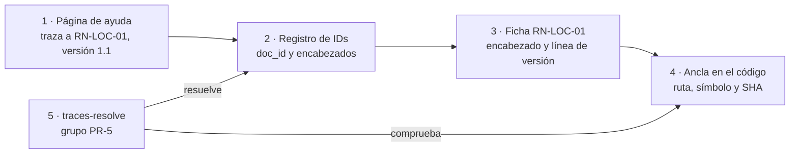

*Figura 1.2. La cadena de una traza, del texto que lee la persona al símbolo del código. La compuerta comprueba los
dos tramos: que el identificador exista una sola vez con la versión pedida y que el ancla de la ficha se cumpla en el
SHA fijado.*

El capítulo 9 explica cómo decide `traces-resolve` cada caso, y el anexo C trae la tabla de prefijos.

##### 1.3.4 Deriva, atraso y divergencia

Tres palabras que en la conversación se usan como sinónimos nombran en este libro cosas distintas, cada una con su
instrumento. Mezclarlas lleva a buscar en el control equivocado.

*Tabla 1.2. Las separaciones de vocabulario y el instrumento de cada una.*

| Término | Qué nombra | Instrumento | Bloquea o avisa |
| --- | --- | --- | --- |
| Letra | Lo que la app promete a quien la usa, textual: el texto de ayuda bajo el campo y los mensajes | Lectura de la pantalla; la ficha la registra | — |
| Intención | Para qué existe la regla, lo que el producto debía hacer, y qué la respalda en el código | La ficha de la regla | — |
| Comportamiento | Lo que el código hace | Las anclas `ruta#Símbolo@SHA` de la ficha | — |
| Divergencia | Diferencia entre letra, intención y comportamiento. **Leve** si no cambia qué se acepta, qué se rechaza ni qué se guarda; **de fondo** si cambia alguna de esas tres cosas, como el 60/80 de la mini demo | Ninguno la decide: la decide una persona (`ACT-SDEI-2`), acto de clase H | — |
| Deriva | Distancia entre lo que una pieza afirma y lo que el código hace | `traces-resolve`, verde o rojo por traza | Bloquea en el carril PR |
| Atraso | Commits que el SHA fijado (`base_commit`, `sha` de `source.lock`) está detrás de la rama principal del repositorio que fija; un entero mayor o igual a 0 | Control 3 (`atraso`) del carril programado | Avisa |
| Deriva de copia fijada | Copia fijada cuya huella SHA-256 ya no coincide con la declarada | Control 4 del carril programado; el nombre es un alias hasta que se renombre el control | Avisa |

[Compilado: 99-Anexos/Glosario.md, l. 47, 56, 64–67, 82–85; ../../../tools/docs-guard/semanal.sh, l. 14–15]

El atraso y la deriva se confunden porque suelen aparecer juntos: el código avanzó y la página quedó atrás. Pero un
SHA fijado puede estar cien commits atrás sin que ninguna afirmación de la página haya dejado de valer, y una página
del mismo repositorio, sin atraso posible, puede afirmar algo que el código ya no hace. Para las piezas que viven en
otro repositorio que el código, el aviso programado cuenta el atraso, y la deriva por símbolo (que el método que cita
la ficha haya cambiado) la mide un control de la mini demo, A1, cuando la demo corre. A1 todavía no está programado:
es una deuda declarada, que se cierra con el pull request que lo programe o con el folio que decida no hacerlo
[Compilado: 00-Marco.md, l. 200–204]. El capítulo 13 muestra ese control en funcionamiento.

#### 1.4 Tipos de documentación y lectores

No toda la documentación cumple la misma función, y mezclar funciones en una página la vuelve difícil para todos.
Diátaxis separa cuatro necesidades del lector y cuatro formas que les responden: el tutorial, para aprender
haciendo; la guía práctica, para resolver una tarea concreta; la referencia, para consultar un dato exacto; y la
explicación, para entender por qué ([Procida, s. f.](#ref-procida-sf)). El cuerpo recoge la misma separación en el
patrón `PE-07`: entre páginas, separar tutorial, guía, referencia y explicación; dentro de la página, rotular los
bloques por tipo [Compilado: 99-Anexos/Patrones-De-Ejemplos.md, l. 38]. Este libro lo aplica a escala de capítulo:
cada uno declara su forma en la apertura.

*Tabla 1.3. Las cuatro formas de Diátaxis y dónde aparecen en este libro.*

| Forma | El lector quiere… | Ejemplo en este libro |
| --- | --- | --- |
| Tutorial | Aprender haciendo, con un resultado garantizado | Capítulo 13, la mini demo MovilidadUrbana; capítulo 16, ejercicios |
| Guía práctica | Resolver una tarea que ya sabe que tiene | Capítulo 12, cómo intervenir; capítulo 14, levantar la prueba de ayuda por rol |
| Referencia | Consultar un dato exacto sin leer prosa | Capítulo 3, marco de referencia; capítulo 11, mapa; anexos A a J |
| Explicación | Entender por qué las cosas son así | Capítulos 1 y 2; capítulos 4 a 10, uno por tema |

La norma ISO/IEC/IEEE 26514:2022 mira el mismo problema desde el proceso: trata la información para usuarios como un
producto con su propio desarrollo, que empieza por establecer qué información se necesita, decide cómo presentarla y
recién después la prepara; y aclara que el diseño sigue a lo largo de todo el ciclo de vida
([ISO/IEC/IEEE, 2022](#ref-iso-26514-2022)) [Compilado: TEM-02-Ciclo-Documental.md, l. 85–88;
TEM-05-Ayuda-Al-Usuario-Final.md, l. 38–40]. El registro de requerimientos documentales del capítulo 5 es la forma
escrita de ese primer paso. La norma se cita por su página oficial de alcance; su texto completo no se consultó
[Compilado: TEM-02-Ciclo-Documental.md, l. 348].

Qué documentos existen en un proyecto de software y para qué sirve cada uno es tema de otra guía del mismo
repositorio, [Documentación técnica](../Creacion-Guias-Tecnicas/README.md), que los ordena en siete familias, de la
visión a la documentación para usuarios [Compilado: ../Creacion-Guias-Tecnicas/README.md, l. 20, 57–128]. Este libro
no las redefine. Le agrega a esa guía la dimensión que no trata: qué maquinaria mantiene cada documento correcto.

Del lado de los lectores, el cuerpo distingue tres. La **persona que estudia** recorre los conceptos en orden y
termina con criterio para elegir piezas, repositorios y controles. La **persona del equipo** que tiene que tocar la
documentación de un proyecto concreto entra por su situación y sale con los pasos y la plantilla. Un **agente** de IA
que trabaja sobre un repositorio busca las convenciones, el contrato de frontmatter y los anexos sin recorrer la
prosa [Compilado: README.md, l. 44–47]. El tercero merece una sección aparte.

#### 1.5 Audiencias, entrega y canales

A quién se le escribe, quién puede recibirlo y quién lee son tres preguntas distintas. La **audiencia** orienta qué se
escribe y no da ni quita acceso; la **regla de entrega** decide quién recibe la pieza y es la que protege; el **lector**,
persona o agente, es una dimensión de canal, y el agente lee con la audiencia de su usuario
[Compilado: 99-Anexos/Glosario.md, l. 48, 96, 84]. El capítulo 7 desarrolla las tres.

Una página tiene hoy dos lectores, una persona en el navegador y un agente que trabaja sobre el repositorio o le
responde a alguien, y una sola fuente sirve a los dos sin mantener dos textos. La persona necesita prosa ordenada,
diagramas que se vean y ejemplos con contexto; el agente, metadatos que se lean sin interpretar la prosa,
identificadores estables y un índice [Compilado: TEM-04-Doble-Audiencia.md, l. 40–43].

La alternativa es conocida: la guía para personas y, aparte, un resumen para agentes escrito a mano, que envejece por
su cuenta. Los modelos de lenguaje responden mejor cuando reciben la documentación de la API que van a usar
([Chen et al., 2025](#ref-chen-2025)) y fallan cuando lo que saben de una biblioteca quedó atrás de su versión
([Wang et al., 2025](#ref-wang-2025)) [Compilado: TEM-04-Doble-Audiencia.md, l. 56–60].

Servir a los dos lectores no quiere decir escribir para el agente. La prosa sigue siendo para personas; lo que se agrega es
estructura: frontmatter, identificadores y diagramas como código [Compilado: TEM-04-Doble-Audiencia.md, l. 64–65]. El
criterio de calidad `CQ-13` lo pregunta en esos términos (frontmatter válido, IDs estables, diagramas como código y
fragmentos con procedencia), y la compuerta lo verifica con el esquema de frontmatter (PR-2) y el mermaid que parsea
(PR-4) [Compilado: 99-Anexos/Criterios-De-Calidad.md, l. 43, 76]. Hay una evidencia
reciente sobre el otro extremo, el archivo que habla al agente a propósito: un estudio de 2303 archivos de contexto
de agentes, en 1925 repositorios públicos, encontró que priorizan las pruebas, la implementación y la arquitectura,
que rara vez cubren la seguridad y que evolucionan como código de configuración
([Chatlatanagulchai et al., 2025](#ref-chatlatanagulchai-2025)) [Compilado: TEM-04-Doble-Audiencia.md, l. 123–128].
En este cuerpo ese archivo es un `AGENTS.md` que sólo apunta a la fuente y que decide una persona. El capítulo 7
desarrolla los canales para cada lector.

#### 1.6 Quién decide: clases D/P/H

La cuarta pregunta de la figura 1.1 se responde con una clasificación que no mira a la persona sino al **acto** de
producir o cambiar una pieza:

- **D**: lo hace un generador determinista. El contrato REST que emite el build es D.
- **P**: lo propone un agente o una persona, y entra si la compuerta da verde. La ayuda al usuario final es P.
- **H**: sólo lo decide una persona. Aceptar una decisión de arquitectura, pasar un documento a `vigente`, etiquetar
  o publicar son H.

[Compilado: 00-Marco.md, l. 41, 160; TEM-01-Sistema-Documentador.md, l. 60]

Una pieza puede tener dos actos: una decisión de arquitectura la redacta un agente (P) y la acepta una persona (H).
Nadie elige la clase de intervención caso por caso: la fija el catálogo para cada clase de pieza, y se conoce cuando
la pieza recibe su clase. Un cambio que toca una pieza de clase H, como un `AGENTS.md`, lo fusiona una persona
[Compilado: TEM-01-Sistema-Documentador.md, l. 60; TEM-02-Ciclo-Documental.md, l. 64–68]. Las clases de intervención
no son las clases de pieza: la clase de pieza dice qué es la pieza; la de intervención, quién la puede cambiar.

«H» quiere decir «la decide una persona», no siempre la responsable del producto. Una divergencia entre lo que la
especificación dice y lo que se quiso decir la decide la analista, no el PO [Compilado: 00-Marco.md, l. 167–168]. Y
una regla atraviesa las tres clases: **quien verifica no es quien redactó**, y una segunda identidad de la misma
persona no aprueba a la primera [Compilado: 00-Marco.md, l. 168–171]. Que un agente fusione su propio pull request no
contradice la regla siempre que se den dos condiciones: quien verifica son los controles de la compuerta, que el
agente no escribió en ese pull request, y una persona dejó asentada por escrito la delegación del merge
[Compilado: 00-Marco.md, l. 171–172]. La comprobación que hace el agente antes de fusionar se llama **guarda de
merge**: abierto, sin conflictos, con todos los controles en verde y sin una duda declarada; con una duda (una
**reserva**), el merge vuelve a la persona [Compilado: 00-Marco.md, l. 52].

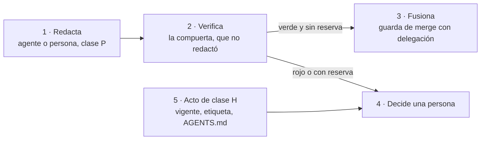

*Figura 1.3. Proponer, verificar y decidir quedan en manos distintas. Lo de clase H nunca pasa por la guarda: llega
siempre a una persona.*

El capítulo 15 trae la tabla completa de quién decide, que agrega un caso más: lo irreversible con consecuencia fuera
del repositorio se eleva a la persona responsable del producto con alternativas y una opción por defecto
[Compilado: 99-Anexos/Como-Decidir.md, l. 141–147].

#### 1.7 Verificar en vez de confiar

La tercera pregunta de la figura 1.1 la responde la compuerta. El libro usa tres términos con significado fijo:

- Un **control** es una comprobación que corre en la CI y termina en verde o en rojo; uno solo. Bloquea (rojo) o sólo
  avisa según la regla de bloqueo [Compilado: 00-Marco.md, l. 44].
- La **compuerta** es el carril PR: el conjunto de controles que corre en cada pull request. La de este cuerpo la
  corre el workflow `docs-guard`, en siete grupos más `autoprueba`: PR-1 enlaces, PR-2 frontmatter, PR-3
  anti-inyección, PR-4 estructura y mermaid, PR-5 trazas, PR-6 contrato y PR-7 fijadas y referencias. Un control
  suelto no es una compuerta [Compilado: 00-Marco.md, l. 45; 99-Anexos/Glosario.md, l. 57].
- El **carril programado** es otra corrida, semanal, que no bloquea: abre o actualiza un issue con lo que derivó
  (enlaces externos rotos, anclas atrasadas, documentos sin revisar hace más de un año)
  [Compilado: 00-Marco.md, l. 51].

Una cuarta expresión, **compuerta de escalón**, nombra otra cosa: el hito que cierra una etapa de prueba del sistema
documentador. No es un control ni el carril PR [Compilado: 00-Marco.md, l. 46]. El capítulo 10 explica los escalones.

Que un control bloquee no es una decisión de gusto. Un control bloquea sólo si cumple cinco condiciones: es
determinista y no usa red; el defecto lo introduce el mismo pull request; tiene par rojo/verde; su línea de base sobre
lo que vigila es 0; y no tiene falsos positivos conocidos, o los canaliza por excepciones con huella. Si falla una,
avisa [Compilado: 99-Anexos/Criterios-De-Calidad.md, l. 67–69; TEM-06-Compuertas-Y-CI.md, l. 109–117]. Dos de esas
condiciones tienen nombre propio. El **par rojo/verde** son dos fixtures por control, uno con el defecto, que tiene
que dar rojo, y otro sin él, que tiene que dar verde: es la prueba negativa de la compuerta. La **línea de base** es la
cantidad de hallazgos de un control sobre lo que vigila, medida antes de que empiece a bloquear
[Compilado: TEM-06-Compuertas-Y-CI.md, l. 46–47].

La regla existe por una razón práctica: un control con falsos positivos que bloquea enseña a ignorar la compuerta
[Compilado: TEM-06-Compuertas-Y-CI.md, l. 62–63]. Y la compuerta no es un juicio de calidad completo: automatiza lo
que se puede contar (enlaces, esquema, trazas, referencias); la claridad se mide con una prueba de lectura y la
corrección, con revisión [Compilado: TEM-06-Compuertas-Y-CI.md, l. 60–61]. Tampoco es un agente: el job no tiene
secretos ni invoca modelos de lenguaje [Compilado: TEM-06-Compuertas-Y-CI.md, l. 64]. Así convierte en algo
comprobable lo que Write the Docs y Google plantean como buena práctica
[Compilado: TEM-06-Compuertas-Y-CI.md, l. 51–56]. El capítulo 9 la desarrolla grupo por grupo.

#### 1.8 La especificación como fuente

En la lista de fuentes de verdad hay una que ordena a las demás: la **especificación**, el conjunto de documentos que
dicen qué tiene que hacer el sistema y por qué (necesidades, casos de uso, reglas, decisiones de arquitectura)
[Compilado: TEM-07-Marco-SDD.md, l. 92]. Un marco de **desarrollo guiado por especificación** (SDD, *spec-driven
development*) la escribe antes que el código y la usa como referente contra el que se contrasta lo que se construye.
La industria todavía no fijó el término. Böckeler distingue tres grados: la especificación que guía una tarea y se
descarta, la que se conserva para mantener la funcionalidad y la que es la única fuente que una persona edita; y
advierte que la mayoría de las herramientas sólo cubre el primero ([Böckeler, 2025](#ref-bockeler-2025)). Thoughtworks
la ubica en el anillo «evaluar» de su radar, no en «adoptar» ([Thoughtworks, 2025](#ref-thoughtworks-2025))
[Compilado: TEM-07-Marco-SDD.md, l. 47–53].

Al sistema documentador le importan tres formas que la especificación le presta:

1. **El criterio verificable.** Un requerimiento documental se escribe con la forma Dado/Cuando/Entonces, que viene
   del desarrollo guiado por comportamiento y sirve para escribir una expectativa como ejemplo comprobable: «Dado un
   estado, cuando alguien hace algo, entonces observa tal resultado» ([Fowler, 2013](#ref-fowler-2013))
   [Compilado: TEM-02-Ciclo-Documental.md, l. 107–112].
2. **La decisión registrada.** Una decisión de arquitectura (ADR) es un registro corto con contexto, decisión, estado
   y consecuencias; se numera, no se borra y, cuando otra la reemplaza, queda marcada como reemplazada
   ([Nygard, 2011](#ref-nygard-2011)) [Compilado: TEM-07-Marco-SDD.md, l. 95].
3. **El identificador con versión.** En los marcos del laboratorio, cada identificador abre el encabezado de su
   documento y la versión va en una línea `**Versión:**` debajo; es lo que la traza de §1.3.3 resuelve
   [Compilado: TEM-07-Marco-SDD.md, l. 93].

Sin integración, un proyecto con SDD termina con dos fuentes que dicen lo mismo, el caso de uso y una página de ayuda
que lo repite con otras palabras; cuando el caso de uso cambia, la página no se entera. Con la traza
`traces: [CU-08002@1.11]`, la página declara de qué versión del caso de uso depende, y la compuerta da rojo cuando esa
versión deja de existir [Compilado: TEM-07-Marco-SDD.md, l. 67–72]. Un proyecto sin SDD no queda afuera: escribe sus
reglas como fichas propias y su registro de requerimientos en `docs/_requisitos.md` [Compilado: 00-Marco.md,
l. 138–140]. El capítulo 10 trata la integración con un marco SDD.

#### 1.9 El texto que leen agentes es superficie de ataque

Si un agente lee la fuente, cualquier texto de la fuente le llega. El riesgo que OWASP llama **inyección indirecta**
es ese: un contenido leído como dato que lleva instrucciones escondidas para que el agente haga algo que
nadie le pidió ([OWASP GenAI Security Project, 2025](#ref-owasp-2025)) [Compilado: TEM-04-Doble-Audiencia.md, l. 52,
168–170]. En un sistema donde la documentación es a la vez lectura para personas y contexto para agentes, una página
es una vía de entrada.

La defensa empieza por una separación: lo que el agente lee es dato, nunca instrucción. Las instrucciones del agente
están en un solo archivo, `AGENTS.md`, que decide una persona (clase H). Que el agente respete esa separación depende
de cómo está armado, y eso quien documenta no lo controla; lo que sí controla es que la fuente no lleve nada
escondido [Compilado: TEM-04-Doble-Audiencia.md, l. 67–70]. De eso se ocupan los controles **anti-inyección**, que
buscan en el texto instrucciones escondidas: comentarios HTML, caracteres invisibles, HTML oculto y enlaces a dominios
fuera de una lista (AI-1 a AI-5) [Compilado: 00-Marco.md, l. 47].

AI-3, que busca frases dirigidas al agente, sólo avisa: aparece también en textos que explican cómo se arma un agente
[Compilado: TEM-04-Doble-Audiencia.md, l. 173–179].

La regla tiene un alcance que conviene ver de frente: al asistente que una persona usuaria usa para leer la ayuda de
un producto no lo instruye el `AGENTS.md`, y sus instrucciones no las controla quien escribe la documentación. Por eso
la defensa que queda es la fuente: que no lleve nada escondido y que sólo diga lo que una persona aprobó
[Compilado: TEM-04-Doble-Audiencia.md, l. 198–201]. Este libro cumple la misma regla que enseña: no tiene comentarios
HTML ni HTML oculto, y sus URL viven sólo en el anexo de referencias. El capítulo 7 trae el ensayo que planta un
defecto y lo ve caer.

#### 1.10 Los principios en una tabla

Las secciones anteriores se pueden condensar en doce principios. La tabla es una síntesis de este libro
**[criterio propio]**: cada fila sale de una sección y de su fuente, pero la selección y la redacción de la fila son
del editor.

*Tabla 1.4. Los principios del método, con la sección que los explica y la que los aplica.*

| # | Principio | Se explica en | Se aplica en |
| --- | --- | --- | --- |
| 1 | La documentación se escribe, versiona, revisa y verifica con las herramientas del código | 1.2 | Capítulo 9 |
| 2 | Si la pieza y su fuente discrepan, manda la fuente | 1.3.1 | Capítulos 4 y 12 |
| 3 | Toda pieza dice contra qué versión del código vale | 1.3.2 | Capítulo 6 |
| 4 | Una traza apunta a un identificador con versión, nunca a una ruta, y el identificador se declara una sola vez | 1.3.3 | Capítulos 6 y 10 |
| 5 | Deriva, atraso y divergencia se miden con instrumentos distintos | 1.3.4 | Capítulos 9 y 13 |
| 6 | Cada forma de documentación responde a una necesidad del lector, y no se mezclan | 1.4 | Capítulos 7 y 8 |
| 7 | Una sola fuente sirve a la persona y al agente | 1.5 | Capítulo 7 |
| 8 | Lo de clase H lo decide una persona, y quien verifica no es quien redactó | 1.6 | Capítulos 5 y 15 |
| 9 | Un control bloquea sólo si cumple las cinco condiciones; si no, avisa | 1.7 | Capítulo 9 |
| 10 | La especificación es la fuente de lo que el producto promete | 1.8 | Capítulos 5 y 10 |
| 11 | Lo que lee un agente es dato, nunca instrucción, y la fuente no lleva nada escondido | 1.9 | Capítulo 7 |
| 12 | Lo que no sale de una fuente se rotula como criterio propio | 2.2 | Todo el libro |

#### 1.11 Preguntas guía del capítulo 1

1. Elegí una página de documentación que conozcas. ¿Cuál es su fuente de verdad, contra qué versión del código vale y
   qué control avisaría si dejara de valer?
2. ¿Por qué una traza sin versión no detecta que una regla cambió, y en qué páginas eso es un problema?
3. Un SHA fijado está cuarenta commits atrás de la rama principal. ¿Hay deriva? ¿Qué tendrías que mirar para saberlo?
4. ¿Qué parte de un cambio que toca una decisión de arquitectura puede cerrar un agente, y qué parte no?
5. ¿Qué tendría que cumplir un control nuevo para pasar de avisar a bloquear?
6. ¿Por qué no alcanza con que el agente «sepa» que la documentación es dato?

#### 1.12 Resumen del capítulo 1

La documentación envejece porque nadie comprueba lo que afirma, y eso no se arregla escribiendo mejor sino con un
sistema documentador que, para cada pieza, sabe de dónde sale lo que afirma (fuente de verdad), contra qué versión
vale (ancla), qué la detecta cuando deja de valer (compuerta o aviso) y quién decide (clase D/P/H y actor). *Docs as
code* es el método: texto plano, Git, pull request y CI. La traza une la página con la regla por identificador y
versión; la deriva se mide por traza, el atraso por commits y la divergencia la decide una persona. La compuerta es el
carril PR, y un control bloquea sólo si cumple cinco condiciones. La misma fuente sirve a personas y agentes, y por
eso se la controla como superficie de ataque.

### 2. Fundamentos didácticos y de evidencia

*Forma: explicación.* **Requisitos previos:** capítulo 1.

**Objetivos.** Al terminar este capítulo podés:

1. Reconocer en una guía los principios de diseño instruccional que la hacen enseñar, y nombrar el patrón del cuerpo
   que aplica cada uno.
2. Citar una fuente externa y una interna con la norma del cuerpo, y separar en un texto el hecho, la interpretación
   y el criterio propio.
3. Rotular un fragmento con su marca de procedencia y decir qué le promete al lector cada marca.
4. Evaluar una guía con los criterios `CQ-01` a `CQ-14` y decir cuáles ya verificó la compuerta.

#### 2.1 Cómo se aprende de una guía

Este libro es una guía de estudio, y su forma responde a lo que se sabe sobre cómo se aprende de un texto técnico. El
cuerpo condensa esa evidencia en los patrones `PE-01` a `PE-12` y en los criterios `CQ-01` a `CQ-14` (anexos F y D);
esta sección presenta los principios de los que salen.

Un ejemplo pesa más que la prosa, para las personas y también para los agentes: en un estudio con cuatro bibliotecas
poco conocidas, lo que más mejoró la generación de código a partir de la documentación fueron los ejemplos, más que
las descripciones o las listas de parámetros ([Chen et al., 2025](#ref-chen-2025))
[Compilado: 99-Anexos/Patrones-De-Ejemplos.md, l. 17–19]. Esa evidencia ordena el resto de la sección.

##### 2.1.1 Un problema conductor

Los primeros principios de instrucción de Merrill sostienen el patrón `PE-01`, **problema conductor**: un caso real
recorre toda la guía y cada unidad lo hace avanzar ([Merrill, 2002](#ref-merrill-2002))
[Compilado: 99-Anexos/Patrones-De-Ejemplos.md, l. 32]. En este libro el caso es un defecto real de MovilidadUrbana:
el texto de la pantalla promete 60 caracteres para el nombre de una localidad y el campo admite 80. Aparece en §1.3.4
como ejemplo de divergencia, recorre el marco en §3.6, vuelve en los temas y se resuelve como tutorial en el capítulo
13. La misma fuente respalda el criterio `CQ-09`, orientación a la tarea: la unidad parte de una tarea real y prevé
errores con su recuperación [Compilado: 99-Anexos/Criterios-De-Calidad.md, l. 39].

##### 2.1.2 Ejemplos trabajados antes que ejercicios

La investigación sobre ejemplos trabajados sostiene el patrón `PE-02`: primero el caso resuelto y rotulado; recién
después un ejercicio análogo, con la respuesta aparte ([Sweller y Cooper, 1985](#ref-sweller-1985);
[Atkinson et al., 2000](#ref-atkinson-2000)). La segunda fuente sostiene también `PE-10`: dos o tres ejemplos que
cambian el dominio y mantienen la estructura [Compilado: 99-Anexos/Patrones-De-Ejemplos.md, l. 33, 41]. El libro
sigue ese orden: los capítulos de las partes II a IV traen ejemplos resueltos; los ejercicios están en el capítulo 16 y
sus claves, aparte, en el anexo H.

##### 2.1.3 Objetivos observables

La taxonomía revisada de Bloom ([Krathwohl, 2002](#ref-krathwohl-2002)) respalda, junto con Merrill, el criterio
`CQ-12`: la unidad declara objetivos observables y cierra con preguntas guía y un ejercicio
[Compilado: 99-Anexos/Criterios-De-Calidad.md, l. 42]. «Observable» quiere decir que se puede comprobar si el lector
lo logró: «escribir el frontmatter de una página nueva y anticipar qué control la rechazaría si le faltara un campo»
lo es; «comprender el frontmatter», no [Compilado: README.md, l. 60]. Por eso cada capítulo de este libro abre con
objetivos que empiezan con un verbo de acción y cierra con preguntas guía.

##### 2.1.4 Minimalismo: partir de la tarea y prever el error

La instrucción minimalista de Carroll y van der Meij ([Carroll, 1990](#ref-carroll-1990);
[van der Meij y Carroll, 1995](#ref-vandermeij-1995)) sostiene dos patrones. `PE-04`, **contraejemplo rotulado**:
mostrar lo que no conviene, marcado como tal. Y `PE-05`, **error previsto y recuperación**: cada procedimiento trae
«si ves X, hacé Y» [Compilado: 99-Anexos/Patrones-De-Ejemplos.md, l. 35–36]. Por esa razón, el procedimiento del
capítulo 14 cierra con los errores previstos y cómo salir de cada uno.

##### 2.1.5 Bloques tipados

El *information mapping* de Horn ([Horn et al., 1969](#ref-horn-1969)) sostiene el patrón `PE-07`, **bloques
tipados**, que la §1.4 ya presentó del lado de Diátaxis, y dos criterios de calidad: `CQ-07`, un término con un solo
significado registrado en el glosario, y `CQ-08`, cada bloque trata un solo tipo de información
[Compilado: 99-Anexos/Patrones-De-Ejemplos.md, l. 38; 99-Anexos/Criterios-De-Calidad.md, l. 37–38].

*Tabla 2.1. De la fuente al patrón y al criterio.*

| Principio | Fuente | Patrón | Criterio | Cómo se ve en este libro |
| --- | --- | --- | --- | --- |
| Problema conductor | Merrill (2002) | `PE-01` | `CQ-09` | El 60/80 de MovilidadUrbana, de §1.3.4 al capítulo 13 |
| Ejemplo trabajado, después ejercicio | Sweller y Cooper (1985); Atkinson et al. (2000) | `PE-02`, `PE-10` | `CQ-10` | Ejemplos en cada tema; ejercicios en el capítulo 16; claves en el anexo H |
| Objetivos observables | Krathwohl (2002); Merrill (2002) | — | `CQ-12` | Objetivos al abrir y preguntas guía al cerrar cada capítulo |
| Minimalismo | Carroll (1990); van der Meij y Carroll (1995) | `PE-04`, `PE-05` | `CQ-09` | Errores previstos en las guías prácticas |
| Bloques tipados | Horn et al. (1969) | `PE-07` | `CQ-07`, `CQ-08` | Forma Diátaxis declarada en cada capítulo; glosario único (anexo A) |
| Material de consulta aparte | ISO/IEC/IEEE (2022) | `PE-12` | `CQ-05` | Anexos A a J con anclas estables |

[Compilado: 99-Anexos/Patrones-De-Ejemplos.md, l. 32–43; 99-Anexos/Criterios-De-Calidad.md, l. 35–42]

#### 2.2 Evidencia y citación

Un sistema documentador que pide a cada pieza su fuente de verdad no puede ser menos exigente consigo mismo. Toda
afirmación de este libro tiene un ancla: una referencia bibliográfica, una ruta y línea del repositorio, o el rótulo
de criterio propio.

##### 2.2.1 La norma de citación

*Tabla 2.2. La norma de citación del cuerpo.*

| Regla | Detalle |
| --- | --- |
| Estilo | APA 7, autor-año, adaptado al castellano: «y» en lugar de «&», «consultado el» ([American Psychological Association, 2020](#ref-apa-2020)) |
| Fecha de consulta | Siempre, en toda fuente web. Es un apartamiento declarado de APA 7, que la pide sólo para contenido que cambia: casi todas las fuentes técnicas son páginas vivas |
| Software | Con la versión usada |
| Fuentes en Git | Por versión publicada o por commit, nunca por la rama principal |
| Estado de verificación | Al final de cada entrada: **V**, verificada en fuente primaria o registro oficial; **P**, parcial (sólo resumen o fuentes secundarias concordantes) |
| Procedencia de las fechas | Las consultas del 2026-10-26 vienen de las bitácoras de investigación del expediente 0002 de DocAsCode y se transcribieron sin volver a consultar; las del 2026-10-27 son consultas directas hechas al escribir el tema que las cita |

[Compilado: 99-Anexos/Referencias.md, l. 35–42]

La norma internacional de referencias bibliográficas, ISO 690, respalda el criterio `CQ-11`, trazabilidad de fuentes:
toda afirmación externa tiene referencia completa con fecha de consulta, y toda interna, ruta y línea o commit
([ISO, 2021](#ref-iso-690-2021)) [Compilado: 99-Anexos/Criterios-De-Calidad.md, l. 41]. Dentro del libro, la cita
externa va como «(Autor, año)» con enlace a su entrada del anexo B; la interna, como
`[Compilado: ruta, l. x–y]`, con la ruta relativa a la carpeta del cuerpo. Las URL viven sólo en el anexo B: la
compuerta exige que toda URL lleve en su mismo párrafo la fecha de consulta o la cita al anexo, y fuera del anexo de
referencias bloquea las URL de dominios que no están en la lista permitida [Compilado: TEM-06-Compuertas-Y-CI.md,
l. 92, 96]. Entre repositorios, la cita toma la forma `Repo@ancla:corpus_id/doc_id`, con enlace permanente al SHA
[Compilado: 00-Marco.md, l. 181].

##### 2.2.2 Hecho, interpretación y criterio propio

Lo que no sale de una fuente se rotula **[criterio propio]** y se separa de los hechos [Compilado: 00-Marco.md,
l. 183]. La separación tiene tres categorías y no dos. Un **hecho** se comprueba en su fuente. Una **interpretación**
es una lectura de hechos citados que otro podría leer distinto. El **criterio propio** es una decisión del autor que
ninguna fuente impone. Los temas del cuerpo cierran con una sección, «Fuentes y observaciones», que separa las tres
[Compilado: README.md, l. 139–140], y la lista de verificación lo pide en dos ítems: `VER-E04`, el criterio propio
declarado como tal, y `VER-E07`, una sección de observaciones que distingue hechos de interpretaciones
[Compilado: 99-Anexos/Lista-De-Verificacion.md, l. 48, 50]. En este libro, la tabla 1.4 es un ejemplo de criterio
propio rotulado: sus filas salen de fuentes, la selección no.

##### 2.2.3 Lo no verificado

Ninguna información se inventa (`VER-E01`). Lo que no se pudo verificar se marca como tal y dice por qué (`VER-E03`),
y las inconsistencias entre documentos se señalan en lugar de alisarse (`VER-E09`)
[Compilado: 99-Anexos/Lista-De-Verificacion.md, l. 45, 47, 52]. Una cita a una norma que sólo se leyó por su página
de alcance, como la de ISO/IEC/IEEE 26514 en §1.4, dice eso mismo en el texto. Las marcas de estado que usa este libro
y la lista de los ensayos fechados están en el anexo J.

#### 2.3 Ejemplos con procedencia y su ciclo de vida

Un fragmento de código o de salida en una guía le promete algo al lector: que corre, o que muestra algo que pasó. El
patrón `PE-03`, **ejemplo ejecutable con procedencia**, lo vuelve explícito: todo fragmento sale de un laboratorio que
compila, lleva la ruta y las líneas de donde sale y la versión del SDK, y su salida se guarda junto al ejemplo
[Compilado: 99-Anexos/Patrones-De-Ejemplos.md, l. 34]. `PE-03` y `PE-09`, la prueba con un lector novato antes de
publicar, son los dos patrones con más respaldo, para personas y para agentes
[Compilado: 99-Anexos/Patrones-De-Ejemplos.md, l. 40, 45].

##### 2.3.1 Marcas de procedencia

*Tabla 2.3. Las cuatro marcas de procedencia.*

| Marca | Cuándo | Ejemplo |
| --- | --- | --- |
| `[Compilado: ruta, l. x–y]` | El fragmento es copia de un archivo que compila en el repositorio | `[Compilado: Examples/Prueba-Ayuda-Por-Rol/Web/HelpCatalog.cs, l. 1–20]` |
| `[Fragmento ilustrativo: motivo]` | El fragmento muestra una forma y no corre tal cual | `[Fragmento ilustrativo: muestra la forma del frontmatter]` |
| `[Fragmento ilustrativo: contraejemplo]` | El fragmento muestra lo que no conviene | Un frontmatter sin `description` |
| `[Salida registrada: corrida del AAAA-MM-DD; recorte]` | El fragmento es la salida de un comando que se corrió. Lleva la fecha de la corrida y dice qué se recortó; si la salida depende de un commit, lo nombra | La salida de `dg.py ai` del ensayo anti-inyección del capítulo 7 |

[Compilado: 99-Anexos/Patrones-De-Ejemplos.md, l. 49–54]

Las marcas responden lo que un lector necesita saber antes de confiar en un fragmento: si corre, de dónde sale y, si
es una salida, cuándo se obtuvo [Compilado: 99-Anexos/Patrones-De-Ejemplos.md, l. 56–57]. Este libro extiende la
primera marca a la cita de prosa del repositorio: `[Compilado: 00-Marco.md, l. 41]` dice de qué líneas de qué
documento sale una afirmación, con la misma promesa de que el lector puede ir a comprobarla.

##### 2.3.2 Ciclo de vida de un ejemplo

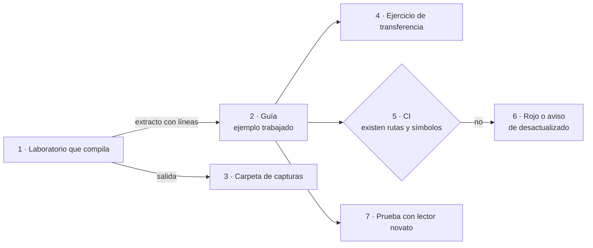

*Figura 2.1. Un ejemplo nace en un laboratorio que compila, se cita con su procedencia y la compuerta comprueba que lo
citado siga existiendo (`CQ-03`). La prueba con un lector novato cierra el ciclo antes de publicar.*

[Compilado: 99-Anexos/Patrones-De-Ejemplos.md, l. 61–72]

Los archivos de `Examples/` son los artefactos; el libro cuenta y muestra fragmentos, sin reemplazarlos. Los doce
patrones completos están en el anexo F.

#### 2.4 Cómo se evalúa una guía

Catorce criterios distinguen una documentación buena de una pobre. Cada uno tiene un identificador estable que se
cita en revisiones («no cumple `CQ-07`»), una pregunta que se responde con sí o no, y su fuente. Cinco los verifica la
compuerta; los demás, la revisión de una persona y la prueba de lectura [Compilado: 99-Anexos/Criterios-De-Calidad.md,
l. 17–19].

##### 2.4.1 Cuatro grupos de criterios

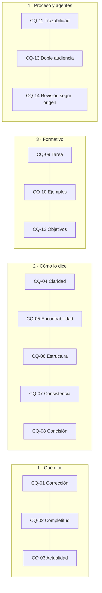

*Figura 2.2. Los catorce criterios agrupados por lo que miran. Los del grupo «proceso y agentes» son los más fáciles
de automatizar.*

[Compilado: 99-Anexos/Criterios-De-Calidad.md, l. 46–63]

El primer grupo mira si lo que la guía dice es cierto y está al día; el segundo, si se entiende y se encuentra; el
tercero, si enseña; el cuarto, si se puede seguir el rastro de cada afirmación y de cada revisión. `CQ-14`, revisión
según origen, pide esto: si un documento no lo escribió una persona (su campo `origin` no es `human`), tiene
que haber pasado revisión técnica y editorial registrada. La compuerta exige el metadato; la revisión la registra el
pull request que pasa el documento a vigente [Compilado: 99-Anexos/Criterios-De-Calidad.md, l. 44, 77]. La pregunta
importa más desde que los agentes presentan bastantes más pull requests de documentación que las personas en los
repositorios estudiados, y sus cambios se integran con poca modificación humana posterior
([Yamasaki et al., 2026](#ref-yamasaki-2026)) [Compilado: TEM-02-Ciclo-Documental.md, l. 98–101].

##### 2.4.2 Lo que ya vio la compuerta

Los cinco criterios automatizables son `CQ-03` (actualidad, con `traces-resolve`), `CQ-05` (encontrabilidad, con
enlaces, anclas y estructura de encabezados), `CQ-11` (trazabilidad, con `reflint` y `url-fecha`), `CQ-13` (doble
audiencia, con el esquema de frontmatter y el mermaid que parsea) y `CQ-14` (el metadato de origen)
[Compilado: 99-Anexos/Criterios-De-Calidad.md, l. 71–77]. El anexo D trae la tabla con el control de cada uno y si
bloquea o avisa.

##### 2.4.3 Cómo se usan en una revisión

1. Quien revisa recorre la tabla de criterios sobre el documento y anota los que no cumple, con la línea.
2. Los cinco automatizables ya los vio la compuerta: si el pull request está en verde, se dan por cumplidos.
3. `CQ-04`, claridad, se comprueba con una **prueba de lectura** (P-LECT): un lector sin contexto recorre el documento
   y anota las dudas que el texto no responde. El umbral es cero dudas sin respuesta.
4. La revisión cita los identificadores; la lista de verificación del anexo E completa el control de forma.

[Compilado: 99-Anexos/Criterios-De-Calidad.md, l. 81–86; 99-Anexos/Glosario.md, l. 89]

Quien revisa no es quien redactó (§1.6). La lista de verificación lo pide de entrada: antes de pasar un documento a
`vigente`, lo recorre quien revisa, no quien redactó [Compilado: 99-Anexos/Lista-De-Verificacion.md, l. 37–39].

#### 2.5 Preguntas guía del capítulo 2

1. ¿Qué problema conductor recorre una guía que conozcas? Si no tiene, ¿cuál elegirías y por qué tendría que ser real?
2. Tomá un objetivo de aprendizaje de una guía. ¿Es observable? ¿Con qué ejercicio comprobarías que se logró?
3. En un párrafo técnico que hayas escrito, marcá qué es hecho, qué es interpretación y qué es criterio propio.
4. Un fragmento de código no tiene marca. ¿Qué le falta saber al lector para confiar en él, y qué marca le pondrías?
5. ¿Cuáles de los catorce criterios no puede ver ninguna compuerta, y quién los comprueba?

#### 2.6 Resumen del capítulo 2

Una guía enseña cuando la recorre un problema real, muestra el ejemplo resuelto antes que el ejercicio, declara
objetivos observables, parte de la tarea y prevé el error, y separa los tipos de información; el cuerpo lo condensa en
los patrones `PE-01` a `PE-12`. Toda afirmación lleva su ancla: APA 7 con fecha de consulta para lo externo, ruta y
línea para lo interno, y el rótulo de criterio propio para lo que no sale de una fuente. Cada fragmento dice si corre,
de dónde sale y cuándo se obtuvo. Los catorce criterios `CQ` evalúan la guía: cinco los verifica la compuerta, el
resto una persona que no la redactó, con la prueba de lectura para la claridad.

### 3. Marco de referencia

*Forma: referencia.* **Requisitos previos:** capítulo 1.

Este capítulo fija el vocabulario común del libro: **cuatro escenarios** (los tipos de sistema que se documentan),
**contextos** que cambian una respuesta dentro de un escenario, **actores** con lo que cada uno decide, y las
**convenciones** de escritura y de identificación. Cada eje se define acá y en ningún otro lugar; los demás capítulos
lo citan por su identificador. Sirve a quien estudia, que necesita el vocabulario antes de los temas, y a un agente,
que encuentra los identificadores estables en un solo lugar [Compilado: 00-Marco.md, l. 17–21].

**Objetivos.** Al terminar este capítulo podés:

1. Ubicar un sistema en uno de los cuatro escenarios y decir qué clases de pieza le corresponden (`OBJ-SDEI-01`).
2. Decir qué contexto cambia la respuesta en un caso concreto.
3. Decir, para cada actor, qué decide y qué no.
4. Aplicar las convenciones de frontmatter, identificadores, trazas, enlaces y citación a una página nueva.

#### 3.1 Definiciones del marco

Los términos de esta tabla se definen acá; los del capítulo 1 (fuente de verdad, ancla, traza, compuerta, control,
clase de intervención) no se repiten.

*Tabla 3.1. Definiciones del marco de referencia.*

| Término | Definición |
| --- | --- |
| Escenario | Tipo de sistema que se documenta. Fija qué audiencias hay, qué clases de pieza documental se activan y contra qué se ancla la versión |
| Contexto | Variante dentro de un escenario que cambia una respuesta concreta: dónde vive una pieza, si hay sitio publicado, qué runner corre la compuerta |
| Actor | Rol que interviene en el sistema documentador, con lo que le toca decidir y lo que no. No confundir con el rol de un producto |
| Cuerpo documental | Conjunto de documentos de una guía bajo un README que declara `corpus_id` (su identificador, acá `SDEI`) y `version` |
| Ficha | Página corta que declara una regla o un caso de uso con su identificador (`RN-LOC-01` = regla de negocio, ámbito «localización», número 01), su versión y dónde se aplica en el código, con la forma `ruta#Símbolo@SHA`. Cuando el código cambia, quien lo cambia actualiza la ficha y sube su versión |
| Requerimiento documental | Lo que una audiencia necesita lograr con la documentación, escrito como fila de un registro (RRD) con un criterio Dado/Cuando/Entonces y la decisión de una persona |
| Repositorio hermano | Repositorio `.Documentacion` que acompaña a uno de código con el mismo nombre (por ejemplo, Lab-Documentos y Lab-Documentos.Documentacion) y guarda índices, expedientes y bitácoras |
| Runner | Máquina que ejecuta los trabajos de la CI. Se elige por etiqueta, que fija el caso por plataforma (Linux; Mac para iOS). La etiqueta no es una dirección: qué máquina la sirve lo decide la organización |

[Compilado: 00-Marco.md, l. 37–39, 43, 49–50, 53–54; 99-Anexos/Glosario.md, l. 43]

#### 3.2 Escenarios y composición por unión

Cada escenario es un tipo de sistema real de los repositorios del laboratorio de la cátedra. El tronco común es el
mismo en los cuatro: las fases del ciclo documental (1a captura y 1b evaluación de requerimientos, 2 análisis,
3 diseño, 4 implementación, 5 integración; las explica el capítulo 5), el frontmatter, las trazas, el catálogo de
piezas y la compuerta. Un escenario sólo activa, quita o sustituye clases de pieza y controles; nunca agrega fases
[Compilado: 00-Marco.md, l. 58–62].

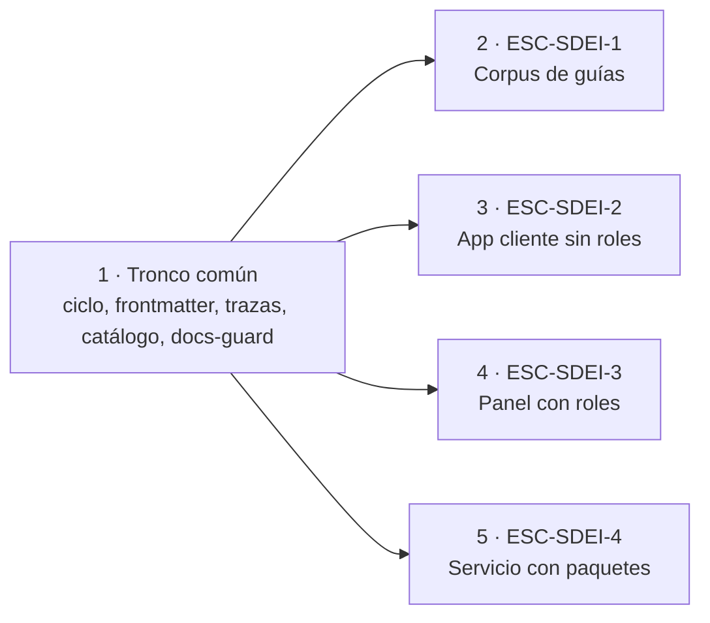

*Figura 3.1. Los cuatro escenarios salen del mismo tronco. Lo que cambia entre ellos es la tabla 3.2.*

##### 3.2.1 Corpus de guías (`ESC-SDEI-1`)

Un repositorio dedicado a documentación formativa: lo que contiene son guías, y el código que aparece (las pruebas de
concepto de `Examples/`) existe para ilustrarlas, no es un producto que se documente. El ejemplo es Lab-Documentos,
que aloja varias guías; el cuerpo del que sale este libro es una de ellas. Las audiencias son quien estudia, quien
enseña y los agentes. La versión se ancla con la versión del cuerpo en su README y una etiqueta por versión
[Compilado: 00-Marco.md, l. 78–81].

##### 3.2.2 App cliente sin roles (`ESC-SDEI-2`)

Una aplicación que usa una sola clase de persona usuaria, sin perfiles con permisos distintos. El ejemplo es
MovilidadUrbana (repositorio Lab-E2E.WebBlazor), que tiene tres aplicaciones (web, API y móvil), cada una con sus
propias capas; las fichas de la demo anclan la app móvil, y la copia de la regla en la API no tiene ancla, así que un
cambio ahí no da rojo. La ayuda al usuario final es una sola para todos; la documentación técnica y el contrato REST
salen del código. La versión se ancla con el SHA del código fijado en un archivo `source.lock`
[Compilado: 00-Marco.md, l. 85–89].

##### 3.2.3 Panel con roles (`ESC-SDEI-3`)

Un panel web donde cada rol ve pantallas y ayuda distintas. El ejemplo es Lab-Geometria, que además tiene un marco de
desarrollo guiado por especificación con su propio registro de identificadores. La ayuda de una pantalla traza al
caso de uso de la unidad que la contiene, y la confidencialidad por rol se resuelve en el servidor
[Compilado: 00-Marco.md, l. 93–95].

##### 3.2.4 Servicio con paquetes (`ESC-SDEI-4`)

Un servicio que publica paquetes para que otros sistemas lo integren, con varias líneas de versión. El ejemplo es un
servicio de repositorio privado, que el libro nombra `{servicio-privado}`: el segundo marco
SDD del laboratorio, junto al de Lab-Geometria; el alias no es una sigla del producto. En este escenario, las audiencias son quien
integra, quien opera y los agentes; la versión se ancla con la etiqueta de cada línea
[Compilado: 00-Marco.md, l. 99–102].

##### 3.2.5 Qué cambia entre escenarios

La tabla 3.2 es la que los capítulos temáticos citan cuando dicen «según el escenario». Su lectura la fijó la mesa de
la reedición (decisión P-16 del expediente 0003): la fila «Clases activas por defecto» es prescriptiva y dice qué
clases se activan en un sistema de ese tipo; la fila siguiente registra las altas y bajas con su motivo, y la de «No
presente en el ejemplo» anota lo que el ejemplo de cada escenario no tiene, medido en el SHA que se cita, sin cambiar
la prescripción.

*Tabla 3.2. Parámetros que cambian entre los cuatro escenarios.*

| Parámetro | `ESC-SDEI-1` Corpus de guías | `ESC-SDEI-2` App sin roles | `ESC-SDEI-3` Panel con roles | `ESC-SDEI-4` Servicio con paquetes |
| --- | --- | --- | --- | --- |
| Audiencias típicas | Estudiante, docente | Persona usuaria, desarrollo, consumidor de la API | Lo anterior más los roles del panel | Integrador, operador |
| Superficies | — (no hay producto: el cuerpo se lee en el repositorio) | App móvil, web y servicio (la API) | Panel | Servicio y SDK (los paquetes); panel, si el servicio lo tiene |
| Canales de ayuda | Página del cuerpo; los canales derivados sólo con sitio (`CTX-SDEI-1`) | Página de ayuda y punto de uso (el texto bajo el campo) | Página por regla de entrega y punto de uso | Página para quien integra y referencia de la API |
| Clases activas por defecto | CL-02, CL-03, CL-08 a CL-13 | CL-02 a CL-08, CL-12, CL-13 | CL-01 a CL-08, CL-12 | CL-01 a CL-05, CL-07, CL-08, CL-11 a CL-13 |
| Altas y bajas, con motivo | Altas: CL-08, porque el índice interno del repositorio hermano indexa el cuerpo; CL-13, porque el `CHANGELOG.md` registra cada cambio y la delegación del merge | Altas: CL-08 y CL-13, porque el repositorio hermano tiene índice interno y los dos repositorios llevan `CHANGELOG.md` | — | — |
| No presente en el ejemplo, medido en su SHA | CL-11: no hay copia fijada fuera de los fixtures (Lab-Documentos `0bed863`) | CL-03: no hay `AGENTS.md`; CL-04: comentarios XML sólo en la API, no en la app MAUI; CL-12: no hay instancia de «Cómo intervenir» (Lab-E2E.WebBlazor `8fb4c3a`) | CL-02: no hay RRD; CL-04: `GenerateDocumentationFile` en `false`; CL-06: la ayuda por rol es la prueba de concepto de `Examples/`; CL-12: no hay instancia (Lab-Geometria `5f07b12`) | — (el ejemplo es privado; no se mide en lo público) |
| Confidencialidad | No aplica | Lo que viaja en el paquete de la app instalada es visible para quien la instala: lleva sólo nivel `publico`, en texto y en recursos compilados | En el build y en el servidor | En el build y en los secretos |
| Fuente generada | — | OpenAPI y comentarios XML | OpenAPI; comentarios XML previstos | API pública de los paquetes |
| Ancla de versión | Versión del cuerpo y etiqueta | SHA en `source.lock` | Etiqueta y SHA | Etiqueta por línea de versión; una familia de versiones sin etiqueta se ancla con el SHA |
| Registro de IDs | `doc_id` y `corpus_id` | Fichas provisionales `RN-LOC-nn` | El del SDD del proyecto | El del SDD del proyecto |

[Compilado: 00-Marco.md, l. 106–117]

Las audiencias típicas son un valor por defecto: orientan y no dan acceso. El agente no figura en la fila porque es un
lector que hereda la audiencia de su usuario ([capítulo 7](#7-audiencias-y-lectura-por-agentes)).

##### 3.2.6 Composición por unión

Un sistema real no siempre cae en un solo escenario. Un proyecto con rasgos de dos escenarios activa la **unión** de
sus clases, y la composición no agrega fases [Compilado: 00-Marco.md, l. 62–63]. Un panel con roles que además
publica paquetes, por ejemplo, activa las clases de `ESC-SDEI-3` y las de `ESC-SDEI-4`, con el mismo ciclo de cinco
fases **[criterio propio: ejemplo construido para ilustrar la regla; no corresponde a un repositorio del
laboratorio]**. Para decidir qué escenario describe mejor un sistema, el capítulo 11 trae las tablas de entrada, y el
ejercicio `EJR-SDEI-01` del capítulo 16 lo practica.

#### 3.3 Contextos

Un contexto no es un escenario más: cruza los cuatro y cambia una sola respuesta [Compilado: 00-Marco.md, l. 128].

##### 3.3.1 Con sitio publicado o sin sitio (`CTX-SDEI-1`)

Sin sitio, la documentación se lee en el render de Markdown del repositorio y los canales para agentes son el propio
Markdown con frontmatter, el `AGENTS.md` y el índice interno. Con sitio, aparecen los canales derivados (una página
`.md` por página publicada, `llms.txt`) y la compuerta suma el build del sitio. Hoy ningún escenario publica sitio
[Compilado: 00-Marco.md, l. 132–134].

##### 3.3.2 Con SDD o sin SDD (`CTX-SDEI-2`)

Con un marco SDD, la especificación (necesidades, casos de uso, reglas, decisiones de arquitectura) ya tiene lugar y
registro de identificadores, y el registro de requerimientos documentales vive junto a ella. Sin SDD, ese registro va
en `docs/_requisitos.md` del árbol que se documenta y las reglas se escriben como fichas propias
[Compilado: 00-Marco.md, l. 138–140].

##### 3.3.3 Mismo repositorio, repositorio hermano o repositorio dedicado (`CTX-SDEI-3`)

La topología dice dónde vive una pieza respecto del código. En el mismo repositorio, el ancla es el commit. En el
repositorio hermano `.Documentacion` o en uno dedicado, el ancla es un SHA fijado (`base_commit`) y el atraso se
detecta con un aviso programado [Compilado: 00-Marco.md, l. 144–146].

##### 3.3.4 Dentro o fuera de la organización del runner (`CTX-SDEI-4`)

Los repositorios de la organización que tiene el runner llaman al workflow reutilizable `docs-guard.yml` de
Lab-Documentos, que corre con la etiqueta de runner que fija el caso, por plataforma (Linux; Mac para iOS). Un
repositorio de otra organización no puede llamarlo con ese runner: copia el workflow junto con su huella (el SHA-256
del archivo, que permite comprobar que la copia no cambió) y lo corre en el runner de su propia organización de
GitHub [Compilado: 00-Marco.md, l. 150–154].

#### 3.4 Actores

Los seis actores son roles, no personas: quién ocupa cada rol en un proyecto lo dice ese proyecto, y la tabla de
§3.4.1 sólo fija qué decide el rol.

##### 3.4.1 Qué decide y qué no cada actor

*Tabla 3.3. Actores del sistema documentador, con lo que deciden, lo que no y por dónde empiezan en el libro.*

| Id | Actor | Decide | No decide | Empieza por |
| --- | --- | --- | --- | --- |
| `ACT-SDEI-1` | Persona responsable del producto (PO) | Lo de clase H del producto: aceptar decisiones de arquitectura, pasar a vigente, etiquetar, publicar; asentar la delegación del merge; exponer o ensanchar la documentación de una API, cada cambio por separado; cambiar la jerarquía de audiencias | Cada pull request de clase D o P sin reserva: lo fusiona el agente que lo abrió, después de pasar la guarda | Capítulo 15, quién decide |
| `ACT-SDEI-2` | Analista | Acepta, rechaza o difiere cada requerimiento documental; decide las divergencias entre lo que la especificación dice y lo que se quiso decir | La clase de una pieza que ya está en el catálogo; la elección de herramientas | Capítulo 5 y el ejercicio `EJR-SDEI-05` |
| `ACT-SDEI-3` | Desarrollo | Escribe el código, sus comentarios XML, el contrato que se emite en el build y la documentación técnica; decide la clave y la ubicación del microtexto de un campo | El texto de la ayuda al usuario final ni la letra del microtexto | Capítulo 4, clases CL-04, CL-05 y CL-07 |
| `ACT-SDEI-4` | Agente de IA | Propone (clase P): fichas, borradores, traducciones, reindexado, correcciones por deriva, que pasen la compuerta | Nada de clase H; no aprueba su propio trabajo | Anexos C y E |
| `ACT-SDEI-5` | Estudiante y docente | Recorren la guía y la evalúan con los criterios de calidad | El contenido normativo del cuerpo | Este capítulo y el capítulo 16; quien enseña, además, el anexo D |
| `ACT-SDEI-6` | Persona usuaria | Usa la ayuda dentro del producto | — | La ayuda de su producto, no este libro |

[Compilado: 00-Marco.md, l. 158–165; 01-Mapa.md, l. 101–108]

El actor que decide los requerimientos documentales es el mismo rol, `ACT-SDEI-2`, en los cuatro escenarios; lo que
cambia es quién lo ocupa. En `ESC-SDEI-1`, por ejemplo, ocupa el rol la responsable de la guía o quien el PO designe
por delegación asentada [Compilado: TEM-02-Ciclo-Documental.md, l. 164–166]. El capítulo 5 trae la tabla por
escenario.

##### 3.4.2 Clase H no es siempre el PO

Clase H quiere decir «la decide una persona», no siempre el PO: la tabla 3.3 dice qué persona decide cada cosa. Rige
además la regla de §1.6: quien verifica no es quien redactó, y una segunda identidad de la misma persona no aprueba a
la primera [Compilado: 00-Marco.md, l. 167–172].

#### 3.5 Convenciones

Las convenciones de esta tabla rigen para todo documento del cuerpo y para este libro. Las convenciones editoriales
propias del libro (marcas de estado, forma de las citas, procedencia de los ejemplos) están en la sección P.4 del
prólogo.

*Tabla 3.4. Convenciones del cuerpo.*

| Convención | Regla | Detalle |
| --- | --- | --- |
| Frontmatter | Todo documento del cuerpo abre con los diez campos más `description`; `corpus_id` y `version` sólo en el README | Anexo C |
| Identificadores | Un prefijo del registro cerrado, guion y sufijo (`TEM-01`, `CQ-05`, `ESC-SDEI-2`). Una traza apunta al identificador, no a la ruta | Anexo C, registro de prefijos |
| Trazas | `traces: [ID]` o `traces: [ID@MAYOR.MENOR]`; cada una tiene que resolver contra el registro, o la compuerta da rojo | §1.3.3; anexo C |
| Enlaces | Relativos dentro del repositorio; nunca un relativo que salga del repositorio. Entre repositorios, `Repo@ancla:corpus_id/doc_id` con enlace permanente al SHA | Anexo A, cita entre repositorios |
| Citación | APA 7, autor-año, en castellano, siempre con fecha de consulta; la cita en el texto enlaza a su ancla del anexo de referencias | §2.2; anexo B |
| Criterio propio | Lo que no sale de una fuente se rotula **[criterio propio]** y se separa de los hechos | §2.2.2; anexo E |
| Diagramas | Mermaid en el Markdown, con una línea en cursiva debajo que dice qué muestra; nunca ASCII ni imagen si hay alternativa | `CQ-13`; anexo D |
| Ejemplos | Todo fragmento de código dice de dónde sale (`[Compilado: ruta, l. x–y]`) o se rotula `[Fragmento ilustrativo: motivo]` | §2.3; `PE-03`, `PE-04` |
| Estados | `borrador` → `vigente` → `obsoleto`; pasar a vigente es acto H | Prólogo, P.6 |
| Repositorios privados | Se nombran por un alias (el servicio privado es `{servicio-privado}`); en lo versionado no van rutas del equipo, direcciones IP, hosts ni usuarios | — |
| Idioma | Castellano rioplatense claro, con voseo, sin regionalismos que traben la lectura; los términos de una API o de un formato van en su idioma original (`traces`, `pull request`) | — |
| Estilo y lengua | Tres niveles, en este orden: (1) las convenciones de este cuerpo, voseo incluido; (2) para la lengua, las obras de la RAE y la ASALE, *Ortografía de la lengua española* (2010) y *Diccionario panhispánico de dudas*; (3) la *Spanish (Neutral) Style Guide* de Microsoft, tomada por la lengua y no por su alcance. Si chocan, manda el nivel 1 | Prólogo, P.4 |

[Compilado: 00-Marco.md, l. 176–189]

#### 3.6 Un caso que recorre el marco

MovilidadUrbana tiene un defecto real: el texto de la pantalla promete 60 caracteres para el nombre de una localidad
y el campo admite 80. Una desarrolladora va a corregir el código, y la ayuda al usuario que menciona el límite tiene
que seguir diciendo la verdad. La ayuda de ejemplo vive en la mini demo de `Examples/` de Lab-Documentos, no en el
repositorio de la app [Compilado: 00-Marco.md, l. 193–195]. La ficha de la regla registra las tres caras del caso:
la **letra**, «Entre 3 y 60 caracteres, único por provincia»; la **intención**, que el nombre entre en las vistas y en
la base sin cortarse, respaldada por la constante `LargoMaximoDelNombre = 60` y la columna declarada con
`HasMaxLength(60)`; y el **comportamiento**, que admite 80, porque el campo deja escribir 80, la validación sólo mira
el mínimo y SQLite no aplica el largo de la columna. La ficha lo califica de divergencia **de fondo**
[Compilado: Examples/MovilidadUrbana-Mini-Demo/docs/fichas/RN-LOC-01.md, l. 37–39].

Con el marco, el caso se ubica en tres pasos [Compilado: 00-Marco.md, l. 198–206]:

1. **Escenario** `ESC-SDEI-2`, app cliente sin roles. La ayuda es una sola y la regla se escribe como ficha
   provisional `RN-LOC-01`, porque el proyecto no tiene SDD (`CTX-SDEI-2`, rama «sin SDD»).
2. **Contexto** `CTX-SDEI-3`: la ayuda de la demostración vive en otro repositorio que el código, así que se ancla al
   SHA del código en `source.lock`; contra ese SHA la traza resuelve. Un aviso programado cuenta cuántos commits de
   atraso tiene el SHA fijado frente a la rama principal; la deriva por símbolo la mide A1 cuando corre la demo, con la
   deuda declarada en §1.3.4.
3. **Actores**: un agente (`ACT-SDEI-4`) propone actualizar la ficha y el `source.lock`; la compuerta corre en el pull
   request; si el número correcto es 60 u 80 es una divergencia que **decide una persona** (`ACT-SDEI-2`).

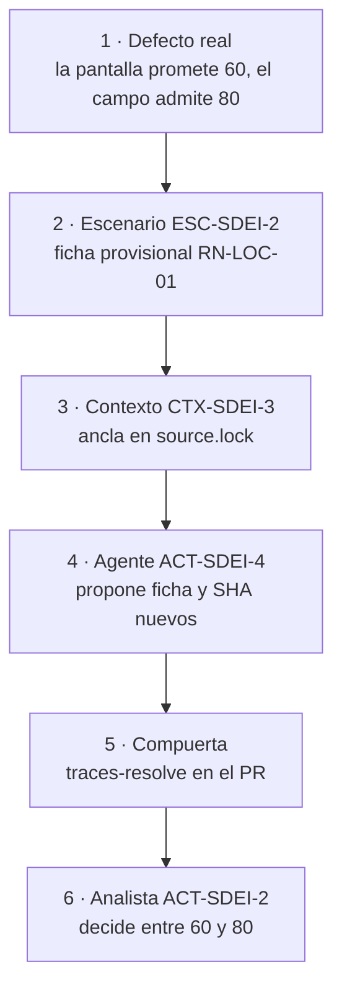

*Figura 3.2. El mismo caso pasa por los tres ejes del marco. La compuerta comprueba lo que se puede contar; el número
correcto lo decide una persona.*

El caso no se cierra en este capítulo: la propuesta de la ficha es que la validación compare también contra el máximo
y que el campo use el largo de 60, y mientras nadie lo decida la ayuda dice lo que la app hace
[Compilado: Examples/MovilidadUrbana-Mini-Demo/docs/fichas/RN-LOC-01.md, l. 47]. El capítulo 13 lo recorre de punta
a punta, con la historia de la versión 1.0 de la ficha, que dio rojo.

#### 3.7 Preguntas guía del capítulo 3

1. ¿En qué escenario está el sistema que tenés que documentar, y qué clases de pieza activa? Si tiene rasgos de dos,
   ¿qué clases suma la unión?
2. ¿Qué contexto cambia la respuesta en tu caso: hay sitio, hay SDD, dónde vive la pieza, en qué organización corre
   la compuerta?
3. ¿Qué parte de tu cambio es de clase H y, por lo tanto, no la puede cerrar un agente? ¿Quién ocupa ese rol en tu
   proyecto?
4. ¿Contra qué ancla de versión vale la pieza que vas a escribir?
5. ¿Qué control de la compuerta va a mirar la pieza que vas a producir, y qué tendría que estar mal para que dé rojo?
6. Si la pieza no encaja en ninguna clase del catálogo, ¿quién decide abrir una nueva?

[Compilado: 00-Marco.md, l. 210–214; 01-Mapa.md, l. 126–128]

#### 3.8 Resumen del capítulo 3

El marco tiene tres ejes y un juego de convenciones. Los cuatro escenarios (corpus de guías, app sin roles, panel con
roles, servicio con paquetes) comparten el tronco común y sólo activan, quitan o sustituyen clases de pieza; un
sistema con rasgos de dos activa la unión. Los cuatro contextos cruzan los escenarios y cambian una sola respuesta:
sitio, SDD, topología y organización del runner. Los seis actores dicen quién decide qué; clase H es una persona, no
siempre el PO, y quien verifica no es quien redactó. Las convenciones fijan frontmatter, identificadores, trazas,
enlaces, citación, diagramas, ejemplos, estados, alias de lo privado y lengua. El defecto 60/80 de MovilidadUrbana
recorre los tres ejes y llega a la decisión de una persona.

## Parte II. Diseñar el sistema documentador

La Parte I fijó el vocabulario; esta parte lo pone a trabajar sobre el objeto del libro. El capítulo 4 dice de qué
está hecho un sistema documentador: sus piezas, sus repositorios, su compuerta y el catálogo cerrado de catorce clases.
El capítulo 5 lo pone en movimiento y sigue a una pieza desde que alguien la necesita hasta que entra al repositorio.
El capítulo 6 resuelve las dos preguntas que el capítulo 5 deja abiertas en la fase de diseño: en qué repositorio vive
la pieza y contra qué versión del código vale. Los tres salen de los temas 01, 02 y 03 del cuerpo y de la sección 4
del Mapa; el colofón dice sobre qué estado de Lab-Documentos se editaron.

### 4. Qué es un sistema documentador

*Forma: explicación.* **Objetivos.** Al terminar el capítulo podés nombrar las piezas de un sistema documentador y
decir de qué fuente sale cada una, clasificar una pieza en el catálogo `CL-01` a `CL-14`, y levantar por comando el
inventario de un sistema real. Sostiene el objetivo `OBJ-SDEI-01`, que se comprueba con `EJR-SDEI-01`
([capítulo 16](#16-ejercicios)).

**Requisitos previos.** El vocabulario del [capítulo 3](#3-marco-de-referencia): escenarios `ESC-SDEI-n`, contextos
`CTX-SDEI-n` y actores `ACT-SDEI-n`. Del [capítulo 1](#1-fundamentos-la-documentación-tratada-como-código): *docs as
code*, clases de intervención D/P/H, compuerta y traza.

**En tres líneas.** Un sistema documentador es la maquinaria que produce y mantiene la documentación, no la
documentación misma. Para cada pieza responde de dónde sale, contra qué versión vale, qué control la vigila y quién
decide. Sus piezas caen en un catálogo cerrado de catorce clases, y el inventario se levanta con un comando.

#### 4.1 Definición y qué no es

##### 4.1.1 La maquinaria detrás de lo que se lee

La documentación es lo que se lee. El **sistema documentador** es lo que hace que eso que se lee sea correcto, esté al
día y llegue a quien lo necesita: el conjunto de piezas documentales, fuentes de verdad, repositorios, anclas de
versión, compuertas, canales y actores (personas y agentes de IA) que producen y mantienen la documentación de un
sistema [Compilado: TEM-01-Sistema-Documentador.md, l. 38–41]. La forma que la industria adoptó para construirlo es
*docs as code*, que el capítulo 1 define con sus componentes ([Write the Docs, s. f.](#ref-writethedocs-sf);
[Winters et al., 2020](#ref-winters-2020)). Este capítulo no vuelve sobre la definición: la aplica.

Cinco términos sostienen lo que sigue y ya están definidos en el capítulo 1 y en el anexo A: **pieza documental**
(unidad que se escribe, se versiona y se valida por separado), **fuente de verdad** (el lugar del que sale lo que la
pieza afirma; si discrepan, manda la fuente), **clase de pieza** `CL-nn`, **compuerta** y **clase de intervención**
D/P/H [Compilado: TEM-01-Sistema-Documentador.md, l. 52–60]. De los cinco, el que más se malinterpreta es el último.
La clase D/P/H clasifica el **acto** de producir o cambiar una pieza, no a la persona: una decisión de arquitectura
tiene dos actos, la redacta un agente (P) y la acepta una persona (H), y el catálogo lo escribe así, «P redacta; H
acepta» [Compilado: TEM-01-Sistema-Documentador.md, l. 60].

##### 4.1.2 Cuatro preguntas por pieza

La documentación de software falla de maneras conocidas, y el capítulo 1 reúne la evidencia: contenido insuficiente,
información obsoleta, referencias a código que ya no existe ([Aghajani et al., 2019](#ref-aghajani-2019);
[Aghajani et al., 2020](#ref-aghajani-2020); [Tan et al., 2024](#ref-tan-2024)). Ninguna de esas fallas se arregla
escribiendo mejor una página. Se arregla con un sistema que sepa de dónde sale cada afirmación, que lo compruebe en
cada cambio y que diga quién decide cuando la página y el código discrepan
[Compilado: TEM-01-Sistema-Documentador.md, l. 64–72].

Ese es el trabajo del sistema documentador, y se resume en cuatro preguntas que tiene que poder contestar para cada
pieza [Compilado: TEM-01-Sistema-Documentador.md, l. 74–80]:

| Pregunta | Nombre de la respuesta | Dónde se desarrolla |
| --- | --- | --- |
| ¿De dónde sale lo que afirma? | Fuente de verdad | Sección 4.2 (columna «Dónde vive») y capítulo 5, fase 2 |
| ¿Contra qué versión del código vale? | Ancla de versión | [Capítulo 6](#6-topología-de-repositorios-y-versionado) |
| ¿Qué control detecta que dejó de valer? | Compuerta o aviso programado | Sección 4.2 (columna «Control») y [capítulo 9](#9-compuertas-de-calidad-y-ci) |
| ¿Quién puede cambiarla y quién decide si hay una divergencia? | Clase D/P/H y actor | Sección 4.2 (columna «Intervención») y sección 3.4 |

*Tabla 4.1. Las cuatro preguntas que un sistema documentador responde para cada pieza, y dónde las trata el libro.*

Una pieza que no puede contestar alguna de las cuatro tiene un hueco. Sin fuente, nadie sabe a quién creerle; sin
ancla, nadie sabe de qué versión habla; sin control, envejece en silencio; sin actor, una divergencia queda sin
dueño.

##### 4.1.3 Qué no es

Cuatro confusiones frecuentes, cada una con su porqué [Compilado: TEM-01-Sistema-Documentador.md, l. 133–143]:

- **No es un generador de sitios.** Mintlify, Docusaurus, MkDocs o DocFX son medios de una pieza, el sitio publicado.
  Un sistema documentador puede no tener sitio: el de este libro no lo tiene y se lee en el render del repositorio
  (`CTX-SDEI-1`).
- **No es una carpeta `docs/`.** Una carpeta sin fuente declarada, sin ancla y sin control es documentación sin
  sistema, y envejece sin que nadie lo note.
- **No es la wiki del equipo.** Lo que vive fuera del control de versiones no se revisa por pull request ni se ancla
  a una versión del código. Puede ser un canal; nunca la fuente.
- **No es una herramienta de IA.** Los agentes son actores con un rol acotado (clase P). El sistema funciona sin
  ellos; con ellos, la compuerta es lo que impide que un borrador equivocado entre.

#### 4.2 Arquitectura de referencia y catálogo de clases

##### 4.2.1 Tres repositorios y una compuerta

Las piezas de un sistema documentador se reparten, en el caso general, en tres repositorios: el del código, uno de
guías y un repositorio hermano `.Documentacion`. La figura 4.1 muestra el reparto y los tres caminos que importan: el
código emite la referencia en el build, el índice para agentes se ancla al código por SHA, y toda pieza entra por un
pull request que la compuerta revisa [Compilado: TEM-01-Sistema-Documentador.md, l. 84–109].

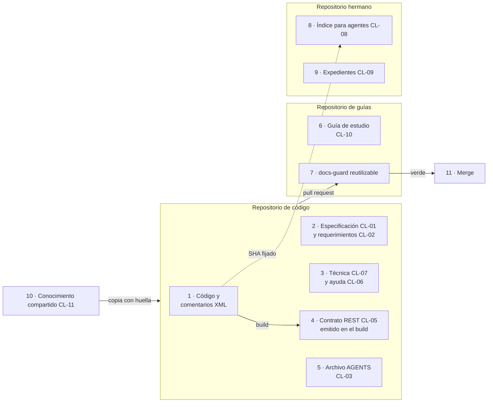

*Figura 4.1. Arquitectura de referencia. Mirá las tres flechas que salen del código: la del build (lo generado, clase
D), la punteada hacia el hermano (un ancla por SHA, no una copia) y la del pull request (la única puerta de entrada).*

Cada componente tiene una responsabilidad y, tan importante como ella, algo que no hace
[Compilado: TEM-01-Sistema-Documentador.md, l. 124–131]:

| Componente | Responsabilidad | Lo que no hace |
| --- | --- | --- |
| Repositorio de código | Fuente de verdad del comportamiento; emite la referencia (OpenAPI, XML) en el build | No aloja la guía de estudio |
| Repositorio de guías | Guarda el cuerpo de estudio, los ejemplos y el workflow reutilizable `docs-guard` | No copia el código: lo fija por SHA |
| Repositorio hermano `.Documentacion` | Índice para agentes, expedientes y bitácoras | No es un marco de especificación propio: es un índice |
| `docs-guard` | Corre las compuertas y devuelve un código de salida | No escribe, no tiene secretos, no invoca agentes |
| Persona del equipo | Decide lo de clase H y asienta por escrito la delegación del merge | No necesita aprobar cada pull request de clase D o P sin reserva |
| Agente de IA | Propone fichas, borradores, reindexado y correcciones (clase P) | No acepta decisiones de arquitectura ni decide divergencias |

*Tabla 4.2. Componentes de la arquitectura de referencia.*

La columna de la derecha es la que evita los errores de diseño más caros. Un repositorio de guías que copia el código
en lugar de fijarlo tiene dos fuentes de verdad; un `docs-guard` que invoca agentes deja de ser un control
determinista; un agente que acepta su propia decisión de arquitectura se saltea el único punto donde decide una
persona.

##### 4.2.2 El catálogo cerrado de catorce clases

Toda pieza del sistema cae en una de catorce clases. El catálogo es **cerrado**: una pieza nueva se clasifica en una
de ellas, y si no encaja en ninguna se abre una clase nueva por expediente, no se improvisa
[Compilado: 01-Mapa.md, l. 77–78]. La tabla 4.3 reproduce el catálogo con las cuatro respuestas de la sección 4.1.2
por clase: dónde vive (fuente y topología), su ancla, el control que la vigila y la clase de intervención.

| Clase | Artefacto | Dónde vive | Ancla | Control (bloquea salvo indicación) | Intervención | Capítulo |
| --- | --- | --- | --- | --- | --- | --- |
| CL-01 | Especificación: necesidad, caso de uso, regla, decisión de arquitectura | Repo de código; sin SDD, la ficha propia puede vivir en un repositorio dedicado con `source.lock` (la mini demo) | Commit y versión del ID | Esquema, enlaces, registro de IDs | P redacta; H acepta la decisión | 5 |
| CL-02 | Registro de requerimientos documentales | Con la especificación o en `docs/_requisitos.md` | Commit | Esquema del registro | P propone; H evalúa | 5 |
| CL-03 | `AGENTS.md` | Raíz de cada repositorio | Commit | Existe y sus enlaces resuelven; excluido del aviso AI-3 por huella | H | 7 |
| CL-04 | Referencia .NET (comentarios XML) | En el código | Commit | Build con avisos como error | D | 4, 9 |
| CL-05 | Contrato REST (`openapi.json`) | Emitido en el build | Commit | Diff del contrato | D | 9 |
| CL-06 | Ayuda al usuario final | Repo de la interfaz, o `Examples/` con `source.lock` | Commit y versión del ID trazado | Enlaces, `traces-resolve`, anti-inyección | P | 8 |
| CL-07 | Documentación técnica escrita | `docs/tecnica/` del código | Commit | Enlaces, frontmatter, mermaid | P | 4 |
| CL-08 | Índice interno para agentes (ia-db) | Repo hermano `.Documentacion` | `base_commit` y `base_tag` | Aviso programado de atraso | P | 7 |
| CL-09 | Expedientes, bitácoras y prompts | Repo hermano `.Documentacion` | Commit | Enlaces y barrido de datos privados | P actúa; H resuelve | — |
| CL-10 | Guía de estudio (este cuerpo y este libro) | Repositorio dedicado | Versión del cuerpo y etiqueta | `docs-guard` completo | P borrador; H vigente | — |
| CL-11 | Conocimiento compartido | Base de conocimiento común, copiado con huella | Versión y SHA-256 | Verificación de la copia; aviso si la base avanza | H | 10 |
| CL-12 | Proceso «Cómo intervenir» | Plantilla en el cuerpo; una instancia por proyecto | Versión de la plantilla | Bloques entradas, salidas y validaciones presentes | H | 12 |
| CL-13 | README y CHANGELOG | Mismo repositorio | Fecha o versión del paquete | Entrada en el pull request | P | 6 |
| CL-14 | Canales derivados para agentes | Artefacto del build del sitio | Versión del build | Reproducibilidad; anti-inyección | D | 7 |

*Tabla 4.3. Catálogo de clases de pieza [Compilado: 01-Mapa.md, l. 80–95]. La columna «Capítulo» reapunta la
columna «Tema» del Mapa a los capítulos del libro.*

`CL-14` está latente: no se activa mientras ningún escenario publique sitio (`CTX-SDEI-1`)
[Compilado: 01-Mapa.md, l. 97].

##### 4.2.3 Cómo se lee el catálogo

El catálogo responde una pregunta que nadie debería contestar caso por caso: quién puede cambiar una pieza. La clase
de intervención no se elige al escribir; la fija el catálogo para cada clase de pieza, y se conoce en la fase de
diseño del ciclo, cuando la pieza recibe su clase ([capítulo 5](#5-el-ciclo-documental), sección 5.1.1). Por eso un
cambio que toca un `AGENTS.md` lo fusiona una persona aunque lo haya propuesto un agente: `CL-03` es H
[Compilado: TEM-02-Ciclo-Documental.md, l. 66–68].

Leído por columnas, el catálogo también muestra el costo de cada clase. Las de ancla «Commit» viven junto a lo que
describen y no necesitan nada extra; `CL-08` y `CL-11` viven lejos y pagan con un aviso programado o una huella.
Las tres clases D (`CL-04`, `CL-05`, `CL-14`) son las que no se redactan: si una de ellas se escribe a mano, el
sistema tiene una fuente de más.

#### 4.3 Aplicación por escenario

El tronco es el mismo en los cuatro escenarios: piezas con fuente, ancla, control y actor. Cambian qué clases se
activan y qué fuente se genera [Compilado: TEM-01-Sistema-Documentador.md, l. 147–155]. Un proyecto con rasgos de
dos escenarios activa la unión de sus clases; la regla de composición y la fila «Clases activas por defecto» están en
la sección 3.2 (expediente 0003, decisión P-16).

| Escenario | Qué aporta pensar el sistema documentador | Piezas centrales | Fuente generada | Lo que más cuesta |
| --- | --- | --- | --- | --- |
| Corpus de guías (`ESC-SDEI-1`) | Que la guía misma tenga contrato (frontmatter), compuerta y versión, aunque no documente un producto | CL-10, CL-12, CL-02 | Ninguna: todo es prosa | Que el cuerpo no se contradiga: un dato en un solo documento |
| App sin roles (`ESC-SDEI-2`) | Separar lo que se genera del código (contrato REST) de lo que se escribe (ayuda, técnica) | CL-05, CL-06, CL-07, CL-02 | OpenAPI y comentarios XML | Que la ayuda diga el mismo número que el código |
| Panel con roles (`ESC-SDEI-3`) | Decidir qué ayuda ve cada rol sin duplicar páginas, y trazar cada página al caso de uso de su pantalla | CL-01, CL-06, CL-08 | OpenAPI y comentarios XML | La confidencialidad: el rol se decide en el servidor |
| Servicio con paquetes (`ESC-SDEI-4`) | Documentar varias líneas de versión que conviven, para integradores que no ven el código | CL-05, CL-11, CL-13 | API pública de los paquetes | Que cada línea tenga su documentación y su CHANGELOG |

*Tabla 4.4. El sistema documentador en cada escenario.*

Los contextos cambian una respuesta dentro de cada fila [Compilado: TEM-01-Sistema-Documentador.md, l. 159–164]:

| Contexto | Qué cambia en el sistema documentador |
| --- | --- |
| Con o sin sitio (`CTX-SDEI-1`) | Con sitio aparecen el build del sitio y los canales derivados para agentes (una página `.md` por página, `llms.txt`); sin sitio, el canal es el propio Markdown |
| Con o sin SDD (`CTX-SDEI-2`) | Con un marco de desarrollo guiado por especificación, la especificación ya es pieza y fuente; sin él, las reglas se escriben como fichas propias |
| Topología (`CTX-SDEI-3`) | Una pieza en otro repositorio que el código necesita un ancla fijada y un aviso de atraso |
| Organización del runner (`CTX-SDEI-4`) | Fuera de la organización del runner, la compuerta se copia con su huella en lugar de llamarse |

*Tabla 4.5. Lo que cambia cada contexto.*

#### 4.4 Ejemplos concretos

##### 4.4.1 Ensayo: inventario de un sistema documentador real

El inventario de un sistema documentador se hace por comando, no de memoria: así se puede repetir y comparar. El
ensayo lee el frontmatter de cada página del cuerpo con el mismo parser que usa la compuerta y cuenta las piezas por
tipo [Compilado: TEM-01-Sistema-Documentador.md, l. 210–217].

- **Precondición.** Python 3, un clon de Lab-Documentos y el guion `01-tem01-inventario.sh`, publicado en el
  repositorio hermano Lab-Documentos.Documentacion, expediente 0002 de DocAsCode, carpeta
  [`evidencia/E1-U4b/`](https://github.com/hdcm-dev/Lab-Documentos.Documentacion/tree/09a451867a05e7718d064067e4dc84377e042ffe/PROMPTs/DEVs/Enchacement/01-Replanteo-Y-Analisis/OUTPUTs/Expedientes/0002-Replanteo-Metodologia-DocAsCode/evidencia/E1-U4b)
  del commit `09a4518` (consultado el 2026-11-01).
- **Orden.** Se corre desde cualquier carpeta, con la ruta del clon como argumento.
- **Resultado esperado.** La lista de piezas por tipo, las piezas que no son prosa y los workflows que corren
  controles.

[Salida registrada: corrida del 2026-11-01 sobre `0bed863` de Lab-Documentos, publicada como
[U25](https://github.com/hdcm-dev/Lab-Documentos.Documentacion/tree/09a451867a05e7718d064067e4dc84377e042ffe/PROMPTs/DEVs/Enchacement/01-Replanteo-Y-Analisis/OUTPUTs/Expedientes/0003-Reedicion-DocsAsCode-Y-Especificacion/evidencia/U25)
del expediente 0003 (medida el 2026-11-01); recorte: la línea del commit y las rutas largas]

```text
$ bash 01-tem01-inventario.sh <clon de Lab-Documentos>
piezas .md con frontmatter, por doc_type:
  anexo                  7
  anexo-referencias      1
  ayuda (sin doc_id)     12
  ficha                  2
  guia-practica          5
  indice                 1
  mapa                   1
  marco-de-referencia    1
  proceso                2
  rrd                    1
  study-note             1
  tema                   7
  sin frontmatter (README de ejemplos): 1
piezas que no son prosa: Examples/MovilidadUrbana-Mini-Demo/contracts/openapi.json,
  Examples/MovilidadUrbana-Mini-Demo/source.lock, Examples/MovilidadUrbana-Mini-Demo/verificar.sh, …
workflows que corren compuertas: docs-enlaces-semanal.yml, docs-guard.yml, framework-concept-demo.yml,
  mini-demo-movilidad.yml
```

La salida histórica del 2026-10-27, sobre «PR #19, merge `e3841b6`» (equivalente de `080f158`), no tenía las líneas
`tema 7` ni `proceso 2`: los siete temas y los dos documentos de proceso se agregaron después
[Compilado: TEM-01-Sistema-Documentador.md, l. 219–222]. Sobre `00171bd`, el estado en el que se editó este
capítulo, la misma orden cuenta `rrd 2`: el pull request de coherencia del expediente 0003 sumó el registro de
requerimientos de la prueba de ayuda por rol [Salida registrada: corrida del 2026-11-01 sobre una copia de `00171bd`
hecha con `git archive`; única diferencia con la de `0bed863`].

Leída con el capítulo, la salida es un inventario por clase. El cuerpo de estudio (`indice`, `marco-de-referencia`,
`mapa`, `tema`, `anexo`) es `CL-10`. Las doce páginas de ayuda de las pruebas de concepto son `CL-06`. Los registros
`rrd` son `CL-02`, y las dos `ficha` son `CL-01` como fichas propias sin SDD, en un repositorio dedicado con
`source.lock`. El `openapi.json` es `CL-05` y el `source.lock` es su ancla
[Compilado: TEM-01-Sistema-Documentador.md, l. 243–245]. De los cuatro workflows, `docs-guard.yml` bloquea en cada
pull request, el de la mini demo bloquea en los pull requests que tocan la demo, el semanal sólo avisa y el cuarto es
la compuerta de la demo del Framework Concept, otra guía del mismo repositorio
[Compilado: ../../../.github/workflows/mini-demo-movilidad.yml, l. 17–23; ../../../.github/workflows/framework-concept-demo.yml, l. 1].

##### 4.4.2 Un cambio recorrido de punta a punta

MovilidadUrbana tiene un defecto real: la pantalla promete 60 caracteres para el nombre de una localidad y el campo
admite 80 [Compilado: TEM-01-Sistema-Documentador.md, l. 273]. La sección 3.6 usa el mismo caso para recorrer el
marco y el [capítulo 13](#13-caso-de-estudio-la-mini-demo-movilidadurbana) lo corre; acá interesa cómo responde cada
pieza del sistema cuando alguien corrige el código.

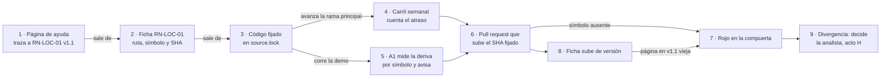

*Figura 4.2. La cadena de fuentes y los controles. Las flechas 1 → 3 dicen quién manda; los nodos 4 y 5 sólo
avisan; el rojo (7) llega recién en el pull request que actualiza el SHA o la ficha.*

1. La ficha `RN-LOC-01` de la mini demo declara la regla y dónde se aplica en el código, con la forma
   `ruta#Símbolo@SHA`. La página de ayuda que menciona el límite lleva `traces: [RN-LOC-01@1.1]` en su frontmatter
   [Compilado: TEM-01-Sistema-Documentador.md, l. 276–278].
2. Si el código cambia en su repositorio, el sistema se entera en dos tiempos. El carril programado cuenta cada
   semana cuántos commits de atraso tiene el SHA fijado frente a la rama principal del código; la deriva por símbolo
   la mide el control A1 cuando corre el workflow de la demo, y sólo avisa. A1 no está programado: el workflow corre
   en los pull requests que tocan la demo o a mano, y esa deuda queda declarada hasta que un pull request lo programe
   o un folio decida no hacerlo [Compilado: 01-Mapa.md, l. 69; ../../../tools/docs-guard/semanal.sh, l. 14;
   ../../../.github/workflows/mini-demo-movilidad.yml, l. 9, 17–23] (expediente 0003, decisión P-18).
3. Cuando alguien actualiza el SHA fijado, la compuerta busca de nuevo cada ancla `ruta#Símbolo@SHA` y da **rojo**
   si el símbolo ya no está en ese SHA. Un agente (`ACT-SDEI-4`) propone actualizar la ficha y subir su versión, y la
   página que traza a la versión anterior queda en rojo hasta que alguien la revisa
   [Compilado: TEM-01-Sistema-Documentador.md, l. 280–282].
4. Ningún control lee el número «60» de la página y lo compara con el «80» del código. Lo que se automatiza es que
   la página quede marcada para revisar cuando la regla cambia [Compilado: TEM-01-Sistema-Documentador.md, l. 282–284].
5. Si el número correcto es 60 u 80 no lo decide nadie de la cadena técnica. Entre la página y la ficha manda la
   ficha; entre la ficha y el código, manda el código, porque la ficha describe lo que el código hace. Lo que esa
   cadena no resuelve es si el código hace lo que se quiso. Eso es una **divergencia** entre la letra (lo que la app
   promete), la intención (para qué) y el comportamiento (lo que el código hace), y la decide la analista
   (`ACT-SDEI-2`), acto de clase H. Después de su decisión se corrige el código o la pantalla, y la cadena vuelve a
   mandar [Compilado: TEM-01-Sistema-Documentador.md, l. 285–290].

##### 4.4.3 El caso de industria y las adopciones

El tema 01 trae además un caso de industria (el portal público de un proveedor de notificaciones) y una tabla de
adopciones públicas de las prácticas P1 a P3, con su ensayo fechado. Las dos cosas se cuentan una sola vez, en el
[capítulo 18](#18-el-sistema-documentador-en-la-industria) (secciones 18.1 y 18.2), donde el caso entra reverificado
(expediente 0003, decisiones P-03 y P-07).

#### 4.5 Preguntas guía

1. ¿Qué piezas documentales tiene tu sistema hoy, y de qué fuente de verdad sale cada una?
2. ¿Cuáles de esas piezas se pueden generar (clase D) y hoy se escriben a mano?
3. Si el código cambia mañana, ¿qué control se pondría en rojo, cuál sólo avisaría, y qué pieza quedaría
   desactualizada sin que nada lo detecte?
4. ¿Quién decide cuando una página y el código discrepan? ¿Está escrito en algún lado?
5. ¿Qué parte de tu sistema documentador depende de una herramienta que podrías cambiar sin perder las piezas?

[Compilado: TEM-01-Sistema-Documentador.md, l. 294–299; la pregunta 3 suma «cuál sólo avisaría», por la sección
4.4.2]

#### 4.6 Criterios de calidad

Los criterios generales de una guía están en el [anexo D](#d-criterios-de-calidad) (`CQ-01` a `CQ-14`); acá van los
propios del sistema documentador, con el `CQ-nn` que los comprueba cuando existe
[Compilado: TEM-01-Sistema-Documentador.md, l. 303–310].

| Criterio | Un sistema documentador bueno | Uno pobre | Se comprueba con |
| --- | --- | --- | --- |
| Fuente declarada | Cada pieza dice de dónde sale lo que afirma | Las páginas repiten datos del código sin decir de dónde | `CQ-01`, `CQ-11` |
| Referencia generada | Lo que puede salir del código sale del código (clase D) | La referencia de la API se copia a mano | Diff del contrato en la CI |
| Control por pieza | Toda clase activa tiene un control que la pone en rojo o un aviso programado | Hay piezas que ningún control mira | Columna «Control» del inventario (plantilla G.1) |
| Roles escritos | Está escrito qué decide cada actor y qué no | «Lo revisa alguien» | Tabla de actores de la sección 3.4 |
| Independencia de la herramienta | Las piezas son texto plano versionado; la herramienta se puede cambiar | El contenido vive dentro de un servicio que no exporta | Que el repositorio se lea sin el sitio |
| Inventario reproducible | El inventario sale de un comando | El inventario es una lista escrita a mano que envejece | Un ensayo como el de la sección 4.4.1 |

*Tabla 4.6. Criterios de calidad de un sistema documentador.*

#### 4.7 Anexo: plantilla de inventario

La plantilla comentada para inventariar el sistema documentador de un proyecto, una fila por pieza y con las
preguntas que guían cada campo, está en el [anexo G](#g-plantillas), G.1.

#### 4.8 Fuentes y observaciones

Fuentes primarias del capítulo, con fecha de consulta en el [anexo B](#b-referencias): Write the Docs (s. f.),
Winters et al. (2020), Aghajani et al. (2019 y 2020) y Tan et al. (2024). El capítulo de Winters et al. y los
resúmenes de los tres artículos se releyeron el 2026-10-27 para el tema 01
[Compilado: TEM-01-Sistema-Documentador.md, l. 341–344].

| Tipo | Observación |
| --- | --- |
| Hecho | Las cifras del inventario son de la corrida del 2026-11-01 sobre `0bed863`; cambian cuando el cuerpo suma piezas, como muestra la diferencia con `00171bd` (`rrd 2`) |
| Hecho | El workflow de la mini demo no corre por calendario: se dispara en los pull requests que tocan la demo, en `tools/docs-guard/` o en el propio workflow, y a mano. Por eso la deriva por símbolo es hoy un aviso a demanda, no programado |
| Interpretación | Que la columna «Lo que no hace» evite los errores más caros (sección 4.2.1) es una lectura de la arquitectura, no una medición |
| Criterio propio | La lectura por columnas del catálogo (sección 4.2.3) es una forma de estudiarlo que propone el libro; el catálogo no la prescribe |
| Deuda declarada | La clase de los workflows y de `tools/docs-guard/` en el catálogo no se votó en el expediente 0003 (resolución, §5.3): hoy no son ninguna de las catorce |

*Tabla 4.7. Observaciones del capítulo 4.*

#### Resumen del capítulo 4

Un sistema documentador es la maquinaria que produce y mantiene la documentación: piezas con fuente, ancla, control y
actor, repartidas en el repositorio del código, uno de guías y un hermano `.Documentacion`. Las piezas caen en un
catálogo cerrado de catorce clases que fija, para cada una, dónde vive, contra qué se ancla, qué control la vigila y
quién la puede cambiar. El inventario se levanta por comando. Cuando la cadena de fuentes no alcanza, porque el
código no hace lo que se quiso, decide una persona: la analista, en un acto de clase H.

### 5. El ciclo documental

*Forma: explicación.* **Objetivos.** Al terminar el capítulo podés ubicar cada decisión documental en su fase,
escribir un requerimiento documental con criterio Dado/Cuando/Entonces y decir quién lo acepta, y saber a qué fase
vuelve una pieza que derivó. Sostiene `OBJ-SDEI-05`, que se comprueba con `EJR-SDEI-05`
([capítulo 16](#16-ejercicios)).

**Requisitos previos.** El [capítulo 4](#4-qué-es-un-sistema-documentador), en especial el catálogo de clases y la
clase de intervención D/P/H; el actor `ACT-SDEI-2` de la sección 3.4.

**En tres líneas.** El ciclo documental tiene cinco fases, y la primera se parte en captura (lo puede hacer un
agente) y evaluación (decide una persona). El mantenimiento no es una sexta fase: es un control de deriva dentro de la
quinta, que devuelve la pieza a la fase 1a o a la 4. Cada fase tiene entrada, salida, quien decide y un control.

#### 5.1 Definición: fases, RRD, estados y cláusulas

##### 5.1.1 Cinco fases, la primera partida en dos

El capítulo 4 mostró de qué está hecho un sistema documentador; el **ciclo documental** muestra cómo se mueve. Es la
secuencia de fases por la que pasa una pieza documental, con lo que entra y sale de cada fase, quién decide y qué
control comprueba la salida. Tiene cinco fases, y la primera se parte en dos porque junta trabajos de naturaleza
distinta: relevar lo que hace falta, que lo puede hacer un agente, y decidir qué se hace, que lo decide una persona
[Compilado: TEM-02-Ciclo-Documental.md, l. 37–40].

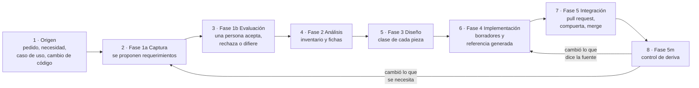

*Figura 5.1. Las fases del ciclo. Mirá las dos flechas que salen de 5m: el mantenimiento no agrega una fase, devuelve
la pieza a 1a o a 4 según qué cambió [Compilado: TEM-02-Ciclo-Documental.md, l. 42–55].*

A qué fase vuelve una pieza que derivó depende de qué cambió. Si cambió **lo que la audiencia necesita** (una tarea
nueva, una pantalla que desaparece, otra audiencia), vuelve a **1a**: hay que reescribir o agregar filas del registro
de requerimientos y que una persona las decida de nuevo. Si el requerimiento sigue igual y sólo cambió **lo que la
fuente dice** (un límite, un nombre de campo), vuelve a **4**: se corrige el texto contra la fuente nueva, sin pasar
por la evaluación [Compilado: TEM-02-Ciclo-Documental.md, l. 57–60].

La tabla 5.1 usa las clases de intervención de la sección 1.6. No son las clases de pieza `CL-nn`: una clase de pieza
dice qué es la pieza; una clase de intervención, quién la puede cambiar. «Sin reserva» quiere decir que nadie declaró
una duda que devuelva el merge a una persona [Compilado: TEM-02-Ciclo-Documental.md, l. 62–68].

| Fase | Entra | Sale | Decide una persona | Hace un agente | Control |
| --- | --- | --- | --- | --- | --- |
| 1a Captura | Pedido, necesidad, caso de uso, inventario de pantallas y endpoints | Filas del registro de requerimientos documentales (RRD) en `pendiente` | — | Releva audiencias, tareas y piezas; propone filas | Esquema del RRD |
| 1b Evaluación | Filas `pendiente` | Filas `aceptado`, `rechazado` o `diferido`, con quién decidió y cuándo | **Acepta, rechaza o difiere** cada fila (`ACT-SDEI-2`) | — | Toda fila tiene decisión y criterio Dado/Cuando/Entonces |
| 2 Análisis | RRD aceptado, código, especificación | Inventario hecho por comando; fichas de reglas y casos de uso | **Decide las divergencias** entre lo que la regla dice y lo que se quiso | Genera el inventario y redacta las fichas | `traces-resolve` sobre las fichas nuevas |
| 3 Diseño | Fichas, catálogo de clases | Clase asignada a cada pieza; decisión de arquitectura propuesta | **Acepta** la decisión de arquitectura | Redacta la decisión y las plantillas | La clase existe en el catálogo (tabla 4.3) |
| 4 Implementación | Diseño aceptado | Páginas en `borrador`; referencia emitida en el build | — | Redacta borradores | Grupos PR-1 a PR-7 de `docs-guard` |
| 5 Integración | Pull request con la compuerta | Merge; anclas fijadas | **Pasa a `vigente`**, etiqueta, publica; fusiona lo de clase H | Fusiona lo de clase D o P sin reserva, con la guarda | Guarda de merge, con la delegación asentada |
| 5m Control de deriva | Repositorios, `last_review` | Issue de aviso con lo que derivó | Prioriza el aviso | Propone la corrección (vuelve a 1a o a 4) | Carril programado semanal: atraso, frescura y deriva de copia fijada; A1 cuando corre la demo |

*Tabla 5.1. Fases del ciclo documental [Compilado: TEM-02-Ciclo-Documental.md, l. 70–78]. La celda «Control» de 5m
nombra lo que el carril mide, con los términos de la decisión P-13 del expediente 0003 (co-cambio propuesto).*

##### 5.1.2 Qué problema resuelve

Sin ciclo, la documentación se escribe cuando alguien se acuerda y se revisa cuando alguien se queja. El ciclo
resuelve tres cosas concretas [Compilado: TEM-02-Ciclo-Documental.md, l. 82–103].

**Que se escriba lo que hace falta y no otra cosa.** La norma ISO/IEC/IEEE 26514:2022 ordena el desarrollo de la
información para usuarios así: establecer qué información necesitan, decidir cómo presentarla, y recién después
prepararla y ponerla a disposición; y aclara que el diseño sigue a lo largo del ciclo de vida
([ISO/IEC/IEEE, 2022](#ref-iso-26514-2022)). El RRD de la fase 1 es la forma escrita de ese primer paso.

**Que la revisión exista y tenga etapas.** Entrevistas a 31 redactores técnicos distinguen cinco etapas de revisión:
autorrevisión, revisión técnica, revisión editorial, prueba de uso y realimentación después de publicar
([Bhat et al., 2026](#ref-bhat-2026)). GitLab, que documenta su producto en el mismo repositorio que el código, pide
la revisión del código, la de la persona redactora técnica y la de quien mantiene el proyecto antes del merge, y
alienta que la documentación vaya en el mismo merge request que el código que describe
([GitLab, s. f.](#ref-gitlab-sf)).

**Que lo que propone un agente no entre sin control.** Un estudio sobre 1997 pull requests de documentación encontró
que los agentes de IA presentan bastantes más que las personas en los repositorios estudiados, y que sus cambios
suelen integrarse con poca modificación humana posterior; los autores lo leen como una alerta sobre las prácticas de
revisión ([Yamasaki et al., 2026](#ref-yamasaki-2026)). Por eso el ciclo separa lo que el agente propone (1a, 2, 4) de
lo que una persona decide (1b, divergencias, decisiones de arquitectura, `vigente`), y pone una compuerta entre los
dos.

##### 5.1.3 El registro de requerimientos documentales

Un **requerimiento documental** es lo que una audiencia necesita lograr con la documentación (sección 3.1). El
**registro de requerimientos documentales** (RRD) los guarda como filas de una tabla, una por requerimiento: cada fila
nombra una sola audiencia, la tarea, la pieza que la resuelve, el criterio con el que se comprueba y la decisión de
una persona. El criterio se escribe con la forma Dado/Cuando/Entonces, un estilo que viene del desarrollo guiado por
comportamiento y que sirve para escribir una expectativa como ejemplo comprobable
([Fowler, 2013](#ref-fowler-2013)) [Compilado: TEM-02-Ciclo-Documental.md, l. 107–112].

| Si el proyecto… | El RRD vive en… |
| --- | --- |
| Tiene un marco de desarrollo guiado por especificación (`CTX-SDEI-2`) | Junto a la especificación de la unidad de entrega |
| No tiene marco de especificación | `docs/_requisitos.md` del árbol que documenta |
| Ofrece la documentación como función del producto (por ejemplo, ayuda en pantalla) | El requerimiento va en la necesidad o el caso de uso del producto, y el RRD lo referencia |

*Tabla 5.2. Dónde vive el RRD [Compilado: TEM-02-Ciclo-Documental.md, l. 114–118].*

Las columnas que la compuerta exige y su vocabulario están en el
[anexo C](#c-esquema-de-frontmatter-y-prefijos), sección del registro de requerimientos.

##### 5.1.4 Estados del documento

Todo documento lleva su estado en el frontmatter: `borrador` → `vigente` → `obsoleto`. Pasar a `vigente` es un acto
de una persona (clase H), en un pull request propio, y es el momento en que esa persona revisa la `description`. Un
documento `obsoleto` dice cuál lo reemplaza. El carril programado avisa cuando `last_review` tiene más de un año
[Compilado: TEM-02-Ciclo-Documental.md, l. 125–127].

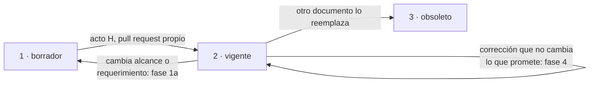

*Figura 5.2. Estados de un documento. La flecha de 2 a 1 es la regla de criterio propio del párrafo siguiente: un
`vigente` no se vuelve `borrador` por corregir un número.*

Si un documento `vigente` deriva y vuelve al ciclo, la regla es esta **[criterio propio]**: una corrección que no
cambia lo que el documento promete (vuelve a la fase 4 para que un número siga a su fuente) se fusiona como cualquier
cambio de clase P y el documento sigue `vigente`; una que cambia su alcance o su requerimiento (vuelve a 1a) lo pasa
a `borrador` en ese mismo pull request, y volver a `vigente` es otro acto H
[Compilado: TEM-02-Ciclo-Documental.md, l. 129–132].

##### 5.1.5 Cláusulas con criterio

La metodología misma se escribe como **cláusulas** que se pueden verificar. Cada cláusula tiene identificador, fase,
a quién obliga, de dónde sale, su criterio Dado/Cuando/Entonces, el instrumento que la comprueba y su nivel (debe,
conviene, opcional) [Compilado: TEM-02-Ciclo-Documental.md, l. 136–138]. La sección 5.3.3 muestra una escrita; la
plantilla está en el anexo G.

##### 5.1.6 «Clara» e «integración»

Una metodología **clara** es una que un lector sin contexto recorre sin quedar con dudas que el texto no responde. Se
mide con la prueba de lectura P-LECT, cuyo umbral es cero dudas sin respuesta. **Integración** tiene dos acepciones
que no se mezclan: en el ciclo del código, pull request más CI (la fase 5); en el producto, la ayuda dentro de la
aplicación y los canales para agentes [Compilado: TEM-02-Ciclo-Documental.md, l. 142–145]. Cuando el libro dice
«integrar» sin más, habla de la primera.

##### 5.1.7 Qué no es

- **No es una cascada.** Las fases ordenan decisiones, no meses: un cambio chico recorre de 1a a 5 en un solo pull
  request. Lo que no se saltea es la decisión de la persona en 1b.
- **No es un proceso aparte del desarrollo.** La fase 5 es el mismo pull request y la misma CI que el código.
- **No es el ciclo de la especificación.** Cuando hay un marco de desarrollo guiado por especificación, la
  especificación tiene su propio ciclo; el documental lo usa como fuente y no lo reemplaza. Böckeler distingue tres
  niveles de ese marco: la especificación escrita antes de la tarea, la que se conserva para mantener la función, y
  la que pasa a ser la fuente principal y sólo se edita ella ([Böckeler, 2025](#ref-bockeler-2025)). Esa integración
  es el tema del [capítulo 10](#10-integración-con-un-marco-sdd).

[Compilado: TEM-02-Ciclo-Documental.md, l. 149–157]

#### 5.2 Aplicación por escenario

Las fases son las mismas en los cuatro escenarios; un escenario nunca agrega fases. Cambia de dónde salen los
requerimientos y qué tan pesada es cada fase [Compilado: TEM-02-Ciclo-Documental.md, l. 161–169]. En todos los
escenarios decide el rol `ACT-SDEI-2`; la columna de la derecha dice quién lo ocupa (expediente 0003, decisión P-17).

| Escenario | De dónde salen los requerimientos (1a) | Qué pesa más | Quién decide en 1b |
| --- | --- | --- | --- |
| Corpus de guías (`ESC-SDEI-1`) | Objetivos de aprendizaje y preguntas de quien estudia | Fase 4 (redacción) y la prueba de lectura | `ACT-SDEI-2`; ocupa el rol la responsable de la guía o quien el PO designe por delegación asentada |
| App sin roles (`ESC-SDEI-2`) | Pantallas, endpoints y defectos conocidos del código | Fase 2: fichas de reglas ancladas al SHA | Analista |
| Panel con roles (`ESC-SDEI-3`) | Casos de uso del marco de especificación, uno por pantalla y rol | Fase 3: qué rol ve qué ayuda | Analista, con el PO para la confidencialidad |
| Servicio con paquetes (`ESC-SDEI-4`) | Cambios del contrato público entre versiones | Fase 5: CHANGELOG y contrato por línea de versión | PO |

*Tabla 5.3. El ciclo en cada escenario.*

| Contexto | Qué cambia en el ciclo |
| --- | --- |
| Con SDD (`CTX-SDEI-2`) | El RRD vive con la especificación y los IDs de las trazas son los del proyecto (`CU-`, `RN-`) |
| Sin SDD (`CTX-SDEI-2`) | La fase 2 escribe fichas propias de reglas; el RRD va en `docs/_requisitos.md` |
| Pieza en otro repositorio (`CTX-SDEI-3`) | La fase 5m pesa más: el pull request del código no ve la página, y el atraso lo detecta el aviso programado |
| Con sitio (`CTX-SDEI-1`) | La fase 4 suma el build del sitio y los canales derivados |

*Tabla 5.4. Lo que cambia cada contexto [Compilado: TEM-02-Ciclo-Documental.md, l. 171–176].*

#### 5.3 Ejemplos concretos

##### 5.3.1 Una fila del RRD real de la mini demo

La mini demo de MovilidadUrbana tiene su RRD en `docs/_requisitos.md`. Su primera fila, recortada a las seis columnas
que exige la compuerta:

| ID | Audiencia | Tarea | Pieza | Criterio | Decisión |
| --- | --- | --- | --- | --- | --- |
| RD-01 | persona usuaria | Dar de alta una localidad sin que el nombre se rechace ni quede distinto de lo esperado | CL-06, `docs/ayuda/alta-de-localidad.md` | Dado el límite de cada regla, cuando la persona lee la ayuda, entonces cada número coincide con el de la ficha; instrumento: `traces-resolve` | aceptado |

*Tabla 5.5. La fila `RD-01` [Compilado: Examples/MovilidadUrbana-Mini-Demo/docs/_requisitos.md, l. 44; sin las
columnas «Fuente» y «Decide y fecha»].*

El instrumento del criterio no lee los números de la página. `traces-resolve` comprueba que la versión de la ficha a
la que traza la página (`RN-LOC-01@1.1`) sea la versión que la ficha declara. Si alguien cambia el límite en la
ficha, tiene que subir su versión, y la página queda en rojo hasta que alguien la revisa y traza a la versión nueva.
El criterio es comprobable en ese sentido: ningún cambio de la regla pasa sin que la página se revise
[Compilado: TEM-02-Ciclo-Documental.md, l. 189–192].

La columna «Decide y fecha» del archivo dice `mesa, 2026-10-27`. «La mesa» es el grupo de revisión del expediente
que diseñó esta guía, y decidió por **delegación escrita** del PO. Delegar una decisión de clase H también es un acto
H: lo hace la persona responsable, por escrito, en un lugar del repositorio que cualquiera puede leer, y con alcance
acotado; la responsabilidad sigue siendo suya. En Lab-Documentos la delegación del merge está escrita en el
[CHANGELOG](../../../CHANGELOG.md) (sección «Delegación del merge»), con fecha, quién decidió, la guarda que tiene
que pasar el pull request y dónde quedó asentada. Lo que una delegación no nombra sigue en la persona
[Compilado: TEM-02-Ciclo-Documental.md, l. 194–199].

Leída por fases, cada parte de la fila es la salida de una fase. La fila misma sale de 1a; su decisión `aceptado`,
de 1b; las fichas `RN-LOC-01` y `RN-LOC-02`, ancladas al código, de 2; la clase `CL-06` de la pieza, de 3; la página
con `traces: [RD-01, RN-LOC-01@1.1, RN-LOC-02@1.0]`, de 4; y el pull request con `docs-guard` en verde que la
fusionó, de 5 [Compilado: TEM-02-Ciclo-Documental.md, l. 201–205]. Si mañana el código cambia el límite, el aviso de
atraso del carril programado, o A1 cuando corre la demo, devuelve la pieza a 4: la tarea de la persona usuaria es la
misma y cambia el número. Si la pantalla de alta desapareciera, la devolvería a 1a.

##### 5.3.2 Ensayo: la evaluación deja huella y la compuerta la verifica

El ensayo arma un RRD de una fila dos veces. En la primera, la fila tiene un criterio sin la forma Dado/Cuando/Entonces
y una decisión fuera del vocabulario («ok»): la persona no decidió nada verificable. En la segunda, la misma fila
corregida [Compilado: TEM-02-Ciclo-Documental.md, l. 211–217].

- **Precondición.** Python 3, un clon de Lab-Documentos y el guion `02-tem02-rrd.sh`, en la misma carpeta
  `evidencia/E1-U4b/` del expediente 0002 que el ensayo de la sección 4.4.1.
- **Orden.** Se corre desde cualquier carpeta, con la ruta del clon como argumento.
- **Resultado esperado.** Rojo y verde.

[Salida registrada: corrida del 2026-11-01 sobre `0bed863` de Lab-Documentos, publicada como U25 del expediente
0003 (medida el 2026-11-01); sobre una copia de `00171bd` la salida es idéntica]

```text
$ bash 02-tem02-rrd.sh <clon de Lab-Documentos>
== caso rojo
_requisitos.md:19: ERROR rrd-decision: «ok» fuera de ['aceptado', 'diferido', 'pendiente', 'rechazado']
_requisitos.md:19: ERROR rrd-criterio: el criterio no tiene la forma Dado/Cuando/Entonces
== PR-2 esquema: ROJO (errores=2 avisos=0) archivos-con-frontmatter=1 sin-frontmatter-fuera-del-cuerpo=0 readme-del-cuerpo-sin-frontmatter=0
rc=1
== caso verde
== PR-2 esquema: verde (errores=0 avisos=0) archivos-con-frontmatter=1 sin-frontmatter-fuera-del-cuerpo=0 readme-del-cuerpo-sin-frontmatter=0
rc=0
```

La salida histórica del 2026-10-27, sobre «PR #19, merge `e3841b6`», da el mismo rojo y el mismo verde; la vigente
sólo suma el contador `readme-del-cuerpo-sin-frontmatter` en la línea de resumen
[Compilado: TEM-02-Ciclo-Documental.md, l. 219–222].

Lo que demuestra: la fase 1b no se puede cerrar con un «ok» ni con un criterio que no se pueda comprobar. Lo que no
demuestra: la compuerta no sabe si la fase 1b ocurrió. Una fila `pendiente` pasa, porque es un valor válido (la fila
espera su evaluación), y la compuerta no lee quién decidió. Que una persona decidió lo muestran la columna «Decide y
fecha» y la revisión del pull request; antes de pasar un documento a `vigente`, quien revisa comprueba que no quede
ninguna fila `pendiente` de la que dependa una página [Compilado: TEM-02-Ciclo-Documental.md, l. 236–240].

##### 5.3.3 Una cláusula escrita con la plantilla

[Fragmento ilustrativo: cláusula de esta guía escrita con la plantilla del anexo G; el prefijo `CLA-` no está
registrado]

| Campo | Valor |
| --- | --- |
| `id` | `CLA-1b-01` |
| `fase` | 1b Evaluación |
| `sujeto` | Analista (`ACT-SDEI-2`) |
| `obliga` | Toda fila del RRD tiene una decisión del vocabulario y quién la tomó |
| `origen` | Sección 5.1.1, tabla 5.1 |
| `dado/cuando/entonces` | Dado un RRD en un pull request, cuando corre la compuerta, entonces toda fila tiene decisión en `aceptado`, `rechazado`, `diferido` o `pendiente` |
| `instrumento` | `docs-guard`, grupo PR-2, regla `rrd-decision` |
| `nivel` | Debe |

*Tabla 5.6. Una cláusula de la metodología [Compilado: TEM-02-Ciclo-Documental.md, l. 246–255].*

La cláusula obliga a algo que el ensayo de la sección 5.3.2 comprueba: el instrumento nombrado es el mismo control
que dio rojo con el «ok». Una cláusula cuyo instrumento no existe es una intención, no una cláusula.

#### 5.4 Preguntas guía

1. ¿Qué audiencia necesita la pieza que vas a escribir, y qué tarea concreta le resuelve? Si nombrás dos audiencias,
   ¿son dos requerimientos?
2. ¿Quién ocupa el rol que decide en la fase 1b de tu proyecto? ¿Está escrito?
3. ¿Tu criterio Dado/Cuando/Entonces se puede comprobar con un instrumento, o sólo con una opinión?
4. Si el código cambia mañana, ¿qué control avisa que la pieza derivó, y a qué fase vuelve?
5. ¿Qué partes del ciclo puede hacer un agente en tu proyecto, y en qué punto exacto interviene una persona?

[Compilado: TEM-02-Ciclo-Documental.md, l. 259–264; las preguntas 2 y 4 nombran el rol y el control, por P-17 y
P-18]

#### 5.5 Criterios de calidad

| Criterio | Un ciclo bueno | Uno pobre | Se comprueba con |
| --- | --- | --- | --- |
| Requerimiento antes que página | Toda página responde a una fila del RRD | Páginas que nadie pidió y pedidos sin página | Trazas de cada página a su `RD-` |
| Criterio comprobable | Cada fila tiene Dado/Cuando/Entonces e instrumento | «La ayuda tiene que ser clara» | Regla `rrd-criterio` de PR-2 |
| Decisión con nombre | Cada fila dice quién decidió y cuándo | Filas aceptadas por nadie | Regla `rrd-decision` de PR-2 y la columna de quién decide |
| Persona en los puntos H | 1b, divergencias, arquitectura y `vigente` los decide una persona | Un agente acepta su propio requerimiento | Tabla 5.1; `CQ-14` |
| Deriva con retorno | Un aviso de deriva abre la corrección en 1a o 4 | El aviso se acumula en un issue que nadie mira | Issues del carril programado con su pull request |
| Claridad medida | La metodología pasa la prueba de lectura con cero dudas | «Se entiende» | P-LECT, `CQ-04` |

*Tabla 5.7. Criterios de calidad del ciclo documental [Compilado: TEM-02-Ciclo-Documental.md, l. 268–275].*

#### 5.6 Anexo: plantilla del RRD y de una cláusula

La plantilla comentada de un RRD con una cláusula de la metodología, y las preguntas que guían cada campo, está en
el [anexo G](#g-plantillas), G.2. Lleva las seis columnas que exige la compuerta más «Fuente» y «Decide y fecha», que
la compuerta no mira pero la revisión sí [Compilado: TEM-02-Ciclo-Documental.md, l. 319–322].

#### 5.7 Fuentes y observaciones

Fuentes primarias del capítulo, con fecha de consulta en el [anexo B](#b-referencias): ISO/IEC/IEEE (2022), GitLab
(s. f.), Bhat et al. (2026), Yamasaki et al. (2026), Fowler (2013) y Böckeler (2025). La página de la norma, la de
GitLab, el artículo de Böckeler y los resúmenes de Bhat et al. y Yamasaki et al. se releyeron el 2026-10-27 para el
tema 02 [Compilado: TEM-02-Ciclo-Documental.md, l. 339–342].

| Tipo | Observación |
| --- | --- |
| Hecho | El ensayo usa los controles `rrd-decision` y `rrd-criterio` de `docs-guard` tal como están en `0bed863` y en `00171bd`; la salida coincide con la de «PR #19, merge `e3841b6`» salvo un contador |
| Hecho | El estado inicial de una fila se llama `pendiente` porque es el valor que acepta la compuerta; el documento de integración del expediente 0002 lo llama «propuesto». Son el mismo estado |
| Hecho | La norma ISO/IEC/IEEE 26514 se cita por su página oficial de alcance; el texto completo de la norma no se consultó |
| Hecho | El carril programado mide atraso, frescura y deriva de copias fijadas; no mide deriva por símbolo. Esa la mide A1, que no está programado (sección 4.4.2) |
| Interpretación | Partir la fase 1 en captura y evaluación es una decisión del expediente 0002 de DocAsCode para separar lo que un agente puede proponer de lo que una persona decide; la norma no la parte |
| Criterio propio | La regla de estados para un `vigente` que deriva (sección 5.1.4) y el prefijo `CLA-` del ejemplo de cláusula; una metodología que adopte la plantilla registra su prefijo por pull request |

*Tabla 5.8. Observaciones del capítulo 5 [Compilado: TEM-02-Ciclo-Documental.md, l. 344–350].*

#### Resumen del capítulo 5

El ciclo documental ordena decisiones, no meses: captura y evaluación, análisis, diseño, implementación e
integración, con un control de deriva dentro de la integración que devuelve la pieza a 1a si cambió lo que se
necesita o a 4 si cambió lo que dice la fuente. El RRD es la forma escrita de la fase 1: una fila por requerimiento,
con criterio Dado/Cuando/Entonces y la decisión de una persona, y la compuerta rechaza un «ok». Lo que la compuerta no
puede ver, que alguien decidió de verdad, lo muestran la columna «Decide y fecha» y la revisión.

### 6. Topología de repositorios y versionado

*Forma: explicación.* **Objetivos.** Al terminar el capítulo podés ubicar una pieza nueva con una regla de tres
preguntas, elegir su ancla de versión (commit, SHA fijado o etiqueta), escribir una traza versionada, y decidir si
hace falta publicar varias versiones de la documentación. Sostiene `OBJ-SDEI-04`, que se comprueba con `EJR-SDEI-04`
([capítulo 16](#16-ejercicios)).

**Requisitos previos.** Los capítulos [4](#4-qué-es-un-sistema-documentador) y [5](#5-el-ciclo-documental): la fase 3
asigna la clase de una pieza, y con la clase vienen su topología y su ancla.

**En tres líneas.** Toda pieza vive en algún repositorio y vale para algún estado del código. La topología dice dónde
y el ancla dice contra qué; si la pieza vive lejos del código, paga con un SHA fijado y un aviso de atraso. Una
traza `ID@MAYOR.MENOR` lleva el ancla al texto y pone en rojo la página cuando la regla cambia.

#### 6.1 Definición y regla para ubicar una pieza

##### 6.1.1 Cuatro topologías

La **topología** de una pieza dice dónde vive respecto del código que describe. Hay cuatro posibilidades
[Compilado: TEM-03-Topologia-Y-Versionado.md, l. 38–45]:

| Topología | Qué es | Ejemplo en el laboratorio |
| --- | --- | --- |
| Mismo repositorio | La pieza está en el repositorio del código, en una carpeta como `docs/` o `SDD/` | La especificación de Lab-Geometria |
| Repositorio hermano | Un repositorio `.Documentacion` con el mismo nombre que el de código, que guarda índices, expedientes y bitácoras | Lab-Documentos.Documentacion |
| Repositorio dedicado | Un repositorio cuyo producto es la documentación | Lab-Documentos, que guarda este libro |
| Artefacto del build | La pieza no se versiona como archivo de prosa: la emite el build del código | El contrato `openapi.json` emitido por la API |

*Tabla 6.1. Las cuatro topologías.*

Los controles que nombra este capítulo son parte de la compuerta (el carril PR) o del carril programado, definidos en
la sección 1.7. En Lab-Documentos la compuerta la corre el workflow `docs-guard`, con siete grupos más `autoprueba`;
`traces-resolve` es el control del grupo PR-5. El carril programado es otra corrida, semanal, que no bloquea: sólo
avisa con un issue. Localmente, todo se corre con `scripts/ci-local.sh` desde la raíz del repositorio
[Compilado: TEM-03-Topologia-Y-Versionado.md, l. 47–53]. El [capítulo 9](#9-compuertas-de-calidad-y-ci) desarrolla
los dos carriles.

##### 6.1.2 El ancla de versión

El **ancla de versión** es el dato que dice contra qué estado del código vale la pieza (sección 1.3.2). Hay cuatro, y
cada una tiene su ocasión y su verificación [Compilado: TEM-03-Topologia-Y-Versionado.md, l. 55–62]:

| Ancla | Cuándo se usa | Qué la verifica |
| --- | --- | --- |
| El commit | La pieza vive en el mismo repositorio que el código: el commit que la contiene es el ancla. Si el repositorio publica versiones, la etiqueta de cada una marca juntos el código y su documentación | Nada extra: el mismo pull request cambia las dos cosas |
| SHA fijado (`source.lock`, `base_commit`) | La pieza vive en otro repositorio que el código | La existencia del SHA bloquea; el atraso frente a la rama principal del código avisa |
| Etiqueta (`base_tag`, `v1.2.0`) | Hay una versión publicada con nombre | La etiqueta anotada; el CHANGELOG de esa versión |
| Versión del cuerpo | Una guía de estudio | El campo `version` del README del cuerpo, en SemVer, y una etiqueta anotada por versión |

*Tabla 6.2. Las cuatro anclas de versión.*

Un ancla sólo sirve si un control la puede leer. La tabla 6.3 dice dónde se escribe cada una y con qué forma
[Compilado: TEM-03-Topologia-Y-Versionado.md, l. 64–70]:

| Ancla | Dónde se escribe | Forma |
| --- | --- | --- |
| SHA fijado de una demo o una copia | Archivo `source.lock` junto a las piezas | Líneas `repo:` y `sha:` con el SHA completo (ejemplo en la sección 6.3.1) |
| `base_commit` y `base_tag` de un índice para agentes | En la cabecera de cada índice de la ia-db, en el repositorio hermano | Líneas `base_commit: <SHA>` y, si existe, `base_tag: <etiqueta>`; el carril programado las busca con esa forma |
| Etiqueta de una versión | En Git, como etiqueta anotada | `v1.2.0`, o `docs-guard-v1.0.0` para una herramienta |

*Tabla 6.3. Dónde y cómo se escribe cada ancla.*

La forma importa al pie de la letra. El carril programado busca `base_commit` con una expresión que admite espacios
y comillas dobles entre el nombre, los dos puntos y el SHA, pero no comillas invertidas
[Compilado: ../../../tools/docs-guard/semanal.sh, l. 107–108]. Un índice que escribe el SHA como código en línea
queda fuera del aviso; la sección 6.7 registra un caso real.

**Cuándo SHA y cuándo etiqueta.** El SHA es obligatorio siempre que la pieza vive en otro repositorio: es lo único que
no se mueve. La etiqueta se agrega cuando existe una que contiene exactamente el código que se documenta, porque le
dice a una persona qué versión es («la 1.2.0») sin que tenga que buscar el SHA. Con las dos, la compuerta verifica el
SHA y la etiqueta es para quien lee. Sin etiqueta, va sólo el SHA [Compilado: TEM-03-Topologia-Y-Versionado.md,
l. 72–75].

Para las versiones con nombre, el cuerpo usa SemVer: mayor, menor y parche, donde la mayor sube con un cambio que
rompe a quien depende de la versión anterior ([Preston-Werner, s. f.](#ref-prestonwerner-sf)). El historial legible
de cada versión va en un CHANGELOG: una lista curada y en orden cronológico de los cambios notables, escrita para
personas, con la versión más reciente arriba y su fecha ([Lacan, s. f.](#ref-lacan-sf))
[Compilado: TEM-03-Topologia-Y-Versionado.md, l. 77–81].

##### 6.1.3 La traza y el registro de IDs

La **traza** lleva el ancla al texto. Una página que depende de una regla declara `traces: [RN-LOC-01@1.1]`: el
identificador apunta a la ficha, no a la ruta, y `@1.1` dice contra qué versión de la ficha vale la página. La
compuerta busca el identificador en un **registro de IDs** que arma sola con los `doc_id` y los encabezados del
repositorio: una ficha declara su regla con un encabezado que empieza con el identificador y, debajo, una línea con
su versión (`# RN-LOC-01 — Largo del nombre de la localidad` y `**Versión:** 1.1`)
[Compilado: TEM-03-Topologia-Y-Versionado.md, l. 83–88]. El detalle de la forma está en el
[anexo C](#c-esquema-de-frontmatter-y-prefijos).

El registro es uno para todo el repositorio. Por eso los identificadores de este cuerpo llevan su `corpus_id`
(`TEM-SDEI-03`, no `TEM-03`): otras guías del mismo repositorio ya chocaron en él, `MARCO-CONVENCIONES` está declarado
cuatro veces, y una traza a un ID declarado dos veces es ambigua [Compilado: TEM-03-Topologia-Y-Versionado.md,
l. 88–91]. Por la misma razón el libro nunca abre un encabezado con un ID que declara otro documento: lo pone entre
paréntesis, después del número de sección (prólogo, sección P.4).

##### 6.1.4 Qué problema resuelve

La documentación que vive lejos del código envejece sin que nadie lo note: en más de 3000 proyectos de GitHub, la
mayoría tuvo en algún momento al menos una referencia en la documentación a un elemento de código ya borrado
([Tan et al., 2024](#ref-tan-2024)). La topología decide si esa deriva es **imposible** (mismo repositorio y mismo
pull request), **detectable** (SHA fijado y aviso programado) o **invisible** (otro repositorio sin ancla)
[Compilado: TEM-03-Topologia-Y-Versionado.md, l. 95–99].

Resuelve además una pregunta que se repite: ¿hay que publicar varias versiones de la documentación? Docusaurus, que
implementa el versionado de documentación (`docs:version 1.1.0` copia la carpeta de documentos a una carpeta
versionada), advierte que la mayoría de las veces no hace falta, porque alarga el build y agrega complejidad
([Docusaurus, s. f.](#ref-docusaurus-sf)). Hace falta cuando conviven en uso versiones distintas del producto
[Compilado: TEM-03-Topologia-Y-Versionado.md, l. 101–105].

##### 6.1.5 La regla para ubicar una pieza

La pregunta que separa las topologías es una: **¿la pieza tiene que cambiar en el mismo pull request que el código
que describe?** Backstage formula el caso afirmativo: quien desarrolla escribe la documentación en Markdown, que vive
junto a su código ([Backstage, s. f.](#ref-backstage-sf)). En el otro extremo, una pieza que habla *del* proyecto y
no *del* producto (un índice para agentes, un expediente, una guía para trabajar en ese proyecto) tiene otro ritmo y
otros autores, y va afuera [Compilado: TEM-03-Topologia-Y-Versionado.md, l. 109–113].

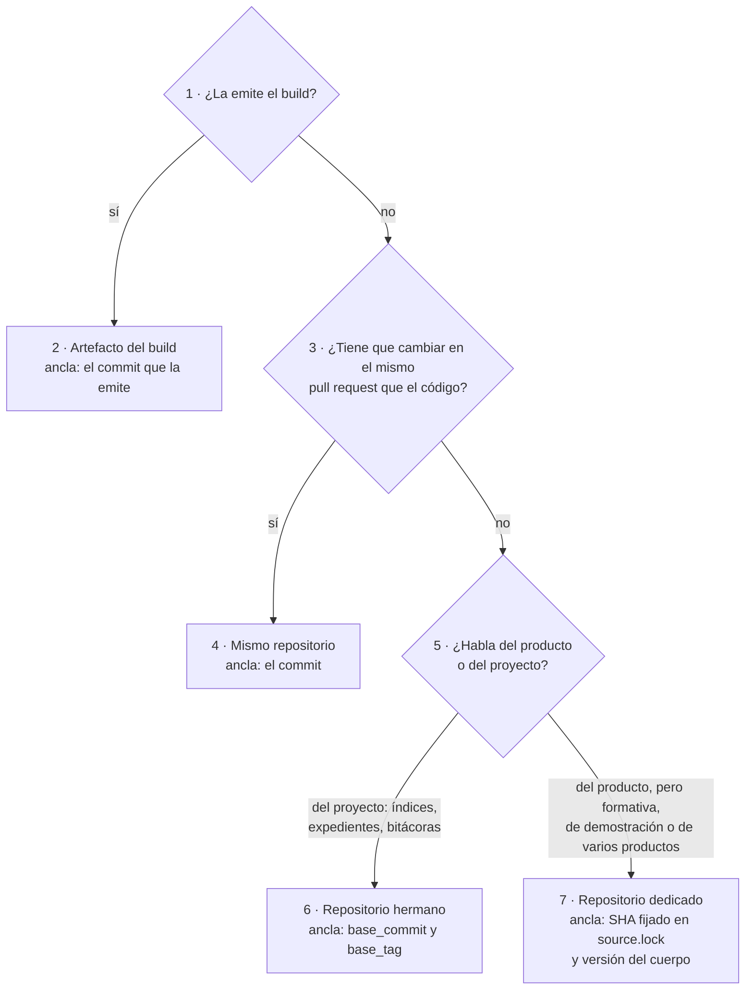

*Figura 6.1. Tres preguntas ubican cualquier pieza. La primera saca lo generado; la segunda, lo que va con el código;
la tercera reparte lo que queda entre el hermano y un repositorio dedicado
[Compilado: TEM-03-Topologia-Y-Versionado.md, l. 115–128].*

La rama más fina es la última. Va a un repositorio dedicado lo que habla del producto pero no puede cambiar en su
pull request: una guía de estudio sobre un tema que sirve a varios proyectos, como este libro; una demostración
escrita desde afuera; una pieza que sirve a varios productos.

##### 6.1.6 Qué no es

- **No es una preferencia de orden.** Ubicar una pieza en otro repositorio tiene un costo: hay que fijar un ancla y
  vigilar su atraso. Si no se paga ese costo, la pieza envejece.
- **No es versionar por las dudas.** Publicar varias versiones de la documentación responde a versiones del producto
  que conviven en uso, no a la cantidad de commits. Un producto con un solo despliegue vivo tiene una sola versión
  que documentar.
- **No es apuntar a la rama principal.** Una cita a otro repositorio por su rama principal cambia de significado con
  cada commit; las citas entre repositorios van por SHA o por etiqueta.

[Compilado: TEM-03-Topologia-Y-Versionado.md, l. 132–138]

#### 6.2 Aplicación por escenario

| Escenario | Topología dominante | Ancla | Qué aporta decidirlo bien |
| --- | --- | --- | --- |
| Corpus de guías (`ESC-SDEI-1`) | Repositorio dedicado | Versión del cuerpo en el README y una etiqueta por versión | Que una cita a la guía diga a qué versión se refiere |
| App sin roles (`ESC-SDEI-2`) | La ayuda y la técnica, en el repositorio de la app; en la mini demo de este laboratorio, en un repositorio dedicado con `source.lock` | Commit, o SHA fijado en la demo | Que la ayuda diga lo mismo que el código del SHA que documenta |
| Panel con roles (`ESC-SDEI-3`) | Especificación y manual por rol en el repositorio del código; índices para agentes y guías para trabajar en ese proyecto, en el hermano | Las piezas del repositorio del código, el commit, y la etiqueta de cada versión publicada marca código y documentación juntos; los índices del hermano, `base_commit` (SHA) y `base_tag` | Que una pantalla y su ayuda cambien en el mismo pull request |
| Servicio con paquetes (`ESC-SDEI-4`) | Mismo repositorio, con una línea de documentación por línea de versión del paquete | El commit; además, la etiqueta de cada versión publicada del paquete (`v1.4.2`), que congela código y documentación de esa línea | Que quien integra la versión 1 no lea la documentación de la 2 |

*Tabla 6.4. Topología y ancla en cada escenario [Compilado: TEM-03-Topologia-Y-Versionado.md, l. 142–147].*

| Contexto | Qué cambia |
| --- | --- |
| Mismo, hermano o dedicado (`CTX-SDEI-3`) | Es el contexto de este capítulo: decide si el ancla es el commit o un SHA fijado |
| Con sitio (`CTX-SDEI-1`) | Una sola versión publicada (la de la rama principal) con un sello por página, salvo que convivan versiones del producto |
| Con SDD (`CTX-SDEI-2`) | Los IDs de las trazas y su versión los define el registro del marco de especificación del proyecto |
| Fuera de la organización del runner (`CTX-SDEI-4`) | La compuerta se copia con su huella (SHA-256): la copia es otra pieza con ancla propia |

*Tabla 6.5. Lo que cambia cada contexto [Compilado: TEM-03-Topologia-Y-Versionado.md, l. 149–154].*

#### 6.3 Ejemplos concretos

##### 6.3.1 Un SHA fijado real: el `source.lock` de la mini demo

La mini demo de MovilidadUrbana documenta una app cuyo código vive en otro repositorio. No lo copia: lo fija.

[Compilado: Examples/MovilidadUrbana-Mini-Demo/source.lock, l. 4–7]

```text
repo: https://github.com/hdcm-dev/Lab-E2E.WebBlazor.git
sha: 8fb4c3a8b1cc629027f456c7c3ce19e041164c06
comparar: main
rutas: src/MovilidadUrbana.ApiWeb src/MovilidadUrbana.MAUI
```

Contra ese SHA, las fichas de reglas resuelven sus anclas `ruta#Símbolo@SHA` y la compuerta da verde. Contra `main`
del código, el carril programado cuenta los commits de atraso del SHA, y el control A1 del workflow de la demo mide
la deriva por símbolo cuando ese workflow corre; los dos sólo avisan. Cambiar el SHA es un pull request que actualiza,
en el mismo cambio, el contrato y las anclas de las fichas [Compilado: TEM-03-Topologia-Y-Versionado.md, l. 172–174,
con la corrección propuesta como co-cambio; Examples/MovilidadUrbana-Mini-Demo/source.lock, l. 1–3].

##### 6.3.2 Ensayo: la traza desfasada y el ID ambiguo

El ensayo arma una página de ayuda y una ficha de regla en una carpeta temporal y corre el control `traces-resolve`
en tres casos: (1) la ficha subió a la versión 1.1 y la página sigue trazando a `@1.0`; (2) la página traza a `@1.1`;
(3) otro documento declara el mismo identificador [Compilado: TEM-03-Topologia-Y-Versionado.md, l. 214–224].

- **Precondición.** Python 3, un clon de Lab-Documentos y el guion `03-tem03-ancla.sh`, en la carpeta
  `evidencia/E1-U4b/` del expediente 0002 (sección 4.4.1).
- **Orden.** Se corre desde cualquier carpeta, con la ruta del clon como argumento.
- **Resultado esperado.** Rojo, verde, rojo.

[Salida registrada: corrida del 2026-11-01 sobre `0bed863` de Lab-Documentos, publicada como U25 del expediente
0003 (medida el 2026-11-01); sobre una copia de `00171bd` la salida es idéntica]

```text
$ bash 03-tem03-ancla.sh <clon de Lab-Documentos>
== caso 1: la página traza a @1.0 y la ficha está en 1.1
ayuda.md:1: ERROR traza-version-desfasada: DEMO-TEM03-01@1.0: la declaración está en 1.1
anclas: 2 fichas sin --fuente; sus anclas las verifica el workflow de su source.lock
== PR-5 traces-resolve: ROJO (errores=1 avisos=0) trazas=2 resueltas=1 ids-duplicados=0 anclas=0 anclas-resueltas=0
rc=1
== caso 2: la página traza a @1.1
anclas: 2 fichas sin --fuente; sus anclas las verifica el workflow de su source.lock
== PR-5 traces-resolve: verde (errores=0 avisos=0) trazas=2 resueltas=2 ids-duplicados=0 anclas=0 anclas-resueltas=0
rc=0
== caso 3: el ID se declara en dos documentos
ayuda.md:1: ERROR traza-ambigua: DEMO-TEM03-01@1.1: declarado 2 veces (fichas.md, otra-guia.md)
fichas.md:17: ERROR id-duplicado: DEMO-TEM03-01: también declarado en otra-guia.md:17
fichas.md:1: ERROR traza-ambigua: DEMO-TEM03-01: declarado 2 veces (fichas.md, otra-guia.md)
otra-guia.md:17: ERROR id-duplicado: DEMO-TEM03-01: también declarado en fichas.md:17
otra-guia.md:1: ERROR traza-ambigua: DEMO-TEM03-01: declarado 2 veces (fichas.md, otra-guia.md)
anclas: 3 fichas sin --fuente; sus anclas las verifica el workflow de su source.lock
== PR-5 traces-resolve: ROJO (errores=5 avisos=0) trazas=3 resueltas=0 ids-duplicados=2 anclas=0 anclas-resueltas=0
rc=1
```

La salida histórica del 2026-10-27, sobre «PR #19, merge `e3841b6`», daba en el caso 3 `errores=3`: los dos
`id-duplicado` que suma la vigente son del control que entró después
[Compilado: TEM-03-Topologia-Y-Versionado.md, l. 226–228].

Lo que demuestra: el ancla de versión no es decorativa. Si quien cambia la regla sube su versión, toda página que la
cita queda en rojo en ese mismo pull request hasta que alguien la revisa. Y un identificador repetido en el
repositorio rompe todas las trazas que lo usan, que es la razón de calificar los IDs con el `corpus_id`
[Compilado: TEM-03-Topologia-Y-Versionado.md, l. 245–247].

##### 6.3.3 Lab-Geometria: por qué la separación que ya tiene es la correcta

Aplicada a Lab-Geometria (`ESC-SDEI-3`), la regla de la sección 6.1.5 confirma la separación que el proyecto ya
tiene. La especificación y el manual del panel por rol van en el repositorio del código, porque describen pantallas
que cambian en el mismo pull request. Los índices para agentes, los análisis y las guías de estudio de ese proyecto
van en el hermano `.Documentacion`, porque hablan del proyecto y no se despliegan con él. Como el panel tiene un único
despliegue vivo, una sola versión de la documentación alcanza [Compilado: TEM-03-Topologia-Y-Versionado.md,
l. 251–255]. El [capítulo 10](#10-integración-con-un-marco-sdd) muestra la traza contra su especificación.

##### 6.3.4 Las adopciones públicas

El tema 03 apoya sus prácticas P4 a P6 (documentación junto al código, rama por versión, copias versionadas sólo si
conviven versiones) en adopciones públicas con fecha. Esa tabla y su ensayo se cuentan, junto con las de P1 a P3, en
el [capítulo 18](#18-el-sistema-documentador-en-la-industria), sección 18.2. Las tres prácticas no compiten: P4 es el
valor por defecto, y P5 y P6 son el precio de salir de él cuando el producto tiene versiones que conviven
[Compilado: TEM-03-Topologia-Y-Versionado.md, l. 191–192].

#### 6.4 Preguntas guía

1. ¿La pieza que vas a escribir tiene que cambiar en el mismo pull request que el código? Si sí, ¿por qué estaría en
   otro repositorio?
2. Si la pieza vive en otro repositorio, ¿qué SHA o etiqueta fija el código que describe, y qué control avisa cuando
   ese código avanza?
3. ¿Conviven hoy en uso dos versiones de tu producto? Si no, ¿qué ganarías publicando dos versiones de la
   documentación?
4. ¿Tus citas a otros repositorios van por SHA o etiqueta, o por la rama principal?
5. ¿Los identificadores de tu repositorio son únicos? ¿Qué pasa con tus trazas si otra guía declara el mismo ID?

[Compilado: TEM-03-Topologia-Y-Versionado.md, l. 259–266]

#### 6.5 Criterios de calidad

| Criterio | Una topología buena | Una pobre | Se comprueba con |
| --- | --- | --- | --- |
| Ubicación justificada | Cada pieza fuera del repositorio del código tiene un motivo («habla del proyecto», «sirve a varios productos») | Piezas en otro repositorio por costumbre | La regla de la sección 6.1.5 |
| Ancla presente | Toda pieza fuera del repositorio del código tiene un SHA o una etiqueta fijados | Documentación externa que no dice qué versión describe | Existencia de `source.lock` o `base_commit`; bloquea |
| Atraso vigilado | Un aviso programado compara el ancla con la rama principal | El atraso se descubre cuando alguien se queja | Carril programado semanal |
| Trazas versionadas | Las páginas trazan a `ID@MAYOR.MENOR` y la ficha sube la versión cuando cambia lo que promete | Trazas sin versión a reglas que cambian | `traces-resolve` (PR-5); `CQ-03` |
| IDs únicos | Identificadores calificados por cuerpo o proyecto | IDs cortos que chocan con otras guías | Regla `traza-ambigua` de PR-5 |
| Versionado proporcional | Una versión publicada salvo que convivan versiones del producto; CHANGELOG por versión | Varias versiones publicadas de un producto con un solo despliegue | Contar las versiones en uso antes de versionar |

*Tabla 6.6. Criterios de calidad de la topología y el versionado [Compilado: TEM-03-Topologia-Y-Versionado.md,
l. 270–277].*

#### 6.6 Anexo: plantilla de topología y ancla

La plantilla comentada para registrar la topología y el ancla de una pieza nueva, que se completa en la fase 3 y va
en la descripción del pull request que agrega la pieza, está en el [anexo G](#g-plantillas), G.3, con el caso de la
ayuda de la mini demo ya llenado [Compilado: TEM-03-Topologia-Y-Versionado.md, l. 281–284].

#### 6.7 Fuentes y observaciones

Fuentes primarias del capítulo, con fecha de consulta en el [anexo B](#b-referencias): Preston-Werner (s. f.), Lacan
(s. f.), Tan et al. (2024), Docusaurus (s. f.) y Backstage (s. f.). SemVer, Keep a Changelog, la página de versionado
de Docusaurus y la de TechDocs de Backstage se releyeron el 2026-10-27 para el tema 03
[Compilado: TEM-03-Topologia-Y-Versionado.md, l. 317–320].

| Tipo | Observación |
| --- | --- |
| Hecho | El registro de IDs es único para todo Lab-Documentos y otras guías ya chocaron en él: `MARCO-CONVENCIONES` está declarado como `doc_id` en cuatro guías de `Guides/`, y el Framework Concept tuvo que pasar sus temas al espacio propio `FC-TEM-nn`. Por eso este cuerpo usa `TEM-SDEI-nn` |
| Hecho | El índice para agentes de Lab-Documentos.Documentacion declara `base_commit` desde el 2026-10-27, pero entre comillas invertidas (`ia-db/README.md`, l. 122, en `e61c5df`, verificado el 2026-11-01); la expresión del carril programado no lo ve. El tema 03 todavía dice que ningún índice lo declara (co-cambio propuesto) |
| Interpretación | Que «mismo repositorio» sea la topología por defecto sale de la regla del mismo pull request y de Backstage; no hay una medición que compare topologías |
| Observación sobre la compuerta | `docs-guard` rechazaba `traces: []` como campo faltante, aunque el anexo del esquema admite la lista vacía; hoy lo acepta con el aviso `traces-vacio` (`tools/docs-guard/dg.py`, l. 342–346), que recomienda trazar al menos al `doc_id` del README del cuerpo |

*Tabla 6.7. Observaciones del capítulo 6 [Compilado: TEM-03-Topologia-Y-Versionado.md, l. 322–329].*

#### Resumen del capítulo 6

Tres preguntas ubican cualquier pieza: si la emite el build, si cambia en el mismo pull request que el código, y si
habla del producto o del proyecto. Cada topología trae su ancla: el commit cuando la pieza vive con el código, un SHA
fijado cuando vive lejos, una etiqueta cuando hay una versión con nombre. La traza `ID@MAYOR.MENOR` lleva esa ancla al
texto, y el registro único de IDs obliga a calificarlos por cuerpo. Publicar varias versiones de la documentación
responde a versiones del producto que conviven, no a la cantidad de commits.

## Parte III. Audiencias y canales

La Parte II dejó armado el sistema documentador: sus piezas, el ciclo que las produce y los repositorios donde viven.
Esta parte mira el otro extremo, quién recibe. El capítulo 7 separa tres cosas que se suelen mezclar: a quién se le
escribe, quién puede recibirlo y quién lee, persona o agente. El capítulo 8 trata a quien no es del equipo, la persona
usuaria del producto, y lleva la ayuda hasta la pantalla y el campo donde se la necesita.

### 7. Audiencias y lectura por agentes

*Forma: explicación.* Por qué la audiencia no protege nada, qué regla sí protege y cómo se lee una fuente única sin
que el canal del agente abra una puerta que la persona no tiene.

**Objetivos.** Al terminar el capítulo podés declarar una regla de entrega con sus dimensiones y su nivel, decidir qué
canales necesita un sistema y comprobar que un agente no recibe más que su usuario.

**Requisitos previos.** Los escenarios y contextos del [capítulo 3](#3-marco-de-referencia); el catálogo de clases de
pieza del [capítulo 4](#4-qué-es-un-sistema-documentador); las clases D, P y H de la
[sección 1.6](#16-quién-decide-clases-dph).

**En tres líneas.** La audiencia orienta qué se escribe; la regla de entrega decide quién lo recibe, y se hace cumplir
en el repositorio, en el build o en el servidor. El agente no es una audiencia: lee con la audiencia y el alcance de su
usuario, por el mismo filtro. Lo que lee es dato; sus instrucciones viven en un `AGENTS.md` que decide una persona.

**Estado de lo que sigue.** Los controles que nombra el capítulo **avisan** y ninguno está en `docs-guard`
([sección 9.1](#91-dos-carriles-y-regla-de-bloqueo)); sus pares corren en una prueba con contenido ficticio
([capítulo 14](#14-caso-de-estudio-ayuda-por-rol)). Los roles de ejemplo son ilustrativos o de Lab-Geometria.

#### 7.1 Audiencia y regla de entrega

Una **audiencia** es un conjunto de lectores definido por sus necesidades y sus tareas. Orienta qué se escribe y cómo;
**no da ni quita acceso**. Una **regla de entrega** dice qué audiencia recibe una pieza, por qué canal, con qué nivel de
acceso y en qué punto se hace cumplir: es la que protege [Compilado: 99-Anexos/Glosario.md, l. 48, 96]. La definición de
audiencia adapta la de ISO/IEC/IEEE 26514:2022, §3.1.7, **sin verificar** contra la edición publicada (anexo J).

| Término | Definición |
| --- | --- |
| Lector | Persona o agente. Es dimensión de **canal**, no de acceso |
| Rol | Perfil del producto con permisos distintos. Es una dimensión de la regla, no un escenario |
| Persona (UX) | Arquetipo de diseño; no entra en la regla de entrega |
| Actor (`ACT-SDEI-n`) | Quien interviene en el sistema documentador, no quien lee el producto |
| Registro de audiencias | Pieza versionada (prefijo `AUD-`, `doc_type: registro-audiencias`), una fila por audiencia; es la fuente. La matriz audiencia × página se deriva |
| `delivery:` | Campo de la página: qué audiencias del registro la reciben. `audience` sigue siendo de orientación |

*Tabla 7.1. Términos que no hay que confundir [Compilado: 99-Anexos/Esquema-Frontmatter-Y-Prefijos.md, l. 56–66].*

#### 7.2 Dimensiones y perfil mínimo

Cuatro dimensiones ortogonales describen la regla: **rol**, **tipo de alcance** (`generico` o `por-aplicacion`; los
valores viven en el producto), **superficie** (panel, portal, app móvil, servicio, SDK) y **nivel de acceso**
[Compilado: TEM-05-Ayuda-Al-Usuario-Final.md, l. 104–109]. El idioma no amplía el acceso y la pericia es opcional.

| Dimensión | Cuándo es obligatoria | Qué se cuida |
| --- | --- | --- |
| Nivel de acceso | Siempre que haya producto | La sección 7.3 |
| Rol | En `ESC-SDEI-3` | Jerarquía declarada una vez con `incluye:`; el build la expande. Cambiarla es clase H |
| Tipo de alcance | Sólo si el inventario lo registra | En el repositorio va el tipo; el cruce de alcance lo prueba el producto, y en el repositorio se barren literales de inquilino |
| Superficie | Sólo si el inventario la registra | Una fuente, salidas por superficie; el paquete instalable lleva sólo lo `publico` |

*Tabla 7.2. Las cuatro dimensiones [Compilado: TEM-05-Ayuda-Al-Usuario-Final.md, l. 109–119].*

El **perfil mínimo** son roles planos con jerarquía declarada, nivel y la regla `nivel-vs-repo`; lo demás son
extensiones que se activan sólo si hacen falta. Un ejemplo ilustrativo, el de un aula: `coordinacion` incluye a
`docente`, y `docente` incluye a `alumno`. Una página de `alumno` que enlaza a una de `coordinacion` sube en la
jerarquía: es un cruce (`cruce-de-audiencia`), porque para ese lector el enlace no lleva a ningún lado.

#### 7.3 Niveles y puntos de aplicación

El nivel de acceso tiene un vocabulario cerrado y cada valor se hace cumplir en un lugar. Los puntos son tres:
**repositorio** (visibilidad de la fuente), **build** (qué se empaqueta) y **servidor** (qué se entrega a cada token).
Un repositorio público sólo puede guardar fuentes `publico` o `producto` (regla `nivel-vs-repo`).

| Nivel | Punto de aplicación | Cómo se prueba que no se entrega |
| --- | --- | --- |
| `publico` | Build: publica sólo estas páginas | El artefacto publicado no contiene páginas de otro nivel |
| `producto` | Servidor, con sesión; el mismo filtro en todos los canales | Prueba pareada por audiencia y canal |
| `restringido` | Servidor o portal, con pertenencia que concede una persona | Prueba pareada, también con la concesión revocada |
| `interno` | Build y repositorio privado: no se compila en el producto | El artefacto no contiene ninguna pieza `interno` |

*Tabla 7.3. Niveles y puntos de aplicación [Compilado: TEM-05-Ayuda-Al-Usuario-Final.md, l. 121–133].*

La **prueba pareada** da el veredicto: el autorizado recibe 200 con contenido y el no autorizado recibe algo distinto
de 200 y sin contenido (403 o 404, elegido y declarado). Una sola mitad no prueba nada: un 404 para todos también
«niega». Ocultar una página en el menú es visibilidad; no entregarla es acceso, y sólo lo segundo protege. La tabla es
una propuesta adoptada con revisión; el par ya corre, con contenido ficticio, en la prueba del capítulo 14.

#### 7.4 Documentación de API por exposición

La documentación de una API se publica en un documento OpenAPI **por exposición** (por ejemplo, uno público y otro
para integradores, detrás de autorización), y la interfaz interactiva sólo en desarrollo. Exponer una API es clase H, y
**cada ensanchamiento** también lo es. El defecto típico es un endpoint sin grupo que cae en todos los documentos: lo
busca `contrato-por-exposicion` [Compilado: TEM-05-Ayuda-Al-Usuario-Final.md, l. 141–144]. ASP.NET Core genera
documentos por audiencia y advierte que el endpoint del documento no exige autorización por defecto
([Microsoft, 2026c](#ref-microsoft-aspnet-openapi-2026)).

#### 7.5 Lectura por agentes

Una página tiene hoy dos lectores, y una sola fuente sirve a los dos sin mantener dos textos: la persona necesita prosa
y ejemplos con contexto; el agente, metadatos, identificadores estables y un índice
[Compilado: TEM-04-Doble-Audiencia.md, l. 40–43]. El segundo texto, escrito a mano para agentes, envejece solo, y el
costo está medido: los modelos responden mejor con la documentación de la API que van a usar
([Chen et al., 2025](#ref-chen-2025)) y fallan cuando su saber quedó atrás de la versión de una biblioteca
([Wang et al., 2025](#ref-wang-2025)).

| Término | Definición |
| --- | --- |
| Canal | La forma en que un lector recibe la fuente: render del repositorio, sitio, índice para agentes |
| Canal derivado (`CL-14`) | Lo que el build de un sitio genera de la fuente: `.md` por página, `llms.txt`, archivo agregado. Sólo con sitio |
| `AGENTS.md` (`CL-03`) | Instrucciones para un agente de código, en la raíz. Puntero escrito a mano; no es canal ni copia |
| Índice interno (`CL-08`) | Índices versionados en el repositorio `.Documentacion`, anclados a `base_commit` |
| Filtro único | La misma regla de entrega, en el mismo punto, para la página, su `.md`, el `llms.txt` y un servidor MCP, con el token del usuario |
| Inyección indirecta | Texto escondido en una fuente que intenta que el agente haga algo que nadie pidió ([OWASP GenAI Security Project, 2025](#ref-owasp-2025)) |

*Tabla 7.4. Términos de la lectura por agentes [Compilado: TEM-04-Doble-Audiencia.md, l. 45–54].*

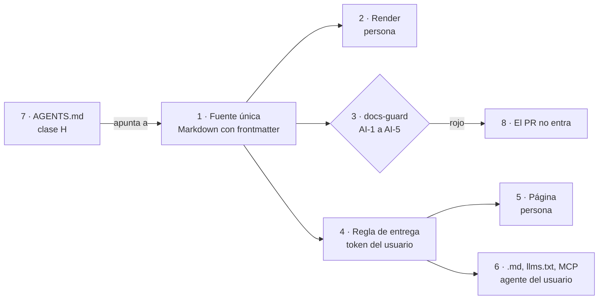

*Figura 7.1. La compuerta revisa la fuente (3); la regla de entrega (4) es una sola para la persona (5) y para su
agente (6). `AGENTS.md` (7) sólo apunta [Compilado: TEM-04-Doble-Audiencia.md, l. 72–85].*

**El agente hereda.** No existe una audiencia «agente» con nivel propio: un agente de código del equipo pertenece a la
audiencia de desarrollo, y el asistente de una persona, a la de esa persona, con su alcance. Es la regla de OWASP para
la agencia excesiva: la autorización la decide el sistema de abajo, no el modelo
([OWASP GenAI Security Project, 2025, LLM06](#ref-owasp-llm06-2025)). La especificación de MCP, sobre HTTP, pide OAuth
y que el servidor valide que el token se emitió para él
([Model Context Protocol, 2025](#ref-mcp-authorization-2025)). El `llms.txt` y el `AGENTS.md` **no** son control de
acceso: el `llms.txt` es una salida más del filtro, una por audiencia, nunca un índice global
[Compilado: TEM-04-Doble-Audiencia.md, l. 210–226].

**Dato, no instrucción.** Lo que el agente lee es dato. Que respete esa separación depende de cómo está armado, y eso
quien documenta no lo controla; sí controla que la fuente no lleve nada escondido. Un asistente que accede a datos
privados, lee contenido no confiable y puede comunicarse hacia afuera reúne las tres condiciones de una exfiltración
([Willison, 2025](#ref-willison-2025)). Quien documenta cubre la fuente; el resto es del producto.

#### 7.6 Por escenario

En los cuatro escenarios la fuente es Markdown con frontmatter; cambia qué canales están activos y qué dimensiones de
la regla hacen falta. `CL-08` está activo por defecto en los cuatro ([sección 3.2](#32-escenarios-y-composición-por-unión)).

| Escenario | Quién es el agente lector | Canales activos | Dimensiones y cuidado |
| --- | --- | --- | --- |
| Corpus de guías (`ESC-SDEI-1`) | El que estudia o mantiene la guía | Markdown, `AGENTS.md`, índice interno | Sin producto, sin regla de entrega. Que los anexos se encuentren sin recorrer la prosa |
| App sin roles (`ESC-SDEI-2`) | Agente de código; asistente de quien usa la ayuda | `AGENTS.md`, contrato OpenAPI (`CL-05`), ayuda con `traces`, índice interno | Nivel. El paquete instalado lleva sólo `publico`. El contrato que se lee es el del SHA fijado |
| Panel con roles (`ESC-SDEI-3`) | Lo anterior, más el agente de quien usa el panel | Lo anterior; `.md` y `llms.txt` de la ayuda, si existen, por el filtro único | Rol y nivel. Que el índice no deje ver títulos que el rol no recibe |
| Servicio con paquetes (`ESC-SDEI-4`) | El agente de quien integra y el del equipo | `AGENTS.md`, README y CHANGELOG del paquete (`CL-13`), contrato, índice interno | Nivel y API por exposición. Que el paquete diga contra qué versión vale |

*Tabla 7.5. Canales y dimensiones por escenario [Compilado: TEM-04-Doble-Audiencia.md, l. 92–97; 00-Marco.md,
l. 106–117].*

| Contexto | Qué cambia |
| --- | --- |
| Sin sitio (`CTX-SDEI-1`) | El agente lee el Markdown del repositorio; no hace falta inventar canales derivados |
| Con sitio (`CTX-SDEI-1`) | Aparecen `.md`, `llms.txt` (rotulado propuesta) y un archivo agregado de menos de 50 000 *tokens* **[criterio propio del diseño del cuerpo]**. La compuerta suma la reproducibilidad |
| Con o sin SDD (`CTX-SDEI-2`) | Cambia a qué identificadores apuntan las trazas |
| Índice en otro repositorio (`CTX-SDEI-3`) | El índice lleva `base_commit`; el carril programado avisa el atraso |
| Fuera de la organización del runner (`CTX-SDEI-4`) | El control anti-inyección corre en una copia del workflow con huella |

*Tabla 7.6. Qué cambia según el contexto [Compilado: TEM-04-Doble-Audiencia.md, l. 101–107].*

#### 7.7 Ejemplos

El portal de un proveedor público que sirve `llms.txt` y una página `.md` por página se cuenta una sola vez, en el
[capítulo 18](#18-el-sistema-documentador-en-la-industria). `llms.txt` es una **propuesta**, no una norma
([Howard, s. f.](#ref-howard-sf)): el cuerpo la activa sólo con sitio.

##### 7.7.1 `AGENTS.md` como puntero

La convención pone en la raíz lo que un agente de código necesita ([AGENTS.md, s. f.](#ref-agentsmd-sf)). Un estudio de
2303 archivos de contexto, en 1925 repositorios públicos, encontró que priorizan pruebas (75,9 %), implementación
(70,8 %) y arquitectura (68,1 %), y que rara vez cubren la seguridad (14,8 %)
([Chatlatanagulchai et al., 2025](#ref-chatlatanagulchai-2025)). En Lab-Documentos, el
[`AGENTS.md`](../../../AGENTS.md) apunta al README del cuerpo y a los anexos, sin repetirlos. Como habla **al** agente a
propósito, tiene una excepción al control AI-3 atada a su huella: si cambia una letra, deja de valer y una persona la
renueva. El caso pasó: un cambio del archivo dejó vencida la huella, se renovó, y hoy `dg.py ai AGENTS.md` da AI-3=0
[Compilado: TEM-04-Doble-Audiencia.md, l. 128–132].

##### 7.7.2 El índice para agentes sale del frontmatter

El ensayo del tema arma un índice con un script de diez líneas que lee `doc_id`, ruta y `description` sin mirar la
prosa. Corrido dos veces sobre el cuerpo, las salidas son idénticas [Compilado: TEM-04-Doble-Audiencia.md, l. 141–157].

De ahí sale una regla: la `description` es obligatoria, y la revisa una persona al pasar el documento a vigente.

##### 7.7.3 La compuerta anti-inyección

La compuerta busca cinco formas de esconder instrucciones; la regla de cada una vive en `tools/docs-guard/dg.py` y en
el [capítulo 9](#9-compuertas-de-calidad-y-ci).

| Control | Qué busca | Bloquea |
| --- | --- | --- |
| AI-1 | Comentarios HTML: la persona no los ve; el agente sí | Sí |
| AI-2 | Caracteres invisibles (ancho cero, control de dirección) | Sí |
| AI-3 | Frases dirigidas al agente, de una lista cerrada. Hablar **sobre** agentes no las dispara | Avisa |
| AI-4 | URL fuera de `tools/docs-guard/dominios.txt` | Sí, salvo en el anexo de referencias |
| AI-5 | HTML oculto (`hidden`, `display: none`) | Sí |

*Tabla 7.7. Los cinco controles [Compilado: TEM-04-Doble-Audiencia.md, l. 173–179].*

Ante un aviso AI-3, quien abre el pull request reescribe la frase, pide una excepción con huella o declara una reserva
**[criterio propio del cuerpo]**. El ensayo planta dos defectos en el Mapa, sobre una copia, y los revierte:

```text
[Salida registrada: corrida del 2026-11-01 sobre una copia (git archive); GUIA-DIR es la carpeta del cuerpo]
$ python3 -I tools/docs-guard/dg.py ai GUIA-DIR          # con una línea en blanco y un comentario HTML al final
GUIA-DIR/01-Mapa.md:133: ERROR AI-1 comentario-html: [el comentario plantado; se omite]
$ python3 -I tools/docs-guard/dg.py ai GUIA-DIR          # con un U+200B dentro de la línea 4
GUIA-DIR/01-Mapa.md:4: ERROR AI-2 caracter-invisible: U+200B
```

##### 7.7.4 El mismo filtro para el agente

La prueba de [ayuda por rol](Examples/Prueba-Ayuda-Por-Rol/README.md) sirve la página, su `.md` crudo y su `llms.txt`
desde la misma lista, con el mismo filtro. Si sólo se filtrara el HTML, el índice le mostraría al asistente de un alumno
los títulos de las páginas del administrador [Compilado: TEM-04-Doble-Audiencia.md, l. 205–208].

#### 7.8 Preguntas guía

1. ¿Qué audiencia orienta esta pieza y qué regla de entrega la protege? ¿Dónde se hace cumplir?
2. ¿Declaré el nivel? Si está por encima de `producto`, ¿la fuente vive en un repositorio privado?
3. Si la jerarquía cambia, ¿lo decidió una persona? ¿Algún enlace sube en ella?
4. ¿Una sesión no autorizada recibe algo distinto de 200 **y** sin contenido, en la página, el `.md` y el índice?
5. ¿Qué agente lee esta pieza y con el token de quién? ¿Tiene algún acceso que su usuario no tenga?
6. ¿La `description` dice para qué abrir el documento? ¿Algún texto se dirige al agente en vez de hablar sobre él?
7. ¿Hay sitio? Si no lo hay, ¿estoy inventando un canal que nadie va a generar?

#### 7.9 Criterios de calidad

Los criterios citables son `CQ-13` y `CQ-05`, en el [anexo D](#d-criterios-de-calidad).

| Aspecto | Versión pobre | Versión buena |
| --- | --- | --- |
| Acceso | `audience` tratado como permiso | `delivery:` cerrado al registro, con su punto de aplicación |
| Prueba | «A mí me da 404» | Prueba pareada, con la mitad autorizada y la no autorizada |
| Agente | Audiencia propia, con acceso propio | Hereda la de su usuario; página, `.md`, índice y MCP salen del mismo filtro |
| Fuente | Un resumen para agentes escrito aparte | Un Markdown; el índice se genera del frontmatter |
| Instrucciones | Repartidas en comentarios | Sólo en `AGENTS.md`, decidido por una persona |
| Canales derivados | `llms.txt` a mano, sin sitio | Ninguno sin sitio; con sitio, generado y reproducible |

*Tabla 7.8. Versión pobre y versión buena [Compilado: TEM-04-Doble-Audiencia.md, l. 268–276].*

Una versión buena también **declara lo que no sabe**, y si la escribió un agente pasa por una revisión registrada
(`CQ-14`): en un estudio de 1997 pull requests de documentación, los que abren agentes se fusionan con poca
modificación humana posterior ([Yamasaki et al., 2026](#ref-yamasaki-2026)).

#### 7.10 Anexo

La plantilla del frontmatter y la lista corta para `AGENTS.md` están en G.4, y la del registro de audiencias en G.11,
en el [anexo G](#g-plantillas).

#### 7.11 Fuentes y observaciones

Fuentes del cuerpo: [Tema 04](TEM-04-Doble-Audiencia.md), [Tema 05](TEM-05-Ayuda-Al-Usuario-Final.md) y el
[glosario](99-Anexos/Glosario.md). Referencias externas en el [anexo B](#b-referencias).

| Tipo | Observación |
| --- | --- |
| Hecho | Ninguna familia de control de audiencias está implementada en `docs-guard`; todas avisan (`TEM-06`, §1.3) |
| Sin verificar | La cita de ISO/IEC/IEEE 26514:2022, §3.1.7, contra la edición publicada |
| Interpretación | El ejemplo del aula de 7.2 es ilustrativo: no describe un producto. El cuerpo ejemplifica la jerarquía con otros nombres; el libro no fija esos roles como modelo |
| Propuesta | `canal_agente`, con `ninguno` por defecto en lo no público, es propuesta de la mesa del expediente 0003, sin puntuar; no es norma [Compilado: TEM-04-Doble-Audiencia.md, l. 228–232]. La tabla de niveles de 7.3, adoptada con revisión |

*Tabla 7.9. Fuentes y observaciones del capítulo 7.*

#### Resumen del capítulo 7

La audiencia orienta y la regla de entrega protege, con cuatro dimensiones y un nivel que se hace cumplir en un punto
concreto; la prueba pareada es la que da el veredicto. El agente hereda la audiencia de su usuario y pasa por el mismo
filtro. La compuerta revisa la fuente antes de que llegue a cualquier lector, y las instrucciones viven sólo en
`AGENTS.md`.

### 8. Ayuda al usuario final

*Forma: explicación.* Cómo se escribe la ayuda desde la especificación, cómo se traza para detectar que quedó atrás y
cómo llega al campo donde se la necesita.

**Objetivos.** Al terminar el capítulo podés escribir una página que la compuerta acepta, revisar la de otra persona y
diseñar el texto de un campo con su traza a la regla.

**Requisitos previos.** El registro de requerimientos del [capítulo 5](#5-el-ciclo-documental); el `source.lock` del
[capítulo 6](#6-topología-de-repositorios-y-versionado); la regla de entrega del
[capítulo 7](#7-audiencias-y-lectura-por-agentes).

**En tres líneas.** La ayuda tiene dos riesgos: prometer lo que el producto ya no hace y entregarle a alguien lo que no
le toca. La traza con versión ataca el primero; la regla de entrega, el segundo. En el campo, los números salen de la
regla y la letra la escribe una persona.

#### 8.1 Definición

La **ayuda al usuario final** (`CL-06`) explica a la persona usuaria cómo lograr una tarea, en su lenguaje y anclada a
la regla o al caso de uso que describe. ISO/IEC/IEEE 26514 la trata como un producto con su propio proceso, con análisis
de audiencia y de tareas y con mantenimiento ([ISO/IEC/IEEE, 2022](#ref-iso-26514-2022))
[Compilado: TEM-05-Ayuda-Al-Usuario-Final.md, l. 36–40].

| Término | Definición |
| --- | --- |
| Derivar (una página) | Escribirla a partir de la especificación, en la voz del usuario. No es **generarla**. No confundir con la **deriva**, la distancia entre lo que una pieza afirma y lo que el código hace |
| Traza con versión | `traces: [RN-LOC-01@1.1]`: qué regla explica la página y en qué versión la leyó. Cualquier subida deja la traza desfasada y la compuerta en rojo. Una fila `RD-` se traza sin versión |
| Catálogo de ayuda | La lista de páginas que el producto arma al arrancar. No es el catálogo de clases del Marco |
| Cruce de rol | Enlace hacia una página que quien lee no puede recibir |

*Tabla 8.1. Términos del capítulo [Compilado: TEM-05-Ayuda-Al-Usuario-Final.md, l. 42–48, 205–210, 225].*

Cada página tiene su fila en el RRD, con audiencia, tarea, criterio y quién decidió, y **traza a lo que pide su
escenario**, según la tabla 8.2 [Compilado: TEM-05-Ayuda-Al-Usuario-Final.md, l. 49, 90; decisión P-15]. El problema es
conocido: la desactualización figura entre los problemas de contenido en una taxonomía de 878 artefactos
([Aghajani et al., 2019](#ref-aghajani-2019)), y las referencias a código inexistente se pueden detectar
([Tan et al., 2024](#ref-tan-2024)). La traza lleva esa detección a la pieza que lee el usuario.

La ayuda no es el caso de uso publicado, ni documentación técnica (`CL-07`), ni un control de acceso por sí misma: la regla
declarada sólo protege si el build o el servidor la usan para no entregar la página.

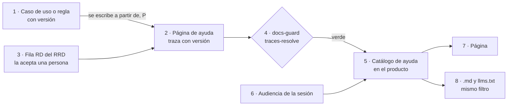

*Figura 8.1. La página sale de la especificación (1) y de una fila aceptada (3); la compuerta comprueba la traza (4) y
la regla de entrega decide qué recibe la persona (7) y su agente (8) [Compilado: TEM-05-Ayuda-Al-Usuario-Final.md,
l. 67–79].*

#### 8.2 Por escenario

| Escenario | Dónde vive la ayuda | A qué traza | Qué decide la regla de entrega |
| --- | --- | --- | --- |
| Corpus de guías (`ESC-SDEI-1`) | No aplica: su material es la guía (`CL-10`) | — | — |
| App sin roles (`ESC-SDEI-2`) | Repositorio de la interfaz; [ejemplo](Examples/MovilidadUrbana-Mini-Demo/docs/ayuda/alta-de-localidad.md) en la mini demo | Fichas `RN-LOC-nn` y la fila `RD-` | Nada: una sola ayuda |
| Panel con roles (`ESC-SDEI-3`) | Dentro del proyecto web, compilada con la app; [prueba de concepto](Examples/Prueba-Ayuda-Por-Rol/README.md) | La fila `RD-` y el caso de uso de la unidad de la pantalla | Qué páginas recibe cada rol, con la jerarquía expandida, en página, `.md` e índice |
| Servicio con paquetes (`ESC-SDEI-4`) | README del paquete y referencia del contrato (`CL-05`, `CL-13`) | La versión del paquete | Qué documento de la API recibe cada audiencia (7.4) |

*Tabla 8.2. Dónde vive la ayuda [Compilado: TEM-05-Ayuda-Al-Usuario-Final.md, l. 86–91].*

| Contexto | Qué cambia |
| --- | --- |
| Sin servidor de ayuda | La ayuda es un `.md` en el repositorio |
| Con servidor | Viaja con el binario: siempre es la de la versión desplegada. Su `.md` y `llms.txt` son parte de la ayuda, no canales derivados |
| La regla cambia en el mismo pull request | Quien propone actualiza la página y su traza; si cambia lo que se promete, decide la analista (`ACT-SDEI-2`) |
| Con SDD / sin SDD (`CTX-SDEI-2`) | Traza a `CU-` o `RN-` del registro / a fichas propias con anclas `ruta#Símbolo@SHA` y RRD en `docs/_requisitos.md` |
| La ayuda en otro repositorio (`CTX-SDEI-3`) | La traza resuelve contra `source.lock`; el carril programado avisa |

*Tabla 8.3. Qué cambia según el contexto [Compilado: TEM-05-Ayuda-Al-Usuario-Final.md, l. 95–102].*

#### 8.3 Ejemplos

##### 8.3.1 Una página real, con una divergencia declarada

La página [Dar de alta una localidad](Examples/MovilidadUrbana-Mini-Demo/docs/ayuda/alta-de-localidad.md) traza a la
fila que la pidió y a dos reglas: `traces: [RD-01, RN-LOC-01@1.1, RN-LOC-02@1.0]`. La
[ficha](Examples/MovilidadUrbana-Mini-Demo/docs/fichas/RN-LOC-01.md) de `RN-LOC-01` mide una divergencia de fondo: la
letra y la intención dicen 60 caracteres; el comportamiento admite 80. La página no la esconde ni la decide: la declara,
dice qué hacer mientras tanto («escribí 60 caracteres o menos») y deja la decisión a la analista. Sus secciones siguen
la tarea, no el código, como pide el minimalismo ([van der Meij y Carroll, 1995](#ref-vandermeij-1995))
[Compilado: TEM-05-Ayuda-Al-Usuario-Final.md, l. 175–178]. El caso completo está en el
[capítulo 13](#13-caso-de-estudio-la-mini-demo-movilidadurbana).

##### 8.3.2 La compuerta detecta la ayuda que quedó atrás

El ensayo edita el frontmatter entre corridas y lo revierte: simula que la ficha subió y la página no, y después una
traza a una regla que no existe.

```text
[Salida registrada: corrida del 2026-11-01 sobre una copia (git archive); GUIA-DIR es la carpeta del cuerpo; se omiten
8 avisos ajenos y se acorta la ruta de la página con «…»]
$ python3 -I tools/docs-guard/dg.py trazas GUIA-DIR      # traces: [RD-01, RN-LOC-01@1.0, RN-LOC-02@1.0]
GUIA-DIR/…/alta-de-localidad.md:1: ERROR traza-version-desfasada: RN-LOC-01@1.0: la declaración está en 1.1
$ python3 -I tools/docs-guard/dg.py trazas GUIA-DIR      # traces: [RD-01, RN-LOC-99@1.0, RN-LOC-02@1.0]
GUIA-DIR/…/alta-de-localidad.md:1: ERROR traza-no-resuelve: RN-LOC-99@1.0: el ID no está declarado en el registro
```

##### 8.3.3 Ayuda por rol, con un cruce que nadie había plantado

La [prueba de concepto](Examples/Prueba-Ayuda-Por-Rol/README.md), derivada de los casos de uso de Lab-Geometria en
`5f07b12`, arma el catálogo con el campo `roles`, forma previa de `delivery:`. El alumno recibe 404 donde el
administrador recibe la página, y el `llms.txt` de cada rol lista sólo lo suyo. Al validar enlaces apareció una página
común que enlazaba a una del alumno: para el administrador, ese enlace no lleva a ningún lado. Fue el único de los tres
defectos que nadie plantó. Se arregla quitando el enlace o moviendo el contenido a una página común. Hoy lo corre el
validador de la prueba, no `docs-guard` [Compilado: TEM-05-Ayuda-Al-Usuario-Final.md, l. 223–228]. El detalle está en
el [capítulo 14](#14-caso-de-estudio-ayuda-por-rol).

##### 8.3.4 Idiomas sin perder la ayuda

Si la página no está traducida, se sirve la del idioma fuente con un aviso, nunca un 404. Un control que avise la
traducción atrasada es **[criterio propio de la propuesta de ayuda por rol; no existe todavía en `docs-guard`]**. Las
dos traducciones de la prueba anclan `translation_of` a la versión del caso de uso, que es lo que hoy admite el esquema
[Compilado: TEM-05-Ayuda-Al-Usuario-Final.md, l. 242–249].

#### 8.4 Ayuda en el punto de uso: pantallas, campos, paneles y portales

La ayuda también llega a la pantalla o al campo: es el canal **punto de uso** de `CL-06`, no una clase nueva. Lo que
*docs as code* agrega a lo que la industria ya hace es que el texto del campo tenga fuente versionada, se revise por pull
request y trace a la regla que valida el campo [Compilado: TEM-05-Ayuda-Al-Usuario-Final.md, l. 251–256].

| Capa | Qué lleva | Regla |
| --- | --- | --- |
| `etiqueta` | El nombre del campo, visible y fuera de él | Nunca reemplazada por el marcador (*placeholder*) |
| `pista` | Una oración para la mayoría | Sin enlaces; nada esencial en el marcador ni en un *tooltip* |
| `info` | Lo que no entra en la pista | Se ofrece por identificador de contexto |
| `ejemplo` | Un valor válido | Ficticio |
| `validacion` | El mensaje de error bajo el campo | Dice qué pasó y cómo corregirlo |

*Tabla 8.4. Capas del microtexto [Compilado: TEM-05-Ayuda-Al-Usuario-Final.md, l. 258–268]; origen en
[GOV.UK Design System, s. f.](#ref-govuk-sf) y [Sherwin, 2014](#ref-sherwin-2014).*

**Los números salen de la regla; la letra, de una persona.** El límite se interpola desde la constante o el atributo, y
la distancia entre texto y regla desaparece por construcción. En .NET, las capas salen de `[Display(Name, Prompt, Description)]`
([Microsoft, 2026d](#ref-microsoft-displayattribute-2026)) y de las anotaciones de Blazor
([Microsoft, s. f.](#ref-microsoft-blazor-validation-sf)); en JSON Schema, de `title` y `description`
([JSON Schema, s. f.](#ref-jsonschema-annotations-sf)).

**Traza desde la ficha.** La ficha de la regla lleva tres anclas: `muestra` (la clave del recurso), `valida` (el
atributo) y `contiene` (el límite que el texto tiene que contener). Va de la ficha al texto porque el texto en archivos
de recursos todavía no se ancla: falta un resolvedor para `.resx` o JSON Schema. Un campo con regla y sin ayuda avisa.

**Identificador de contexto.** La página que amplía un campo declara `contexto: <app>/<id>`, y el mapa pantalla → página
se deriva. Es la idea de la ayuda contextual de las herramientas de autoría
([MadCap Software, 2026](#ref-madcap-flare-2026)) y del par `@appname` y `@appid` de DITA
([OASIS, 2015](#ref-oasis-dita-resourceid-2015)).

**Paneles y portales.** El resolvedor corre en el servidor, con la audiencia de la sesión. Etiqueta y error son
**iguales** para todas las audiencias; si hay variante, va en la pista o en la ayuda ampliada, resuelta en el servidor.
El portal es superficie, no fuente, y un enlace del panel al portal **no transfiere permiso**: el portal aplica su
propia regla ([Redocly, s. f.](#ref-redocly-permissions-sf)).

**Plataformas de guía en producto.** Segmentan bien, pero el contenido vive en su editor
([Pendo, s. f.](#ref-pendo-sf); [Appcues, s. f.](#ref-appcues-sf)): pierden traza, revisión y versión. Entran sólo como
canal derivado que **dirige** a la ayuda, sin números ni reglas y nunca con nivel no público. Si nadie pidió recorridos,
el proyecto dice «no se usa»: es lo que rige en este cuerpo.

**Accesibilidad.** WCAG 2.2 pide identificar el error ([W3C, s. f., a](#ref-w3c-wcag22-331)), etiquetas o instrucciones
([W3C, s. f., b](#ref-w3c-wcag22-332)) y sugerir cómo corregir ([W3C, s. f., c](#ref-w3c-wcag22-333)). La asociación con
`aria-describedby` es un agregado del cuerpo y se comprueba en las pruebas de interfaz. Medido en la prueba extendida:
`ValidationMessage` emite el mensaje sin `id` e `InputText` no emite `aria-describedby`, así que la asociación la pone
la vista [Compilado: Examples/Prueba-Ayuda-Por-Rol/Audiencias/salida.txt, l. 75–76].

**Asistente, si lo hay.** Nada obliga a tenerlo. Si existe, recupera la misma pieza con el token del usuario, cita
`ID@versión` y **sugiere, no envía** **[propuesta de la mesa del expediente 0003, rotulada como tal]**.

#### 8.5 Preguntas guía

1. ¿Qué fila `RD-` pide esta página y qué tarea logra la persona? Si no hay tarea, ¿es ayuda?
2. ¿A qué regla traza y en qué versión la leí? Si vive en otro repositorio sin `source.lock`, la compuerta sólo avisa.
3. ¿Hay una divergencia? ¿La declaro sin decidirla y digo qué hacer mientras tanto?
4. ¿Los errores llevan el mensaje que la persona ve, no el código interno?
5. Con la sesión que no corresponde, ¿la página, su `.md` y el índice no devuelven nada?
6. ¿`traces-resolve` da verde, y alguien releyó el texto? Lo muestra el diff o una línea «releída contra la versión
   nueva, sin cambios» **[criterio propio]**.
7. En el campo: ¿el número se interpola? ¿La pista cabe en una oración? ¿La ficha tiene sus tres anclas?

#### 8.6 Criterios de calidad

Los criterios citables son `CQ-01`, `CQ-03` y `CQ-09`, en el [anexo D](#d-criterios-de-calidad).

| Aspecto | Versión pobre | Versión buena |
| --- | --- | --- |
| Origen | Copia del caso de uso | Derivada, en la voz del usuario, con su fila `RD-` |
| Traza | Ninguna, o sin versión | `ID@MAYOR.MENOR`; rojo si la regla sube |
| Divergencias | Repite la pantalla aunque el producto haga otra cosa | Se declara, con qué hacer y quién decide |
| Entrega | Se oculta del menú y se entrega por URL | El servidor no la entrega; mismo filtro en todos los canales |
| Campo | El límite copiado a mano en la pista | Interpolado desde la regla, con traza desde la ficha |
| Idioma | 404 si falta la traducción | Idioma fuente con aviso |

*Tabla 8.5. Versión pobre y versión buena [Compilado: TEM-05-Ayuda-Al-Usuario-Final.md, l. 372–380].*

#### 8.7 Anexo

Las plantillas de una página de ayuda están en G.5 y G.9, en el [anexo G](#g-plantillas).

#### 8.8 Fuentes y observaciones

Fuente del cuerpo: [Tema 05](TEM-05-Ayuda-Al-Usuario-Final.md). Referencias en el [anexo B](#b-referencias).

| Tipo | Observación |
| --- | --- |
| Hecho | La salida de 8.3.2 se reprodujo el 2026-11-01; las ocho trazas de la prueba resuelven con el SDD como fuente (`--fuente`), y llevarlo a la CI es deuda del expediente de herramienta |
| Hecho | El par `aria-describedby` y los demás de 8.4 son de la prueba extendida, con contenido ficticio |
| Sin verificar | Empaquetado de satélites `.resx` en MAUI Android: no se midió |
| Decisión por defecto | PO-1 y PO-2 sin respuesta: las plataformas de guía «no se usan» y la regla del asistente queda como propuesta rotulada |
| Criterio propio | La línea «releída contra la versión nueva» y el control de traducción atrasada |
| Hecho | La propuesta completa de ayuda por rol estaba en la guía de un solo archivo, archivada con la etiqueta `sdei-v2.0.0-borrador` (P-08) |

*Tabla 8.6. Fuentes y observaciones del capítulo 8.*

#### Resumen del capítulo 8

La ayuda se deriva de la especificación y se traza con versión; si la regla sube, la compuerta da rojo. Las divergencias
se declaran. La regla de entrega cubre la página, su `.md` y el índice. En el campo van capas de vocabulario cerrado, números
interpolados, letra de una persona y traza desde la ficha; el portal aplica su propia regla.

## Parte IV. Verificar e integrar

Las partes II y III enseñaron a diseñar las piezas y a escribirlas para sus lectores. Esta parte trata de lo que las
mantiene en pie cuando el código y la especificación se mueven. El capítulo 9 explica la compuerta: qué controles
corren en cada pull request, cuáles bloquean y cuáles sólo avisan, y cómo se prueba que la compuerta misma funciona.
El capítulo 10 lleva esa compuerta a un proyecto que ya tiene un marco de desarrollo guiado por especificación, para
que la documentación trace a los identificadores que ese marco declara en lugar de inventar los suyos.

### 9. Compuertas de calidad y CI

*Forma: explicación.* Una documentación que se escribe como código se verifica como código: en cada pull request
corre un conjunto de controles que termina con un código de salida, y si alguno da rojo, el cambio no entra
[Compilado: TEM-06-Compuertas-Y-CI.md, l. 17–19].

**Objetivos.** Al terminar el capítulo podés decidir, para un control nuevo, si tiene que bloquear o sólo avisar;
leer el resultado de una corrida para saber qué arreglar; y explicar por qué un pull request que llega desde un fork
no se fusiona solo [Compilado: TEM-06-Compuertas-Y-CI.md, l. 20–21, 196–205].

**Requisitos previos.** Las definiciones de control, compuerta, compuerta de escalón, traza y carril programado de
[1.3.3](#133-traza-y-registro-de-identificadores) y [1.7](#17-verificar-en-vez-de-confiar); los escenarios y contextos de [3.2](#32-escenarios-y-composición-por-unión) y
[3.3](#33-contextos); las clases de intervención D/P/H de [1.6](#16-quién-decide-clases-dph). Para el detalle de dos
grupos de controles conviene haber leído el [capítulo 7](#7-audiencias-y-lectura-por-agentes) (anti-inyección) y el
[capítulo 8](#8-ayuda-al-usuario-final) (trazas de la ayuda).

**En tres líneas.** El carril PR corre todos los grupos de controles y un agregador estricto decide; el carril
programado sólo avisa. Un control bloquea únicamente si cumple las cinco condiciones de la regla de bloqueo. Cada
control tiene su par rojo/verde, y la compuerta se prueba a sí misma en cada corrida.

#### 9.1 Dos carriles y regla de bloqueo

Lab-Documentos tiene dos workflows para la documentación. Los controles del carril PR viven en uno solo,
reutilizable, `docs-guard`, que otros repositorios de la misma organización llaman; el carril programado es otro
workflow del mismo repositorio, `docs-enlaces-semanal`. Los controles propios están en un script de Python con
biblioteca estándar, `tools/docs-guard/dg.py` [Compilado: TEM-06-Compuertas-Y-CI.md, l. 36–39]. Las herramientas
externas son medios de un control y no tema: lychee verifica enlaces, markdownlint la estructura del Markdown y un
parser de mermaid los diagramas [Compilado: TEM-06-Compuertas-Y-CI.md, l. 84–86].

##### 9.1.1 Qué problema resuelve y qué no es

La práctica *docs as code* trata la documentación con las mismas herramientas que el código, pruebas automáticas
incluidas, y señala que se puede bloquear el merge de una función que no trae su documentación
([Write the Docs, s. f.](#ref-writethedocs-sf)). La experiencia de Google es que la documentación tiene que estar bajo
control de versiones, tener dueño claro y pasar revisión, porque la que no tiene dueño se vuelve obsoleta
([Winters et al., 2020](#ref-winters-2020)). La compuerta convierte esas intenciones en algo que se comprueba en cada
cambio [Compilado: TEM-06-Compuertas-Y-CI.md, l. 51–56].

La compuerta no es un juicio de calidad completo: automatiza lo que se puede contar (enlaces, esquema, trazas,
referencias), y la claridad se mide con una prueba de lectura y la corrección, con revisión. Tampoco es un lugar para
controles que «casi siempre» aciertan, porque uno con falsos positivos que bloquea enseña a ignorarla. Y no es un
agente: el job no tiene secretos ni invoca modelos de lenguaje [Compilado: TEM-06-Compuertas-Y-CI.md, l. 58–64].

##### 9.1.2 Definiciones del capítulo

*Control*, *compuerta* y *carril programado* se definieron en [1.7](#17-verificar-en-vez-de-confiar) y no se repiten. Un control
termina con un código de salida, 0 si está en orden y 1 si bloquea [Compilado: TEM-06-Compuertas-Y-CI.md, l. 35];
la compuerta es el carril PR entero ([Marco §1](00-Marco.md#1-definiciones)). Los términos que siguen son propios
de este capítulo.

*Tabla 9.1. Términos del capítulo 9 [Compilado: TEM-06-Compuertas-Y-CI.md, l. 41–49, 220–221].*

| Término | Definición |
| --- | --- |
| Carril PR | Los controles que corren en cada pull request y **bloquean** el merge si dan rojo. Grupos `PR-1` a `PR-7` |
| Regla de bloqueo | Las cinco condiciones que un control tiene que cumplir para bloquear; si falla una, avisa (9.1.4) |
| Par rojo/verde | Dos fixtures por control: uno con el defecto, que tiene que dar rojo, y otro sin él, que tiene que dar verde. Es la prueba negativa de la compuerta |
| Línea de base | Cantidad de hallazgos de un control sobre lo que vigila, medida antes de que empiece a bloquear |
| Guarda de merge (G1–G4) | Lo que se comprueba antes de fusionar un pull request sin intervención humana: G1 abierto con la misma cabeza, G2 sin conflictos, G3 al menos una corrida de controles y todas en éxito, G4 sin reserva. No se confunde con los grupos `PR-n` |
| Cuerpo nuevo y heredado | Un cuerpo nuevo es una carpeta cuyo `README.md` declara `corpus_id`, como el SDEI. Lo heredado son las demás guías del repositorio, escritas antes del contrato de frontmatter: ahí los mismos defectos avisan |
| Agregador estricto | Último paso del job: mira el resultado de cada grupo y da rojo si alguno falló |

##### 9.1.3 Los dos carriles

El carril PR corre todos los grupos aunque uno falle, uno detrás de otro dentro del mismo job, para que el pull
request vea todos sus defectos en una sola corrida; al final decide el agregador. El carril programado corre los
lunes, o a mano desde la pestaña de Actions, y no bloquea: abre o actualiza un único issue en Lab-Documentos, que
prioriza una persona [Compilado: TEM-06-Compuertas-Y-CI.md, l. 44, 80–82]. El runner es **efímero**: cada job
arranca de cero, salvo una caché de herramientas [Compilado: TEM-06-Compuertas-Y-CI.md, l. 85–86].

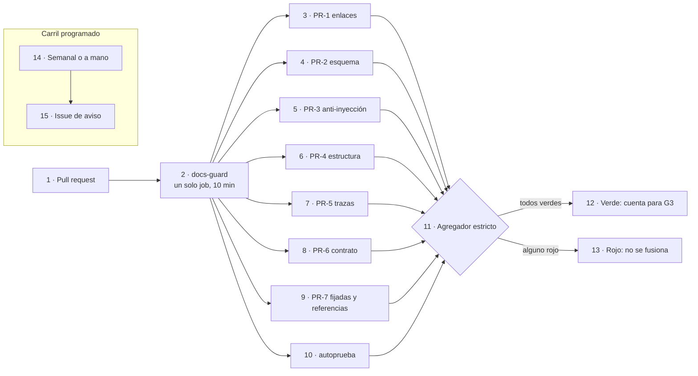

*Figura 9.1. Los dos carriles. Del 2 al 13, el carril PR: siete grupos más `autoprueba` y un agregador que decide. El
14 y el 15, el carril programado, que escribe un issue y nunca bloquea.*

*Tabla 9.2. Grupos del carril PR [Compilado: TEM-06-Compuertas-Y-CI.md, l. 88–97; tools/docs-guard/README.md,
l. 81–91].*

| Grupo | Controles | Bloquea |
| --- | --- | --- |
| `PR-1` | Enlaces internos y anclas (lychee sin red, con fragmentos); enlaces relativos que salen del repositorio | Sí |
| `PR-2` | Frontmatter contra su esquema, registro cerrado de prefijos, esquema del registro de requerimientos | Sí; un archivo sin frontmatter sólo bloquea dentro de un cuerpo nuevo |
| `PR-3` | Anti-inyección AI-1 a AI-5 (detalle en el [capítulo 7](#7-audiencias-y-lectura-por-agentes)) | Sí, salvo AI-3, que avisa en todo el cuerpo, y AI-4, que avisa sólo dentro del anexo de referencias |
| `PR-4` | Markdown estructural (sin la regla de largo de línea), mermaid que parsea y `mermaid-arroba`: una arroba seguida de un nombre con punto dentro de una etiqueta mermaid | Sí |
| `PR-5` | `traces-resolve`: cada `ID@versión` contra el registro generado de los encabezados (detalle en el [capítulo 8](#8-ayuda-al-usuario-final)) | Sí |
| `PR-6` | Diff del contrato OpenAPI, si la carpeta tiene un `contracts/openapi.json` | Sí |
| `PR-7` | Fijadas y referencias: piezas fijadas con su SHA-256; `reflint` sobre las entradas del anexo de referencias; `url-fecha`: toda URL y toda cita por dominio en un code span lleva, en su mismo párrafo o fila, la fecha de consulta o la cita enlazada al anexo | Sí; `reflint` y `url-fecha` avisan en lo heredado, y `url-fecha` también en un documento `obsoleto` |
| `avisos` | `url-fecha` sobre lo heredado y `cita-linea` (ruta del workspace sin línea) | No: avisa siempre y no entra al agregador |

`PR-6` es la única fila donde la compuerta compara contra algo que no escribió
una persona. Como `docs-guard` no compila, el contrato que emitió el código, `contracts/.generado/openapi.json`, llega
de una de dos formas: está en el árbol del pull request, porque el build lo escribió y se versionó en el mismo
cambio, o el `source.lock` de la carpeta tiene una línea `workflow:` que nombra otro workflow del repositorio, que
compila, extrae y compara. Ese otro workflow es otro check del pull request, y la guarda G3 lo exige en verde como a
`docs-guard`. Sin ninguna de las dos, `PR-6` da rojo por falta de extracción; la mini demo usa la segunda forma, con
`mini-demo-movilidad`. Cualquier operación nueva, quitada o cambiada da rojo, rompa o no la compatibilidad: un cambio
legítimo de la API actualiza el contrato versionado en el mismo pull request, y el diff queda a la vista de quien
revisa [Compilado: TEM-06-Compuertas-Y-CI.md, l. 95].

*Tabla 9.3. Controles del carril programado [Compilado: TEM-06-Compuertas-Y-CI.md, l. 99–105;
tools/docs-guard/semanal.sh, l. 11–17].*

| Control | Qué detecta |
| --- | --- |
| Enlaces con red sobre el árbol armado (los repositorios públicos de la organización, clonados juntos según una tabla versionada) | Enlaces entre repositorios y externos rotos |
| Atraso de `base_commit` y de `source.lock` | Índices o demos que quedaron atrás de la rama principal del código; un commit ya cuenta y el informe da cuántos |
| Deriva de copias fijadas | Conocimiento copiado cuya huella ya no coincide con la de su fuente |
| Frescura | `last_review` de más de 365 días |
| Línea de base de AI-3 | Cuántos avisos AI-3 quedan con las excepciones vigentes: cuándo AI-3 puede pasar a bloquear |

El carril programado mide atraso, no deriva por símbolo. Cuenta cuántos commits tiene el SHA fijado detrás de la
rama principal; si el método que una ficha cita cambió, eso lo mide A1 cuando corre la demo. A1 no está programado:
es deuda declarada, y se cierra con el pull request que lo programe o con el folio que decida no hacerlo
[Compilado: 00-Marco.md, l. 200–204]. El [capítulo 17](#173-carril-programado-aplicado-al-libro) aplica este carril
al propio libro.

##### 9.1.4 La regla de bloqueo

Un control bloquea sólo si cumple **las cinco** condiciones; si falla una, avisa
[Compilado: TEM-06-Compuertas-Y-CI.md, l. 109–117]:

1. es determinista y no usa red;
2. el defecto lo introduce el mismo pull request;
3. tiene prueba negativa (par rojo/verde);
4. su línea de base sobre lo que vigila es 0;
5. no tiene falsos positivos conocidos, o los canaliza por excepciones con huella que aprueba una persona: una línea
   `sha256 ruta control` en `tools/docs-guard/excepciones.txt`. Agregarla es de clase H, así que un agente no la
   agrega en su propio pull request.

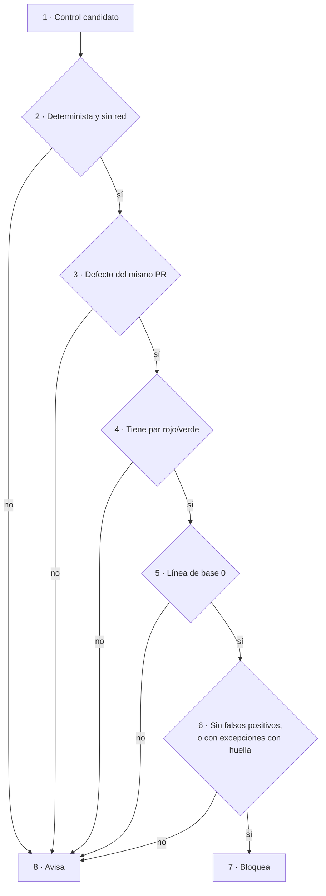

*Figura 9.2. La regla de bloqueo como árbol de decisión. Basta un «no» en cualquiera de las cinco preguntas para que
el control sólo avise.*

La regla explica cada excepción de la tabla 9.2, y conviene leerla así, condición por condición. Los enlaces externos
usan red (falla la 1): van al carril programado. La frescura no depende del pull request (falla la 2): avisa. AI-3
busca frases dirigidas al agente y tiene falsos positivos en textos que explican cómo se arma un agente; se podrían
canalizar con excepciones con huella, pero no se aprobaron todas, así que su línea de base con excepciones no es 0
(falla la 4) y avisa hasta que lo sea. AI-4 avisa en el anexo de referencias porque ahí citar dominios fuera de la
lista es su función: todo hallazgo sería un falso positivo (falla la 5). `reflint` sobre las guías viejas tiene línea
de base alta (falla la 4) y bloquea sólo en un cuerpo nuevo [Compilado: TEM-06-Compuertas-Y-CI.md, l. 139–147].

Un archivo está en un cuerpo nuevo si su carpeta, o una carpeta superior dentro del repositorio, tiene un `README.md`
con `corpus_id` en el frontmatter. Un repositorio que adopta la compuerta por primera vez mide antes su línea de
base: si da hallazgos, los sanea antes de llamar al workflow, o lo llama sólo sobre una carpeta ya limpia, con el
parámetro `ruta` [Compilado: TEM-06-Compuertas-Y-CI.md, l. 119–120, 145–147].

##### 9.1.5 Familias de controles de audiencias y ayuda

La regla de entrega y la ayuda en el punto de uso traen controles nuevos. Todos nacen **avisando**: ninguno tiene su par
corrido en `autoprueba` (falla la condición 3) y **ninguno está implementado** en `docs-guard`; la tabla fija sus
nombres. Pasan a bloquear de a uno, por el expediente de herramienta [Compilado: TEM-06-Compuertas-Y-CI.md, l. 149–174].

| Control | Qué detecta | Dónde corre | Estado |
| --- | --- | --- | --- |
| `audiencia-vocabulario` | Un valor de `delivery:` fuera del registro | `docs-guard` | Avisa |
| `delivery-clave-cercana` | `audiencias:`, `audiences:` y variantes | `docs-guard` | Avisa |
| `nivel-vs-repo` | Nivel mayor que `producto` en un repositorio público | `docs-guard` | Avisa |
| `cruce-de-audiencia` | Enlace que sube en la jerarquía expandida | `docs-guard` | Avisa |
| `indice-sin-fuga` | Página no pública en un índice público o en `llms.txt` | `docs-guard`, sobre la salida del build | Avisa |
| `paquete-sin-fuga` | Clave o página no pública en el paquete instalable | Build del producto | Avisa |
| `ampliacion-de-acceso` | Cambio que ensancha un nivel o una exposición | Guarda de merge, reserva H | Avisa |
| `contrato-por-exposicion` | Endpoint sin grupo en todos los documentos OpenAPI | Producto | Avisa |
| `contexto-resuelve` | `contexto:` sin página, o página huérfana | `docs-guard` | Avisa |
| `anclas` extendidas | Traza `muestra`, `valida` y `contiene` del microtexto | `docs-guard` y producto | Avisa |
| `traduccion-atrasada` | Traducción con versión menor que su fuente | `docs-guard` | Avisa siempre |
| `anti-inyeccion-en-recursos` | AI-1 a AI-5 sobre recursos de microtexto | `docs-guard` | Avisa |
| Pruebas de entrega pareadas | 200 con contenido al autorizado; distinto de 200 y sin contenido al otro | CI del producto | Avisa |

*Tabla 9.4. Familias de controles y su estado [Compilado: TEM-06-Compuertas-Y-CI.md, l. 156–170].*

`traduccion-atrasada` avisa siempre porque el defecto no lo introduce el pull request que cambia la fuente (falla la
condición 2).

#### 9.2 Las compuertas por escenario

El tronco es el mismo en los cuatro escenarios de [3.2](#32-escenarios-y-composición-por-unión): el carril PR con su
agregador y el carril programado. Cambia qué grupos tienen material sobre el que actuar y dónde corre la compuerta
[Compilado: TEM-06-Compuertas-Y-CI.md, l. 178–180].

*Tabla 9.5. Grupos con más peso por escenario [Compilado: TEM-06-Compuertas-Y-CI.md, l. 182–187].*

| Escenario | Grupos con más peso | Lo particular |
| --- | --- | --- |
| Corpus de guías (`ESC-SDEI-1`) | `PR-1`, `PR-2`, `PR-3`, `PR-4`, `PR-7` (`reflint`) | El cuerpo nuevo endurece la compuerta: todo archivo exige frontmatter y `reflint` bloquea |
| App sin roles (`ESC-SDEI-2`) | `PR-5`, `PR-6` | `PR-5` resuelve las trazas de nivel 1 (`ID@versión`) contra el registro. Las anclas de nivel 2 de las fichas (`ruta#Símbolo@SHA`) necesitan el código: las verifica, y bloquea, el workflow de la mini demo (`mini-demo-movilidad`), que baja el código en el SHA de `source.lock`; `docs-guard` no baja código |
| Panel con roles (`ESC-SDEI-3`) | `PR-5` contra el registro del SDD; las pruebas de acceso por rol | El cruce de rol y el «404 para el rol que no corresponde» son pruebas del producto, no de `docs-guard` |
| Servicio con paquetes (`ESC-SDEI-4`) | `PR-6`, con comparación de contratos entre líneas de versión; `PR-7` (copias fijadas) | Corre en otra organización: una copia del workflow con huella en su propio runner |

##### 9.2.1 Por contexto

*Tabla 9.6. Qué cambia en la compuerta según el contexto [Compilado: TEM-06-Compuertas-Y-CI.md, l. 189–194].*

| Contexto | Qué cambia en la compuerta |
| --- | --- |
| Con sitio (`CTX-SDEI-1`) | Se suma el build del sitio con avisos como error y la reproducibilidad de los canales derivados |
| Pieza en otro repositorio (`CTX-SDEI-3`) | El defecto ya no lo introduce el mismo pull request (falla la condición 2): el atraso se avisa en el carril programado |
| Dentro de la organización del runner (`CTX-SDEI-4`) | El repositorio llama `uses: <dueño>/Lab-Documentos/.github/workflows/docs-guard.yml@<SHA>` y pasa `ruta` (la carpeta a verificar) y `herramientas-ref`. El workflow baja los scripts de Lab-Documentos en `herramientas-ref`; por eso va el mismo SHA que en `uses:`, para que el workflow y sus scripts sean de la misma versión |
| Fuera de la organización del runner (`CTX-SDEI-4`) | Copia sólo el `.yml` (los scripts los sigue bajando de Lab-Documentos, que es público, por SHA) y anota su SHA-256 como pieza fijada; `PR-7` comprueba en ese repositorio que la copia no cambió, y el carril programado de su organización avisa si el original avanzó |

La etiqueta de runner no es parte de la compuerta: la fija el caso, por plataforma (Linux; Mac para iOS). En
Lab-Documentos es la de `.github/workflows/docs-guard.yml:60` [Compilado: 00-Marco.md, l. 150–152].

##### 9.2.2 Seguridad del runner

El runner es propio (`self-hosted`) y efímero. El workflow declara permisos de sólo lectura; no usa
`pull_request_target`, el disparador que corre con los permisos y secretos del repositorio destino aunque el código
venga de un fork; fija cada action por SHA, para que una etiqueta movida no cambie lo que corre; y tiene una guarda
`if:` que no corre pull requests que vienen de un fork [Compilado: TEM-06-Compuertas-Y-CI.md, l. 196–199].

De ahí sale una consecuencia que sorprende la primera vez. Un job salteado no es una corrida en éxito para la guarda
de merge, porque G3 exige al menos una; un cambio que llega desde un fork no se fusiona solo, y alguien con permiso lo
lleva a una rama del repositorio y abre el pull request desde ahí **[criterio propio del cuerpo]**
[Compilado: TEM-06-Compuertas-Y-CI.md, l. 199–201]. Para un merge que hace una persona, el bloqueo lo impone la
protección de rama del alojamiento, si existe, con `docs-guard` como check obligatorio (acto H); si no existe, lo
cumple la persona.

La guarda `if:` es higiene, no barrera. El archivo del workflow que corre en un pull request desde un fork viene del
propio pull request, y puede no tenerla. La barrera es de la organización: aprobación obligatoria de las corridas de
forks y un grupo de runners limitado a los repositorios elegidos, dos actos de una persona (clase H)
[Compilado: TEM-06-Compuertas-Y-CI.md, l. 201–205].

#### 9.3 Ejemplos de compuerta

La compuerta de un proyecto grande, que en la fuente abre esta sección, se cuenta en
[18.3](#183-compuertas-de-proyectos-grandes), junto con los demás casos de la industria. Acá quedan los ejemplos de
este repositorio.

##### 9.3.1 La compuerta de Lab-Documentos

`docs-guard` es un solo job con un paso por grupo. Cada paso lleva `continue-on-error: true` y un `id`; el último
paso, el agregador, mira el resultado de cada `id` y da rojo si alguno falló. El encabezado del job fija los
permisos, la concurrencia (una corrida nueva del mismo pull request cancela la anterior), la guarda contra forks, el
runner y el tiempo máximo [Compilado: TEM-06-Compuertas-Y-CI.md, l. 220–223]:

```yaml
# [Compilado: .github/workflows/docs-guard.yml en 00171bd, l. 50-61: permissions: l. 50, runs-on: l. 60,
#  timeout-minutes: l. 61; la etiqueta de runner va como parámetro, <etiqueta-de-runner>]
permissions:
  contents: read

concurrency:
  group: docs-${{ github.workflow }}-${{ github.ref }}
  cancel-in-progress: ${{ github.event_name == 'pull_request' }}

jobs:
  docs-guard:
    if: github.event_name != 'pull_request' || github.event.pull_request.head.repo.full_name == github.repository
    runs-on: <etiqueta-de-runner>
    timeout-minutes: 10
```

En local, `scripts/ci-local.sh` da los mismos pasos en el mismo orden. El script recibe el paso y la carpeta
(`scripts/ci-local.sh todo <carpeta>`, por defecto la del cuerpo SDEI) y su paso `herramientas` baja lychee,
markdownlint y el parser de mermaid con las mismas versiones y SHA-256 que la CI. Esa equivalencia es la que permite
que el paso «validar» del proceso de intervención ([capítulo 12](#12-cómo-intervenir-el-proceso-en-cinco-pasos)) use
el mismo comando que la CI: si da verde en local, da verde en el pull request
[Compilado: TEM-06-Compuertas-Y-CI.md, l. 242–246].

##### 9.3.2 Ensayo: un defecto, una línea roja

El ensayo corre la compuerta entera sobre la carpeta del cuerpo, planta un defecto (un enlace a un ancla que no
existe en el mismo tema) y vuelve a correr el grupo de enlaces. **Qué demuestra:** que un solo defecto basta para que
el grupo, y con él el agregador, dé rojo, y que la salida dice dónde está. **Precondiciones:** un árbol de
Lab-Documentos en `00171bd` y las herramientas que baja el paso `herramientas`. **Resultado:** verde sin el defecto;
código de salida 1 con él.

```text
[Salida registrada: corrida del 2026-11-01 sobre una copia de Lab-Documentos en 00171bd; recortada, sin íconos]
$ scripts/ci-local.sh todo
== agregador docs-guard
  enlaces      verde
  esquema      verde
  ai           verde
  estructura   verde
  trazas       verde
  contrato     verde
  fijadas      verde
  autoprueba   verde
== docs-guard: verde
$ scripts/ci-local.sh enlaces      # con un enlace a #9-no-existe al final de TEM-06
[ERROR] file:///…/TEM-06-Compuertas-Y-CI.md#9-no-existe | Cannot find fragment
673 Total (in 0s)  613 OK  1 Error  59 Excluded
$ echo $?
1
```

La fuente registra la misma corrida el 2026-10-27, en la rama del tema, con 543 enlaces en total y 53 excluidos
[Compilado: TEM-06-Compuertas-Y-CI.md, l. 254–270]. La diferencia de cantidades es el crecimiento del cuerpo entre
las dos fechas; el comportamiento (una línea roja, código 1) es el mismo.

El paso `autoprueba` es la prueba de la prueba: corre cada control sobre su par rojo/verde y sobre un fixture
permanente con las cinco formas de inyección, que **tiene** que dar rojo en cada corrida. Si alguna vez da verde, el
control anti-inyección dejó de funcionar, y la compuerta lo dice [Compilado: TEM-06-Compuertas-Y-CI.md, l. 273–275].

##### 9.3.3 Un control que no cumple la regla

En el cuerpo SDEI, `reflint` exige año, título en cursiva y fecha de consulta en cada referencia. Sobre las guías
viejas del repositorio, que no seguían esa norma, la línea de base no era 0. En lugar de bloquear todo el repositorio
o apagar el control, se lo hizo bloquear sólo donde la línea de base es 0 (el cuerpo nuevo) y avisar en el resto. El
carril programado mide la línea de base de AI-3 cada semana, para saber cuándo puede pasar a bloquear
[Compilado: TEM-06-Compuertas-Y-CI.md, l. 279–282].

La corrida del 2026-11-01 mostró por qué la quinta condición pide excepciones *con huella*. AI-3 dio un aviso
en `AGENTS.md:17`, el puntero para agentes de la raíz, que estaba exceptuado de AI-3 por diseño; la huella registrada en
`excepciones.txt` ya no coincidía con la del archivo, que cambió después de que se aprobara la excepción
[Salida registrada: corrida del 2026-11-01, grupo PR-3; tools/docs-guard/excepciones.txt en 00171bd]. La excepción
dejó de valer sola, que es lo que tiene que pasar: renovarla es de clase H. La huella ya se renovó y hoy da AI-3=0.

#### 9.4 Preguntas guía para diseñar un control y leer una corrida

Para **diseñar** un control nuevo [Compilado: TEM-06-Compuertas-Y-CI.md, l. 286–293]:

1. ¿El defecto que detecta lo introduce el mismo pull request, o aparece solo con el tiempo?
2. ¿Corre sin red y da siempre el mismo resultado sobre el mismo árbol?
3. ¿Cuál es su par rojo/verde? ¿Lo agregué a `autoprueba`?
4. ¿Cuántos hallazgos da hoy sobre lo que va a vigilar? Si no son 0, ¿saneo primero o lo dejo como aviso?
5. ¿Tiene falsos positivos conocidos? ¿Hay un mecanismo de excepciones con huella que apruebe una persona?
6. ¿Está en `ci-local.sh` y en el workflow, en el mismo orden?

Para **leer** una corrida [Compilado: TEM-06-Compuertas-Y-CI.md, l. 295–304]:

1. ¿Qué grupo dio rojo, en qué archivo y en qué línea? Los controles de `dg.py` escriben
   `ruta:línea: ERROR regla: detalle`; lychee da la ruta y el ancla, sin línea.
2. ¿Es un error o un aviso? Un aviso se escribe `ruta:línea: aviso regla: detalle`, se cuenta en `avisos=n` del
   resumen del grupo y no cambia su resultado: un grupo con avisos y sin errores sigue en verde. Los «excluidos» de
   lychee son enlaces externos, que el carril PR no verifica porque usan red. Los avisos del carril PR quedan en la
   salida del job y los revisa quien abre el pull request; sólo la línea de base de AI-3 llega, además, al issue
   semanal. Es un límite conocido de esta compuerta.
3. Si es de `autoprueba`, ¿qué control dejó de detectar su defecto?

#### 9.5 Criterios de calidad de una compuerta

Los criterios del [anexo D](#d-criterios-de-calidad) que la compuerta automatiza son `CQ-03`, `CQ-05`, `CQ-11`,
`CQ-13` y `CQ-14`; la [lista de verificación](#e-lista-de-verificación) dice qué ítem `VER-*` cubre cada uno
[Compilado: TEM-06-Compuertas-Y-CI.md, l. 308–310]. La tabla siguiente no los repite: concreta qué distingue una
compuerta buena de una pobre.

*Tabla 9.7. Compuerta pobre y compuerta buena [Compilado: TEM-06-Compuertas-Y-CI.md, l. 312–320].*

| Aspecto | Compuerta pobre | Compuerta buena |
| --- | --- | --- |
| Qué bloquea | Todo lo que encuentra, incluidos controles con red o con falsos positivos | Sólo lo que cumple las cinco condiciones; el resto avisa |
| Prueba de la compuerta | Ninguna: nadie sabe si un control sigue detectando | Par rojo/verde por control y un fixture permanente en rojo |
| Resultado | Se corta en el primer error | Corre todos los grupos y un agregador decide |
| Local y CI | Comandos distintos | `ci-local.sh` con los mismos pasos y el mismo orden |
| Herramientas | Versiones flotantes | Versión y SHA-256 fijos; actions fijadas por SHA |
| Seguridad | Permisos amplios, secretos en el job, corre forks | Sólo lectura, sin secretos, sin forks; la barrera real en la organización |
| Aviso | Un aviso en la salida que nadie lee | El carril programado abre o actualiza un único issue |

#### 9.6 Plantilla para dar de alta un control

La plantilla comentada para dar de alta un control nuevo, una fila por pregunta que su pull request tiene que
responder, con `url-fecha` como ejemplo trabajado, está en el [anexo G](#g-plantillas), sección G.6.

#### 9.7 Fuentes y observaciones del capítulo 9

Fuentes primarias, con fecha de consulta en el [anexo B](#b-referencias): Write the Docs (s. f.) y Winters et al.
(2020). El caso de GitLab que la fuente cita en este tema se trata en el capítulo 18.

*Tabla 9.8. Hechos, interpretaciones y criterio propio del capítulo 9.*

| Tipo | Observación |
| --- | --- |
| Hecho | El bloque del workflow se cita de `docs-guard.yml` en `00171bd`, l. 50–61; la fuente lo cita del commit `4750354`, con las mismas líneas. La etiqueta de runner va como parámetro, porque la fija el caso por plataforma |
| Hecho | El ensayo de 9.3.2 se repitió el 2026-11-01 sobre una copia de Lab-Documentos en `00171bd`: verde sin el defecto, código 1 con él (673 enlaces, 1 error) |
| Hecho | En esa corrida, AI-3 avisó en `AGENTS.md:17` porque la huella de su excepción no coincide con el archivo vigente |
| Interpretación | La diferencia de cantidades entre la corrida del 2026-10-27 y la del 2026-11-01 se debe al crecimiento del cuerpo, no a un cambio del control |
| Criterio propio | Un cambio que llega desde un fork no se fusiona solo: alguien con permiso lo lleva a una rama del repositorio y abre el pull request desde ahí (de la fuente, l. 174) |

#### 9.8 Resumen del capítulo 9

La compuerta separa dos carriles. El carril PR corre siete grupos más `autoprueba` en un solo job y un agregador
estricto decide; el carril programado usa red, mide atraso, deriva de copias fijadas y frescura, y sólo escribe un
issue. Que un control bloquee lo decide la regla de cinco condiciones, y cada excepción de la tabla de grupos se
explica por la condición que falla. La compuerta se prueba a sí misma con pares rojo/verde y un fixture permanente en
rojo; la seguridad real del runner es de la organización, no del archivo del workflow. El
[capítulo 10](#10-integración-con-un-marco-sdd) lleva esta compuerta a un proyecto con su propio marco SDD.

### 10. Integración con un marco SDD

*Forma: explicación.* Cuando un proyecto se desarrolla con un marco de **desarrollo guiado por especificación** (SDD,
*spec-driven development*), la especificación ya tiene dónde vivir, con qué identificadores y con qué reglas. Este
capítulo enseña a encajar el sistema documentador dentro de ese marco: qué piezas toma del SDD, cuáles agrega y qué
controles las mantienen de acuerdo, sin escribir dos veces lo mismo [Compilado: TEM-07-Marco-SDD.md, l. 17–20].

**Objetivos.** Al terminar podés decidir qué pertenece al SDD y qué al sistema documentador para una clase de pieza
dada; preparar la fuente del registro de IDs de un SDD que guarda versiones congeladas; y repetir el ensayo de trazas
contra un SDD real [Compilado: TEM-07-Marco-SDD.md, l. 20–22].

**Requisitos previos.** El ciclo documental y el registro de requerimientos documentales del
[capítulo 5](#5-el-ciclo-documental); la ayuda por rol del [capítulo 8](#8-ayuda-al-usuario-final); la compuerta y la
regla de bloqueo del [capítulo 9](#9-compuertas-de-calidad-y-ci); los actores de [3.4](#34-actores).

**En tres líneas.** Integrar con un SDD quiere decir trazar a sus IDs, poner el RRD junto a la especificación y
resolver las trazas contra el registro del SDD en una versión fija. Lo que el SDD ya tiene se cita; lo que declara
fuera de alcance se agrega; si dicen cosas distintas, decide una persona.

**Estado.** El sistema documentador se pone a prueba en tres escalones: el 1 es el cuerpo SDEI con su mini demo; el 2,
una piloto sobre Lab-Geometria, el primer proyecto con SDD que adopta la compuerta en su propia CI; el 3, `{servicio-privado}`. La
fuente de este capítulo queda en `borrador` hasta que el escalón 2 pase su compuerta de escalón, con la compuerta
corriendo en la CI de Lab-Geometria: sus reglas salen del diseño y de un ensayo sobre el SDD real de ese proyecto,
pero todavía no corrieron en una CI de proyecto [Compilado: TEM-07-Marco-SDD.md, l. 24–28]. Lab-Geometria, IA.SDD y
Lab-Documentos son públicos; `{servicio-privado}` es privado y se nombra por su alias [Compilado: TEM-07-Marco-SDD.md, l. 30–31].

#### 10.1 Definición de la integración con un SDD

##### 10.1.1 Qué es un marco SDD

Un **marco SDD** es un método y un conjunto de reglas donde la especificación (necesidades, casos de uso, reglas de
negocio, decisiones de arquitectura) se escribe antes que el código y es el referente contra el que se contrasta lo
que se construye. La industria todavía no fijó el término. Böckeler distingue tres grados: la especificación que
guía una tarea y se descarta (*spec-first*), la que se conserva para mantener la funcionalidad (*spec-anchored*) y la
que es la única fuente que una persona edita (*spec-as-source*); advierte que la mayoría de las herramientas sólo
cubre el primero ([Böckeler, 2025](#ref-bockeler-2025)). Thoughtworks la ubica en el anillo «evaluar» de su radar, no
en «adoptar» ([Thoughtworks, 2025](#ref-thoughtworks-2025)) [Compilado: TEM-07-Marco-SDD.md, l. 47–53]. La idea de
la especificación como fuente se presentó en [1.8](#18-la-especificación-como-fuente); acá se vuelve operativa.

##### 10.1.2 Las tres cosas que quiere decir integrar

**Integrar el sistema documentador con un marco SDD** quiere decir tres cosas, y sólo tres
[Compilado: TEM-07-Marco-SDD.md, l. 55–63]:

1. Las piezas documentales **trazan** a los identificadores que el SDD ya declara, en lugar de inventar los suyos.
2. El **registro de requerimientos documentales** (RRD) vive junto a la especificación, no en un archivo aparte.
3. La compuerta `docs-guard` **resuelve** esas trazas contra el registro de IDs del SDD tomado en una versión fija:
   un SHA, o una etiqueta, que en Git apunta a un SHA. Cuál de los dos usa cada escenario lo dice 10.2.

Lo que el SDD no cubre lo agrega el sistema documentador como clases de pieza propias, con el mismo frontmatter y la
misma compuerta.

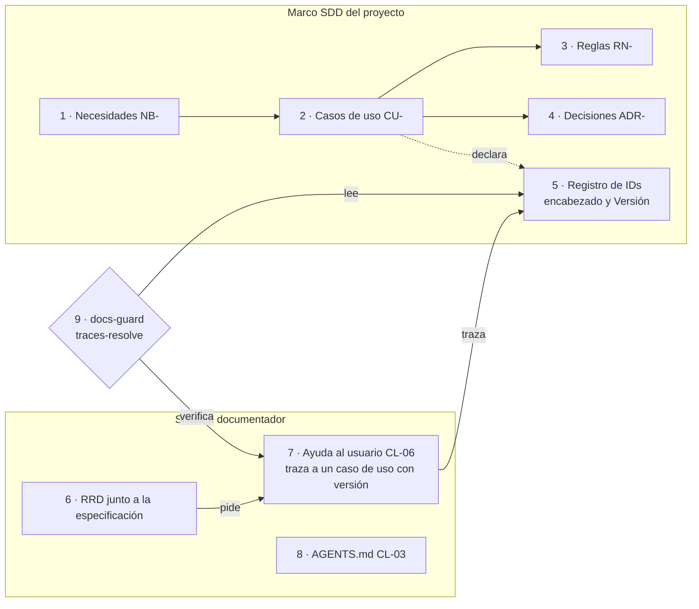

*Figura 10.1. La especificación declara los IDs (flecha punteada); el sistema documentador traza a ellos y
`docs-guard` comprueba cada traza contra el registro (flechas llenas, dependencias). Basada en la figura de la fuente
[Compilado: TEM-07-Marco-SDD.md, l. 101–122].*

##### 10.1.3 Qué problema resuelve y qué no es

Sin integración, un proyecto con SDD termina con dos fuentes que dicen lo mismo: el caso de uso en la especificación
y una página de ayuda que lo repite con otras palabras. Cuando el caso de uso cambia, la página no se entera. La
investigación sobre documentación lo mide desde hace años: las referencias desactualizadas al código son uno de los
defectos más comunes de la documentación de repositorios ([Tan et al., 2024](#ref-tan-2024)). Con la traza
`traces: [CU-08002@1.11]`, la página declara de qué versión del caso de uso depende, y la compuerta da rojo cuando
esa versión deja de existir [Compilado: TEM-07-Marco-SDD.md, l. 67–72].

*Tabla 10.1. Lo que la integración no es [Compilado: TEM-07-Marco-SDD.md, l. 76–81].*

| No es… | Por qué |
| --- | --- |
| Un reemplazo de la norma del SDD | El sistema documentador no redefine las categorías del SDD ni sus reglas: las cita. Si una regla del cuerpo choca con la del SDD, rige la del SDD dentro de su repositorio y la diferencia se declara en la hoja de integración del proyecto (campo «Norma que no se toca», 10.6) y en el pull request que la aplica |
| Un generador de especificaciones | No escribe casos de uso ni decisiones de arquitectura; documenta para audiencias que el SDD no atiende |
| Una sola herramienta | Spec Kit ([GitHub, 2026](#ref-github-2026)) y Kiro ([Kiro, s. f.](#ref-kiro-sf)) son marcos SDD con flujos de comandos; el laboratorio tiene dos marcos propios. Las reglas de este capítulo valen para cualquiera que tenga un registro de IDs estable |
| Obligatorio | Un proyecto sin SDD usa la rama «sin SDD» de `CTX-SDEI-2`: RRD en `docs/_requisitos.md` y fichas propias, como muestra la mini demo del [capítulo 13](#13-caso-de-estudio-la-mini-demo-movilidadurbana) |

##### 10.1.4 Definiciones del capítulo

*Traza* y *registro de IDs* en su forma general se definieron en
[1.3.3](#133-traza-y-registro-de-identificadores); la
especificación y el SDD, en el [capítulo 1](#18-la-especificación-como-fuente). Los términos que siguen son los que
este capítulo necesita para hablar de un SDD concreto.

*Tabla 10.2. Términos del capítulo 10 [Compilado: TEM-07-Marco-SDD.md, l. 85–99].*

| Término | Definición |
| --- | --- |
| Escalón | Etapa de prueba del sistema documentador con su propia compuerta de escalón, el hito que la cierra: 1, el cuerpo SDEI y la mini demo; 2, la piloto en Lab-Geometria; 3, `{servicio-privado}` |
| Marco SDD y proyecto destino | El marco es un repositorio con las reglas y los orquestadores (IA.SDD); el proyecto destino es el que aplica el marco y guarda su especificación generada (Lab-Geometria, en `SDD/Docs/`). Las trazas resuelven contra el proyecto destino, no contra el marco |
| Categoría (IA.SDD) | Cada una de las doce carpetas numeradas de la especificación generada: 01 necesidades, 02 especificación funcional, 05 arquitectura, 10 ejemplos, 11 documentación de entrega, entre otras |
| Unidad de entrega (IA.SDD) | Parte del producto que se construye y se entrega por separado, con su propia especificación (en Lab-Geometria, la API y el front web). Una pantalla pertenece a la unidad del front que la dibuja |
| Cuerpos de la categoría 11 | La documentación de entrega de IA.SDD se arma por rol de intervención: integrador (usa la unidad desde otro sistema), mantenedor (cambia su código), operador (la despliega y la sostiene) |
| Registro de IDs del SDD | Lista de identificadores que la especificación declara, cada uno una sola vez y con su versión. En los marcos del laboratorio, el ID abre el encabezado del documento (`# CU-08002 — …`) y la versión va en una línea `**Versión:** 1.11` |
| Versión congelada | Copia de un documento tal como estaba en una versión anterior, guardada para reconstruir la historia (en los marcos del laboratorio, carpetas `_legacy/`). Repite el ID del documento vigente |
| Decisión de arquitectura (ADR) | Registro corto de una decisión con contexto, decisión, estado y consecuencias. Se numera, no se borra, y cuando otra la reemplaza queda marcada como reemplazada ([Nygard, 2011](#ref-nygard-2011)) |
| Conocimiento compartido (`CL-11`) | Documento de una base de conocimiento común que varios proyectos copian, fijado con su SHA-256 (su **huella**) para comprobar que no cambió. Hoy el marco de referencia lo activa sólo en `ESC-SDEI-1` y `ESC-SDEI-4`; si se activa en `ESC-SDEI-3` lo decide el escalón 2 (10.2.3) |
| Lección de decisión | Registro de una decisión que un agente resolvió sin que la persona responsable tuviera que decidirla, con el nivel donde se resolvió (N1, análisis previo de un agente; N2, mesa de agentes que deliberan) o donde se elevó (N3, consulta a la persona con una sugerencia), la regla aplicada, la evidencia y el resultado. Sólo cubre lo que no es de clase H |
| Prefijo externo | Prefijo del registro cerrado del cuerpo (`CU`, `RN`, `ADR`, `NB`, `RF`…) pensado para IDs que declara el sistema que se documenta. Cómo se resuelve lo muestra la figura 10.2 |
| Orquestador | El agente o la persona que conduce las fases del SDD, despacha el trabajo y decide cuándo se pasa de una fase a la siguiente |

Las fichas `RN-LOC-nn` de la mini demo usan un prefijo externo pero se declaran en Lab-Documentos, así que resuelven
contra el registro propio [Compilado: TEM-07-Marco-SDD.md, l. 98; tools/docs-guard/README.md, l. 102–105].

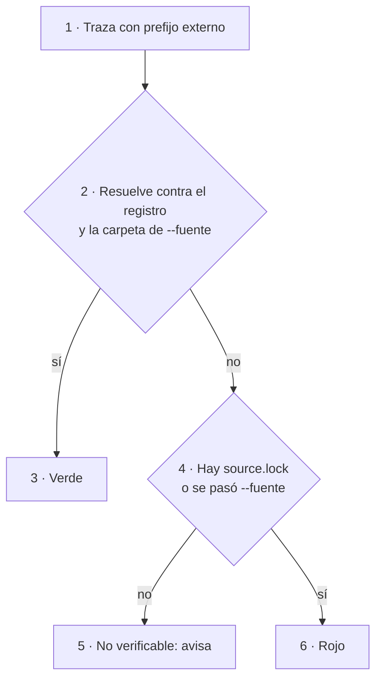

*Figura 10.2. Cómo resuelve `dg.py` una traza con prefijo externo: el registro es el del repositorio más la carpeta de
`--fuente`, y el `source.lock` se busca en la carpeta de la página o más arriba. El aviso del 5 no es un verde: dice
que la compuerta no tiene contra qué comprobar.*

#### 10.2 La integración por escenario y las lecciones de decisión

Los cuatro escenarios son los de [3.2](#32-escenarios-y-composición-por-unión). Lo que cambia entre ellos es si hay
SDD, de quién es la norma y dónde corre la compuerta [Compilado: TEM-07-Marco-SDD.md, l. 126–127].

*Tabla 10.3. La integración en cada escenario [Compilado: TEM-07-Marco-SDD.md, l. 129–134].*

| Escenario | ¿Hay SDD? | Qué toma del SDD | Qué agrega el sistema documentador | Contra qué resuelve la traza |
| --- | --- | --- | --- | --- |
| Corpus de guías (`ESC-SDEI-1`) | No | Nada | Todo el cuerpo (CL-10) y el proceso «Cómo intervenir» (CL-12). Una guía que cita un SDD de otro proyecto lo hace con un enlace permanente al SHA, no con una traza | El registro del propio repositorio (`doc_id` y encabezados) |
| App sin roles (`ESC-SDEI-2`) | No | — | RRD en `docs/_requisitos.md`, fichas provisionales `RN-LOC-nn`, ayuda, técnica y contrato | Las trazas de nivel 1 (`RN-LOC-01@1.0`), contra las fichas del propio repositorio; las anclas de nivel 2 de cada ficha (`ruta#Símbolo@SHA`), contra el código en el SHA de `source.lock` |
| Panel con roles (`ESC-SDEI-3`) | Sí: Lab-Geometria usa el marco IA.SDD | Casos de uso de cada unidad de entrega, reglas, ADR, la categoría 11 de documentación de entrega | Ayuda al usuario final por rol (CL-06): el marco la declara fuera de su alcance. RRD junto a la especificación | El SHA del proyecto (la etiqueta, cuando la hay, sólo nombra ese SHA), **sin** las versiones congeladas |
| Servicio con paquetes (`ESC-SDEI-4`) | Sí: `{servicio-privado}`, que lleva su norma y su especificación en el mismo repositorio (marco y proyecto destino a la vez) | Su registro de IDs y su vía para cambiar la norma | Contrato de los paquetes, README y CHANGELOG por línea, conocimiento compartido copiado con huella (CL-11) | La etiqueta de cada línea de versión |

##### 10.2.1 Por contexto

Tres contextos del marco de referencia cambian la respuesta dentro de un escenario con SDD
[Compilado: TEM-07-Marco-SDD.md, l. 136–142].

*Tabla 10.4. Contextos que cambian la integración.*

| Contexto | Cambia | Regla |
| --- | --- | --- |
| Con SDD (`CTX-SDEI-2`) | Dónde vive el RRD y qué prefijos usan las trazas | El RRD va con la especificación, como un archivo `doc_type: rrd` del proyecto destino; agregarlo es contenido del proyecto (clase P, por pull request), no un cambio a la norma del marco. La carpeta exacta en Lab-Geometria la fija el escalón 2. Las trazas usan `CU-`, `RN-`, `ADR-` del SDD, que son prefijos externos |
| Documentación en otro repositorio (`CTX-SDEI-3`) | El ancla | Si la página vive fuera del repositorio del SDD, la traza resuelve contra un SHA fijado y el atraso lo avisa el carril programado |
| Fuera de la organización del runner (`CTX-SDEI-4`) | De dónde sale la compuerta | `{servicio-privado}` vive en otra organización de GitHub, con su propio runner, y no puede llamar al workflow reutilizable: copia `docs-guard.yml` con su huella y lo corre en el runner de su organización |

##### 10.2.2 Una regla que no cambia y la frontera por clase

Un escenario sólo activa, quita o sustituye clases de pieza y controles; nunca agrega fases al ciclo documental del
[capítulo 5](#5-el-ciclo-documental) (1a captura y 1b evaluación de requerimientos, 2 análisis, 3 diseño,
4 implementación, 5 integración). Si un SDD tiene una fase que el ciclo no tiene, la documentación se engancha en la
fase del ciclo donde se escribe el código o el texto. El plan de sprint de IA.SDD no agrega una fase, porque la
documentación de cada incremento se actualiza en la fase 4, dentro del mismo pull request
[Compilado: TEM-07-Marco-SDD.md, l. 144–148].

La frontera entre el SDD y el sistema documentador se decide clase por clase, con una sola pregunta
**[criterio propio del cuerpo]** [Compilado: TEM-07-Marco-SDD.md, l. 150–156]. Si la clase ya existe en el SDD, el
sistema documentador la **cita**; si el SDD la declara fuera de alcance, la **agrega**; si las dos existen y dicen
cosas distintas, decide una persona (clase H). Qué persona decide lo dice la tabla de actores de [3.4](#34-actores): una
divergencia entre especificación e intención, la analista; un cambio de norma, la persona responsable del producto.
La diferencia se declara en la hoja de integración del proyecto y en el pull request.

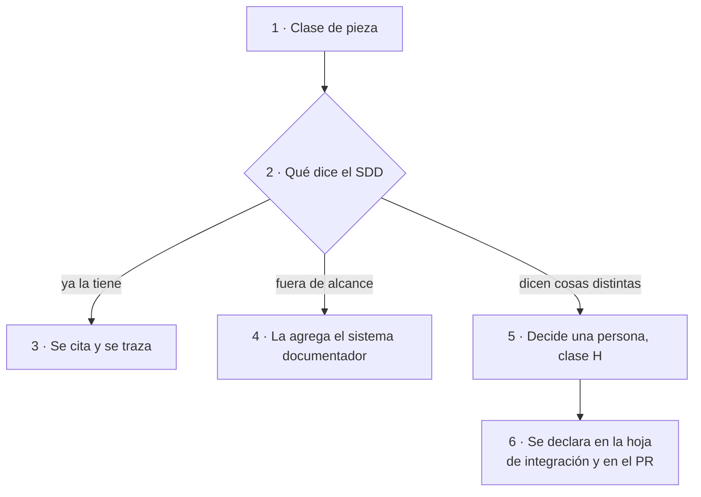

*Figura 10.3. La frontera en una línea por clase. Las ramas 3 y 4 no necesitan a nadie; la 5 siempre.*

La tabla 10.5 nombra sólo las clases donde la frontera se discute en `ESC-SDEI-3`. Las demás clases activas de ese
escenario (CL-02, CL-04, CL-05, CL-08) no tienen par en el SDD o salen del build, y el sistema documentador las trata
como en cualquier escenario.

*Tabla 10.5. La frontera en IA.SDD [Compilado: TEM-07-Marco-SDD.md, l. 158–166].*

| Clase | En IA.SDD (`ESC-SDEI-3`) | Sistema documentador |
| --- | --- | --- |
| CL-01 Especificación | Categorías 01, 02 y 05 | Cita y traza |
| CL-03 `AGENTS.md` | Lo emite la consolidación de cierre de la categoría 11 | Exige que exista y que sus enlaces resuelvan |
| CL-06 Ayuda al usuario final | Fuera de alcance («esta categoría no documenta al usuario final no técnico») | Agrega, con `traces` al caso de uso de la unidad |
| CL-07 Documentación técnica | Categoría 11, cuerpos integrador, mantenedor y operador | Cita; no reescribe esos archivos ni los pasa por la compuerta: los gobierna la norma del SDD, con su propia auditoría (10.3.2). Si el escalón 2 decide que entren a la compuerta, el frontmatter lo agrega el propio proyecto en su pull request, como contenido suyo |

La cita de la categoría 11 sale de las reglas de IA.SDD, en su tabla de fronteras: IA.SDD en `bac7e48`,
`SDD/Devs/Rules/Rules-Documentacion.md`, l. 102, consultado el 2026-10-27 [Compilado: TEM-07-Marco-SDD.md,
l. 165–166].

##### 10.2.3 Las lecciones de decisión, dentro del marco

Un SDD operado por agentes toma decisiones a cada paso: qué prefijo usar, si una divergencia es de forma o de fondo,
si un cambio necesita a la persona responsable. El diseño del sistema documentador separa esas decisiones en dos
capas **[criterio propio del diseño del sistema documentador, en borrador hasta el escalón 2]**
[Compilado: TEM-07-Marco-SDD.md, l. 170–172].

*Tabla 10.6. Las dos capas de las lecciones de decisión [Compilado: TEM-07-Marco-SDD.md, l. 180–185].*

| Capa | Qué es | Clase | Dónde |
| --- | --- | --- | --- |
| A | Un conocimiento compartido (CL-11) que registra y destila lecciones de decisión (decisión, nivel, regla, evidencia, resultado, lección). No redefine qué se puede decidir sin la persona: cita las reglas de cada marco que ya lo dicen | P | La base de conocimiento común del laboratorio, copiada con huella a la carpeta de conocimiento de cada SDD |
| B | Una línea en la norma de cada orquestador que manda a consultar la capa A antes de preguntar | H | La norma de cada SDD, por su propia vía de cambio |

La capa B cambia una norma ajena; por eso es de clase H y la decide la persona responsable de cada SDD, no el cuerpo
SDEI.

Lo que existe hoy está medido, y no coincide del todo con el diseño. En IA.SDD, en `bac7e48`, hay un conocimiento de
lógica de decisión 1.0 (`Conocimiento/Knowledge-Logica-De-Decision.md`) que registra lecciones (§3.9, con la forma de
§5.3), y dos líneas de norma mandan correrlo antes de detenerse (`SDD/Devs/Orchestrator/Master-Prompt.md`, l. 1025, y
`SDD/Devs/Rules/Mesa-Rules.md`, l. 570). Su lección registra pregunta, análisis, salida y regla: no tiene los campos
«evidencia» ni «resultado» que la tabla 10.6 pide a la capa A. En Lab-Geometria (`5f07b12`) no hay copia, sólo una
aplicación citada (`ADR-10010`, l. 8 y 61). Si esas piezas son las capas A y B de este diseño lo decide el escalón 2
[Compilado: TEM-07-Marco-SDD.md, l. 172–178; medido el 2026-11-01].

#### 10.3 Ejemplos de integración

##### 10.3.1 Resolver una traza contra el SDD real de Lab-Geometria

Una página de ayuda de Lab-Geometria traza al contrato de administración de cuentas: `traces: [CU-08002@1.11]`. El
ensayo comprueba qué hace `traces-resolve` con esa traza según qué parte del SDD se le dé como registro. **Qué
demuestra:** que la fuente del registro decide el resultado, y que un SDD con versiones congeladas hace ambigua toda
traza a un documento con historia. **Precondiciones:** un clon descartable de Lab-Documentos, red para clonar
Lab-Geometria y Python 3. **Resultado:** la tabla 10.7.

La página de ensayo vive fuera del repositorio del SDD, como la mini demo vive fuera del de MovilidadUrbana: por eso
el SDD se baja en un SHA fijado y entra por `--fuente`. La herramienta es `tools/docs-guard/dg.py`; su subcomando
`trazas` es el control `traces-resolve` del grupo PR-5. Recibe la carpeta con las páginas que se verifican, `--raiz`
(la raíz contra la que arma su propio registro) y `--fuente` (una carpeta más cuyos IDs suma al registro: acá, el SDD
del proyecto) [Compilado: TEM-07-Marco-SDD.md, l. 191–201]. El guion se corre desde la raíz de un clon descartable
de Lab-Documentos:

```bash
# [Compilado: TEM-07-Marco-SDD.md, l. 205-224; la dirección de clonado de Lab-Geometria va en la variable REPO_LG]
set -u
REPO_LG='<dirección de clonado de Lab-Geometria>'
git checkout --quiet e3841b6                                            # el dg.py con el que se corrió
E=/tmp/ensayo; rm -rf "$E"; mkdir -p "$E/geo"
git clone --quiet --filter=blob:none "$REPO_LG" "$E/clon"
git -C "$E/clon" archive 5f07b12 SDD/Docs | tar -x -C "$E/geo"          # el SDD entero, en el SHA fijado
cp -r "$E/geo" "$E/geo-vigente"
find "$E/geo-vigente" -type d -name _legacy -prune -exec rm -rf {} +    # el mismo SDD sin versiones congeladas
pagina() {  # pagina CASO TRAZA: una carpeta con una sola página de ayuda que lleva esa traza
  mkdir -p "$E/p-$1"
  printf -- '---\ndoc_id: GP-ENSAYO-%s\ndoc_type: guia-practica\ntitle: Página de ayuda de ensayo\ndescription: Página mínima que traza a un caso de uso del SDD de Lab-Geometria.\nstatus: borrador\norigin: ia-assisted\nconfidence: media\nowner: ensayo\nlast_review: 2026-10-27\naudience: [humano]\ntraces: [%s]\n---\n# Ensayo\n' "$1" "$2" > "$E/p-$1/ayuda.md"
}
caso() {    # caso CASO TRAZA FUENTE
  pagina "$1" "$2"
  python3 -I tools/docs-guard/dg.py trazas "$E/p-$1" --raiz "$E/p-$1" --fuente "$E/$3"; echo "caso $1: exit=$?"
}
caso A CU-08002@1.11 geo
caso B CU-08002@1.11 geo-vigente
caso C CU-08002@1.10 geo-vigente
caso D CU-03         geo-vigente
```

El `dg.py` es el de Lab-Documentos en «PR #19, merge `e3841b6`», equivalente de `080f158`, anterior a la reescritura
de la historia; el árbol de `tools/docs-guard` es idéntico en los dos [Compilado: TEM-07-Marco-SDD.md, l. 193–194].

*Tabla 10.7. Los cuatro casos del ensayo [Compilado: TEM-07-Marco-SDD.md, l. 227–232].*

| Caso | Traza | Registro | Resultado | Por qué |
| --- | --- | --- | --- | --- |
| A | `CU-08002@1.11` | Todo `SDD/Docs` | Rojo, `traza-ambigua` | El ID está declarado 3 veces: el vigente y dos versiones congeladas en `_legacy/` |
| B | `CU-08002@1.11` | `SDD/Docs` sin `_legacy/` | Verde | Una sola declaración, con `**Versión:** 1.11` |
| C | `CU-08002@1.10` | `SDD/Docs` sin `_legacy/` | Rojo, `traza-version-desfasada` | La página quedó atrás de la especificación: hay que revisarla |
| D | `CU-03` | `SDD/Docs` sin `_legacy/` | Rojo, `traza-no-resuelve` | `CU-03` sólo existe en versiones congeladas: el SDD renumeró sus casos de uso |

```text
[Salida registrada: ensayo del 2026-10-27, recortada a una línea por caso (TEM-07, l. 249-254); repetida el
 2026-11-01 sobre LG 5f07b12 con el dg.py de e3841b6 y con el de 00171bd: los mismos cuatro resultados]
caso A  ERROR traza-ambigua: CU-08002@1.11: declarado 3 veces    PR-5 traces-resolve: ROJO
caso B  PR-5 traces-resolve: verde (errores=0 avisos=0) trazas=1 resueltas=1
caso C  ERROR traza-version-desfasada: CU-08002@1.10: la declaración está en 1.11
caso D  ERROR traza-no-resuelve: CU-03: el ID no está declarado en el registro
```

Sobre el árbol completo, el registro tiene 829 IDs y 355 de ellos están declarados más de una vez. Sin `_legacy/`
quedan 715 IDs y 52 repetidos, ninguno con prefijo `CU`, `RN`, `ADR`, `NB` o `RF`: los repetidos son rótulos locales
de listas (`H-01`, `N-01`, `BT-01`) que una página no traza [Compilado: TEM-07-Marco-SDD.md, l. 234–236]. **La
lección del ensayo:** al integrar con un SDD que guarda versiones congeladas, la fuente del registro excluye esas
carpetas; si no, toda traza a un documento con historia da rojo por ambigüedad.

##### 10.3.2 Cómo pasa el ensayo a la CI

El ensayo corre a mano. Llevarlo a la CI tiene dos casos, y ninguno tiene todavía un workflow escrito
**[criterio propio del cuerpo; se diseña y se confirma en el escalón 2]** [Compilado: TEM-07-Marco-SDD.md,
l. 240–241].

*Tabla 10.8. Lo que falta para que la compuerta resuelva contra el SDD [Compilado: TEM-07-Marco-SDD.md,
l. 243–246].*

| Dónde vive la página | Ancla | Qué falta |
| --- | --- | --- |
| En otro repositorio que el SDD (como el ensayo) | El SHA del SDD, guardado en un `source.lock` junto a las páginas | Un paso del workflow que, como el guion, baje el SDD con `git archive`, borre `_legacy/` y pase la carpeta en `--fuente`. La mini demo ya hace lo mismo con el código de MovilidadUrbana en su propio workflow, `mini-demo-movilidad.yml` |
| En el mismo repositorio que el SDD (lo previsto para Lab-Geometria) | El commit del pull request: no hace falta `source.lock` ni `git archive` | Dos cambios a `dg.py`: una opción para excluir carpetas, porque hoy arma el registro con todo el repositorio, `_legacy/` incluido; y una forma de declarar que los prefijos externos se resuelven contra el propio repositorio |

El segundo caso es el que importa para Lab-Geometria, y conviene ver por qué no alcanza con lo que hay. Sin
`source.lock` ni `--fuente`, una traza `CU-` que no resuelve hoy sólo **avisa** (figura 10.2). Pasar el propio
`SDD/Docs` en `--fuente` tampoco sirve: `dg.py` lo leería dos veces y volvería ambiguo cada ID. Hasta que estén los
dos cambios, la compuerta no cumple en ese proyecto la promesa de 10.1.3: una traza a un documento con versiones
congeladas da ambigua, y una a un ID que desapareció sólo avisa [Compilado: TEM-07-Marco-SDD.md, l. 246].

`docs-guard` verifica las carpetas que el workflow le pasa, no el repositorio entero. En Lab-Geometria se le pasan sólo
las del sistema documentador (la ayuda, el RRD): los documentos del SDD sirven de registro, pero su frontmatter no se
controla, y un documento sin frontmatter fuera de un cuerpo nuevo sólo avisa
[Compilado: TEM-07-Marco-SDD.md, l. 256–259].

##### 10.3.3 Lo que el SDD no cubre: la ayuda al usuario final

Las reglas de documentación de IA.SDD organizan su cuerpo de entrega por rol de intervención (integrador,
mantenedor, operador) y declaran fuera de alcance al usuario final no técnico. Lab-Geometria, que usa ese marco, tiene
alumnos y docentes que usan el panel. El hueco lo cubre el sistema documentador con la ayuda por rol (CL-06,
[capítulo 8](#8-ayuda-al-usuario-final)): una página por tarea, con `traces` al caso de uso de la unidad que contiene
la pantalla [Compilado: TEM-07-Marco-SDD.md, l. 263–266].

La regla es una sola. La pantalla traza al caso de uso de su unidad, el front; si ese caso usa una operación de otra
unidad, la API, es el caso de uso del front el que cita a la API, no la página de ayuda. Cómo se sirve esa ayuda según
el rol lo muestra la prueba de concepto del [capítulo 14](#14-caso-de-estudio-ayuda-por-rol)
[Compilado: TEM-07-Marco-SDD.md, l. 266–269].

##### 10.3.4 Las fases de Spec Kit y de Kiro

Los dos marcos SDD públicos más citados separan la especificación en fases con un artefacto por fase. Kiro genera
`requirements.md` (historias y criterios de aceptación), `design.md` (arquitectura, flujos, manejo de errores) y
`tasks.md` (tareas discretas con estado) ([Kiro, s. f.](#ref-kiro-sf)). Spec Kit encadena comandos para los principios
del proyecto, la especificación, el plan técnico, las tareas, la implementación y una verificación final que se repite
hasta que converge ([GitHub, 2026](#ref-github-2026)) [Compilado: TEM-07-Marco-SDD.md, l. 273–277]. El lugar de estos
marcos entre las tendencias de la industria se trata en [18.5](#185-tendencias).

Ninguno de los dos trae un registro de IDs versionados como el de los marcos del laboratorio. Para integrarlos con
este sistema documentador, el proyecto tiene que elegir antes qué encabezado declara el ID y dónde va la versión; sin
eso, `traces-resolve` no tiene contra qué resolver. `dg.py` acepta cualquier nivel de encabezado que empiece con el
ID (`# RF-01 — …` o `### RF-01 — …`), así que un `requirements.md` con varios requisitos los declara con un
encabezado cada uno. Esa elección es de clase H y la toma la persona responsable del proyecto: es una convención del
proyecto sobre sus propios artefactos, no un cambio a la herramienta, que no trae una norma propia que respetar
[Compilado: TEM-07-Marco-SDD.md, l. 278–284].

#### 10.4 Preguntas guía para integrar con un SDD

Estas preguntas se contestan antes de escribir la primera página que trace a la especificación
[Compilado: TEM-07-Marco-SDD.md, l. 288–295]:

1. ¿El proyecto tiene un marco SDD? Si lo tiene, ¿qué encabezado declara un ID y dónde va su versión?
2. ¿El SDD guarda versiones congeladas? ¿Qué carpetas hay que excluir de la fuente del registro?
3. Para la pieza que vas a escribir, ¿el SDD ya la tiene (la citás), la declara fuera de alcance (la agregás) o dicen
   cosas distintas (decide una persona)?
4. ¿A qué caso de uso traza la página, y es el de la unidad que contiene la pantalla o el de otra?
5. ¿Dónde vive el RRD del proyecto y quién acepta cada fila?
6. ¿La compuerta corre en el runner de la organización del proyecto o hay que copiar el workflow con su huella?
7. Si el cambio toca la norma del SDD, ¿quién lo decide y por qué vía se propone?

#### 10.5 Criterios de calidad de la integración

Los criterios generales de una guía están en el [anexo D](#d-criterios-de-calidad); los de este capítulo los
concretan para la integración con un SDD [Compilado: TEM-07-Marco-SDD.md, l. 308–309].

*Tabla 10.9. Integración buena e integración pobre [Compilado: TEM-07-Marco-SDD.md, l. 299–306].*

| Criterio | Versión buena | Versión pobre |
| --- | --- | --- |
| Una sola fuente | La página traza a `CU-08002@1.11` y no repite el caso de uso | La página copia los pasos del caso de uso con otras palabras |
| Registro resoluble | La fuente del registro excluye las versiones congeladas y toda traza da verde o un rojo que se explica | La compuerta da `traza-ambigua` en cada página y alguien apaga el control |
| Frontera declarada | Cada clase de pieza dice si la cita del SDD, la agrega o la decide una persona | Hay ayuda al usuario en la categoría técnica del SDD y técnica en la ayuda |
| Norma respetada | Un cambio a la norma del SDD va por la vía de ese SDD, como clase H | El cuerpo «corrige» una regla del SDD en su propio texto |
| Ancla explícita | La traza a una pieza que cambia de contenido (un caso de uso, una regla) lleva versión (`@MAYOR.MENOR`) y la fuente está fijada a un SHA; la traza a un documento de estructura, como el marco de referencia, puede ir sin versión | La traza apunta a la rama principal del SDD y cambia sin aviso |
| Decisiones registradas | Lo que un agente resolvió sin preguntar queda como lección con regla y evidencia | La misma duda vuelve a la persona responsable en cada pull request |

#### 10.6 Hoja de integración con un SDD

La hoja de integración se completa una por proyecto, antes de la primera página que trace a la especificación. No es
un archivo aparte: es una sección más de la instancia de «Cómo intervenir» del proyecto
([capítulo 12](#12-cómo-intervenir-el-proceso-en-cinco-pasos)), y la de Lab-Documentos es
[Cómo intervenir en Lab-Documentos](Examples/Como-Intervenir-Lab-Documentos.md)
[Compilado: TEM-07-Marco-SDD.md, l. 313–316]. Sus diez campos, con la pregunta que guía cada uno, están en el
[anexo G](#g-plantillas), sección G.7.

#### 10.7 Fuentes y observaciones del capítulo 10

Fuentes primarias, con fecha de consulta en el [anexo B](#b-referencias): Böckeler (2025), GitHub (2026), Kiro
(s. f.), Nygard (2011), Tan et al. (2024) y Thoughtworks (2025). IA.SDD y Lab-Geometria se citan por SHA.

*Tabla 10.10. Hechos, interpretaciones y criterio propio del capítulo 10.*

| Tipo | Observación |
| --- | --- |
| Hecho | El ensayo de trazas se corrió el 2026-10-27 sobre Lab-Geometria en `5f07b12`, con el `dg.py` de «PR #19, merge `e3841b6`»; la fuente lo repitió el 2026-11-01 en un clon nuevo, y esta edición otra vez el mismo día, también con el `dg.py` de `00171bd`: los mismos cuatro resultados |
| Hecho | El conocimiento de lógica de decisión de IA.SDD y las dos líneas de norma que mandan correrlo se midieron en `bac7e48` el 2026-11-01 |
| Hecho | Las cifras del registro (829 IDs y 355 repetidos; 715 y 52 sin `_legacy/`) son de la fuente; esta edición no las volvió a contar |
| Interpretación | Mientras `dg.py` no excluya carpetas ni resuelva prefijos externos contra el propio repositorio, la compuerta no cumple en Lab-Geometria la promesa de 10.1.3 |
| Criterio propio | La frontera en una línea por clase: el sistema documentador cita lo que el SDD ya tiene y agrega lo que el SDD declara fuera de alcance |
| Criterio propio | Las capas A y B de las lecciones de decisión y el paso del ensayo a la CI están en borrador hasta el escalón 2 |

#### 10.8 Resumen del capítulo 10

Integrar con un SDD son tres cosas: trazar a sus IDs, poner el RRD junto a la especificación y resolver las trazas
contra su registro en una versión fija. La frontera se decide por clase y en una línea: se cita lo que el SDD ya
tiene, se agrega lo que declara fuera de alcance y decide una persona cuando dicen cosas distintas. El ensayo sobre
Lab-Geometria enseña que la fuente del registro decide el resultado: con las versiones congeladas adentro, toda traza
con historia da ambigua. Falta que la CI del proyecto haga lo que el guion hace a mano, y eso, como las lecciones de
decisión, lo resuelve el escalón 2. La parte V pasa de los temas a la práctica, empezando por el
[capítulo 11](#11-estoy-acá-qué-aplico).

## Parte V. Práctica

Las partes I a IV explican el método; esta lo pone a trabajar. Los capítulos 11 a 14 son la mitad que se usa con un
problema en la mano: dónde entrar según la situación (11), cómo hacer un cambio sin romper nada (12) y dos casos que
corren de verdad, la mini demo MovilidadUrbana (13) y la prueba de ayuda por rol (14). Los capítulos 15 a 17 completan
la parte con la decisión entre alternativas, los ejercicios y el mantenimiento.

### 11. Estoy acá: qué aplico

*Forma: referencia.* El capítulo es una tabla de entrada: no se lee de corrido, se busca la fila propia.
**Objetivos.** Al terminarlo podés ubicar tu situación por escenario, por contexto o por actor, y salir con la pieza
que tenés que producir, el control que la va a revisar, el capítulo que la explica y el anexo que necesitás.

Quien llega con un problema concreto («tengo que documentar una API», «una página de ayuda quedó desactualizada»,
«soy un agente y tengo que proponer una página») no necesita el recorrido completo para empezar. Este capítulo
traslada el Mapa del cuerpo a las secciones del libro y usa el vocabulario del [capítulo 3](#3-marco-de-referencia):
escenarios `ESC-SDEI-n`, contextos `CTX-SDEI-n` y actores `ACT-SDEI-n` [Compilado: 01-Mapa.md, l. 17–20]. El catálogo
de las catorce clases de pieza, que el Mapa también trae, está en el [capítulo 4](#4-qué-es-un-sistema-documentador),
porque es la arquitectura del sistema documentador y no una vía de entrada.

#### 11.1 Cómo se usa

Se entra por la tabla que corresponde a lo que ya se sabe, se ajusta por contexto y se sale por un anexo.

```mermaid
flowchart LR
  S["1 · Tu situación"] --> E{"2 · ¿Sabés el escenario?"}
  E -->|sí| T2["3 · Por escenario<br/>11.2"]
  E -->|no, sé la pieza| T4["4 · Catálogo de piezas<br/>cap. 4"]
  E -->|no, sé mi rol| T5["5 · Por actor<br/>11.4"]
  T2 --> C["6 · Ajuste por contexto<br/>11.3"]
  T4 --> C
  T5 --> C
  C --> A["7 · Anexo que necesitás<br/>11.5"]
```

*Figura 11.1. Tres puertas de entrada (2 a 5) que convergen en el ajuste por contexto (6) y terminan en un anexo (7).
Redibujado de [01-Mapa.md](01-Mapa.md), l. 34–44, con las secciones del libro.*

Las tablas que siguen conservan las celdas del Mapa y cambian sólo dos columnas: «Tema» pasa a «Capítulo» y «Anexo»
apunta a los anexos del libro. Si una celda de este capítulo y la del Mapa dicen cosas distintas, vale el Mapa
([P.5](#p5-relación-con-el-cuerpo)).

#### 11.2 Por escenario

| Estoy en… | Lo primero que aplico | Piezas que activo | Control que me revisa | Capítulo | Anexo |
| --- | --- | --- | --- | --- | --- |
| `ESC-SDEI-1` Corpus de guías: escribo o cambio una guía | El frontmatter de diez campos y la estructura de seis secciones por tema | CL-10 guía; CL-12 si escribo un proceso | `docs-guard` completo: esquema, enlaces, anti-inyección, mermaid, referencias | [9](#9-compuertas-de-calidad-y-ci) | [C](#c-esquema-de-frontmatter-y-prefijos), [B](#b-referencias), [E](#e-lista-de-verificación) |
| `ESC-SDEI-2` App sin roles: documento una app y su API | Fijo el SHA del código en `source.lock`; escribo las reglas como fichas y la ayuda con `traces` | CL-02, CL-05, CL-06, CL-07 | `traces-resolve` contra el SHA; diff del contrato OpenAPI | [6](#6-topología-de-repositorios-y-versionado), [8](#8-ayuda-al-usuario-final); caso resuelto en el [13](#13-caso-de-estudio-la-mini-demo-movilidadurbana) | [C](#c-esquema-de-frontmatter-y-prefijos) (trazas), [F](#f-patrones-de-ejemplos) |
| `ESC-SDEI-3` Panel con roles: agrego ayuda a una pantalla | Trazo la ayuda al caso de uso de la unidad de la pantalla; el rol decide qué se sirve | CL-01, CL-06, CL-08 | `traces-resolve`; cruce de rol en las pruebas de acceso | [8](#8-ayuda-al-usuario-final), [10](#10-integración-con-un-marco-sdd); caso resuelto en el [14](#14-caso-de-estudio-ayuda-por-rol) | [Cap. 15](#15-decidir-entre-alternativas) si el cambio supera una norma del proyecto |
| `ESC-SDEI-4` Servicio con paquetes: publico una versión | Actualizo README y CHANGELOG del paquete; reviso el contrato contra la línea anterior | CL-05, CL-11, CL-13 | Diff del contrato; copias fijadas de conocimiento verificadas por huella | [6](#6-topología-de-repositorios-y-versionado), [10](#10-integración-con-un-marco-sdd) | [A](#a-glosario-índice) (ancla de versión, copia fijada) |

*Tabla 11.1. Entrada por escenario [Compilado: 01-Mapa.md, l. 54–59]; columnas «Capítulo» y «Anexo» reapuntadas al
libro.*

«Piezas que activo» es lo que toca quien hace ese trabajo, no la lista de clases activas del escenario, que explica
la [sección 3.2](#32-escenarios-y-composición-por-unión).

#### 11.3 Por contexto

Un contexto cruza los cuatro escenarios y cambia una sola respuesta [Compilado: 00-Marco.md, l. 128]. Tres filas no son
contextos del Marco: son la situación más frecuente de quien interviene, una página que quedó atrás porque el código
cambió, partida según dónde vive la página.

| Si además… | Cambia | Aplico | Anexo |
| --- | --- | --- | --- |
| `CTX-SDEI-1` hay sitio publicado | Aparecen los canales derivados para agentes y el build del sitio entra a la compuerta | Una página `.md` por página publicada y `llms.txt` rotulado como propuesta | [A](#a-glosario-índice) (canal derivado) |
| `CTX-SDEI-1` no hay sitio | El render del repositorio es el canal; no hay build que verificar | Markdown con frontmatter y `AGENTS.md` | [C](#c-esquema-de-frontmatter-y-prefijos) |
| `CTX-SDEI-2` el proyecto tiene SDD | El registro de requerimientos documentales va con la especificación; los IDs son los del SDD | Trazas a `CU-`, `RN-` del registro del proyecto | [Cap. 16](#16-ejercicios) (`EJR-SDEI-05`) |
| `CTX-SDEI-2` el proyecto no tiene SDD | El registro va en `docs/_requisitos.md`; las reglas son fichas propias | Tabla `ID \| Audiencia \| Tarea \| Pieza \| Criterio \| Decisión` | [C](#c-esquema-de-frontmatter-y-prefijos) (registro de requerimientos) |
| `CTX-SDEI-3` la pieza vive en otro repositorio que el código | El ancla deja de ser el commit: es un SHA fijado | `source.lock` o `base_commit`. Un aviso programado cuenta cuántos commits de atraso tiene el SHA fijado frente a la rama principal; la deriva por símbolo la mide A1 cuando corre la demo. Deuda: A1 no está programado; se cierra con el PR que lo programe o con el folio que decida no hacerlo | [A](#a-glosario-índice) (ancla de versión) |
| El código cambió y una página que lo describe quedó desactualizada, en el **mismo** repositorio | Quien cambia el código sube la versión de la ficha de la regla (de 1.0 a 1.1); la página traza a `@1.0` | `traces-resolve` da rojo en ese mismo pull request hasta que la página se revisa y traza a `@1.1`. La revisa quien propone el cambio (un agente o una persona, clase P); si el cambio altera lo que la regla promete, decide la analista. Si nadie sube la versión de la ficha, hoy ningún control lo detecta: lo cubre la revisión del pull request (`CQ-03` es parcial en este punto) | [C](#c-esquema-de-frontmatter-y-prefijos) (trazas) |
| El código cambió y la página vive en **otro** repositorio (`CTX-SDEI-3`) | El pull request del código no ve la página | El carril programado avisa el atraso del SHA fijado; la deriva por símbolo la mide A1 cuando corre la demo (deuda: A1 no está programado); un agente propone actualizar la ficha y el SHA fijado; una persona decide si la regla cambió | [Cap. 16](#16-ejercicios) (`EJR-SDEI-04`) |
| El código cambió y la página desactualizada **no traza** a ninguna ficha (por ejemplo, una página técnica `CL-07` que describe la arquitectura) | Ningún control la conecta con el cambio | Se agrega la traza a la ficha o al requerimiento de los que depende, con versión, para que el próximo cambio la ponga en rojo; mientras no la tenga, la revisión del pull request del código es la única defensa | [C](#c-esquema-de-frontmatter-y-prefijos) (trazas) |
| `CTX-SDEI-4` el repositorio está fuera de la organización del runner | No puede llamar al workflow reutilizable | Copia del workflow con huella, en el runner propio | [Cap. 15](#15-decidir-entre-alternativas) |

*Tabla 11.2. Entrada por contexto y por cambio de código [Compilado: 01-Mapa.md, l. 63–73]; columna «Anexo»
reapuntada al libro.*

Las tres filas de «el código cambió» son la lección del capítulo: en el mismo repositorio el rojo llega en el mismo
pull request; en otro, sólo un aviso de atraso; sin traza, nada. La [sección 13.5](#135-cuando-el-código-cambia) mide
la segunda.

#### 11.4 Por actor

| Soy… | Lo que me toca | Lo que no me toca | Empiezo por |
| --- | --- | --- | --- |
| `ACT-SDEI-1` PO | Decidir lo de clase H; asentar por escrito la delegación del merge; pasar a vigente | Fusionar cada pull request sin reserva | [Cap. 15](#15-decidir-entre-alternativas), quién decide |
| `ACT-SDEI-2` Analista | Evaluar el registro de requerimientos; decidir divergencias entre letra e intención | Elegir herramientas | [Cap. 16](#16-ejercicios) (`EJR-SDEI-05`) |
| `ACT-SDEI-3` Desarrollo | Comentarios XML, contrato emitido, documentación técnica | La ayuda al usuario final | [Cap. 4](#4-qué-es-un-sistema-documentador), clases CL-04, CL-05 y CL-07 |
| `ACT-SDEI-4` Agente de IA | Proponer páginas, fichas y correcciones que pasen la compuerta | Lo de clase H | [C](#c-esquema-de-frontmatter-y-prefijos), [E](#e-lista-de-verificación) |
| `ACT-SDEI-5` Estudiante o docente | Recorrer la ruta «aprender»; quien enseña, además, evaluar las guías con criterios | El contenido normativo | [Cap. 3](#3-marco-de-referencia), [cap. 16](#16-ejercicios); quien enseña, [D](#d-criterios-de-calidad) |
| `ACT-SDEI-6` Persona usuaria | Leer la ayuda del producto | — | La ayuda de su producto, no este libro |

*Tabla 11.3. Entrada por actor [Compilado: 01-Mapa.md, l. 101–108]; columna «Empiezo por» reapuntada al libro. Las
responsabilidades de cada actor las define la [sección 3.4](#34-actores).*

#### 11.5 Qué anexo necesito

| Necesito… | Anexo del libro | Fuente en el cuerpo |
| --- | --- | --- |
| Escribir un frontmatter válido o elegir un prefijo de ID | [C. Esquema de frontmatter y prefijos](#c-esquema-de-frontmatter-y-prefijos) | `ANX-SDEI-ESQUEMA` |
| Saber qué significa una sigla o un término | [A. Glosario-índice](#a-glosario-índice) | `ANX-SDEI-GLOSARIO` |
| Citar una fuente o encontrar la referencia completa de una cita | [B. Referencias](#b-referencias) | `ANX-SDEI-REFERENCIAS` |
| Evaluar si una guía es buena | [D. Criterios de calidad](#d-criterios-de-calidad) | `ANX-SDEI-CQ` |
| Escribir un ejemplo o material de consulta | [F. Patrones de ejemplos](#f-patrones-de-ejemplos) | `ANX-SDEI-PE` |
| Revisar una guía antes de pasarla a vigente | [E. Lista de verificación](#e-lista-de-verificación) | `ANX-SDEI-VER` |
| Una plantilla para la pieza que tengo que producir | [G. Plantillas](#g-plantillas) | Anexos de `TEM-01` a `TEM-07`; [Como-Intervenir.md](Examples/Como-Intervenir.md) §8 |
| Elegir entre alternativas de diseño | [Capítulo 15](#15-decidir-entre-alternativas) | `ANX-SDEI-DECIDIR` |
| Comprobar que aprendí | [Capítulo 16](#16-ejercicios) y [H. Claves](#h-claves-de-los-ejercicios) | `ANX-SDEI-EJERCICIOS` |
| Saber de qué archivo y línea del cuerpo sale una sección | [I. Correspondencia](#i-correspondencia) | Colofón |

*Tabla 11.4. Lo que se busca y dónde está [Compilado: 01-Mapa.md, l. 112–121]. Las filas de plantillas y de
correspondencia son del libro: el cuerpo no tiene un anexo para cada una.*

#### 11.6 Preguntas guía

1. ¿Por qué tabla entraste y qué fila describe tu situación?
2. ¿Qué control de la compuerta va a mirar la pieza que vas a producir, y qué tendría que estar mal para que dé rojo?
3. Si la pieza no encaja en ninguna clase del catálogo, ¿quién decide abrir una nueva? [Compilado: 01-Mapa.md, l. 126–128]
4. El código cambió en otro repositorio y tu página traza a una ficha: ¿qué te avisa, cuándo, y qué no te avisa?

#### 11.7 Resumen

Tres puertas (escenario, pieza, actor), un ajuste por contexto y una salida por anexo. El capítulo no agrega reglas:
traslada las del Mapa a los capítulos del libro. La fila que más se usa es la del código que cambió, y la respuesta
depende de dónde vive la página: rojo en el mismo pull request, aviso de atraso si vive en otro repositorio, silencio
si no traza a nada.

### 12. Cómo intervenir: el proceso en cinco pasos

*Forma: guía práctica.* Una tarea, en orden, con lo que entra, lo que sale y cómo se comprueba cada paso.
**Objetivos.** Al terminarlo podés llevar un cambio de documentación desde el pedido hasta el merge sin dejar piezas
derivadas atrás, correr la compuerta en local antes de proponer, y saber quién fusiona según la clase del cambio.

La plantilla del proceso dice cómo cambiar la documentación de un proyecto sin romperla: dónde está la pieza que hay
que tocar, qué se deriva de qué, cómo se valida en local, cómo se propone y qué queda para después. Cada proyecto la
completa en **una instancia de una página** con sus rutas, su compuerta y quién decide
[Compilado: Examples/Como-Intervenir.md, l. 17–21]. Es la entrada de la ruta «intervenir»
([P.3](#p3-rutas-de-lectura)).

Cada paso trae tres bloques pensados para un agente: `entradas`, lo que necesita tener antes de empezar; `salidas`,
lo que deja hecho; y `validaciones`, cómo se comprueba que terminó bien, con un comando o una condición que da sí o
no. Una persona lee la prosa; un agente puede ejecutar los bloques [Compilado: Examples/Como-Intervenir.md,
l. 23–25]. El libro los reproduce tal como están en la plantilla.

#### 12.1 Definiciones

| Término | Definición |
| --- | --- |
| Intervención | Cualquier cambio a una pieza documental de un proyecto: agregar, corregir, mover o retirar |
| Instancia | La página de un proyecto que completa la plantilla. Traza a la plantilla y a la versión del cuerpo (`traces: [GP-SDEI-INTERVENIR, IDX-SDEI@2.0]`): si el cuerpo pasa a otra versión mayor o menor, la compuerta pide revisar la instancia |
| Pieza derivada | Pieza que sale de otra por un paso mecánico (el contrato OpenAPI del build) o que depende de otra por una traza (la ayuda que traza a una regla) |
| Reserva | Una duda declarada en el pull request que impide fusionarlo sin una persona |

*Tabla 12.1. Términos del proceso [Compilado: Examples/Como-Intervenir.md, l. 40–45]. Las clases de intervención D, P
y H las define la [sección 1.6](#16-quién-decide-clases-dph).*

#### 12.2 El proceso de un vistazo

```mermaid
flowchart LR
  U["1 · Ubicar<br/>escenario, clase, pieza"] --> D["2 · Derivar<br/>qué cambia con ella"]
  D --> V["3 · Validar<br/>ci-local.sh"]
  V -->|rojo| D
  V -->|verde| P["4 · Proponer<br/>pull request"]
  P --> H{"5 · ¿Clase H<br/>o reserva?"}
  H -->|sí| PER["6 · Decide una persona"]
  H -->|no| G["7 · Guarda de merge<br/>si hay delegación asentada"]
  PER --> M["8 · Mantener<br/>trazas, atraso, avisos"]
  G --> M
```

*Figura 12.1. Los cinco pasos (1 a 4 y 8). El rojo de la validación vuelve a derivar, no a proponer; la clase de
intervención (5) decide quién fusiona. Redibujado de [Como-Intervenir.md](Examples/Como-Intervenir.md), l. 49–60.*

#### 12.3 Paso 1: ubicar

Se busca la situación en el Mapa ([capítulo 11](#11-estoy-acá-qué-aplico)): el escenario del proyecto, la clase de
pieza (`CL-nn`) y el archivo concreto. Si la pieza no encaja en ninguna clase del catálogo, no se improvisa: se abre
una clase nueva por expediente [Compilado: Examples/Como-Intervenir.md, l. 66–79].

```yaml
entradas:
  - el pedido de cambio (issue, requerimiento documental RD-nn o hallazgo del carril programado)
  - el Mapa del cuerpo (01-Mapa.md) y la instancia de este proceso en el proyecto
salidas:
  - escenario (ESC-SDEI-n), clase de pieza (CL-nn) y clase de intervención (D, P o H)
  - ruta del archivo a tocar y su doc_id
validaciones:
  - la clase existe en el catálogo del Mapa §4
  - si la clase es H, el paso 4 va a una persona y no a la guarda de merge
```

#### 12.4 Paso 2: derivar

Se listan las piezas que dependen de la que se toca y las que la producen. Si se sube la versión de una ficha, las
páginas que trazan a la versión anterior se revisan en el mismo pull request; si la pieza sale del build, se regenera,
no se edita a mano [Compilado: Examples/Como-Intervenir.md, l. 83–97].

```yaml
entradas:
  - la pieza ubicada en el paso 1
  - el registro de IDs (doc_id y encabezados con ID) del repositorio
salidas:
  - lista de piezas que trazan a la pieza tocada (grep de su ID en los frontmatter)
  - el cambio hecho en la pieza y en cada pieza derivada
validaciones:
  - ninguna página traza a una versión que ya no existe
  - ninguna pieza de clase D se editó a mano
```

Para la ficha `RN-LOC-01` de la mini demo, `grep -rl 'RN-LOC-01@'` sobre su carpeta `docs/` devuelve cuatro
archivos: la ayuda, el registro y las dos páginas técnicas [Salida registrada: corrida del 2026-11-01 en
Lab-Documentos `00171bd`]. Son las que se releen si la ficha sube de versión.

#### 12.5 Paso 3: validar

Se corre la compuerta en local, con el mismo guion que corre la CI, desde la raíz del repositorio [Compilado:
Examples/Como-Intervenir.md, l. 101–105]:

```bash
scripts/ci-local.sh todo <carpeta-del-cuerpo-o-del-ejemplo>
```

El guion corre los siete grupos de `docs-guard` más `autoprueba` (PR-1 enlaces, PR-2 esquema, PR-3 anti-inyección,
PR-4 estructura y mermaid, PR-5 trazas, PR-6 contrato y PR-7 fijadas y referencias, con `reflint` y `url-fecha`) y
termina en verde, con código 0, o en rojo. Un grupo suelto se corre con su nombre (`scripts/ci-local.sh trazas
<carpeta>`). Si el proyecto no tiene el guion, su instancia nombra el equivalente [Compilado:
Examples/Como-Intervenir.md, l. 107–111]. Qué mira cada grupo lo explica el
[capítulo 9](#9-compuertas-de-calidad-y-ci). Bloques [Compilado: Examples/Como-Intervenir.md, l. 113–122]:

```yaml
entradas:
  - el árbol de trabajo con el cambio del paso 2
  - scripts/ci-local.sh (o el guion equivalente que nombra la instancia)
salidas:
  - la salida de scripts/ci-local.sh todo, recortada a las líneas de resumen de cada grupo
validaciones:
  - scripts/ci-local.sh todo termina con código 0
  - el agregador no muestra ningún grupo en ROJO
```

#### 12.6 Paso 4: proponer

Se abre un pull request desde una rama propia. La descripción dice qué se cambió, qué piezas derivadas se tocaron, la
salida recortada del paso 3 y, si hay, la reserva. Quién fusiona depende de la clase: D y P sin reserva los fusiona el
agente que los abrió, después de pasar la guarda, **sólo** si la persona responsable dejó asentada por escrito la
delegación del merge en el repositorio; H, o cualquier pull request con reserva, lo decide una persona [Compilado:
Examples/Como-Intervenir.md, l. 126–142].

```yaml
entradas:
  - la rama con el cambio validado
  - la delegación del merge asentada en el repositorio (si la hay)
salidas:
  - el pull request con descripción, salida del paso 3 y reservas
  - el merge (por la guarda o por la persona) o el pedido de decisión
validaciones:
  - la CI del pull request terminó en verde en la cabeza de la rama
  - el pull request está abierto, sin conflictos y sin reserva antes de fusionar por la guarda
  - quien verifica no es quien redactó
```

Que quien verifica no sea quien redactó es la regla que el [capítulo 5](#5-el-ciclo-documental) desarrolla para todo
el ciclo documental.

#### 12.7 Paso 5: mantener

Después del merge quedan dos cosas: el carril programado, que una vez por semana avisa de enlaces externos rotos,
anclas atrasadas y documentos sin revisar hace más de un año, y la próxima intervención, que vuelve al paso 1
[Compilado: Examples/Como-Intervenir.md, l. 146–158].

```yaml
entradas:
  - el merge del paso 4
  - el issue que abre o actualiza el carril programado
salidas:
  - cada aviso atendido con una intervención nueva o cerrado con su motivo
validaciones:
  - ningún documento del cuerpo tiene last_review de hace más de 365 días sin un aviso abierto
  - las anclas entre repositorios apuntan a un SHA que existe
```

#### 12.8 La instancia de Lab-Documentos

Una instancia ocupa una página y responde, con datos del proyecto, seis preguntas: escenario, dónde vive cada pieza,
guion de validación, compuerta en la CI, quién decide y excepciones [Compilado: Examples/Como-Intervenir.md,
l. 162–172]. La plantilla comentada, con la pregunta que guía cada campo, está en G.8 del
[anexo G](#g-plantillas). Así la completa Lab-Documentos:

| Campo | Lab-Documentos |
| --- | --- |
| Escenario | `ESC-SDEI-1` Corpus de guías. Clases activas por defecto: CL-02, CL-03, CL-08 a CL-13 (tabla de parámetros del Marco) |
| Dónde vive cada pieza | Guías en `Guides/` y `Concepts/`; este cuerpo en `Guides/Documentacion-Tecnica/Sistema-De-Documentacion-E-Integracion/`; ejemplos en su `Examples/`; controles en `tools/docs-guard/`; expedientes e índices en el repositorio hermano Lab-Documentos.Documentacion |
| Guion de validación | `scripts/ci-local.sh todo <carpeta>` desde la raíz del repositorio. Sin `<carpeta>`, verifica este cuerpo. Requiere bash, curl, Python 3 y Node.js |
| Compuerta en la CI | `.github/workflows/docs-guard.yml` en cada pull request, en el runner con la etiqueta de runner que fija el caso, por plataforma (Linux; Mac para iOS); en este repositorio, la de `.github/workflows/docs-guard.yml:60`; `docs-enlaces-semanal.yml` como carril programado |
| Quién decide | Hay delegación del merge asentada en el [CHANGELOG](../../../CHANGELOG.md): D y P sin reserva los fusiona el agente por la guarda. Lo de clase H (pasar a `vigente`, etiquetar, cambiar un workflow) lo decide la persona responsable del producto |
| Excepciones | Ninguna respecto de la plantilla |

*Tabla 12.2. Instancia de la plantilla para Lab-Documentos [Compilado: Examples/Como-Intervenir-Lab-Documentos.md,
l. 27–34]. La etiqueta del runner no se escribe: la fija el workflow (expediente 0003, P-11).*

Para los ejemplos de `Examples/`, el paso 3 usa la carpeta del ejemplo y suma lo suyo: `verificar.sh` y el workflow
`mini-demo-movilidad.yml` en la mini demo (capítulo 13); el devcontainer y un recorrido por rol en la ayuda por rol
(capítulo 14) [Compilado: Examples/Como-Intervenir-Lab-Documentos.md, l. 38–44].

#### 12.9 Un recorrido completo, con un cambio real

El caso que sigue es un cambio que se hizo, no uno inventado para el libro (`PE-02`, ejemplo trabajado antes del
ejercicio; [Sweller y Cooper, 1985](#ref-sweller-1985)). El tutorial de la mini demo citaba como ejemplo de rojo la
línea `RN-LOC-01.md:62: ERROR ancla-valor-distinto`, y la línea real de ese error en la ficha negativa es la 63. La
corrección entró en Lab-Documentos con el commit `b53e27a`, dentro del pull request #43 (merge `00171bd`). La tabla
reconstruye los pasos a partir del diff y de las fuentes; la clasificación de cada paso es **[criterio propio]**.

| Paso | Qué corresponde en este caso |
| --- | --- |
| 1. Ubicar | Escenario `ESC-SDEI-1`: el README de la demo es parte del cuerpo; pieza: el tutorial de la mini demo, `doc_id: DEMO-MU-00`; intervención de clase P: corrige un dato y no cambia lo que una regla promete |
| 2. Derivar | La cifra sale de la ficha negativa, que no cambia, y ninguna página traza al tutorial a nivel de línea: derivadas, ninguna. La misma cifra aparece en la historia de la ficha, que ya decía `:63`. Lo que el paso no miró fue el resto de la línea: la ruta quedó como `docs/fichas/RN-LOC-01.md`, la ficha 1.1, cuya línea 63 está en blanco |
| 3. Validar | `scripts/ci-local.sh todo` sobre el cuerpo; para el dato mismo, `verificar.sh`: su control C4 imprime el rojo esperado en `RN-LOC-01.md:63` (corrida de la sección 13.3) |
| 4. Proponer | El cambio viajó en un pull request de varios ajustes del expediente 0003; la descripción lista cada uno con su identificador (AC-25 para este) |
| 5. Mantener | Queda pendiente la ruta: `b53e27a` corrigió el número y no el archivo, y lo completa el co-cambio que viaja con el pull request de este libro (el README de la demo, l. 115; sección 13.3). Si la ficha negativa cambiara de forma, C4 exige que siga dando rojo por las mismas dos anclas |

*Tabla 12.3. Los cinco pasos aplicados a la corrección de una línea citada. Fuentes: diff de `b53e27a` sobre el
[README de la mini demo](Examples/MovilidadUrbana-Mini-Demo/README.md), l. 115; historia de la ficha [Compilado:
Examples/MovilidadUrbana-Mini-Demo/docs/fichas/RN-LOC-01.md, l. 70–74]; condición de C4 [Compilado:
Examples/MovilidadUrbana-Mini-Demo/verificar.sh, l. 119–131].*

El caso es chico a propósito: ningún control lee la prosa del tutorial, así que sólo el paso 2 («¿qué más dice esta
cifra?») evitó dos versiones distintas del mismo hecho. Y el mismo caso muestra el límite: `b53e27a` arregló el número
y dejó la ruta apuntando a `docs/fichas/` en lugar de la ficha negativa de
`tools/docs-guard/fixtures/anclas/real-rn-loc-01/`. Ni `ci-local.sh` ni C4 lo vieron, porque ninguno lee la prosa; el
verde del paso 3 no alcanza. El paso 2 tiene que preguntar por la línea entera, no sólo por la cifra que se cambia.

#### 12.10 Preguntas guía

1. Tu cambio sube la versión de una ficha: ¿qué búsqueda hacés en el paso 2 y qué tiene que dar para seguir?
2. La compuerta local da verde y la del pull request da rojo: ¿qué paso de la plantilla miente, y qué revisás primero?
3. Un cambio de clase P no tiene reserva pero el repositorio no tiene delegación asentada: ¿quién fusiona?
4. ¿Qué seis preguntas tiene que responder la instancia de tu proyecto, y cuál de ellas no podés contestar todavía?

#### 12.11 Resumen

Cinco pasos con bloques que un agente puede ejecutar: ubicar con el Mapa, derivar con una búsqueda del ID, validar con
el guion de la CI, proponer con la salida y las reservas, y mantener atendiendo los avisos. El rojo vuelve a derivar.
Quién fusiona lo decide la clase del cambio y una delegación escrita, nunca la comodidad. Cada proyecto completa la
plantilla en una instancia de una página; la de Lab-Documentos es la tabla 12.2.

### 13. Caso de estudio: la mini demo MovilidadUrbana

*Forma: tutorial.* El capítulo se hace con un clon de Lab-Documentos abierto: se corre la verificación, se recorre el
tutorial de una pantalla nueva y se lee el caso real que dio origen a la demo.
**Objetivos.** Al terminarlo podés correr la verificación de la demo e interpretar cada control, documentar una
pantalla nueva con su fila del registro, sus fichas y su página, y explicar qué pasa cuando el código del otro
repositorio cambia.

La mini demo documenta una app real, MovilidadUrbana.MAUI, del repositorio público Lab-E2E.WebBlazor, **desde otro
repositorio**: no copia el código y tiene una compuerta que da rojo cuando lo escrito deja de coincidir con lo que el
código hace. Es el ejemplo del escalón 1 del sistema documentador: audiencias sin roles, fuente generada del SHA,
ancla SHA entre repositorios con aviso de deriva y trazas de dos niveles [Compilado:
Examples/MovilidadUrbana-Mini-Demo/README.md, l. 17–20]. En el Marco es el ejemplo de `ESC-SDEI-2`, la app cliente
sin roles ([sección 3.2](#32-escenarios-y-composición-por-unión)). El límite de 60 u 80 caracteres que aparece en
13.6 es el problema conductor de todo el libro (`PE-01`; [Merrill, 2002](#ref-merrill-2002)).

#### 13.1 Qué hay y qué significa cada pieza

La demo trae su propio vocabulario, que el resto del libro reutiliza. Los términos generales (traza, ficha, atraso,
deriva) los define la Parte I y los recoge el [anexo A](#a-glosario-índice); acá van los que nacen en la demo.

| Término | Significado |
| --- | --- |
| `source.lock` | Archivo que fija el repositorio y el SHA del código que se documenta. Todo lo que la demo afirma se comprueba contra ese commit |
| Ancla | `ruta#Símbolo@SHA`: dónde se declara, se muestra, se verifica o se aplica una regla. Con una afirmación (`= 60`, `contiene …`) que la compuerta comprueba |
| Traza de nivel 1 | Página → ficha: el ID existe y la versión coincide |
| Traza de nivel 2 | Ficha → código: cada ancla resuelve en el SHA y cumple su afirmación |

*Tabla 13.1. Términos propios de la demo [Compilado: Examples/MovilidadUrbana-Mini-Demo/README.md, l. 37–42].*

| Pieza | Clase | Para quién | Qué es |
| --- | --- | --- | --- |
| `source.lock` | — | todos | Repositorio, SHA, rutas y proyecto de la API |
| `verificar.sh` | — | desarrollo, CI | Baja el código, extrae el contrato y corre los controles |
| `contracts/openapi.json` | CL-05 | desarrollo | Contrato de la API extraído en ejecución del SHA |
| `docs/_requisitos.md` | CL-02 (RRD) | analista, PO | Qué documentación hace falta y cómo se comprueba |
| `docs/fichas/RN-LOC-01.md` | CL-01 (ficha propia, sin SDD) | analista | Largo del nombre (con divergencia 60/80) |
| `docs/fichas/RN-LOC-02.md` | CL-01 (ficha propia, sin SDD) | analista | Localidad única por nombre y provincia |
| `docs/ayuda/alta-de-localidad.md` | CL-06 | persona usuaria | Cómo dar de alta una localidad |
| `docs/tecnica/arquitectura.md` | CL-07 | desarrollo | Capas y dónde vive cada regla |
| `docs/tecnica/compilar-y-primer-pedido.md` | CL-07 | desarrollo | Compilar la API, pedir el contrato, primer alta |

*Tabla 13.2. Las piezas de la carpeta `Examples/MovilidadUrbana-Mini-Demo/` [Compilado:
Examples/MovilidadUrbana-Mini-Demo/README.md, l. 51–61]. Fuera de la carpeta, en la raíz de Lab-Documentos, viven el
workflow `mini-demo-movilidad.yml` y la prueba negativa permanente `tools/docs-guard/fixtures/anclas/real-rn-loc-01/`
(l. 63–64).*

El `source.lock` es el ancla de versión del escenario: seis líneas que dicen el repositorio, el SHA completo, la rama
de comparación (`main`), las dos rutas que se bajan, el proyecto de la API y cómo se pide el contrato (`GET
/openapi/v1.json`) [Compilado: Examples/MovilidadUrbana-Mini-Demo/source.lock, l. 4–9].

#### 13.2 Cómo funciona

```mermaid
flowchart LR
  PAG["1 · Páginas de ayuda y técnica<br/>traces a RD y a fichas con versión"] -->|nivel 1| FIC["2 · Fichas RN-LOC<br/>anclas ruta, símbolo y SHA"]
  LOCK["3 · source.lock<br/>SHA 8fb4c3a"] --> SHA["5 · Lab-E2E.WebBlazor<br/>commit 8fb4c3a"]
  CON["4 · contracts/openapi.json"]
  FIC -->|nivel 2: bloquea| SHA
  CON -->|diff: bloquea| SHA
  FIC -.->|deriva: avisa| MAIN["6 · Lab-E2E.WebBlazor<br/>rama main"]
  CON -.->|deriva: avisa| MAIN
```

*Figura 13.1. Lo que vive en Lab-Documentos (1 a 4) se comprueba contra el commit fijado (5) y bloquea; contra la rama
principal (6) sólo avisa. Redibujado de [README de la mini demo](Examples/MovilidadUrbana-Mini-Demo/README.md),
l. 68–84.*

La compuerta tiene dos partes, y conviene no confundirlas: una corre en todo pull request del repositorio, la otra sólo
cuando el cambio toca la demo o los controles.

| Dónde corre | Qué comprueba | Bloquea |
| --- | --- | --- |
| `docs-guard` (cada PR) | Enlaces, frontmatter, RRD, anti-inyección, estructura, trazas de nivel 1 | Sí |
| `mini-demo-movilidad` (cada PR que toca la demo o `tools/docs-guard/`) | C1 contrato = extraído del SHA; C2 un contrato con una operación plantada da rojo; C3 trazas de nivel 1 y 2 contra el SHA; C4 la ficha RN-LOC-01 sin corregir da rojo; A1 deriva contra `main` | C1 a C4 sí; A1 sólo avisa |

*Tabla 13.3. Las dos partes de la compuerta de la demo [Compilado: Examples/MovilidadUrbana-Mini-Demo/README.md,
l. 88–91].*

C2 y C4 son controles del control: dan verde cuando el rojo esperado aparece. C2 planta una operación que el contrato
versionado no tiene y exige que el diff la vea; C4 corre la ficha 1.0, la que copió la promesa de la pantalla, y exige
rojo exactamente por las dos anclas del defecto real, no por otro hallazgo [Compilado:
Examples/MovilidadUrbana-Mini-Demo/verificar.sh, l. 112–132]. Sin ellos, un `verificar.sh` que no comprobara nada
también daría verde.

#### 13.3 Correr la verificación

Requisitos: bash, git, curl, Python 3, el SDK de .NET 10 y Node.js para `docs-guard`. Desde la raíz de
Lab-Documentos [Compilado: Examples/MovilidadUrbana-Mini-Demo/README.md, l. 95–101]:

```bash
DEMO=Guides/Documentacion-Tecnica/Sistema-De-Documentacion-E-Integracion/Examples/MovilidadUrbana-Mini-Demo
scripts/ci-local.sh todo "$DEMO"     # docs-guard sobre la demo
"$DEMO/verificar.sh"                 # contrato, anclas y deriva contra el código
```

`verificar.sh` hace tres cosas en orden. Baja con `git archive` sólo las rutas de `source.lock` del SHA fijado y de la
rama de comparación; compila la API de cada árbol, la arranca y le pide el contrato en ejecución; y corre los cinco
controles con un agregador estricto [Compilado: Examples/MovilidadUrbana-Mini-Demo/verificar.sh, l. 5–17]. La carpeta
de trabajo es `$TRABAJO`, y si no está definida, `$RUNNER_TEMP`, `$TMPDIR` o `/tmp` más `/mini-demo-movilidad` (l. 29).

Para este libro se corrió entera, en un contenedor efímero con el SDK de .NET:

```text
== fuente: https://github.com/hdcm-dev/Lab-E2E.WebBlazor.git @ 8fb4c3a8b1cc629027f456c7c3ce19e041164c06 y main
  8fb4c3a8b1cc629027f456c7c3ce19e041164c06 -> 8fb4c3a8b1cc629027f456c7c3ce19e041164c06 (103 archivos)
  main -> 59399ba6678c56c3219988a5f9666fc4e0047160 (103 archivos)
== C1 contrato: contracts/openapi.json frente al extraído de 8fb4c3a8b1cc629027f456c7c3ce19e041164c06
  ok    C1: verde (rc=0)
== C2 plantado: una operación de más tiene que dar exit 1
    <trabajo>/plantado.json:1: ERROR operacion-nueva: GET /api/v1/plantada no está en el contrato versionado
    == PR-6 contrato: ROJO (errores=1 avisos=0) operaciones=8
  ok    C2: rojo (rc=1)
== C3 trazas: traces-resolve y anclas contra 8fb4c3a8b1cc629027f456c7c3ce19e041164c06
    == PR-5 traces-resolve: verde (errores=0 avisos=0) trazas=17 resueltas=17 ids-duplicados=0 anclas=10 anclas-resueltas=10
== C4 negativa: RN-LOC-01 sin corregir (defecto real 60/80) tiene que dar rojo
    RN-LOC-01.md:62: ERROR ancla-no-contiene: LocalidadRules.NombreValido no contiene «LargoMaximoDelNombre»
    RN-LOC-01.md:63: ERROR ancla-valor-distinto: NombreEntry.MaxLength: la ficha afirma 60 y el código tiene 80
    == PR-5 traces-resolve: ROJO (errores=2 avisos=0) trazas=1 resueltas=1 ids-duplicados=0 anclas=6 anclas-resueltas=4
  ok    C4: rojo por el defecto real 60/80 (rc=1, 2 anclas)
== A1 deriva contra main (avisa, no bloquea)
  contrato: sin deriva frente a main (59399ba6678c56c3219988a5f9666fc4e0047160)
  anclas: sin deriva frente a main (59399ba6678c56c3219988a5f9666fc4e0047160)
== agregador mini demo
  C1  verde
  C2  verde
  C3  verde
  C4  verde
== mini demo: verde
== tiempo de pared: 58 s
```

[Salida registrada: corrida del 2026-11-01 de `verificar.sh` en Lab-Documentos `00171bd`, contenedor
`mcr.microsoft.com/dotnet/sdk:10.0` (SDK 10.0.403) con python3 instalado en el contenedor (3.12.3; la imagen no lo
trae y `verificar.sh` lo necesita); código de salida 0. Recorte: la salida de
compilación y extracción del contrato en los dos árboles (5 rutas, 8 operaciones, OpenAPI 3.1.1; 36 s y 7 s), el resumen de C1, la línea «ok» de C3 y el
resumen de A1; la carpeta de trabajo se escribe `<trabajo>`]

Tres números de esa salida merecen lectura. **C3 resuelve 17 trazas y 10 anclas**: las anclas son las seis de
`RN-LOC-01` y las cuatro de `RN-LOC-02`. **C4 cita las líneas 62 y 63** de la ficha negativa, las dos anclas que la
versión 1.0 afirmaba mal (13.6). **A1 no encontró deriva** frente a `main`, aunque `main` no es el SHA fijado; la
sección 13.5 explica por qué las dos cosas son ciertas a la vez.

Si un control da rojo, la línea anterior al agregador dice qué archivo y qué fila [Compilado:
Examples/MovilidadUrbana-Mini-Demo/README.md, l. 114]. El ejemplo es el de C4 en la salida de arriba: `RN-LOC-01.md:63`
es la fila «aplica» de la ficha negativa, en `tools/docs-guard/fixtures/anclas/real-rn-loc-01/`, no de la ficha 1.1
de `docs/fichas/`.

#### 13.4 Tutorial: documentar una pantalla nueva

El ejemplo trabajado es la pantalla **Encuesta**, para la persona usuaria; los pasos valen para cualquier pantalla
[Compilado: Examples/MovilidadUrbana-Mini-Demo/README.md, l. 119–120]. Vas a producir cuatro cosas, en este orden:
una fila del registro, una ficha por regla, la página y el cambio propuesto. Es el proceso del
[capítulo 12](#12-cómo-intervenir-el-proceso-en-cinco-pasos) aplicado a una pantalla.

##### 13.4.1 Agregar la fila al registro

En `docs/_requisitos.md`, una fila nueva con el número siguiente y las mismas ocho columnas de la tabla: `ID`,
`Audiencia`, `Tarea`, `Pieza`, `Fuente`, `Criterio`, `Decisión` y `Decide y fecha`. La compuerta exige seis (`ID`,
`Audiencia`, `Tarea`, `Pieza`, `Criterio`, `Decisión`); las otras dos se completan igual [Compilado:
Examples/MovilidadUrbana-Mini-Demo/README.md, l. 124–126]. Las reglas de cada celda están en la fuente (l. 128–135); la
que más se equivoca es la de **Decisión**: quien escribe no decide, así que una fila nueva va como `pendiente`, con
quién la va a decidir y sin fecha.

```text
| RD-05 | persona usuaria | Completar el paso 1 de la encuesta | CL-06, [`docs/ayuda/encuesta.md`](ayuda/encuesta.md) | `RN-ENC-01@1.0`, `RN-ENC-02@1.0`, … (una por regla) | Dado el paso 1 de la encuesta, cuando la persona lee la ayuda, entonces cada número coincide con el de la ficha; instrumento: `traces-resolve` | pendiente | PO, pendiente |
```

[Compilado: Examples/MovilidadUrbana-Mini-Demo/README.md, l. 138]

##### 13.4.2 Escribir una ficha por regla

**Cada regla de la pantalla lleva su ficha** en `docs/fichas/`, tenga número o no: un mínimo, un rango, un formato, una
unicidad, que un campo sea obligatorio o que su valor tenga que salir de una lista. Las restricciones sobre un mismo
campo van en una sola ficha, aunque cada una se compruebe por un camino distinto: los caminos son filas de la tabla de
anclas. Los textos de navegación («Paso 1 de 3», títulos, botones) no son reglas [Compilado:
Examples/MovilidadUrbana-Mini-Demo/README.md, l. 143–151]. El modelo para copiar es `RN-LOC-02.md`: frontmatter con
`doc_type: ficha` y `traces: [RD-04]`, encabezado `# RN-XXX-nn — Nombre`, la línea `**Versión:** 1.0`, la tabla de la
ficha y la tabla de anclas (l. 155–158).

La ficha tiene catorce campos, en este orden: Id, Enunciado atómico, Ancla, Letra, Intención, ¿Divergen?, Especie,
Momento, Quién la verifica hoy, Dueño, Depende de, Grado de certeza, Prueba y Propuesta. Cinco de ellos tienen valores
cerrados, y la fuente los define uno por uno: no los resumas, copiá la tabla [Compilado:
Examples/MovilidadUrbana-Mini-Demo/README.md, l. 164–189]. La distinción que más pesa es la de **¿Divergen?**:

| Valor | Cuándo |
| --- | --- |
| Leve | La letra y el código difieren en algo que no cambia qué se acepta, qué se rechaza ni qué se guarda |
| De fondo | La letra promete algo que cambia alguna de esas tres cosas, como el 60/80 |
| Silencio | La letra no promete nada sobre algo que el código hace: no hay divergencia; va como dato debajo de la tabla |

*Tabla 13.4. Los valores de «¿Divergen?», recortados de la tabla de valores cerrados [Compilado:
Examples/MovilidadUrbana-Mini-Demo/README.md, l. 185]; los ejemplos completos de cada valor están en la fuente.*

La tabla de anclas lleva el encabezado `| Rol | Ancla | Afirma |`. El símbolo se escribe `Clase.Miembro` en un `.cs` y
`Elemento.Atributo` en un `.xaml`, con el elemento nombrado por `x:Name` o por `AutomationId`; la columna **Afirma**
lleva `` = `16` ``, `` contiene `texto` `` o `` no contiene `texto` `` [Compilado:
Examples/MovilidadUrbana-Mini-Demo/README.md, l. 195–204]. Un mensaje que el código arma con valores se ancla con
`contiene` y el texto copiado tal como está en el código, llaves incluidas; los números, aparte, con `=` sobre sus
constantes (l. 206–213).

Escribí en la ficha lo que **el código hace**. Si diverge de lo que la pantalla promete, marcá «¿Divergen?» como «De
fondo» y dejá la decisión en la propuesta: no la decidas vos [Compilado: Examples/MovilidadUrbana-Mini-Demo/README.md,
l. 215–217]. Para buscar un símbolo, el código del SHA ya está en `$TRABAJO/sha/` después de `verificar.sh fuente`.

##### 13.4.3 Escribir la página

La página va en `docs/ayuda/encuesta.md` con el frontmatter de diez campos más `description`; el ejemplo del tutorial,
con un comentario por campo, está en la fuente (l. 225–239) y el contrato completo, en el
[anexo C](#c-esquema-de-frontmatter-y-prefijos). Lo que cambia respecto de una página cualquiera es la última línea:

```yaml
traces: [RD-05, RN-ENC-01@1.0, RN-ENC-02@1.0]
```

[Compilado: Examples/MovilidadUrbana-Mini-Demo/README.md, l. 237]

El cuerpo sigue a `alta-de-localidad.md`: un solo título, índice, qué se carga, pasos, qué pide cada campo y qué hacer
cuando la app no acepta un dato. La ayuda trata de vos, aunque la app trate de usted (l. 241–244). Tres decisiones de
contenido tienen regla propia (l. 246–258): la ficha lleva cada regla que la página explica, no los datos de ejemplo;
la página cuenta una divergencia leve sólo si la persona la va a notar, y toda divergencia de fondo que pueda notar;
y nombra los límites que el código aplica, aunque la pantalla no los prometa, y las dos cosas si se contradicen.

La página real aplica la tercera: dice que la pantalla promete 60 y el campo deja 80, y le da a la persona una
conducta segura mientras no se decide, «escribí 60 caracteres o menos» [Compilado:
Examples/MovilidadUrbana-Mini-Demo/docs/ayuda/alta-de-localidad.md, l. 55–58]. El
[capítulo 8](#8-ayuda-al-usuario-final) la analiza como página de ayuda.

##### 13.4.4 Validar

Los dos guiones de 13.3 tienen que terminar en verde. El final de `ci-local.sh`, si todo está bien, nombra los ocho
grupos (siete más `autoprueba`) y el veredicto `== docs-guard: verde` [Compilado:
Examples/MovilidadUrbana-Mini-Demo/README.md, l. 269–280]. Para revisar sólo trazas y anclas, sin compilar ni tener
.NET, con el código ya bajado, alcanza `python3 -I tools/docs-guard/dg.py trazas --fuente "$TRABAJO/sha" "$DEMO"`
(l. 287).

| Mensaje | Causa | Arreglo |
| --- | --- | --- |
| `traza-no-resuelve: RD-05` | La fila no está en el RRD o el ID está mal escrito | Agregar la fila (13.4.1) |
| `traza-version-desfasada` | La página traza `@1.0` y la ficha está en otra versión | Releer la página contra la ficha y actualizar la traza |
| `ancla-sin-simbolo` | El símbolo no existe en el SHA, o es una forma que la compuerta no entiende | Buscarlo en `$TRABAJO/sha/`; revisar mayúsculas y la clase |
| `ancla-valor-distinto` | El código tiene otro valor que el que afirma la ficha | Escribir lo que el código hace (13.4.2) |
| `prefijo` | El `doc_id` no usa un prefijo registrado | Usar `DEMO-MU-nn` |
| `rrd-criterio` | Falta Dado, Cuando o Entonces en el criterio | Reescribir el criterio |

*Tabla 13.5. Errores frecuentes y su arreglo (`PE-05`, error previsto y recuperación) [Compilado:
Examples/MovilidadUrbana-Mini-Demo/README.md, l. 292–299]; las remisiones apuntan a las subsecciones del libro.*

##### 13.4.5 Proponer el cambio

Además de las piezas nuevas, el mismo cambio toca tres lugares: la tabla de piezas del README de la demo suma una fila
por pieza; la tabla «Dónde vive cada regla» de `arquitectura.md` suma una fila por regla, y su `traces` y la columna
Fuente de RD-03 suman las fichas nuevas con su versión; el `CHANGELOG.md` de Lab-Documentos suma una entrada propia
arriba de todo, nunca agregada a la de otro cambio [Compilado: Examples/MovilidadUrbana-Mini-Demo/README.md,
l. 303–314]. Agregar una fuente a una fila ya decidida no la reabre; cambiar su tarea o su criterio sí: vuelve a
`pendiente` (l. 310–311). Después, una rama `demo-mu/<pantalla>`, un commit que diga qué pantalla se documentó y un
pull request contra `main` (l. 326–334).

En el pull request corren `docs-guard` y `mini-demo-movilidad` en el runner con la etiqueta de runner que fija el caso;
se fusiona sólo con los dos en verde. El cuerpo lleva qué pantalla se documentó, las piezas nuevas y cambiadas, las
divergencias que quedan para decidir con su ficha, los supuestos y el final de las dos salidas (l. 337–340). Lo que
**no** se toca: `verificar.sh`, el workflow y `source.lock`, porque C3 lee todas las fichas sin configurar nada; el
`traces` del README de la demo; y el `last_review` de los archivos que no se releyeron (l. 342–345).

##### 13.4.6 Cuando el tutorial no cubre un caso

Ningún tutorial cubre todos los casos de una pantalla real, y la clasificación fina de una regla está fuera de su
alcance. Ante un caso que el tutorial no prevé: se resuelve por analogía con la pieza modelo más parecida; si el caso
es sobre lo que el código hace y la letra promete, se escribe lo que el código hace y no se decide la divergencia; y se
anota en el pull request, en una sección «Supuestos», con el caso, lo que se eligió y por qué. Quien revisa decide si
el supuesto queda o si el tutorial suma la respuesta [Compilado: Examples/MovilidadUrbana-Mini-Demo/README.md,
l. 349–356].

La sección «Supuestos» vuelve aprendible el tutorial: cada caso sin resolver queda escrito donde el próximo lo
encuentra. **[criterio propio]**

#### 13.5 Cuando el código cambia

Mientras `source.lock` no cambie, nada de lo que pase en el otro repositorio pone la demo en rojo: sólo aparece el
aviso de deriva (A1) en el registro de la corrida [Compilado: Examples/MovilidadUrbana-Mini-Demo/README.md,
l. 360–361]. Para actualizar la demo a un código nuevo:

1. Cambiar `sha:` en `source.lock`.
2. Correr `verificar.sh`. Las anclas que ya no se cumplen dan rojo y dicen cuál.
3. Corregir cada ficha y subir su versión (`1.1` → `1.2`); `traces-resolve` marca entonces las páginas con traza
   desfasada, que se releen y se actualizan.
4. Si C1 da rojo, revisar el diff y reemplazar `contracts/openapi.json` por el extraído (queda en
   `$TRABAJO/sha/openapi.json`).

Todo eso va en un mismo pull request [Compilado: Examples/MovilidadUrbana-Mini-Demo/README.md, l. 363–370].

La corrida de 13.3 sirve para separar dos medidas que el libro distingue: **atraso** y **deriva**. El SHA fijado
(`8fb4c3a`, del 2026-09-18) está **2 commits** detrás de `main` (`59399ba`, del 2026-10-27), y esos dos commits no
tocan ninguna de las dos rutas que fija `source.lock`; por eso A1 dio «sin deriva» en el contrato y en las diez anclas.
Atraso distinto de cero y deriva cero a la vez no es una contradicción: el atraso cuenta commits; la deriva compara lo
que la pieza afirma con lo que el código hace [Salida registrada: corrida del 2026-11-01 sobre un clon parcial de
Lab-E2E.WebBlazor; `git rev-list --count 8fb4c3a..origin/main` da 2 y `git diff --stat` en las dos rutas, vacío].

El aviso de A1 corre hoy sólo cuando corre la demo, en un pull request que la toca: A1 no está programado y esa
deuda está declarada en el cuerpo, con su evento de cierre [Compilado: 01-Mapa.md, l. 69]. El
[capítulo 17](#17-mantener-el-libro-el-cuerpo-y-el-conocimiento) la retoma para el libro.

#### 13.6 El caso real: RN-LOC-01 y el 60/80

Al derivar la ayuda desde el código apareció un defecto: la pantalla promete «Entre 3 y 60 caracteres», el campo deja
escribir 80 y la app guarda nombres de más de 60. La primera versión de la ficha (1.0) copió la promesa de la pantalla
y la compuerta dio rojo en dos anclas. La 1.1 dice lo que el código hace y deja la decisión a una persona: elegir entre
60 y 80 es una divergencia entre letra e intención, y no se resuelve documentando [Compilado:
Examples/MovilidadUrbana-Mini-Demo/README.md, l. 374–377].

La ficha 1.1 hace visible cada lugar donde vive la regla. Seis anclas, y cada una afirma algo comprobable:

| Rol | Ancla (en `8fb4c3a`) | Afirma |
| --- | --- | --- |
| declara | `LocalidadRules.LargoMaximoDelNombre` | = `60` |
| declara | `LocalidadRules.LargoMinimoDelNombre` | = `3` |
| muestra | `LocalidadPolicy.RequisitoDelNombre` | contiene `LargoMaximoDelNombre` |
| verifica | `LocalidadRules.NombreValido` | no contiene `LargoMaximoDelNombre` |
| aplica | `NombreEntry.MaxLength` (en `LocalidadEditorPage.xaml`) | = `80` |
| persiste | `AppDbContext.OnModelCreating` | contiene `l.Nombre).HasMaxLength(60)` |

*Tabla 13.6. Las anclas de la ficha 1.1, con el símbolo sin la ruta [Compilado:
Examples/MovilidadUrbana-Mini-Demo/docs/fichas/RN-LOC-01.md, l. 55–62].*

Leída de arriba abajo, la tabla cuenta el defecto sin prosa: el dominio declara 60, la pantalla lo muestra, el servicio
**no** lo verifica (sólo mira el mínimo), el campo aplica 80 y la base declara 60, que SQLite no aplica [Compilado:
Examples/MovilidadUrbana-Mini-Demo/docs/fichas/RN-LOC-01.md, l. 39]. La versión 1.0 afirmaba lo contrario en las filas
«verifica» y «aplica», y esas son exactamente las dos líneas rojas que C4 sigue exigiendo en cada corrida (13.3).

La regla que sale del caso, tal como la escribe la demo: **lo que la ayuda afirma se verifica contra el
comportamiento; si diverge, se documenta lo que hace y se avisa**. La ayuda lo dice en lenguaje llano (13.4.3) y la
ficha 1.0 se conserva como prueba negativa permanente [Compilado: Examples/MovilidadUrbana-Mini-Demo/README.md,
l. 379–382]. La propuesta de la ficha, que compare también el máximo y que el campo use 60, es para el dueño del código
y la decide una persona (`ACT-SDEI-2`, [sección 3.4](#34-actores)) [Compilado:
Examples/MovilidadUrbana-Mini-Demo/docs/fichas/RN-LOC-01.md, l. 47].

#### 13.7 Límites de la demo

| Límite | Por qué |
| --- | --- |
| No hay roles ni confidencialidad | La app móvil no tiene roles; la ayuda por rol se demostró aparte ([capítulo 14](#14-caso-de-estudio-ayuda-por-rol)) |
| Los IDs `RN-LOC-nn` son provisionales | MovilidadUrbana no tiene registro de reglas; los asigna la demo |
| Las páginas no se publican en un sitio | Se leen como `.md` en el repositorio |
| No se modifica el código | Si el repositorio del código abre un expediente que lo autorice, la documentación pasa a vivir junto al código |
| La clasificación fina de una regla queda fuera de alcance | El tutorial resume el método de deducción de reglas y no lo enseña; los casos de borde se resuelven por 13.4.6 y quedan como supuestos |
| Las fichas anclan sólo la app móvil | MovilidadUrbana tiene tres aplicaciones (web, API y móvil), cada una con sus capas; la copia de la regla en la API no tiene ancla, así que un cambio ahí no da rojo |

*Tabla 13.7. Límites de la demo [Compilado: Examples/MovilidadUrbana-Mini-Demo/README.md, l. 386–392]; la última fila
sale del Marco [Compilado: 00-Marco.md, l. 85–88] y de la página de arquitectura de la demo [Compilado:
Examples/MovilidadUrbana-Mini-Demo/docs/tecnica/arquitectura.md, l. 61–63].*

La última fila es el hueco de la tabla 11.2, «la página no traza a nada», visto desde el código: si alguien cambiara
sólo la copia de la regla en la API, ninguna ancla lo notaría. Lo que no está anclado no da rojo.

#### 13.8 Preguntas guía

1. En la salida de 13.3, ¿por qué C2 y C4 dan rojo y el agregador los marca en verde? ¿Qué pasaría si C4 diera verde?
2. Tu pantalla nueva tiene un campo de edad «entre 16 y 110» que el código guarda como entero: ¿cuántas fichas
   escribís, y por qué una sola?
3. La letra de la pantalla promete algo que el código no hace: ¿qué escribe la ficha, qué escribe la página y quién
   decide?
4. Alguien cambia la constante en la copia de la API y no en la app móvil: ¿qué control lo detecta hoy?
5. `main` del otro repositorio está diez commits adelante del SHA fijado: ¿eso basta para que la demo esté
   desactualizada? ¿Qué medida lo dice?

#### 13.9 Resumen

La demo documenta un código ajeno sin copiarlo: `source.lock` fija el commit, las fichas anclan cada lugar donde vive
una regla y la compuerta compara lo escrito con lo que el código hace. Dos de sus controles existen para probar que los
otros todavía muerden. El tutorial convierte una pantalla en una fila del registro, una ficha por regla y una página
trazada con versión. El caso 60/80 deja la regla del libro: se documenta lo que el código hace, se declara la
divergencia y decide una persona. Atraso y deriva son medidas distintas, y la corrida del 2026-11-01 lo muestra con 2
commits de atraso y cero deriva.

### 14. Caso de estudio: ayuda por rol

*Forma: guía práctica.* El capítulo levanta la prueba de concepto y comprueba, petición por petición, que cada rol
recibe sólo su ayuda.
**Objetivos.** Al terminarlo podés explicar qué demuestra la prueba de concepto y qué no, correr la consola y leer sus
tres fallas, levantar el panel web con versiones fijas, validar por HTTP que el servidor no entrega la ayuda de otro
rol y leer los ocho pares de la prueba extendida.

El [capítulo 8](#8-ayuda-al-usuario-final) explica la ayuda al usuario final y por qué, en un panel con roles, el
problema es de acceso y no de visibilidad. Este capítulo es la parte que se ejecuta: la prueba vive en
`Examples/Prueba-Ayuda-Por-Rol/` y es el ejemplo de `ESC-SDEI-3`, panel con roles, en la tabla de aplicación por
escenario del tema de ayuda [Compilado: TEM-05-Ayuda-Al-Usuario-Final.md, l. 90].

#### 14.1 La prueba de concepto

La prueba tiene tres carpetas. `Consola/` es el motor aislado: catálogo, filtro por rol, `llms.txt` y
validador, con dos defectos plantados y un tercero que encontró el validador. `Web/` es un panel Blazor (.NET 10,
render estático de servidor) con ingreso simulado por rol, ayuda contextual, 404 por rol, fuente `.md`, `llms.txt` y
dos idiomas. El entorno es un devcontainer con la imagen `mcr.microsoft.com/devcontainers/dotnet:1-10.0` y el puerto
5190; las capturas de `capturas/` son del 2026-09-19 [Compilado: Examples/Prueba-Ayuda-Por-Rol/README.md, l. 5–11].

No es código de Lab-Geometria, pero su ayuda deriva de él: el contenido de `Web/Ayuda/` sale de los casos de uso de la
unidad Web de ese proyecto en el SHA `5f07b12`, cada página lo declara en `traces` y tiene su fila en el registro de
requerimientos de la prueba, con el rango `RD-21` a `RD-27` [Compilado: Examples/Prueba-Ayuda-Por-Rol/README.md,
l. 13].

| Fila | Audiencia | Tarea | Fuente |
| --- | --- | --- | --- |
| RD-21 | alumno y administrador | Ingresar al laboratorio con correo y contraseña | `CU-10002@1.5` |
| RD-22 | alumno y administrador | Cambiar la contraseña propia, también cuando el cambio es obligatorio | `CU-10003@1.5` |
| RD-23 | alumno | Enviar un trabajo, con la previsualización optativa, y leer las observaciones | `CU-10005@1.2` |
| RD-24 | alumno | Consultar los trabajos propios y abrir uno | `CU-10006@1.1`, `CU-10007@1.3` |
| RD-25 | administrador | Habilitar, bloquear, rehabilitar y dar de baja cuentas, sabiendo que la baja borra los trabajos | `CU-10004@1.9` |
| RD-26 | administrador | Resetear la contraseña de un alumno | `CU-10004@1.9` |
| RD-27 | administrador | Dar desenlace a un trabajo pendiente | `CU-10009@1.1` |

*Tabla 14.1. Las siete páginas en castellano y el caso de uso al que traza cada una; las siete filas están aceptadas
por la mesa del expediente 0003, el 2026-11-01 [Compilado: Examples/Prueba-Ayuda-Por-Rol/_requisitos.md, l. 49–55].*

Una página de ayuda de la prueba es Markdown con un frontmatter liviano, distinto del de diez campos: `title`,
`description`, `roles` (por ejemplo, `[Student]`), `order`, `topic` y `traces` al caso de uso con su versión
(`[CU-10005@1.2]`) [Compilado: Examples/Prueba-Ayuda-Por-Rol/Web/Ayuda/es/alumno/enviar-un-trabajo.md, l. 2–7].

El vínculo con la fila `RD-` va en la columna «Pieza» del registro y no en `traces` de la página, porque el esquema de
las páginas de ayuda sólo admite trazas con versión y las filas `RD-` no la tienen [Compilado:
Examples/Prueba-Ayuda-Por-Rol/_requisitos.md, l. 27–30]. En la compuerta del repositorio, esas trazas a casos de uso
quedan como aviso «no verificable»: la carpeta no tiene `source.lock`, porque todavía no hay un trabajo de la CI que
baje Lab-Geometria en ese SHA. A mano, con el SDD de la unidad como fuente, las ocho resuelven (l. 55–65).

```mermaid
flowchart LR
  S["1 · Sesión<br/>rol Student"] --> C["2 · Catálogo de ayuda<br/>páginas con roles"]
  C --> F{"3 · ¿La página<br/>admite el rol?"}
  F -->|sí| N["4 · Navegación,<br/>página y fuente md"]
  F -->|sí| L["5 · llms.txt<br/>del rol"]
  F -->|no| X["6 · 404<br/>sin título en el HTML"]
```

*Figura 14.1. Un solo filtro (3) decide la navegación, la página, su fuente `.md` y el índice para agentes; lo que no
pasa el filtro no se entrega (6), no se esconde. Elaborada a partir de [Compilado: TEM-05-Ayuda-Al-Usuario-Final.md,
l. 205–227] y de [Compilado: Examples/Prueba-Ayuda-Por-Rol/README.md, l. 39–47].*

La tercera carpeta, `Audiencias/`, es la **prueba extendida**: lleva el catálogo a la regla de entrega. **Todo su
contenido es ficticio** y no describe ningún producto real: sus nombres de audiencias y sus aplicaciones `app-a` y `app-b`
son inventados y no son un modelo para copiar. Declara un registro con una jerarquía de tres roles y dos audiencias
aparte, dos alcances, panel y paquete, dos documentos OpenAPI y un formulario. Como el repositorio es público, lo
`restringido` y lo `interno` no existe como archivo: se plantan en memoria al correr
[Compilado: Examples/Prueba-Ayuda-Por-Rol/README.md, l. 66–88].

#### 14.2 Qué probar y la consola

Con el panel arriba, siete acciones comprueban lo que la prueba promete:

| Acción | Resultado esperado |
| --- | --- |
| Entrar como **Alumno** | Panel con *Enviar un trabajo*, *Mis trabajos* y *Tu contraseña*, cada uno con su «¿Cómo se hace?» |
| Entrar como **Administrador** | Panel con *Cuentas*, *Reseteo*, *Revisión* y *Tu contraseña* |
| Alumno pide `/ayuda/administrador/gobernar-las-cuentas` | `404`. El HTML no contiene ni el título de la página |
| `/ayuda/llms.txt` | Sólo las páginas del rol de la sesión |
| `/ayuda/alumno/enviar-un-trabajo.md` | El Markdown fuente, con su frontmatter |
| Selector **EN** | Interfaz en inglés; dos páginas traducidas; el resto en español con aviso y marca `es` en la navegación |
| Sin sesión, `/ayuda` | `302` a `/ingresar` |

*Tabla 14.2. Qué probar en el panel web [Compilado: Examples/Prueba-Ayuda-Por-Rol/README.md, l. 39–47].*

La consola corre en un contenedor del SDK, sin devcontainer:

```bash
docker run --rm -u $(id -u):$(id -g) -e HOME=/tmp -v "$PWD/Consola":/w -w /w \
  mcr.microsoft.com/dotnet/sdk:10.0 dotnet run
```

[Compilado: Examples/Prueba-Ayuda-Por-Rol/README.md, l. 52–53]

Su salida registrada termina en rojo **a propósito**. Dos de las tres fallas estaban plantadas; la tercera la encontró
el validador:

```text
FALLA enlace roto: administrador/habilitar-cuentas → ../comun/no-existe.md
FALLA cruce de rol: alumno/entregar-trabajo → administrador/habilitar-cuentas; Student no puede verla
FALLA cruce de rol: comun/ingresar → alumno/entregar-trabajo; Administrator no puede verla

Validador: 3 fallas
[exit=1]
```

[Compilado: Examples/Prueba-Ayuda-Por-Rol/Consola/salida.txt, l. 48–53]

La tercera es la que enseña. Una página común enlazaba a una del alumno: para el administrador, ese enlace no lleva a
ningún lado. Es un **cruce de rol**, y nadie lo había plantado [Compilado: Examples/Prueba-Ayuda-Por-Rol/README.md,
l. 58–62]. Hoy no es un control de `docs-guard`: lo corre el validador de la prueba, y en un panel real va en las
pruebas del producto [Compilado: TEM-05-Ayuda-Al-Usuario-Final.md, l. 223–227]. Cómo se arregla lo explica la
[sección 8.3.3](#833-ayuda-por-rol-con-un-cruce-que-nadie-había-plantado).

También son deliberados el `<script>` de la consola, que sale escapado, y dos enlaces de `Web/Ayuda/en/` a páginas
sin traducción, que el panel resuelve sirviendo la de español con un aviso [Compilado:
Examples/Prueba-Ayuda-Por-Rol/README.md, l. 64, 111].

La prueba extendida corre con el mismo contenedor, sobre `Audiencias/`. Cada control corre dos veces, tal cual (verde)
y con un defecto plantado (rojo), y la consola sale con 0 sólo si los ocho pares se comportan así:

| Id | Control | Mitad roja: qué se planta |
| --- | --- | --- |
| E-1 | `cruce-de-audiencia` | Una página del rol de base que enlaza a una del rol de arriba |
| E-2 | Prueba pareada de alcance | Un servidor que ignora la aplicación de la sesión |
| E-3 | `paquete-sin-fuga` | Una clave `restringido` en el `.resources` del paquete |
| E-4a | `contrato-por-exposicion` | Un endpoint sin grupo: cae en los dos documentos |
| E-4b | Prueba pareada 200 / distinto de 200 | El documento de integradores sin autorización |
| E-5a | `anclas` | La regla sube a 100 y el texto quedó copiado con 80 |
| E-5b | `aria-describedby` | El campo sin el atributo |
| E-6 | `nivel-vs-repo` | Una página de nivel `interno` en el repositorio público |

*Tabla 14.3. Los ocho pares [Compilado: Examples/Prueba-Ayuda-Por-Rol/README.md, l. 91–100]. La corrida registrada
termina con `Validador: 8/8 pares` y `[exit=0]` [Compilado: Examples/Prueba-Ayuda-Por-Rol/Audiencias/salida.txt,
l. 92–93].*

Dos límites. Son controles de la prueba, no de `docs-guard` ([9.1.5](#915-familias-de-controles-de-audiencias-y-ayuda)).
Y el paquete de E-3 es una carpeta que simula la app instalada: el empaquetado de satélites `.resx` en MAUI Android no
se midió. La ayuda responde 404 a quien no la recibe; el documento de integradores, 401 sin sesión y 403 sin el rol.

#### 14.3 Levantar y publicar

El procedimiento es la guía práctica genérica de `Examples/Lanzar-Example.md`, reescrita para que cualquiera la corra
sin datos de un entorno en particular: versiones fijas, variables explicadas y una remisión al tema de ayuda
(expediente 0003, P-06). Su objetivo es dejar corriendo el panel web y ver con peticiones HTTP que cada rol recibe
sólo su ayuda; el ingreso es simulado y la prueba no tiene datos reales [Compilado: Examples/Lanzar-Example.md,
l. 34–36].

##### 14.3.1 Prerrequisitos y variables

Hacen falta un clon de Lab-Documentos, Docker, Node.js con `npx` y `curl` [Compilado: Examples/Lanzar-Example.md,
l. 40–45]. Las variables no se suponen: cada una dice de dónde sale.

| Variable | Qué es | De dónde sale |
| --- | --- | --- |
| `$LD` | Raíz del clon de Lab-Documentos | La ruta donde quien ejecuta tiene el clon; se pregunta o se busca, no se supone |
| `$P` | Carpeta de la prueba | `$LD/Guides/Documentacion-Tecnica/Sistema-De-Documentacion-E-Integracion/Examples/Prueba-Ayuda-Por-Rol` |
| `$CID` | Identificador del contenedor del devcontainer | Campo `containerId` de la salida del paso 1 |
| `$W` | Carpeta de trabajo dentro del contenedor | Campo `remoteWorkspaceFolder` de la salida del paso 1 |
| `$U` | URL base del panel | `http://localhost:5190`, o la URL del túnel si se hace el paso 5 |

*Tabla 14.4. Variables del procedimiento [Compilado: Examples/Lanzar-Example.md, l. 52–58]. Versiones fijas: CLI de
devcontainers `@devcontainers/cli@0.89.0`; imagen del túnel `cloudflare/cloudflared:2026.10.5` (l. 62–65).*

##### 14.3.2 Pasos

Se ejecutan en orden y cada uno se verifica antes del siguiente; si uno falla, se detiene y se busca la causa en la
Tabla 14.6 (`PE-06`, instrucciones probadas en contenedor).

**Paso 1. Levantar el devcontainer.** Desde `$P`, `npx -y @devcontainers/cli@0.89.0 up --workspace-folder .`. La
salida es un JSON con `"outcome":"success"`, `containerId` (es `$CID`) y `remoteWorkspaceFolder` (es `$W`)
[Compilado: Examples/Lanzar-Example.md, l. 73–79].

**Paso 2. Compilar.** Con el mismo CLI, `exec` y `dotnet build Web/AyudaDemo.Web.csproj -nologo -v q`. Esperado:
`0 Error(s)` (l. 83–88).

**Paso 3. Lanzar la app desacoplada de la sesión, en `Production`.** La app no se lanza como proceso en segundo plano
de la terminal o del agente, porque al cerrarse la sesión muere; se lanza con `setsid nohup` dentro del contenedor:

```bash
docker exec "$CID" pkill -f AyudaDemo.Web || true
docker exec -d -u vscode -w "$W/Web" \
  -e ASPNETCORE_URLS=http://0.0.0.0:5190 -e ASPNETCORE_ENVIRONMENT=Production -e DOTNET_CLI_TELEMETRY_OPTOUT=1 \
  "$CID" sh -c 'setsid nohup dotnet run --no-build --project AyudaDemo.Web.csproj --no-launch-profile > /tmp/ayuda-demo.log 2>&1 &'
```

[Compilado: Examples/Lanzar-Example.md, l. 92–102]

Se espera hasta 30 s y se comprueba que `/ingresar` responde `200` y que el registro de la app tiene las líneas del
catálogo y del entorno (l. 104–109).

**Paso 4. Validar por HTTP** con `U=http://localhost:5190` (14.3.3).

**Paso 5, opcional. Mostrarla afuera por un túnel temporal.** Sólo si alguien que no está en la máquina tiene que
verla, y sólo con la app en `Production`. El túnel rápido no pide cuenta ni DNS, su URL cambia cada vez que se recrea
y el paso no toca otros contenedores ni túneles: sólo el que crea, por su nombre [Compilado:
Examples/Lanzar-Example.md, l. 113–125]. **NO VERIFICADO** en la corrida de 14.3.3: publicaría la app en una URL
abierta.

##### 14.3.3 Resultado y validaciones

El panel responde en `$U`, el registro dice `Catálogo de ayuda: 9 páginas, validador con 0 fallas` (siete páginas en
castellano y dos traducciones) y `Hosting environment: Production`, y cada rol ve sólo su ayuda [Compilado:
Examples/Lanzar-Example.md, l. 129–130]. Las validaciones van en una sesión de alumno, con la cookie guardada entre
peticiones:

| Petición | Esperado | Qué comprueba |
| --- | --- | --- |
| `GET $U/ingresar` | `200` | Que la app está arriba |
| `GET $U/entrar/Student` (guardar la cookie) | `302` | El ingreso simulado del alumno |
| `GET $U/ayuda/alumno/enviar-un-trabajo` | `200` | La ayuda del propio rol |
| `GET $U/ayuda/administrador/gobernar-las-cuentas` | `404` | Que el servidor no entrega la ayuda de otro rol |
| `GET $U/ayuda/llms.txt` | `200`, cuatro entradas, ninguna de administrador | El mismo filtro en el canal para agentes |

*Tabla 14.5. Validaciones por HTTP [Compilado: Examples/Lanzar-Example.md, l. 136–142].*

Toda afirmación sobre la prueba sale de una validación corrida en esa misma vez: no se dice «arriba» sin el `200` (l.
144). La corrida que comprobó el procedimiento saneado (el tool-prompt de Lab-Documentos.Documentacion, con los mismos
comandos que esta guía), el 2026-11-01, dio exactamente los cinco códigos esperados y este índice para el alumno:

```text
GET /ingresar -> 200
GET /entrar/Student -> 302
GET /ayuda/alumno/enviar-un-trabajo -> 200
GET /ayuda/administrador/gobernar-las-cuentas -> 404
GET /ayuda/llms.txt -> 200
# Ayuda de la Fábrica de Geometría — Student
- [Ingresar al laboratorio](/ayuda/comun/ingresar.md): Entrar con tu correo y tu contraseña.
- [Cambiar la contraseña](/ayuda/comun/cambiar-la-contrasena.md): Cuándo el laboratorio te la pide y cómo se cambia.
- [Enviar un trabajo](/ayuda/alumno/enviar-un-trabajo.md): Pegar la salida de tu programa y leer las observaciones.
- [Mis trabajos](/ayuda/alumno/consultar-mis-trabajos.md): Tus envíos, su estado y el desenlace de la revisión.
```

[Salida registrada: corrida del 2026-11-01 (20:10 a 20:12 UTC) del tool-prompt saneado de Lab-Documentos.Documentacion
(`Lanzar-Example.md` de la guía 14, en sus `OUTPUTs/Tool-Prompts/`), con los mismos comandos que
`Examples/Lanzar-Example.md`; sólo cambia la numeración: en el tool-prompt el túnel es el paso 4 y en la guía, el 5;
sobre un clon temporal de Lab-Documentos en `0bed863`, antes de que `b791f50` reescribiera la guía, con
`@devcontainers/cli@0.89.0` y `cloudflared:2026.10.5`; evidencia `P-06` del expediente 0003 en
Lab-Documentos.Documentacion, merge `e61c5df`. Recorte: pasos 1 a 3 y la bajada; el paso del túnel no se corrió]

Cuatro entradas y ninguna de administrador: el mismo filtro que decide el 404 decide qué ve un agente que lee el
índice. Es el punto que el [capítulo 7](#7-audiencias-y-lectura-por-agentes) llama filtro único y que acá se comprueba con un
`curl`.

##### 14.3.4 Errores frecuentes y bajada

| Si ves | Causa probable | Qué hacer |
| --- | --- | --- |
| El paso 1 corta por tiempo | La imagen base todavía se está bajando | Bajarla aparte (`docker pull mcr.microsoft.com/devcontainers/dotnet:1-10.0`) y repetir el paso 1 |
| `curl` devuelve `000` o el puerto no responde | La app no terminó de arrancar, o murió con la sesión | Mirar `/tmp/ayuda-demo.log` en el contenedor; relanzar el paso 3 con `setsid nohup` |
| `Hosting environment: Development` | Faltó `ASPNETCORE_ENVIRONMENT=Production` | Relanzar el paso 3; nunca exponer la app en `Development`, que muestra trazas internas |
| `0 Error(s)` no aparece en el paso 2 | El código de la prueba no compila | Reportarlo; la guía lanza la prueba, no la modifica |

*Tabla 14.6. Errores frecuentes (`PE-05`) [Compilado: Examples/Lanzar-Example.md, l. 148–155]; la fuente trae dos
filas más, sobre devcontainers huérfanos y la URL del túnel.*

La primera fila pasó en la corrida de 14.3.3: el primer intento cortó por tiempo mientras la imagen bajaba (evidencia
`P-06`, «Incidencias»). Para bajar la prueba se borra el túnel por su nombre y se detiene la app con `pkill`; el
devcontainer se conserva parado [Compilado: Examples/Lanzar-Example.md, l. 159–165].

#### 14.4 Preguntas guía

1. ¿Qué diferencia hay entre ocultar la página de administrador en la navegación y devolver 404? ¿Cuál de las dos
   validaciones de la tabla 14.5 lo comprueba?
2. El validador de la consola encontró un cruce de rol que nadie plantó: ¿en qué pruebas iría ese control en un panel
   real, y por qué no en `docs-guard`?
3. Una página traza a `CU-10005@1.2` y el caso de uso pasa a 1.3: ¿qué avisa hoy la compuerta, y qué haría falta para
   que diera rojo?
4. ¿Por qué el procedimiento fija la versión del CLI y de la imagen del túnel en lugar de usar la última?

#### 14.5 Resumen

La prueba de concepto demuestra, con un panel que corre, que la ayuda por rol se resuelve en el servidor: un solo
filtro decide navegación, página, fuente `.md` y `llms.txt`, y lo que no pasa no se entrega. Sus siete páginas trazan a
casos de uso de Lab-Geometria en un SHA fijo, con su registro `RD-21` a `RD-27`. La consola falla a propósito y una de
sus fallas, el cruce de rol, la encontró el validador. El procedimiento de 14.3 la levanta con versiones fijas, y su
corrida del 2026-11-01 dio los cinco códigos esperados; el túnel queda sin verificar.

### 15. Decidir entre alternativas

*Forma: explicación.* Por qué una decisión de diseño documental se toma con criterios, escala y regla de firmeza, y
cómo se lee una matriz trabajada.
**Objetivos.** Al terminarlo podés comparar alternativas de diseño con criterios que tienen fuente, puntuar cada
celda citando su observable, decir si la decisión es firme o lleva condición de revisión, y saber quién la cierra.

Diseñar un sistema documentador obliga a elegir: un repositorio dedicado o el mismo del código, un generador de sitio
o ninguno, un control que bloquea o uno que avisa. Sin una regla estable, cada sistema nuevo reabre el mismo debate
[Compilado: 99-Anexos/Como-Decidir.md, l. 17–20]. Este capítulo es la pieza de «métodos y marcos» que pide el perfil de guía de
estudio: enfoques alternativos y criterios para elegir entre ellos.

#### 15.1 Definiciones del método de decisión

| Término | Definición |
| --- | --- |
| Criterio (`K`) | Dimensión por la que se compara toda alternativa de una pregunta de diseño |
| Peso | Fracción de importancia de un criterio; los pesos suman 1 |
| Escala anclada | Escala de 1 a 5 en la que cada punto tiene un observable; sin observable, la celda queda «s/d» |
| Filtro duro | Restricción que excluye una alternativa antes de puntuar; no se compensa con puntaje |
| Margen | Diferencia de puntaje ponderado entre la primera y la segunda alternativa admitidas |
| Decisión firme | Margen de 0,30 o más, y el ganador no cambia al mover ±10 % cualquier peso |
| Decisión con revisión | Margen menor o ganador inestable: se toma la alternativa reversible y se escribe una condición de revisión comprobable |

*Tabla 15.1. Términos del método [Compilado: 99-Anexos/Como-Decidir.md, l. 34–42]. El anexo A los registra.*

#### 15.2 Los criterios

Simplicidad, practicidad y escalabilidad son los tres que el pedido del caso exige mostrar. Audiencia, coherencia con
los marcos existentes y deriva entre documentación y código salen del mismo pedido. El costo de adopción es
**[criterio propio]** y por eso pesa menos [Compilado: 99-Anexos/Como-Decidir.md, l. 46–48].

| K | Criterio | Qué mide | Fuente de industria |
| --- | --- | --- | --- |
| K1 | Simplicidad | Cuántas piezas, herramientas o reglas nuevas agrega | [Böckeler, 2025](#ref-bockeler-2025): la crítica al exceso de ceremonia |
| K2 | Practicidad | Si funciona hoy con lo que hay, sin pasos humanos ni permisos extra, y si está medido | [GitLab, s. f.](#ref-gitlab-sf); [Write the Docs, s. f.](#ref-writethedocs-sf) |
| K3 | Escalabilidad | Cuánto cuesta aplicarlo a un sistema nuevo | [Backstage, s. f.](#ref-backstage-sf) |
| K4 | Costo de adopción | Migración, dependencias y operación para un equipo chico | [Docusaurus, s. f.](#ref-docusaurus-sf) |
| K5 | Doble audiencia | Si la misma fuente sirve a personas y a agentes, con verificación | [AGENTS.md, s. f.](#ref-agentsmd-sf); [Howard, s. f.](#ref-howard-sf); [OWASP, 2025](#ref-owasp-2025) |
| K6 | Coherencia con los marcos SDD | Si reutiliza un mecanismo ya catalogado o lo contradice | [Thoughtworks, 2025](#ref-thoughtworks-2025) |
| K7 | Riesgo de deriva (alto = riesgo bajo) | Si la deriva entre documentación y código se detecta, cuándo y cómo | [Winters et al., 2020](#ref-winters-2020); [Tan et al., 2024](#ref-tan-2024); [DORA, s. f.](#ref-dora-sf) |

*Tabla 15.2. Los siete criterios y la fuente que sostiene cada uno [Compilado: 99-Anexos/Como-Decidir.md, l. 50–58].*

#### 15.3 La escala anclada

| Punto | K1 Simplicidad | K2 Practicidad | K3 Escalabilidad | K4 Costo | K5 Doble audiencia | K6 Coherencia SDD | K7 Deriva |
| --- | --- | --- | --- | --- | --- | --- | --- |
| 5 | Ninguna pieza nueva | Funciona hoy y está medido | Un sistema nuevo = una fila o un parámetro | Menos de una hora, sin migración | Una sola fuente sirve a los dos, con verificación | Reusa un mecanismo catalogado tal cual | Se detecta de forma determinista en el PR |
| 4 | Una pieza nueva (archivo, campo) | Medido en copia o con un acto humano | Una configuración por sistema | Un PR mecánico | Sirve a los dos con un paso extra | Compatible sin cambiar norma | Se detecta en un aviso programado |
| 3 | Dos o tres piezas | Paso sin medir | Adaptación por sistema | Migración de muchos archivos | Sirve bien a una audiencia | Neutral | Se detecta a mano |
| 2 | Herramienta o servicio nuevo | Exige otro repo, otro expediente o decisión del PO | Rehacer parte por sistema | Toolchain nuevo, cientos de MB | Una audiencia queda mal servida | Choca con una regla local | Se detecta tarde |
| 1 | Infraestructura nueva | Bloqueado | Rehacer todo por sistema | Compra u operación permanente | Perjudica a una audiencia | Contradice una norma (exige apartamiento) | Invisible |

*Tabla 15.3. La escala anclada: cada punto, su observable [Compilado: 99-Anexos/Como-Decidir.md, l. 62–68].*

La escala sirve si la celda dice por qué. «K1 = 4 porque agrega un archivo» se puede discutir; «K1 = 4» solo, no
[Compilado: 99-Anexos/Como-Decidir.md, l. 70]. Eso deja revisar la matriz celda por celda: no es una votación.

#### 15.4 Pesos, filtros y regla de firmeza

K1, K2, K3, K5, K6 y K7 pesan 0,15 cada uno; K4, 0,10. El pedido no ordena los seis primeros, así que el reparto es
igual (razón insuficiente), y K4 pesa menos porque no tiene origen en el pedido. Los pesos se fijan **antes** de
puntuar y se guarda su huella; si se fijan después, el resultado se contrasta con pesos iguales
[Compilado: 99-Anexos/Como-Decidir.md, l. 74–76]. Un filtro duro actúa antes que la escala: la alternativa que lo
viola no se puntúa.

| Filtro | Excluye la alternativa que… |
| --- | --- |
| F1 | no corre en el runner con la etiqueta de runner que fija el caso, por plataforma (Linux; Mac para iOS); en este repositorio, la del workflow `docs-guard` |
| F2 | escribe rutas del equipo, usuarios o hosts en lo versionado |
| F3 | nombra un repositorio privado (se usa su alias) |
| F4 | modifica material del dueño del caso sin mandato |
| F5 | se aparta de un conocimiento compartido sin dejar ficha del apartamiento |
| F6 | ignora un estándar de industria aplicable que se relevó |
| F7 | reduce la arquitectura documental a la elección de una herramienta |
| F8 | no aplica el Profile de guía de estudio |

*Tabla 15.4. Filtros duros [Compilado: 99-Anexos/Como-Decidir.md, l. 80–89]; la etiqueta de runner la fija el
workflow (P-11). F1 y F8 son parámetros de este laboratorio: [17.4](#174-de-la-explicación-al-conocimiento) los
generaliza.*

```mermaid
flowchart TB
  P["1 · Pregunta de diseño"] --> C["2 · Criterios con fuente<br/>pesos fijados antes"]
  C --> F["3 · Filtros F1 a F8"]
  F --> M["4 · Matriz con observables citados"]
  M --> S["5 · Sensibilidad ±10 % en cada peso<br/>y pesos iguales"]
  S -->|margen ≥ 0,30 y estable| FI["6 · FIRME<br/>decisión de arquitectura con la matriz"]
  S -->|margen menor o inestable| RV["7 · CON REVISIÓN<br/>alternativa reversible y condición comprobable"]
  RV -.->|condición cumplida| P
```

*Figura 15.1. De la pregunta a la decisión. Una decisión con revisión (7) vuelve a la pregunta (1) cuando se cumple
su condición. Redibujado de [Como-Decidir.md](99-Anexos/Como-Decidir.md), l. 93–102.*

Con varios evaluadores, el expediente 0003 exigió además para FIRME una ventaja de tres o más puntos de celda, el
ruido medido entre ellos (regla R-06) **[criterio propio del refutador, adoptado por el jurado]**. Su resolución,
en Lab-Documentos.Documentacion, commit `e61c5df`, se cita en adelante como «resolución del 0003» [Compilado:
PROMPTs/DEVs/Enchacement/01-Replanteo-Y-Analisis/OUTPUTs/Expedientes/0003-Reedicion-DocsAsCode-Y-Especificacion/actuaciones/099-resolucion.md, l. 143].

#### 15.5 Una matriz trabajada

La pregunta que dio forma al cuerpo sirve de ejemplo trabajado (`PE-02`): ¿la guía del sistema documentador es un
cuerpo de varios documentos o un archivo único? [Compilado: 99-Anexos/Como-Decidir.md, l. 108–109].

| Alternativa | K1 | K2 | K3 | K4 | K5 | K6 | K7 | Total | Filtro |
| --- | --- | --- | --- | --- | --- | --- | --- | --- | --- |
| **A** Cuerpo documental: README, Marco, Mapa, siete temas, ejemplos y anexos | 3 | 4 | 5 | 3 | 5 | 5 | 4 | **4,20** | Pasa |
| B Enriquecer el archivo único | 5 | 4 | 2 | 5 | 4 | 2 | 3 | 3,50 | **Excluida por F8**: el Profile pide un documento por tema |
| C Archivo único más satélites por escenario | 3 | 3 | 3 | 3 | 3 | 2 | 2 | 2,70 | Pasa |

*Tabla 15.5. La matriz del cuerpo [Compilado: 99-Anexos/Como-Decidir.md, l. 111–115].*

El total de A es 0,15 × (3 + 4 + 5 + 5 + 5 + 4) + 0,10 × 3 = 0,15 × 26 + 0,30 = 4,20. Los puntos los fijó la mesa del
expediente 0002; la lectura de algunas celdas la reconstruye el anexo con la escala de 15.3 **[criterio propio del
anexo]** [Compilado: 99-Anexos/Como-Decidir.md, l. 117–120]:

| Celda | Observable que la justifica |
| --- | --- |
| A · K1 = 3 | Agrega varias piezas (README, Marco, Mapa, anexos) aunque reusa la estructura de seis secciones del Profile |
| A · K3 = 5 | Un sistema nuevo es una fila en las tablas del Marco y del Mapa |
| A · K6 = 5 | Reusa tal cual el Profile de guía de estudio |
| B · K3 = 2 | Cada sistema nuevo obliga a rehacer secciones de un archivo que ya mezcla los cuatro escenarios |
| C · K7 = 2 | Los satélites repiten contenido del archivo central y la deriva entre ellos se nota tarde |

*Tabla 15.6. Celdas leídas contra la escala [Compilado: 99-Anexos/Como-Decidir.md, l. 122–128].*

Con B excluida, el margen de A sobre C es 1,50. Moviendo ±10 % cada peso y renormalizando, el margen mínimo es 1,48;
con pesos iguales, A da 4,14 y C, 2,71. El ganador no cambia: la decisión es **FIRME**. Aun sin el filtro F8, A le
gana a B por 0,66 en el peor caso de la sensibilidad [Compilado: 99-Anexos/Como-Decidir.md, l. 130–134]. Esta
edición repitió el cálculo con Python 3, sin dependencias, y obtuvo las mismas cifras (margen mínimo de A sobre C,
1,477) [Salida registrada: corrida del 2026-11-01; anexo J].

#### 15.6 Quién decide

Una decisión bien tomada puede no ser de quien la tomó. La regla depende de la clase de intervención y de si el efecto
se puede deshacer [Compilado: 99-Anexos/Como-Decidir.md, l. 138–139].

| Situación | Clase | Quién decide | Cómo entra |
| --- | --- | --- | --- |
| La produce un generador determinista (contrato emitido, índice generado) | D | El generador; la compuerta lo verifica | Pull request por la guarda G1–G4, sin reserva |
| Un agente o una persona propone una página, una ficha, una corrección | P | Quien propone, con la compuerta en verde | Pull request por la guarda G1–G4 si la delegación del merge está asentada por escrito en el repositorio |
| Aceptar una decisión de arquitectura, pasar a vigente, etiquetar, publicar, cambiar `AGENTS.md` o un conocimiento compartido | H | Una persona | La persona fusiona o aprueba |
| Lo aditivo y reversible que choca con una decisión propia ya escrita | P | Quien propone, con un análisis | Se escribe una decisión consecuente que ratifica o ajusta la anterior, y se sigue |
| Lo irreversible con consecuencia fuera del repositorio (configuración de la organización, publicación de paquetes, compras) | H | La persona responsable del producto | Se le eleva con alternativas y una opción por defecto |

*Tabla 15.7. Quién cierra cada decisión [Compilado: 99-Anexos/Como-Decidir.md, l. 141–147]. Las clases D, P y H
las define la [sección 1.6](#16-quién-decide-clases-dph).*

```mermaid
flowchart TD
  Q["1 · Cambio propuesto"] --> D{"2 · ¿Lo produce un generador?"}
  D -->|sí| G["3 · Guarda G1 a G4"]
  D -->|no| H{"4 · ¿Es de clase H?"}
  H -->|sí| PER["5 · Decide una persona"]
  H -->|no| I{"6 · ¿Es irreversible con efecto externo?"}
  I -->|sí| PO["7 · Se eleva al PO<br/>con alternativas y default"]
  I -->|no| A{"8 · ¿Choca con una decisión propia escrita?"}
  A -->|sí| DC["9 · Decisión consecuente"]
  A -->|no| G
  DC --> G
```

*Figura 15.2. Lo que se puede deshacer y no es de clase H lo cierra la guarda (3); sólo lo de clase H (5) y lo
irreversible con efecto externo (7) llegan a una persona. Redibujado de
[Como-Decidir.md](99-Anexos/Como-Decidir.md), l. 149–161.*

#### 15.7 Preguntas guía del capítulo 15

Las del anexo, que pone a prueba `EJR-SDEI-03` ([16.4](#164-ejercicio-3-decidir-con-la-escala-ejr-sdei-03))
[Compilado: 99-Anexos/Como-Decidir.md, l. 168–172]:

1. ¿Qué alternativas reales tiene tu pregunta, y alguna cae por un filtro antes de puntuar?
2. ¿Qué observable de la escala justifica cada celda que pusiste?
3. ¿Tu decisión sigue ganando con pesos iguales? Si no, ¿qué condición comprobable la haría revisar?
4. ¿Tu cambio es reversible? Si no lo es y tiene efecto fuera del repositorio, ¿a quién se lo elevás y con qué opción
   por defecto?

#### 15.8 Resumen del capítulo 15

Siete criterios con fuente, una escala cuyos puntos tienen observable, pesos fijados antes y ocho filtros que
excluyen sin compensar. Firme es un margen de 0,30 que resiste ±10 % en cada peso; si no, la alternativa reversible
con condición de revisión. Quién la cierra depende de la clase y de si el efecto se puede deshacer.

### 16. Ejercicios

*Forma: tutorial.* Cinco tareas cortas, cada una después de un caso resuelto.
**Objetivos.** Al terminarlo comprobaste, con un caso distinto del trabajado, que podés ubicar un sistema, escribir un
frontmatter, decidir con la escala, encontrar qué aplicar y redactar un requerimiento documental.

Cada ejercicio comprueba un objetivo de [P.2](#p2-objetivos-de-aprendizaje) con el patrón «ejemplo trabajado,
después ejercicio» (`PE-02`): cambia el sistema del caso resuelto y mantiene la estructura. Las claves, para después
de intentar, están en el [anexo H](#h-claves-de-los-ejercicios) [Compilado: 99-Anexos/Ejercicios.md, l. 17–19].

#### 16.1 Cómo se usan los ejercicios

| Ejercicio | Objetivo | Ejemplo trabajado previo | Tiempo estimado |
| --- | --- | --- | --- |
| `EJR-SDEI-01` | `OBJ-SDEI-01` | [3.6 Un caso que recorre el marco](#36-un-caso-que-recorre-el-marco) | 15 min |
| `EJR-SDEI-02` | `OBJ-SDEI-02` | [C.6 Un frontmatter completo y sus errores](#c6-un-frontmatter-completo-y-sus-errores) | 15 min |
| `EJR-SDEI-03` | `OBJ-SDEI-03` | [15.5 Una matriz trabajada](#155-una-matriz-trabajada) | 30 min |
| `EJR-SDEI-04` | `OBJ-SDEI-04` | [11.2](#112-por-escenario) y [11.3](#113-por-contexto) | 10 min |
| `EJR-SDEI-05` | `OBJ-SDEI-05` | [C.5 Registro de requerimientos documentales](#c5-registro-de-requerimientos-documentales) | 15 min |

*Tabla 16.1. Ejercicio, objetivo y caso resuelto [Compilado: 99-Anexos/Ejercicios.md, l. 29–35]; la columna del
ejemplo apunta a las secciones del libro que traen el mismo caso.*

Los tiempos son **[criterio propio]** del cuerpo: sirven para planificar una clase, no para evaluar
[Compilado: 99-Anexos/Ejercicios.md, l. 37].

#### 16.2 Ejercicio 1: ubicar un sistema (`EJR-SDEI-01`)

Una cátedra arma una aplicación web donde los alumnos entregan trabajos y los docentes los corrigen; cada rol ve
pantallas distintas. El equipo usa un marco SDD con casos de uso numerados. No hay sitio de documentación publicado
[Compilado: 99-Anexos/Ejercicios.md, l. 43–48].

1. ¿En qué escenario del Marco está?
2. ¿Qué dos contextos fijan las respuestas en este caso, y en qué rama de cada uno cae?
3. Nombrá tres clases de pieza que se activan y una que queda latente, con el motivo.

#### 16.3 Ejercicio 2: escribir un frontmatter (`EJR-SDEI-02`)

Escribí el frontmatter de una página nueva del cuerpo: un anexo con plantillas de registro de requerimientos, que
redactó un agente y que todavía no revisó nadie. Después respondé: si borrás la línea `confidence`, ¿qué grupo de la
compuerta da rojo y con qué regla? [Compilado: 99-Anexos/Ejercicios.md, l. 52–54].

#### 16.4 Ejercicio 3: decidir con la escala (`EJR-SDEI-03`)

Un equipo duda entre dos formas de publicar la ayuda al usuario de una app sin roles [Compilado:
99-Anexos/Ejercicios.md, l. 58–65; las secciones del capítulo 15 reemplazan las del anexo]:

- **X**: las páginas de ayuda en Markdown dentro del repositorio del código, servidas por la propia app.
- **Y**: un sitio aparte, generado con un generador de sitios estáticos, en un repositorio dedicado.

1. Puntuá X e Y en K1 a K7 con la escala anclada de 15.3, citando el observable de cada celda.
2. Calculá los totales con los pesos de 15.4.
3. ¿Alguna cae por un filtro? ¿La decisión es firme?

#### 16.5 Ejercicio 4: encontrar qué aplicar (`EJR-SDEI-04`)

En MovilidadUrbana se renombró el método que valida el largo del nombre de una localidad. Una página de ayuda de la
demostración traza a la ficha de esa regla, y la demostración fija el código en un `source.lock`. Usando sólo el
[capítulo 11](#11-estoy-acá-qué-aplico), que trae el Mapa del cuerpo [Compilado: 99-Anexos/Ejercicios.md, l. 69–74]:

1. ¿Por qué tabla entrás y qué fila aplicás?
2. ¿Qué control detecta el cambio, y bloquea o avisa? ¿Por qué?
3. ¿Quién actualiza la ficha y quién decide si el número de la regla sigue siendo el correcto?

#### 16.6 Ejercicio 5: redactar un requerimiento documental (`EJR-SDEI-05`)

Un docente pide que la guía explique cómo se corre la compuerta en local. Redactá la fila del registro de
requerimientos documentales: audiencia, tarea, pieza, criterio Dado/Cuando/Entonces y decisión. ¿Quién la acepta?
[Compilado: 99-Anexos/Ejercicios.md, l. 78–79].

#### 16.7 Preguntas guía del capítulo 16

1. ¿Qué tienen en común el caso resuelto y el ejercicio, y qué cambió? Si no lo podés decir, volvé al caso.
2. En los ejercicios 2 y 3, con varias respuestas válidas, ¿qué observable o regla citás para defender la tuya?

#### 16.8 Resumen del capítulo 16

Cinco ejercicios, uno por objetivo, cada uno después de su caso resuelto y con la clave aparte en el anexo H. Dos
tienen varias respuestas válidas: se corrigen por la cita del observable o de la regla, no por coincidir con la clave.

### 17. Mantener el libro, el cuerpo y el conocimiento

*Forma: guía práctica.* Corregir, versionar, vigilar y elegir entre el libro y el conocimiento.
**Objetivos.** Al terminarlo podés llevar una corrección a la fuente y al libro en el mismo pull request, medir si un
capítulo quedó atrás, decir qué versión manda en cada pieza y elegir entre el libro y el conocimiento según la tarea.

Tres piezas se mantienen juntas: el cuerpo, que es la fuente; este libro, que lo reúne; y el conocimiento de
especificación, que destila de él lo necesario para diseñar otro sistema documentador. Las reglas son del expediente
0003 («resolución del 0003», 15.4).

#### 17.1 Precedencia y co-cambio

Manda la fuente; el libro cita reglas y umbrales por su identificador; una corrección de fondo va también a la
fuente en el mismo pull request (co-cambio); el colofón da el SHA de cada capítulo (P-01, CON REVISIÓN)
[Compilado: resolución del 0003, l. 107]. [P.5](#p5-relación-con-el-cuerpo) enuncia las reglas; este es el
procedimiento:

1. **Ubicar.** El [anexo I](#i-correspondencia) da, por sección del libro, la fuente y su línea. Si la sección no
   tiene fuente (texto rotulado **[criterio propio]**), la corrección es sólo del libro.
2. **Corregir la fuente**, con la forma de ese documento.
3. **Llevar al capítulo** la corrección; si las líneas se movieron, se actualiza el rango de su `[Compilado: …]`.
4. **Medir.** Desde la raíz de Lab-Documentos, `git diff --stat <sha-del-colofón>..HEAD -- <fuentes>` lista las fuentes
   del capítulo que cambiaron desde la edición; la salida esperada después del paso 3 es sólo lo que tocó este cambio.
5. **Proponer.** La descripción del pull request lista cada co-cambio con su fuente y línea.

Repetir el texto de las fuentes choca con la regla de que un dato vive en un solo documento; el expediente lo admitió
como excepción declarada, con el SHA por capítulo y el control de co-cambio como compromiso
[Compilado: resolución del 0003, l. 265, 502]. P-01 se reabre sólo si un guion de ensamblado con reescritura de
enlaces se mide verde y en menos de 150 líneas.

#### 17.2 Versión y estados

| Pieza | Dónde vive la versión | Cómo sube | Quién la mueve |
| --- | --- | --- | --- |
| Cuerpo `SDEI` | `version` del README, SemVer; hoy `2.0.0-borrador.2` | Al pasar los documentos a `vigente`, la persona responsable del producto fija `2.0.0` y la marca con una etiqueta anotada | Clase H |
| Libro (`DOC-SDEI-LIBRO`) | La edición de la portada, igual a la versión del cuerpo; el SHA de cada capítulo, en el colofón | Con el cuerpo: no tiene versión propia | Sigue al cuerpo |
| Conocimiento (`ANX-SDEI-ESPECIFICACION`) | `**Versión:**` de su cabecera, `1.4`; el `version` del frontmatter la repite | Las correcciones que dejan los ensayos suben la cifra menor | Su autor propone; pasar a vigente, clase H |

*Tabla 17.1. Tres líneas de versión [Compilado: README.md, l. 3, 22, 160–165; resolución del 0003, l. 108, 114, 129, 192;
Conocimientos/knowledge-DocsAsCode-Designing-Specification.md, cabecera y §10].*

El conocimiento es la única pieza con `version` propia en un documento que no es el README. La convención del cuerpo
dice lo contrario («`corpus_id` y `version` sólo en el README») [Compilado: 00-Marco.md, l. 178], y la excepción la
decidió el expediente (P-23): «Manda `**Versión:**`; `version` del frontmatter la repite»
[Compilado: resolución del 0003, l. 129]. Los estados son los de [P.6](#p6-versión-estado-y-origen): `borrador`,
`vigente`, `obsoleto`; pasar a vigente es un acto de una persona [Compilado: 00-Marco.md, l. 186].
La guía de un solo archivo se archiva con el libro (P.6): los enlaces a «la versión archivada» apuntan a la etiqueta
anotada `sdei-v2.0.0-borrador`, creada antes de borrarla [Compilado: resolución del 0003, l. 114].

#### 17.3 Carril programado aplicado al libro

El carril programado corre una vez por semana, o a mano, y sólo avisa: abre o actualiza un único issue
[Compilado: TEM-06-Compuertas-Y-CI.md, l. 44]. Verifica la carpeta `Guides` de Lab-Documentos por defecto, así que el
libro entra sin configurar nada [Compilado: tools/docs-guard/semanal.sh, l. 9, 21]. Lo que cada control hace con él:

| Control | Qué mira en el libro | Qué no ve |
| --- | --- | --- |
| Enlaces con red, con fragmentos | Enlaces relativos y anclas internas rotas; el libro no lleva URL externas, que viven en `99-Anexos/Referencias.md` | — |
| Atraso de `base_commit` y `source.lock` | Nada: el libro no declara ninguno | El SHA del colofón, porque el control busca sólo esas dos claves |
| Deriva de copias fijadas | Nada mientras el conocimiento no se copie a otra base | — |
| Frescura | `last_review` del libro con más de 365 días | — |
| Línea de base de AI-3 | Frases dirigidas al agente en el libro | — |

*Tabla 17.2. El carril programado sobre el libro [Compilado: tools/docs-guard/semanal.sh, l. 11–17, 66–68, 107–108,
123, 131]. La columna «Qué no ve» es lectura de esta edición sobre el guion **[criterio propio]**.*

El hueco de la segunda fila lo cubre el paso 4 de 17.1, en el pull request. Llevarlo al carril sería un cambio de
herramienta, que el expediente 0003 dejaría para un expediente propio, como hizo con `dg.py` (P-04) y con la deriva
por símbolo (P-13) **[criterio propio]** [Compilado: resolución del 0003, l. 110, 119].

El carril mide **atraso**, no deriva por símbolo: cuenta cuántos commits tiene un SHA fijado detrás de la rama
principal. Si el método que una ficha cita cambió, eso lo mide A1 cuando corre la demo. A1 no está programado; es
deuda declarada, que se cierra con el pull request que lo programe o con el folio que decida no hacerlo (P-18)
[Compilado: 00-Marco.md, l. 200–204; 01-Mapa.md, l. 69]. Si la deuda se cierra, cambian a la vez esas fuentes y el
[capítulo 13](#13-caso-de-estudio-la-mini-demo-movilidadurbana), que repite la frase.

#### 17.4 De la explicación al conocimiento

El libro explica: por qué existe cada regla, cómo se aplicó en casos reales, qué ensayos la sostienen. El
conocimiento de especificación especifica: qué hay que decidir para diseñar el sistema documentador de un proyecto,
qué artefactos deja ese diseño y cómo se comprueba que quedó bien. Lo puede aplicar una persona o un agente que no
conoce este laboratorio; la explicación la deja afuera y remite a esta sección
[Compilado: Conocimientos/knowledge-DocsAsCode-Designing-Specification.md, §0; resolución del 0003, l. 333–334].

##### 17.4.1 Dos piezas, dos usos

| Rasgo | Libro | Conocimiento de especificación |
| --- | --- | --- |
| Para qué | Aprender el método y formar criterio | Diseñar o revisar el sistema documentador de un proyecto |
| Forma | Partes, capítulos, ejemplos, ejercicios; Diátaxis por capítulo | Cabecera de once campos y secciones 0 a 10; tablas, decisiones `D-01`…`D-17`, criterios `DE-1`…`DE-26` |
| Normativo | No: cita las reglas del cuerpo | Sólo su §6; el resto es contrato de uso; es consultivo |
| Alcance | Este cuerpo, con su laboratorio y sus casos | Cualquier proyecto en Git con pull requests y CI; neutral respecto de un marco de especificación concreto |
| Cómo se carga | Se lee por rutas ([P.3](#p3-rutas-de-lectura)) | Por secciones, según su mapa de carga |

*Tabla 17.3. El libro y el conocimiento, rasgo por rasgo [Compilado: Conocimientos/knowledge-DocsAsCode-Designing-Specification.md,
§0, §1, §8; resolución del 0003, l. 108, 128–130].*

##### 17.4.2 Qué parte del libro destila el conocimiento

El conocimiento no se deriva del libro sino de las mismas fuentes: declara su origen, documento por documento, como
«derivado de Lab-Documentos» en un SHA, y conserva sólo las tablas normativas y las reglas con nombre
[Compilado: Conocimientos/knowledge-DocsAsCode-Designing-Specification.md, §9]. Por eso cada sección suya tiene su
explicación en un capítulo del libro:

| Sección del conocimiento | Qué conserva | Dónde se explica en el libro |
| --- | --- | --- |
| §0 Terminología mínima | Un sentido por término | [1.3](#13-fuente-de-verdad-traza-y-ancla-de-versión), [1.6](#16-quién-decide-clases-dph), [3.1](#31-definiciones-del-marco), [anexo A](#a-glosario-índice) |
| §2.1 Catálogo `CL-01`…`CL-14` | Las clases de pieza | [4.2](#42-arquitectura-de-referencia-y-catálogo-de-clases) |
| §2.2 Invariantes `I-01`…`I-20` y regla de bloqueo | Lo que vale en cualquier proyecto | [3.5](#35-convenciones), [cap. 5](#5-el-ciclo-documental), [6.1](#61-definición-y-regla-para-ubicar-una-pieza), [9.1.4](#914-la-regla-de-bloqueo) |
| §2.3 Apéndice por escenario | Los valores por tipo de sistema | [3.2](#32-escenarios-y-composición-por-unión) |
| §3.1–§3.2 Procedimiento y decisiones | Qué decidir y en qué orden | Caps. [3](#3-marco-de-referencia) a [10](#10-integración-con-un-marco-sdd); entrada por el [11](#11-estoy-acá-qué-aplico) |
| §3.3 Cómo decidir | Criterios, escala, pesos, filtros, firmeza | [Capítulo 15](#15-decidir-entre-alternativas) |
| §3.4 Proyecto nuevo o existente | Línea de base antes de bloquear | [Cap. 9](#9-compuertas-de-calidad-y-ci) |
| §3.6 Público y privado | Alias y barrido | [P.4](#p4-convenciones) |
| §5 Esqueletos | Ficha de diseño, frontmatter, RRD, instancia, workflow | [Anexo G](#g-plantillas), [anexo C](#c-esquema-de-frontmatter-y-prefijos) |
| §6–§7 Criterios y anti-patrones | Cómo se comprueba un diseño | [Anexo D](#d-criterios-de-calidad), [anexo E](#e-lista-de-verificación) para guías; caps. 6 y 9 para los anti-patrones |

*Tabla 17.4. Del conocimiento al libro. Las secciones del conocimiento son las de su índice; los destinos son
**[criterio propio]** de esta edición, por correspondencia de contenido.*

Sólo en el libro queda la mitad explicativa: qué problema resuelve cada tema y qué no es, ejemplos, ensayos, preguntas
guía, la industria del [capítulo 18](#18-el-sistema-documentador-en-la-industria), los ejercicios y la matriz de 15.5.

Destilar también es generalizar. Lo que en el cuerpo es un dato de este laboratorio, en el conocimiento pasa a ser
una decisión del proyecto que lo aplica:

| En el cuerpo y en el libro | En el conocimiento |
| --- | --- |
| F1: la etiqueta de runner del caso | La etiqueta que fija **el proyecto**, por plataforma; parámetro `{etiqueta-runner}` (P-11) |
| F8: el Profile de guía de estudio | El perfil de documentación que el proyecto fijó, si enseña (decisión `D-15`) |
| F3: nombrar un repositorio privado | Invariante `I-09`, no un filtro |
| Rioplatense con voseo | Idioma y estilo del proyecto (`D-16`) |
| Marco SDD, `CTX-SDEI-2` | «Marco de especificación del proyecto»; la sigla no aparece (P-24) |
| El servicio privado por su alias | «Servicio con paquetes», sin un alias que contenga la sigla |

*Tabla 17.5. Parámetros del laboratorio y su forma general [Compilado:
Conocimientos/knowledge-DocsAsCode-Designing-Specification.md, §2.3, §3.2, §3.3, §7; resolución del 0003, l. 117, 130, 365].*

##### 17.4.3 Cuándo usar cada uno

```mermaid
flowchart TD
  T["1 · ¿Qué tenés que hacer?"] --> A{"2 · ¿Entender por qué<br/>o aprender el método?"}
  A -->|sí| L["3 · El libro<br/>ruta de P.3"]
  A -->|no| D{"4 · ¿Diseñar el sistema<br/>de un proyecto?"}
  D -->|sí| K1["5 · Conocimiento<br/>§2, §3, §5.1 y §6"]
  D -->|no| R{"6 · ¿Revisar un diseño hecho?"}
  R -->|sí| K2["7 · Conocimiento<br/>§2.2, §6 y §7"]
  R -->|no| K3["8 · Una sola decisión<br/>su fila de §3.2 y §3.3"]
  K1 -.->|duda sobre una regla| L
  K2 -.->|duda sobre una regla| L
  K3 -.->|el método completo| C15["9 · Capítulo 15"]
```

*Figura 17.1. El libro forma (3); el conocimiento se carga por secciones según la tarea (5, 7, 8) y vuelve al libro
cuando hace falta el porqué. Las secciones salen del mapa de carga del conocimiento, §0.*

Para cambiar este mismo cuerpo rige el [capítulo 12](#12-cómo-intervenir-el-proceso-en-cinco-pasos)
**[criterio propio]**; el conocimiento diseña el sistema de **otro** proyecto, y copiarle los parámetros del
laboratorio es uno de sus anti-patrones [Compilado: Conocimientos/knowledge-DocsAsCode-Designing-Specification.md, §7].

##### 17.4.4 Mantener los dos juntos

Una corrección de fondo en una fuente va al capítulo (17.1) y al conocimiento si esa fuente está en su origen, con
subida de la cifra menor. Antes de su pull request, el conocimiento pasa la compuerta, `mermaid.sh` y dos cuentas en
0: la sigla del marco de especificación y lo privado [Compilado: resolución del 0003, l. 375–376].

El conocimiento vigente es la versión `1.4`, con el rótulo **«borrador ensayado, no probado»**: se ensayó en cuatro
rondas y en la última ninguna de las ocho corridas válidas pasó la métrica; quedan abiertos cuatro defectos P0. Se publicó
así por decisión de la persona responsable del producto. Se usa como guía con criterio, no como procedimiento validado
(`EXP0003-F208`, enmendado por `EXP0003-F209`). Los resultados están en el
[capítulo 18](#18-el-sistema-documentador-en-la-industria) y en el [anexo J](#j-marcas-de-estado-y-ensayos-fechados). Copiarlo a la base de conocimientos de la organización espera la
decisión de la persona responsable del producto [Compilado: resolución del 0003, l. 483].

#### 17.5 Preguntas guía del capítulo 17

1. Encontraste en el capítulo 9 una cifra distinta de la de su tema: ¿qué corregís primero, y qué comando muestra
   después que el capítulo quedó al día?
2. ¿Qué versión citás del conocimiento: la del README del cuerpo o la de su cabecera? ¿Por qué?
3. Un agente va a diseñar la documentación de un proyecto nuevo: ¿qué secciones del conocimiento carga, y cuándo
   vuelve al libro?

#### 17.6 Resumen del capítulo 17

Una corrección va primero al cuerpo y después al capítulo, en un solo pull request; `git diff --stat` contra el SHA
del colofón dice si un capítulo quedó atrás, cosa que el carril programado no ve. El libro sigue la versión del
cuerpo y el conocimiento tiene la suya. El libro forma; el conocimiento destila de las mismas fuentes lo necesario
para diseñar el sistema de otro proyecto, generaliza los parámetros del laboratorio y sigue siendo un borrador ensayado, no probado.

## Parte VI. Industria

Las cinco partes anteriores describen un sistema documentador desde adentro: qué piezas tiene, quién las decide, qué
las verifica. Esta parte lo mira desde afuera, en proyectos que nadie del laboratorio controla. El capítulo 18 junta
un caso de punta a punta, las adopciones públicas de las prácticas que el cuerpo recomienda, la compuerta de un
proyecto grande, las normas que se pueden citar y lo que está cambiando. Todo hecho de industria lleva fecha de
consulta, porque los sitios cambian: el caso de la sección 18.1 cambió tres de sus cinco cifras en siete semanas.

### 18. El sistema documentador en la industria

*Forma: explicación.* **Requisitos previos:** los capítulos 4 (qué es un sistema
documentador), 7 (audiencias y lectura por agentes) y 9 (compuertas); para 18.6, el capítulo 17.

**Objetivos.** Al terminar este capítulo podés:

1. Descomponer un portal de documentación ajeno en piezas, fuentes de verdad y clases D/P/H, a partir de lo que el
   propio sitio responde.
2. Reverificar un caso de industria con un método de conteo declarado y distinguir el patrón, que dura, de las cifras,
   que se fechan.
3. Leer una tabla de adopciones como prueba de presencia y de actividad, no de efectividad.
4. Comparar la compuerta de un proyecto grande con los dos carriles del capítulo 9.
5. Separar una norma citable de una propuesta y de una tendencia de proveedor.

**Cómo se leen las cifras de este capítulo.** Cada dato de un sitio o de un repositorio ajeno dice cuándo se midió y
con qué comando. El argumento se apoya en el patrón; las cifras van como datos fechados («al 2026-11-01») y se
pueden repetir con el ensayo de cada sección. Las direcciones consultadas están en el anexo B, con su fecha, y no en
el texto (regla de dominios de la compuerta, capítulo 9).

#### 18.1 El portal de un proveedor público de notificaciones, reverificado

OneSignal es un proveedor público y externo de mensajería (push, correo, SMS y mensajes dentro de la app). Su índice
para agentes lo describe como una plataforma que envía todo eso «via a single API, Journey Builder, and a dashboard»
([OneSignal, s. f., b](#ref-onesignal-llms-sf)). El cuerpo lo analizó por primera vez el 2026-09-16, en la guía de un
solo archivo que este libro reemplaza [Compilado: Sistema-Documentador-Tecnico-Guide.md, l. 99–171], y lo usó como
caso en dos temas [Compilado: TEM-01-Sistema-Documentador.md, l. 168–183; TEM-04-Doble-Audiencia.md, l. 111–119].
Este libro lo trae reverificado el 2026-11-01, como decidió la mesa del expediente 0003 (P-07).

Una advertencia antes de leerlo: el portal es la documentación de **quien integra** (la referencia de una API y de sus
SDK), no ayuda al usuario final. Sirve como ejemplo del patrón de entrega, no como modelo de página de ayuda; el
modelo de ayuda por rol está en el capítulo 8 y en la prueba de concepto del capítulo 14.

##### 18.1.1 Qué se verificó y cómo se contó

La reverificación repite cada afirmación de la consulta original contra la respuesta del sitio, con un comando por
afirmación. El cambio más visible es de método: la consulta original habló de «170 páginas» del índice para agentes
sin decir cómo las contó, y dos comisiones de la mesa contaron el mismo archivo el mismo día con dos comandos
distintos y obtuvieron 179 y 159 (P-07). Las dos cifras son correctas; miden cosas distintas. Por eso este libro declara el
método antes de dar el número.

| Afirmación | Al 2026-09-16 | Al 2026-11-01 | Método de conteo |
| --- | --- | --- | --- |
| Generador declarado en la página HTML de referencia «Create user» | Mintlify | Mintlify (la etiqueta suma un atributo `data-mint-head`) | `grep -o -i '<meta[^>]*generator[^>]*>'` |
| Apariciones de `mintlify` en esa página | 1133 | 206 | `grep -o -i mintlify \| wc -l` |
| La misma página con `.md` al final | 200 `text/markdown`, 920 líneas | 200 `text/markdown; charset=utf-8`, 834 líneas; abre con un aviso que remite al índice para agentes | `wc -l` |
| Contrato embebido en el `.md` | `openapi: 3.1.0`, versión `'11.6'`, en la línea 60 | Igual, líneas 60 a 63 | `grep -n '^openapi:'` |
| Contrato completo en `/openapi.json` | OpenAPI 3.1.0, versión 11.6 | Igual; declara 48 rutas | `json.load` y `len(paths)` |
| Índice para agentes `/llms.txt` | 200 `text/plain`, «170 páginas» | 200 `text/plain`; **179 entradas** | Entrada = línea que empieza con `- [` (`grep -c '^- \['`) |
| Mismo contenido en el subdominio del generador | 200, mismo contenido | 200; el contenido no se comparó | `curl -L -w '%{http_code}'` |

*Tabla 18.1. El caso del portal, afirmación por afirmación, en la consulta original y en la del 2026-11-01. Cambiaron
tres cifras de cinco; no cambió ninguna afirmación sobre el patrón.*

Las 179 entradas del índice se reparten así: 71 apuntan a la referencia de la API (`/reference/`), 86 a guías
(`/docs/`), 16 a subíndices por idioma (`/_llms/`) y 6 a otras cosas (el registro de cambios, las versiones de los
SDK, el contrato, el blog y dos redes). Si en vez de entradas se cuentan las líneas que contienen `.md`, el resultado
es 159: los subíndices terminan en `.txt` y quedan afuera. Ninguna de las dos cuentas es «páginas»: los subíndices
declaran por su cuenta 201 páginas de guías en inglés y más de 300 por idioma traducido.

El ensayo que produce la columna del 2026-11-01 se corre desde cualquier carpeta vacía; `BASE` es la raíz del portal
que figura en el anexo B ([OneSignal, s. f., a](#ref-onesignal-sf)).

```text
BASE=<raíz del portal, anexo B>
curl -sS -L -o pagina.html "$BASE/reference/create-user"
curl -sS -L -o pagina.md -D pagina.md.h "$BASE/reference/create-user.md"
curl -sS -L -o llms.txt "$BASE/llms.txt"
curl -sS -L -o openapi.json "$BASE/openapi.json"
grep -o -i '<meta[^>]*generator[^>]*>' pagina.html
grep -o -i mintlify pagina.html | wc -l
wc -l < pagina.md
grep -n '^openapi:\|^  version:' pagina.md
grep -c '^- \[' llms.txt
grep '^- \[' llms.txt | grep -c '/reference/'
grep '^- \[' llms.txt | grep -c '/docs/'
grep -c '\.md' llms.txt
```

[Fragmento ilustrativo: los comandos de la reverificación del 2026-11-01, con la dirección reemplazada por `BASE`]

```text
<meta data-mint-head name="generator" content="Mintlify">
206
834
60:openapi: 3.1.0
63:  version: '11.6'
179
71
86
159
```

[Salida registrada: corrida del 2026-11-01 a las 21:31 UTC; huellas de los archivos bajados y encabezados de
respuesta en el anexo J]

##### 18.1.2 El patrón: dos fuentes, un build, tres salidas

Leído con el capítulo 4, el portal se descompone en cuatro piezas con dos fuentes de verdad
[Compilado: TEM-01-Sistema-Documentador.md, l. 174–179]:

| Pieza | Fuente de verdad | Cómo se produce | Clase |
| --- | --- | --- | --- |
| Guías y conceptos | Archivos MDX (Markdown con componentes) en un repositorio | Los escriben personas | P |
| Referencia de cada operación | El contrato `openapi.json` 3.1 | Se genera del contrato | D |
| Sitio HTML | El repositorio entero | Un *push* a la rama de producción dispara el build en el generador | D |
| Salida para agentes | El mismo build | Un `.md` por página y el índice `llms.txt` | D |

*Tabla 18.2. Piezas del portal, con su fuente y su clase. La única pieza de clase P es la prosa.*

El generador documenta las dos mitades del mecanismo. Para la referencia, se nombran uno o más contratos OpenAPI en
la navegación del sitio y el generador crea una página por operación; una página MDX con prosa propia se engancha a
una operación con el campo `openapi` de su frontmatter ([Mintlify, s. f., a](#ref-mintlify-openapi-sf)). Para los
agentes, el generador publica por su cuenta un `llms.txt` en la raíz que lista todas las páginas, y un `llms-full.txt` con el
sitio entero en un archivo ([Mintlify, s. f., b](#ref-mintlify-llmstxt-sf)). Las dos salidas son de clase D: nadie las
escribe.

```mermaid
flowchart LR
  P["1 · Prosa en MDX<br/>clase P"] --> B["3 · Build del generador<br/>en cada push"]
  C["2 · Contrato OpenAPI 3.1<br/>clase D"] --> B
  B --> H["4 · HTML<br/>para personas"]
  B --> M["5 · Un .md por página<br/>con aviso al índice"]
  B --> L["6 · llms.txt<br/>índice para agentes"]
```

*Figura 18.1. El portal reverificado: dos fuentes con ritmos distintos, un build y tres salidas que nadie escribe a
mano.*

Lo que la consulta del 2026-11-01 agregó al caso es un detalle de lectura por agentes que la original no vio. La
respuesta del `.md` trae un encabezado HTTP `x-llms-txt: /llms.txt` y otro `x-robots-tag: noindex`: el `.md` le
señala el índice al agente por el encabezado y por el aviso de sus primeras líneas, y les pide a los buscadores que no
lo indexen. Es la fuente única del capítulo 7 aplicada por un proveedor comercial.

##### 18.1.3 La lección, y cuánto dura

La lección no es la herramienta. Es que la prosa y el contrato son dos fuentes con dos ritmos, y que separar la
referencia generada de las guías escritas es la distinción entre referencia y explicación de Diátaxis ([Procida, s. f.](#ref-procida-sf)). Que esa separación sea «la decisión
que más simplifica el mantenimiento» es una interpretación del cuerpo, no una medición
[Compilado: TEM-01-Sistema-Documentador.md, l. 181–183, 350].

La reverificación también muestra cuánto dura cada parte del caso. El patrón (fuente servida como Markdown, contrato
embebido, generador declarado, índice para agentes) siguió igual; tres de cinco cifras cambiaron en siete semanas. La
mesa fijó una condición para que el libro no envejezca en silencio: si al publicarse la consulta tiene más de 90 días,
se repite en el mismo pull request (P-07). La marca queda en el anexo J.

#### 18.2 Adopciones públicas por práctica, con fecha

El cuerpo apoya cada práctica que recomienda en al menos dos proyectos públicos que la sostienen hoy. La prueba es el
último commit que tocó la ruta que materializa la práctica, consultado con la API pública de GitHub, dentro de una
ventana de 24 meses; el umbral de 24 meses y el de dos adopciones son **[criterio propio del plan]** del expediente
0002, sin fuente externa [Compilado: TEM-01-Sistema-Documentador.md, l. 188–191, 351]. Los temas 01 y 03 midieron
el 2026-10-27 [Compilado: TEM-01-Sistema-Documentador.md, l. 186–206; TEM-03-Topologia-Y-Versionado.md, l. 176–193].
La tabla siguiente repite la consulta el 2026-11-01.

| Práctica | Adopción | Ruta | Commit y fecha al 2026-10-27 | Commit y fecha al 2026-11-01 |
| --- | --- | --- | --- | --- |
| P1. La documentación vive en Git y cambia por pull request | GitHub ([GitHub, 2026a](#ref-github-docs-2026)) | `content/` | `ee20fda`, 2026-10-27 | `33b1f4a`, 2026-10-31 |
| | Kubernetes ([Kubernetes, 2026](#ref-kubernetes-website-2026)) | `content/en/` | `ed70e31`, 2026-10-26 | `6dbc6e1`, 2026-11-01 |
| | Microsoft Azure ([Microsoft, 2026a](#ref-microsoft-azure-docs-2026)) | `articles/` | `d7e590b`, 2026-10-27 | `c96c090`, 2026-10-31 |
| P2. La referencia de la API sale de un contrato OpenAPI versionado | GitHub ([GitHub, 2026b](#ref-github-openapi-2026)) | `descriptions/` | `a5c38c1`, 2026-10-27 | `e85aa3d`, 2026-10-31 |
| | Stripe ([Stripe, 2026](#ref-stripe-openapi-2026)) | `openapi/` | `a6cd987`, 2026-10-26 | `aab1dee`, 2026-10-29 |
| P3. La CI revisa la prosa con un linter además de los enlaces | Mintlify ([Mintlify, 2026](#ref-mintlify-docs-2026)) | `.vale.ini` | `4a8f15c`, 2026-08-14 | Igual |
| | Red Hat OpenShift ([Red Hat, 2026](#ref-redhat-openshift-docs-2026)) | `.vale.ini` | `df83131`, 2026-08-25 | Igual |
| | Grafana ([Grafana Labs, 2026](#ref-grafana-2026)) | `.vale.ini` | `5427e8d`, 2026-08-03 | Igual |
| P4. La documentación del producto vive en el mismo repositorio que su código | Backstage ([Backstage, 2026](#ref-backstage-2026)) | `docs/` | `82079b4`, 2026-10-27 | `f81ca4e`, 2026-10-31 |
| | Grafana ([Grafana Labs, 2026](#ref-grafana-2026)) | `docs/sources/` | `7b102dd`, 2026-10-27 | `a9c678d`, 2026-10-30 |
| P5. Documentación en repositorio separado, una rama por versión del producto | Kubernetes ([Kubernetes, 2026](#ref-kubernetes-website-2026)) | ramas `release-1.*` | 33, la última `release-1.36` | Igual |
| | Istio ([Istio, 2026](#ref-istio-2026)) | ramas `release-1.*` | 33, la última `release-1.31`; `content/` en `2100f40`, 2026-10-27 | Igual; `content/` en `5453c1c`, 2026-10-29 |
| P6. Copias versionadas sólo cuando conviven versiones | Docusaurus ([Docusaurus, 2026](#ref-docusaurus-2026)) | `website/versioned_docs/` | `206e741`, 2026-10-16; doce versiones | `c5bc92e`, 2026-10-29; doce versiones, de la 2.x a la 3.10.2 |
| | Jest ([Jest, 2026](#ref-jest-2026)) | `website/versioned_docs/` | `ea7258e`, 2026-08-31; cuatro versiones | Igual |

*Tabla 18.3. Las seis prácticas con su evidencia en dos fechas. Todas las filas siguen dentro de la ventana de 24
meses.*

Tres lecturas salen de comparar las columnas. La primera: en cinco días cambiaron nueve de los catorce commits consultados y
ninguna conclusión, que es lo que se espera de una prueba de presencia; por eso la tabla cita el commit y no la rama. La
segunda: la fila de Docusaurus, que la corrida del guion del 2026-11-01 dejó en «no reproducido» porque el repositorio
se mudó de organización [Compilado: TEM-03-Topologia-Y-Versionado.md, l. 188, 194–197], se reproduce si la consulta
sigue la redirección: la API responde desde la organización nueva, con doce versiones publicadas. La tercera, que el
propio cuerpo ya escribe: la tabla prueba que la práctica está materializada y viva, no que sea la mejor ni cuánto
rinde [Compilado: TEM-01-Sistema-Documentador.md, l. 204–206].

```text
API=<API pública de GitHub, anexo B>
curl -sS -L "$API/repos/<dueño>/<repositorio>/commits?path=<ruta>&per_page=1"
git ls-remote --heads <repositorio> 'release-1.*' | wc -l
```

[Fragmento ilustrativo: las dos consultas de la columna del 2026-11-01; `-L`, que sigue la redirección, es lo que el
guion `04-adopciones.sh` del expediente 0002 no hace y lo que recupera la fila de Docusaurus]

Los commits dicen que la práctica existe; no dicen por qué un equipo la eligió. Para eso sirven los relatos de
migración. Twilio cuenta que su equipo de documentación «decided to embrace the Docs as Code philosophy» para más de
5000 páginas y casi 20 000 ejemplos de código en nueve lenguajes, que escribe en MDX y que, al pasar a OpenAPI,
empezó a generar los ejemplos desde el contrato ([Molina y Christensen, 2024](#ref-molina-2024)): el mismo patrón de
18.1, contado por quien lo adoptó. Stripe creó Markdoc, un marco de autoría basado en Markdown, «to power our public
docs» ([Markdoc, s. f.](#ref-markdoc-sf)). Write the Docs enlaza desde su definición de *docs as code* charlas de
adopción de Google (2015), Rackspace y Capital One (2016), F5 (2017), el Servicio Digital del Gobierno británico (2019)
y Amazon Web Services (2022), entre otras ([Write the Docs, s. f.](#ref-writethedocs-sf)); el libro no las resume
porque no las abrió.

#### 18.3 Compuertas de proyectos grandes

GitLab documenta en público qué controles corren sobre su documentación en cada merge request que toca Markdown
([GitLab, s. f., b](#ref-gitlab-testing-sf)). El tema 06 lo usó como caso de compuerta grande
[Compilado: TEM-06-Compuertas-Y-CI.md, l. 209–216]. Releída el 2026-11-01, la página da más detalle y corrige una
afirmación del cuerpo.

| Trabajo de GitLab | Qué revisa | Qué dice la página del resultado | Análogo en el capítulo 9 |
| --- | --- | --- | --- |
| `docs-lint markdown` | Vale, markdownlint y controles propios (frontmatter, nombres de archivo) | Falla si un linter reporta errores, también los de Vale | Carril PR, estructura |
| `docs-lint links` | Enlaces relativos y anclas; los que requieren red se omiten | Informa los problemas; no dice si falla | Carril PR sin red; los externos, al carril programado |
| `docs-lint mermaid` | Diagramas mermaid que no parsean | El guion devuelve error; no dice qué hace el trabajo | Carril PR, estructura |
| `docs-lint redirects` | Archivos borrados o renombrados sin redirección | No lo dice | Sin análogo: el cuerpo no publica sitio (`CTX-SDEI-1`) |
| `graphql-verify` | Referencia generada de GraphQL desactualizada respecto de su fuente | Falla | Trazas y anclas: lo generado contra su fuente |
| `docs code_quality` | Vale, como informe de calidad | «does not block merge requests» | Aviso |

*Tabla 18.4. Algunos trabajos de documentación de GitLab al 2026-11-01. La tercera columna dice sólo lo que la página
afirma; donde calla, el libro no completa. La columna de la derecha es **[criterio propio]**: una lectura, no una
equivalencia declarada por GitLab.*

La corrección es esta. El cuerpo dice que en GitLab el lint de estilo de prosa «es informativo y no bloquea»
[Compilado: TEM-06-Compuertas-Y-CI.md, l. 215–216]. Al 2026-11-01, Vale corre en dos trabajos: sus errores hacen
fallar `docs-lint markdown` y sus hallazgos en `docs code_quality` sólo se muestran. La separación entre
bloquear y avisar sigue en pie, pero pasa por el nivel del hallazgo y no por la herramienta. El libro anota el cambio
como co-cambio para `TEM-06`. La regla de bloqueo del cuerpo no cambia: un control bloquea sólo si cumple las cinco
condiciones del capítulo 9; este capítulo las cita por su sección y no las repite.

El mismo proyecto fija dónde viaja la documentación. Su flujo pide que, cuando se pueda, el merge request del código
incluya la documentación; no es obligatorio en general, pero sí para las funciones marcadas con la etiqueta de
documentación y para los equipos que lo adoptan; y la documentación forma parte de su definición de «terminado»
([GitLab, s. f., a](#ref-gitlab-sf)). La guía de buenas prácticas de documentación de Google dice lo mismo con menos
matices: «Change your documentation in the same CL as the code change», y agrega que «Dead docs are bad»
([Google, s. f.](#ref-google-docguide-sf)).

```mermaid
flowchart LR
  MR["1 · Merge request<br/>que toca Markdown"] --> E["2 · Errores de lint<br/>Vale, markdownlint"]
  MR --> G["3 · Referencia generada<br/>contra su fuente"]
  MR --> Q["4 · Informe de calidad<br/>hallazgos de Vale"]
  E --> BL["5 · Falla el trabajo"]
  G --> BL
  Q --> AV["6 · Sólo se muestra"]
```

*Figura 18.2. Los trabajos de GitLab cuyo resultado la página declara, al 2026-11-01: el mismo linter hace fallar
un trabajo por sus errores y sólo muestra sus hallazgos en otro.*

Hay un segundo ejemplo en la tabla 18.3: el repositorio de la documentación de GitHub verifica enlaces con un workflow
diario (`link-check-daily.yml`, sin cambios desde el commit `7abf80d` del 2026-01-26). Un control con red que corre
por calendario y no en cada pull request es lo que el cuerpo llama carril programado (capítulo 9).

Los portales también son compuertas de entrega. Azure API Management gobierna con grupos qué productos ve cada quien en
su portal ([Microsoft, s. f., b](#ref-microsoft-apim-groups-sf)); Redocly declara permisos por página, con redirección al
ingreso sin sesión ([Redocly, s. f.](#ref-redocly-permissions-sf)); Mintlify trae autenticación propia
([Mintlify, s. f., c](#ref-mintlify-auth-sf)). Y ASP.NET Core genera documentos OpenAPI por audiencia, con la advertencia
de que el endpoint del documento no exige autorización por defecto
([Microsoft, 2026c](#ref-microsoft-aspnet-openapi-2026)). Es la forma que el capítulo 7 llama API por exposición.

#### 18.4 Normas y estándares

Una norma, un marco y una propuesta no obligan igual, y la tabla los separa. El criterio para entrar en esta sección
es haber abierto la ficha oficial el 2026-11-01.

| Fuente | Qué es | Qué afirma la ficha, al 2026-11-01 | Dónde la usa el libro |
| --- | --- | --- | --- |
| ISO/IEC/IEEE 26514:2022 ([ISO/IEC/IEEE, 2022](#ref-iso-26514-2022)) | Norma internacional | «Design and development of information for users»; publicada en 2022-01, primera edición, vigente; cubre el proceso de desarrollo de la información para usuarios de software | Capítulos 5, 7 y 8. La definición de audiencia de su §3.1.7 está **sin verificar** contra la edición publicada |
| ISO/IEC/IEEE 26515:2018 ([ISO/IEC/IEEE, 2018](#ref-iso-26515-2018)) | Norma internacional | «Developing information for users in an agile environment»; publicada en 2018-12, segunda edición; revisada y confirmada en 2024, sigue vigente | Capítulo 5: el ciclo documental iterativo **[criterio propio]** |
| IEC/IEEE 82079-1:2019 ([IEC, 2019](#ref-iec-82079-2019)) | Norma internacional, conjunta de IEC, IEEE e ISO | «Preparation of information for use (instructions for use) of products»; edición 2.0 del 2019-05-16 | Contexto del capítulo 8: es la norma general de información para el uso; 26514 es la de software **[criterio propio]** |
| Diátaxis ([Procida, s. f.](#ref-procida-sf)) | Marco de organización, no norma | Cuatro necesidades y cuatro formas: tutoriales, guías prácticas, referencia y explicación; la página no nombra autor | Rótulo de cada capítulo de este libro |
| *Docs as code* ([Write the Docs, s. f.](#ref-writethedocs-sf)) | Definición de una comunidad | Escribir la documentación «with the same tools as code»: gestor de incidencias, Git, marcado en texto plano, revisión y pruebas automáticas | Capítulo 1 |
| `llms.txt` ([Howard, s. f.](#ref-howard-sf)) | Propuesta | Un archivo Markdown en la raíz del sitio; sólo el título H1 es obligatorio; publicada el 2024-09-03 | Capítulo 7, sólo con sitio |
| `AGENTS.md` ([AGENTS.md, s. f.](#ref-agentsmd-sf)) | Formato abierto | «A simple, open format for guiding coding agents» | Capítulo 7 |
| DITA 1.3, `<resourceid>` ([OASIS, 2015](#ref-oasis-dita-resourceid-2015)) | Estándar de OASIS | `@appid` es único junto con `@appname` | Sección 8.4, identificador de contexto |
| APA 7 ([APA, 2020](#ref-apa-2020)) | Norma de citación | Ficha sin consultar en línea; el cuerpo la marca P | Anexo B |

*Tabla 18.5. Normas, marcos y propuestas que el libro cita, con su naturaleza. Una propuesta no obliga; el cuerpo la
rotula así y la activa sólo en el contexto que corresponde.*

De la familia ISO/IEC/IEEE 265xx, el libro cita sólo lo que abrió. La 26515 entró porque su ficha de comité
respondió el 2026-11-01. Las 26511, 26512 y 26513 aparecen en buscadores asociadas a temas del cuerpo, pero sus fichas
no se abrieron. Hasta abrir cada una, el libro no las cita: es la regla de evidencia del capítulo 2 aplicada a sí
mismo. Por la misma regla, el atributo `@audience` de DITA, que la mesa nombró, queda sin citar: su página no se abrió.

#### 18.5 Tendencias

Las tendencias de esta sección tienen fuente abierta y fecha, pero no todas tienen el mismo peso: algunas son datos
de un proveedor sobre sus propios clientes. Cada fila dice de dónde sale.

##### 18.5.1 Los agentes ya son lectores medidos

GitBook midió el tráfico de todos los sitios publicados con su plataforma durante doce meses: los lectores de IA
pasaron de alrededor del 9 % del tráfico en enero de 2025 a cerca del 41 o 42 % a fin de año, y a principios de 2026
los humanos seguían siendo el 60 % de las vistas ([GitBook, 2026a](#ref-gitbook-2026a)). Su encuesta *State of Docs
2026*, con más de 1100 respuestas, dice que el 76 % usa IA con regularidad en su trabajo de documentación, que el 70 %
de los equipos la tiene en cuenta al decidir la arquitectura de la información y que el 56 % de quienes la usan
escribe menos y revisa más ([GitBook, 2026b](#ref-gitbook-2026b)). Las dos fuentes son de un proveedor comercial y de
su base de clientes: sirven como tendencia, no como medición independiente. Las dos páginas muestran además una fecha
de metadatos (2026-10-30) distinta de la del encabezado; el libro usa la del encabezado.

Para el sistema documentador, el dato cambia el estatus de la lectura por agentes del capítulo 7: deja de ser una
previsión de diseño y pasa a ser tráfico medido. El 56 % que revisa más también es la división del trabajo que el
cuerpo prescribe: el agente propone, una persona decide **[criterio propio]**.

##### 18.5.2 Canales para agentes que genera la herramienta

Los canales para agentes se están volviendo productos de la herramienta y no del autor. El generador de 18.1 publica
el `llms.txt` sin que nadie lo escriba (sección 18.1.2). `AGENTS.md` declara más de 60 000 proyectos de código
abierto que lo usan y pasó a la administración de la Agentic AI Foundation, bajo la Linux Foundation
([AGENTS.md, s. f.](#ref-agentsmd-sf)). GitHub Copilot admite varios `AGENTS.md` en un repositorio y da precedencia
al más cercano en el árbol ([GitHub, s. f.](#ref-github-copilot-agents-sf)); un cuerpo documental puede tener el suyo
sin pisar el de la raíz **[criterio propio]**. Y Microsoft Learn sirve su documentación por un servidor MCP remoto,
sin autenticación, que permite buscar, traer un artículo entero y buscar ejemplos de código, sobre un servicio que se
refresca de forma incremental y por completo una vez por día ([Microsoft, 2026b](#ref-microsoft-learn-mcp-2026)).

Ese último es un tercer canal que el cuerpo no trata: además del Markdown y del índice, la documentación servida por
protocolo. El libro lo registra como tendencia; no es requisito de ningún escenario.

##### 18.5.3 Especificación antes que código

El desarrollo guiado por especificación (SDD, capítulo 10) entró al radar de Thoughtworks en noviembre de 2025, en el
anillo «Assess», como «an emerging approach to AI-assisted coding workflows»; al 2026-11-01 la ficha avisa que ya no
figura en la edición vigente del radar ([Thoughtworks, 2025](#ref-thoughtworks-2025)). Böckeler comparó tres
herramientas y distinguió tres niveles: la especificación escrita primero, la que se conserva después de terminar la
tarea y la que es la fuente principal a lo largo del tiempo; a Kiro y a Spec Kit los lee como de especificación
primero ([Böckeler, 2025](#ref-bockeler-2025)). Kiro genera `requirements.md`, `design.md` y `tasks.md`
([Kiro, s. f.](#ref-kiro-sf)). Spec Kit publicó la versión 1.2.5, fechada el 28 de
octubre en su página de versiones, que no muestra el año; el cuerpo cita la 1.2.4
[Compilado: TEM-07-Marco-SDD.md, l. 273–277] ([GitHub, 2026c](#ref-github-2026)).

Lo que el capítulo 10 agrega a esa tendencia no cambia: ninguna de las dos herramientas trae un registro de
identificadores versionados, y elegir qué encabezado declara el ID y dónde va la versión es un acto de clase H del
proyecto [Compilado: TEM-07-Marco-SDD.md, l. 278–284].

##### 18.5.4 Herramientas que se retiran

Material for MkDocs, un tema de sitio para el generador MkDocs, anuncia en su portada el fin de vida para el 5
de mayo de 2027 y nombra a Zensical como sucesor ([Material for MkDocs, s. f.](#ref-mkdocs-material-sf)). Para un
sistema documentador la consecuencia es de diseño: el método no se ata a un generador, y si el libro nombra uno lo
hace como ejemplo y con fecha **[criterio propio]**. Este libro no publica sitio (decisión P-19 del expediente 0003).

| Tendencia | Fuente y fecha | Peso | Capítulo que toca |
| --- | --- | --- | --- |
| Lectores de IA medidos en el tráfico | GitBook, 2026-02-04 y 2026-03-18 | Dato de proveedor | 7 |
| Índices para agentes generados por la herramienta | Mintlify; portal de 18.1 | Hecho verificado | 7 |
| `AGENTS.md` bajo una fundación neutral | AGENTS.md; GitHub Copilot | Hecho verificado | 7 |
| Documentación servida por MCP | Microsoft Learn, ficha del 2026-05-05 | Hecho verificado | 7 |
| Especificación como fuente | Thoughtworks 2025; Böckeler 2025; Kiro; Spec Kit 1.2.5 | Hecho verificado; el nivel de cada herramienta es lectura de Böckeler | 10 |
| Fin de vida de un tema de sitio | Material for MkDocs | Hecho verificado | 6 |

*Tabla 18.6. Tendencias con fuente abierta al 2026-11-01. «Peso» separa el dato de proveedor del hecho verificado.*

##### 18.5.5 Guía en producto y centros de ayuda segmentados

Las plataformas de guía en producto dirigen recorridos y *tooltips* por segmentos de usuario, y el contenido vive en su
editor ([Pendo, s. f.](#ref-pendo-sf); [Appcues, s. f.](#ref-appcues-sf)). Los centros de ayuda embebidos sugieren
artículos por búsqueda, dirección o etiquetas ([Zendesk, s. f.](#ref-zendesk-helpcenter-sf)). Ganan en segmentación y
pierden traza, revisión y versión; por eso la [sección 8.4](#84-ayuda-en-el-punto-de-uso-pantallas-campos-paneles-y-portales)
los admite sólo como canal que dirige **[decisión de la mesa del expediente 0003]**.

#### 18.6 Aplicaciones propias: Lab-Geometria y {servicio-privado}

El conocimiento de especificación se ensayó con aplicadores sin contexto, contra oráculos sellados antes de correr. El
resultado es **negativo y se cuenta así**: el conocimiento 1.4 lleva el rótulo «borrador ensayado, no probado» y este libro
no afirma más que eso. Las cifras salen de `EXP0003-F208`, enmendado por `EXP0003-F209`, en Lab-Documentos.Documentacion.

| Ronda | Corridas | Anuladas | Pasan | Causa dominante |
| --- | --- | --- | --- | --- |
| 1 | 6 | 0 | 0 | Discrepancias con el oráculo y artefactos |
| 2 | 8 | 2 | 1, con reserva | Discrepancias, clase H y artefactos |
| 3 | 8 | 5 | 0 | Filas de audiencia, clase H y aislamiento |
| 4 | 8 | 0 | 0 | Discrepancias heredadas y de audiencia |

*Tabla 18.7. Las cuatro rondas de ensayo (`EXP0003-F208`, §4).*

| Caso | Conocimiento | Discrepancias heredadas, r1 y r2 (umbral) | De audiencia, r1 y r2 (umbral) | ¿Alcanza solo? |
| --- | --- | --- | --- | --- |
| C0, Lab-Documentos | 1.2 | 10 y 5 (3) | no aplica | No |
| C1, Lab-Geometria (`ESC-SDEI-3`) | 1.4 | 7 y 8 (3) | 1 y 3 (1) | No, cerca |
| C2, `{servicio-privado}`, sólo cifras | 1.4 | 10 y 9 (3) | 15 y 11 (2) | No |
| C3a, proyecto nuevo | 1.4 | 5 y 8 (3) | 2 y 7 (1) | No |

*Tabla 18.8. Ronda 4, ocho corridas válidas bajo aislamiento total, ninguna pasa (`EXP0003-F208`, §2 y §7).*

**Hecho.** Ningún caso tiene una corrida que pase y quedan abiertos cuatro defectos P0 de la 1.4: sin una regla
obligatoria, una decisión de clase H abierta frena los artefactos (C1 K4-01); sin el repositorio del código, D-18 queda
entero pendiente (C2 K4-01); la fila H de exponer una API admite el valor «pendiente» (C2 K4-02); y el alcance con
autorización en un repositorio ajeno queda sin activar (C3a K4-01). **Interpretación.** El error es estable entre
corridas: lo explican defectos del conocimiento, no la varianza. La 1.4 mejora frente a la 1.2 en clase H e invenciones,
y no mejora en discrepancias. **Sin probar.** La mitad «proyectos nuevos»: el libro no afirma que el material alcance
para un proyecto nuevo. Una ronda 5, si se abre, se sella en un folio previo propio.

Dos reglas siguen vigentes: los resultados de Geometría entran al escalón 2 como evidencia citada (P-28), y de
`{servicio-privado}` el libro publica cifras y nada más (P-27).

#### 18.7 Preguntas guía del capítulo 18

1. Elegí un portal de documentación que uses. ¿Qué piezas tiene, cuál es la fuente de verdad de cada una y cuáles
   son de clase D? ¿Lo podés afirmar con lo que el sitio responde, o lo estás suponiendo?
2. Si tuvieras que citar una cifra de ese portal, ¿con qué comando la contarías, y qué otro comando daría otra cifra
   igual de correcta?
3. ¿Qué parte de tu caso es patrón y qué parte es cifra? ¿Cuál de las dos sostiene tu argumento?
4. En la tabla 18.3, ¿qué tendría que pasar para que una práctica saliera de la ventana de 24 meses, y qué probaría
   eso?
5. En tu compuerta, ¿qué control bloquea por la herramienta y cuál por el nivel del hallazgo, como Vale en GitLab?
6. ¿Qué fuente de este capítulo es norma, cuál marco, cuál propuesta y cuál dato de proveedor? ¿Cambia eso cómo la
   citás?

#### 18.8 Resumen del capítulo 18

El caso del portal del proveedor público sigue en pie al 2026-11-01: prosa en MDX y un contrato OpenAPI 3.1 entran a
un build que da HTML para personas y `.md` más `llms.txt` para agentes. Cambiaron tres de cinco cifras en siete
semanas y apareció un encabezado que ofrece el índice al agente; por eso el argumento se apoya en el patrón y las
cifras van fechadas con su método. Las seis prácticas de adopción siguen vivas en catorce filas, y la de Docusaurus se
reproduce siguiendo la redirección. GitLab hace fallar un trabajo por los errores de su linter de prosa y sólo muestra el resto, lo que
corrige una frase del tema 06. Sólo se citan las normas cuya ficha se abrió. Las tendencias con fuente son tres: los
agentes como lectores medidos, los canales para agentes que genera la herramienta y la especificación antes que el
código. La sección 18.6 cuenta un resultado negativo: el conocimiento sigue siendo un borrador ensayado, no probado.

## Anexos

### A. Glosario-índice

*Forma: referencia.*

Cada término del libro, con su definición, su equivalente en inglés, su sigla y la sección donde se define. Hace de índice analítico. Orden alfabético de la *Ortografía*: la ñ va después de la n.

| Término | Definición | En inglés | Sigla | Sección |
| --- | --- | --- | --- | --- |
| A1 | Control del workflow de la mini demo que compara contrato y anclas contra la rama principal del código y sólo avisa; corre cuando corre el workflow, no está programado | — | A1 | 4.4.2 |
| Actor | Rol que interviene en el sistema documentador, con lo que decide y lo que no | — | ACT-SDEI-n | 3.1 |
| Adopción pública | Proyecto público que materializa una práctica en una ruta de su repositorio, con un commit dentro de la ventana de 24 meses; prueba presencia y actividad, no efectividad | Public adoption | — | 18.2 |
| `AGENTS.md` | Archivo con las instrucciones para un agente de código; puntero, no canal ni copia | — | `CL-03` | 7.5 |
| Agregador estricto | Último paso del job docs-guard: mira el resultado de cada grupo y da rojo si alguno falló | Strict aggregator | — | 9.1.2 |
| Ancla (de una ficha) | ruta#Símbolo@SHA: dónde se declara, se muestra, se verifica o se aplica una regla, con una afirmación que la compuerta comprueba (mini demo README:39). Distinto de «Ancla de versión» | Anchor | — | 13.1 |
| Ancla de versión | Dato que dice contra qué estado del código vale una pieza: commit, SHA fijado, etiqueta o versión del cuerpo | — | — | 1.3.2 |
| Anti-inyección | Controles que buscan instrucciones escondidas para un agente en el texto | — | AI-1 a AI-5 | 1.9 |
| Artefacto del build | Pieza que no se versiona como prosa porque la emite el build del código | build artifact | — | 6.1.1 |
| Atraso | Commits que el SHA fijado está detrás de la rama principal; entero ≥ 0; avisa | — | — | 1.3.4 |
| Audiencia | Conjunto de lectores a los que se dirige una pieza, definido por sus necesidades y sus tareas. Orienta qué se escribe y cómo; no da ni quita acceso | audience | — | 7.1 |
| Ayuda al usuario final | Pieza que explica a la persona usuaria cómo lograr una tarea con el producto, en su lenguaje y anclada a la regla o caso de uso | End-user help; user documentation | CL-06 | 8.1 |
| Canal | La forma en que un lector recibe la fuente | channel | — | 7.5 |
| Canal derivado | Lo que el build de un sitio genera de la fuente | — | `CL-14` | 7.5 |
| Capa | Cada nivel del microtexto de un campo, de un vocabulario cerrado | — | — | 8.4 |
| Capas A y B (lecciones de decisión) | A: conocimiento compartido (CL-11) que registra y destila lecciones, clase P; B: línea en la norma de cada orquestador que manda a consultar A, clase H. Criterio propio en borrador hasta el escalón 2 | — | — | 10.2.3 |
| Carril PR | Los controles que corren en cada pull request y bloquean el merge si dan rojo; grupos PR-1 a PR-7 | PR lane | — | 9.1.2 |
| Carril programado | Corrida semanal de la CI que sólo avisa con un issue | scheduled lane | — | 1.7 |
| Catálogo de ayuda | En la prueba de ayuda por rol, la lista de páginas con su campo roles que se consulta con el rol de la sesión; no es el catálogo de clases de pieza | Help catalog | — | 14.1 |
| Catálogo de clases | Lista cerrada de las catorce clases de pieza (CL-01 a CL-14) con dónde vive, ancla, control e intervención de cada una; una pieza que no encaja abre una clase por expediente | piece class catalog [criterio propio] | — | 4.2.2 |
| Categoría (IA.SDD) | Cada una de las doce carpetas numeradas de la especificación generada por IA.SDD (01 necesidades … 11 documentación de entrega) | — | — | 10.1.4 |
| Ciclo documental | Secuencia de fases por la que pasa una pieza (1a captura, 1b evaluación, 2 análisis, 3 diseño, 4 implementación, 5 integración, 5m control de deriva), con entrada, salida, quién decide y control | documentation lifecycle | — | 5.1.1 |
| Clara (metodología) | La que un lector sin contexto recorre sin dudas que el texto no responda; se mide con P-LECT, umbral cero dudas | clear | — | 5.1.6 |
| Clase de intervención | Clasifica el acto de producir o cambiar una pieza: D generador, P propone y entra por la compuerta, H decide una persona | — | D/P/H | 1.6 |
| Clase de pieza | Categoría cerrada del catálogo de catorce que fija dónde vive la pieza, su ancla, su control y quién interviene | — | CL-nn | 1.3.1 |
| Cláusula | Regla de la metodología escrita para verificarse: identificador, fase, sujeto, obliga, origen, criterio Dado/Cuando/Entonces, instrumento y nivel | clause | — | 5.1.5 |
| Co-cambio | Corrección de fondo hecha en el libro que se aplica también en la fuente, en el mismo pull request (P-01) | — | — | P.5 |
| Colofón | Página que dice sobre qué SHA de Lab-Documentos se editó cada capítulo, para medir la distancia con las fuentes | Colophon | — | Colofón |
| Comportamiento | Lo que el código hace | — | — | 1.3.4 |
| Composición por unión | Un sistema con rasgos de dos escenarios activa la unión de sus clases, sin agregar fases | — | — | 3.2.6 |
| Compuerta | El carril PR: el conjunto de controles que corre en cada pull request | gate | — | 1.7 |
| Compuerta de escalón | Hito que cierra un escalón del sistema documentador; no es un control ni el carril PR | — | — | 1.7 |
| Conocimiento de especificación | Pieza que destila del cuerpo lo que hace falta para diseñar el sistema documentador de otro proyecto: decisiones, artefactos y criterios de aceptación; consultivo, neutral respecto de un marco de especificación, con versión propia (Conocimientos/knowledge-DocsAsCode-Designing-Specification.md §0, §1, §8) | Specification knowledge | ANX-SDEI-ESPECIFICACION | 17.4 |
| Contexto | Variante que cruza los escenarios y cambia una respuesta concreta | — | CTX-SDEI-n | 3.1 |
| Control | Una comprobación de la CI que termina en verde o en rojo; bloquea o avisa según la regla de bloqueo | check | — | 1.7 |
| Control de deriva (fase 5m) | Parte de la fase 5 que devuelve una pieza al ciclo: a 1a si cambió lo que se necesita, a 4 si cambió lo que dice la fuente; no es una sexta fase | drift control | 5m | 5.1.1 |
| Criterio (de decisión) | Dimensión por la que se compara toda alternativa de una pregunta de diseño; se nombra K1 a K7 | Criterion | K | 15.1 |
| Criterio propio | Lo que no sale de una fuente; se rotula y se separa de los hechos | — | — | 2.2.2 |
| Cruce de rol | Enlace de una página de ayuda a otra que alguno de sus roles lectores no puede ver | Role crossing | — | 14.2 |
| Cuerpo documental | Documentos de una guía bajo un README que declara corpus_id y version | corpus | — | 3.1 |
| Cuerpo heredado | Las guías del repositorio escritas antes del contrato de frontmatter, fuera de un cuerpo nuevo: ahí los mismos defectos avisan | Legacy corpus | — | 9.1.2 |
| Cuerpo nuevo | Carpeta con un README.md cuyo frontmatter tiene corpus_id; dentro de ella, todo archivo que no sea un README tiene que tener frontmatter | — | — | C (fuente: Esquema-Frontmatter-Y-Prefijos.md:36-39; el anexo A la define) |
| Cuerpos de la categoría 11 | Documentación de entrega de IA.SDD por rol de intervención: integrador, mantenedor, operador | — | — | 10.1.4 |
| Dato de proveedor | Cifra que un proveedor comercial publica sobre su propia base de clientes; sirve como tendencia, no como medición independiente | Vendor data | — | 18.5.1 |
| Dato fechado | Cifra de una fuente viva que se publica con «al AAAA-MM-DD» y su método; el argumento no se apoya en ella sino en el patrón | Dated figure | — | 18.1.3 |
| Decisión con revisión | Margen menor o ganador inestable: se toma la alternativa reversible y se escribe una condición de revisión comprobable | — | CON REVISIÓN | 15.1 |
| Decisión de arquitectura | Registro corto con contexto, decisión, estado y consecuencias; se numera y no se borra | architecture decision record | ADR | 1.8 |
| Decisión firme | Margen de 0,30 o más, y el ganador no cambia al mover ±10 % cualquier peso; con varios evaluadores, además ventaja de tres o más puntos de celda | — | FIRME | 15.1; 15.4 |
| Delegación escrita | Acto H por el que la persona responsable delega una decisión H, por escrito, en un lugar legible del repositorio y con alcance acotado; la responsabilidad sigue siendo suya | written delegation | — | 5.3.1 |
| Deriva | Distancia entre lo que una pieza afirma y lo que el código hace; instrumento traces-resolve | drift | — | 1.3.4 |
| Deriva de copia fijada | Copia fijada cuya huella SHA-256 ya no coincide; alias del control 4 del carril programado | — | — | 1.3.4 |
| Derivar (una página) | Escribir la página a partir de la especificación, reescrita en la voz del usuario; no es generarla ni tiene que ver con la deriva | Derive | — | 8.1 |
| Desarrollo guiado por especificación | Marco donde la especificación se escribe antes que el código y es su referente | spec-driven development | SDD | 1.8 |
| Diátaxis | Marco que separa la documentación en tutorial, guía práctica, referencia y explicación | Diátaxis | — | 1.4 |
| Dimensiones de entrega | Rol, tipo de alcance, superficie y nivel de acceso; cuatro y ortogonales | — | — | 7.2 |
| Divergencia | Diferencia entre letra, intención y comportamiento; leve o de fondo; la decide una persona (ACT-SDEI-2) | — | — | 1.3.4 |
| Doble audiencia | Nombre anterior del tema de personas y agentes como lectores. Véase **lector** | — | — | 7.5 |
| DocsAsCode | El método: tratar la documentación como código, del que este libro es la guía | Docs as code (nombre de la obra) | — | Portada |
| Documentación como código | Escribir la documentación en texto plano, versionarla en Git, revisarla por pull request y verificarla en la CI, con las mismas herramientas que el código | docs as code | — | 1.2 |
| Edición de lectura | Forma de este libro: reúne y ordena los documentos del cuerpo sin reemplazarlos; si discrepan, manda la fuente (P-01) | Reading edition | — | P.5 |
| Escala anclada | Escala de 1 a 5 en la que cada punto tiene un observable; sin observable, la celda queda «s/d» | Anchored rating scale | — | 15.1 |
| Escalón | Etapa de prueba del sistema documentador con su compuerta de escalón: 1, el cuerpo SDEI y la mini demo; 2, la piloto en Lab-Geometria; 3, `{servicio-privado}` | — | — | 10.1.4 |
| Escenario | Tipo de sistema que se documenta; el cuerpo tiene cuatro | — | ESC-SDEI-n | 3.1 |
| Especificación | Documentos del SDD que dicen qué tiene que hacer el sistema y por qué: NB-, CU-, RN-, ADR- | specification | — | 1.8 |
| Estado de verificación | Marca al final de una referencia: V verificada en fuente primaria o registro oficial; P parcial | — | V / P | B |
| Estado del documento | Valor de status en el frontmatter: borrador, vigente u obsoleto; pasar a vigente es un acto H | document status | — | 5.1.4 |
| Ficha | Página corta que declara una regla o un caso de uso con su ID, su versión y su ancla ruta#Símbolo@SHA | — | — | 3.1 |
| Filtro duro | Restricción que excluye una alternativa antes de puntuar; no se compensa con puntaje | Hard filter | — | 15.1 |
| Filtro único | La misma regla de entrega, en el mismo punto, para todos los canales, con el token del usuario | — | — | 7.5 |
| Forma (Diátaxis) | Rótulo de apertura de cada capítulo: tutorial, guía práctica, referencia o explicación; orienta y no es norma | Documentation type (Diátaxis) | — | P.3 |
| Frontmatter | Bloque YAML entre dos líneas `---` al principio del archivo; la compuerta entiende un subconjunto: clave: valor, clave: [a, b] y listas con - elemento | front matter | — | C (fuente: Esquema-Frontmatter-Y-Prefijos.md:36-39; el anexo A la define) |
| Fuente de verdad | Lugar del que sale lo que una pieza afirma; si discrepan, manda la fuente | source of truth | — | 1.3.1 |
| Fuente única | El archivo Markdown con frontmatter del que se deriva todo canal | single source | — | 7.5 |
| Grados de la especificación | Según Böckeler (2025): la que guía una tarea y se descarta, la que se conserva para mantener la funcionalidad, la que es la única fuente que se edita | Spec-first, spec-anchored, spec-as-source | — | 10.1.1 |
| Guarda de merge | Comprobación que hace un agente antes de fusionar su propio pull request, válida sólo con delegación asentada | merge guard | G1–G4 | 1.6 |
| Hoja de integración con un SDD | Sección de la instancia de «Cómo intervenir» de un proyecto, con diez campos que fijan marco, ancla, declaración del ID, prefijos, carpetas excluidas, clases citadas y agregadas, RRD, runner y norma que no se toca | — | — | 10.6 |
| Identificador de contexto | `contexto: <app>/<id>` en el frontmatter de una página de ayuda; el mapa pantalla → página se deriva | context ID | — | 8.4 |
| Índice interno | Índices versionados en el repositorio `.Documentacion`, anclados a `base_commit` | — | `CL-08` | 7.5 |
| Instancia (de «Cómo intervenir») | Página de un proyecto que completa la plantilla del proceso con sus rutas, su compuerta y quién decide; traza a la plantilla y a la versión del cuerpo | — | — | 12.1 |
| Instancia de «Cómo intervenir» | Página de un proyecto que completa la plantilla del proceso con sus datos; doc_type proceso | — | — | G.8 |
| Integración | En el ciclo del código, pull request más CI (fase 5); en el producto, la ayuda dentro de la aplicación y los canales para agentes | integration | — | 5.1.6 |
| Intención | Para qué existe una regla y qué la respalda en el código | — | — | 1.3.4 |
| Intervención | Cualquier cambio a una pieza documental de un proyecto: agregar, corregir, mover o retirar | — | — | 12.1 |
| Inventario del sistema documentador | Lista de las piezas de un proyecto, una fila por pieza con clase, fuente, ancla, control, intervención y quién decide; se levanta por comando | documentation system inventory [criterio propio] | — | 4.4.1 |
| Inyección indirecta | Texto escondido en una fuente que intenta que un agente haga algo que nadie pidió | indirect prompt injection | — | 7.5 |
| Ítem de verificación | Pregunta de sí o no, con ID estable, que quien revisa responde antes de pasar un documento a vigente | checklist item | VER | E |
| Jerarquía | Orden entre roles que se declara una vez con `incluye:` y que el build expande; cambiarla es clase H | — | — | 7.2 |
| Jerarquía de estilo | Tres niveles para estilo y lengua: convenciones del cuerpo, RAE y ASALE, Spanish (Neutral) Style Guide de Microsoft; manda el primero (P-05) | Style precedence | M3 | P.4 |
| Lección de decisión | Registro de una decisión que un agente resolvió sin la persona responsable, con nivel (N1, N2) o elevación (N3), regla, evidencia y resultado; nunca de clase H | Decision lesson | — | 10.1.4 |
| Lector | Persona o agente. Es dimensión de canal, no de acceso: el agente hereda la audiencia y el alcance de su usuario | reader | — | 7.1 |
| Letra | Lo que la app promete a quien la usa, textual | — | — | 1.3.4 |
| Línea de base | Hallazgos de un control sobre lo que vigila, medidos antes de bloquear | baseline | — | 1.7 |
| Marca de estado | Rótulo en negrita del estado de un dato: NO VERIFICADO, HISTÓRICO (fecha), ESPECULACIÓN; listadas en el anexo J | Status label | — | P.4 |
| Marca de procedencia | Rótulo que dice de dónde sale un fragmento: Compilado, Salida registrada, Fragmento ilustrativo | Provenance label | — | P.4 |
| Marco de especificación del proyecto | Forma neutral con que el conocimiento nombra el marco de especificación de un proyecto, sin sigla (P-24) | — | — | 17.4.2 |
| Margen | Diferencia de puntaje ponderado entre la primera y la segunda alternativa admitidas | Margin | — | 15.1 |
| Método de conteo | El comando exacto con que se obtuvo una cifra; se declara antes del número porque dos métodos correctos dan cifras distintas sobre el mismo archivo | Counting method | — | 18.1.1 |
| Microtexto | Texto corto de un campo, en capas: `etiqueta`, `pista`, `info`, `ejemplo`, `validacion` | microcopy | — | 8.4 |
| Nivel de acceso | Vocabulario cerrado: `publico`, `producto`, `restringido`, `interno` | access level | — | 7.3 |
| Orquestador | Agente o persona que conduce las fases del SDD, despacha el trabajo y decide el paso de fase | Orchestrator | — | 10.1.4 |
| Par rojo/verde | Dos fixtures por control, con y sin el defecto; prueba negativa de la compuerta | red/green pair | — | 1.7 |
| Patrón de ejemplo | Regla citable para escribir ejemplos y material de consulta | example pattern | PE | F.1 |
| Peso | Fracción de importancia de un criterio; los pesos suman 1 y se fijan antes de puntuar | Weight | — | 15.1 |
| Pieza derivada | Pieza que sale de otra por un paso mecánico (el contrato OpenAPI del build) o que depende de otra por una traza | Derived artifact | — | 12.1 |
| Pieza documental | Unidad que se escribe, se versiona y se valida por separado | documentation artifact | — | 1.3.1 |
| Prefijo | Parte de un identificador antes del primer guion (TEM en TEM-01); sale de un registro cerrado | prefix | — | C.4 |
| Prefijo externo | Prefijo del registro cerrado (CU, RN, ADR, NB, RF…) para IDs que declara el sistema que se documenta; sin source.lock ni --fuente, la traza que no resuelve sólo avisa | External prefix | — | 10.1.4 |
| Prefijo interno | Prefijo de un ID que se declara en este repositorio; si la traza no resuelve, bloquea | — | — | C.4 |
| Propuesta | Especificación pública sin organismo de normalización detrás (como llms.txt); no obliga y el cuerpo la activa sólo en su contexto | Proposal | — | 18.4 |
| Proyecto destino | Repositorio que aplica un marco SDD y guarda su especificación generada; las trazas resuelven contra él, no contra el marco | Target project | — | 10.1.4 |
| Prueba de lectura | Un lector sin contexto recorre el texto y anota las dudas que no responde; umbral cero | — | P-LECT | 2.4.3 |
| Prueba negativa permanente | Pieza que tiene que seguir dando rojo en cada corrida para probar que el control muerde; en la demo, la ficha RN-LOC-01 1.0 (control C4; RN-LOC-01.md:76-79) | Permanent negative test | — | 13.2 |
| Prueba pareada | 200 con contenido al autorizado; distinto de 200 y sin contenido al que no lo está | — | — | 7.3 |
| Punto de aplicación | Lugar donde se hace cumplir el nivel: repositorio, build o servidor | enforcement point | — | 7.3 |
| Punto de uso | Canal de `CL-06` que lleva la ayuda a la pantalla o al campo donde se la necesita | point of use | — | 8.4 |
| Registro de audiencias | Pieza versionada con prefijo `AUD-`, una fila por audiencia; es la fuente, y la matriz audiencia × página se deriva | audience register | AUD | 7.1 |
| Registro de identificadores | Lista que la compuerta arma sola con los doc_id y los encabezados que empiezan con un ID, contra la que resuelve las trazas | ID registry | — | 1.3.3 |
| Registro de IDs | Registro único por repositorio que la compuerta arma con los doc_id y los encabezados que empiezan con un ID; contra él resuelve traces-resolve | ID registry [criterio propio] | — | 6.1.3 |
| Registro de IDs del SDD | Lista de identificadores que la especificación declara, cada uno una vez y con su versión (encabezado que empieza con el ID y línea **Versión:**) | ID registry | — | 10.1.4 |
| Registro de requerimientos documentales | Tabla con una fila por requerimiento documental: audiencia, tarea, pieza, criterio Dado/Cuando/Entonces y decisión de una persona | documentation requirements register [criterio propio] | RRD | 5.1.3 |
| Regla de bloqueo | Las cinco condiciones que un control cumple para bloquear; si falla una, avisa | — | — | 1.7 |
| Regla de entrega | Qué audiencia recibe una pieza, por qué canal, con qué nivel de acceso y en qué punto se hace cumplir. Es la que protege | delivery rule | — | 7.1 |
| Relato de migración | Texto en que un equipo cuenta por qué adoptó una práctica; complementa la adopción, que sólo dice que existe | Migration story | — | 18.2 |
| Repositorio dedicado | Repositorio cuyo producto es la documentación | dedicated repository | — | 6.1.1 |
| Repositorio hermano | Repositorio .Documentacion que acompaña a uno de código con el mismo nombre | — | — | 3.1 |
| Requerimiento documental | Lo que una audiencia necesita lograr con la documentación, como fila del RRD con criterio Dado/Cuando/Entonces | — | RRD (el registro) | 3.1 |
| Reserva | Duda declarada o condición que devuelve el merge a una persona | — | — | 1.6 |
| Reverificación | Repetir cada afirmación de un caso ajeno contra la respuesta actual de la fuente, con un comando por afirmación y fecha nueva (P-07) | Re-verification | — | 18.1.1 |
| Rol | Perfil del producto con permisos distintos; una dimensión de la regla de entrega, no un escenario | role | — | 7.1 |
| Runner | Máquina que ejecuta los trabajos de la CI; se elige por etiqueta | runner | — | 3.1 |
| Runner efímero | Runner donde cada job arranca de cero, salvo una caché de herramientas | Ephemeral runner | — | 9.1.3 |
| Ruta de lectura | Recorrido del libro según el lector: aprender, intervenir, agente, escribo la ayuda de un producto, de corrido | Reading path | — | P.3 |
| SDEI | Este cuerpo documental: Sistema de documentación e integración, la carpeta de Lab-Documentos de la que sale el libro | — | SDEI | Portada |
| SHA fijado | Ancla de una pieza que vive en otro repositorio que el código: el SHA completo escrito en source.lock o como base_commit | pinned commit | — | 6.1.2 |
| Sistema documentador | Lo que el método construye: piezas, fuentes de verdad, repositorios, anclas de versión, compuertas, canales y actores que producen y mantienen la documentación de un sistema | Documentation system | — | P.1 |
| source.lock | Archivo que fija el repositorio y el SHA del código que se documenta desde otro repositorio; todo lo que la pieza afirma se comprueba contra ese commit (mini demo README:37) | — | — | 13.1 |
| Supuesto (en un pull request) | Caso que el tutorial no cubre, resuelto por analogía y anotado en una sección «Supuestos» del PR para que lo decida quien revisa (mini demo README:349-356) | Assumption | — | 13.4.6 |
| Topología | Dónde vive una pieza respecto del código que describe: mismo repositorio, repositorio hermano, repositorio dedicado o artefacto del build | repository topology | — | 6.1.1 |
| Traza | Declaración en el frontmatter de que un documento depende de un identificador, con o sin versión | trace | traces | 1.3.3 |
| Traza con versión | traces: [ID@MAYOR.MENOR]: qué regla explica la página y en qué versión se leyó; una subida deja la traza desfasada | Versioned trace | — | 8.1 |
| Traza de nivel 1 | Página → ficha: el ID existe y la versión coincide (mini demo README:41) | — | — | 13.1 |
| Traza de nivel 2 | Ficha → código: cada ancla resuelve en el SHA y cumple su afirmación (mini demo README:42) | — | — | 13.1 |
| Variante completa (página de ayuda) | Página de ayuda con doc_id y los diez campos más description; la compuerta la valida como documento del cuerpo y no mira roles | — | — | G.9.1 |
| Variante de rol (página de ayuda) | Página de ayuda sin doc_id, con title, description y roles o translation_of, que la compuerta valida con el esquema de ayuda | — | — | G.9.2 |
| Versión congelada | Copia de un documento en una versión anterior, guardada para la historia (carpetas _legacy/); repite el ID del vigente | Frozen version | — | 10.1.4 |
| Versión del cuerpo | Ancla de una guía de estudio: version del README del cuerpo en SemVer y una etiqueta anotada por versión | corpus version [criterio propio] | — | 6.1.2 |
| Visibilidad y acceso | Ocultar en la navegación es visibilidad; no entregar es acceso. Sólo lo segundo protege | — | — | 7.3 |
| Vocabulario cerrado | Lista fija de valores admitidos para un campo; un valor fuera de la lista pone la compuerta en rojo | controlled vocabulary | — | C (fuente: Esquema-Frontmatter-Y-Prefijos.md:37; el anexo A la define) |

*Tabla A.1. Glosario-índice.*

### B. Referencias

*Forma: referencia.*

Las fuentes externas que el libro cita, en un solo lugar y en APA 7 adaptado al castellano. Cada entrada abre con un
ancla `ref-apellido-año`: en el texto, la cita va como «(Aghajani et al., 2020)» y lleva a su entrada de este anexo.
Las direcciones web de cada entrada (URL y
DOI resuelto) viven en el [anexo de referencias del cuerpo](99-Anexos/Referencias.md), con la misma ancla; acá
quedan el autor, el año, el título, el identificador estable cuando lo hay, la fecha de consulta y el estado de
verificación. Así el libro no lleva enlaces a dominios fuera de la lista permitida, que la compuerta bloquea fuera del
anexo de referencias [Compilado: TEM-06-Compuertas-Y-CI.md, l. 92, 96]. Las entradas de B.1 a B.7 son las del
anexo del cuerpo, en su orden [Compilado: 99-Anexos/Referencias.md, l. 57–175], salvo las tres de lengua de B.3,
que se suman en esta edición. También se suman B.8, el software de la compuerta; B.9, las fuentes de industria y
las normas que cita el capítulo 18; y B.10, las de audiencias y punto de uso. Cuando un autor tiene dos obras del mismo año, o dos sin fecha, se distinguen con
una letra (2026a, 2026b; s. f., a, s. f., b) que va igual en la cita del texto.

La norma de citación del cuerpo (estilo, fecha de consulta siempre, software con versión, fuentes en Git por versión
o commit, estado de verificación y procedencia de las fechas) está explicada en [2.2.1](#221-la-norma-de-citación).
Las formas por tipo de fuente (artículo, ponencia, preprint, libro, página web, software) están en el anexo de
referencias del cuerpo [Compilado: 99-Anexos/Referencias.md, l. 46–53]; acá se aplican sin la URL.

Al final de cada entrada, **V** quiere decir verificada en fuente primaria o registro oficial, y **P**, parcial: sólo
resumen o fuentes secundarias concordantes [Compilado: 99-Anexos/Referencias.md, l. 41]. Las consultas fechadas el
2026-10-26 se transcribieron de las bitácoras de investigación del expediente 0002 de DocAsCode sin volver a
consultar, y las del 2026-10-27 son directas [Compilado: 99-Anexos/Referencias.md, l. 42]. Las del 2026-11-01 son
consultas de esta edición y no figuran en el cuerpo: son las tres de lengua de B.3 y todas las de B.8 y B.9.

#### B.1 Calidad de la documentación

<a id="ref-aghajani-2019"></a>Aghajani, E., Nagy, C., Vega-Márquez, O. L., Linares-Vásquez, M., Moreno, L., Bavota, G., y Lanza, M. (2019). Software documentation issues unveiled. En *Proceedings of ICSE 2019* (pp. 1199-1210). IEEE. DOI 10.1109/ICSE.2019.00122 (consultado el 2026-10-26). Verificación: V (registro).\
<a id="ref-aghajani-2020"></a>Aghajani, E., Nagy, C., Linares-Vásquez, M., Moreno, L., Bavota, G., Lanza, M., y Shepherd, D. C. (2020). Software documentation: The practitioners' perspective. En *Proceedings of ICSE 2020* (pp. 590-601). ACM. DOI 10.1145/3377811.3380405 (consultado el 2026-10-26). Verificación: V.\
<a id="ref-tan-2024"></a>Tan, W. S., Wagner, M., y Treude, C. (2024). Detecting outdated code element references in software repository documentation. *Empirical Software Engineering*, *29*, art. 5. DOI 10.1007/s10664-023-10397-6 (consultado el 2026-10-26). Verificación: V (resumen).\
<a id="ref-treude-2020"></a>Treude, C., Middleton, J., y Atapattu, T. (2020). Beyond accuracy: Assessing software documentation quality. En *Proceedings of ESEC/FSE 2020* (pp. 1509-1512). ACM. DOI 10.1145/3368089.3417045 (consultado el 2026-10-26). Verificación: V (dimensiones); P (DOI).\
<a id="ref-bhat-2026"></a>Bhat, A., Arawjo, I., Shrivastava, D., y Guo, J. L. C. (2026). *"A second set of eyes": The process and challenges of software documentation review* (arXiv:2608.26232). arXiv (consultado el 2026-10-26). Verificación: V (resumen).

#### B.2 Diseño instruccional y ejemplos

<a id="ref-merrill-2002"></a>Merrill, M. D. (2002). First principles of instruction. *Educational Technology Research and Development*, *50*(3), 43-59. DOI 10.1007/BF02505024 (consultado el 2026-10-26). Verificación: V.\
<a id="ref-sweller-1985"></a>Sweller, J., y Cooper, G. A. (1985). The use of worked examples as a substitute for problem solving in learning algebra. *Cognition and Instruction*, *2*(1), 59-89. DOI 10.1207/s1532690xci0201_3 (consultado el 2026-10-26). Verificación: P.\
<a id="ref-atkinson-2000"></a>Atkinson, R. K., Derry, S. J., Renkl, A., y Wortham, D. (2000). Learning from examples: Instructional principles from the worked examples research. *Review of Educational Research*, *70*(2), 181-214. DOI 10.3102/00346543070002181 (consultado el 2026-10-26). Verificación: P.\
<a id="ref-krathwohl-2002"></a>Krathwohl, D. R. (2002). A revision of Bloom's taxonomy: An overview. *Theory Into Practice*, *41*(4), 212-218. DOI 10.1207/s15430421tip4104_2 (consultado el 2026-10-26). Verificación: P.\
<a id="ref-carroll-1990"></a>Carroll, J. M. (1990). *The Nurnberg funnel: Designing minimalist instruction for practical computer skill*. MIT Press. Verificación: P.\
<a id="ref-vandermeij-1995"></a>van der Meij, H., y Carroll, J. M. (1995). Principles and heuristics for designing minimalist instruction. *Technical Communication*, *42*(2), 243-261. Verificación: P.\
<a id="ref-horn-1969"></a>Horn, R. E., Nicol, E., Kleinman, J., y Grace, M. (1969). *Information mapping for learning and reference*. Information Resources Inc. Verificación: P.

#### B.3 Normas, estilo y lengua

<a id="ref-iso-26514-2022"></a>ISO/IEC/IEEE. (2022). *ISO/IEC/IEEE 26514:2022 Systems and software engineering — Design and development of information for users* (1.ª ed.). Ficha oficial en el sitio de comités de ISO (consultado el 2026-10-26). Verificación: **sin verificar**: la definición de audiencia (§3.1.7) se cita adaptada y no se cotejó con la edición publicada.\
<a id="ref-iso-690-2021"></a>ISO. (2021). *ISO 690:2021 Information and documentation — Guidelines for bibliographic references and citations to information resources*. Verificación: P.\
<a id="ref-apa-2020"></a>American Psychological Association. (2020). *Publication manual of the American Psychological Association* (7.ª ed.). Verificación: P.\
<a id="ref-rae-asale-2010"></a>Real Academia Española y Asociación de Academias de la Lengua Española. (2010). *Ortografía de la lengua española*. Espasa (consultado el 2026-11-01). Verificación: P (ficha por el buscador; el sitio de la obra respondió 403; se cita por título y año, sin apartado).\
<a id="ref-rae-asale-2005"></a>Real Academia Española y Asociación de Academias de la Lengua Española. (2005). *Diccionario panhispánico de dudas*. Santillana (consultado el 2026-11-01). Verificación: P (el sitio respondió 403; año y editorial de la primera edición sin verificar en fuente primaria).\
<a id="ref-microsoft-spanish-neutral-2021"></a>Microsoft. (2021). *Spanish (Neutral) Style Guide* [Guía de estilo de localización, PDF]. Listada en el índice de guías de estilo de Microsoft Learn (consultado el 2026-11-01). Verificación: V (PDF de 56 páginas creado el 2021-04-29; año tomado de esa fecha).

#### B.4 Modelos de lenguaje y documentación

<a id="ref-wang-2025"></a>Wang, C., Huang, K., Zhang, J., Feng, Y., Zhang, L., Liu, Y., y Peng, X. (2025). LLMs meet library evolution: Evaluating deprecated API usage in LLM-based code completion. En *Proceedings of ICSE 2025* (arXiv:2406.09834) (consultado el 2026-10-26). Verificación: V.\
<a id="ref-chen-2025"></a>Chen, J., Chen, S., Cao, J., Shen, J., y Cheung, S.-C. (2025). *When LLMs meet API documentation: Can retrieval augmentation aid code generation just as it helps developers?* (arXiv:2503.15231). arXiv. DOI 10.48550/arXiv.2503.15231 (consultado el 2026-10-26). Verificación: V (resumen).\
<a id="ref-chatlatanagulchai-2025"></a>Chatlatanagulchai, W., et al. (2025). *Agent READMEs: An empirical study of context files for agentic coding* (arXiv:2511.12884). arXiv (consultado el 2026-10-26). Verificación: V.\
<a id="ref-yamasaki-2026"></a>Yamasaki, K., et al. (2026). *Who writes the docs in SE 3.0? Agent vs. human documentation pull requests* (arXiv:2601.20171). arXiv (consultado el 2026-10-26). Verificación: V (resumen).

#### B.5 Práctica de la industria

<a id="ref-bockeler-2025"></a>Böckeler, B. (2025, 15 de octubre). *Understanding spec-driven development: Kiro, spec-kit, and Tessl*. martinfowler.com (consultado el 2026-10-26). Verificación: V.\
<a id="ref-writethedocs-sf"></a>Write the Docs. (s. f.). *Docs as code* (consultado el 2026-10-26). Verificación: V.\
<a id="ref-gitlab-sf"></a>GitLab. (s. f., a). *Documentation workflow*. GitLab Docs (consultado el 2026-10-26). Verificación: V.\
<a id="ref-gitlab-testing-sf"></a>GitLab. (s. f., b). *Documentation testing*. GitLab Docs (consultado el 2026-10-26). Verificación: V.\
<a id="ref-backstage-sf"></a>Backstage. (s. f.). *TechDocs architecture* (consultado el 2026-10-26). Verificación: V.\
<a id="ref-docusaurus-sf"></a>Docusaurus. (s. f.). *Versioning* (consultado el 2026-10-26). Verificación: V.\
<a id="ref-agentsmd-sf"></a>AGENTS.md. (s. f.). *AGENTS.md* (consultado el 2026-10-26). Verificación: V.\
<a id="ref-howard-sf"></a>Howard, J. (s. f.). *The /llms.txt file* (consultado el 2026-10-26). Verificación: V.\
<a id="ref-owasp-2025"></a>OWASP GenAI Security Project. (2025). *LLM01:2025 Prompt injection* (consultado el 2026-10-26). Verificación: V.\
<a id="ref-thoughtworks-2025"></a>Thoughtworks. (2025, 5 de noviembre). *Spec-driven development* [Technology Radar, anillo Assess] (consultado el 2026-10-26). Verificación: V.\
<a id="ref-winters-2020"></a>Winters, T., Manshreck, T., y Wright, H. (Eds.). (2020). *Software engineering at Google*, cap. 10 «Documentation». O'Reilly (consultado el 2026-10-26). Verificación: V.\
<a id="ref-dora-sf"></a>DORA. (s. f.). *Documentation quality* (consultado el 2026-10-26). Verificación: V.

#### B.6 Versionado, estilo y adopciones públicas

Los repositorios se citan por el commit más reciente que tocó la ruta que materializa la práctica
[Compilado: 99-Anexos/Referencias.md, l. 131–133]; el guion que reproducía la consulta figura en el anexo J.

<a id="ref-procida-sf"></a>Procida, D. (s. f.). *Diátaxis: A systematic approach to technical documentation authoring* (consultado el 2026-10-27). Verificación: P (la página no nombra al autor; la autoría es la conocida del marco).\
<a id="ref-prestonwerner-sf"></a>Preston-Werner, T. (s. f.). *Semantic Versioning 2.0.0* (consultado el 2026-10-27). Verificación: V.\
<a id="ref-lacan-sf"></a>Lacan, O. (s. f.). *Keep a Changelog* (versión 1.1.0) (consultado el 2026-10-27). Verificación: V.\
<a id="ref-fowler-2013"></a>Fowler, M. (2013, 21 de agosto). *GivenWhenThen*. martinfowler.com (consultado el 2026-10-27). Verificación: V.\
<a id="ref-github-docs-2026"></a>GitHub. (2026a). *github/docs* (commit ee20fda) [Repositorio] (consultado el 2026-10-27). Ruta `content/`; la verificación diaria de enlaces está en `.github/workflows/link-check-daily.yml` (commit 7abf80d, 2026-01-26). Verificación: V (API pública de GitHub).\
<a id="ref-github-openapi-2026"></a>GitHub. (2026b). *github/rest-api-description* (commit a5c38c1) [Repositorio] (consultado el 2026-10-27). Ruta `descriptions/`, descripciones OpenAPI de la API REST. Verificación: V (API pública de GitHub).\
<a id="ref-kubernetes-website-2026"></a>Kubernetes. (2026). *kubernetes/website* (commit ed70e31) [Repositorio] (consultado el 2026-10-27). Ruta `content/en/`; 33 ramas `release-1.*` (la última, `release-1.36`). Verificación: V (API pública de GitHub).\
<a id="ref-microsoft-azure-docs-2026"></a>Microsoft. (2026a). *MicrosoftDocs/azure-docs* (commit d7e590b) [Repositorio] (consultado el 2026-10-27). Ruta `articles/`. Verificación: V (API pública de GitHub).\
<a id="ref-stripe-openapi-2026"></a>Stripe. (2026). *stripe/openapi* (commit a6cd987) [Repositorio] (consultado el 2026-10-27). Ruta `openapi/`. Verificación: V (API pública de GitHub).\
<a id="ref-mintlify-docs-2026"></a>Mintlify. (2026). *mintlify/docs* (commit 4a8f15c) [Repositorio] (consultado el 2026-10-27). Archivo `.vale.ini`. Verificación: V (API pública de GitHub).\
<a id="ref-redhat-openshift-docs-2026"></a>Red Hat. (2026). *openshift/openshift-docs* (commit df83131) [Repositorio] (consultado el 2026-10-27). Archivo `.vale.ini`. Verificación: V (API pública de GitHub).\
<a id="ref-grafana-2026"></a>Grafana Labs. (2026). *grafana/grafana* (commit 5427e8d) [Repositorio] (consultado el 2026-10-27). Archivo `.vale.ini`; la documentación del producto vive en `docs/sources/` del mismo repositorio (commit 7b102dd, 2026-10-27). Verificación: V (API pública de GitHub).\
<a id="ref-backstage-2026"></a>Backstage. (2026). *backstage/backstage* (commit 82079b4) [Repositorio] (consultado el 2026-10-27). Ruta `docs/`, en el mismo repositorio que el código. Verificación: V (API pública de GitHub).\
<a id="ref-istio-2026"></a>Istio. (2026). *istio/istio.io* (commit 2100f40) [Repositorio] (consultado el 2026-10-27). Ruta `content/`; 33 ramas `release-1.*` (la última, `release-1.31`). Verificación: V (API pública de GitHub).\
<a id="ref-docusaurus-2026"></a>Docusaurus. (2026). *facebook/docusaurus* (commit 206e741) [Repositorio] (consultado el 2026-10-27). Ruta `website/versioned_docs/`, doce versiones publicadas. Verificación: V (API pública de GitHub).\
<a id="ref-jest-2026"></a>Jest. (2026). *jestjs/jest* (commit ea7258e) [Repositorio] (consultado el 2026-10-27). Ruta `website/versioned_docs/`, cuatro versiones publicadas. Verificación: V (API pública de GitHub).

#### B.7 Desarrollo guiado por especificación

<a id="ref-github-2026"></a>GitHub. (2026c). *Spec Kit* (v1.2.4) [Software] (consultado el 2026-10-27). Verificación: V.\
<a id="ref-kiro-sf"></a>Kiro. (s. f.). *Specs*. Kiro Docs (consultado el 2026-10-27). Verificación: V.\
<a id="ref-nygard-2011"></a>Nygard, M. (2011, 15 de noviembre). *Documenting architecture decisions*. Cognitect (consultado el 2026-10-27). Verificación: V.

#### B.8 Software

La norma pide citar el software con la versión usada [Compilado: 99-Anexos/Referencias.md, l. 39]; el cuerpo no
citaba las herramientas de su propia compuerta. Van con la versión que fija el repositorio, para que una salida
registrada en el libro se reproduzca con las mismas piezas. Spec Kit queda en
[B.7](#b7-desarrollo-guiado-por-especificación).

| Herramienta | Para qué la usa la compuerta | Dónde se fija la versión | Entrada |
| --- | --- | --- | --- |
| `docs-guard` | Los controles PR-1 a PR-7 y la autoprueba | El commit de Lab-Documentos que se verifica; la etiqueta `docs-guard-v1.0.0` (commit 14d5a28, 2026-10-27) es anterior al control `mermaid-arroba` | [Lab-Documentos, 2026](#ref-lab-documentos-2026) |
| lychee | PR-1, enlaces y anclas sin red | `scripts/ci-local.sh`, l. 40–41, con su SHA-256 | [lycheeverse, 2025](#ref-lycheeverse-2025) |
| markdownlint-cli2 | PR-4, estructura de encabezados y tablas | `scripts/ci-local.sh`, l. 42 | [Anson, 2025a](#ref-anson-2025a) |
| markdownlint | Motor de reglas de markdownlint-cli2 | Dependencia exacta de markdownlint-cli2 0.17.2 | [Anson, 2025b](#ref-anson-2025b) |
| mermaid | PR-4, que cada diagrama parsee | `tools/docs-guard/mermaid/package.json`, l. 7–8, y su lockfile | [Sveidqvist, 2024](#ref-sveidqvist-2024) |
| jsdom | Documento sin navegador para el parser de mermaid | Mismo `package.json` y lockfile | [jsdom, 2024](#ref-jsdom-2024) |
| actions/checkout | Trae el repositorio y las herramientas en el runner | Fijada por SHA en `.github/workflows/docs-guard.yml`, l. 68 y 73 | [GitHub, 2024](#ref-github-checkout-2024) |

*Tabla B.1. Las herramientas de la compuerta y dónde fija cada una su versión [Compilado:
scripts/ci-local.sh, l. 40–45; tools/docs-guard/mermaid/package.json, l. 6–9; .github/workflows/docs-guard.yml, l. 68,
73; rutas desde la raíz de Lab-Documentos].*

Python 3 y Node.js no tienen versión fijada: se usan los del runner, y `dg.py` se limita a la biblioteca estándar
[Compilado: scripts/ci-local.sh, l. 30–31, 47].

<a id="ref-lab-documentos-2026"></a>Lab-Documentos. (2026). *docs-guard* (commit 00171bd) [Software]. Carpeta `tools/docs-guard` y guion `scripts/ci-local.sh` del repositorio público Lab-Documentos (consultado el 2026-11-01). Verificación: V.\
<a id="ref-lycheeverse-2025"></a>lycheeverse. (2025, 11 de febrero). *lychee* (versión 0.18.1) [Software]. GitHub (consultado el 2026-11-01). Verificación: V (registro de versiones de GitHub).\
<a id="ref-anson-2025a"></a>Anson, D. (2025a, 17 de enero). *markdownlint-cli2* (versión 0.17.2) [Software]. npm (consultado el 2026-11-01). Verificación: V (registro de npm).\
<a id="ref-anson-2025b"></a>Anson, D. (2025b, 15 de enero). *markdownlint* (versión 0.37.4) [Software]. npm (consultado el 2026-11-01). Verificación: V (registro de npm).\
<a id="ref-sveidqvist-2024"></a>Sveidqvist, K. (2024, 27 de noviembre). *mermaid* (versión 11.4.1) [Software]. npm y GitHub (consultado el 2026-11-01). Verificación: V (registro de versiones de GitHub; autoría según el registro de npm).\
<a id="ref-jsdom-2024"></a>jsdom. (2024, 22 de septiembre). *jsdom* (versión 25.0.1) [Software]. GitHub (consultado el 2026-11-01). Verificación: V (registro de versiones de GitHub).\
<a id="ref-github-checkout-2024"></a>GitHub. (2024, 23 de octubre). *actions/checkout* (v4.2.2) [Software]. GitHub (consultado el 2026-11-01). Verificación: V (registro de versiones de GitHub).

#### B.9 Industria y estándares

Las fuentes que el capítulo 18 suma para contrastar el sistema con la práctica de la industria y con las normas
de información para el usuario. Todas se consultaron el 2026-11-01; las páginas sin fecha van como «s. f.».

<a id="ref-gitbook-2026a"></a>GitBook. (2026a, 4 de febrero). *AI docs readership increased over 500% in 2025. What does it mean for you?* GitBook Blog (consultado el 2026-11-01). Verificación: V (dato del proveedor sobre los sitios de sus clientes).\
<a id="ref-gitbook-2026b"></a>GitBook. (2026b, 18 de marzo). *The State of Docs Report 2026 is live! Here are the highlights*. GitBook Blog (consultado el 2026-11-01). Verificación: V (encuesta del proveedor).\
<a id="ref-github-copilot-agents-sf"></a>GitHub. (s. f.). *Adding repository custom instructions for GitHub Copilot*. GitHub Docs (consultado el 2026-11-01). Verificación: V.\
<a id="ref-google-docguide-sf"></a>Google. (s. f.). *Documentation best practices*. Google Style Guides (consultado el 2026-11-01). Verificación: V.\
<a id="ref-iec-82079-2019"></a>IEC. (2019). *IEC/IEEE 82079-1:2019 Preparation of information for use (instructions for use) of products — Part 1: Principles and general requirements* (ed. 2.0). Ficha oficial en el catálogo de IEC (consultado el 2026-11-01). Verificación: V (ficha).\
<a id="ref-iso-26515-2018"></a>ISO/IEC/IEEE. (2018). *ISO/IEC/IEEE 26515:2018 Systems and software engineering — Developing information for users in an agile environment* (2.ª ed.). Ficha oficial en el sitio de comités de ISO (consultado el 2026-11-01). Verificación: V (ficha de comité).\
<a id="ref-markdoc-sf"></a>Markdoc. (s. f.). *Markdoc: A powerful, flexible, Markdown-based authoring framework* (consultado el 2026-11-01). Verificación: V.\
<a id="ref-mkdocs-material-sf"></a>Material for MkDocs. (s. f.). *Material for MkDocs* (consultado el 2026-11-01). Verificación: V.\
<a id="ref-microsoft-learn-mcp-2026"></a>Microsoft. (2026b, 5 de mayo). *Microsoft Learn MCP Server overview*. Microsoft Learn (consultado el 2026-11-01). Verificación: V.\
<a id="ref-mintlify-openapi-sf"></a>Mintlify. (s. f., a). *OpenAPI setup*. Mintlify Docs (consultado el 2026-11-01). Verificación: V.\
<a id="ref-mintlify-llmstxt-sf"></a>Mintlify. (s. f., b). *llms.txt*. Mintlify Docs (consultado el 2026-11-01). Verificación: V.\
<a id="ref-molina-2024"></a>Molina, D., y Christensen, W. (2024, 8 de julio). *A new era for Twilio's documentation*. Twilio Blog (consultado el 2026-11-01). Verificación: V.\
<a id="ref-onesignal-sf"></a>OneSignal. (s. f., a). *Create user* [Referencia de la API, página HTML y fuente .md]. OneSignal Documentation (consultado el 2026-11-01). Verificación: V (respuesta del propio sitio).\
<a id="ref-onesignal-llms-sf"></a>OneSignal. (s. f., b). *OneSignal* [Índice para agentes, llms.txt] (consultado el 2026-11-01). Verificación: V.

#### B.10 Audiencias, punto de uso y entrega

Las fuentes que suman los capítulos 7, 8 y 18 en esta edición, tomadas de la sección 9 del anexo del cuerpo.

<a id="ref-appcues-sf"></a>Appcues. (s. f.). *Targeting by user property*. (consultado el 2026-11-02). Verificación: V.\
<a id="ref-govuk-sf"></a>GOV.UK Design System. (s. f.). *Text input*. (consultado el 2026-11-02). Verificación: V.\
<a id="ref-jsonschema-annotations-sf"></a>JSON Schema. (s. f.). *Annotations*. (consultado el 2026-11-02). Verificación: V.\
<a id="ref-madcap-flare-2026"></a>MadCap Software. (2026). *Context-sensitive help* (Flare 2026). (consultado el 2026-11-02). Verificación: V.\
<a id="ref-microsoft-aspnet-openapi-2026"></a>Microsoft. (2026c, 29 de octubre). *Generate OpenAPI documents* (ASP.NET Core). Microsoft Learn. (consultado el 2026-11-02). Verificación: V.\
<a id="ref-microsoft-displayattribute-2026"></a>Microsoft. (2026d, 27 de mayo). *DisplayAttribute.Description property*. Microsoft Learn. (consultado el 2026-11-02). Verificación: V.\
<a id="ref-microsoft-blazor-validation-sf"></a>Microsoft. (s. f., a). *ASP.NET Core Blazor forms validation*. Microsoft Learn. (consultado el 2026-11-01). Verificación: V.\
<a id="ref-microsoft-apim-groups-sf"></a>Microsoft. (s. f., b). *Create and use groups in Azure API Management*. Microsoft Learn. (consultado el 2026-11-01). Verificación: V.\
<a id="ref-mintlify-auth-sf"></a>Mintlify. (s. f., c). *Authentication setup*. (consultado el 2026-11-02). Verificación: V.\
<a id="ref-mcp-authorization-2025"></a>Model Context Protocol. (2025, 18 de junio). *Authorization* (especificación 2025-06-18). (consultado el 2026-11-02). Verificación: V.\
<a id="ref-oasis-dita-resourceid-2015"></a>OASIS. (2015). *DITA 1.3: `<resourceid>`*. (consultado el 2026-11-02). `@appid` es único junto con `@appname`. Verificación: V.\
<a id="ref-owasp-llm06-2025"></a>OWASP GenAI Security Project. (2025). *LLM06:2025 Excessive agency*. (consultado el 2026-11-02). Verificación: V.\
<a id="ref-pendo-sf"></a>Pendo. (s. f.). *Take a tour of Pendo*. (consultado el 2026-11-01). Verificación: V.\
<a id="ref-redocly-permissions-sf"></a>Redocly. (s. f.). *Page permissions*. (consultado el 2026-11-02). Sin sesión, redirige al login. Verificación: V.\
<a id="ref-sherwin-2014"></a>Sherwin, K. (2014, rev. 2018). *Placeholders in form fields are harmful*. Nielsen Norman Group. (consultado el 2026-11-02). Verificación: V.\
<a id="ref-w3c-wcag22-331"></a>W3C. (s. f., a). *Understanding SC 3.3.1: Error identification* (WCAG 2.2, nivel A). (consultado el 2026-11-02). Verificación: V.\
<a id="ref-w3c-wcag22-332"></a>W3C. (s. f., b). *Understanding SC 3.3.2: Labels or instructions* (WCAG 2.2, nivel A). (consultado el 2026-11-02). Verificación: V.\
<a id="ref-w3c-wcag22-333"></a>W3C. (s. f., c). *Understanding SC 3.3.3: Error suggestion* (WCAG 2.2, nivel AA). (consultado el 2026-11-02). Verificación: V.\
<a id="ref-willison-2025"></a>Willison, S. (2025, 16 de junio). *The lethal trifecta for AI agents*. (consultado el 2026-11-02). Verificación: V.\
<a id="ref-zendesk-helpcenter-sf"></a>Zendesk. (s. f.). *Help Center API* (Web Widget). (consultado el 2026-11-02). Verificación: V.

### C. Esquema de frontmatter y prefijos

*Forma: referencia.*

El contrato que cumple todo documento del cuerpo, y que conviene adoptar en los proyectos que documenta, lo verifica
la compuerta en los grupos PR-2 (esquema) y PR-5 (trazas) [Compilado: 99-Anexos/Esquema-Frontmatter-Y-Prefijos.md,
l. 17–19]. Para qué sirven la traza y el registro está en [1.3](#13-fuente-de-verdad-traza-y-ancla-de-versión).

#### C.1 Los diez campos más description

| Campo | Obligatorio | Valores | Para qué sirve |
| --- | --- | --- | --- |
| `doc_id` | Sí | Prefijo registrado, guion y sufijo en mayúsculas (`TEM-01`, `ANX-SDEI-CQ`) | Identidad estable: las trazas y las citas entre repositorios apuntan a él, no a la ruta |
| `doc_type` | Sí | `tema`, `marco-de-referencia`, `familia`, `mapa`, `anexo`, `anexo-referencias`, `indice`, `guia-practica`, `guia-de-estudio`, `operativa`, `study-note`, `rrd`, `proceso`, `ficha` | Decide qué estructura se espera y qué controles se relajan (en `anexo-referencias`, AI-4 sólo avisa) |
| `title` | Sí | Texto, 3 caracteres o más | Título para índices y canales; el H1 visible puede ser más corto |
| `status` | Sí | `borrador`, `vigente`, `obsoleto` | Ciclo de vida; pasar a `vigente` es acto de una persona |
| `origin` | Sí | `human`, `ia-assisted`, `ia-generated` | Quién produjo el texto; gatilla la revisión según origen (`CQ-14`) |
| `confidence` | Si `origin` no es `human` | `alta`, `media`, `baja` | Cuánto confía quien redactó en lo que afirma |
| `owner` | Sí | Texto | Responsable de mantenerlo |
| `last_review` | Sí | Fecha `AAAA-MM-DD` | Frescura: el carril programado avisa pasados 365 días |
| `audience` | Sí | Lista con uno o más de: `humano`, `agente`, `estudiante`, `docente`, `desarrollo`, `qa`, `devops`, `po`, `analista`, `persona-usuaria` | A quién sirve; ordena las rutas de lectura |
| `traces` | Sí (puede ser `[]`) | Lista de `ID` o `ID@MAYOR.MENOR`, sin repetidos | De qué depende el documento; cada traza tiene que resolver |
| `delivery` | No | Lista de audiencias del registro (`AUD-`) | Regla de entrega: qué audiencias reciben la página. Es el campo que protege; `audience` sólo orienta. Lo heredado sin `delivery` avisa |
| `description` | Sí | Texto de 10 a 160 caracteres | Resumen para índices y agentes. La revisa una persona en el pull request que pasa el documento a vigente |

*Tabla C.1. El contrato de frontmatter de un documento del cuerpo [Compilado: 99-Anexos/Esquema-Frontmatter-Y-Prefijos.md,
l. 43–55]. Coincide campo por campo con `tools/docs-guard/esquemas/cuerpo.schema.json` en el commit de esta edición.*

#### C.2 README del cuerpo y páginas de ayuda

Dos formas tienen su propio esquema. La compuerta elige cuál aplicar en este orden: un `README.md` con `corpus_id`
es README de cuerpo; si no, un frontmatter con `doc_id` es documento del cuerpo; si no, uno con `roles` o
`translation_of` es página de ayuda [Compilado: tools/docs-guard/dg.py, l. 334–341].

| Forma | Cómo se reconoce | Campos obligatorios |
| --- | --- | --- |
| README de un cuerpo | `README.md` con `corpus_id` | `corpus_id` (mayúsculas y guiones), `version` (SemVer, admite sufijo de versión previa como `-borrador` o `-borrador.1`), `title`, `description`. Puede sumar los diez campos, como el README del cuerpo |
| Página de ayuda al usuario final | Tiene `roles` o `translation_of` y no tiene `doc_id` | `title`, `description` y, según el caso, `roles` o `translation_of`. Si lleva `traces`, cada una con `@MAYOR.MENOR` |

*Tabla C.2. Las dos formas con esquema propio [Compilado: 99-Anexos/Esquema-Frontmatter-Y-Prefijos.md, l. 72–75;
tools/docs-guard/esquemas/ayuda.schema.json, l. 6–18; tools/docs-guard/esquemas/readme-cuerpo.schema.json, l. 6–11]. La
tabla corrige dos celdas de la fuente según el archivo que manda (co-cambio): `description` es obligatoria en la
página de ayuda, y el sufijo admitido en `version` es cualquiera de versión previa.*

Una página de ayuda admite además, como opcionales, `delivery` y `contexto: <app>/<id>`, el identificador de contexto de la
[sección 8.4](#84-ayuda-en-el-punto-de-uso-pantallas-campos-paneles-y-portales).

`corpus_id` y `version` viven sólo en el README: un tema no repite la versión del cuerpo
[Compilado: 99-Anexos/Esquema-Frontmatter-Y-Prefijos.md, l. 77]. La excepción es el conocimiento de especificación,
cuyo `version` repite la línea `**Versión:**` del propio conocimiento; el capítulo 17 cuenta por qué.

Una página de ayuda con `doc_id` **no** se valida contra el esquema de páginas de ayuda, aunque tenga `roles`: la
compuerta la toma como documento del cuerpo y no mira ese campo. Un ensayo de esta edición lo muestra: con
`roles: [student]`, en minúscula, la página con `doc_id` pasa y la de rol sin `doc_id` da rojo con
`esquema-ayuda`
[Salida registrada: corrida del 2026-11-01 sobre Lab-Documentos 00171bd; anexo J]. Las dos variantes y cuándo
conviene cada una están en [G.9](#g9-página-de-ayuda-en-dos-variantes).

#### C.3 Trazas en dos niveles

Una traza dice de qué otro identificador depende un documento.

| Nivel | Dónde | Forma | Ejemplo |
| --- | --- | --- | --- |
| 1 | En el frontmatter de la página | `traces: [ID]` o `traces: [ID@MAYOR.MENOR]` | `traces: [RN-LOC-01@1.1]` (la ayuda de la mini demo) |
| 2 | En la ficha del ID | `ruta#Símbolo@SHA` de dónde se declara, se verifica y se aplica en el código | `src/MovilidadUrbana.MAUI/Domain/Rules/LocalidadRules.cs#LocalidadRules.LargoMaximoDelNombre@8fb4c3a` (la ficha `RN-LOC-01`; el símbolo va como `Clase.Miembro`) |

*Tabla C.3. Los dos niveles de traza [Compilado: 99-Anexos/Esquema-Frontmatter-Y-Prefijos.md, l. 84–87].*

El registro contra el que se resuelven se genera solo: lo forman los `doc_id` de todo el repositorio y los
encabezados que empiezan con un identificador. El Marco del cuerpo, por ejemplo, declara `ESC-SDEI-2` con un
encabezado de nivel 3 que empieza por ese ID. Con `@MAYOR.MENOR`, la declaración tiene que tener esa versión
[Compilado: 99-Anexos/Esquema-Frontmatter-Y-Prefijos.md, l. 89–92].

```mermaid
flowchart LR
  PG["1 · Página"] -->|declara| P["2 · traces: [ID#64;1.0]"] --> R{"3 · ¿ID en el registro?"}
  R -->|no, prefijo interno| ROJO["4 · Rojo"]
  R -->|no, externo sin source.lock| AV["5 · Aviso: no verificable"]
  R -->|no, externo con source.lock| ROJO
  R -->|sí, una vez| V{"6 · ¿Versión igual?"}
  R -->|sí, más de una vez| ROJO
  V -->|sí o sin versión| OK["7 · Verde"]
  V -->|no| ROJO
```

*Figura C.1. Cómo decide el control `traces-resolve`. Un ID declarado dos veces es ambiguo y también da rojo
[Compilado: 99-Anexos/Esquema-Frontmatter-Y-Prefijos.md, l. 94–106]. El capítulo 9 recorre los casos con su salida.*

#### C.4 Registro de prefijos

El registro es cerrado: un prefijo nuevo entra por un pull request que lo agrega. **Interno** quiere decir que el ID
se declara en este repositorio; si no resuelve, bloquea. **Externo** quiere decir que se declara en el sistema que se
documenta y se resuelve contra el SHA de su `source.lock`
[Compilado: 99-Anexos/Esquema-Frontmatter-Y-Prefijos.md, l. 110–112].

| Prefijo | Ámbito | Qué identifica |
| --- | --- | --- |
| `ESC` | interno | Escenario del marco |
| `CTX` | interno | Contexto del marco |
| `ACT` | interno | Actor del marco |
| `DOC` | interno | Documento temático por tipo de documentación |
| `FAM` | interno | Familia documental |
| `MET` | interno | Método ágil |
| `ARQ` | interno | Modelo de arquitectura |
| `MARCO` | interno | Documento del marco de referencia |
| `MAPA` | interno | Mapa conceptual |
| `ANX` | interno | Anexo |
| `IDX` | interno | Índice |
| `FC` | interno | Documento del Framework Concept (`FC-TEM-nn`, `FC-GUIA-INDICE`, `FC-MARCO-REFERENCIA`, `FC-ANEXO-99`), espacio propio para no chocar con los cuerpos de `Guides/` |
| `AUD` | interno | Registro de audiencias (`doc_type: registro-audiencias`) |
| `TEM` | interno | Tema del cuerpo |
| `CQ` | interno | Criterio de calidad |
| `PE` | interno | Patrón de ejemplo |
| `OBJ` | interno | Objetivo de aprendizaje |
| `EJR` | interno | Ejercicio |
| `RD` | interno | Requerimiento documental |
| `VER` | interno | Ítem de verificación |
| `GP` | interno | Guía práctica de un ejemplo |
| `DEMO` | interno | Pieza de una demo de `Examples/` (mini demo MovilidadUrbana: `DEMO-MU-nn`) |
| `RF` | externo | Requisito funcional |
| `RNF` | externo | Requisito no funcional |
| `RN` | externo | Regla de negocio |
| `CU` | externo | Caso de uso |
| `ADR` | externo | Decisión de arquitectura |
| `TC` | externo | Caso de prueba |
| `RSK` | externo | Riesgo |
| `FLU` | externo | Flujo de usuario |
| `NB` | externo | Necesidad de negocio |

*Tabla C.4. El registro cerrado de prefijos [Compilado: 99-Anexos/Esquema-Frontmatter-Y-Prefijos.md, l. 114–146].
Coincide fila por fila con `tools/docs-guard/prefijos.txt`, l. 8–40, en el commit de esta edición, `FC` y
`PE` = patrón de ejemplo incluidos.*

Los identificadores del marco y de los anexos llevan el `corpus_id` como segundo segmento (`ESC-SDEI-1`,
`ANX-SDEI-CQ`) porque el registro es único para todo el repositorio y otras guías ya declaran `ESC-1`; es una
convención del cuerpo, declarada como criterio propio [Compilado: 99-Anexos/Esquema-Frontmatter-Y-Prefijos.md, l. 148–153].

#### C.5 Registro de requerimientos documentales

Un archivo `_requisitos.md`, o uno con `doc_type: rrd`, tiene una tabla con estas columnas, en este orden.

| Columna | Regla |
| --- | --- |
| `ID` | `RD-nn` |
| `Audiencia` | Una sola |
| `Tarea` | Lo que esa audiencia necesita lograr |
| `Pieza` | Clase y archivo |
| `Criterio` | Forma Dado/Cuando/Entonces |
| `Decisión` | `aceptado`, `rechazado`, `diferido` o `pendiente` |

*Tabla C.5. Columnas del RRD [Compilado: 99-Anexos/Esquema-Frontmatter-Y-Prefijos.md, l. 157–166].*

La primera fila del RRD de la mini demo es una fila válida; el capítulo 5 la lee completa, y qué controla la
compuerta en cada celda está en [G.10](#g10-lo-que-la-compuerta-exige-a-un-rrd)
[Compilado: 99-Anexos/Esquema-Frontmatter-Y-Prefijos.md, l. 168–173].

#### C.6 Un frontmatter completo y sus errores

Frontmatter válido de un tema, el de `TEM-03`, con la lista de `audience` y de `traces` recortada
[Fragmento ilustrativo: frontmatter de `TEM-03`, l. 1–13, con `audience` y `traces` recortadas]:

```yaml
---
doc_id: TEM-SDEI-03
doc_type: tema
title: Tema 03 — Topología de repositorios y versionado
description: "Dónde vive cada pieza documental respecto del código y contra qué versión vale: commit, SHA fijado o etiqueta, con la regla para elegir."
status: borrador
origin: ia-assisted
confidence: media
owner: Lab-Documentos — guía del sistema documentador
last_review: 2026-10-28
audience: [humano, agente, estudiante]
traces: [MARCO-SDEI, MAPA-SDEI, TEM-SDEI-02]
---
```

| Si cambiás… | La compuerta dice | Grupo |
| --- | --- | --- |
| `status: aprobado` | `esquema-cuerpo`: valor fuera del vocabulario | PR-2 |
| Borrás `confidence` con `origin: ia-assisted` | `esquema-cuerpo`: falta `confidence` | PR-2 |
| `doc_id: TOP-03` | `prefijo`: «TOP-» no está en el registro | PR-2 |
| `traces: [TEM-SDEI-99]` | `traza-no-resuelve` | PR-5 |
| Borrás el bloque entero | `sin-frontmatter`: todo documento del cuerpo abre con frontmatter | PR-2 |

*Tabla C.6. Cinco errores y la regla que los detecta [Compilado: 99-Anexos/Esquema-Frontmatter-Y-Prefijos.md,
l. 196–202]. Las cinco filas se reprodujeron en esta edición mutando una copia de `TEM-03`, una por vez; cada
mutación dio la regla de su fila [Salida registrada: corrida del 2026-11-01 sobre Lab-Documentos 00171bd; se omiten
las rutas].*

#### C.7 Dónde vive la fuente de verdad del esquema

Las tablas de este anexo explican el contrato. Los datos que la compuerta lee están en `tools/docs-guard/`, desde la
raíz de Lab-Documentos: `esquemas/cuerpo.schema.json` (documento con `doc_id`), `esquemas/readme-cuerpo.schema.json`
(README de un cuerpo), `esquemas/ayuda.schema.json` (página de ayuda) y `prefijos.txt` (registro de prefijos)
[Compilado: 99-Anexos/Esquema-Frontmatter-Y-Prefijos.md, l. 208–213]. Si una tabla y su archivo no coinciden,
manda el archivo, y la diferencia se corrige en el anexo del cuerpo y en este libro en el mismo pull request
[Compilado: 99-Anexos/Esquema-Frontmatter-Y-Prefijos.md, l. 215–216].

### D. Criterios de calidad

*Forma: referencia.*

Catorce criterios con identificador estable, que se citan en revisiones («no cumple `CQ-07`»); cinco los verifica la
compuerta [Compilado: 99-Anexos/Criterios-De-Calidad.md, l. 17–19]. Cómo se agrupan y cómo se usan en una revisión
está en [2.4](#24-cómo-se-evalúa-una-guía); acá van las dos tablas que se consultan.

#### D.1 Los catorce criterios

| Id | Criterio | Pregunta de verificación | Automatizable | Fuente |
| --- | --- | --- | --- | --- |
| `CQ-01` | Corrección | ¿Cada afirmación técnica y cada ejemplo coincide con el sistema en la versión declarada? | Parcial: compilar los ejemplos | [Aghajani et al., 2019](#ref-aghajani-2019); [Aghajani et al., 2020](#ref-aghajani-2020) |
| `CQ-02` | Completitud | ¿Están cubiertas la instalación, el despliegue y cada función nueva? | No | [Aghajani et al., 2020](#ref-aghajani-2020) |
| `CQ-03` | Actualidad | ¿Toda referencia a código, ruta o símbolo existe en el commit citado? | Sí | [Tan et al., 2024](#ref-tan-2024) |
| `CQ-04` | Claridad | ¿Un lector sin conocimiento del dominio ejecuta la guía sin ayuda? | No: prueba de lectura | [Aghajani et al., 2020](#ref-aghajani-2020); [Bhat et al., 2026](#ref-bhat-2026) |
| `CQ-05` | Encontrabilidad | ¿Hay índice, anclas predecibles y entradas «estoy acá → qué aplico»? | Sí: índice y anclas | [Aghajani et al., 2020](#ref-aghajani-2020); Profile de guía de estudio |
| `CQ-06` | Estructura y cohesión | ¿Las unidades siguen el mismo patrón interno y se enlazan entre sí? | Parcial | [Treude et al., 2020](#ref-treude-2020); Profile de guía de estudio |
| `CQ-07` | Consistencia terminológica | ¿Un término, un significado, registrado en el glosario? | Parcial | [Treude et al., 2020](#ref-treude-2020); [Horn et al., 1969](#ref-horn-1969) |
| `CQ-08` | Concisión y relevancia | ¿Cada bloque trata un solo tipo de información? | No | [Treude et al., 2020](#ref-treude-2020); [Horn et al., 1969](#ref-horn-1969) |
| `CQ-09` | Orientación a la tarea | ¿La unidad parte de una tarea real y prevé errores con su recuperación? | No | [van der Meij y Carroll, 1995](#ref-vandermeij-1995); [Merrill, 2002](#ref-merrill-2002) |
| `CQ-10` | Ejemplos trabajados de calidad | ¿Hay ejemplos resueltos, rotulados, con procedencia, antes de los ejercicios? | Parcial | [Sweller y Cooper, 1985](#ref-sweller-1985); [Atkinson et al., 2000](#ref-atkinson-2000); [Chen et al., 2025](#ref-chen-2025) |
| `CQ-11` | Trazabilidad de fuentes | ¿Toda afirmación externa tiene referencia completa con fecha de consulta, y toda interna, ruta y línea o commit? | Sí: enlaces y formato | [Aghajani et al., 2020](#ref-aghajani-2020); [ISO, 2021](#ref-iso-690-2021) |
| `CQ-12` | Objetivos y evaluación | ¿La unidad declara objetivos observables y cierra con preguntas guía y un ejercicio? | Parcial: presencia | [Krathwohl, 2002](#ref-krathwohl-2002); [Merrill, 2002](#ref-merrill-2002) |
| `CQ-13` | Doble audiencia | ¿Frontmatter válido, IDs estables, diagramas como código y fragmentos con procedencia? | Sí | [Chatlatanagulchai et al., 2025](#ref-chatlatanagulchai-2025) |
| `CQ-14` | Revisión según origen | Si `origin` no es `human`, ¿pasó revisión técnica y editorial registrada? | Sí: metadato | [Yamasaki et al., 2026](#ref-yamasaki-2026); [Bhat et al., 2026](#ref-bhat-2026) |

*Tabla D.1. Los criterios `CQ-01` a `CQ-14` [Compilado: 99-Anexos/Criterios-De-Calidad.md, l. 29–44].*

#### D.2 Qué automatiza la compuerta

Un control bloquea sólo si cumple las cinco condiciones de la regla de bloqueo
([9.1](#91-dos-carriles-y-regla-de-bloqueo)); si falla una, avisa [Compilado: 99-Anexos/Criterios-De-Calidad.md, l. 67–69].

| Criterio | Control de `docs-guard` | Bloquea o avisa |
| --- | --- | --- |
| `CQ-03` | PR-5 `traces-resolve`: cada traza resuelve contra el registro o contra el SHA de `source.lock`. Aviso `cita-linea` para rutas del espacio de trabajo sin línea | PR-5 bloquea; `cita-linea` avisa |
| `CQ-05` | PR-1 enlaces y anclas (`lychee --offline --include-fragments`); PR-4 estructura de encabezados | Bloquea |
| `CQ-11` | PR-7 `reflint`: año, título en cursiva y fecha de consulta en cada referencia; PR-7 `url-fecha`: toda URL y toda cita por dominio en un code span con fecha de consulta o cita al anexo | Bloquean en un cuerpo nuevo; avisan en lo heredado, y `url-fecha` también en un documento `obsoleto` |
| `CQ-13` | PR-2 esquema de frontmatter y registro de prefijos; PR-4 mermaid que parsea y `mermaid-arroba` | Bloquea |
| `CQ-14` | PR-2 exige `confidence` cuando `origin` no es `human`. La revisión en sí la registra el pull request que pasa el documento a vigente | Bloquea la falta del metadato |

*Tabla D.2. Control de cada criterio automatizable [Compilado: 99-Anexos/Criterios-De-Calidad.md, l. 71–77;
`mermaid-arroba` en PR-4 según scripts/ci-local.sh, l. 14–17, desde la raíz de Lab-Documentos].*

`mermaid-arroba` da rojo con una arroba seguida de un nombre con punto en una etiqueta de mermaid, que el dibujo toma
por correo [Compilado: scripts/ci-local.sh, l. 14–17]. Los demás criterios los mira una persona
([2.4.3](#243-cómo-se-usan-en-una-revisión)).

### E. Lista de verificación

*Forma: referencia.*

Cada ítem se responde con sí o no sobre el documento o el conjunto. Los identificadores `VER-…` son estables: una
revisión dice «no cumple `VER-G08`» y quien lee sabe qué falta. La columna «Origen» nombra la regla del marco de
prompts de la que sale cada ítem: el Profile de guía de estudio y las reglas *Evidences*, *Markdown*,
*Documentation*, *Dual-Audience* y *Narrative-Voice* [Compilado: 99-Anexos/Lista-De-Verificacion.md, l. 17–20].

#### E.1 Cómo se recorre la lista

Antes de pasar un documento a `vigente`, quien revisa (no quien redactó) recorre las secciones que le aplican: un
tema, E.2 a E.9; un anexo, E.2, E.5, E.6 y E.8; el conjunto, además, E.3. Lo que la compuerta ya verifica figura en
la columna «Compuerta»; si el pull request está en verde, esos ítems se dan por cumplidos
[Compilado: 99-Anexos/Lista-De-Verificacion.md, l. 37–39]. La usa el paso «validar» del
[capítulo 12](#12-cómo-intervenir-el-proceso-en-cinco-pasos).

#### E.2 Evidencia y veracidad

| Id | Verificación | Compuerta | Origen |
| --- | --- | --- | --- |
| `VER-E01` | Ninguna información inventada | — | Evidences |
| `VER-E02` | Toda afirmación lleva evidencia verificable: `ruta:línea` o commit para el repositorio; referencia con fecha de consulta para fuentes externas | PR-7 `reflint` (formato) | Evidences |
| `VER-E03` | Lo no verificado está marcado («No verificado», «Requiere verificación manual», «Información no disponible») y dice por qué | — | Evidences |
| `VER-E04` | El criterio propio se declara como tal y se separa de los hechos | — | Profile; Evidences |
| `VER-E05` | Las conclusiones salen de la evidencia; no se omitió ni reinterpretó evidencia contraria | — | Evidences |
| `VER-E07` | Hay una sección de observaciones que distingue hechos de interpretaciones, cuando el documento las tiene | — | Evidences |
| `VER-E08` | Definiciones y prácticas anclan a estándares o fuentes de la industria | — | Profile |
| `VER-E09` | Las inconsistencias entre documentos se señalan explícitamente | — | Reglas generales |

*Tabla E.1. Evidencia y veracidad [Compilado: 99-Anexos/Lista-De-Verificacion.md, l. 43–52].*

#### E.3 Estructura de la guía

| Id | Verificación | Compuerta | Origen |
| --- | --- | --- | --- |
| `VER-G01` | Se diseñó el mapa antes de escribir piezas: mapa → ejes → un documento por tema → anexos | — | Profile |
| `VER-G02` | Los tres ejes (escenarios, contextos, actores) están definidos una sola vez, en documentos propios, y el resto los referencia | — | Profile |
| `VER-G03` | Ningún tema queda sin cruce con al menos un escenario o contexto | — | Profile |
| `VER-G04` | Hay mapa con tablas de entrada por escenario, por contexto y por artefacto | — | Profile |
| `VER-G05` | Hay un documento de métodos y marcos: alternativas, diferencias y criterios de elección | — | Profile |
| `VER-G06` | Hay anexos: plantillas comentadas, listas de verificación y glosario | — | Profile |
| `VER-G07` | El README tiene la tabla de contenido de todo lo generado y la ruta de lectura sugerida | — | Profile |
| `VER-G08` | Cada documento enlaza al que lo precede y al que lo continúa; ninguno queda huérfano del mapa | PR-1 (que los enlaces resuelvan) | Profile |
| `VER-G09` | Revisión final de la guía completa contra el mapa: huecos, solapamientos y contradicciones corregidos | — | Profile |
| `VER-G10` | Cada sección deja al lector en condiciones de decidir, no sólo de reconocer términos | — | Profile |

*Tabla E.2. Estructura de la guía [Compilado: 99-Anexos/Lista-De-Verificacion.md, l. 56–67].*

#### E.4 Estructura de cada tema

| Id | Verificación | Origen |
| --- | --- | --- |
| `VER-T01` | **Definición**: qué es, qué problema resuelve, qué no es | Profile |
| `VER-T02` | **Aplicación por escenario**, con lo que cambia según el contexto | Profile |
| `VER-T03` | **Ejemplos concretos** del dominio, no descripciones abstractas | Profile |
| `VER-T04` | **Preguntas guía** para producir o evaluar el artefacto | Profile; Dual-Audience |
| `VER-T05` | **Criterios de calidad**: cómo distinguir una versión buena de una pobre | Profile |
| `VER-T06` | **Anexo**: plantilla comentada con preguntas por campo | Profile |
| `VER-T07` | Los seis encabezados se llaman igual en todos los temas (anclas predecibles) | Profile; Dual-Audience |

*Tabla E.3. Estructura de cada tema [Compilado: 99-Anexos/Lista-De-Verificacion.md, l. 71–79].*

#### E.5 Markdown, índices y mermaid

| Id | Verificación | Compuerta | Origen |
| --- | --- | --- | --- |
| `VER-M01` | Secciones jerárquicas, sin saltar niveles, sin títulos vacíos ni duplicados | PR-4 (MD001, MD024, MD025) | Markdown |
| `VER-M02` | Todo documento tiene índice | — | Markdown |
| `VER-M03` | Autocontenido y no delta: no remite a versiones previas ni a una conversación para entenderse | — | Markdown |
| `VER-M04` | Sin secciones vacías o decorativas | — | Markdown |
| `VER-M05` | Tablas para resumir o comparar, sin celdas de texto largo | PR-4 (MD056, columnas) | Markdown |
| `VER-M06` | Bloques de código con lenguaje indicado, mínimos y con contexto | — | Markdown |
| `VER-M07` | Diagramas en mermaid, sólo cuando aportan y sin redundancia | — | Markdown |
| `VER-M08` | Todo bloque mermaid es sintácticamente correcto y no lleva una arroba que el dibujo tome como correo | PR-4 (parser de mermaid y `mermaid-arroba`) | Markdown |
| `VER-M09` | Los ejemplos reales salen de una ejecución; los ilustrativos están marcados | — | Markdown |
| `VER-M10` | Enlaces válidos; se referencia en lugar de duplicar | PR-1 | Markdown |
| `VER-M11` | Estilo técnico, didáctico y uniforme: el conjunto se lee como una única obra | — | Markdown |

*Tabla E.4. Markdown, índices y mermaid [Compilado: 99-Anexos/Lista-De-Verificacion.md, l. 83–95]; `VER-M08` suma
el control `mermaid-arroba` (co-cambio).*

#### E.6 Contenido y organización

| Id | Verificación | Origen |
| --- | --- | --- |
| `VER-D01` | Se documenta el estado real de los sistemas; lo no verificable está marcado | Documentation |
| `VER-D02` | Se explica (qué es, para qué, cómo funciona, cuándo, cómo se relaciona), no sólo se describe | Documentation |
| `VER-D03` | Las relaciones (dependencias, procesos, repositorios) están documentadas | Documentation |
| `VER-D04` | No se asume que el lector conoce el proyecto | Documentation |
| `VER-D05` | Los procedimientos traen objetivo, prerrequisitos, pasos, resultado esperado, validaciones y errores posibles | Documentation |
| `VER-D06` | La arquitectura documenta componentes, responsabilidades, relaciones, flujos y límites, no listas de archivos | Documentation |
| `VER-D07` | Cada dato vive en un solo documento; el resto lo referencia | Documentation |
| `VER-D08` | Documentos pequeños, de una sola responsabilidad | Documentation |
| `VER-D09` | No se eliminó ni sobrescribió contenido existente sin mandato explícito | Reglas generales |

*Tabla E.5. Contenido y organización [Compilado: 99-Anexos/Lista-De-Verificacion.md, l. 99–109].*

#### E.7 Cara humana

| Id | Verificación | Origen |
| --- | --- | --- |
| `VER-H01` | Cada documento abre con un resumen breve: qué es, para qué, a quién sirve | Dual-Audience |
| `VER-H02` | Los flujos importantes se narran de punta a punta con un caso concreto; la narración complementa el diagrama | Dual-Audience |
| `VER-H03` | Cada término se define en su primer uso y está en el glosario | Dual-Audience |
| `VER-H04` | Las secciones densas cierran con preguntas guía | Dual-Audience |
| `VER-H05` | Todo ejemplo dice qué demuestra, sus precondiciones y el resultado esperado | Dual-Audience |

*Tabla E.6. Cara humana [Compilado: 99-Anexos/Lista-De-Verificacion.md, l. 113–119].*

#### E.8 Cara agente

| Id | Verificación | Compuerta | Origen |
| --- | --- | --- | --- |
| `VER-A01` | Frontmatter con los diez campos (`doc_id`, `doc_type`, `title`, `status`, `origin`, `confidence` si `origin` no es `human`, `owner`, `last_review`, `audience`, `traces`) más `description` | PR-2 | Dual-Audience |
| `VER-A02` | IDs estables con prefijo; las trazas apuntan al ID, no a la ruta | PR-2 (prefijo); PR-5 | Dual-Audience |
| `VER-A03` | Documentos del mismo tipo comparten secciones y anclas | — | Dual-Audience |
| `VER-A04` | Diagramas y modelos como código; binarios sólo sin alternativa | — | Dual-Audience |
| `VER-A05` | Los documentos que definen un proceso que un agente ejecuta tienen bloques entradas, salidas y validaciones | — | Dual-Audience |
| `VER-A06` | Fragmentos con procedencia: ruta, rango y versión | — | Dual-Audience |
| `VER-A07` | Cara humana y cara agente dicen lo mismo; los sinónimos figuran como alias en el glosario | — | Dual-Audience |

*Tabla E.7. Cara agente [Compilado: 99-Anexos/Lista-De-Verificacion.md, l. 123–131].*

#### E.9 Voz narrativa

| Id | Verificación | Origen |
| --- | --- | --- |
| `VER-V01` | La prosa responde al caso concreto, no a una plantilla rellenada | Narrative-Voice |
| `VER-V02` | Afirma con seguridad donde hay evidencia; señala la incertidumbre sin rodeos defensivos | Narrative-Voice |
| `VER-V03` | Largo de frase variado | Narrative-Voice |
| `VER-V04` | Causa → efecto → impacto en párrafos; listas sólo para enumeraciones reales | Narrative-Voice |
| `VER-V05` | Sin paralelismo forzado en listas | Narrative-Voice |
| `VER-V06` | Ninguna sección abre reformulando su título ni anunciando lo que va a tratar | Narrative-Voice |
| `VER-V07` | Sin muletillas («Es importante destacar», «Cabe destacar», «En resumen», «En conclusión») | Narrative-Voice |
| `VER-V08` | Sin conectores decorativos encadenados («Además», «Asimismo», «Por otro lado») | Narrative-Voice |
| `VER-V09` | Los cierres aportan información o recomendación; si un párrafo se borra sin perder nada, sobra | Narrative-Voice |
| `VER-V10` | Una sola voz en todo el conjunto | Narrative-Voice; Profile |
| `VER-V11` | Castellano rioplatense neutro y claro | Convención del cuerpo |

*Tabla E.8. Voz narrativa [Compilado: 99-Anexos/Lista-De-Verificacion.md, l. 135–147]. La jerarquía de estilo que
arbitra `VER-V11` cuando una duda de lengua no la resuelve el cuerpo está en [P.4](#p4-convenciones).*

#### E.10 Proceso

| Id | Verificación | Origen |
| --- | --- | --- |
| `VER-W06` | Se reutilizó lo existente (guía anterior, ejemplos, conocimientos) antes de crear | Workflow |
| `VER-W09` | El workflow de CI corre en el runner con la etiqueta de runner que fija el caso, por plataforma (Linux; Mac para iOS); en este repositorio, la de `.github/workflows/docs-guard.yml`, l. 60 | Pedido del caso |
| `VER-I04` | Los documentos nuevos o los cambios de estructura quedan reflejados en el índice interno (ia-db) antes de cerrar el escalón | Indexing |
| `VER-I06` | No se duplica conocimiento entre índices | Indexing |

*Tabla E.9. Proceso [Compilado: 99-Anexos/Lista-De-Verificacion.md, l. 151–156].*

### F. Patrones de ejemplos

*Forma: referencia.*

Un ejemplo pesa más que la prosa, para las personas y para los agentes: en un estudio con cuatro bibliotecas poco
conocidas, lo que más mejoró la generación de código a partir de la documentación fueron los ejemplos, más que las
descripciones o las listas de parámetros ([Chen et al., 2025](#ref-chen-2025))
[Compilado: 99-Anexos/Patrones-De-Ejemplos.md, l. 17–20]. Los doce patrones dicen cómo escribirlos y dónde poner el
material de consulta. Las marcas de procedencia que acompañan a cada fragmento y el ciclo de vida de un ejemplo están
en [2.3](#23-ejemplos-con-procedencia-y-su-ciclo-de-vida).

#### F.1 Los doce patrones

| Id | Patrón | Qué hacer | Fuente |
| --- | --- | --- | --- |
| `PE-01` | Problema conductor | Un caso real recorre toda la guía y cada unidad lo hace avanzar. En este cuerpo, el límite de 60 u 80 caracteres del nombre de una localidad en MovilidadUrbana | [Merrill, 2002](#ref-merrill-2002) |
| `PE-02` | Ejemplo trabajado, después ejercicio | Primero el caso resuelto y rotulado; recién después un ejercicio análogo, con la respuesta aparte | [Sweller y Cooper, 1985](#ref-sweller-1985); [Atkinson et al., 2000](#ref-atkinson-2000) |
| `PE-03` | Ejemplo ejecutable con procedencia | Todo fragmento sale de un laboratorio que compila; lleva `[Compilado: ruta, l. x–y]` y la versión del SDK; la salida se guarda en `capturas/` | [Chen et al., 2025](#ref-chen-2025); [Aghajani et al., 2020](#ref-aghajani-2020) |
| `PE-04` | Contraejemplo rotulado | Mostrar lo que no conviene, marcado `[Fragmento ilustrativo: contraejemplo]` | [van der Meij y Carroll, 1995](#ref-vandermeij-1995) |
| `PE-05` | Error previsto y recuperación | Cada procedimiento trae «si ves X, hacé Y» | [van der Meij y Carroll, 1995](#ref-vandermeij-1995) |
| `PE-06` | Instrucciones probadas en contenedor | Instalación y lanzamiento verificados en un devcontainer limpio | [Aghajani et al., 2020](#ref-aghajani-2020) |
| `PE-07` | Bloques tipados | Dentro de la página, rotular los bloques por tipo (concepto, procedimiento, principio); entre páginas, separar tutorial, guía, referencia y explicación | [Horn et al., 1969](#ref-horn-1969) |
| `PE-08` | Mapa de entrada | Tablas «estoy acá → qué aplico» por escenario, contexto y artefacto | Profile de guía de estudio; el [capítulo 11](#11-estoy-acá-qué-aplico) de este libro |
| `PE-09` | Prueba con un lector novato | Antes de publicar, alguien con poco dominio ejecuta la guía y se registra el resultado (P-LECT) | [Aghajani et al., 2020](#ref-aghajani-2020); [Bhat et al., 2026](#ref-bhat-2026) |
| `PE-10` | Ejemplos variados en lo superficial | Dos o tres ejemplos que cambian el dominio y mantienen la estructura | [Atkinson et al., 2000](#ref-atkinson-2000) (verificación parcial); [Chen et al., 2025](#ref-chen-2025) |
| `PE-11` | Fecha y versión visibles | Cada guía declara las versiones verificadas y la fecha; lo deprecado se marca | [Wang et al., 2025](#ref-wang-2025) |
| `PE-12` | Material de consulta separado del recorrido | Glosario, referencias, listas de verificación y plantillas en anexos con anclas estables | [ISO/IEC/IEEE, 2022](#ref-iso-26514-2022); Profile de guía de estudio |

*Tabla F.1. Los patrones `PE-01` a `PE-12` [Compilado: 99-Anexos/Patrones-De-Ejemplos.md, l. 30–43].*

Los dos patrones con más respaldo son `PE-03` y `PE-09` [Compilado: 99-Anexos/Patrones-De-Ejemplos.md, l. 45]. El
libro aplica `PE-01` en el [capítulo 13](#13-caso-de-estudio-la-mini-demo-movilidadurbana) y `PE-02` en el
[capítulo 16](#16-ejercicios), con las claves en el anexo H.

### G. Plantillas

*Forma: referencia.*

Las plantillas comentadas del cuerpo: una por tema (G.1 a G.7), la instancia de «Cómo intervenir» (G.8), la página
de ayuda en sus dos variantes (G.9), lo que la compuerta exige a un registro de requerimientos (G.10) y el registro de
audiencias (G.11). Cada capítulo
temático remite acá desde su sección «Anexo». Debajo de cada plantilla van las preguntas que guían sus campos: sin
ellas, una plantilla se llena por imitación.

#### G.1 Inventario del sistema documentador

Plantilla para inventariar el sistema documentador de un proyecto, una fila por pieza
([capítulo 4](#4-qué-es-un-sistema-documentador)).

[Fragmento ilustrativo: plantilla vacía con una fila de ejemplo de la mini demo]

```markdown
## Inventario del sistema documentador de <proyecto>

Escenario: <ESC-SDEI-n> · Contextos: <CTX-SDEI-n, …> · Fecha: <AAAA-MM-DD> · Commit: <SHA>

| Pieza | Clase | Fuente de verdad | Ancla | Control | Intervención | Decide si discrepa |
| --- | --- | --- | --- | --- | --- | --- |
| docs/ayuda/alta-de-localidad.md | CL-06 | Fichas RN-LOC-01 y RN-LOC-02 | SHA en source.lock | traces-resolve | P | Analista |
```

| Campo | Preguntas que lo guían |
| --- | --- |
| Pieza | ¿Es una unidad que se escribe y se valida por separado? Si dos archivos siempre cambian juntos, ¿son una sola pieza? |
| Clase | ¿En qué clase del catálogo encaja? Si no encaja en ninguna, ¿quién abre una clase nueva? |
| Fuente de verdad | Si la pieza y esa fuente discrepan, ¿cuál manda? Si la respuesta es «la pieza», la pieza es la fuente |
| Ancla | ¿Contra qué commit, SHA fijado o etiqueta vale? El capítulo 6 ayuda a elegir |
| Control | ¿Qué control da rojo si la pieza deja de valer? Si ninguno, ¿hay al menos un aviso programado? |
| Intervención | ¿La genera una herramienta (D), la propone alguien (P) o sólo la decide una persona (H)? Si tiene dos actos, se escriben los dos, como en el catálogo: «P redacta; H acepta» |
| Decide si discrepa | ¿Qué actor del Marco resuelve una divergencia entre la pieza y la fuente? |

*Tabla G.1. Preguntas del inventario [Compilado: TEM-01-Sistema-Documentador.md, l. 314–337].*

#### G.2 Registro de requerimientos y cláusulas de la metodología

Plantilla de un RRD con una cláusula de la metodología ([capítulo 5](#5-el-ciclo-documental)).

[Fragmento ilustrativo: plantilla vacía]

```markdown
---
doc_id: <PREFIJO-NN>
doc_type: rrd
title: Registro de requerimientos documentales de <proyecto>
description: <Qué documentación necesita cada audiencia y cómo se comprueba, en menos de 160 caracteres.>
status: borrador
origin: <human | ia-assisted | ia-generated>
confidence: <alta | media | baja, si origin no es human>
owner: <responsable>
last_review: <AAAA-MM-DD>
audience: [analista, po, desarrollo, agente]
traces: [<IDs de las reglas o casos de uso de los que salen los requerimientos>]
---

# Registro de requerimientos documentales

| ID | Audiencia | Tarea | Pieza | Fuente | Criterio | Decisión | Decide y fecha |
| --- | --- | --- | --- | --- | --- | --- | --- |
| RD-01 | <una sola> | <lo que necesita lograr> | <CL-nn, ruta> | <ID@versión de la regla o caso de uso> | Dado <estado>, cuando <acción>, entonces <resultado>; instrumento: <control> | pendiente | <quién, AAAA-MM-DD; motivo si es diferido o rechazado> |

## Cláusulas de la metodología

### CLA-01 <título corto>

| Campo | Valor |
| --- | --- |
| `fase` | <1a, 1b, 2, 3, 4, 5 o 5m> |
| `sujeto` | <actor del Marco> |
| `obliga` | <una frase que se cumple o no se cumple> |
| `origen` | <documento o decisión de donde sale> |
| `dado/cuando/entonces` | Dado <estado>, cuando <acción>, entonces <resultado> |
| `instrumento` | <control de la compuerta o revisión que la comprueba> |
| `nivel` | <debe, conviene u opcional> |
```

Las seis columnas `ID`, `Audiencia`, `Tarea`, `Pieza`, `Criterio` y `Decisión` son las que la compuerta exige;
`Fuente` y `Decide y fecha` las agrega la plantilla, como hace el RRD de la mini demo, porque la compuerta no las mira
pero la revisión sí. Las cláusulas pueden ir en el mismo archivo, después del registro, o en un documento propio de
la metodología del proyecto; su identificador usa un prefijo que el proyecto registra
[Compilado: TEM-02-Ciclo-Documental.md, l. 319–322].

| Campo | Preguntas que lo guían |
| --- | --- |
| `ID` | ¿Es `RD-` seguido de dos dígitos o más? ¿Lo cita alguna página en sus `traces`? |
| `Audiencia` | ¿Es una sola? ¿Está en el vocabulario de `audience` del esquema ([C.1](#c1-los-diez-campos-más-description))? |
| `Tarea` | ¿Es algo que la audiencia hace, no algo que la documentación «explica»? |
| `Pieza` | ¿Qué clase del catálogo y qué archivo? Si todavía no existe, ¿la crea la fase 4? |
| `Criterio` | ¿Tiene Dado, Cuando y Entonces? ¿Nombra el instrumento que lo comprueba? |
| `Fuente` | ¿De qué regla o caso de uso sale lo que la pieza va a afirmar, y en qué versión? |
| `Decisión` | ¿Es uno de los cuatro valores? `pendiente` quiere decir que la fase 1b todavía no ocurrió |
| `Decide y fecha` | ¿Quién decidió, cuándo, y es una persona? Si es `diferido` o `rechazado`, ¿dice el motivo? |
| Cláusula: `sujeto` y `obliga` | ¿A quién obliga y a qué, en una frase que se pueda cumplir o no cumplir? |
| Cláusula: `instrumento` y `nivel` | ¿Qué comando o revisión la comprueba? ¿Es debe, conviene u opcional? |

*Tabla G.2. Preguntas del RRD y de la cláusula [Compilado: TEM-02-Ciclo-Documental.md, l. 281–335].*

#### G.3 Topología y ancla de una pieza

Se completa en la fase 3 (diseño) y va en la descripción del pull request que agrega la pieza
([capítulo 6](#6-topología-de-repositorios-y-versionado)).

[Fragmento ilustrativo: plantilla con el caso de la ayuda de la mini demo]

```markdown
## Topología y ancla de <pieza>

| Campo | Valor |
| --- | --- |
| Pieza y clase | docs/ayuda/alta-de-localidad.md · CL-06 |
| ¿La emite el build? | No |
| ¿Cambia en el mismo pull request que el código? | No en esta demo: el código vive en otro repositorio |
| ¿Habla del producto o del proyecto? | Del producto |
| Topología elegida | Repositorio dedicado (Lab-Documentos, Examples/) |
| Ancla | SHA 8fb4c3a en source.lock |
| Control que bloquea | traces-resolve contra el SHA |
| Control que avisa | Deriva contra main del código, en el workflow de la demo |
| Trazas | RD-01, RN-LOC-01@1.1, RN-LOC-02@1.0 |
| ¿Hace falta publicar varias versiones? | No: una sola versión del código está documentada |
```

| Campo | Preguntas que lo guían |
| --- | --- |
| Pieza y clase | ¿Qué clase del catálogo? La clase ya sugiere una topología |
| ¿La emite el build? | Si sí, ¿por qué la escribiría una persona? |
| ¿Cambia en el mismo pull request que el código? | Si el código cambia y la pieza no, ¿la pieza miente? |
| ¿Habla del producto o del proyecto? | ¿Se despliega con el producto, o sirve a quien trabaja en el proyecto? |
| Topología elegida | ¿Coincide con lo que dice la regla para ubicar una pieza? Si no, ¿cuál es el motivo? |
| Ancla | ¿Commit, SHA fijado o etiqueta? ¿Está escrito en un archivo que la compuerta lee? |
| Control que bloquea y control que avisa | ¿Qué da rojo si el ancla no existe? ¿Qué avisa si el código avanzó? |
| Trazas | ¿Cada traza lleva `@MAYOR.MENOR` cuando la ficha tiene versión? ¿Los IDs son únicos en el repositorio? |
| ¿Hace falta publicar varias versiones? | ¿Cuántas versiones del producto están en uso hoy? |

*Tabla G.3. Preguntas de la topología [Compilado: TEM-03-Topologia-Y-Versionado.md, l. 281–313]. «Control que avisa»
es A1, del workflow de la demo: contrato y anclas contra la rama principal, sólo aviso, no programado
[Compilado: .github/workflows/mini-demo-movilidad.yml, l. 9, desde la raíz de Lab-Documentos].*

#### G.4 Frontmatter para los dos lectores y bloque de AGENTS.md

Plantilla del frontmatter de una página pensada para la persona y para el agente; cada comentario (`#`) dice la
pregunta que guía el campo, y el contrato completo está en [C.1](#c1-los-diez-campos-más-description)
([capítulo 7](#7-audiencias-y-lectura-por-agentes)).

```yaml
# [Fragmento ilustrativo: plantilla; los valores son ejemplos]
---
doc_id: DEMO-MU-21        # ¿Con qué identificador estable la va a citar un agente o una traza?
doc_type: guia-practica   # ¿Qué tipo de documento es? Decide qué estructura se espera
title: Dar de alta una localidad   # ¿Cómo la nombra un índice?
description: Cómo cargar una localidad nueva y qué hacer si la app rechaza el nombre.
                          # ¿Alcanza esta línea para decidir si abrir el documento? (10 a 160 caracteres)
status: borrador          # ¿La revisó y aprobó una persona? Si no, borrador
origin: ia-assisted       # ¿Quién la escribió? Si no fue una persona sola, hace falta confidence
confidence: media         # ¿Cuánto confía quien la escribió en lo que afirma?
owner: Lab-Documentos     # ¿Quién responde si queda desactualizada?
last_review: 2026-10-27   # ¿Cuándo se revisó por última vez contra la fuente?
audience: [persona-usuaria]   # ¿A quién se le escribe? Orienta, no da acceso; el agente hereda de su usuario
traces: [RN-LOC-01@1.1]   # ¿Qué regla o caso de uso explica, y en qué versión se leyó?
---
```

Lista corta para el `AGENTS.md` de un repositorio, que es la puerta de la ruta «agente»:

| Bloque | Pregunta que lo guía |
| --- | --- |
| Qué es el repositorio | ¿Qué tiene que saber el agente antes de tocar nada, en dos líneas? |
| Dónde está la documentación | ¿Cuál es el README del cuerpo y cuáles los anexos de referencia? |
| Cómo se valida | ¿Qué comando corre la misma compuerta que la CI? (En Lab-Documentos, `scripts/ci-local.sh` desde la raíz) |
| Qué no puede hacer | ¿Qué es de clase H en este repositorio? |

*Tabla G.4. Bloques de un `AGENTS.md` [Compilado: TEM-04-Doble-Audiencia.md, l. 286–315].*

#### G.5 Página de ayuda al usuario final

Plantilla comentada de una página de ayuda; cada comentario dice la pregunta que guía el bloque
([capítulo 8](#8-ayuda-al-usuario-final)).

```markdown
[Fragmento ilustrativo: plantilla; los valores entre <> se reemplazan]
---
doc_id: <PREFIJO-NN>          # ¿Con qué ID estable la cita el registro o un agente?
doc_type: guia-practica
title: <Verbo + objeto: «Dar de alta una localidad»>   # ¿Nombra la tarea, no la pantalla?
description: <Qué logra la persona y qué hacer si falla, en una línea>
status: borrador
origin: <human | ia-assisted | ia-generated>
confidence: <alta | media | baja>     # Obligatorio si origin no es human
owner: <quién responde por su frescura>
last_review: <AAAA-MM-DD>
audience: [persona-usuaria]
traces: [RD-<nn>, <RN-o-CU>@<MAYOR.MENOR>]   # ¿Qué fila la pidió y qué regla explica, en qué versión?
---

# <Título de la tarea>

## Antes de empezar
<Qué necesita tener o saber la persona. ¿Hay algo que no puede deshacer?>

## Pasos
<Numerados, con los nombres de botones y pantallas tal como se ven.>

## Qué pide cada campo
<Tabla: campo, qué escribir, ejemplo. ¿Cada límite coincide con la regla trazada?>
<Si la regla y el producto divergen: un párrafo en negrita con qué promete la pantalla, qué hace la app y qué
conviene hacer mientras se decide. Sin decidir cuál es el correcto.>

## Si algo sale mal
<Tabla: mensaje bajo el campo, qué pasó, qué hacer. ¿Está el mensaje literal?>
```

[Compilado: TEM-05-Ayuda-Al-Usuario-Final.md, l. 385–418]. Esta plantilla es la variante completa, con `doc_id`.
En un panel con roles hay una segunda variante, sin `doc_id` y con `roles`, que la compuerta valida contra otro
esquema; las dos están en G.9.

#### G.6 Alta de un control nuevo

Cada fila es una pregunta que el pull request del control tiene que responder ([capítulo 9](#9-compuertas-de-calidad-y-ci)).

| Campo | Pregunta que lo guía | Ejemplo |
| --- | --- | --- |
| Nombre y grupo | ¿Qué detecta, en una frase, y en qué grupo `PR-n` entra? | `url-fecha`: URL o cita por dominio sin fecha de consulta ni cita al anexo; grupo `PR-7` |
| Condición 1 | ¿Es determinista y corre sin red? | Sí: expresión regular sobre el texto |
| Condición 2 | ¿El defecto lo introduce el mismo pull request? | Sí, si la URL es nueva |
| Condición 3 | ¿Dónde están sus fixtures `rojo/` y `verde/`? | `tools/docs-guard/fixtures/<control>/` |
| Condición 4 | ¿Cuál es su línea de base sobre la carpeta que vigila? | 0 en el cuerpo nuevo, sin contar la guía `obsoleta`; alta en las guías viejas |
| Condición 5 | ¿Tiene falsos positivos conocidos? ¿Cómo se exceptúan? | Direcciones locales, dominios de ejemplo, imágenes de contenedor y direcciones de clonado: se exceptúan por clase, con un fixture verde que lo prueba |
| Decisión | ¿Bloquea o avisa? ¿Dónde? | Bloquea en el cuerpo nuevo, donde la línea de base es 0; avisa en lo heredado y en un documento `obsoleto` |
| Pasos | ¿Está en `ci-local.sh`, en el workflow y, si bloquea, en el agregador? | Paso `avisos`, que no entra al agregador |

*Tabla G.5. Preguntas del alta de un control [Compilado: TEM-06-Compuertas-Y-CI.md, l. 324–336].*

#### G.7 Hoja de integración con un SDD

Se completa una por proyecto, antes de la primera página que trace a la especificación. No es un archivo aparte: es
una sección más de la instancia de «Cómo intervenir» del proyecto (G.8) ([capítulo 10](#10-integración-con-un-marco-sdd)).

[Fragmento ilustrativo: plantilla; la columna del medio es la pregunta que guía cada campo y la última se completa]

| Campo | Pregunta que guía el campo | Valor |
| --- | --- | --- |
| Marco SDD | ¿Qué marco y en qué versión? Si no hay, se usa la rama «sin SDD» de `CTX-SDEI-2` y esta ficha no hace falta | |
| Repositorio y ancla | ¿En qué repositorio vive la especificación y contra qué SHA o etiqueta se resuelve? | |
| Declaración del ID | ¿Qué encabezado declara un ID (por ejemplo, `# CU-08002 — …`) y dónde va la versión (`**Versión:** 1.11`)? | |
| Prefijos que se trazan | ¿Qué prefijos de la especificación usan las páginas (`CU`, `RN`, `ADR`)? ¿Están como externos en el registro de prefijos? | |
| Carpetas excluidas del registro | ¿Qué carpetas guardan versiones congeladas (`_legacy/`) y quedan fuera de la fuente? | |
| Clases que se citan | ¿Qué clases ya produce el SDD, de modo que el sistema documentador sólo las cita? | |
| Clases que se agregan | ¿Qué declara el SDD fuera de alcance y agrega el sistema documentador (por ejemplo, CL-06)? | |
| Dónde vive el RRD | ¿En qué carpeta de la especificación y quién acepta cada fila? | |
| Runner y workflow | ¿Llama a `docs-guard.yml` por `uses:` o lo copia con su huella? ¿Con qué etiqueta de runner? | |
| Norma que no se toca | ¿Qué reglas del SDD mandan sobre este cuerpo y por qué vía se propone un cambio? | |

*Tabla G.6. Hoja de integración con un SDD [Compilado: TEM-07-Marco-SDD.md, l. 313–331].*

#### G.8 Instancia de «Cómo intervenir»

Una instancia ocupa una página y completa esta tabla para su proyecto; cada fila es una pregunta que la instancia
responde con datos del proyecto, no con la prosa de la plantilla. El proceso de cinco pasos al que pertenece está en
el [capítulo 12](#12-cómo-intervenir-el-proceso-en-cinco-pasos).

| Campo | Pregunta que guía el campo |
| --- | --- |
| Escenario | ¿En qué `ESC-SDEI-n` está el proyecto y qué clases de pieza activa? |
| Dónde vive cada pieza | ¿En qué carpetas están las guías, la ayuda, la técnica, el RRD? |
| Guion de validación | ¿Qué comando corre la compuerta en local (el `scripts/ci-local.sh` del proyecto o su equivalente)? |
| Compuerta en la CI | ¿Qué workflow corre en el pull request y en qué runner? |
| Quién decide | ¿Hay delegación del merge asentada? ¿Quién decide lo de clase H? |
| Excepciones | ¿Qué se aparta de esta plantilla y por qué? |

*Tabla G.7. Campos de una instancia [Compilado: Examples/Como-Intervenir.md, l. 162–172].*

El frontmatter de la instancia lleva `doc_type: proceso` y `traces: [GP-SDEI-INTERVENIR, IDX-SDEI@2.0]`
[Compilado: Examples/Como-Intervenir.md, l. 174]. La instancia de este repositorio, `GP-SDEI-INTERVENIR-LD`, lo
cumple [Compilado: Examples/Como-Intervenir-Lab-Documentos.md, l. 2–12].

#### G.9 Página de ayuda en dos variantes

Quien escribe la ayuda de un producto elige entre dos formas de frontmatter, y la compuerta no las trata igual. La
diferencia la decide la presencia de `doc_id` (C.2): con `doc_id`, la página es un documento del cuerpo y `roles`
queda fuera del esquema; sin `doc_id` y con `roles` o `translation_of`, el esquema de ayuda controla `title`,
`description` y la forma de cada rol; sin ninguno de los tres no hay forma que aplicar
[Compilado: tools/docs-guard/dg.py, l. 334–342; tools/docs-guard/esquemas/ayuda.schema.json, l. 6–10].

##### G.9.1 Variante completa: diez campos más description

Es la página de la mini demo, una app sin roles (`ESC-SDEI-2`): los mismos diez campos más description de G.4, sin
comentarios y con valores propios: una `description` más larga, que nombra la app, y `origin: ia-generated`,
`confidence: alta`, `audience: [persona-usuaria]` y `traces: [RD-01, RN-LOC-01@1.1, RN-LOC-02@1.0]`, que traza
a la fila del RRD que la pidió y a las dos reglas que explica, con su versión
[Compilado: Examples/MovilidadUrbana-Mini-Demo/docs/ayuda/alta-de-localidad.md, l. 1–13]. La plantilla comentada
de G.5 es esta misma variante.

##### G.9.2 Variante de rol: esquema liviano

Es una página de la prueba de concepto de ayuda por rol, un panel con roles (`ESC-SDEI-3`). No tiene `doc_id`: la
cita el catálogo de ayuda del producto, que la filtra por `roles` con los nombres del rol tal como los guarda la
aplicación, y la ordena por `order` y `topic`.

```yaml
---
title: Mis trabajos
description: Tus envíos, su estado y el desenlace de la revisión.
roles: [Student]
order: 11
traces: [CU-10006@1.1, CU-10007@1.3]
topic: mis-trabajos
---
```

[Compilado: Examples/Prueba-Ayuda-Por-Rol/Web/Ayuda/es/alumno/consultar-mis-trabajos.md, l. 1–8]. Su traducción
cambia `roles` por `translation_of`, con la página de origen y la traza que tradujo: `translation_of:
es/alumno/enviar-un-trabajo.md@CU-10005@1.2` [Compilado: Examples/Prueba-Ayuda-Por-Rol/Web/Ayuda/en/alumno/enviar-un-trabajo.md,
l. 4].

##### G.9.3 Cuál elegir

| Si la página… | Variante | Qué controla la compuerta |
| --- | --- | --- |
| La pide una fila del RRD y la tiene que citar un agente o una traza por su ID | Completa (G.9.1) | Los diez campos, el prefijo del `doc_id` y que cada traza resuelva |
| Vive en el catálogo de ayuda de un panel y se filtra por rol | De rol (G.9.2) | `title`, `description`, la forma de cada rol y que cada traza lleve versión |
| Traduce otra página | De rol, con `translation_of` | La forma de la referencia a la página de origen |

*Tabla G.8. Cuál variante elegir [Compilado: tools/docs-guard/esquemas/ayuda.schema.json, l. 6–18;
tools/docs-guard/esquemas/cuerpo.schema.json; tools/docs-guard/dg.py, l. 334–356]. **[criterio propio]** en la
columna «Si la página…»: la fuente no da una regla de elección. Con `doc_id`, un rol mal escrito pasa sin aviso
(ensayo de [C.2](#c2-readme-del-cuerpo-y-páginas-de-ayuda)); si el panel filtra por rol, conviene la variante de rol.*

#### G.10 Lo que la compuerta exige a un RRD

G.2 es la plantilla completa del registro; esta sección es su parte mínima, lo que la compuerta lee y la regla que
falla si falta. La
validación corre sobre todo archivo con `doc_id` que se llame `_requisitos.md` o tenga `doc_type: rrd`
[Compilado: tools/docs-guard/dg.py, l. 283–306, 356–358].

| Qué mira | Regla que falla | Ejemplo que da rojo |
| --- | --- | --- |
| Una tabla cuyo encabezado tiene las seis columnas `ID`, `Audiencia`, `Tarea`, `Pieza`, `Criterio`, `Decisión`; puede tener más | `rrd-tabla` | Un registro con la columna `Requerimiento` en lugar de `Tarea` |
| Cada `ID` es `RD-` y dos dígitos o más | `rrd-id` | `RD-7`, `REQ-07` |
| Cada `Decisión` es `aceptado`, `rechazado`, `diferido` o `pendiente` | `rrd-decision` | `aprobado`, `en revisión` |
| Cada `Criterio` tiene, en ese orden, las palabras Dado, Cuando y Entonces | `rrd-criterio` | «La ayuda explica el límite» |

*Tabla G.9. Las cuatro reglas del RRD en la compuerta [Compilado: tools/docs-guard/dg.py, l. 283–306]. Los
ejemplos de la última columna son **[Fragmento ilustrativo: contraejemplo]**.*

La cláusula no tiene control propio: la revisa una persona con las preguntas de la tabla G.2, junto con lo que la
compuerta no lee, como que «Decide y fecha» nombre a una persona [Compilado: TEM-02-Ciclo-Documental.md, l. 236–240]. La
función que valida el registro sólo recorre la tabla de requerimientos y no mira las cláusulas
[Compilado: tools/docs-guard/dg.py, l. 283–306].

#### G.11 Registro de audiencias

Plantilla del registro (`AUD-`), la fuente de la regla de entrega; la matriz audiencia × página se deriva
([sección 7.2](#72-dimensiones-y-perfil-mínimo)). Los nombres son los del ejemplo ilustrativo del aula: cada proyecto
declara los suyos. El perfil mínimo son las columnas Rol, Nivel e Incluye; Alcance y Superficie, sólo si el inventario
los registra.

```text
[Fragmento ilustrativo: plantilla; los valores son ejemplos, no describen un producto]
Visibilidad del repositorio: publico

| Audiencia | Rol | Alcance | Superficie | Nivel | Incluye |
| --- | --- | --- | --- | --- | --- |
| coordinacion | Coordinacion | generico | panel | producto | docente |
| docente | Docente | generico | panel | producto | alumno |
| alumno | Alumno | generico | panel, paquete | publico | — |
```

Cambiar la jerarquía es clase H. Un repositorio público no guarda fuentes de nivel `restringido` ni `interno`.

### H. Claves de los ejercicios

*Forma: referencia.*

Las claves de los cinco ejercicios del [capítulo 16](#16-ejercicios), para mirarlas después de intentar. El caso
resuelto de cada uno está antes, en el capítulo que el enunciado indica (`PE-02`) [Compilado: 99-Anexos/Ejercicios.md,
l. 17–19]; donde valen varias respuestas, la clave da el criterio de corrección.

#### H.1 Clave del ejercicio 1: ubicar un sistema (`EJR-SDEI-01`)

Escenario `ESC-SDEI-3` (panel con roles). Contextos: `CTX-SDEI-2` en la rama «con SDD» (los requerimientos
documentales viven con la especificación y la ayuda traza a los casos de uso) y `CTX-SDEI-1` en la rama «sin sitio».
Se activan, entre otras, CL-01 (especificación), CL-06 (ayuda al usuario final) y CL-08 (índice para agentes); CL-14
(canales derivados) queda latente porque no hay sitio [Compilado: 99-Anexos/Ejercicios.md, l. 83–86].

#### H.2 Clave del ejercicio 2: escribir un frontmatter (`EJR-SDEI-02`)

Una respuesta válida [Fragmento ilustrativo: una de varias formas correctas]:

```yaml
---
doc_id: ANX-SDEI-PLANTILLA-RRD
doc_type: anexo
title: Anexo — plantillas del registro de requerimientos documentales
description: Plantillas comentadas para escribir filas del registro de requerimientos documentales con criterio Dado/Cuando/Entonces.
status: borrador
origin: ia-generated
confidence: media
owner: Lab-Documentos — guía del sistema documentador
last_review: 2026-10-27
audience: [humano, agente, analista]
traces: [ANX-SDEI-ESQUEMA]
---
```

[Compilado: 99-Anexos/Ejercicios.md, l. 90–104]. Sin `confidence`, da rojo el grupo PR-2 (esquema) con la regla
`esquema-cuerpo`, porque `origin` no es `human` [Compilado: 99-Anexos/Ejercicios.md, l. 106]. La clave se comprobó en
esta edición con la respuesta sin esa línea: `ERROR esquema-cuerpo: falta «confidence»`
[Salida registrada: corrida del 2026-11-01 sobre Lab-Documentos 00171bd; anexo J].

#### H.3 Clave del ejercicio 3: decidir con la escala (`EJR-SDEI-03`)

No hay una única respuesta: se evalúa que cada celda cite su observable. Una lectura posible: X agrega poco (K1
alto), sirve a la persona usuaria y al agente desde la misma fuente (K5 alto) y la deriva se ve en el pull request
del código (K7 = 5); Y suma una herramienta y un repositorio (K1 = 2) y un ancla entre repositorios (K7 = 4, aviso
programado). Si X gana por 0,30 o más con los pesos del capítulo 15, y sigue ganando al mover ±10 % cualquier peso y con
pesos iguales, la decisión es firme. Ninguna cae por un filtro si ambas corren en el runner del caso
[Compilado: 99-Anexos/Ejercicios.md, l. 108–112]. La regla de firmeza completa, con la sensibilidad, está en el
[capítulo 15](#15-decidir-entre-alternativas) [Compilado: 99-Anexos/Como-Decidir.md, l. 41, 91–100]; la clave la
cita entera (co-cambio).

#### H.4 Clave del ejercicio 4: encontrar qué aplicar (`EJR-SDEI-04`)

Se entra por la tabla por escenario del [capítulo 11](#11-estoy-acá-qué-aplico), fila `ESC-SDEI-2`, y se ajusta por
la tabla por contexto, fila `CTX-SDEI-3`, porque la pieza vive en otro repositorio que el código. Contra el SHA fijado
en `source.lock`, `traces-resolve` sigue en verde: el cambio no entró ahí. Un aviso programado cuenta cuántos commits
de atraso tiene el SHA fijado frente a la rama principal; la deriva por símbolo la mide A1 cuando corre la demo, y
**avisa**, porque la deriva no la introdujo el pull request de la documentación (no cumple la segunda condición de la
regla de bloqueo). Deuda: A1 no está programado; se cierra con el PR que lo programe o con el folio que decida no
hacerlo. Un agente propone actualizar la ficha y el `source.lock`; si el número de la regla es correcto lo decide una
persona (analista) [Compilado: 99-Anexos/Ejercicios.md, l. 114–120].

#### H.5 Clave del ejercicio 5: redactar un requerimiento documental (`EJR-SDEI-05`)

Una fila válida:

| ID | Audiencia | Tarea | Pieza | Criterio | Decisión |
| --- | --- | --- | --- | --- | --- |
| RD-07 | estudiante | correr la compuerta en local antes de abrir un pull request | CL-10, tema `TEM-06` | Dado un clon del repositorio, cuando el estudiante sigue la sección, entonces `scripts/ci-local.sh` termina con el mismo veredicto que la CI | pendiente |

*Tabla H.1. Una fila del RRD que responde al ejercicio [Compilado: 99-Anexos/Ejercicios.md, l. 124–126].*

La acepta, rechaza o difiere el rol `ACT-SDEI-2`; en este cuerpo lo ocupa la responsable de la guía o quien el PO
designe por delegación asentada. Es la fase de evaluación del ciclo, de clase H
[Compilado: 99-Anexos/Ejercicios.md, l. 128]. La fila pasa las cuatro reglas de
[G.10](#g10-lo-que-la-compuerta-exige-a-un-rrd); `pendiente` es lo correcto, porque quien la redacta no es quien la
evalúa.

### I. Correspondencia

*Forma: referencia.*

De qué fuente sale cada capítulo y qué quedó afuera. La edición parte de Lab-Documentos `31660d3`; las citas `[Compilado: …]` del texto bajan a la línea. Las rutas son relativas a la carpeta del cuerpo.

| Fuente | Destino en el libro | Tratamiento |
| --- | --- | --- |
| `README.md` §1 a §3, §5 a §7 | P.1 a P.6; 17.1 y 17.2 | Íntegro, con las rutas reapuntadas |
| `README.md` §4, tabla de contenido | Índice general y este anexo | Navegación |
| `00-Marco.md` §1 a §7 | 3.1 a 3.7; lo editorial de §5, en P.4 | Íntegro; las definiciones, una vez |
| `01-Mapa.md` §1 a §3, §5, §6 | Capítulo 11; §5 también en 3.4 | Navegación reapuntada |
| `01-Mapa.md` §4 | 4.2 y 11.2 | Fusión con `TEM-01` |
| `01-Mapa.md` §7 | 3.7 | Fusión |
| `TEM-01` | 1.1, 1.2, 4.1 a 4.8; casos y adopciones en 18.1 y 18.2; anexo en G.1 | Íntegro y fusión |
| `TEM-02` | 1.1, 5.1 a 5.7; anexo en G.2 | Íntegro |
| `TEM-03` | 1.3, 6.1 a 6.7; adopciones en 18.2; anexo en G.3 | Íntegro |
| `TEM-04` Definición y escenario | 7.5, 7.6; la idea, en 1.5 | Condensado |
| `TEM-04` §3.1 | 18.1 y una frase en 7.7 | Fusión |
| `TEM-04` §3.2 a §3.5 | 7.7.1 a 7.7.4 | Condensado; el script del índice queda en la fuente |
| `TEM-04` §3.6 | 7.5 | Condensado |
| `TEM-04` Preguntas, Criterios, Anexo | 7.8, 7.9, G.4 | Condensado |
| `TEM-05` Definición | 7.1 y 8.1 | Reparto |
| `TEM-05` Aplicación por escenario | 7.2 a 7.4 (regla de entrega, niveles, API); 8.2 | Reparto |
| `TEM-05` §3.1 a §3.4 | 8.3; §3.3 remite al capítulo 14 | Condensado |
| `TEM-05` §3.5 | 8.4 | Condensado |
| `TEM-05` Preguntas, Criterios, Anexo | 8.5, 8.6, G.5 y G.9 | Condensado |
| `TEM-06` Definición, §1.1 a §1.3 | 1.7, 9.1; §1.3 en 9.1.5 | Íntegro |
| `TEM-06` Escenario, ejemplos | 9.2, 9.3; §3.1 en 18.3 | Íntegro y fusión |
| `TEM-06` Preguntas, Criterios, Anexo | 9.4, 9.5, G.6 | Íntegro |
| `TEM-07` | 1.8, 10.1 a 10.7; Spec Kit y Kiro también en 18.5; anexo en G.7 | Íntegro |
| `99-Anexos/Esquema-Frontmatter-Y-Prefijos.md` | Anexo C | Íntegro |
| `99-Anexos/Glosario.md` | Anexo A | Fusión con las tablas de definiciones |
| `99-Anexos/Referencias.md` | 2.2 y anexo B | Íntegro, sin URL |
| `99-Anexos/Criterios-De-Calidad.md` | 2.4 y anexo D | Íntegro |
| `99-Anexos/Patrones-De-Ejemplos.md` | 2.1, 2.3, P.4 y anexo F | Íntegro |
| `99-Anexos/Lista-De-Verificacion.md` | Anexo E | Íntegro |
| `99-Anexos/Como-Decidir.md` | Capítulo 15 | Íntegro |
| `99-Anexos/Ejercicios.md` | Capítulo 16 y anexo H | Íntegro |
| `Examples/Como-Intervenir*.md` | Capítulo 12 y G.8 | Íntegro |
| `Examples/MovilidadUrbana-Mini-Demo/` | Capítulo 13; citas en 5.3, 6.3 y 8.3 | Íntegro y cita |
| `Examples/Prueba-Ayuda-Por-Rol/` | Capítulo 14 y 8.3; `Audiencias/` en 14.1 y 14.2 | Íntegro y cita |
| `Examples/Lanzar-Example.md` | 14.3 | Reescrito como procedimiento |
| `Conocimientos/` | 17.4 y 18.6 | Remisión; el libro no lo reformula |

*Tabla I.1. Fuente y destino.*

| Excluido | Por qué |
| --- | --- |
| Índices propios, frontmatter y «documento anterior / siguiente» de cada documento | Los reemplaza la estructura del libro |
| Tabla de destinos de la guía de un solo archivo | Es delta; la reemplaza este anexo |
| Inventario del SDD de Lab-Geometria al 2026-09-15 | Estado fechado que `TEM-07` ya reverificó |
| Tabla de las siete familias de la guía de un solo archivo | Es de otra guía; se remite |
| Script completo del ensayo de `TEM-04` §3.3 y el detalle de la derivación de ayuda por rol | Condensados por extensión; quedan en la fuente y en la etiqueta `sdei-v2.0.0-borrador` |

*Tabla I.2. Lo que quedó afuera.*

### J. Marcas de estado y ensayos fechados

*Forma: referencia.*

Cada marca con su sección y cada ensayo con su fecha. Las salidas registradas son de Lab-Documentos `00171bd` salvo que se diga otra cosa: no se repitieron sobre el SHA del colofón.

#### J.1 Lo no verificado

| Qué | Dónde | Estado |
| --- | --- | --- |
| Conocimiento 1.4 | 17.4, 18.6 | **Borrador ensayado, no probado**: cuatro P0 abiertos, ninguna corrida pasa la métrica (`EXP0003-F208`, `EXP0003-F209`) |
| Que el material alcance para un proyecto nuevo | 18.6 | **Sin probar** |
| ISO/IEC/IEEE 26514:2022, §3.1.7 | 7.1, 18.4 | Sin verificar contra la edición publicada |
| Satélites `.resx` en MAUI Android | 8.8, 14.2 | Sin verificar; no se midió |
| Ayuda de campo de Salesforce | No se cita | Sin verificar (403 el 2026-11-02) |
| `@audience` de DITA | 18.4 | Sin abrir; no se cita |

*Tabla J.1. Lo no verificado.*

#### J.2 Marcas y ensayos

| Marca o ensayo | Sección | Detalle |
| --- | --- | --- |
| A VERIFICAR | P.6 | La guía de un solo archivo se archiva en el mismo pull request con la etiqueta anotada sdei-v2.0.0-borrador |
| A VERIFICAR | Colofón (tabla 0.1), fila 15 a 17 | Conocimientos/knowledge-DocsAsCode-Designing-Specification.md |
| A VERIFICAR | P.4 | Fila «NO VERIFICADO, HISTÓRICO, ESPECULACIÓN» remite al anexo J |
| [criterio propio] | 1.10 | Tabla 1.4: selección y redacción de los doce principios |
| [criterio propio: ejemplo construido] | 3.2.6 | Panel con roles que publica paquetes, ejemplo construido para ilustrar la composición por unión |
| No consultado (texto completo) | 1.4 | ISO/IEC/IEEE 26514:2022 citada por su página oficial de alcance; el texto completo no se consultó (TEM-02:348) |
| Deuda declarada | 1.3.4; 3.6 | A1 (deriva por símbolo de la mini demo) no está programado; cierra con el PR que lo programe o el folio que decida no hacerlo (00-Marco.md:193-194) |
| Medición en SHA | 3.2.5 | Fila «No presente en el ejemplo» de la tabla 3.2, ESC-SDEI-1 |
| Medición en SHA | 3.2.5 | Fila «No presente en el ejemplo» de la tabla 3.2, ESC-SDEI-2 |
| Medición en SHA | 3.2.5 | Fila «No presente en el ejemplo» de la tabla 3.2, ESC-SDEI-3 |
| Fechas de consulta transcritas | 2.2.1 | Consultas del 2026-10-26 transcritas de las bitácoras del expediente 0002 sin reconsultar; las del 2026-10-27, directas (Referencias.md:41) |
| Divergencia de fondo vigente | 3.6 | RN-LOC-01: letra e intención 60, comportamiento 80; sin decidir (ficha l. 37-39, 47) |
| Ensayo: inventario | 4.4.1 | 2026-11-01; Piezas por doc_type (tema 7, proceso 2, rrd 1 sobre 0bed863); rc=0 |
| Ensayo: inventario sobre 00171bd | 4.4.1 | 2026-11-01; Igual que sobre 0bed863 salvo rrd 2; rc=0 |
| Ensayo: la evaluación deja huella | 5.3.2 | 2026-11-01; Rojo (rc=1, errores=2) y verde (rc=0); idéntico sobre 00171bd |
| Ensayo: traza desfasada e ID ambiguo | 6.3.2 | 2026-11-01; Rojo (errores=1), verde, rojo (errores=5, ids-duplicados=2); idéntico sobre 00171bd |
| Verificado el 2026-11-01: base_commit del índice de LDD fuera de la expresión del carril | 6.1.2; 6.7 | 2026-11-01; Sin coincidencias (rc=1) |
| Deuda declarada: A1 no programado | 4.4.2; 4.8; 5.7 | —; Evento de cierre: PR que programe A1 o folio que decida no hacerlo |
| Deuda declarada: clase de workflows y tools/docs-guard sin votar | 4.8 | —; Ninguna de las catorce clases |
| [criterio propio] | 5.1.4 | —; Regla de estados para un vigente que deriva |
| [criterio propio] (tabla) | 4.8; 5.7 | —; Lectura por columnas del catálogo; prefijo CLA- |
| [Fragmento ilustrativo] | 5.3.3 | —; Cláusula CLA-1b-01 con prefijo no registrado |
| ENSAYO FECHADO | 9.3.2 | Corrida del 2026-11-01 sobre una copia de Lab-Documentos en 00171bd: scripts/ci-local.sh todo → agregador verde (rc=0); con un enlace a #9-no-existe al final de TEM-06, scripts/ci-local.sh enlaces → 673 Total, 613 OK, 1 Error, 59  |
| HISTÓRICO (2026-10-27) | 9.3.2 | Corrida de la fuente en la rama del tema: 543 Total, 489 OK, 1 Error, 53 Excluded (TEM-06:227-243) |
| SALIDA REGISTRADA | 9.3.3 | Aviso AI-3 en AGENTS.md:17 por huella de excepción desactualizada (corrida del 2026-11-01, grupo PR-3) |
| ENSAYO FECHADO | 10.3.1 | Ensayo de trazas sobre LG 5f07b12: 2026-10-27 (fuente); repetido 2026-11-01 en clon nuevo (fuente, TEM-07:344); repetido 2026-11-01 por esta edición con dg.py de e3841b6 y de 00171bd: A rojo traza-ambigua, B verde, C rojo traza-version-desf |
| A VERIFICAR | 10.3.1 | 829 IDs y 355 repetidos; 715 y 52 sin _legacy/ (TEM-07:234-236) |
| MEDIDO (2026-11-01) | 10.2.3 | Conocimiento de lógica de decisión 1.0 en IA.SDD@bac7e48, §3.9 y §5.3; Master-Prompt.md l. 1025; Mesa-Rules.md l. 570; ADR-10010 l. 8 y 61 en LG 5f07b12 (TEM-07:172-178) |
| CONSULTADO (2026-10-27) | 10.2.2 | IA.SDD@bac7e48, SDD/Devs/Rules/Rules-Documentacion.md, l. 102 (tabla de fronteras) |
| BORRADOR HASTA EL ESCALÓN 2 | 10 (Estado), 10.2.3, 10.3.2 | Capas A y B; paso del ensayo a la CI; carpeta del RRD en Lab-Geometria; entrada de CL-07 a la compuerta |
| DEUDA DECLARADA | 9.1.3 | A1 no está programado (00-Marco.md:190-194, P-18) |
| FRAGMENTO COMPILADO CON CAMBIO | 10.3.1 | Guion de TEM-07:205-224 con la dirección de clonado de Lab-Geometria en la variable REPO_LG |
| FRAGMENTO COMPILADO CON CAMBIO | 9.3.1 | Bloque de docs-guard.yml en 00171bd l. 50-61 con runs-on como <etiqueta-de-runner> (P-11) |
| ENSAYO FECHADO | 13.3 | verificar.sh de la mini demo, 2026-11-01, Lab-Documentos 00171bd, contenedor mcr.microsoft.com/dotnet/sdk:10.0 (SDK 10.0.403) con python3 instalado aparte; C1-C4 verde, A1 sin deriva frente a main 59399ba; rc=0; 58 s |
| ENSAYO FECHADO | 13.5 | Atraso de 8fb4c3a frente a main de Lab-E2E.WebBlazor: 2 commits; diff en las rutas de source.lock vacío; 2026-11-01 |
| ENSAYO FECHADO | 12.4 | grep -rl 'RN-LOC-01@' sobre docs/ de la mini demo en 00171bd: cuatro archivos; 2026-11-01 |
| ENSAYO FECHADO | 14.3.3 | Corrida del tool-prompt saneado de LDD (mismos comandos que Examples/Lanzar-Example.md; túnel = paso 4 allí, 5 en la guía), 2026-11-01 20:10-20:12 UTC, sobre 0bed863; 200/302/200/404/200 y llms.txt con 4 entradas |
| NO VERIFICADO | 14.3.2, paso 5 | Túnel temporal (cloudflared) no corrido: publicaría la app en una URL abierta |
| HISTÓRICO (2026-09-19) | 14.1 | Capturas de capturas/ del 2026-09-19 |
| [criterio propio] | 12.9 | Clasificación por pasos del cambio AC-25 (tabla 12.3) |
| [criterio propio] | 13.4.6 | «La sección Supuestos vuelve aprendible el tutorial» |
| ENSAYO FECHADO | 15.5 | Reproducción de la matriz de Como-Decidir.md §5 con Python 3 sin dependencias, 2026-11-01, Lab-Documentos 00171bd: totales 4,20 / 3,50 / 2,70; margen mínimo A-C 1,477 (±10 % por peso, renormalizado); A-B 0,66; pesos iguales 4,14 / |
| [criterio propio] | 17.3 | Columna «Qué no ve» de la tabla 17.2, leída sobre semanal.sh:107-108 |
| [criterio propio] | 17.4.2 | Destinos de la tabla 17.4 (sección del conocimiento → capítulo) |
| [criterio propio] | 17.4.3 | «Para cambiar este mismo cuerpo rige el capítulo 12» |
| [criterio propio] | 15.4 | Regla R-06, del refutador del 0003, adoptada por el jurado |
| ENSAYO FECHADO | 18.1.1 | Reverificación del portal del proveedor público, 2026-11-01 21:31 UTC |
| CONDICIÓN | 18.1.3 | Consulta del 2026-11-01 |
| ENSAYO FECHADO | 18.2 | Adopciones al 2026-11-01 (tabla 18.3) |
| NO REPRODUCIDO | 18.2 | Guion 04-adopciones.sh, fila Docusaurus |
| NO VERIFICADO | 18.4 | ISO/IEC/IEEE 26511, 26512, 26513 |
| FECHA DUDOSA | 18.5.1 | GitBook 2026a y 2026b |
| FECHA DUDOSA | 18.5.3 | Spec Kit 1.2.5, «28 de octubre» |
| Salida registrada (ensayo E-L8-1) | C.2 | Qué esquema valida una página de ayuda: con doc_id y roles: [student] pasa; sin doc_id da rojo con esquema-ayuda (falta description; rol fuera del patrón). Comando: dg.py esquema --raiz <tmp> c. rc=1. |
| Salida registrada (ensayo E-L8-3) | C.6 | Las cinco mutaciones de la tabla C.6 sobre una copia de TEM-03 dan esquema-cuerpo (×2), prefijo, traza-no-resuelve y sin-frontmatter. Comandos: dg.py esquema y dg.py trazas. |
| Salida registrada (ensayo E-L8-2) | H.2 | Clave de EJR-SDEI-02 sin confidence: ERROR esquema-cuerpo: falta «confidence», rc=1. |
| Fechas de consulta transcritas | B.1 a B.5 | Consultas del 2026-10-26 transcritas de las bitácoras del expediente 0002 sin reconsultar (Referencias.md:41) |
| Consulta directa | B.6, B.7 | Consultas directas al escribir los temas (Referencias.md:41) |
| Consulta de esta edición | B.3 (tres de lengua), B.8, B.9 | RAE 2010 y 2005 (403, verificación P), Microsoft 2021 (V), las siete entradas de software por registro de GitHub y npm, y las catorce de industria y normas de B.9 (todas V) |
| Verificación P | B | Entradas con verificación parcial: treude-2020 (DOI), sweller-1985, atkinson-2000, krathwohl-2002, carroll-1990, vandermeij-1995, horn-1969, iso-690-2021, apa-2020, procida-sf, rae-asale-2010, rae-asale-2005 |
| NO VERIFICADO | B.3 | rae-asale-2005: año y editorial de la primera edición sin verificar en fuente primaria |
| No reproducido | B.6 | El guion de adopciones del expediente 0002 (04-adopciones.sh) queda «no reproducido» hasta que corra (P-12); el anexo B sólo remite al anexo J |
| Versión anterior al control | B.8 | La etiqueta docs-guard-v1.0.0 (14d5a28) es anterior a mermaid-arroba; la entrada cita el commit 00171bd |
| [criterio propio] | G.9.3 | Columna «Si la página…» de la tabla G.8 y la recomendación de la variante de rol cuando el panel filtra por rol |
| [criterio propio] | G.10 | Separar G.10 (lo que la compuerta exige al RRD) de G.2 (plantilla comentada), sin duplicar la plantilla |
| [Fragmento ilustrativo: contraejemplo] | G.10 | Ejemplos de la última columna de la tabla G.9 |
| [Fragmento ilustrativo] | C.6; G.1; G.2; G.3; G.4; G.5; G.7; H.2 | Plantillas y respuestas de ejemplo que muestran una forma y no corren tal cual |
| Rótulos a/b/c | B.5, B.6, B.7, B.9 | GitLab s. f., a (workflow) y s. f., b (testing); GitHub 2026a (docs), 2026b (rest-api-description), 2026c (Spec Kit); Microsoft 2026a (azure-docs) y 2026b (Learn MCP) |
| ENSAYO FECHADO | 7.7.2 | Índice generado del frontmatter, dos corridas, `diff` vacío; 2026-11-01 |
| ENSAYO FECHADO | 7.7.3 | `dg.py ai` con AI-1 y AI-2 plantados en una copia: `rc=1` y `rc=1`; 2026-11-01 |
| ENSAYO FECHADO | 8.3.2 | `dg.py trazas`: `traza-version-desfasada` y `traza-no-resuelve`, `rc=1`; 2026-11-01 |
| CRITERIO PROPIO | 7.6 | Tope de 50 000 *tokens* del archivo agregado |
| CRITERIO PROPIO | 8.5 | Línea «releída contra la versión nueva, sin cambios» |
| Propuesta | 7.11, 8.4 | `canal_agente` y la regla del asistente: propuestas de la mesa, sin puntuar |

*Tabla J.2. Marcas y ensayos.*
