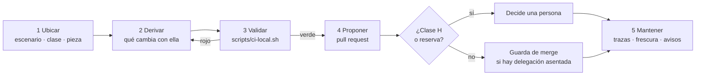

# Cómo intervenir — plantilla del proceso

Esta plantilla dice cómo cambiar la documentación de un proyecto sin romperla: dónde está la pieza que hay que tocar,
qué se deriva de qué, cómo se valida en local, cómo se propone y qué queda para después. Es la entrada de la ruta
«intervenir» del cuerpo. Cada proyecto escribe **una instancia de una página** que completa la plantilla con sus
rutas, su compuerta y quién decide; la instancia de este repositorio es
[Cómo intervenir en Lab-Documentos](Como-Intervenir-Lab-Documentos.md).

Cada paso trae tres bloques para un agente: `entradas` (lo que necesita tener antes de empezar), `salidas` (lo que deja
hecho) y `validaciones` (cómo se comprueba que el paso terminó bien, con un comando o una condición que da sí o no).
Una persona lee la prosa; un agente puede ejecutar los bloques.

## Índice

1. [Definiciones](#1-definiciones)
2. [El proceso de un vistazo](#2-el-proceso-de-un-vistazo)
3. [Paso 1: ubicar](#3-paso-1-ubicar)
4. [Paso 2: derivar](#4-paso-2-derivar)
5. [Paso 3: validar](#5-paso-3-validar)
6. [Paso 4: proponer](#6-paso-4-proponer)
7. [Paso 5: mantener](#7-paso-5-mantener)
8. [Cómo se escribe una instancia](#8-cómo-se-escribe-una-instancia)

## 1. Definiciones

| Término | Definición |
| --- | --- |
| Intervención | Cualquier cambio a una pieza documental de un proyecto: agregar, corregir, mover o retirar |
| Instancia | La página de un proyecto que completa esta plantilla. Traza a la plantilla y a la versión del cuerpo (`traces: [GP-SDEI-INTERVENIR, IDX-SDEI@2.0]`): si el cuerpo pasa a otra versión mayor o menor, la compuerta pide revisar la instancia |
| Pieza derivada | Pieza que sale de otra por un paso mecánico (el contrato OpenAPI del build) o que depende de otra por una traza (la ayuda que traza a una regla) |
| Reserva | Una duda declarada en el pull request que impide fusionarlo sin una persona |

## 2. El proceso de un vistazo



*Diagrama: los cinco pasos. El rojo de la validación vuelve a derivar; la clase de intervención decide quién fusiona.*

## 3. Paso 1: ubicar

Se busca la situación en el [Mapa](../01-Mapa.md): el escenario del proyecto, la clase de pieza (`CL-nn`) y el archivo
concreto. Si la pieza no encaja en ninguna clase del catálogo, no se improvisa: se abre una clase nueva por expediente.

```yaml
entradas:
  - el pedido de cambio (issue, requerimiento documental RD-nn o hallazgo del carril programado)
  - el Mapa del cuerpo (01-Mapa.md) y la instancia de este proceso en el proyecto
salidas:
  - escenario (ESC-SDEI-n), clase de pieza (CL-nn) y clase de intervención (D, P o H)
  - ruta del archivo a tocar y su doc_id
validaciones:
  - la clase existe en el catálogo del Mapa §4
  - si la clase es H, el paso 4 va a una persona y no a la guarda de merge
```

## 4. Paso 2: derivar

Se listan las piezas que dependen de la que se toca y las que la producen. Si se sube la versión de una ficha, las
páginas que trazan a la versión anterior tienen que revisarse en el mismo pull request; si la pieza sale del build, se
regenera, no se edita a mano.

```yaml
entradas:
  - la pieza ubicada en el paso 1
  - el registro de IDs (doc_id y encabezados con ID) del repositorio
salidas:
  - lista de piezas que trazan a la pieza tocada (grep de su ID en los frontmatter)
  - el cambio hecho en la pieza y en cada pieza derivada
validaciones:
  - ninguna página traza a una versión que ya no existe
  - ninguna pieza de clase D se editó a mano
```

## 5. Paso 3: validar

Se corre la compuerta en local, con el mismo guion que corre la CI. Desde la raíz del repositorio:

```bash
scripts/ci-local.sh todo <carpeta-del-cuerpo-o-del-ejemplo>
```

`scripts/ci-local.sh` corre los grupos PR-1 a PR-7 de `docs-guard` (enlaces, esquema, anti-inyección, estructura y
mermaid, trazas, contrato y referencias) y la autoprueba de cada control, y termina en verde (código 0) o en rojo. Un
grupo suelto se corre con su nombre (`scripts/ci-local.sh trazas <carpeta>`). Si el proyecto no tiene el guion, su
instancia nombra el equivalente.

```yaml
entradas:
  - el árbol de trabajo con el cambio del paso 2
  - scripts/ci-local.sh (o el guion equivalente que nombra la instancia)
salidas:
  - la salida de scripts/ci-local.sh todo, recortada a las líneas de resumen de cada grupo
validaciones:
  - scripts/ci-local.sh todo termina con código 0
  - el agregador no muestra ningún grupo en ROJO
```

## 6. Paso 4: proponer

Se abre un pull request con una rama propia. La descripción dice qué se cambió, qué piezas derivadas se tocaron, la
salida recortada del paso 3 y, si hay, la reserva. Quién fusiona depende de la clase: D y P sin reserva los fusiona el
agente que los abrió, después de pasar la guarda, **sólo** si la persona responsable dejó asentada por escrito la
delegación del merge en el repositorio; H, o cualquier pull request con reserva, lo decide una persona.

```yaml
entradas:
  - la rama con el cambio validado
  - la delegación del merge asentada en el repositorio (si la hay)
salidas:
  - el pull request con descripción, salida del paso 3 y reservas
  - el merge (por la guarda o por la persona) o el pedido de decisión
validaciones:
  - la CI del pull request terminó en verde en la cabeza de la rama
  - el pull request está abierto, sin conflictos y sin reserva antes de fusionar por la guarda
  - quien verifica no es quien redactó
```

## 7. Paso 5: mantener

Después del merge quedan dos cosas: el carril programado, que una vez por semana avisa de enlaces externos rotos,
anclas atrasadas y documentos sin revisar hace más de un año, y la próxima intervención, que vuelve al paso 1.

```yaml
entradas:
  - el merge del paso 4
  - el issue que abre o actualiza el carril programado
salidas:
  - cada aviso atendido con una intervención nueva o cerrado con su motivo
validaciones:
  - ningún documento del cuerpo tiene last_review de hace más de 365 días sin un aviso abierto
  - las anclas entre repositorios apuntan a un SHA que existe
```

## 8. Cómo se escribe una instancia

Una instancia ocupa una página y completa esta tabla para su proyecto. Cada fila es una pregunta que la instancia
responde con datos del proyecto, no con la prosa de la plantilla.

| Campo | Pregunta que guía el campo |
| --- | --- |
| Escenario | ¿En qué `ESC-SDEI-n` está el proyecto y qué clases de pieza activa? |
| Dónde vive cada pieza | ¿En qué carpetas están las guías, la ayuda, la técnica, el RRD? |
| Guion de validación | ¿Qué comando corre la compuerta en local (el `scripts/ci-local.sh` del proyecto o su equivalente)? |
| Compuerta en la CI | ¿Qué workflow corre en el pull request y en qué runner? |
| Quién decide | ¿Hay delegación del merge asentada? ¿Quién decide lo de clase H? |
| Excepciones | ¿Qué se aparta de esta plantilla y por qué? |

El frontmatter de la instancia lleva `doc_type: proceso` y `traces: [GP-SDEI-INTERVENIR, IDX-SDEI@2.0]`.

Volver al [Mapa](../01-Mapa.md#4-por-artefacto) (fila CL-12) o a la [Lista de verificación](../99-Anexos/Lista-De-Verificacion.md).
