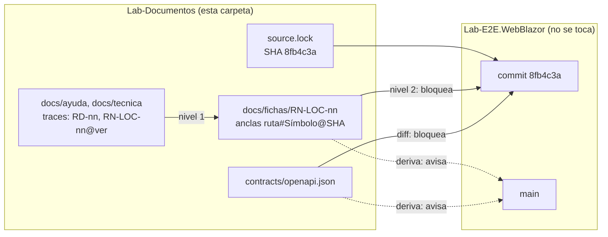

# Mini demo MovilidadUrbana

Documentación de una app real (MovilidadUrbana.MAUI, del repositorio Lab-E2E.WebBlazor) escrita **desde otro
repositorio**, sin copiar el código y con una compuerta que da rojo cuando lo escrito deja de coincidir con lo que el
código hace. Es el ejemplo del escalón 1 del sistema documentador: audiencias sin roles, fuente generada del SHA,
ancla SHA entre repositorios con aviso de deriva y trazas de dos niveles.

## Índice

1. [Definiciones](#1-definiciones)
2. [Qué hay en esta carpeta](#2-qué-hay-en-esta-carpeta)
3. [Cómo funciona](#3-cómo-funciona)
4. [Correr la verificación](#4-correr-la-verificación)
5. [Tutorial: documentar una pantalla nueva](#5-tutorial-documentar-una-pantalla-nueva)
6. [Cuando el código cambia](#6-cuando-el-código-cambia)
7. [El caso real: RN-LOC-01 y el 60/80](#7-el-caso-real-rn-loc-01-y-el-6080)
8. [Límites de la demo](#8-límites-de-la-demo)

## 1. Definiciones

| Término | Significado |
| --- | --- |
| `source.lock` | Archivo que fija el repositorio y el SHA del código que se documenta. Todo lo que la demo afirma se comprueba contra ese commit |
| Ficha | Documento de una regla de negocio (`RN-LOC-nn`) con la forma de *Deducción de reglas de negocio* §5.1 y una tabla de anclas |
| Ancla | `ruta#Símbolo@SHA`: dónde se declara, se muestra, se verifica o se aplica una regla. Con una afirmación (`= 60`, `contiene …`) que la compuerta comprueba |
| Traza | En el frontmatter, `traces: [ID@MAYOR.MENOR]`: de qué requerimiento o regla, y de qué versión, sale lo que una página afirma |
| Traza de nivel 1 | Página → ficha: el ID existe y la versión coincide |
| Traza de nivel 2 | Ficha → código: cada ancla resuelve en el SHA y cumple su afirmación |
| RRD | Registro de requerimientos documentales: [`docs/_requisitos.md`](docs/_requisitos.md). Una fila `RD-nn` por cosa que la documentación tiene que lograr |
| CL-06, CL-07 | Clases de documento: ayuda al usuario final (CL-06) y técnica escrita (CL-07) |
| Deriva | Diferencia entre el SHA fijado y `main` del repositorio del código. Avisa; no bloquea |
| docs-guard | Compuerta documental de Lab-Documentos ([`tools/docs-guard/`](../../../../../tools/docs-guard/README.md)) |

## 2. Qué hay en esta carpeta

| Pieza | Clase | Para quién | Qué es |
| --- | --- | --- | --- |
| [`source.lock`](source.lock) | — | todos | Repositorio, SHA, rutas y proyecto de la API |
| [`verificar.sh`](verificar.sh) | — | desarrollo, CI | Baja el código, extrae el contrato y corre los controles |
| [`contracts/openapi.json`](contracts/openapi.json) | contrato | desarrollo | Contrato de la API extraído en ejecución del SHA |
| [`docs/_requisitos.md`](docs/_requisitos.md) | CL-02 (RRD) | analista, PO | Qué documentación hace falta y cómo se comprueba |
| [`docs/fichas/RN-LOC-01.md`](docs/fichas/RN-LOC-01.md) | anexo | analista | Largo del nombre (con divergencia 60/80) |
| [`docs/fichas/RN-LOC-02.md`](docs/fichas/RN-LOC-02.md) | anexo | analista | Localidad única por nombre y provincia |
| [`docs/ayuda/alta-de-localidad.md`](docs/ayuda/alta-de-localidad.md) | CL-06 | persona usuaria | Cómo dar de alta una localidad |
| [`docs/tecnica/arquitectura.md`](docs/tecnica/arquitectura.md) | CL-07 | desarrollo | Capas y dónde vive cada regla |
| [`docs/tecnica/compilar-y-primer-pedido.md`](docs/tecnica/compilar-y-primer-pedido.md) | CL-07 | desarrollo | Compilar la API, pedir el contrato, primer alta |

Fuera de esta carpeta, en la raíz de Lab-Documentos: el workflow `.github/workflows/mini-demo-movilidad.yml` y la
prueba negativa permanente `tools/docs-guard/fixtures/anclas/real-rn-loc-01/`.

## 3. Cómo funciona



La compuerta tiene dos partes:

| Dónde corre | Qué comprueba | Bloquea |
| --- | --- | --- |
| `docs-guard` (cada PR) | Enlaces, frontmatter, RRD, anti-inyección, estructura, trazas de nivel 1 | Sí |
| `mini-demo-movilidad` (cada PR que toca la demo o `tools/docs-guard/`) | C1 contrato = extraído del SHA; C2 un contrato con una operación plantada da rojo; C3 trazas de nivel 1 y 2 contra el SHA; C4 la ficha RN-LOC-01 sin corregir da rojo; A1 deriva contra `main` | C1 a C4 sí; A1 sólo avisa |

## 4. Correr la verificación

Requisitos: bash, git, curl, Python 3, el SDK de .NET 10 y Node.js (para docs-guard). Desde la raíz de Lab-Documentos:

```bash
DEMO=Guides/Documentacion-Tecnica/Sistema-De-Documentacion-E-Integracion/Examples/MovilidadUrbana-Mini-Demo
scripts/ci-local.sh todo "$DEMO"     # docs-guard sobre la demo
"$DEMO/verificar.sh"                 # contrato, anclas y deriva contra el código
```

El final de una corrida en orden:

```text
== agregador mini demo
  C1  verde
  C2  verde
  C3  verde
  C4  verde
== mini demo: verde
```

Si un control da rojo, la línea anterior al agregador dice qué archivo y qué fila. Por ejemplo:
`docs/fichas/RN-LOC-01.md:62: ERROR ancla-valor-distinto: NombreEntry.MaxLength: la ficha afirma 60 y el código tiene 80`.

## 5. Tutorial: documentar una pantalla nueva

Ejemplo trabajado: documentar la pantalla **Encuesta** para la persona usuaria. Los pasos valen para cualquier
pantalla.

### 5.1 Agregar la fila al RRD

En [`docs/_requisitos.md`](docs/_requisitos.md), una fila nueva con el número siguiente y las mismas ocho columnas de
la tabla: `ID`, `Audiencia`, `Tarea`, `Pieza`, `Fuente`, `Criterio`, `Decisión` y `Decide y fecha`. La compuerta exige
seis (`ID`, `Audiencia`, `Tarea`, `Pieza`, `Criterio`, `Decisión`); las otras dos se completan igual. Reglas:

- **Criterio**: tiene que tener las palabras **Dado**, **Cuando** y **Entonces**, y nombrar el instrumento.
- **Pieza**: clase y enlace relativo al archivo, como en las filas existentes.
- **Fuente**: una regla con versión por cada ficha que la página va a trazar (§5.2).
- **Decisión**: `aceptado`, `rechazado`, `diferido` o `pendiente`. Quien escribe no decide: una fila nueva va como
  `pendiente`, y en `Decide y fecha` se pone quién la va a decidir, sin fecha (`PO, pendiente`). Cuando la persona
  decide, cambia la decisión y agrega la fecha.
- **Frontmatter del RRD**: su `traces` lista las reglas de las que salen las filas; se agregan las fichas nuevas con
  su versión.

```text
| RD-05 | persona usuaria | Completar el paso 1 de la encuesta | CL-06, [`docs/ayuda/encuesta.md`](ayuda/encuesta.md) | `RN-ENC-01@1.0`, `RN-ENC-02@1.0`, … (una por regla) | Dado el paso 1 de la encuesta, cuando la persona lee la ayuda, entonces cada número coincide con el de la ficha; instrumento: `traces-resolve` | pendiente | PO, pendiente |
```

### 5.2 Escribir la ficha de cada regla que la página nombre

**Cada regla de la pantalla lleva su ficha** en `docs/fichas/`, tenga número o no: un mínimo, un rango, un formato,
una unicidad, que un campo sea obligatorio o que su valor tenga que salir de una lista. Cada una con un ID
`RN-<ÁREA>-nn` nuevo (los asigna la demo; ver §8). La fila RD-04 del RRD no cambia: su pieza es la carpeta de fichas.

Qué cuenta como **una** regla: las restricciones sobre un mismo campo van en una sola ficha, aunque cada una se
compruebe o se imponga por un camino distinto; los caminos son filas de la tabla de anclas. Que la edad sea un número
entero y esté entre 16 y 110 es una regla; que el nombre tenga entre 3 y 60 caracteres, también, aunque el máximo no lo
compruebe nadie (RN-LOC-01); que la localidad sea obligatoria y salga de la lista, también. Los textos de navegación
(«Paso 1 de 3», títulos, botones) no son reglas y no llevan ficha. Las reglas que valen para
toda la app y no las impone esta pantalla, como que cada sesión ve sólo sus datos, no llevan ficha en la pantalla; si
la persona las nota, la ayuda las dice en «Antes de empezar», como en
[alta-de-localidad §1](docs/ayuda/alta-de-localidad.md#1-antes-de-empezar). Copiá
[`RN-LOC-02.md`](docs/fichas/RN-LOC-02.md) como modelo: frontmatter (`doc_type: ficha`, `traces: [RD-04]`, porque las
fichas son la pieza de RD-04), encabezado `# RN-XXX-nn — Nombre`, línea `**Versión:** 1.0`, la tabla de la ficha y la
tabla de anclas.

**Campos de la ficha.** La forma es la de *Deducción de reglas de negocio* §5.1, un conocimiento del espacio de
trabajo que no se publica con este repositorio; todo lo que hace falta de él está acá. Los catorce campos van en este
orden:

| Campo | Qué se escribe |
| --- | --- |
| Id | `RN-<ÁREA>-nn`, provisional |
| Enunciado atómico | La regla en una oración |
| Ancla | El ancla principal y «y las de §2». La principal es la primera fila `declara` de la tabla; si no hay, la primera `verifica`; si tampoco, la primera `aplica` |
| Letra | Lo que la app promete, textual, entre comillas: el texto de ayuda bajo el campo y los mensajes. Los rótulos y los ejemplos de los campos describen, no prometen |
| Intención | Para qué existe la regla y qué la respalda en el código; si no hay respaldo, «Conjetura» |
| ¿Divergen? | Ver la tabla siguiente |
| Especie | Ver la tabla siguiente |
| Momento | Ver la tabla siguiente |
| Quién la verifica hoy | El método que la comprueba, o **nadie** |
| Dueño | La clase del dominio que la declara. Si ninguna la declara, «ninguno en el dominio» y dónde termina: la clase que la verifica o, si nadie la verifica, el elemento de la pantalla o el método que la impone. La tabla de anclas no lleva fila `declara` |
| Depende de | Otras fichas cuya regla esta supone, o «Ninguna» |
| Grado de certeza | Ver la tabla siguiente |
| Prueba | Una oración Dado/Cuando/Entonces que se podría escribir como prueba |
| Propuesta | Ver la tabla siguiente |

**Valores cerrados:**

| Campo | Valores |
| --- | --- |
| ¿Divergen? | `No`, `Leve` o `De fondo`, y en qué. **Leve**: la letra y el código difieren en algo que no cambia qué se acepta, qué se rechaza ni qué se guarda (una palabra, o un rótulo que pide más de lo que se valida, como «Nombre y apellido» cuando alcanza una palabra). **De fondo**: la letra promete algo que cambia alguna de esas tres cosas, como el 60/80. **Silencio**: si la letra no nombra un límite que el código aplica, no hay divergencia; va como dato debajo de la tabla y la ayuda nombra el límite |
| Especie | **restricción** (limita qué valores se aceptan: un largo, un rango, una unicidad, un campo obligatorio, un valor de una lista); **derivación** (un valor se calcula de otros); **alcance** (a qué objetos o casos se aplica otra regla, como «sólo las localidades de la sesión»); **estructura** (cómo se relacionan los objetos, como «una localidad tiene una provincia») |
| Momento | **Invariant** (cierta siempre para lo guardado); **Precondition de ‹acto›** (se comprueba antes de un acto: «del alta», «de pasar al paso 2»); **completitud** (se exige recién al cerrar un conjunto, como al registrar la encuesta completa); **ninguno** (nadie la comprueba en un acto: sólo la impone la pantalla, por ejemplo con `MaxLength`). Si se comprueba en un acto y no en otro que la necesitaría (se valida al avanzar pero no al registrar), el Momento es el del acto donde se comprueba y el hueco va en «¿Divergen?»: «De fondo» si por ese hueco se puede guardar algo que la regla prohíbe; si no, «Leve» |
| Grado de certeza | **testimonio** (lo dijo una persona responsable); **letra** (lo dice un texto de la app o de un requisito); **caso de uso** (sale de un caso de uso escrito); **código** (cada paso está en una ancla de la ficha, aunque no se haya ejecutado); **inferencia** (se deduce de varias piezas y al menos un paso no tiene ancla); **conjetura** (no hay respaldo) |
| Propuesta | Obligatoria si hay divergencia de fondo; con una leve, una propuesta o «Sin propuesta: divergencia leve»; sin divergencia, «No corresponde» |

**Tabla de anclas.** Encabezado `| Rol | Ancla | Afirma |`. El código del SHA lo deja `verificar.sh fuente` en
`$TRABAJO/sha/`. `TRABAJO` es la variable de entorno, si está; si no, `$RUNNER_TEMP`, `$TMPDIR` o `/tmp`, más
`/mini-demo-movilidad`.

| Archivo | Símbolo | Ejemplo | Qué entiende la compuerta |
| --- | --- | --- | --- |
| `.cs` (incluye `.xaml.cs`) | `Clase.Miembro` | `src/MovilidadUrbana.MAUI/Domain/Rules/EncuestaRules.cs#EncuestaRules.EdadMinima@8fb4c3a` | Constantes, campos, propiedades y métodos, con cuerpo de expresión (`=>`) o de bloque, con o sin atributos (`[RelayCommand]`). No entiende parámetros de constructores primarios ni funciones locales |
| `.xaml` | `Elemento.Atributo`, con el elemento nombrado por `x:Name` o por `AutomationId` | `src/MovilidadUrbana.MAUI/Pages/EncuestaPage.xaml#edad.MaxLength@8fb4c3a` | Cualquier atributo; el valor se compara como texto (`` = `Numeric` `` también vale) |

La columna **Afirma** se escribe con el valor entre comillas invertidas: `` = `16` ``, `` contiene `texto` `` o
`` no contiene `texto` ``; vacía o `—` comprueba sólo que el símbolo existe. `contiene` mira la declaración completa,
desde la línea que declara el símbolo hasta el final de su cuerpo; no incluye los comentarios `///` ni los atributos
escritos en las líneas de arriba. La columna **Rol** no la lee la compuerta; los roles de las fichas modelo (`declara`, `muestra`,
`verifica`, `aplica`, `persiste`) cubren los casos de la demo, y se puede usar otro si ninguno describe el lugar.

**Mensajes interpolados.** Si el código arma un texto con valores (`$"Entre {EncuestaRules.EdadMinima} y …"`), la
afirmación `contiene` copia el texto **tal como está en el código**, con las llaves, y los números se anclan aparte con
`=` sobre sus constantes:

```text
| muestra | `src/MovilidadUrbana.MAUI/Application/Encuestas/EncuestaPolicy.cs#EncuestaPolicy.RequisitoDeLaEdad@8fb4c3a` | contiene `{EncuestaRules.EdadMinima}` |
| declara | `src/MovilidadUrbana.MAUI/Domain/Rules/EncuestaRules.cs#EncuestaRules.EdadMinima@8fb4c3a` | = `16` |
```

El SHA del ancla tiene que ser el de `source.lock` (alcanza con los primeros siete caracteres). Escribí en la ficha lo
que **el código hace**; si eso diverge de lo que la pantalla promete, marcá «¿Divergen?» como «De fondo» y dejá la
decisión en la propuesta. No la decidas vos (§7). Un dato que no es divergencia (por ejemplo, que la base no tiene
índice único) va en un párrafo debajo de la tabla, como en RN-LOC-02.

### 5.3 Escribir la página

Creá `docs/ayuda/encuesta.md` con este frontmatter; todos los campos son obligatorios. Los comentarios `#` son sólo
para este tutorial: en el archivo real se quitan.

```yaml
---
doc_id: DEMO-MU-22          # prefijo DEMO, siguiente número libre del grupo (ayuda 2x, técnica 3x, fichas 1x)
doc_type: guia-practica
title: Completar el paso 1 de la encuesta
description: Una oración de hasta 160 caracteres que diga qué resuelve la página.
status: borrador            # vigente lo decide una persona
origin: ia-generated        # human, ia-assisted o ia-generated
confidence: alta            # obligatorio si origin no es human: alta, media o baja
owner: Lab-Documentos
last_review: 2026-10-27
audience: [persona-usuaria] # humano, agente, estudiante, docente, desarrollo, qa, devops, po, analista, persona-usuaria
traces: [RD-05, RN-ENC-01@1.0, RN-ENC-02@1.0]
---
```

El cuerpo, como [`alta-de-localidad.md`](docs/ayuda/alta-de-localidad.md): un solo título `#`, índice, qué se carga,
pasos, qué pide cada campo y qué hacer cuando la app no acepta un dato. Si la pantalla no guarda (un paso intermedio),
esa sección se llama por lo que pasa («Si la app no te deja seguir»). Una página puede cubrir una parte de una
pantalla; el título y la tarea de la fila del RRD lo dicen. La ayuda trata de vos, aunque la app trate de usted.

**Qué tiene que estar en una ficha.** Cada regla que la página explica, con sus límites o valores. Los datos de
ejemplo («Goya», «3450») no. Un mensaje de error se cita textual en la página; si sale de una regla, la ficha de esa
regla lo ancla en su fila `verifica`. Un mensaje general que no sale de una sola regla («Complete los datos del
paso…») se cita sin ficha y sin ancla: es un límite conocido de la demo, y si el código lo cambia nada da rojo.

**Qué divergencias cuenta la página.** Una divergencia leve, sólo si la persona la va a notar al usar la pantalla, y
en una oración. Toda divergencia de fondo que la persona pueda notar, no sólo un límite contra
una promesa (también, por ejemplo, un paso que deja avanzar sin un dato que la pantalla pide). Se cuenta en lenguaje
llano, como en alta-de-localidad §3. Si la letra que se cita tiene jerga («ABM»), se cita textual y se explica.

**Qué límites nombra la página.** Los que la persona se va a encontrar, es decir, lo que el código aplica, aunque la
pantalla no lo prometa: si el campo corta en 80, la ayuda dice «hasta 80». Si lo que el código aplica contradice lo
que la pantalla promete, la página dice las dos cosas, como [alta-de-localidad §3](docs/ayuda/alta-de-localidad.md#3-qué-pide-cada-campo).

### 5.4 Validar

```bash
scripts/ci-local.sh todo "$DEMO"
"$DEMO/verificar.sh"
```

Los dos tienen que terminar en verde. El final de `ci-local.sh`:

```text
== agregador docs-guard
  enlaces      verde
  esquema      verde
  ai           verde
  estructura   verde
  trazas       verde
  contrato     verde
  fijadas      verde
  autoprueba   verde
== docs-guard: verde
```

El de `verificar.sh` está en §4. Qué controla cada grupo y qué significa cada mensaje está en el
[README de docs-guard](../../../../../tools/docs-guard/README.md#4-controles-del-carril-pr). Para revisar sólo las trazas y las anclas sin compilar ni tener .NET (con el código
ya bajado por `verificar.sh fuente`):

```bash
python3 -I tools/docs-guard/dg.py trazas --fuente "$TRABAJO/sha" "$DEMO"
```

Errores frecuentes:

| Mensaje | Causa | Arreglo |
| --- | --- | --- |
| `traza-no-resuelve: RD-05` | La fila no está en el RRD o el ID está mal escrito | Agregar la fila (§5.1) |
| `traza-version-desfasada` | La página traza `@1.0` y la ficha está en otra versión | Releer la página contra la ficha y actualizar la traza |
| `ancla-sin-simbolo` | El símbolo no existe en el SHA, o es una forma que la compuerta no entiende (§5.2) | Buscarlo en `$TRABAJO/sha/`; revisar mayúsculas y la clase |
| `ancla-valor-distinto` | El código tiene otro valor que el que afirma la ficha | Escribir lo que el código hace (§5.2) |
| `prefijo` | El `doc_id` no usa un prefijo registrado | Usar `DEMO-MU-nn` |
| `rrd-criterio` | Falta Dado, Cuando o Entonces en el criterio | Reescribir el criterio |

### 5.5 Proponer el cambio

En el mismo cambio, además de las piezas nuevas:

- la tabla de §2 de este README suma una fila por pieza nueva;
- la tabla de §3 de [`docs/tecnica/arquitectura.md`](docs/tecnica/arquitectura.md) suma una fila por regla nueva
  (es la pieza de RD-03: dónde vive cada regla; si la regla no tiene dueño en el dominio, la columna Declara dice
  «ninguno en el dominio»; la columna Estado dice «Sin divergencia», «Divergencia leve» o «Divergencia de fondo»), y el
  `traces` de esa página y la columna Fuente de RD-03 suman las
  fichas nuevas con su versión. Agregar una fuente a una fila ya decidida no la reabre; cambiar su tarea o su
  criterio sí: vuelve a `pendiente`;
- [`CHANGELOG.md`](../../../../../CHANGELOG.md) de Lab-Documentos suma una entrada nueva arriba de todo, con la fecha y
  un título propio entre paréntesis, una línea `###` con la carpeta y qué cambió, y la línea bajo `#### Añadido`. La
  fecha es la del día del PR. No se agrega a la entrada de otro cambio aunque tenga la misma fecha:

```text
## 2026-10-28 (mini demo: ayuda de la encuesta)

### Guides/Documentacion-Tecnica/Sistema-De-Documentacion-E-Integracion/Examples/MovilidadUrbana-Mini-Demo/ — paso 1 de la encuesta

#### Añadido

- **`docs/ayuda/encuesta.md`** y las fichas `RN-ENC-01` y `RN-ENC-02`: ayuda del paso 1 de la encuesta.
```

Después, una rama (`demo-mu/<pantalla>`, por ejemplo `demo-mu/encuesta-paso-1`), un commit con un mensaje que diga qué
pantalla se documentó y un PR contra `main` de Lab-Documentos:

```bash
git switch -c demo-mu/encuesta-paso-1 origin/main
git add "$DEMO" CHANGELOG.md
git commit -m "Mini demo: ayuda del paso 1 de la encuesta"
git push -u origin demo-mu/encuesta-paso-1
```

El PR se abre desde la página del repositorio en GitHub (botón «Compare & pull request») o con la herramienta que use
el equipo; la base es `main`. En el PR
corren `docs-guard` y `mini-demo-movilidad` en el runner `[self-hosted, i7infra-dev]`; el PR se fusiona sólo con los
dos en verde. El cuerpo del PR lleva: qué pantalla se documentó, la lista de piezas nuevas y cambiadas, las
divergencias que quedan para decidir (con su ficha), los supuestos de §5.6 y el final de las dos salidas de §5.4.

Lo que **no** se toca: `verificar.sh`, el workflow y `source.lock` (C3 lee todas las fichas de `docs/fichas/` sin
configurar nada); el `traces` de este README (traza las filas que el README mismo explica, RD-01 a RD-04); el
`last_review` de los archivos que no se releyeron. En los que sí se cambiaron, `last_review` pasa a la fecha del PR, y
si una página amplía lo que cubre (como `arquitectura.md` con reglas nuevas), su `description` se ajusta.

### 5.6 Cuando el tutorial no cubre un caso

Ningún tutorial cubre todos los casos de una pantalla real, y la clasificación fina de una regla está declarada fuera
de su alcance ([§8](#8-límites-de-la-demo)). Si te encontrás con un caso que este no prevé:

1. Resolvelo por analogía con la pieza modelo más parecida (las fichas RN-LOC, la ayuda de alta, las páginas técnicas).
2. Si el caso es sobre lo que el código hace y la letra promete, escribí lo que el código hace y no decidas la
   divergencia (§7).
3. Anotalo en el cuerpo del PR, en una sección «Supuestos», con el caso, lo que elegiste y por qué. Quien revise el PR
   decide si el supuesto queda o si este tutorial suma la respuesta.

## 6. Cuando el código cambia

Mientras `source.lock` no cambie, nada de lo que pase en el otro repositorio pone esta demo en rojo: sólo aparece el
aviso de deriva (A1) en el registro de la corrida. Para actualizar la demo a un código nuevo:

1. Cambiar `sha:` en `source.lock`.
2. Correr `verificar.sh`. Las anclas que ya no se cumplen dan rojo y dicen cuál.
3. Corregir cada ficha y subir su versión (`1.1` → `1.2`); `traces-resolve` marca entonces las páginas con traza
   desfasada, que se releen y se actualizan.
4. Si C1 da rojo, revisar el diff y reemplazar `contracts/openapi.json` por el extraído (queda en
   `$TRABAJO/sha/openapi.json`).

Todo eso va en un mismo PR.

## 7. El caso real: RN-LOC-01 y el 60/80

Al derivar la ayuda desde el código apareció un defecto: la pantalla promete «Entre 3 y 60 caracteres», el campo deja
escribir 80 y la app guarda nombres de más de 60. La primera versión de la ficha (1.0) copió la promesa de la pantalla
y la compuerta dio rojo en dos anclas. La 1.1 dice lo que el código hace y deja la decisión a una persona: elegir
entre 60 y 80 es una divergencia entre letra e intención, y no se resuelve documentando.

La regla que sale de este caso: **lo que la ayuda afirma se verifica contra el comportamiento; si diverge, se
documenta lo que hace y se avisa**. La ayuda al usuario lo dice en lenguaje llano ([§3 de la
ayuda](docs/ayuda/alta-de-localidad.md#3-qué-pide-cada-campo)) y la ficha 1.0 se conserva como prueba negativa
permanente.

## 8. Límites de la demo

| Límite | Por qué |
| --- | --- |
| No hay roles ni confidencialidad | La app móvil no tiene roles; la ayuda por rol se demostró aparte (Prueba-Ayuda-Por-Rol, en esta misma carpeta `Examples/`) |
| Los IDs `RN-LOC-nn` son provisionales | MovilidadUrbana no tiene registro de reglas; los asigna esta demo |
| Las páginas no se publican en un sitio | Se leen como `.md` en el repositorio |
| No se modifica el código | Si el repositorio del código abre un expediente que lo autorice, la documentación pasa a vivir junto al código |
| La clasificación fina de una regla queda fuera de alcance | El tutorial resume el método de deducción de reglas (§5.2) y no lo enseña. Los casos de borde que §5.2 no resuelve (qué cuenta como una regla, una regla con partes de especies o momentos distintos, un grado de certeza mixto o dudoso, una divergencia que no encaja en Leve o De fondo, un hueco común a toda la pantalla) se resuelven por §5.6 y quedan como supuestos en el PR, para que los decida quien revisa |
