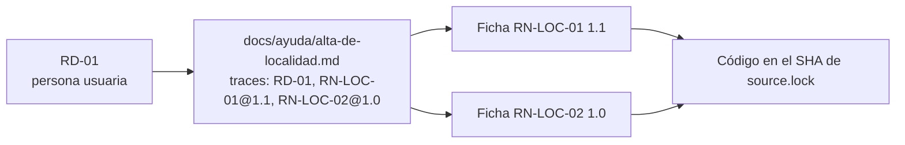

# Registro de requerimientos documentales (RRD)

## Índice

1. [Qué es este registro](#1-qué-es-este-registro)
2. [Requerimientos](#2-requerimientos)
3. [Cómo se lee una fila](#3-cómo-se-lee-una-fila)

## 1. Qué es este registro

El RRD es la lista de lo que la documentación tiene que lograr, escrita **antes** de las páginas. Cada fila dice para
quién es (una sola audiencia), qué tarea le resuelve, en qué pieza vive y con qué criterio se comprueba. Una página
que no responde a ninguna fila sobra; una fila sin página es un hueco.

Este proyecto no tiene especificación formal (no hay SDD), así que el registro vive acá, en `docs/_requisitos.md`, al
lado de las piezas que pide.

| Término | Significado |
| --- | --- |
| Audiencia | Quién lee: persona usuaria (usa la app), desarrollo (compila o consume la API), analista (lee las reglas), agente (asistente de IA que lee el repositorio) |
| Pieza | Clase de documento y archivo. CL-06 es ayuda al usuario final; CL-07, documentación técnica escrita |
| Fuente | De dónde sale lo que la pieza afirma: una regla con versión (`RN-LOC-01@1.1`) o el contrato extraído |
| Criterio | Dado/Cuando/Entonces, con el instrumento que lo comprueba |
| Decisión | `aceptado`, `rechazado`, `diferido` o `pendiente`. La toma una persona; acá, la mesa del expediente 0002 por delegación del PO |

## 2. Requerimientos

| ID | Audiencia | Tarea | Pieza | Fuente | Criterio | Decisión | Decide y fecha |
| --- | --- | --- | --- | --- | --- | --- | --- |
| RD-01 | persona usuaria | Dar de alta una localidad sin que el nombre se rechace ni quede distinto de lo esperado | CL-06, [`docs/ayuda/alta-de-localidad.md`](ayuda/alta-de-localidad.md) | `RN-LOC-01@1.1`, `RN-LOC-02@1.0` | Dado el límite de cada regla, cuando la persona lee la ayuda, entonces cada número coincide con el de la ficha; instrumento: `traces-resolve` | aceptado | mesa, 2026-10-27 |
| RD-02 | desarrollo | Compilar la API, pedir el contrato y hacer el primer alta por HTTP | CL-07, [`docs/tecnica/compilar-y-primer-pedido.md`](tecnica/compilar-y-primer-pedido.md) | contrato extraído del SHA | Dado el SHA de `source.lock`, cuando se extrae el contrato en ejecución, entonces coincide con `contracts/openapi.json` (diff 0); instrumento: `verificar.sh`, control C1 | aceptado | mesa, 2026-10-27 |
| RD-03 | desarrollo | Ubicar en qué capa vive cada regla y por qué la demo no copia el código | CL-07, [`docs/tecnica/arquitectura.md`](tecnica/arquitectura.md) | `RN-LOC-01@1.1`, `RN-LOC-02@1.0` | Dado el símbolo que ancla una ficha, cuando se lo busca en el SHA, entonces existe y cumple lo que la ficha afirma; instrumento: `traces-resolve` con `--fuente` | aceptado | mesa, 2026-10-27 |
| RD-04 | analista | Saber qué afirma cada regla, dónde se declara, se verifica y se aplica, y si la letra diverge del código | Anexo de fichas, [`docs/fichas/`](fichas/RN-LOC-01.md) | código en el SHA | Dado un cambio en el código que ancla una ficha, cuando corre la compuerta, entonces da rojo hasta que la ficha se corrige; instrumento: control C4 (negativa real) | aceptado | mesa, 2026-10-27 |

## 3. Cómo se lee una fila

Ejemplo con RD-01. La persona usuaria quiere cargar una localidad. La pieza que la ayuda es una página de ayuda
(CL-06). Lo que esa página afirma sale de dos reglas, cada una con su versión. El criterio es comprobable: si la ficha
de `RN-LOC-01` cambia de versión, la traza de la página queda desfasada y la compuerta da rojo hasta que alguien
revisa la página.

