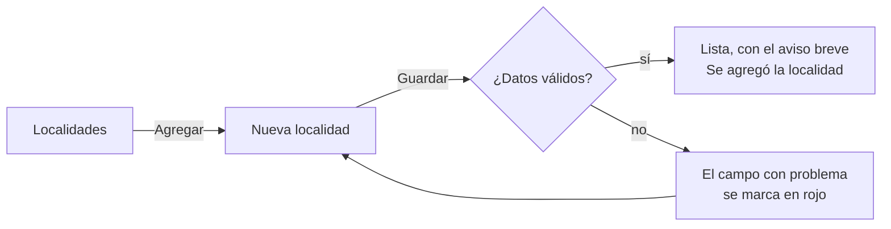

# Dar de alta una localidad

## Índice

1. [Antes de empezar](#1-antes-de-empezar)
2. [Pasos](#2-pasos)
3. [Qué pide cada campo](#3-qué-pide-cada-campo)
4. [Si la app no guarda](#4-si-la-app-no-guarda)

## 1. Antes de empezar

Una **localidad** es una ciudad o pueblo que cargás con su provincia, su código postal y su cantidad de habitantes.
Las localidades que cargás son sólo tuyas: otra persona que use la app en otro equipo no las ve.

## 2. Pasos

1. En la pestaña **Localidades**, tocá **Agregar** (abajo; si la lista está vacía, **Agregar localidad**). Se abre
   **Nueva localidad**.
2. Completá los cuatro campos (ver [§3](#3-qué-pide-cada-campo)). Debajo de cada uno, la app muestra lo que
   pide.
3. Tocá **Guardar**. Si todo está bien, volvés a la lista y aparece por un momento el aviso «Se agregó la localidad …».

## 3. Qué pide cada campo

| Campo | Qué escribir | Ejemplo |
| --- | --- | --- |
| Nombre | Entre 3 y 60 caracteres. No puede repetirse dentro de la misma provincia: «Goya» y «goya» cuentan como el mismo nombre | Goya |
| Provincia | Una de la lista: Buenos Aires, Chaco, Córdoba, Corrientes, Entre Ríos, Mendoza o Santa Fe | Corrientes |
| Código postal | 4 dígitos | 3450 |
| Habitantes | Un número entero de 1 en adelante | 89959 |

**Sobre el largo del nombre.** La pantalla dice «Entre 3 y 60 caracteres», pero hoy el campo deja escribir hasta 80 y
la app guarda nombres de más de 60 sin avisar. Es una diferencia conocida entre lo que la pantalla promete y lo que la
app hace, y está registrada para que se corrija. Mientras tanto, **escribí 60 caracteres o menos**: así el nombre queda
igual en todas las vistas y no tendrás que cambiarlo cuando se corrija.

## 4. Si la app no guarda

| Mensaje bajo el campo | Qué pasó | Qué hacer |
| --- | --- | --- |
| «El nombre debe tener al menos 3 caracteres.» | El nombre, sin espacios al principio ni al final, es muy corto | Escribí el nombre completo |
| «Ya existe una localidad con ese nombre en la provincia.» | Ya cargaste esa localidad en esa provincia | Buscala en la lista y editala, o elegí otra provincia si te equivocaste |
| «Seleccione una provincia.» | No elegiste provincia | Elegí una de la lista |
| «El código postal debe tener 4 dígitos.» | Tiene letras o no son 4 números | Escribí sólo los 4 números |
| «Ingrese una cantidad de habitantes mayor a cero.» | Quedó vacío o en 0 | Escribí la cantidad con números |
