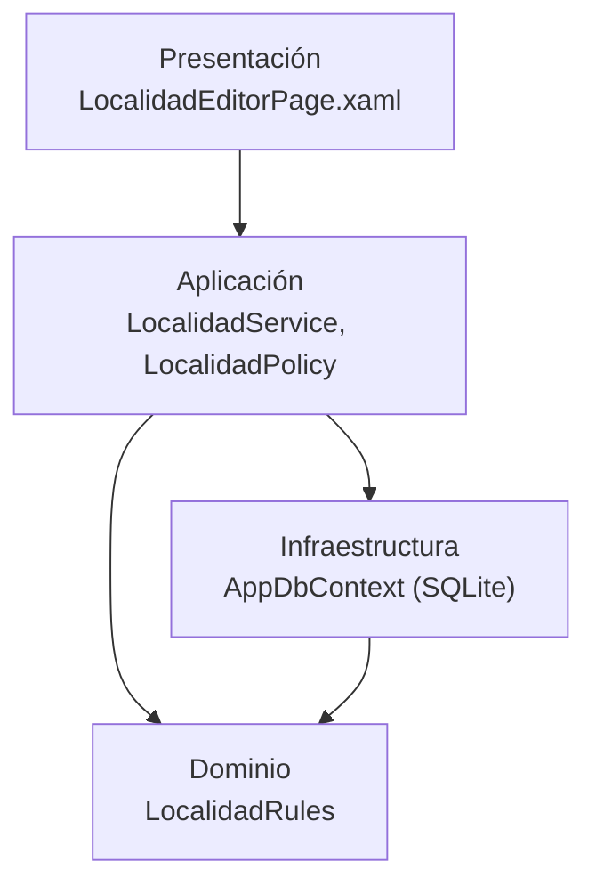

# Arquitectura de MovilidadUrbana y dónde viven sus reglas

## Índice

1. [El sistema en una línea](#1-el-sistema-en-una-línea)
2. [Capas](#2-capas)
3. [Dónde vive cada regla](#3-dónde-vive-cada-regla)
4. [Por qué la demo no copia el código](#4-por-qué-la-demo-no-copia-el-código)

## 1. El sistema en una línea

MovilidadUrbana es una app de ejemplo para cargar localidades y registrar encuestas de movilidad. Tiene tres
aplicaciones independientes en el mismo repositorio: la web, la API REST (`MovilidadUrbana.ApiWeb`) y la app móvil
(`MovilidadUrbana.MAUI`). **Cada una trae sus propias capas** como carpetas: no comparten un proyecto de dominio, así
que una regla aparece una vez por aplicación.

## 2. Capas

Las tres repiten la misma partición. Ejemplo con la app móvil:

| Capa | Carpeta | Qué contiene | Ejemplo |
| --- | --- | --- | --- |
| Dominio | `Domain/` | Entidades y reglas, sin dependencias | `Domain/Rules/LocalidadRules.cs` |
| Aplicación | `Application/` | Casos de uso y textos para la persona | `Application/Localidades/LocalidadService.cs`, `LocalidadPolicy.cs` |
| Infraestructura | `Infrastructure/` | SQLite con Entity Framework, sesión | `Infrastructure/Persistence/AppDbContext.cs` |
| Presentación | `Pages/`, `Presentation/` | Pantallas XAML y sus modelos de vista | `Pages/LocalidadEditorPage.xaml` |

## 3. Dónde vive cada regla

Una regla de negocio se **declara** en el dominio, se **muestra** a la persona desde la aplicación, se **verifica** en
el servicio y se **aplica** en la pantalla o en la base. La ficha de cada regla ancla esos cuatro lugares con
`ruta#Símbolo@SHA`, y la compuerta comprueba cada ancla contra el código.

| Regla | Declara | Muestra | Verifica | Aplica | Estado |
| --- | --- | --- | --- | --- | --- |
| [RN-LOC-01](../fichas/RN-LOC-01.md) largo del nombre | `LocalidadRules.LargoMaximoDelNombre` = 60 | `LocalidadPolicy.RequisitoDelNombre` | `NombreValido`: sólo el mínimo | Campo con `MaxLength="80"`; columna `HasMaxLength(60)` que SQLite no aplica | Divergencia de fondo |
| [RN-LOC-02](../fichas/RN-LOC-02.md) única por provincia | `LocalidadRules.MismaLocalidad` | `LocalidadPolicy.RequisitoDelNombre` | `LocalidadService.SaveAsync` | Sólo el servicio (no hay índice único) | Sin divergencia |

Las fichas anclan la app móvil, que es la unidad que documenta esta demo. La API tiene su propia copia de
`LocalidadRules` con los mismos valores en el SHA fijado; por eso la divergencia de RN-LOC-01 también se ve por HTTP
([compilar y primer pedido, §6](compilar-y-primer-pedido.md#6-lo-que-el-contrato-no-dice)).

## 4. Por qué la demo no copia el código

La demo vive en Lab-Documentos y el código en otro repositorio. Copiarlo obligaría a mantener dos copias; en cambio,
[`source.lock`](../../source.lock) fija un SHA y `verificar.sh` lo baja con `git archive` en cada corrida. Así:

- las anclas y el contrato se comprueban contra **ese** commit, y el resultado no cambia si el otro repositorio avanza;
- la misma corrida compara también contra `main` del otro repositorio y **avisa** si algo derivó, sin bloquear;
- actualizar la demo a un código nuevo es un PR que cambia el SHA y, en el mismo cambio, las fichas y el contrato.
