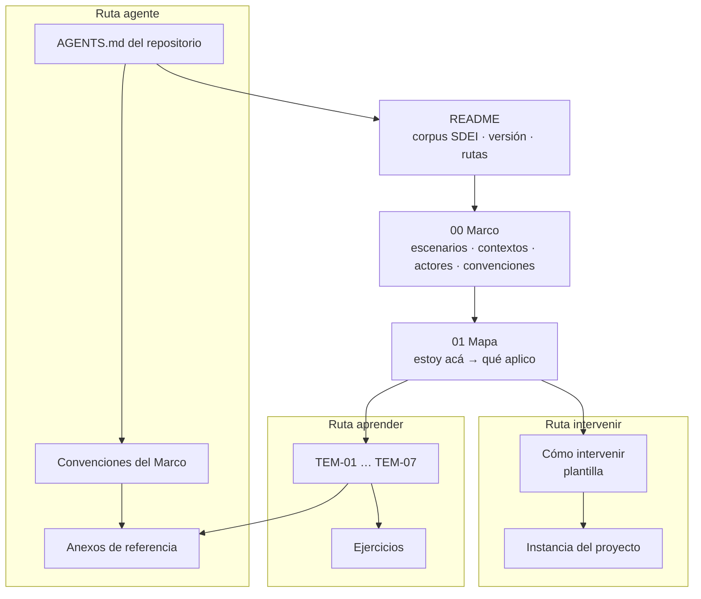

# Sistema de documentación e integración — guía de estudio

| Campo | Valor |
| --- | --- |
| **Cuerpo** (`corpus_id`) | `SDEI` |
| **Versión** | `2.0.0-borrador` |
| **Estado** | Borrador: el esqueleto (README, Marco, Mapa y anexos) está escrito; los siete temas se agregan sobre él |
| **Compuerta** | `docs-guard` (grupos PR-1 a PR-7) en cada pull request; en local, `scripts/ci-local.sh` desde la raíz del repositorio |

## Índice

1. [Qué es esta guía](#1-qué-es-esta-guía)
2. [Objetivos de aprendizaje](#2-objetivos-de-aprendizaje)
3. [Rutas de lectura](#3-rutas-de-lectura)
4. [Tabla de contenido](#4-tabla-de-contenido)
5. [Cómo está armado el cuerpo](#5-cómo-está-armado-el-cuerpo)
6. [Versión y estado](#6-versión-y-estado)
7. [Origen](#7-origen)

## 1. Qué es esta guía

Un **sistema documentador** es el conjunto de piezas, fuentes de verdad, repositorios, anclas de versión, compuertas,
canales y actores (personas y agentes) que producen y mantienen la documentación de un sistema de software. Esta
guía enseña a diseñarlo, a hacerlo funcionar dentro del ciclo de desarrollo y a intervenir en uno que ya existe, con
la documentación tratada como código (*docs as code*): Markdown versionado en Git, revisado por pull request y
verificado por la integración continua.

Sirve a tres lectores. La **persona que estudia** el tema recorre los conceptos en orden y termina con criterio para
elegir piezas, repositorios y controles. La **persona del equipo** que tiene que tocar la documentación de un
proyecto concreto entra por su situación y sale con los pasos y la plantilla. Un **agente** de IA que trabaja sobre un
repositorio encuentra las convenciones, el contrato de frontmatter y los anexos de referencia sin recorrer la prosa.

Lo que no es: no es la documentación de un producto ni un manual de una herramienta. Las herramientas (lychee,
markdownlint, mermaid, DocFX) aparecen como medios de un control, no como tema.

## 2. Objetivos de aprendizaje

Al terminar la ruta «aprender», quien estudia puede hacer lo que dice cada objetivo. Los objetivos son observables:
cada uno se comprueba con un ejercicio del anexo [Ejercicios](99-Anexos/Ejercicios.md).

| Id | Al terminar, podés… | Se comprueba con |
| --- | --- | --- |
| `OBJ-SDEI-01` | Ubicar un sistema en uno de los cuatro escenarios del marco y decir qué clases de pieza documental le corresponden | `EJR-SDEI-01` |
| `OBJ-SDEI-02` | Escribir el frontmatter de una página nueva ([diez campos más `description`](99-Anexos/Esquema-Frontmatter-Y-Prefijos.md#2-los-diez-campos-más-description)) y anticipar qué control de la compuerta la rechazaría si le faltara un campo | `EJR-SDEI-02` |
| `OBJ-SDEI-03` | Elegir entre dos alternativas de diseño documental con la escala anclada, y decir si la decisión es firme | `EJR-SDEI-03` |
| `OBJ-SDEI-04` | Encontrar en el Mapa qué aplicar ante una situación concreta (un cambio de código que deja desactualizada una página) | `EJR-SDEI-04` |
| `OBJ-SDEI-05` | Redactar un requerimiento documental con criterio Dado/Cuando/Entonces y decir quién lo acepta | `EJR-SDEI-05` |

## 3. Rutas de lectura

El cuerpo se lee por tres rutas. Las tres parten de este README y comparten el Marco y los anexos; cambian el orden y
el punto de salida.



*Diagrama: las tres rutas. Todas las cajas tienen archivo en esta versión del cuerpo; la tabla de §4 los enlaza.*

| Ruta | Para quién | Recorrido | Sale con |
| --- | --- | --- | --- |
| **Aprender** | Quien estudia el tema desde cero | [Marco](00-Marco.md) → [Mapa](01-Mapa.md) (leído entero, como panorama) → `TEM-01` a `TEM-07` en orden → tutorial de la mini demo de `Examples/` → [Ejercicios](99-Anexos/Ejercicios.md) | Los objetivos `OBJ-SDEI-01` a `OBJ-SDEI-05` |
| **Intervenir** | La persona del equipo que tiene que cambiar la documentación (alguien que recién llega hace su primer cambio por esta ruta y vuelve a los temas cuando necesita el porqué; para entender cómo se verifica una página en la CI, `TEM-06`) de un proyecto | [Mapa](01-Mapa.md) (fila de su escenario) → [Cómo intervenir](Examples/Como-Intervenir.md) y la instancia de su proyecto ([la de este repositorio](Examples/Como-Intervenir-Lab-Documentos.md)) → [Lista de verificación](99-Anexos/Lista-De-Verificacion.md) | Un pull request que la compuerta acepta |
| **Agente** | Un agente de IA que trabaja sobre el repositorio | [`AGENTS.md`](../../../AGENTS.md) en la raíz del repositorio → este README → [Convenciones](00-Marco.md#5-convenciones) → [Esquema de frontmatter](99-Anexos/Esquema-Frontmatter-Y-Prefijos.md) → [Glosario](99-Anexos/Glosario.md) | Las reglas para producir una página que pasa la compuerta |

Los siete temas están escritos, así que la ruta «aprender» ya no pasa por la guía de un solo archivo: esa guía está
`obsoleta` y su [tabla de destinos](Sistema-Documentador-Tecnico-Guide.md#tabla-de-destinos) dice en qué tema o
anexo quedó cada una de sus secciones, y cuáles se trasladaron sólo en parte.

## 4. Tabla de contenido

| Documento | `doc_id` | Tipo | Estado | Qué contiene |
| --- | --- | --- | --- | --- |
| [README](README.md) | `IDX-SDEI` | índice | borrador | Esta página: objetivos, rutas y contenido |
| [00 Marco](00-Marco.md) | `MARCO-SDEI` | marco de referencia | borrador | Los cuatro escenarios, los contextos, los actores y las convenciones del cuerpo |
| [01 Mapa](01-Mapa.md) | `MAPA-SDEI` | mapa | borrador | Tablas «estoy acá → qué aplico» por escenario, por contexto, por artefacto y por actor; índice de anexos |
| [Tema 01 — Qué es un sistema documentador](TEM-01-Sistema-Documentador.md) | `TEM-SDEI-01` | tema | borrador | Piezas, arquitectura de referencia, un caso de industria y adopciones públicas |
| [Tema 02 — El ciclo documental](TEM-02-Ciclo-Documental.md) | `TEM-SDEI-02` | tema | borrador | De la captura de requerimientos a la integración: fases, RRD y estados |
| [Tema 03 — Topología de repositorios y versionado](TEM-03-Topologia-Y-Versionado.md) | `TEM-SDEI-03` | tema | borrador | Dónde vive cada pieza y contra qué versión vale |
| [Tema 04 — Doble audiencia](TEM-04-Doble-Audiencia.md) | `TEM-SDEI-04` | tema | borrador | Personas y agentes leyendo la misma fuente: canales, `AGENTS.md` y anti-inyección |
| [Tema 05 — Ayuda al usuario final](TEM-05-Ayuda-Al-Usuario-Final.md) | `TEM-SDEI-05` | tema | borrador | La ayuda dentro del producto, trazada a la regla con su versión, con roles como contexto |
| [Tema 06 — Compuertas de calidad y CI](TEM-06-Compuertas-Y-CI.md) | `TEM-SDEI-06` | tema | borrador | Qué bloquea, qué avisa y por qué: dos carriles, regla de bloqueo, pares rojo/verde |
| [Tema 07 — Integración con un marco SDD](TEM-07-Marco-SDD.md) | `TEM-SDEI-07` | tema | borrador (hasta el escalón 2) | La documentación dentro de un desarrollo guiado por especificación: qué se cita del SDD, qué se agrega y cómo resuelven las trazas |
| [Anexo: esquema de frontmatter y prefijos](99-Anexos/Esquema-Frontmatter-Y-Prefijos.md) | `ANX-SDEI-ESQUEMA` | anexo | borrador | Los diez campos más `description`, vocabularios y registro de prefijos |
| [Anexo: glosario](99-Anexos/Glosario.md) | `ANX-SDEI-GLOSARIO` | anexo | borrador | Términos del cuerpo con su sigla y dónde se anclan |
| [Anexo: referencias](99-Anexos/Referencias.md) | `ANX-SDEI-REFERENCIAS` | anexo de referencias | borrador | Bibliografía en APA 7 con anclas `ref-…` y fecha de consulta |
| [Anexo: criterios de calidad](99-Anexos/Criterios-De-Calidad.md) | `ANX-SDEI-CQ` | anexo | borrador | `CQ-01` a `CQ-14`, con su pregunta y el control que los automatiza |
| [Anexo: patrones de ejemplos](99-Anexos/Patrones-De-Ejemplos.md) | `ANX-SDEI-PE` | anexo | borrador | `PE-01` a `PE-12` para escribir ejemplos y material de consulta |
| [Anexo: lista de verificación](99-Anexos/Lista-De-Verificacion.md) | `ANX-SDEI-VER` | anexo | borrador | Ítems `VER-*` que se revisan sobre una guía antes de pasarla a vigente |
| [Anexo: cómo decidir](99-Anexos/Como-Decidir.md) | `ANX-SDEI-DECIDIR` | anexo | borrador | Criterios, escala anclada, filtros, regla de firmeza y una matriz trabajada |
| [Anexo: ejercicios](99-Anexos/Ejercicios.md) | `ANX-SDEI-EJERCICIOS` | anexo | borrador | Ejercicios de transferencia `EJR-SDEI-nn`, con claves al final |
| [Guía de un solo archivo](Sistema-Documentador-Tecnico-Guide.md) | `DOC-SDT-0001` | nota de estudio | obsoleto | La primera forma del mismo dominio en un archivo. La reemplaza este cuerpo: su [tabla de destinos](Sistema-Documentador-Tecnico-Guide.md#tabla-de-destinos) lleva cada sección a su tema o anexo. Se archiva en la versión siguiente del cuerpo |
| [Tutorial de la mini demo (MovilidadUrbana)](Examples/MovilidadUrbana-Mini-Demo/README.md) | `DEMO-MU-00` | ejemplo | borrador | Las piezas de `ESC-SDEI-2` sobre la app real, ancladas a su SHA: fichas, ayuda, contrato y registro de requerimientos |
| [Ejemplo: ayuda por rol](Examples/Prueba-Ayuda-Por-Rol/README.md) | — | ejemplo | — | Prueba de concepto en Blazor: ayuda contextual que se sirve según el rol |
| [Ejemplo: lanzar la prueba de concepto](Examples/Lanzar-Example.md) | `GP-SDEI-LANZAR` | guía práctica | borrador | Cómo levantar el ejemplo anterior en su devcontainer y publicarlo |
| [Cómo intervenir: plantilla](Examples/Como-Intervenir.md) | `GP-SDEI-INTERVENIR` | proceso | borrador | Los cinco pasos para cambiar la documentación de un proyecto (ubicar, derivar, validar, proponer, mantener), con entradas, salidas y validaciones |
| [Cómo intervenir en Lab-Documentos](Examples/Como-Intervenir-Lab-Documentos.md) | `GP-SDEI-INTERVENIR-LD` | proceso | borrador | La instancia de una página de la plantilla para este repositorio |

## 5. Cómo está armado el cuerpo

El cuerpo va de lo general a lo particular. El **Marco** fija una sola vez el vocabulario que después reaparece en
todos los documentos: escenarios, contextos, actores y convenciones. El **Mapa** cruza ese vocabulario con las
situaciones del lector. Cada **tema** sigue la misma estructura interna de seis secciones (definición, aplicación por
escenario, ejemplos concretos, preguntas guía, criterios de calidad y anexo), para que se aprenda una sola forma de
leer. Los **anexos** guardan el material de consulta, separado del recorrido.

```text
Sistema-De-Documentacion-E-Integracion/
├── README.md                 este índice (corpus_id y versión viven sólo acá)
├── 00-Marco.md               escenarios, contextos, actores, convenciones
├── 01-Mapa.md                estoy acá → qué aplico
├── 99-Anexos/                material de consulta
└── Examples/                 ejemplos ejecutables y guías prácticas
```

Todo documento del cuerpo abre con frontmatter, salvo los `README.md` de las subcarpetas de ejemplos. Como este README
declara `corpus_id`, la compuerta trata la carpeta entera como **cuerpo nuevo**: un archivo sin frontmatter o una
referencia mal formada la ponen en rojo. En una carpeta sin README con `corpus_id` (lo heredado de otras guías del
repositorio), esas mismas faltas sólo avisan. El contrato
está en el [anexo del esquema](99-Anexos/Esquema-Frontmatter-Y-Prefijos.md).

## 6. Versión y estado

La versión del cuerpo sigue SemVer y vive sólo en este README. Es la 2 porque el cuerpo reemplaza a la guía de un
solo archivo, primera forma del mismo contenido **[criterio propio del plan de implementación]**. El orden es este:
la compuerta `docs-guard` corre en cada pull request y pasa con documentos en borrador; cuando están los siete temas y
la revisión del escalón da su visto bueno, una persona pasa cada documento a `vigente` en un pull request propio
(revisando su `description`), y después la persona responsable del producto fija la versión en `2.0.0` y la marca con
una etiqueta anotada.

| Si ves… | Significa | Qué hacer |
| --- | --- | --- |
| `status: borrador` | El texto puede cambiar sin aviso | Usarlo, pero no citarlo como norma |
| `status: vigente` | Una persona lo revisó y lo aprobó | Citarlo por `corpus_id/doc_id` |
| `status: obsoleto` | Lo reemplaza otro documento | Ir al reemplazo que indica |

## 7. Origen

El diseño del cuerpo (siete temas, tres rutas, anexos) sale del expediente 0002 de DocAsCode, que vive en el
repositorio hermano Lab-Documentos.Documentacion: decisiones D27 (cuerpo documental y rutas), D28 (citación APA 7
con fecha de consulta), D09 (contrato de frontmatter y prefijos) y D29 (objetivos y ejercicios como anexo, sin tocar
el Profile de guía de estudio). Este esqueleto es la unidad E1-U4a del plan de implementación de ese expediente.

Siguiente documento: [00 Marco](00-Marco.md).
