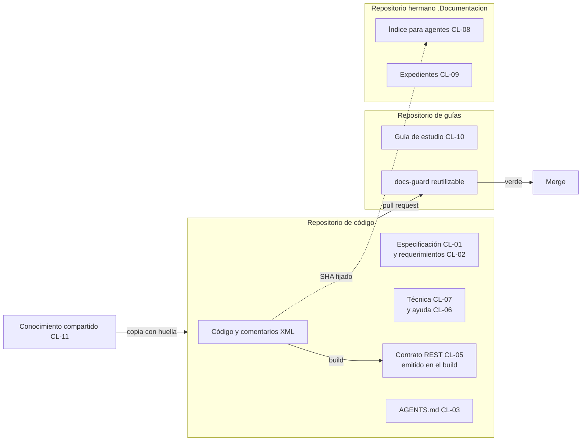

# Tema 01 — Qué es un sistema documentador

Este tema presenta el objeto de toda la guía: el **sistema documentador**, que es la maquinaria que produce y mantiene
la documentación de un sistema de software, y no la documentación misma. Quien estudia sale sabiendo qué piezas lo
forman, de qué fuente sale cada una, quién la escribe y qué control la revisa. Quien tiene que intervenir en un
proyecto sale con un inventario que puede llenar para el suyo. Un agente encuentra la arquitectura de referencia y la
plantilla del inventario en secciones con nombre fijo. Usa el vocabulario del [Marco](00-Marco.md): escenarios
`ESC-SDEI-n`, contextos `CTX-SDEI-n`, actores `ACT-SDEI-n` y clases de pieza `CL-nn`.

## Índice

1. [Definición](#definición)
2. [Aplicación por escenario](#aplicación-por-escenario)
3. [Ejemplos concretos](#ejemplos-concretos)
4. [Preguntas guía](#preguntas-guía)
5. [Criterios de calidad](#criterios-de-calidad)
6. [Anexo](#anexo)
7. [Fuentes y observaciones](#fuentes-y-observaciones)

## Definición

### Qué es

Un **sistema documentador** es el conjunto de piezas documentales, fuentes de verdad, repositorios, anclas de versión,
compuertas, canales y actores (personas y agentes de IA) que producen y mantienen la documentación de un sistema. La
documentación es lo que se lee; el sistema documentador es lo que hace que lo que se lee sea correcto, esté al día y
llegue a quien lo necesita.

La forma que la industria adoptó para construirlo se llama *docs as code*. Write the Docs, la comunidad de referencia
de quienes escriben documentación técnica, la define como escribir la documentación «con las mismas herramientas que
el código» y enumera sus componentes: gestor de incidencias, control de versiones con Git, marcado en texto plano,
revisión de código y pruebas automatizadas ([Write the Docs, s. f.](99-Anexos/Referencias.md#ref-writethedocs-sf)).
El libro de ingeniería de software de Google llega a lo mismo desde la práctica: la documentación está tan acoplada
al código que conviene tratarla como código, tiene que tener dueño (sin dueño, envejece) y, idealmente, vive bajo
control de versiones junto al código que documenta
([Winters et al., 2020](99-Anexos/Referencias.md#ref-winters-2020)).

Cinco términos sostienen el resto del tema. Los cinco están en el [Glosario](99-Anexos/Glosario.md#2-términos).

| Término | Qué es | Ejemplo |
| --- | --- | --- |
| Pieza documental | Unidad que se escribe, se versiona y se valida por separado | Una página de ayuda, un `AGENTS.md`, el `openapi.json` |
| Fuente de verdad | El lugar del que sale lo que la pieza afirma; si la pieza y la fuente discrepan, manda la fuente | El código para la referencia de la API; la ficha de una regla para la ayuda que la menciona |
| Clase de pieza (`CL-nn`) | Categoría cerrada que fija dónde vive la pieza, contra qué se ancla, qué control la revisa y quién interviene | `CL-06` ayuda al usuario final |
| Compuerta | Control de la integración continua (CI) que termina en verde o en rojo en cada pull request | `docs-guard`, grupos PR-1 a PR-7 |
| Clase de intervención D/P/H | Clasifica el **acto** de producir o cambiar una pieza, no a la persona: lo hace un generador determinista (D), lo propone un agente o una persona y entra si la compuerta da verde (P), o sólo lo decide una persona (H). Una pieza puede tener dos actos: una decisión de arquitectura la redacta un agente (P) y la acepta una persona (H) | El contrato REST es D; la ayuda es P; la especificación es «P redacta; H acepta» |

### Qué problema resuelve

La documentación de software falla de maneras conocidas. Un estudio que analizó 878 artefactos de cuatro fuentes
(listas de correo, Stack Overflow, gestores de incidencias y pull requests) armó una taxonomía de esos problemas
([Aghajani et al., 2019](99-Anexos/Referencias.md#ref-aghajani-2019)). Una encuesta posterior a 146 profesionales
nombra entre los problemas que más pesan el contenido insuficiente o inadecuado y la información obsoleta o ambigua
([Aghajani et al., 2020](99-Anexos/Referencias.md#ref-aghajani-2020)). Y en más de 3000 proyectos de GitHub, la
mayoría tuvo en algún momento de su historia al menos una referencia en la documentación a un elemento de código que
ya no existía ([Tan et al., 2024](99-Anexos/Referencias.md#ref-tan-2024)). Ninguna de esas fallas se arregla
escribiendo mejor una página: se arregla con un sistema que sepa de dónde sale cada afirmación, que lo compruebe en
cada cambio y que diga quién decide cuando la página y el código discrepan.

Ese es el trabajo del sistema documentador. Responde cuatro preguntas para cada pieza:

1. **De dónde sale** lo que afirma (fuente de verdad).
2. **Contra qué versión** del código vale (ancla de versión; el [tema 03](TEM-03-Topologia-Y-Versionado.md) la
   desarrolla).
3. **Qué control** detecta que dejó de valer (compuerta o aviso programado).
4. **Quién** puede cambiarla y quién decide si hay una divergencia (clase D/P/H y actor).

### Arquitectura de referencia



*Diagrama: las piezas se reparten en tres repositorios. El código emite la referencia en el build; el índice para
agentes se ancla al código por SHA; toda pieza entra por un pull request que la compuerta revisa.*

Las catorce clases de pieza, por nombre; dónde vive cada una, su ancla, su control y quién interviene están en el
catálogo del [Mapa](01-Mapa.md#4-por-artefacto):

| Clase | Pieza | Clase | Pieza |
| --- | --- | --- | --- |
| CL-01 | Especificación: necesidad, caso de uso, regla, decisión de arquitectura | CL-08 | Índice interno para agentes (ia-db) |
| CL-02 | Registro de requerimientos documentales (RRD) | CL-09 | Expedientes, bitácoras y prompts |
| CL-03 | `AGENTS.md` | CL-10 | Guía de estudio |
| CL-04 | Referencia .NET (comentarios XML) | CL-11 | Conocimiento compartido, copiado con huella |
| CL-05 | Contrato REST (`openapi.json`) | CL-12 | Proceso «Cómo intervenir» |
| CL-06 | Ayuda al usuario final | CL-13 | README y CHANGELOG |
| CL-07 | Documentación técnica escrita | CL-14 | Canales derivados para agentes (sólo con sitio) |

| Componente | Responsabilidad | Lo que no hace |
| --- | --- | --- |
| Repositorio de código | Fuente de verdad del comportamiento; emite la referencia (OpenAPI, XML) en el build | No aloja la guía de estudio |
| Repositorio de guías | Guarda el cuerpo de estudio, los ejemplos y el workflow reutilizable `docs-guard` | No copia el código: lo fija por SHA |
| Repositorio hermano `.Documentacion` | Índice para agentes, expedientes y bitácoras | No es un marco de especificación propio: es un índice |
| `docs-guard` | Corre las compuertas y devuelve un código de salida | No escribe, no tiene secretos, no invoca agentes |
| Persona del equipo | Decide lo de clase H y asienta por escrito la delegación del merge | No necesita aprobar cada pull request de clase D o P sin reserva |
| Agente de IA | Propone fichas, borradores, reindexado y correcciones (clase P) | No acepta decisiones de arquitectura ni decide divergencias |

### Qué no es

- **No es un generador de sitios.** Mintlify, Docusaurus, MkDocs o DocFX son medios de una pieza (el sitio publicado).
  Un sistema documentador puede no tener sitio: el de esta guía no lo tiene y se lee en el render del repositorio
  (`CTX-SDEI-1`).
- **No es una carpeta `docs/`.** Una carpeta sin fuente declarada, sin ancla y sin control es documentación sin
  sistema: envejece sin que nadie lo note.
- **No es la wiki del equipo.** Una wiki que vive fuera del control de versiones no se revisa por pull request ni se
  ancla a una versión del código; puede ser un canal, nunca la fuente.
- **No es una herramienta de IA.** Los agentes son actores del sistema, con un rol acotado (clase P). El sistema
  funciona sin ellos; con ellos, la compuerta es lo que impide que un borrador equivocado entre.

## Aplicación por escenario

El tronco es el mismo en los cuatro escenarios del [Marco](00-Marco.md#2-escenarios): piezas con fuente, ancla,
control y actor. Cambian qué clases se activan y qué fuente se genera.

| Escenario | Qué aporta pensar el sistema documentador | Piezas centrales | Fuente generada | Lo que más cuesta |
| --- | --- | --- | --- | --- |
| `ESC-SDEI-1` Corpus de guías | Que la guía misma tenga contrato (frontmatter), compuerta y versión, aunque no documente un producto | CL-10, CL-12, CL-02 | Ninguna: todo es prosa | Que el cuerpo no se contradiga: un dato en un solo documento |
| `ESC-SDEI-2` App sin roles | Separar lo que se genera del código (contrato REST) de lo que se escribe (ayuda, técnica) | CL-05, CL-06, CL-07, CL-02 | OpenAPI y comentarios XML | Que la ayuda diga el mismo número que el código |
| `ESC-SDEI-3` Panel con roles | Decidir qué ayuda ve cada rol sin duplicar páginas, y trazar cada página al caso de uso de su pantalla | CL-01, CL-06, CL-08 | OpenAPI y comentarios XML | La confidencialidad: el rol se decide en el servidor |
| `ESC-SDEI-4` Servicio con paquetes | Documentar varias líneas de versión que conviven, para integradores que no ven el código | CL-05, CL-11, CL-13 | API pública de los paquetes | Que cada línea tenga su documentación y su CHANGELOG |

Los contextos cambian una respuesta dentro de cada fila:

| Contexto | Qué cambia en el sistema documentador |
| --- | --- |
| `CTX-SDEI-1` con o sin sitio | Con sitio aparecen el build del sitio y los canales derivados para agentes (una página `.md` por página, `llms.txt`); sin sitio, el canal es el propio Markdown |
| `CTX-SDEI-2` con o sin SDD | Con un marco de desarrollo guiado por especificación, la especificación ya es pieza y fuente; sin él, las reglas se escriben como fichas propias |
| `CTX-SDEI-3` topología | Una pieza en otro repositorio que el código necesita un ancla fijada y un aviso de desfase |
| `CTX-SDEI-4` organización del runner | Fuera de la organización del runner, la compuerta se copia con su huella en lugar de llamarse |

## Ejemplos concretos

### Un caso de industria: el portal de un proveedor de notificaciones

La [guía de un solo archivo](Sistema-Documentador-Tecnico-Guide.md#1-qué-es-el-sitio-consultado) de este mismo
directorio analiza el portal público de documentación de OneSignal, un proveedor de notificaciones push, y verifica
cada afirmación con la respuesta del propio sitio. Leído con este tema, el portal se descompone así:

| Pieza | Fuente de verdad | Cómo se produce | Clase |
| --- | --- | --- | --- |
| Guías y conceptos | Archivos MDX (Markdown con componentes) en un repositorio | Los escriben personas | P |
| Referencia de cada endpoint | `openapi.json` 3.1 | Se genera del contrato | D |
| Sitio HTML | El repositorio entero | Un *push* a la rama de producción dispara el build en Mintlify | D |
| Salida para agentes | El mismo build | `.md` por página y `llms.txt` | D |

La lección no es la herramienta. Es que la prosa y el contrato son dos fuentes distintas con dos ritmos distintos, y
que separar la referencia generada de las guías escritas es la decisión que más simplifica el mantenimiento: es la
distinción entre referencia y explicación que propone Diátaxis
([Procida, s. f.](99-Anexos/Referencias.md#ref-procida-sf)).

### Adopciones públicas de las prácticas que recomienda este tema

Cada práctica recomendada se apoya en al menos dos proyectos públicos que la sostienen hoy. La fecha es la del último
commit que tocó la ruta que materializa la práctica, consultada el 2026-10-27 con la API pública de GitHub; todas caen
dentro de los 24 meses anteriores **[umbral de criterio propio del plan]**. El comando que reproduce la tabla está en
el [ensayo de adopciones](#ensayo-reproducible-adopciones-con-fecha).

| Práctica | Adopción | Evidencia (ruta, commit, fecha) |
| --- | --- | --- |
| P1. La documentación vive en Git y cambia por pull request | GitHub ([GitHub, 2026a](99-Anexos/Referencias.md#ref-github-docs-2026)) | `content/`, `ee20fda`, 2026-10-27; además verifica enlaces en la CI con `.github/workflows/link-check-daily.yml` (`7abf80d`, 2026-01-26) |
| | Kubernetes ([Kubernetes, 2026](99-Anexos/Referencias.md#ref-kubernetes-website-2026)) | `content/en/`, `ed70e31`, 2026-10-26 |
| | Microsoft Azure ([Microsoft, 2026](99-Anexos/Referencias.md#ref-microsoft-azure-docs-2026)) | `articles/`, `d7e590b`, 2026-10-27 |
| P2. La referencia de la API sale de un contrato OpenAPI versionado | GitHub ([GitHub, 2026b](99-Anexos/Referencias.md#ref-github-openapi-2026)) | `descriptions/`, `a5c38c1`, 2026-10-27 |
| | Stripe ([Stripe, 2026](99-Anexos/Referencias.md#ref-stripe-openapi-2026)) | `openapi/`, `a6cd987`, 2026-10-26 |
| P3. La CI revisa la prosa con un linter además de los enlaces | Mintlify ([Mintlify, 2026](99-Anexos/Referencias.md#ref-mintlify-docs-2026)) | `.vale.ini`, `4a8f15c`, 2026-08-14 |
| | Red Hat OpenShift ([Red Hat, 2026](99-Anexos/Referencias.md#ref-redhat-openshift-docs-2026)) | `.vale.ini`, `df83131`, 2026-08-25 |
| | Grafana ([Grafana Labs, 2026](99-Anexos/Referencias.md#ref-grafana-2026)) | `.vale.ini`, `5427e8d`, 2026-08-03 |

Lo que la tabla prueba y lo que no: prueba que la práctica está materializada y viva en esos repositorios en la ventana
de 24 meses. No prueba que sea la mejor práctica ni mide su efecto; para eso están las fuentes académicas de
[Definición](#qué-problema-resuelve).

### Ensayo reproducible: inventario de un sistema documentador real

El inventario de un sistema documentador se hace por comando, no de memoria: así se puede repetir y comparar. Este
ensayo lee el frontmatter de cada página de esta guía con el mismo parser que usa la compuerta y cuenta las piezas
por tipo. Precondición: Python 3, un clon de Lab-Documentos y el script, que está en el repositorio público
Lab-Documentos.Documentacion (expediente 0002 de DocAsCode, carpeta `evidencia/E1-U4b/`); se corre desde cualquier
carpeta, con la ruta del clon como argumento. Resultado esperado: la lista de piezas por tipo, las
piezas que no son prosa y los workflows que corren las compuertas.

[Compilado: `evidencia/E1-U4b/01-tem01-inventario.sh` del expediente 0002 de DocAsCode, en el repositorio
Lab-Documentos.Documentacion; salida sobre el commit `080f158` de Lab-Documentos, 2026-10-27, recortada]

```text
$ bash 01-tem01-inventario.sh <clon de Lab-Documentos>
piezas .md con frontmatter, por doc_type:
  anexo                  7
  anexo-referencias      1
  ayuda (sin doc_id)     12
  ficha                  2
  guia-practica          5
  indice                 1
  mapa                   1
  marco-de-referencia    1
  rrd                    1
  study-note             1
piezas que no son prosa: Examples/MovilidadUrbana-Mini-Demo/contracts/openapi.json,
  Examples/MovilidadUrbana-Mini-Demo/source.lock, Examples/MovilidadUrbana-Mini-Demo/verificar.sh, …
workflows que corren compuertas: docs-enlaces-semanal.yml, docs-guard.yml, framework-concept-demo.yml,
  mini-demo-movilidad.yml
```

Leído con el tema: el cuerpo de estudio (`indice`, `marco-de-referencia`, `mapa`, `anexo`) es CL-10; las doce
páginas de ayuda de las pruebas de concepto son CL-06; la `rrd` y las dos `ficha` son la mini demo de MovilidadUrbana
(CL-02 y fichas de reglas); el `openapi.json` es CL-05 y el `source.lock` es su ancla. Cuatro workflows ejecutan
controles: dos bloquean en cada pull request (`docs-guard.yml` y el de la mini demo) y uno sólo avisa por semana.

### Ensayo reproducible: adopciones con fecha

[Compilado: `evidencia/E1-U4b/04-adopciones.sh` del mismo expediente; corrida del 2026-10-27, recortada a las filas
de este tema]

```text
$ bash 04-adopciones.sh 2026-10-27
corte: 2026-10-27 · ventana desde: 2024-10-27
práct repositorio                  ruta                             commit       fecha      ≤24m
P1     github/docs                  content                          ee20fda5d481 2026-10-27 sí
P1     github/docs                  .github/workflows/link-check-daily.yml 7abf80d21149 2026-01-26 sí
P1     kubernetes/website           content/en                       ed70e311737a 2026-10-26 sí
P1     MicrosoftDocs/azure-docs     articles                         d7e590b2008f 2026-10-27 sí
P2     github/rest-api-description  descriptions                     a5c38c137866 2026-10-27 sí
P2     stripe/openapi               openapi                          a6cd9878ad3d 2026-10-26 sí
P3     mintlify/docs                .vale.ini                        4a8f15c3dc3f 2026-08-14 sí
P3     openshift/openshift-docs     .vale.ini                        df831314fea6 2026-08-25 sí
P3     grafana/grafana              .vale.ini                        5427e8d92b28 2026-08-03 sí
```

Si se corre otro día, los commits cambian: la ventana se recalcula desde la fecha que se pasa como argumento.

### Un cambio recorrido de punta a punta

MovilidadUrbana tiene un defecto real: la pantalla promete 60 caracteres para el comentario y el campo admite 80. Así
responde el sistema documentador cuando alguien corrige el código:

1. La ficha `RN-LOC-01` de la [mini demo](Examples/MovilidadUrbana-Mini-Demo/README.md) declara la regla y dónde se
   aplica en el código, con la forma `ruta#Símbolo@SHA`.
2. La página de ayuda que menciona el límite lleva `traces: [RN-LOC-01@1.1]` en su frontmatter.
3. Si el código cambia, dos controles lo detectan. El workflow de la mini demo compara el código fijado con la rama
   principal del código y **avisa** que el símbolo que cita la ficha cambió. Cuando alguien actualiza el SHA fijado,
   la compuerta busca de nuevo cada ancla `ruta#Símbolo@SHA` y da **rojo** si el símbolo ya no está en ese SHA. Un agente (`ACT-SDEI-4`) propone entonces actualizar la ficha y subir su versión, y la página
   que traza a la versión anterior queda en rojo hasta que alguien la revisa. Ningún control lee el número «60» de
   la página y lo compara con el «80» del código: lo que se automatiza es que la página quede marcada para revisar
   cuando la regla cambia.
4. Si el número correcto es 60 u 80 no lo decide nadie de la cadena técnica. La cadena de fuentes es esta: la ayuda
   sale de la ficha, y la ficha sale del código. Entre la página y la ficha manda la ficha; entre la ficha y el
   código, manda el código, porque la ficha describe lo que el código hace. Lo que esa cadena no resuelve es si el
   código hace lo que se quiso: la pantalla promete 60 y el código acepta 80. Eso es una **divergencia** entre la
   letra (el código) y la intención (lo que el producto debía hacer), y la decide la analista (`ACT-SDEI-2`), acto de
   clase H. Después de su decisión, se corrige el código o la pantalla, y la cadena vuelve a mandar.

## Preguntas guía

1. ¿Qué piezas documentales tiene tu sistema hoy, y de qué fuente de verdad sale cada una?
2. ¿Cuáles de esas piezas se pueden generar (clase D) y hoy se escriben a mano?
3. Si el código cambia mañana, ¿qué control se pondría en rojo, y qué pieza quedaría desactualizada sin que nada lo
   detecte?
4. ¿Quién decide cuando una página y el código discrepan? ¿Está escrito en algún lado?
5. ¿Qué parte de tu sistema documentador depende de una herramienta que podrías cambiar sin perder las piezas?

## Criterios de calidad

| Criterio | Un sistema documentador bueno | Uno pobre | Se comprueba con |
| --- | --- | --- | --- |
| Fuente declarada | Cada pieza dice de dónde sale lo que afirma | Las páginas repiten datos del código sin decir de dónde | `CQ-01`, `CQ-11` del [anexo de criterios](99-Anexos/Criterios-De-Calidad.md#1-los-catorce-criterios) |
| Referencia generada | Lo que puede salir del código sale del código (clase D) | La referencia de la API se copia a mano | Diff del contrato en la CI |
| Control por pieza | Toda clase activa tiene un control que la pone en rojo o un aviso programado | Hay piezas que ningún control mira | Tabla de inventario del [Anexo](#anexo), columna «Control» |
| Roles escritos | Está escrito qué decide cada actor y qué no | «Lo revisa alguien» | Tabla de actores del [Marco](00-Marco.md#4-actores) |
| Independencia de la herramienta | Las piezas son texto plano versionado; la herramienta se puede cambiar | El contenido vive dentro de un servicio que no exporta | Que el repositorio se lea sin el sitio |
| Inventario reproducible | El inventario sale de un comando | El inventario es una lista escrita a mano que envejece | Un ensayo como el de [Ejemplos concretos](#ensayo-reproducible-inventario-de-un-sistema-documentador-real) |

## Anexo

Plantilla comentada para inventariar el sistema documentador de un proyecto. Se llena una fila por pieza. Debajo de
la tabla, las preguntas que guían cada campo.

[Fragmento ilustrativo: plantilla vacía con una fila de ejemplo de la mini demo]

```markdown
## Inventario del sistema documentador de <proyecto>

Escenario: <ESC-SDEI-n> · Contextos: <CTX-SDEI-n, …> · Fecha: <AAAA-MM-DD> · Commit: <SHA>

| Pieza | Clase | Fuente de verdad | Ancla | Control | Intervención | Decide si discrepa |
| --- | --- | --- | --- | --- | --- | --- |
| docs/ayuda/alta-de-localidad.md | CL-06 | Fichas RN-LOC-01 y RN-LOC-02 | SHA en source.lock | traces-resolve | P | Analista |
```

| Campo | Preguntas que lo guían |
| --- | --- |
| Pieza | ¿Es una unidad que se escribe y se valida por separado? Si dos archivos siempre cambian juntos, ¿son una sola pieza? |
| Clase | ¿En qué clase del [catálogo](01-Mapa.md#4-por-artefacto) encaja? Si no encaja en ninguna, ¿quién abre una clase nueva? |
| Fuente de verdad | Si la pieza y esa fuente discrepan, ¿cuál manda? Si la respuesta es «la pieza», la pieza es la fuente |
| Ancla | ¿Contra qué commit, SHA fijado o etiqueta vale? El [tema 03](TEM-03-Topologia-Y-Versionado.md) ayuda a elegir |
| Control | ¿Qué control da rojo si la pieza deja de valer? Si ninguno, ¿hay al menos un aviso programado? |
| Intervención | ¿La genera una herramienta (D), la propone alguien (P) o sólo la decide una persona (H)? Si tiene dos actos, se escriben los dos, como en el catálogo: «P redacta; H acepta» |
| Decide si discrepa | ¿Qué actor del Marco resuelve una divergencia entre la pieza y la fuente? |

## Fuentes y observaciones

Fuentes primarias del tema, todas con fecha de consulta en el [anexo de referencias](99-Anexos/Referencias.md):
Write the Docs (s. f.), Winters et al. (2020), Aghajani et al. (2019 y 2020), Tan et al. (2024), Procida (s. f.) y
los repositorios de la tabla de adopciones. El capítulo de Winters et al. y los resúmenes de los tres artículos se
releyeron el 2026-10-27 para este tema.

| Tipo | Observación |
| --- | --- |
| Hecho | Las cifras del inventario son de la salida del ensayo sobre `080f158`; cambian cuando el cuerpo suma piezas |
| Hecho | Las adopciones prueban presencia y actividad en 24 meses, no efectividad |
| Interpretación | Que separar referencia generada y guías escritas es «la decisión que más simplifica el mantenimiento» es una lectura del caso de OneSignal y de Diátaxis, no una medición |
| Criterio propio | El umbral de 24 meses y el de dos adopciones por práctica son del plan de implementación del expediente 0002, sin fuente externa |

Documento anterior: [01 Mapa](01-Mapa.md). Siguiente documento: [Tema 02 — El ciclo documental](TEM-02-Ciclo-Documental.md).
