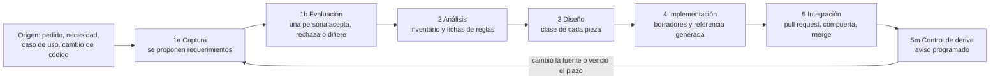

# Tema 02 — El ciclo documental

El [tema 01](TEM-01-Sistema-Documentador.md) mostró de qué está hecho un sistema documentador. Este tema muestra cómo
se mueve: por qué fases pasa una pieza desde que alguien la necesita hasta que entra al repositorio, qué sale de cada
fase, quién decide y qué control lo verifica. Quien estudia sale sabiendo escribir un requerimiento documental con
criterio comprobable y ubicar cada decisión en su fase. Quien interviene en un proyecto sale con la plantilla del
registro de requerimientos y la regla de quién acepta cada cosa.

## Índice

1. [Definición](#definición)
2. [Aplicación por escenario](#aplicación-por-escenario)
3. [Ejemplos concretos](#ejemplos-concretos)
4. [Preguntas guía](#preguntas-guía)
5. [Criterios de calidad](#criterios-de-calidad)
6. [Anexo](#anexo)
7. [Fuentes y observaciones](#fuentes-y-observaciones)

## Definición

### Qué es

El **ciclo documental** es la secuencia de fases por la que pasa una pieza documental, con lo que entra y sale de
cada fase, quién decide y qué control comprueba la salida. Tiene cinco fases, y la primera se parte en dos porque
juntan trabajos de naturaleza distinta: relevar lo que hace falta (lo puede hacer un agente) y decidir qué se hace (lo
decide una persona).



*Diagrama: las fases del ciclo. El mantenimiento no es una sexta fase: es el control de deriva dentro de la fase 5
(marcado «5m»), que devuelve la pieza al ciclo cuando su fuente cambia o vence su plazo de revisión.*

A qué fase vuelve una pieza que derivó depende de qué cambió. Si cambió **lo que la audiencia necesita** (una tarea
nueva, una pantalla que desaparece, otra audiencia), vuelve a **1a**: hay que reescribir o agregar filas del RRD y que
una persona las decida de nuevo. Si el requerimiento sigue igual y sólo cambió **lo que la fuente dice** (un límite,
un nombre de campo), vuelve a **4**: se corrige el texto contra la fuente nueva, sin pasar por la evaluación.

La tabla usa las clases de intervención del [Marco](00-Marco.md#1-definiciones): **D**, la produce un generador
determinista (el contrato que emite el build); **P**, la propone un agente o una persona y entra si la compuerta da
verde; **H**, sólo la decide una persona. No son las clases de pieza `CL-nn`: una clase de pieza dice qué es la pieza;
una clase de intervención, quién la puede cambiar. «Sin reserva» quiere decir que nadie declaró una duda que devuelva
el merge a una persona. Nadie elige la clase de intervención caso por caso: la fija el catálogo para cada clase de
pieza (columna «Intervención» del [Mapa](01-Mapa.md#4-por-artefacto)), y se conoce en la fase 3, cuando la pieza
recibe su clase. Un cambio que toca una pieza de clase H (un `AGENTS.md`, por ejemplo) lo fusiona una persona.

| Fase | Entra | Sale | Decide una persona | Hace un agente | Control |
| --- | --- | --- | --- | --- | --- |
| 1a Captura | Pedido, necesidad, caso de uso, inventario de pantallas y endpoints | Filas del registro de requerimientos documentales (RRD) en `pendiente` | — | Releva audiencias, tareas y piezas; propone filas | Esquema del RRD |
| 1b Evaluación | Filas `pendiente` | Filas `aceptado`, `rechazado` o `diferido`, con quién decidió y cuándo | **Acepta, rechaza o difiere** cada fila (`ACT-SDEI-2`) | — | Toda fila tiene decisión y criterio Dado/Cuando/Entonces |
| 2 Análisis | RRD aceptado, código, especificación | Inventario hecho por comando; fichas de reglas y casos de uso | **Decide las divergencias** entre lo que la regla dice y lo que se quiso | Genera el inventario y redacta las fichas | `traces-resolve` sobre las fichas nuevas |
| 3 Diseño | Fichas, catálogo de clases | Clase asignada a cada pieza; decisión de arquitectura propuesta | **Acepta** la decisión de arquitectura | Redacta la decisión y las plantillas | La clase existe en el [catálogo](01-Mapa.md#4-por-artefacto) |
| 4 Implementación | Diseño aceptado | Páginas en `borrador`; referencia emitida en el build | — | Redacta borradores | Grupos PR-1 a PR-7 de `docs-guard` |
| 5 Integración | Pull request con la compuerta | Merge; anclas fijadas | **Pasa a `vigente`**, etiqueta, publica; fusiona lo de clase H | Fusiona lo de clase D o P sin reserva, con la guarda | Guarda de merge, con la delegación asentada |
| 5m Control de deriva | Repositorios, `last_review` | Issue de aviso con lo que derivó | Prioriza el aviso | Propone la corrección (vuelve a 1a o a 4) | Carril programado semanal |

### Qué problema resuelve

Sin ciclo, la documentación se escribe cuando alguien se acuerda y se revisa cuando alguien se queja. El ciclo resuelve
tres cosas concretas.

**Que se escriba lo que hace falta y no otra cosa.** La norma ISO/IEC/IEEE 26514:2022 ordena el desarrollo de la
información para usuarios en ese orden: establecer qué información necesitan, decidir cómo presentarla, y recién
después prepararla y ponerla a disposición; y aclara que el diseño no termina en una etapa, sigue a lo largo del ciclo
de vida ([ISO/IEC/IEEE, 2022](99-Anexos/Referencias.md#ref-iso-26514-2022)). El RRD de la fase 1 es la forma escrita
de ese primer paso.

**Que la revisión exista y tenga etapas.** Entrevistas a 31 redactores técnicos con experiencia distinguen cinco etapas
de revisión de la documentación: autorrevisión, revisión técnica, revisión editorial, prueba de uso y realimentación
después de publicar ([Bhat et al., 2026](99-Anexos/Referencias.md#ref-bhat-2026)). GitLab, que documenta su producto
en el mismo repositorio que el código, pide la revisión del código, la de la persona redactora técnica y la de quien
mantiene el proyecto antes del merge, y alienta que la documentación vaya en el mismo merge request que el código que
describe ([GitLab, s. f.](99-Anexos/Referencias.md#ref-gitlab-sf)).

**Que lo que propone un agente no entre sin control.** Un estudio sobre 1997 pull requests de documentación encontró que
los agentes de IA presentan bastantes más que las personas en los repositorios estudiados, y que sus cambios suelen
integrarse con poca modificación humana posterior, lo que los autores leen como una alerta sobre las prácticas de
revisión ([Yamasaki et al., 2026](99-Anexos/Referencias.md#ref-yamasaki-2026)). Por eso el ciclo separa lo que el agente
propone (1a, 2, 4) de lo que una persona decide (1b, divergencias, decisiones de arquitectura, `vigente`), y pone una
compuerta entre los dos.

### El registro de requerimientos documentales (RRD)

Un **requerimiento documental** es lo que una audiencia necesita lograr con la documentación. El RRD los guarda como
filas de una tabla, una por requerimiento. Cada fila nombra una sola audiencia, la tarea, la pieza que la resuelve,
el criterio con el que se comprueba y la decisión de una persona. El criterio se escribe con la forma
Dado/Cuando/Entonces, un estilo que viene del desarrollo guiado por comportamiento y que sirve para escribir una
expectativa como ejemplo comprobable ([Fowler, 2013](99-Anexos/Referencias.md#ref-fowler-2013)): «Dado un estado,
cuando alguien hace algo, entonces observa tal resultado».

| Si el proyecto… | El RRD vive en… |
| --- | --- |
| Tiene un marco de desarrollo guiado por especificación (`CTX-SDEI-2`) | Junto a la especificación de la unidad de entrega |
| No tiene marco de especificación | `docs/_requisitos.md` del árbol que documenta |
| Ofrece la documentación como función del producto (por ejemplo, ayuda en pantalla) | El requerimiento va en la necesidad o el caso de uso del producto, y el RRD lo referencia |

Las columnas que la compuerta exige y su vocabulario están en el
[anexo del esquema](99-Anexos/Esquema-Frontmatter-Y-Prefijos.md#6-registro-de-requerimientos-documentales).

### Estados del documento

Todo documento lleva su estado en el frontmatter: `borrador` → `vigente` → `obsoleto`. Pasar a `vigente` es un acto
de una persona (clase H), en un pull request propio, y es el momento en que esa persona revisa la `description`. Un
documento `obsoleto` dice cuál lo reemplaza. El carril programado avisa cuando `last_review` tiene más de un año.

Si un documento `vigente` deriva y vuelve al ciclo, la regla es esta **[criterio propio]**: una corrección que no
cambia lo que el documento promete (vuelve a la fase 4 para que un número siga a su fuente) se fusiona como cualquier
cambio de clase P y el documento sigue `vigente`; una que cambia su alcance o su requerimiento (vuelve a 1a) lo pasa a
`borrador` en ese mismo pull request, y volver a `vigente` es otro acto H.

### Cláusulas con criterio

La metodología misma se escribe como cláusulas que se pueden verificar. Cada cláusula tiene identificador, fase, a
quién obliga, de dónde sale, su criterio Dado/Cuando/Entonces, el instrumento que la comprueba y su nivel (debe,
conviene, opcional). La plantilla está en el [Anexo](#anexo).

### Qué significa «clara» e «integración»

Una metodología **clara** es una que un lector sin contexto recorre sin quedar con dudas que el texto no responde. Se
mide con la prueba de lectura P-LECT: el umbral es cero dudas sin respuesta. **Integración** tiene dos acepciones que
no se mezclan: en el ciclo del código, pull request más CI (la fase 5); en el producto, la ayuda dentro de la
aplicación y los canales para agentes.

### Qué no es

- **No es una cascada.** Las fases ordenan decisiones, no meses: un cambio chico recorre 1a a 5 en un solo pull
  request. Lo que no se saltea es la decisión de la persona en 1b.
- **No es un proceso aparte del desarrollo.** La fase 5 es el mismo pull request y la misma CI que el código.
- **No es el ciclo de la especificación.** Cuando hay un marco de desarrollo guiado por especificación, la
  especificación tiene su propio ciclo; el documental lo usa como fuente y no lo reemplaza. Böckeler distingue tres
  niveles de ese marco: la especificación escrita antes de la tarea, la que se conserva para mantener la función, y
  la que pasa a ser la fuente principal y sólo se edita ella
  ([Böckeler, 2025](99-Anexos/Referencias.md#ref-bockeler-2025)). El [tema 07](README.md#4-tabla-de-contenido) trata
  esa integración.

## Aplicación por escenario

Las fases son las mismas en los cuatro escenarios; un escenario nunca agrega fases. Cambia de dónde salen los
requerimientos y qué tan pesada es cada fase.

| Escenario | De dónde salen los requerimientos (1a) | Qué pesa más | Quién decide en 1b |
| --- | --- | --- | --- |
| `ESC-SDEI-1` Corpus de guías | Objetivos de aprendizaje y preguntas de quien estudia | Fase 4 (redacción) y la prueba de lectura | Docente o responsable de la guía |
| `ESC-SDEI-2` App sin roles | Pantallas, endpoints y defectos conocidos del código | Fase 2: fichas de reglas ancladas al SHA | Analista |
| `ESC-SDEI-3` Panel con roles | Casos de uso del marco de especificación, uno por pantalla y rol | Fase 3: qué rol ve qué ayuda | Analista, con el PO para la confidencialidad |
| `ESC-SDEI-4` Servicio con paquetes | Cambios del contrato público entre versiones | Fase 5: CHANGELOG y contrato por línea de versión | PO |

| Contexto | Qué cambia en el ciclo |
| --- | --- |
| `CTX-SDEI-2` con SDD | El RRD vive con la especificación y los IDs de las trazas son los del proyecto (`CU-`, `RN-`) |
| `CTX-SDEI-2` sin SDD | La fase 2 escribe fichas propias de reglas; el RRD va en `docs/_requisitos.md` |
| `CTX-SDEI-3` pieza en otro repositorio | La fase 5m pesa más: el pull request del código no ve la página, y el desfase lo detecta el aviso programado |
| `CTX-SDEI-1` con sitio | La fase 4 suma el build del sitio y los canales derivados |

## Ejemplos concretos

### Una fila del RRD real de la mini demo

La [mini demo de MovilidadUrbana](Examples/MovilidadUrbana-Mini-Demo/README.md) tiene su RRD en
[`docs/_requisitos.md`](Examples/MovilidadUrbana-Mini-Demo/docs/_requisitos.md). Su primera fila, recortada:

| ID | Audiencia | Tarea | Pieza | Criterio | Decisión |
| --- | --- | --- | --- | --- | --- |
| RD-01 | persona usuaria | Dar de alta una localidad sin que el nombre se rechace ni quede distinto de lo esperado | CL-06, `docs/ayuda/alta-de-localidad.md` | Dado el límite de cada regla, cuando la persona lee la ayuda, entonces cada número coincide con el de la ficha; instrumento: `traces-resolve` | aceptado |

Qué comprueba el instrumento del criterio: `traces-resolve` no lee los números de la página. Comprueba que la versión
de la ficha a la que traza la página (`RN-LOC-01@1.1`) sea la versión que la ficha declara. Si alguien cambia el límite
en la ficha, tiene que subir su versión, y la página queda en rojo hasta que alguien la revisa y traza a la versión
nueva. El criterio es comprobable en ese sentido: ningún cambio de la regla pasa sin que la página se revise.

«La mesa» es el grupo de revisión del expediente que diseñó esta guía, y decidió por **delegación escrita** del PO.
Delegar una decisión de clase H también es un acto H: lo hace la persona responsable, por escrito, en un lugar del
repositorio que cualquiera puede leer, y con alcance acotado; la responsabilidad sigue siendo suya. En Lab-Documentos,
la delegación del merge está escrita en el `CHANGELOG.md` (sección «Delegación del merge»), con fecha, quién decidió,
la guarda que tiene que pasar el pull request y dónde quedó asentada. Lo que una delegación no nombra sigue en la
persona.

Leída por fases, cada parte de la fila y de la mini demo es la salida de una fase: la fila misma sale de 1a; su
decisión `aceptado`, de 1b (la columna «Decide y fecha» del archivo dice que la tomó la mesa del expediente, por
delegación del PO, el 2026-10-27); las fichas `RN-LOC-01` y `RN-LOC-02`, ancladas al código, salen de 2; la clase
CL-06 de la pieza, de 3; la página con `traces: [RD-01, RN-LOC-01@1.1, RN-LOC-02@1.0]`, de 4; y el pull request con
`docs-guard` en verde que la fusionó, de 5. Si mañana el código cambia el límite, el aviso de deriva devuelve la
pieza a 4 (la tarea de la persona usuaria es la misma; cambia el número); si la pantalla de alta desapareciera, la
devolvería a 1a.

### Ensayo reproducible: la evaluación deja huella y la compuerta la verifica

El ensayo arma un RRD de una fila dos veces. En la primera, la fila tiene un criterio sin la forma Dado/Cuando/Entonces
y una decisión fuera del vocabulario («ok»): la persona no decidió nada verificable. En la segunda, la misma fila
corregida. Precondición: Python 3, un clon de Lab-Documentos y el script, que está en el repositorio público
Lab-Documentos.Documentacion (expediente 0002 de DocAsCode, carpeta `evidencia/E1-U4b/`); se corre desde cualquier
carpeta, con la ruta del clon como argumento. Resultado esperado: rojo y verde.

[Compilado: `evidencia/E1-U4b/02-tem02-rrd.sh` del expediente 0002 de DocAsCode, en el repositorio
Lab-Documentos.Documentacion; salida del 2026-10-27 sobre el commit `080f158` de Lab-Documentos]

```text
$ bash 02-tem02-rrd.sh <clon de Lab-Documentos>
== caso rojo
_requisitos.md:19: ERROR rrd-decision: «ok» fuera de ['aceptado', 'diferido', 'pendiente', 'rechazado']
_requisitos.md:19: ERROR rrd-criterio: el criterio no tiene la forma Dado/Cuando/Entonces
== PR-2 esquema: ROJO (errores=2 avisos=0) archivos-con-frontmatter=1 sin-frontmatter-fuera-del-cuerpo=0
rc=1
== caso verde
== PR-2 esquema: verde (errores=0 avisos=0) archivos-con-frontmatter=1 sin-frontmatter-fuera-del-cuerpo=0
rc=0
```

Lo que demuestra: la fase 1b no se puede cerrar con un «ok» ni con un criterio que no se pueda comprobar. Lo que no
demuestra: la compuerta no sabe si la fase 1b ocurrió. Una fila `pendiente` pasa (es un valor válido: la fila espera
su evaluación), y la compuerta no lee quién decidió. Que una persona decidió lo muestran la columna «Decide y fecha» y
la revisión del pull request; antes de pasar un documento a `vigente`, quien revisa comprueba que no quede ninguna
fila `pendiente` de la que dependa una página.

### Una cláusula escrita con la plantilla

[Fragmento ilustrativo: cláusula de esta guía escrita con la plantilla del Anexo]

| Campo | Valor |
| --- | --- |
| `id` | `CLA-1b-01` |
| `fase` | 1b Evaluación |
| `sujeto` | Analista (`ACT-SDEI-2`) |
| `obliga` | Toda fila del RRD tiene una decisión del vocabulario y quién la tomó |
| `origen` | Este tema, sección [Definición](#definición) |
| `dado/cuando/entonces` | Dado un RRD en un pull request, cuando corre la compuerta, entonces toda fila tiene decisión en `aceptado`, `rechazado`, `diferido` o `pendiente` |
| `instrumento` | `docs-guard`, grupo PR-2, regla `rrd-decision` |
| `nivel` | Debe |

## Preguntas guía

1. ¿Qué audiencia necesita la pieza que vas a escribir, y qué tarea concreta le resuelve? Si nombrás dos audiencias,
   ¿son dos requerimientos?
2. ¿Quién decide en la fase 1b de tu proyecto? ¿Está escrito?
3. ¿Tu criterio Dado/Cuando/Entonces se puede comprobar con un instrumento, o sólo con una opinión?
4. Si el código cambia mañana, ¿qué fase detecta que la pieza derivó y a qué fase vuelve?
5. ¿Qué partes del ciclo puede hacer un agente en tu proyecto, y en qué punto exacto interviene una persona?

## Criterios de calidad

| Criterio | Un ciclo bueno | Uno pobre | Se comprueba con |
| --- | --- | --- | --- |
| Requerimiento antes que página | Toda página responde a una fila del RRD | Páginas que nadie pidió y pedidos sin página | Trazas de cada página a su `RD-` |
| Criterio comprobable | Cada fila tiene Dado/Cuando/Entonces e instrumento | «La ayuda tiene que ser clara» | Regla `rrd-criterio` de PR-2 |
| Decisión con nombre | Cada fila dice quién decidió y cuándo | Filas aceptadas por nadie | Regla `rrd-decision` de PR-2 y la columna de quién decide |
| Persona en los puntos H | 1b, divergencias, arquitectura y `vigente` los decide una persona | Un agente acepta su propio requerimiento | Tabla de fases y actores; `CQ-14` del [anexo de criterios](99-Anexos/Criterios-De-Calidad.md#1-los-catorce-criterios) |
| Deriva con retorno | Un aviso de deriva abre la corrección en 1a o 4 | El aviso se acumula en un issue que nadie mira | Issues del carril programado con su pull request |
| Claridad medida | La metodología pasa la prueba de lectura con cero dudas | «Se entiende» | P-LECT, `CQ-04` |

## Anexo

Plantilla comentada de un RRD con una cláusula de la metodología. Debajo, las preguntas que guían cada campo.

[Fragmento ilustrativo: plantilla vacía]

```markdown
---
doc_id: <PREFIJO-NN>
doc_type: rrd
title: Registro de requerimientos documentales de <proyecto>
description: <Qué documentación necesita cada audiencia y cómo se comprueba, en menos de 160 caracteres.>
status: borrador
origin: <human | ia-assisted | ia-generated>
confidence: <alta | media | baja, si origin no es human>
owner: <responsable>
last_review: <AAAA-MM-DD>
audience: [analista, po, desarrollo, agente]
traces: [<IDs de las reglas o casos de uso de los que salen los requerimientos>]
---

# Registro de requerimientos documentales

| ID | Audiencia | Tarea | Pieza | Fuente | Criterio | Decisión | Decide y fecha |
| --- | --- | --- | --- | --- | --- | --- | --- |
| RD-01 | <una sola> | <lo que necesita lograr> | <CL-nn, ruta> | <ID@versión de la regla o caso de uso> | Dado <estado>, cuando <acción>, entonces <resultado>; instrumento: <control> | pendiente | <quién, AAAA-MM-DD; motivo si es diferido o rechazado> |

## Cláusulas de la metodología

### CLA-01 <título corto>

| Campo | Valor |
| --- | --- |
| `fase` | <1a, 1b, 2, 3, 4, 5 o 5m> |
| `sujeto` | <actor del Marco> |
| `obliga` | <una frase que se cumple o no se cumple> |
| `origen` | <documento o decisión de donde sale> |
| `dado/cuando/entonces` | Dado <estado>, cuando <acción>, entonces <resultado> |
| `instrumento` | <control de la compuerta o revisión que la comprueba> |
| `nivel` | <debe, conviene u opcional> |
```

Las seis columnas `ID`, `Audiencia`, `Tarea`, `Pieza`, `Criterio` y `Decisión` son las que la compuerta exige; `Fuente`
y `Decide y fecha` las agrega la plantilla, como hace el RRD de la mini demo, porque la compuerta no las mira pero la
revisión sí. Las cláusulas pueden ir en el mismo archivo, después del registro, o en un documento propio de la
metodología del proyecto; su identificador usa un prefijo que el proyecto registra.

| Campo | Preguntas que lo guían |
| --- | --- |
| `ID` | ¿Es `RD-` seguido de dos dígitos o más? ¿Lo cita alguna página en sus `traces`? |
| `Audiencia` | ¿Es una sola? ¿Está en el vocabulario de `audience` del [esquema](99-Anexos/Esquema-Frontmatter-Y-Prefijos.md#2-los-diez-campos-más-description)? |
| `Tarea` | ¿Es algo que la audiencia hace, no algo que la documentación «explica»? |
| `Pieza` | ¿Qué clase del catálogo y qué archivo? Si todavía no existe, ¿la crea la fase 4? |
| `Criterio` | ¿Tiene Dado, Cuando y Entonces? ¿Nombra el instrumento que lo comprueba? |
| `Fuente` | ¿De qué regla o caso de uso sale lo que la pieza va a afirmar, y en qué versión? |
| `Decisión` | ¿Es uno de los cuatro valores? `pendiente` quiere decir que la fase 1b todavía no ocurrió |
| `Decide y fecha` | ¿Quién decidió, cuándo, y es una persona? Si es `diferido` o `rechazado`, ¿dice el motivo? |
| Cláusula: `sujeto` y `obliga` | ¿A quién obliga y a qué, en una frase que se pueda cumplir o no cumplir? |
| Cláusula: `instrumento` y `nivel` | ¿Qué comando o revisión la comprueba? ¿Es debe, conviene u opcional? |

## Fuentes y observaciones

Fuentes primarias del tema, con fecha de consulta en el [anexo de referencias](99-Anexos/Referencias.md):
ISO/IEC/IEEE (2022), GitLab (s. f.), Bhat et al. (2026), Yamasaki et al. (2026), Fowler (2013) y Böckeler (2025). La
página de la norma, la de GitLab, el artículo de Böckeler y los resúmenes de Bhat et al. y Yamasaki et al. se releyeron
el 2026-10-27 para este tema.

| Tipo | Observación |
| --- | --- |
| Hecho | El ensayo usa los controles `rrd-decision` y `rrd-criterio` de `docs-guard` tal como están en el commit `080f158` |
| Hecho | El estado inicial de una fila se llama `pendiente` porque es el valor que acepta la compuerta; el documento de integración del expediente 0002 lo llama «propuesto». Son el mismo estado |
| Hecho | La norma ISO/IEC/IEEE 26514 se cita por su página oficial de alcance; el texto completo de la norma no se consultó |
| Interpretación | Partir la fase 1 en captura y evaluación es una decisión del expediente 0002 de DocAsCode para separar lo que un agente puede proponer de lo que una persona decide; la norma no la parte |
| Criterio propio | El prefijo `CLA-` del ejemplo de cláusula es ilustrativo y no está en el registro de prefijos: una metodología que adopte la plantilla lo registra por pull request |

Documento anterior: [Tema 01 — Qué es un sistema documentador](TEM-01-Sistema-Documentador.md). Siguiente documento:
[Tema 03 — Topología de repositorios y versionado](TEM-03-Topologia-Y-Versionado.md).
