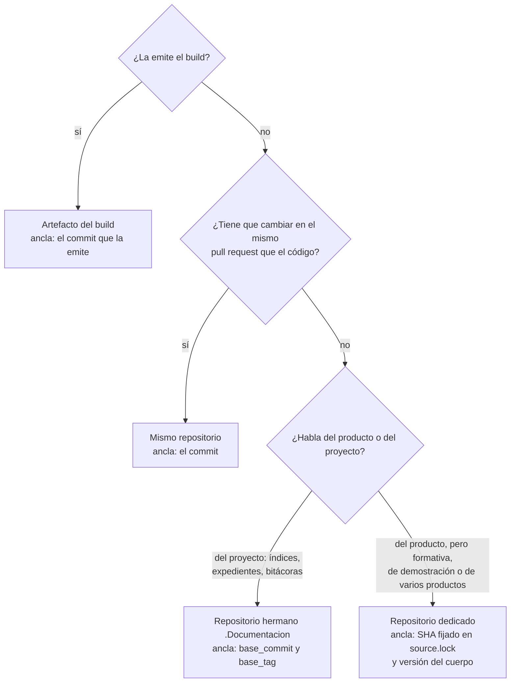

# Tema 03 — Topología de repositorios y versionado

Toda pieza documental vive en algún repositorio y vale para algún estado del código. Este tema enseña a decidir las
dos cosas: la **topología** (en qué repositorio va la pieza respecto del código que describe) y el **ancla de versión**
(contra qué commit, SHA o etiqueta vale). Quien estudia sale con una regla para ubicar una pieza nueva y con el criterio
para saber cuándo hace falta publicar varias versiones de la documentación y cuándo no. Quien interviene sale con la
plantilla de la decisión. Sigue al [tema 02](TEM-02-Ciclo-Documental.md): la fase 3 (diseño) asigna la clase de una
pieza, y con la clase vienen su topología y su ancla.

## Índice

1. [Definición](#definición)
2. [Aplicación por escenario](#aplicación-por-escenario)
3. [Ejemplos concretos](#ejemplos-concretos)
4. [Preguntas guía](#preguntas-guía)
5. [Criterios de calidad](#criterios-de-calidad)
6. [Anexo](#anexo)
7. [Fuentes y observaciones](#fuentes-y-observaciones)

## Definición

### Qué es

La **topología** de una pieza dice dónde vive respecto del código. Hay cuatro posibilidades:

| Topología | Qué es | Ejemplo en el laboratorio |
| --- | --- | --- |
| Mismo repositorio | La pieza está en el repositorio del código, en una carpeta como `docs/` o `SDD/` | La especificación de Lab-Geometria |
| Repositorio hermano | Un repositorio `.Documentacion` con el mismo nombre que el de código, que guarda índices, expedientes y bitácoras | Lab-Documentos.Documentacion |
| Repositorio dedicado | Un repositorio cuyo producto es la documentación | Lab-Documentos, que guarda este cuerpo |
| Artefacto del build | La pieza no se versiona como archivo de prosa: la emite el build del código | El contrato `openapi.json` emitido por la API |

Los controles que se nombran en este tema son parte de una **compuerta**: un conjunto de controles que corre en la
integración continua en cada pull request y termina en verde o en rojo. En este laboratorio la corre el workflow
`docs-guard`, con siete grupos de controles (PR-1 enlaces, PR-2 frontmatter, PR-3 anti-inyección, PR-4 estructura,
PR-5 trazas, PR-6 contrato, PR-7 referencias); `traces-resolve` es el control del grupo PR-5. El **carril
programado** es otra corrida, semanal, que no bloquea: sólo avisa con un issue cuando algo derivó. Localmente, todo
se corre con `scripts/ci-local.sh` desde la raíz del repositorio.

El **ancla de versión** es el dato que dice contra qué estado del código vale la pieza:

| Ancla | Cuándo se usa | Qué la verifica |
| --- | --- | --- |
| El commit | La pieza vive en el mismo repositorio que el código: el commit que la contiene es el ancla. Si el repositorio publica versiones, la etiqueta de cada una marca juntos el código y su documentación | Nada extra: el mismo pull request cambia las dos cosas |
| SHA fijado (`source.lock`, `base_commit`) | La pieza vive en otro repositorio que el código | La existencia del SHA bloquea; el desfase con la rama principal del código avisa |
| Etiqueta (`base_tag`, `v1.2.0`) | Hay una versión publicada con nombre | La etiqueta anotada; el CHANGELOG de esa versión |
| Versión del cuerpo | Una guía de estudio | El campo `version` del README del cuerpo, en SemVer, y una etiqueta anotada por compuerta |

Dónde se escribe cada ancla, para que la compuerta la lea:

| Ancla | Dónde se escribe | Forma |
| --- | --- | --- |
| SHA fijado de una demo o una copia | Archivo `source.lock` junto a las piezas | Líneas `repo:` y `sha:` con el SHA completo (el ejemplo está en [Ejemplos concretos](#un-sha-fijado-real-el-sourcelock-de-la-mini-demo)) |
| `base_commit` y `base_tag` de un índice para agentes | En la cabecera de cada índice de la ia-db, en el repositorio hermano | Líneas `base_commit: <SHA>` y, si existe, `base_tag: <etiqueta>`; el carril programado las busca con esa forma |
| Etiqueta de una versión | En Git, como etiqueta anotada | `v1.2.0`, o `docs-guard-v1.0.0` para una herramienta |

**Cuándo SHA y cuándo etiqueta.** El SHA es obligatorio siempre que la pieza vive en otro repositorio: es lo único que
no se mueve. La etiqueta se agrega cuando existe una que contiene exactamente el código que se documenta, porque le
dice a una persona qué versión es («la 1.2.0») sin que tenga que buscar el SHA. Con las dos, la compuerta verifica el
SHA y la etiqueta es para quien lee. Sin etiqueta, va sólo el SHA.

Para las versiones con nombre, el cuerpo usa SemVer: mayor, menor y parche, donde la mayor sube con un cambio que
rompe a quien depende de la versión anterior ([Preston-Werner, s. f.](99-Anexos/Referencias.md#ref-prestonwerner-sf)).
El historial legible de cada versión va en un CHANGELOG: una lista curada y en orden cronológico de los cambios
notables de cada versión, escrita para personas, con la más reciente arriba y su fecha
([Lacan, s. f.](99-Anexos/Referencias.md#ref-lacan-sf)).

La **traza** une las dos ideas dentro del texto. Una página que depende de una regla declara `traces: [RN-LOC-01@1.1]`:
el identificador apunta a la ficha, no a la ruta, y `@1.1` dice contra qué versión de la ficha vale la página. La
compuerta busca el identificador en un registro que arma sola con los `doc_id` y los encabezados del repositorio: una
ficha declara su regla con un encabezado que empieza con el identificador y, debajo, una línea con su versión
(`## RN-LOC-01 Largo máximo del nombre` y `**Versión:** 1.1`; detalle en el
[anexo del esquema](99-Anexos/Esquema-Frontmatter-Y-Prefijos.md#4-trazas)). El
registro es uno para todo el repositorio: por eso los identificadores de este cuerpo llevan su `corpus_id`
(`TEM-SDEI-03`, no `TEM-03`), porque otra guía del mismo repositorio ya declara `TEM-03` y una traza a un ID declarado
dos veces es ambigua.

### Qué problema resuelve

La documentación que vive lejos del código envejece sin que nadie lo note. En más de 3000 proyectos de GitHub, la
mayoría tuvo en algún momento al menos una referencia en la documentación a un elemento de código que ya había sido
borrado ([Tan et al., 2024](99-Anexos/Referencias.md#ref-tan-2024)). La topología decide si ese desfase es imposible
(mismo repositorio y mismo pull request), detectable (SHA fijado y aviso programado) o invisible (otro repositorio sin
ancla).

Resuelve además una pregunta que se repite: ¿hay que publicar varias versiones de la documentación? Docusaurus, que
implementa el versionado de documentación (`docs:version 1.1.0` copia la carpeta de documentos a una carpeta
versionada), advierte que la mayoría de las veces no hace falta, porque alarga el build y agrega complejidad
([Docusaurus, s. f.](99-Anexos/Referencias.md#ref-docusaurus-sf)). Hace falta cuando conviven en uso versiones
distintas del producto.

### La regla para ubicar una pieza

La pregunta que separa las topologías es una: **¿la pieza tiene que cambiar en el mismo pull request que el código que
describe?** Backstage formula el caso afirmativo: quien desarrolla escribe la documentación en Markdown, que vive junto
a su código ([Backstage, s. f.](99-Anexos/Referencias.md#ref-backstage-sf)). En el otro extremo, una pieza que habla
*del* proyecto y no *del* producto (un índice para agentes, un expediente, una guía para trabajar en ese proyecto) tiene otro ritmo y otros
autores, y va afuera.



*Diagrama: tres preguntas ubican cualquier pieza. La primera saca lo generado; la segunda, lo que va con el código; la
tercera reparte lo que queda: lo que habla del proyecto va al repositorio hermano, y lo que habla del producto pero no
puede cambiar en su pull request (una guía de estudio sobre un tema que sirve a varios proyectos, como este cuerpo; una demostración escrita desde afuera, una pieza que sirve a
varios productos) va a uno dedicado.*

### Qué no es

- **No es una preferencia de orden.** Ubicar una pieza en otro repositorio tiene un costo: hay que fijar un ancla y
  vigilar el desfase. Si no se paga ese costo, la pieza envejece.
- **No es versionar por las dudas.** Publicar varias versiones de la documentación responde a versiones del producto
  que conviven en uso, no a la cantidad de commits. Un producto con un solo despliegue vivo tiene una sola versión que
  documentar.
- **No es apuntar a la rama principal.** Una cita a otro repositorio por su rama principal cambia de significado con
  cada commit; las citas entre repositorios van por SHA o por etiqueta.

## Aplicación por escenario

| Escenario | Topología dominante | Ancla | Qué aporta decidirlo bien |
| --- | --- | --- | --- |
| `ESC-SDEI-1` Corpus de guías | Repositorio dedicado | Versión del cuerpo en el README y etiqueta por compuerta | Que una cita a la guía diga a qué versión se refiere |
| `ESC-SDEI-2` App sin roles | La ayuda y la técnica, en el repositorio de la app; en la mini demo de este laboratorio, en un repositorio dedicado con `source.lock` | Commit, o SHA fijado en la demo | Que la ayuda diga lo mismo que el código del SHA que documenta |
| `ESC-SDEI-3` Panel con roles | Especificación y manual por rol en el repositorio del código; índices para agentes y guías para trabajar en ese proyecto, en el hermano | Las piezas del repositorio del código, el commit, y la etiqueta de cada versión publicada marca código y documentación juntos; los índices del hermano, `base_commit` (SHA) y `base_tag` | Que una pantalla y su ayuda cambien en el mismo pull request |
| `ESC-SDEI-4` Servicio con paquetes | Mismo repositorio, con una línea de documentación por línea de versión del paquete | El commit; además, la etiqueta de cada versión publicada del paquete (`v1.4.2`), que congela código y documentación de esa línea | Que quien integra la versión 1 no lea la documentación de la 2 |

| Contexto | Qué cambia |
| --- | --- |
| `CTX-SDEI-3` mismo, hermano o dedicado | Es el contexto de este tema: decide si el ancla es el commit o un SHA fijado |
| `CTX-SDEI-1` con sitio | Una sola versión publicada (la de la rama principal) con un sello por página, salvo que convivan versiones del producto |
| `CTX-SDEI-2` con SDD | Los IDs de las trazas y su versión los define el registro del marco de especificación del proyecto |
| `CTX-SDEI-4` fuera de la organización del runner | La compuerta se copia con su huella (SHA-256): la copia es otra pieza con ancla propia |

## Ejemplos concretos

### Un SHA fijado real: el `source.lock` de la mini demo

La [mini demo de MovilidadUrbana](Examples/MovilidadUrbana-Mini-Demo/README.md) documenta una app cuyo código vive en
otro repositorio. No lo copia: lo fija.

[Compilado: `Examples/MovilidadUrbana-Mini-Demo/source.lock`, líneas 4–7, en el commit `080f158` de Lab-Documentos]

```text
repo: https://github.com/hdcm-dev/Lab-E2E.WebBlazor.git
sha: 8fb4c3a8b1cc629027f456c7c3ce19e041164c06
comparar: main
rutas: src/MovilidadUrbana.ApiWeb src/MovilidadUrbana.MAUI
```

Contra ese SHA, las fichas de reglas resuelven sus anclas `ruta#Símbolo@SHA` y la compuerta da verde. Contra `main`
del código, el workflow de la demo mide la deriva y sólo avisa. Cambiar el SHA es un pull request que actualiza, en el
mismo cambio, el contrato y las anclas de las fichas.

### Adopciones públicas de las prácticas que recomienda este tema

Cada práctica se apoya en al menos dos proyectos públicos que la sostienen hoy. La fecha es la del último commit que
tocó la ruta que la materializa, consultada el 2026-10-27 con la API pública de GitHub; todas caen dentro de los 24
meses anteriores **[umbral de criterio propio del plan]**.

| Práctica | Adopción | Evidencia (ruta, commit, fecha) |
| --- | --- | --- |
| P4. La documentación del producto vive en el mismo repositorio que su código | Backstage ([Backstage, 2026](99-Anexos/Referencias.md#ref-backstage-2026)) | `docs/`, `82079b4`, 2026-10-27 |
| | Grafana ([Grafana Labs, 2026](99-Anexos/Referencias.md#ref-grafana-2026)) | `docs/sources/`, `7b102dd`, 2026-10-27 |
| P5. Si la documentación va en un repositorio separado, una rama por versión del producto | Kubernetes ([Kubernetes, 2026](99-Anexos/Referencias.md#ref-kubernetes-website-2026)) | 33 ramas `release-1.*`, la última `release-1.36`; `content/en/`, `ed70e31`, 2026-10-26 |
| | Istio ([Istio, 2026](99-Anexos/Referencias.md#ref-istio-2026)) | 33 ramas `release-1.*`, la última `release-1.31`; `content/`, `2100f40`, 2026-10-27 |
| P6. Copias versionadas de la documentación sólo cuando conviven versiones del producto | Docusaurus ([Docusaurus, 2026](99-Anexos/Referencias.md#ref-docusaurus-2026)) | `website/versioned_docs/` con doce versiones de la 2.x a la 3.10; `206e741`, 2026-10-16 |
| | Jest ([Jest, 2026](99-Anexos/Referencias.md#ref-jest-2026)) | `website/versioned_docs/` con las versiones 29.7, 30.0, 30.4 y 30.5; `ea7258e`, 2026-08-31 |

Las tres prácticas no compiten: P4 es el valor por defecto; P5 y P6 son el precio de salir de él cuando el producto
tiene versiones que conviven.

[Compilado: `evidencia/E1-U4b/04-adopciones.sh` del expediente 0002 de DocAsCode, en el repositorio
Lab-Documentos.Documentacion; corrida del 2026-10-27, recortada a las filas de este tema]

```text
$ bash 04-adopciones.sh 2026-10-27
corte: 2026-10-27 · ventana desde: 2024-10-27
P4     backstage/backstage          docs                             82079b4e75b6 2026-10-27 sí
P4     grafana/grafana              docs/sources                     7b102dddd2bf 2026-10-27 sí
P5     kubernetes/website           content/en                       ed70e311737a 2026-10-26 sí
P5     istio/istio.io               content                          2100f4033a62 2026-10-27 sí
P5     kubernetes/website           ramas release-1.*: 33 (la última: release-1.36)
P5     istio/istio.io               ramas release-1.*: 33 (la última: release-1.31)
P6     facebook/docusaurus          website/versioned_docs           206e741f1fed 2026-10-16 sí
P6     jestjs/jest                  website/versioned_docs           ea7258e3338b 2026-08-31 sí
```

### Ensayo reproducible: la traza desfasada y el ID ambiguo

El ensayo arma una página de ayuda y una ficha de regla en una carpeta temporal y corre el control `traces-resolve`
de la compuerta en tres casos. Precondición: Python 3, un clon de Lab-Documentos y el script, que está en el repositorio público
Lab-Documentos.Documentacion (expediente 0002 de DocAsCode, carpeta `evidencia/E1-U4b/`); se corre desde cualquier
carpeta, con la ruta del clon como argumento. Resultado esperado: rojo, verde,
rojo.

1. La ficha subió a la versión 1.1 y la página sigue trazando a `@1.0`.
2. La página traza a `@1.1`.
3. Otro documento declara el mismo identificador.

[Compilado: `evidencia/E1-U4b/03-tem03-ancla.sh` del mismo expediente; salida del 2026-10-27 sobre el commit `080f158`
de Lab-Documentos, recortada]

```text
$ bash 03-tem03-ancla.sh <clon de Lab-Documentos>
== caso 1: la página traza a @1.0 y la ficha está en 1.1
ayuda.md:1: ERROR traza-version-desfasada: DEMO-TEM03-01@1.0: la declaración está en 1.1
== PR-5 traces-resolve: ROJO (errores=1 avisos=0) trazas=2 resueltas=1 anclas=0 anclas-resueltas=0
rc=1
== caso 2: la página traza a @1.1
== PR-5 traces-resolve: verde (errores=0 avisos=0) trazas=2 resueltas=2 anclas=0 anclas-resueltas=0
rc=0
== caso 3: el ID se declara en dos documentos
ayuda.md:1: ERROR traza-ambigua: DEMO-TEM03-01@1.1: declarado 2 veces (fichas.md, otra-guia.md)
== PR-5 traces-resolve: ROJO (errores=3 avisos=0) trazas=3 resueltas=0 anclas=0 anclas-resueltas=0
rc=1
```

Lo que demuestra: el ancla de versión no es decorativa. Si quien cambia la regla sube su versión, toda página que la
cita queda en rojo en ese mismo pull request hasta que alguien la revisa. Y un identificador repetido en el repositorio
rompe todas las trazas que lo usan, que es la razón de calificar los IDs con el `corpus_id`.

### Lab-Geometria: por qué la separación que ya tiene es la correcta

La [guía de un solo archivo](Sistema-Documentador-Tecnico-Guide.md#62-mismo-repositorio-o-repositorio-auxiliar)
aplica la regla a Lab-Geometria (`ESC-SDEI-3`): la especificación y el manual del panel por rol van en el repositorio
del código, porque describen pantallas que cambian en el mismo pull request; los índices para agentes, los análisis y
las guías de estudio de ese proyecto van en el hermano `.Documentacion`, porque hablan del proyecto y no se despliegan con él. Como el
panel tiene un único despliegue vivo, una sola versión de la documentación alcanza (P6 no aplica).

## Preguntas guía

1. ¿La pieza que vas a escribir tiene que cambiar en el mismo pull request que el código? Si sí, ¿por qué estaría en
   otro repositorio?
2. Si la pieza vive en otro repositorio, ¿qué SHA o etiqueta fija el código que describe, y qué control avisa cuando
   ese código avanza?
3. ¿Conviven hoy en uso dos versiones de tu producto? Si no, ¿qué ganarías publicando dos versiones de la
   documentación?
4. ¿Tus citas a otros repositorios van por SHA o etiqueta, o por la rama principal?
5. ¿Los identificadores de tu repositorio son únicos? ¿Qué pasa con tus trazas si otra guía declara el mismo ID?

## Criterios de calidad

| Criterio | Una topología buena | Una pobre | Se comprueba con |
| --- | --- | --- | --- |
| Ubicación justificada | Cada pieza fuera del repositorio del código tiene un motivo («habla del proyecto», «sirve a varios productos») | Piezas en otro repositorio por costumbre | La regla de [Definición](#la-regla-para-ubicar-una-pieza) |
| Ancla presente | Toda pieza fuera del repositorio del código tiene un SHA o una etiqueta fijados | Documentación externa que no dice qué versión describe | Existencia de `source.lock` o `base_commit`; bloquea |
| Desfase vigilado | Un aviso programado compara el ancla con la rama principal | El desfase se descubre cuando alguien se queja | Carril programado semanal |
| Trazas versionadas | Las páginas trazan a `ID@MAYOR.MENOR` y la ficha sube la versión cuando cambia lo que promete | Trazas sin versión a reglas que cambian | `traces-resolve` (PR-5); `CQ-03` del [anexo de criterios](99-Anexos/Criterios-De-Calidad.md#1-los-catorce-criterios) |
| IDs únicos | Identificadores calificados por cuerpo o proyecto | IDs cortos que chocan con otras guías | Regla `traza-ambigua` de PR-5 |
| Versionado proporcional | Una versión publicada salvo que convivan versiones del producto; CHANGELOG por versión | Varias versiones publicadas de un producto con un solo despliegue | Contar las versiones en uso antes de versionar |

## Anexo

Plantilla comentada para registrar la topología y el ancla de una pieza nueva. Se completa en la fase 3 (diseño) y va
en la descripción del pull request que agrega la pieza. Debajo, las preguntas que guían cada campo.

[Fragmento ilustrativo: plantilla con el caso de la ayuda de la mini demo]

```markdown
## Topología y ancla de <pieza>

| Campo | Valor |
| --- | --- |
| Pieza y clase | docs/ayuda/alta-de-localidad.md · CL-06 |
| ¿La emite el build? | No |
| ¿Cambia en el mismo pull request que el código? | No en esta demo: el código vive en otro repositorio |
| ¿Habla del producto o del proyecto? | Del producto |
| Topología elegida | Repositorio dedicado (Lab-Documentos, Examples/) |
| Ancla | SHA 8fb4c3a en source.lock |
| Control que bloquea | traces-resolve contra el SHA |
| Control que avisa | Deriva contra main del código, en el workflow de la demo |
| Trazas | RD-01, RN-LOC-01@1.1, RN-LOC-02@1.0 |
| ¿Hace falta publicar varias versiones? | No: una sola versión del código está documentada |
```

| Campo | Preguntas que lo guían |
| --- | --- |
| Pieza y clase | ¿Qué clase del [catálogo](01-Mapa.md#4-por-artefacto)? La clase ya sugiere una topología |
| ¿La emite el build? | Si sí, ¿por qué la escribiría una persona? |
| ¿Cambia en el mismo pull request que el código? | Si el código cambia y la pieza no, ¿la pieza miente? |
| ¿Habla del producto o del proyecto? | ¿Se despliega con el producto, o sirve a quien trabaja en el proyecto? |
| Topología elegida | ¿Coincide con lo que dice la [regla](#la-regla-para-ubicar-una-pieza)? Si no, ¿cuál es el motivo? |
| Ancla | ¿Commit, SHA fijado o etiqueta? ¿Está escrito en un archivo que la compuerta lee? |
| Control que bloquea y control que avisa | ¿Qué da rojo si el ancla no existe? ¿Qué avisa si el código avanzó? |
| Trazas | ¿Cada traza lleva `@MAYOR.MENOR` cuando la ficha tiene versión? ¿Los IDs son únicos en el repositorio? |
| ¿Hace falta publicar varias versiones? | ¿Cuántas versiones del producto están en uso hoy? |

## Fuentes y observaciones

Fuentes primarias del tema, con fecha de consulta en el [anexo de referencias](99-Anexos/Referencias.md):
Preston-Werner (s. f.), Lacan (s. f.), Tan et al. (2024), Docusaurus (s. f.), Backstage (s. f.) y los repositorios de
la tabla de adopciones. SemVer, Keep a Changelog, la página de versionado de Docusaurus y la de TechDocs de Backstage
se releyeron el 2026-10-27 para este tema.

| Tipo | Observación |
| --- | --- |
| Hecho | Las cantidades de ramas y de versiones son las de la corrida del 2026-10-27; cambian con cada versión que publican esos proyectos |
| Hecho | Otra guía de Lab-Documentos declara `TEM-01` a `TEM-08` como `doc_id`; por eso este cuerpo usa `TEM-SDEI-nn` |
| Interpretación | Que P4 sea «el valor por defecto» sale de la regla del mismo pull request y de Backstage; no hay una medición que compare topologías |
| Hecho | Ningún índice versionado del laboratorio declara todavía `base_commit`; la forma de la tabla de anclas es la que busca el carril programado (`tools/docs-guard/semanal.sh`) |
| Observación sobre la compuerta | El anexo del esquema dice que `traces` puede ser una lista vacía, pero `docs-guard` hoy la rechaza como campo faltante. Hasta que se corrija, toda página lleva al menos una traza |
| Criterio propio | El umbral de 24 meses y el de dos adopciones por práctica son del plan de implementación del expediente 0002, sin fuente externa |

Documento anterior: [Tema 02 — El ciclo documental](TEM-02-Ciclo-Documental.md). Siguiente documento:
[Tema 04 — Doble audiencia](TEM-04-Doble-Audiencia.md).
