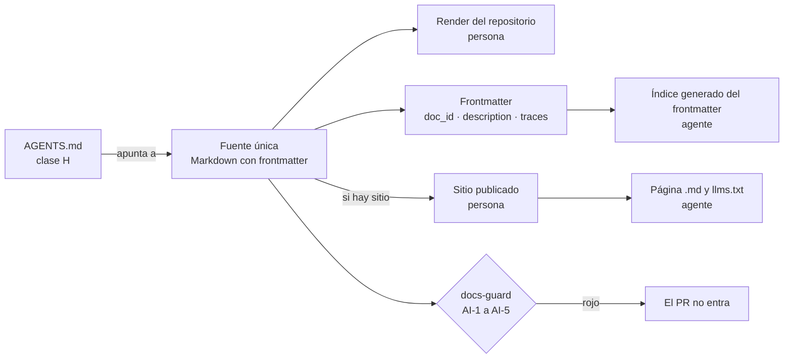

# TEM-04 Doble audiencia

Una página de documentación hoy tiene dos lectores: una persona que la abre en el navegador y un agente de IA que la
lee para trabajar sobre el repositorio o para responderle a alguien. Este tema explica cómo se escribe **una sola
fuente** que sirva a los dos, por qué canales le llega a cada uno y qué se controla para que ese canal no se convierta
en una vía para darle órdenes al agente. Al terminarlo podés decidir qué canales necesita un sistema según su
escenario y revisar si una página está lista para los dos lectores.

## Índice

1. [Definición](#definición)
2. [Aplicación por escenario](#aplicación-por-escenario)
3. [Ejemplos concretos](#ejemplos-concretos)
4. [Preguntas guía](#preguntas-guía)
5. [Criterios de calidad](#criterios-de-calidad)
6. [Anexo](#anexo)

## Definición

**Doble audiencia** es la propiedad de una pieza documental que sirve, desde la misma fuente, a una persona y a un
agente de IA, sin mantener dos textos. La persona necesita prosa ordenada, diagramas que se vean y ejemplos con
contexto. El agente necesita metadatos que se puedan leer sin interpretar la prosa, identificadores estables a los
que apuntar y un índice que le diga qué hay y dónde.

| Término | Definición |
| --- | --- |
| Fuente única | El archivo Markdown con frontmatter. Todo canal se deriva de él; ninguno se escribe aparte |
| Canal | La forma en que un lector recibe la fuente: el render de Markdown del repositorio, un sitio publicado, un índice para agentes. El `AGENTS.md` no es un canal de la fuente: es un puntero escrito a mano que le dice al agente dónde está |
| Canal derivado (`CL-14`) | Artefacto que el build de un **sitio publicado** genera de la fuente: una página `.md` por página publicada, un `llms.txt`, un archivo que agrega todo el contenido. Sólo existe si hay sitio (`CTX-SDEI-1`). No confundir con el `.md` y el `llms.txt` que sirve la ayuda de un producto desde su propio servidor: esos son parte de la ayuda (`CL-06`, ver `TEM-05`) |
| `AGENTS.md` (`CL-03`) | Archivo en la raíz de un repositorio con las instrucciones para un agente de código: cómo compilar, qué convenciones seguir, dónde está la documentación. Es un puntero, no una copia de la guía |
| Índice interno (`CL-08`) | La ia-db del repositorio hermano `.Documentacion`: índices versionados en Markdown que un agente consulta antes de leer el código de un sistema, anclados al SHA que indexaron (`base_commit`). Según la tabla del Marco, se activa en `ESC-SDEI-3` y `ESC-SDEI-4` |
| Inyección indirecta | Texto escondido en una fuente que un agente lee y que intenta que el agente haga algo que nadie le pidió ([OWASP GenAI Security Project, 2025](99-Anexos/Referencias.md#ref-owasp-2025)) |

**Qué problema resuelve.** Sin doble audiencia, el equipo termina con dos textos: la guía para personas y un resumen
para agentes, escrito a mano, que envejece por separado. Los modelos de lenguaje responden mejor cuando reciben la
documentación de la API que van a usar ([Chen et al., 2025](99-Anexos/Referencias.md#ref-chen-2025)), y fallan cuando
lo que saben de una biblioteca quedó atrás de su versión ([Wang et al., 2025](99-Anexos/Referencias.md#ref-wang-2025)).
Un agente que lee la misma fuente que la persona, en la misma versión, no puede tener un resumen desactualizado.

**Qué no es.**

- No es escribir para el agente. La prosa sigue siendo para personas; lo que se agrega es estructura (frontmatter,
  identificadores, diagramas como código), no un segundo registro de lenguaje.
- No es publicar un sitio. Sin sitio hay doble audiencia igual: el Markdown con frontmatter ya es legible por los dos.
- No es darle al agente permisos sobre la documentación. Lo que el agente lee es **dato**, nunca instrucción; las
  instrucciones del agente están en un solo archivo, `AGENTS.md`, que decide una persona (clase H). Que el agente
  respete esa separación depende de cómo está armado el agente, que quien documenta no controla; lo que sí controla
  es que la fuente no lleve nada escondido (§3.4).



*Diagrama: de una fuente salen los canales de los dos lectores. El `AGENTS.md` sólo apunta a la fuente, y la
compuerta revisa la fuente antes de que llegue a cualquiera de los dos.*

## Aplicación por escenario

Los escenarios y los contextos son los del [Marco](00-Marco.md#2-escenarios). En los cuatro, la fuente es Markdown con
frontmatter; lo que cambia es qué canales para agentes están activos y quién es el agente que lee.

| Escenario | Quién es el agente lector | Canales activos | Lo que hay que cuidar |
| --- | --- | --- | --- |
| `ESC-SDEI-1` Corpus de guías | Un agente que estudia o mantiene la guía | Markdown con frontmatter y `AGENTS.md` en la raíz (ruta «agente» del [README](README.md#3-rutas-de-lectura)). No hay índice interno: no hay código propio que indexar | Que los anexos de referencia (esquema, glosario) se encuentren sin recorrer la prosa |
| `ESC-SDEI-2` App sin roles | Un agente de código que trabaja sobre la app; el asistente del usuario que lee la ayuda | `AGENTS.md`, contrato OpenAPI emitido en el build (`CL-05`), ayuda con `traces` | Que el contrato que lee el agente sea el del SHA fijado, no uno escrito a mano |
| `ESC-SDEI-3` Panel con roles | Lo anterior, más un agente al que el usuario del panel le pide ayuda | Lo anterior, más el índice interno. Si la ayuda del panel ofrece su propio `.md` y `llms.txt` (parte de la ayuda, no un canal derivado de sitio), van **filtrados por el rol de la sesión** | Que el `llms.txt` de la ayuda no deje ver títulos de páginas que el rol no puede ver |
| `ESC-SDEI-4` Servicio con paquetes | El agente de código de quien integra el paquete, y el del equipo del servicio | `AGENTS.md`, README y CHANGELOG del paquete (`CL-13`), contrato, índice interno | Que la documentación del paquete diga contra qué versión vale |

Los contextos cambian una respuesta concreta:

| Contexto | Qué cambia en la doble audiencia |
| --- | --- |
| `CTX-SDEI-1` sin sitio | El agente lee el Markdown del repositorio. No hay `llms.txt` ni páginas `.md` derivadas: no hace falta inventarlas |
| `CTX-SDEI-1` con sitio | Aparecen los canales derivados (`CL-14`): una página `.md` por página, `llms.txt` (con una línea que dice que sigue una propuesta, no una norma) y un archivo que agrega todo el contenido en menos de 50 000 *tokens*, para que entre de una vez en el contexto de un modelo **[criterio propio del diseño de este cuerpo; sin fuente externa]**. La compuerta suma su reproducibilidad: dos builds, el mismo resultado |
| `CTX-SDEI-2` con o sin SDD | No cambia los canales: cambia a qué IDs apuntan las trazas |
| `CTX-SDEI-3` índice en otro repositorio que el código (hermano o dedicado) | El índice interno lleva `base_commit`. Si el código avanza, el carril programado avisa que el índice quedó atrás |
| `CTX-SDEI-4` fuera de la organización del runner | El control anti-inyección es el mismo, pero corre en una copia del workflow con huella |

## Ejemplos concretos

### 3.1 Un proveedor que sirve a los dos lectores

El portal público de OneSignal, un proveedor externo de notificaciones, analizado en la
[guía de un solo archivo](Sistema-Documentador-Tecnico-Guide.md#14-evidencia-el-sitio-está-pensado-también-para-agentes),
publica un `llms.txt` con un índice de 170 páginas en formato `.md`, y cada página `.md` abre con un aviso que apunta a
ese índice. La misma fuente da HTML a la persona y Markdown al modelo. La propuesta de `llms.txt` describe ese archivo
como un índice en Markdown, en la raíz del sitio, pensado para que un modelo encuentre lo relevante sin recorrer el
HTML ([Howard, s. f.](99-Anexos/Referencias.md#ref-howard-sf)). Es una **propuesta**, no una norma: por eso el cuerpo la
rotula así y sólo la activa con sitio.

### 3.2 `AGENTS.md` como puntero

La convención `AGENTS.md` pone en la raíz del repositorio las instrucciones que un agente de código necesita y que a
una persona le sobran ([AGENTS.md, s. f.](99-Anexos/Referencias.md#ref-agentsmd-sf)). Un estudio de 2 303 archivos
de contexto de agentes, en 1 925 repositorios públicos, encontró que priorizan las pruebas (75,9 %), la implementación
(70,8 %) y la arquitectura (68,1 %), que rara vez cubren la seguridad (14,8 %) y que evolucionan como código de
configuración, con agregados chicos y frecuentes
([Chatlatanagulchai et al., 2025](99-Anexos/Referencias.md#ref-chatlatanagulchai-2025)). En este cuerpo, el
[`AGENTS.md` de Lab-Documentos](../../../AGENTS.md) es la entrada de la ruta «agente» del [README](README.md#3-rutas-de-lectura): apunta al README, a
las convenciones del Marco y a los anexos de referencia, y no repite su contenido. Lo decide una persona (clase H),
porque es el único archivo cuyo texto el agente toma como instrucción. Como habla **al** agente a propósito, está
exceptuado de AI-3 con la huella del archivo: si cambia una letra, la excepción deja de valer y una persona la renueva.

### 3.3 Ensayo reproducible: el índice para agentes sale del frontmatter

Este cuerpo no tiene sitio ni índice interno. El ensayo comprueba que el frontmatter alcanza para armar, sin leer la
prosa, un índice que le diga a un agente qué documento abrir, y que ese índice es reproducible. No es una pieza
nueva: no se versiona, se genera cuando hace falta. Es la misma información que tomaría un índice interno o un
`llms.txt` si existieran.

```python
# [Fragmento ilustrativo: el script del ensayo, completo; corre con la biblioteca estándar]
import re, sys, pathlib
raiz = pathlib.Path(sys.argv[1])
for f in sorted(raiz.rglob('*.md')):
    t = f.read_text(encoding='utf-8')
    m = re.match(r'---\n(.*?)\n---\n', t, re.S)
    if not m:
        continue
    fm = dict(re.findall(r'^(\w+): (.*)$', m.group(1), re.M))
    if 'doc_id' in fm:
        print(f"{fm['doc_id']}\t{f.relative_to(raiz)}\t{fm.get('description', '')}")
```

Corrido dos veces sobre la carpeta del cuerpo, las dos salidas son idénticas (`diff` vacío). Cada línea da el `doc_id`,
la ruta y la `description`. Con eso un agente sabe qué documento abrir para una pregunta. Por eso la `description` es
obligatoria y la revisa una persona al pasar el documento a vigente.

```text
[Salida registrada: corrida del 2026-10-27 sobre la carpeta del cuerpo; primeras tres líneas, recortadas a mano al ancho de la página]
MARCO-SDEI	00-Marco.md	Define una sola vez los cuatro escenarios (tipos de sistema), los contextos, los actores y …
MAPA-SDEI	01-Mapa.md	Tablas de entrada por escenario, contexto, artefacto y actor que llevan de la situación del …
ANX-SDEI-DECIDIR	99-Anexos/Como-Decidir.md	Criterios con fuente, escala anclada de 1 a 5, filtros, regla de firmeza, …
```

### 3.4 Ensayo reproducible: la compuerta anti-inyección

Si el agente lee la fuente, cualquier texto de la fuente le llega. El riesgo que OWASP llama inyección indirecta es
justamente ese: un contenido externo, leído como dato, que lleva instrucciones escondidas
([OWASP GenAI Security Project, 2025](99-Anexos/Referencias.md#ref-owasp-2025)). La compuerta del cuerpo busca cinco
formas de esconderlas:

| Control | Qué busca | Por qué es inyección | Bloquea |
| --- | --- | --- | --- |
| AI-1 | Comentarios HTML | La persona no los ve en el render; el agente sí los lee | Sí |
| AI-2 | Caracteres invisibles (ancho cero, control de dirección) | Esconden texto o cambian lo que se ve | Sí |
| AI-3 | Frases dirigidas al agente, de una lista cerrada (por ejemplo, una orden de olvidar las instrucciones anteriores, o una nota que se presenta como dirigida al modelo). Hablar **sobre** agentes, como hace este tema, no las dispara | Es la forma más directa, pero aparece también en textos que explican cómo se arma un agente | Avisa. La lista vive en `tools/docs-guard/dg.py`. El aviso queda en la salida del job: quien abre el pull request reescribe la frase o pide una excepción con huella, que aprueba una persona; si no puede resolverlo, declara una reserva y el merge queda para una persona **[criterio propio]** |
| AI-4 | URL fuera de la lista de dominios permitidos (`tools/docs-guard/dominios.txt`; un dominio nuevo entra por pull request con aprobación explícita de una persona) | Llevan al agente a una fuente que nadie revisó | Sí, salvo en el anexo de referencias |
| AI-5 | HTML oculto (`hidden`, `display: none`) | Igual que AI-1, con otra forma | Sí |

El ensayo planta dos defectos en el Mapa, uno por vez, y los revierte:

```text
[Salida registrada: corrida del 2026-10-27; GUIA-DIR es la carpeta del cuerpo]
$ python3 -I tools/docs-guard/dg.py ai GUIA-DIR          # con un comentario HTML al final del Mapa
GUIA-DIR/01-Mapa.md:131: ERROR AI-1 comentario-html: [el comentario plantado; acá se omite, porque la compuerta lo detectaría en esta página]
rc=1
$ python3 -I tools/docs-guard/dg.py ai GUIA-DIR          # con un U+200B dentro de una palabra
GUIA-DIR/01-Mapa.md:4: ERROR AI-2 caracter-invisible: U+200B
rc=1
```

Sin los defectos, el mismo comando termina con `rc=0`. Los controles AI-n son el control AK-1 de la lista de
controles del sistema del [glosario](99-Anexos/Glosario.md#1-siglas-de-los-controles); otro de ellos, AK-7, es un fixture permanente con las cinco formas, que
tiene que dar rojo en cada corrida (ver `TEM-06`). Por qué AI-3 sólo avisa lo explica la regla de bloqueo, en
`TEM-06`.

**El asistente de la persona usuaria.** Al agente de código lo instruye el `AGENTS.md`; al asistente que una persona
usuaria usa para leer la ayuda, no: sus instrucciones no las controla quien escribe la documentación. Por eso la
defensa es la que sí se controla, la fuente: que no lleve nada escondido (AI-1 a AI-5) y que sólo diga lo que una
persona aprobó.

### 3.5 La ayuda filtrada por rol también para el agente

La prueba de concepto de [ayuda por rol](Examples/Prueba-Ayuda-Por-Rol/README.md) sirve la página, su `.md` crudo y su
`llms.txt` desde el mismo catálogo, con el mismo filtro de rol. Si sólo se filtrara la página HTML, el índice para
agentes le mostraría al asistente de un alumno los títulos de las páginas del administrador. El detalle de ese caso
está en `TEM-05`.

## Preguntas guía

Para **producir** una pieza con doble audiencia:

1. ¿Qué agente va a leer esta pieza: un agente de código en el repositorio, o el asistente de la persona usuaria?
2. ¿La `description` dice, en una línea y sin leer el resto, para qué abrir este documento?
3. ¿Cada identificador al que apunta `traces` existe, y la versión es la que se leyó?
4. ¿Los diagramas son código (mermaid) y no imagen, para que el agente los lea igual que la persona?
5. ¿Hay sitio? Si no lo hay, ¿estoy inventando un canal derivado que nadie va a generar?
6. ¿Algún texto de la página está dirigido al agente? Si lo está, ¿no debería ir en `AGENTS.md`, que decide una persona? (Hablar **sobre** agentes está bien; dirigirse a uno, no)

Para **evaluar** una pieza:

1. ¿Un índice generado del frontmatter (como el de §3.3) la ubica bien, o su `description` es genérica?
2. ¿Pasa AI-1 a AI-5 sin excepciones? Si tiene una excepción (una línea `sha256 ruta control` en
   `tools/docs-guard/excepciones.txt`, que vale mientras el archivo no cambie), ¿la agregó un pull request que aprobó
   una persona? Agregar excepciones es de clase H: un agente no las agrega en su propio pull request.
3. Si se sirve filtrada por rol, ¿el `.md` crudo y el `llms.txt` de la ayuda pasan por el mismo filtro que la página?
4. ¿El `AGENTS.md` del repositorio apunta a esta pieza, o la copia?

## Criterios de calidad

Los criterios citables son `CQ-13` (doble audiencia) y `CQ-05` (encontrabilidad) del
[anexo de criterios](99-Anexos/Criterios-De-Calidad.md); la compuerta automatiza la parte que se puede contar.

| Aspecto | Versión pobre | Versión buena |
| --- | --- | --- |
| Fuente | Un resumen para agentes escrito aparte, que nadie actualiza | Un solo Markdown; el índice se genera de su frontmatter |
| `description` | «Documento sobre la ayuda» | «Cómo cargar una localidad nueva, qué pide cada campo y qué hacer si la app rechaza el nombre» |
| Identificadores | Enlaces por ruta, que se rompen al mover el archivo | `doc_id` estable; `traces` a IDs, con versión cuando el destino es una ficha o un caso de uso versionado |
| Diagramas | Capturas de pantalla de un diagrama | Mermaid con una línea debajo que dice qué muestra |
| Instrucciones al agente | Repartidas en comentarios dentro de las páginas | Sólo en `AGENTS.md`, decidido por una persona; las páginas son dato |
| Canales derivados | Un `llms.txt` escrito a mano en un repositorio sin sitio | Ninguno sin sitio; con sitio, generado por el build y verificado por reproducibilidad |
| Filtrado por rol | La página se filtra y el índice no | Página, `.md` e índice salen del mismo filtro |

Una versión buena también **declara lo que no sabe**: si una afirmación sobre el comportamiento de los agentes sale de
un solo estudio, se dice cuál, y si es criterio propio, se rotula. Y si la escribió un agente, pasa por una revisión
registrada (`CQ-14`): un estudio de 1 997 pull requests de documentación encontró que los que abren agentes se
fusionan con poca modificación humana posterior
([Yamasaki et al., 2026](99-Anexos/Referencias.md#ref-yamasaki-2026)).

## Anexo

Plantilla comentada del frontmatter de una página pensada para los dos lectores. Cada comentario (`#`) dice la
pregunta que guía el campo; el contrato completo está en el
[anexo del esquema](99-Anexos/Esquema-Frontmatter-Y-Prefijos.md#2-los-diez-campos-más-description).

```yaml
# [Fragmento ilustrativo: plantilla; los valores son ejemplos]
---
doc_id: DEMO-MU-21        # ¿Con qué identificador estable la va a citar un agente o una traza?
doc_type: guia-practica   # ¿Qué tipo de documento es? Decide qué estructura se espera
title: Dar de alta una localidad   # ¿Cómo la nombra un índice?
description: Cómo cargar una localidad nueva y qué hacer si la app rechaza el nombre.
                          # ¿Alcanza esta línea para decidir si abrir el documento? (10 a 160 caracteres)
status: borrador          # ¿La revisó y aprobó una persona? Si no, borrador
origin: ia-assisted       # ¿Quién la escribió? Si no fue una persona sola, hace falta confidence
confidence: media         # ¿Cuánto confía quien la escribió en lo que afirma?
owner: Lab-Documentos     # ¿Quién responde si queda desactualizada?
last_review: 2026-10-27   # ¿Cuándo se revisó por última vez contra la fuente?
audience: [persona-usuaria, agente]   # ¿Quiénes la leen? Ordena las rutas y los canales
traces: [RN-LOC-01@1.1]   # ¿Qué regla o caso de uso explica, y en qué versión se leyó?
---
```

Lista corta para el `AGENTS.md` de un repositorio (la ruta «agente»):

| Bloque | Pregunta que lo guía |
| --- | --- |
| Qué es el repositorio | ¿Qué tiene que saber el agente antes de tocar nada, en dos líneas? |
| Dónde está la documentación | ¿Cuál es el README del cuerpo y cuáles los anexos de referencia? |
| Cómo se valida | ¿Qué comando corre la misma compuerta que la CI? (En Lab-Documentos, `scripts/ci-local.sh` desde la raíz) |
| Qué no puede hacer | ¿Qué es de clase H en este repositorio? |

---

Anterior: [Tema 03 — Topología de repositorios y versionado](TEM-03-Topologia-Y-Versionado.md) · Siguiente:
[Tema 05 — Ayuda al usuario final](TEM-05-Ayuda-Al-Usuario-Final.md) · Volver al [Mapa](01-Mapa.md#4-por-artefacto)
