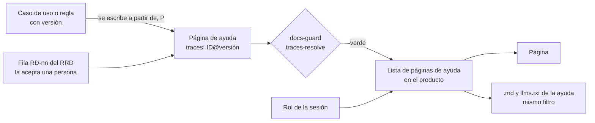

# TEM-05 Ayuda al usuario final

La ayuda al usuario final es la documentación que lee quien usa el producto: cómo hacer una tarea, qué pide cada
campo, qué hacer si algo sale mal. Es la única pieza del sistema documentador que lee alguien que no forma parte del
equipo ni integra el sistema, y por eso tiene dos riesgos propios: que **prometa algo que el producto ya no hace** y que **le muestre a un
rol lo que no le corresponde**. Este tema explica cómo se deriva de la especificación, cómo se traza para que la
compuerta detecte cuándo quedó atrás, y cómo el rol decide qué se sirve. Al terminarlo podés escribir una página de
ayuda que la compuerta acepta y revisar si la de otro respeta la regla y el rol.

## Índice

1. [Definición](#definición)
2. [Aplicación por escenario](#aplicación-por-escenario)
3. [Ejemplos concretos](#ejemplos-concretos)
4. [Preguntas guía](#preguntas-guía)
5. [Criterios de calidad](#criterios-de-calidad)
6. [Anexo](#anexo)

## Definición

**Ayuda al usuario final** (`CL-06`) es la pieza que explica a la persona usuaria cómo lograr una tarea con el
producto, escrita en su lenguaje y anclada a la regla o al caso de uso que describe. La norma
ISO/IEC/IEEE 26514 trata este tipo de información como un producto con su propio proceso: establecer qué información
necesita el usuario, cómo presentarla y cómo prepararla y hacerla disponible, a lo largo de todo el ciclo de vida, con
análisis de audiencia y de tareas y con mantenimiento ([ISO/IEC/IEEE, 2022](99-Anexos/Referencias.md#ref-iso-26514-2022)).

| Término | Definición |
| --- | --- |
| Derivar (una página) | Escribir la página a partir de la especificación (el caso de uso o la regla), reescrita en la voz del usuario. No es **generarla**: el caso de uso está escrito para el equipo y la página, para quien usa. No confundir con la **deriva** del glosario, que es la distancia entre lo que una pieza afirma y lo que el código hace |
| Traza con versión | `traces: [RN-LOC-01@1.1]`: la página dice qué regla explica y en qué versión la leyó. La versión es la línea `**Versión:** 1.1` de la ficha; quien cambia lo que la regla afirma la sube. Cualquier subida, mayor o menor, deja la traza desfasada y la compuerta da rojo: toda edición de la regla obliga a mirar la ayuda. Una fila `RD-` del registro se traza sin versión, porque el registro no versiona filas; la compuerta lee las filas de la tabla del registro (`docs/_requisitos.md` o un documento `doc_type: rrd`) y las suma al registro de IDs |
| Rol | Perfil del producto con permisos distintos (alumno, administrador). En este cuerpo el rol **no es un escenario**: dentro de `ESC-SDEI-3`, decide qué página se sirve |
| Unidad | En un proyecto con SDD, el módulo de la especificación al que pertenece una pantalla, con sus propios casos de uso y reglas (detalle en `TEM-07`) |
| Visibilidad y acceso | Ocultar una página en la navegación es visibilidad; no entregarla es acceso. Sólo lo segundo protege |
| Registro de requerimientos (RRD, `CL-02`) | Tabla donde cada página de ayuda tiene su fila: audiencia, tarea, criterio Dado/Cuando/Entonces y quién decidió. Toda página de usuario traza a un `RD-` |

**Qué problema resuelve.** La taxonomía de problemas documentales que surge de 878 artefactos (listas de correo,
preguntas, *issues* y pull requests) pone la desactualización, junto con la incorrección y la incompletitud, entre los
problemas del contenido ([Aghajani et al., 2019](99-Anexos/Referencias.md#ref-aghajani-2019)). Las
referencias a código que ya no existe se pueden detectar de forma automática
([Tan et al., 2024](99-Anexos/Referencias.md#ref-tan-2024)). La ayuda con traza con versión lleva esa detección a la
pieza que lee el usuario: si la regla cambia, el pull request que la cambia no entra hasta que la página se revisa.

**Qué no es.**

- No es el caso de uso publicado. Los criterios de aceptación, los flujos que el usuario no percibe y los códigos de
  error internos no van en la ayuda.
- No es documentación técnica (`CL-07`): la persona usuaria no compila nada.
- No es un control de acceso por sí misma. Un campo `roles` en el frontmatter sólo protege si el servidor lo usa para
  no entregar la página.



*Diagrama: la página se escribe a partir de la especificación y de una fila aceptada del registro; la compuerta
comprueba la traza; en el producto, el rol de la sesión decide qué páginas se entregan, a la persona y a su agente.*

## Aplicación por escenario

Los escenarios son los del [Marco](00-Marco.md#2-escenarios). La ayuda al usuario existe donde hay un producto que
alguien usa: no aplica al corpus de guías.

| Escenario | Dónde vive la ayuda | A qué traza | Qué decide el rol | Ejemplo |
| --- | --- | --- | --- | --- |
| `ESC-SDEI-1` Corpus de guías | No aplica: el lector es quien estudia, y su material es la guía (`CL-10`) | — | — | — |
| `ESC-SDEI-2` App sin roles | Repositorio de la interfaz; en este cuerpo, la mini demo de `Examples/` con `source.lock` | Fichas de regla propias (`RN-LOC-nn`) y la fila `RD-` | Nada: una sola ayuda para todos | [Dar de alta una localidad](Examples/MovilidadUrbana-Mini-Demo/docs/ayuda/alta-de-localidad.md) |
| `ESC-SDEI-3` Panel con roles | Dentro del proyecto web, compilada con la app | La fila `RD-` y el caso de uso de la unidad de la pantalla, en el registro del SDD | Qué páginas entrega el catálogo, para la página, el `.md` y el índice | [Prueba de concepto de ayuda por rol](Examples/Prueba-Ayuda-Por-Rol/README.md) |
| `ESC-SDEI-4` Servicio con paquetes | La persona usuaria es quien integra: su «ayuda» es el README del paquete y la referencia del contrato (`CL-05`, `CL-13`) | La versión del paquete | Nada | — |

Lo que cambia según el contexto:

| Contexto | Qué cambia |
| --- | --- |
| Sin servidor de ayuda | La ayuda es un `.md` en el repositorio. Es el caso de la mini demo |
| La regla cambia en el mismo pull request | Quien propone el cambio (un agente o una persona, clase P) actualiza también la página y su traza; si el cambio altera lo que la regla promete, decide la analista |
| Con servidor (la app sirve su ayuda) | La ayuda viaja con el binario y la sirve la propia app: siempre es la de la versión desplegada. Su `.md` y su `llms.txt` son parte de la ayuda, no los canales derivados de un sitio (`CTX-SDEI-1` trata el sitio publicado de la documentación, que es otra cosa) |
| `CTX-SDEI-2` con SDD | La página traza a `CU-`/`RN-` del registro del proyecto; el RRD vive junto a la especificación |
| `CTX-SDEI-2` sin SDD | Las reglas se escriben como fichas propias con anclas al código (`ruta#Símbolo@SHA`) y el RRD va en `docs/_requisitos.md` |
| `CTX-SDEI-3` la ayuda vive en otro repositorio que el código | La traza resuelve contra el SHA de `source.lock`; si el código avanza, el carril programado avisa |

**Confidencialidad por rol.** En un panel con roles, la decisión de qué ve cada rol se toma **en el servidor**, no en
la vista; y lo que no es para ningún usuario (la documentación interna del equipo) se decide **en el build**: no se
compila en el producto. Una página marcada con `roles` y escondida en el menú, pero entregada si alguien escribe su
dirección, no protege nada. Por eso la prueba de concepto devuelve 404 a un rol que no alcanza la página (404 y no
403, para no revelar siquiera que la página existe), y aplica el
mismo filtro al `.md` crudo y al `llms.txt` de la ayuda: el asistente del alumno tampoco puede ver los títulos del administrador
(el lado del agente está en `TEM-04`).

## Ejemplos concretos

### 3.1 Una página de ayuda real, con una divergencia declarada

La página [Dar de alta una localidad](Examples/MovilidadUrbana-Mini-Demo/docs/ayuda/alta-de-localidad.md) de la mini
demo documenta una app real, fijada por SHA. Su frontmatter traza a la fila que la pidió y a las dos reglas que
explica:

```yaml
# [Compilado: Examples/MovilidadUrbana-Mini-Demo/docs/ayuda/alta-de-localidad.md, l. 1-13; fragmento]
doc_id: DEMO-MU-21
doc_type: guia-practica
audience: [persona-usuaria]
traces: [RD-01, RN-LOC-01@1.1, RN-LOC-02@1.0]
```

La regla `RN-LOC-01` es el largo del nombre de la localidad. Su [ficha](Examples/MovilidadUrbana-Mini-Demo/docs/fichas/RN-LOC-01.md)
(`DEMO-MU-11`) dice que el texto bajo el campo y la constante del código prometen entre 3 y 60 caracteres, pero el
campo deja escribir 80 y la validación sólo mira el mínimo: una divergencia entre lo que la regla promete y lo que el
producto hace. La página no la esconde ni la decide. La declara, le
dice a la persona qué hacer mientras tanto («escribí 60 caracteres o menos») y deja la decisión de cuál es el límite
correcto a quien le toca: la analista (`ACT-SDEI-2`). Sus secciones siguen la tarea, no el código: antes de empezar,
pasos, qué pide cada campo y qué hacer si la app no guarda, con el mensaje que la persona ve en la pantalla. Es el
minimalismo de la comunicación técnica: orientarse a la acción, anclarse en la tarea y apoyar el reconocimiento y la
recuperación de errores ([van der Meij y Carroll, 1995](99-Anexos/Referencias.md#ref-vandermeij-1995)).

### 3.2 Ensayo reproducible: la compuerta detecta la ayuda que quedó atrás

El ensayo edita a mano el frontmatter de la página entre corrida y corrida, corre el control de trazas desde la raíz
del repositorio y revierte la edición al final. Primero simula que la ficha subió a 1.1 y la página se quedó en 1.0;
después, una traza a una regla que no existe.

```text
[Salida registrada: corrida del 2026-10-27; GUIA-DIR es la carpeta del cuerpo; se omiten 9 avisos ajenos]
$ python3 -I tools/docs-guard/dg.py trazas GUIA-DIR      # sin cambios
== PR-5 traces-resolve: verde (errores=0 avisos=9) trazas=121 resueltas=112
rc=0
$ python3 -I tools/docs-guard/dg.py trazas GUIA-DIR      # traces: [RD-01, RN-LOC-01@1.0, RN-LOC-02@1.0]
GUIA-DIR/Examples/MovilidadUrbana-Mini-Demo/docs/ayuda/alta-de-localidad.md:1: ERROR traza-version-desfasada: RN-LOC-01@1.0: la declaración está en 1.1
rc=1
$ python3 -I tools/docs-guard/dg.py trazas GUIA-DIR      # traces: [RD-01, RN-LOC-99@1.0, RN-LOC-02@1.0]
GUIA-DIR/Examples/MovilidadUrbana-Mini-Demo/docs/ayuda/alta-de-localidad.md:1: ERROR traza-no-resuelve: RN-LOC-99@1.0: el ID no está declarado en el registro
rc=1
```

Los nueve avisos omitidos son de la prueba de concepto de ayuda por rol: trazan a casos de uso de otro sistema sin un
`source.lock` que diga contra qué SHA resolverlos, y la compuerta los marca como «no verificables» en lugar de
bloquear. Es el comportamiento esperado, no un defecto de la mini demo.

### 3.3 Ayuda por rol, con un cruce que nadie había plantado

La [prueba de concepto de ayuda por rol](Examples/Prueba-Ayuda-Por-Rol/README.md) arma, al arrancar, la lista de páginas
de ayuda con su campo `roles` (`roles: [Student]`, con los nombres del rol tal como los guarda el producto; una página
común lista todos los roles) y la consulta con el rol de la sesión. La prueba llama a esa lista «catálogo de ayuda»;
no es el catálogo de clases de pieza del Marco. Su salida registrada muestra las dos caras de la misma lista (el
número de la izquierda es el orden en la navegación):

```text
[Compilado: Examples/Prueba-Ayuda-Por-Rol/Consola/salida.txt, l. 3-17; fragmento]
== Rol Student: navegación
     1  /ayuda/comun/ingresar  «Ingresar al laboratorio»
    10  /ayuda/alumno/entregar-trabajo  «Entregar un trabajo»
   GET administrador/habilitar-cuentas → 404
== Rol Administrator: navegación
    10  /ayuda/administrador/habilitar-cuentas  «Habilitar cuentas»
   GET administrador/habilitar-cuentas → 200
```

El alumno recibe 404 donde el administrador recibe la página, y el `llms.txt` de cada rol lista sólo lo suyo. Al
validar los enlaces, la prueba encontró una página común que enlazaba a una del alumno: para el administrador, ese
enlace no lleva a ningún lado. Es un **cruce de rol**. Hoy no es un control de `docs-guard`: lo corre el validador de la
prueba de concepto, y en un panel real va en las pruebas del producto. Se arregla de una de dos formas: quitar el
enlace, o mover el contenido enlazado a una página común. (Un enlace condicionado por rol dentro de la página exigiría
que el formato lo admita, y el de la prueba no lo admite.) La propuesta completa, con la derivación del caso de uso a la página sección por sección, está en la
[guía de un solo archivo](Sistema-Documentador-Tecnico-Guide.md#7-propuesta-ayuda-por-rol-en-lab-geometria).

### 3.4 Idiomas sin perder la ayuda

Si la página no está traducida, se sirve la del idioma fuente con un aviso visible, nunca un 404: la falta de
traducción no puede quitarle la ayuda a nadie. Cada traducción declara de qué commit de la página fuente se tradujo
(`translation_of: es/alumno/enviar-un-trabajo.md@a1b2c3d`), y un control de la CI avisa que la traducción está atrasada
si la fuente cambió después de ese commit **[criterio propio de la propuesta de ayuda por rol; el control no existe
todavía en `docs-guard`]**.

## Preguntas guía

Para **producir** una página de ayuda:

Antes de las preguntas, el identificador: el prefijo del `doc_id` sale del registro cerrado de prefijos
([anexo del esquema](99-Anexos/Esquema-Frontmatter-Y-Prefijos.md#5-registro-de-prefijos)). La mini demo usa `DEMO`; un
producto que no tiene prefijo para su ayuda lo agrega a `tools/docs-guard/prefijos.txt` en un pull request.


1. ¿Qué fila `RD-` del registro la pide, y quién la aceptó?
2. ¿Qué tarea concreta logra la persona con esta página? Si no hay tarea, ¿es ayuda o es explicación técnica?
3. ¿A qué regla o caso de uso traza, y en qué versión lo leí? La versión es la línea `**Versión:**` de la ficha o del
   caso de uso. Si el caso de uso vive en otro repositorio y la carpeta no tiene `source.lock`, la traza no se puede
   verificar y la compuerta sólo avisa.
4. ¿Hay una divergencia entre lo que la pantalla promete y lo que el producto hace? Si la hay, ¿la declaro sin decidirla
   y le digo a la persona qué hacer mientras tanto?
5. ¿Los errores están escritos con el mensaje que la persona ve en la pantalla, no con el código interno?
6. ¿Qué roles pueden ver esta página? ¿Enlaza a alguna que otro de sus roles lectores no puede ver?

Para **evaluar** una página:

1. ¿`traces-resolve` da verde sobre ella? ¿La versión trazada es la actual de la regla? Y, como el verde se consigue
   con sólo cambiar el número, ¿el pull request muestra que alguien releyó el texto contra la regla nueva? Lo muestra
   el diff, si el texto cambió, o una línea en la descripción del pull request que diga «releída contra la versión
   nueva, sin cambios» **[criterio propio]**.
2. Con una sesión del rol que no corresponde, ¿la página, su `.md` y el índice devuelven nada?
3. ¿Una persona sin conocimiento del sistema hace la tarea sin ayuda (prueba de lectura)?
4. ¿Algo de la página es un criterio de aceptación o un flujo interno que no debería estar ahí?

## Criterios de calidad

Los criterios citables son `CQ-01` (corrección), `CQ-03` (actualidad) y `CQ-09` (orientación a la tarea) del
[anexo de criterios](99-Anexos/Criterios-De-Calidad.md). La compuerta automatiza `CQ-03` con `traces-resolve`.

| Aspecto | Versión pobre | Versión buena |
| --- | --- | --- |
| Origen | Copia del caso de uso con su vocabulario de contrato | Derivada del caso de uso, reescrita en la voz del usuario, con la fila `RD-` que la pidió |
| Traza | Ninguna, o el ID sin versión | `ID@MAYOR.MENOR` de la regla que se leyó; rojo si la regla sube |
| Divergencias | El texto repite lo que dice la pantalla aunque el producto haga otra cosa | La divergencia se declara, con qué hacer mientras tanto y quién la decide |
| Errores | «Error de validación» | El mensaje literal bajo el campo, qué pasó y qué hacer |
| Rol | La página se oculta del menú y se entrega por URL | El servidor no la entrega; el `.md` y el índice pasan por el mismo filtro |
| Enlaces | Una página común enlaza a una de un solo rol | Una prueba detecta el cruce de rol (en el validador del producto, no en `docs-guard`) |
| Idioma | 404 si falta la traducción | Idioma fuente con aviso; traducción marcada como atrasada si la fuente cambió |

## Anexo

Plantilla comentada de una página de ayuda. Cada comentario dice la pregunta que guía el bloque.

```markdown
[Fragmento ilustrativo: plantilla; los valores entre <> se reemplazan]
---
doc_id: <PREFIJO-NN>          # ¿Con qué ID estable la cita el registro o un agente?
doc_type: guia-practica
title: <Verbo + objeto: «Dar de alta una localidad»>   # ¿Nombra la tarea, no la pantalla?
description: <Qué logra la persona y qué hacer si falla, en una línea>
status: borrador
origin: <human | ia-assisted | ia-generated>
confidence: <alta | media | baja>     # Obligatorio si origin no es human
owner: <quién responde por su frescura>
last_review: <AAAA-MM-DD>
audience: [persona-usuaria]
traces: [RD-<nn>, <RN-o-CU>@<MAYOR.MENOR>]   # ¿Qué fila la pidió y qué regla explica, en qué versión?
---

# <Título de la tarea>

## Antes de empezar
<Qué necesita tener o saber la persona. ¿Hay algo que no puede deshacer?>

## Pasos
<Numerados, con los nombres de botones y pantallas tal como se ven.>

## Qué pide cada campo
<Tabla: campo, qué escribir, ejemplo. ¿Cada límite coincide con la regla trazada?>
<Si la regla y el producto divergen: un párrafo en negrita con qué promete la pantalla, qué hace la app y qué
conviene hacer mientras se decide. Sin decidir cuál es el correcto.>

## Si algo sale mal
<Tabla: mensaje bajo el campo, qué pasó, qué hacer. ¿Está el mensaje literal?>
```

En un panel con roles se suma el campo `roles` (con los nombres del rol tal como los guarda el producto) y se valida
contra el esquema de páginas de ayuda del [anexo del esquema](99-Anexos/Esquema-Frontmatter-Y-Prefijos.md#3-readme-del-cuerpo-y-páginas-de-ayuda).

---

Anterior: [Tema 04 — Doble audiencia](TEM-04-Doble-Audiencia.md) · Siguiente:
[Tema 06 — Compuertas de calidad y CI](TEM-06-Compuertas-Y-CI.md) · Volver al [Mapa](01-Mapa.md#4-por-artefacto)
