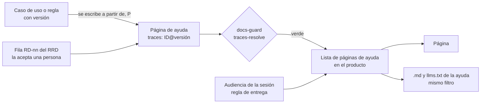

# Tema 05 — Ayuda al usuario final

La ayuda al usuario final es la documentación que lee quien usa el producto: cómo hacer una tarea, qué pide cada
campo, qué hacer si algo sale mal. Es la única pieza del sistema documentador que lee alguien que no forma parte del
equipo ni integra el sistema, y por eso tiene dos riesgos propios: que **prometa algo que el producto ya no hace** y que **le entregue a
una audiencia lo que no le corresponde**. Este tema explica cómo se deriva de la especificación, cómo se traza para que la
compuerta detecte cuándo quedó atrás, y cómo la regla de entrega decide qué se sirve. Al terminarlo podés escribir una página de
ayuda que la compuerta acepta y revisar si la de otro respeta la regla y su entrega.

## Índice

1. [Definición](#definición)
2. [Aplicación por escenario](#aplicación-por-escenario)
3. [Ejemplos concretos](#ejemplos-concretos)
4. [Preguntas guía](#preguntas-guía)
5. [Criterios de calidad](#criterios-de-calidad)
6. [Anexo](#anexo)
7. [Fuentes y observaciones](#fuentes-y-observaciones)

## Definición

**Ayuda al usuario final** (`CL-06`) es la pieza que explica a la persona usuaria cómo lograr una tarea con el
producto, escrita en su lenguaje y anclada a la regla o al caso de uso que describe. La norma
ISO/IEC/IEEE 26514 trata este tipo de información como un producto con su propio proceso: establecer qué información
necesita el usuario, cómo presentarla y cómo prepararla y hacerla disponible, a lo largo de todo el ciclo de vida, con
análisis de audiencia y de tareas y con mantenimiento ([ISO/IEC/IEEE, 2022](99-Anexos/Referencias.md#ref-iso-26514-2022)).

| Término | Definición |
| --- | --- |
| Derivar (una página) | Escribir la página a partir de la especificación (el caso de uso o la regla), reescrita en la voz del usuario. No es **generarla**: el caso de uso está escrito para el equipo y la página, para quien usa. No confundir con la **deriva** del glosario, que es la distancia entre lo que una pieza afirma y lo que el código hace |
| Traza con versión | `traces: [RN-LOC-01@1.1]`: la página dice qué regla explica y en qué versión la leyó. La versión es la línea `**Versión:** 1.1` de la ficha; quien cambia lo que la regla afirma la sube. Cualquier subida, mayor o menor, deja la traza desfasada y la compuerta da rojo: toda edición de la regla obliga a mirar la ayuda. Una fila `RD-` del registro se traza sin versión, porque el registro no versiona filas; la compuerta lee las filas de la tabla del registro (`docs/_requisitos.md` o un documento `doc_type: rrd`) y las suma al registro de IDs |
| Audiencia y regla de entrega | La audiencia orienta qué se escribe y **no da ni quita acceso**; la regla de entrega dice qué audiencia recibe la página, por qué canal, con qué nivel de acceso y en qué punto se hace cumplir, y es la que protege. En la página se declara con `delivery:` ([glosario](99-Anexos/Glosario.md#2-términos)). El rol del producto (alumno, administrador) es una de sus cuatro dimensiones y **no es un escenario**: dentro de `ESC-SDEI-3`, decide qué página se sirve |
| Unidad | En un proyecto con SDD, el módulo de la especificación al que pertenece una pantalla, con sus propios casos de uso y reglas (detalle en `TEM-07`) |
| Visibilidad y acceso | Ocultar una página en la navegación es visibilidad; no entregarla es acceso. Sólo lo segundo protege |
| Registro de requerimientos (RRD, `CL-02`) | Tabla donde cada página de ayuda tiene su fila: audiencia, tarea, criterio Dado/Cuando/Entonces y quién decidió. Toda página de usuario traza a lo que pide su escenario (tabla de [Aplicación por escenario](#aplicación-por-escenario)); la regla de `ESC-SDEI-3` está en su fila, en la columna «A qué traza» |

**Qué problema resuelve.** La taxonomía de problemas documentales que surge de 878 artefactos (listas de correo,
preguntas, *issues* y pull requests) pone la desactualización, junto con la incorrección y la incompletitud, entre los
problemas del contenido ([Aghajani et al., 2019](99-Anexos/Referencias.md#ref-aghajani-2019)). Las
referencias a código que ya no existe se pueden detectar de forma automática
([Tan et al., 2024](99-Anexos/Referencias.md#ref-tan-2024)). La ayuda con traza con versión lleva esa detección a la
pieza que lee el usuario: si la regla cambia, el pull request que la cambia no entra hasta que la página se revisa.

**Qué no es.**

- No es el caso de uso publicado. Los criterios de aceptación, los flujos que el usuario no percibe y los códigos de
  error internos no van en la ayuda.
- No es documentación técnica (`CL-07`): la persona usuaria no compila nada.
- No es un control de acceso por sí misma. La regla de entrega declarada en el frontmatter (`delivery:`, o el campo
  `roles` que usa hoy la prueba de ayuda por rol) sólo protege si el build o el servidor la usan para no entregar la
  página.



*Diagrama: la página se escribe a partir de la especificación y de una fila aceptada del registro; la compuerta
comprueba la traza; en el producto, la regla de entrega, con la audiencia de la sesión, decide qué páginas se entregan, a la persona y a su agente.*

## Aplicación por escenario

Los escenarios son los del [Marco](00-Marco.md#2-escenarios). La ayuda al usuario existe donde hay un producto que
alguien usa: no aplica al corpus de guías.

| Escenario | Dónde vive la ayuda | A qué traza | Qué decide la regla de entrega | Ejemplo |
| --- | --- | --- | --- | --- |
| `ESC-SDEI-1` Corpus de guías | No aplica: el lector es quien estudia, y su material es la guía (`CL-10`) | — | — | — |
| `ESC-SDEI-2` App sin roles | Repositorio de la interfaz; en este cuerpo, la mini demo de `Examples/` con `source.lock` | Fichas de regla propias (`RN-LOC-nn`) y la fila `RD-` | Nada: una sola audiencia y una sola ayuda para todos | [Dar de alta una localidad](Examples/MovilidadUrbana-Mini-Demo/docs/ayuda/alta-de-localidad.md) |
| `ESC-SDEI-3` Panel con roles | Dentro del proyecto web, compilada con la app | La fila `RD-` y el caso de uso de la unidad de la pantalla, en el registro del SDD | Qué páginas entrega el catálogo a cada rol, con la jerarquía expandida, para la página, el `.md` y el índice | [Prueba de concepto de ayuda por rol](Examples/Prueba-Ayuda-Por-Rol/README.md) |
| `ESC-SDEI-4` Servicio con paquetes | La persona usuaria es quien integra: su «ayuda» es el README del paquete y la referencia del contrato (`CL-05`, `CL-13`) | La versión del paquete | Qué documento de la API recibe cada audiencia (API por exposición, abajo) | — |

Lo que cambia según el contexto:

| Contexto | Qué cambia |
| --- | --- |
| Sin servidor de ayuda | La ayuda es un `.md` en el repositorio. Es el caso de la mini demo |
| La regla cambia en el mismo pull request | Quien propone el cambio (un agente o una persona, clase P) actualiza también la página y su traza; si el cambio altera lo que la regla promete, decide la analista |
| Con servidor (la app sirve su ayuda) | La ayuda viaja con el binario y la sirve la propia app: siempre es la de la versión desplegada. Su `.md` y su `llms.txt` son parte de la ayuda, no los canales derivados de un sitio (`CTX-SDEI-1` trata el sitio publicado de la documentación, que es otra cosa) |
| `CTX-SDEI-2` con SDD | La página traza a `CU-`/`RN-` del registro del proyecto; el RRD vive junto a la especificación |
| `CTX-SDEI-2` sin SDD | Las reglas se escriben como fichas propias con anclas al código (`ruta#Símbolo@SHA`) y el RRD va en `docs/_requisitos.md` |
| `CTX-SDEI-3` la ayuda vive en otro repositorio que el código | La traza resuelve contra el SHA de `source.lock`; si el código avanza, el carril programado avisa |

**Regla de entrega.** Cuatro dimensiones ortogonales la describen: **rol**, **tipo de alcance**, **superficie** y
**nivel de acceso** ([glosario](99-Anexos/Glosario.md#2-términos)). Se declaran una vez, en el registro de audiencias
(`AUD-`, [anexo del esquema](99-Anexos/Esquema-Frontmatter-Y-Prefijos.md#2-los-diez-campos-más-description)), y la
página sólo nombra a qué audiencias se entrega con `delivery:`. El nivel es obligatorio siempre que haya producto; el
rol, en `ESC-SDEI-3`; alcance y superficie, sólo si el inventario del proyecto los registra. El perfil mínimo son roles
planos con jerarquía declarada, nivel y la regla `nivel-vs-repo`.

- **Jerarquía.** Se deriva del rol: se declara una vez con `incluye:` en el registro (por ejemplo, administrador raíz
  ⊃ administrador por aplicación ⊃ usuario) y el build la expande. Un enlace de una página de un nivel bajo a una de
  uno alto es un cruce (control `cruce-de-audiencia`). Cambiar la jerarquía es clase H.
- **Tipo de alcance.** En el repositorio se declara sólo el tipo (`generico` o `por-aplicacion`); los valores (qué
  aplicación o qué inquilino) viven en el producto. El cruce de alcance lo prueba el producto, y en el repositorio se
  barren los literales de inquilino.
- **Superficies.** Una fuente, salidas por superficie (panel, portal, app móvil, servicio, SDK). El paquete
  instalable (app móvil, WebAssembly) lleva **sólo** lo `publico`, en texto **y** en recursos compilados (control
  `paquete-sin-fuga`).

**Cuatro niveles, cada uno con su punto de aplicación.** El acceso se mide en tres puntos: **repositorio**
(visibilidad de la fuente), **build** (qué se empaqueta) y **servidor** (qué se entrega a cada token). Un repositorio
público sólo puede contener fuentes de nivel `publico` o `producto`; `restringido` e `interno` exigen fuente en un
repositorio privado (control `nivel-vs-repo`).

| Nivel | Punto de aplicación | Cómo se prueba que no se entrega |
| --- | --- | --- |
| `publico` | Build: publica sólo estas páginas | El artefacto publicado (sitio, paquete, `llms.txt`) no contiene páginas de otro nivel |
| `producto` | Servidor del producto, con sesión; el mismo filtro en todos los canales | Prueba pareada por audiencia y canal |
| `restringido` | Servidor o portal, con pertenencia que concede una persona (invitación, grupo, credencial) | Prueba pareada, también con la concesión revocada |
| `interno` | Build y repositorio privado: no se compila en el producto | El artefacto del producto no contiene ninguna pieza `interno` |

La **prueba pareada** es la que da el veredicto: el autorizado recibe 200 con contenido y el no autorizado recibe
algo distinto de 200 y sin contenido (403 o 404, elegido y declarado). Una sola mitad no prueba nada: un 404 para
todos también «niega». La tabla es la propuesta de la comisión de seguridad que la mesa del expediente 0003 adoptó con
revisión: queda firme cuando el par corra verde y rojo en la prueba de ayuda por rol extendida. Ese par ya corre en la
[prueba extendida](Examples/Prueba-Ayuda-Por-Rol/README.md#la-prueba-extendida-audiencias-y-entrega), con contenido ficticio: 404 para la ayuda y 401 o 403 para el documento
OpenAPI de integradores, cada mitad con su rojo plantado
([Compilado: Examples/Prueba-Ayuda-Por-Rol/Audiencias/salida.txt, l. 21-31 y 53-61]).

**API por exposición.** La documentación de una API se publica en un documento OpenAPI **por exposición** (por
ejemplo, uno público y otro para integradores, detrás de autorización), y la interfaz interactiva sólo en desarrollo.
Exponer una API es clase H, y **cada ensanchamiento** de una exposición también lo es. Un endpoint sin grupo que cae
en todos los documentos es el defecto que busca el control `contrato-por-exposicion`.

**Confidencialidad.** La decisión de qué recibe cada audiencia se toma **en el servidor**, no en la vista; y lo que no
es para ningún usuario (la documentación interna del equipo, nivel `interno`) se decide **en el build**: no se compila
en el producto. Una página con su regla de entrega y escondida en el menú, pero entregada si alguien escribe su
dirección, no protege nada. Por eso la prueba de concepto devuelve 404 a un rol que no alcanza la página (404 y no
403, para no revelar siquiera que la página existe), y aplica el mismo filtro al `.md` crudo y al `llms.txt` de la
ayuda: el asistente del alumno tampoco puede ver los títulos del administrador (el lado del agente está en `TEM-04`).
Todos los controles que nombra esta sección están en `TEM-06` §1.3 y avisan hasta tener su par rojo/verde.

## Ejemplos concretos

### 3.1 Una página de ayuda real, con una divergencia declarada

La página [Dar de alta una localidad](Examples/MovilidadUrbana-Mini-Demo/docs/ayuda/alta-de-localidad.md) de la mini
demo documenta una app real, fijada por SHA. Su frontmatter traza a la fila que la pidió y a las dos reglas que
explica:

```yaml
# [Compilado: Examples/MovilidadUrbana-Mini-Demo/docs/ayuda/alta-de-localidad.md, l. 1-13; fragmento]
doc_id: DEMO-MU-21
doc_type: guia-practica
audience: [persona-usuaria]
traces: [RD-01, RN-LOC-01@1.1, RN-LOC-02@1.0]
```

La regla `RN-LOC-01` es el largo del nombre de la localidad. Su [ficha](Examples/MovilidadUrbana-Mini-Demo/docs/fichas/RN-LOC-01.md)
(`DEMO-MU-11`) dice que el texto bajo el campo y la constante del código prometen entre 3 y 60 caracteres, pero el
campo deja escribir 80 y la validación sólo mira el mínimo: una divergencia entre lo que la regla promete y lo que el
producto hace. La página no la esconde ni la decide. La declara, le
dice a la persona qué hacer mientras tanto («escribí 60 caracteres o menos») y deja la decisión de cuál es el límite
correcto a quien le toca: la analista (`ACT-SDEI-2`). Sus secciones siguen la tarea, no el código: antes de empezar,
pasos, qué pide cada campo y qué hacer si la app no guarda, con el mensaje que la persona ve en la pantalla. Es el
minimalismo de la comunicación técnica: orientarse a la acción, anclarse en la tarea y apoyar el reconocimiento y la
recuperación de errores ([van der Meij y Carroll, 1995](99-Anexos/Referencias.md#ref-vandermeij-1995)).

### 3.2 Ensayo reproducible: la compuerta detecta la ayuda que quedó atrás

El ensayo edita a mano el frontmatter de la página entre corrida y corrida, corre el control de trazas desde la raíz
del repositorio y revierte la edición al final. Primero simula que la ficha subió a 1.1 y la página se quedó en 1.0;
después, una traza a una regla que no existe.

```text
[Salida registrada: corrida del 2026-11-01; GUIA-DIR es la carpeta del cuerpo; se omiten 8 avisos ajenos y la línea de anclas]
$ python3 -I tools/docs-guard/dg.py trazas GUIA-DIR      # sin cambios
== PR-5 traces-resolve: verde (errores=0 avisos=8) trazas=122 resueltas=114 ids-duplicados=0 anclas=0 anclas-resueltas=0
rc=0
$ python3 -I tools/docs-guard/dg.py trazas GUIA-DIR      # traces: [RD-01, RN-LOC-01@1.0, RN-LOC-02@1.0]
GUIA-DIR/Examples/MovilidadUrbana-Mini-Demo/docs/ayuda/alta-de-localidad.md:1: ERROR traza-version-desfasada: RN-LOC-01@1.0: la declaración está en 1.1
rc=1
$ python3 -I tools/docs-guard/dg.py trazas GUIA-DIR      # traces: [RD-01, RN-LOC-99@1.0, RN-LOC-02@1.0]
GUIA-DIR/Examples/MovilidadUrbana-Mini-Demo/docs/ayuda/alta-de-localidad.md:1: ERROR traza-no-resuelve: RN-LOC-99@1.0: el ID no está declarado en el registro
rc=1
```

Los ocho avisos omitidos son de la prueba de concepto de ayuda por rol: trazan a casos de uso de otro sistema sin un
`source.lock` que diga contra qué SHA resolverlos, y la compuerta los marca como «no verificables» en lugar de
bloquear. Es el comportamiento esperado, no un defecto de la mini demo.

### 3.3 Ayuda por rol, con un cruce que nadie había plantado

La [prueba de concepto de ayuda por rol](Examples/Prueba-Ayuda-Por-Rol/README.md) arma, al arrancar, la lista de páginas
de ayuda con su campo `roles` (`roles: [Student]`, con los nombres del rol tal como los guarda el producto; una página
común lista todos los roles) y la consulta con el rol de la sesión. Ese campo es la forma previa de la regla de
entrega: el esquema la declara con `delivery:`, y lo heredado sólo avisa. La prueba llama a esa lista «catálogo de ayuda»;
no es el catálogo de clases de pieza del Marco. Su salida registrada muestra las dos caras de la misma lista (el
número de la izquierda es el orden en la navegación):

```text
[Compilado: Examples/Prueba-Ayuda-Por-Rol/Consola/salida.txt, l. 3-17; fragmento]
== Rol Student: navegación
     1  /ayuda/comun/ingresar  «Ingresar al laboratorio»
    10  /ayuda/alumno/entregar-trabajo  «Entregar un trabajo»
   GET administrador/habilitar-cuentas → 404
== Rol Administrator: navegación
    10  /ayuda/administrador/habilitar-cuentas  «Habilitar cuentas»
   GET administrador/habilitar-cuentas → 200
```

El alumno recibe 404 donde el administrador recibe la página, y el `llms.txt` de cada rol lista sólo lo suyo. Al
validar los enlaces, la prueba encontró una página común que enlazaba a una del alumno: para el administrador, ese
enlace no lleva a ningún lado. Es un **cruce de rol**. Hoy no es un control de `docs-guard`: lo corre el validador de la
prueba de concepto, y en un panel real va en las pruebas del producto. Se arregla de una de dos formas: quitar el
enlace, o mover el contenido enlazado a una página común. (Un enlace condicionado por rol dentro de la página exigiría
que el formato lo admita, y el de la prueba no lo admite.) La propuesta completa, con la derivación del caso de uso a la página sección por sección, está en la
[guía de un solo archivo](https://github.com/hdcm-dev/Lab-Documentos/blob/sdei-v2.0.0-borrador/Guides/Documentacion-Tecnica/Sistema-De-Documentacion-E-Integracion/Sistema-Documentador-Tecnico-Guide.md#7-propuesta-ayuda-por-rol-en-lab-geometria), hoy archivada ([Lab-Documentos, s. f.](99-Anexos/Referencias.md#ref-lab-documentos-guia-sf)).

La [prueba extendida](Examples/Prueba-Ayuda-Por-Rol/README.md#la-prueba-extendida-audiencias-y-entrega) lleva el mismo catálogo a la regla de entrega, con contenido **ficticio**
porque este repositorio es público: un registro de audiencias con jerarquía (administrador raíz ⊃ administrador por
aplicación ⊃ usuario) y el integrador, páginas con `delivery:`, dos alcances, panel y paquete, dos documentos OpenAPI
y un formulario con la ayuda del campo trazada a su regla. Ahí el cruce ya no es un hallazgo: cada control
(`cruce-de-audiencia`, `paquete-sin-fuga`, `contrato-por-exposicion`, `anclas`, `nivel-vs-repo` y las pruebas
pareadas) corre con su mitad verde y su mitad roja plantada, y la consola sale con 0 sólo si los ocho pares se
comportan así ([Compilado: Examples/Prueba-Ayuda-Por-Rol/Audiencias/salida.txt, l. 92-93]). Siguen siendo controles
de la prueba, no de `docs-guard`: entran a la compuerta con el expediente de herramienta.

### 3.4 Idiomas sin perder la ayuda

Si la página no está traducida, se sirve la del idioma fuente con un aviso visible, nunca un 404: la falta de
traducción no puede quitarle la ayuda a nadie. Cada traducción declara de qué commit de la página fuente se tradujo
(`translation_of: es/alumno/enviar-un-trabajo.md@a1b2c3d`), y un control de la CI avisa que la traducción está atrasada
si la fuente cambió después de ese commit **[criterio propio de la propuesta de ayuda por rol; el control no existe
todavía en `docs-guard`]**. Las dos traducciones de la prueba de concepto no usan esa forma: anclan `translation_of` a
la versión del caso de uso que traza la página fuente (`es/alumno/enviar-un-trabajo.md@CU-10005@1.2`), que es la que
hoy admite el esquema de las páginas de ayuda (`tools/docs-guard/esquemas/ayuda.schema.json`). Así, cuando exista el
control, avisará que cambió el caso y no la página.

### 3.5 Ayuda en el punto de uso: pantallas, campos, paneles y portales

La ayuda no sólo vive en una página aparte. También llega a la pantalla o al campo donde se la necesita: es el canal
**punto de uso** de `CL-06`, no una clase nueva de pieza (ver el [glosario](99-Anexos/Glosario.md#2-términos)). Lo que
agrega el sistema documentador a los mecanismos que ya usa la industria es que el texto del campo tiene fuente
versionada, se revisa por pull request y traza a la regla que valida el campo con `ID@versión`.

**Capas del microtexto.** El texto de un campo se escribe en capas de un vocabulario cerrado:

| Capa | Qué lleva | Regla |
| --- | --- | --- |
| `etiqueta` | El nombre del campo, visible y fuera de él | Nunca reemplazada por el marcador (*placeholder*) |
| `pista` | Una oración que sirve a la mayoría | Sin enlaces; nada esencial en el marcador ni en un *tooltip* |
| `info` | Lo que no entra en la pista | Se ofrece por identificador de contexto, en una página de ayuda |
| `ejemplo` | Un valor válido | Ficticio, nunca un dato de un inquilino real |
| `validacion` | El mensaje de error bajo el campo | Dice qué pasó y cómo corregirlo |

La pista para la mayoría, en una oración y sin enlaces, y no usar el marcador en lugar de la etiqueta vienen del
sistema de diseño de GOV.UK ([GOV.UK Design System, s. f.](99-Anexos/Referencias.md#ref-govuk-sf)); que el marcador
daña la usabilidad, de Nielsen Norman Group ([Sherwin, 2014](99-Anexos/Referencias.md#ref-sherwin-2014)). En .NET, la
capa sale del modelo de datos: `[Display(Name, Prompt, Description)]`, donde `Description` es la que se usa como
*tooltip* o descripción ([Microsoft, 2026](99-Anexos/Referencias.md#ref-microsoft-displayattribute-2026)), y las
anotaciones de validación de Blazor dan el mensaje por campo
([Microsoft, s. f.](99-Anexos/Referencias.md#ref-microsoft-blazor-validation-sf)). En un formulario generado desde
JSON Schema, `title` es lo corto y `description` lo largo
([JSON Schema, s. f.](99-Anexos/Referencias.md#ref-jsonschema-annotations-sf)).

**Los números salen de la regla; la letra, de una persona.** El límite que aparece en la pista o en el error
(«entre 3 y 60 caracteres») se interpola desde la constante o el atributo de la regla, no se copia. La letra la
escribe una persona: derivar no es generar (ver la [Definición](#definición)). Así el desfase numérico entre ayuda y regla desaparece por
construcción; es el caso de `RN-LOC-01` de §3.1, escrito al revés.

**Traza desde la ficha de la regla.** La ficha de la regla lleva tres anclas hacia el producto: `muestra` (la clave
del recurso del microtexto), `valida` (el atributo que la hace cumplir) y `contiene` (el límite interpolado que el
texto tiene que contener). La traza va de la ficha al microtexto y no al revés, porque el texto localizado en
archivos de recursos todavía no se ancla: la frase que lo dice en la decisión del conocimiento se quita recién
cuando exista un resolvedor para `.resx` o JSON Schema. Un campo con regla y sin ayuda **avisa**; donde la regla no
está en atributos, la comparación entre texto y regla es una prueba unitaria del producto.

**Identificador de contexto.** La página de ayuda que amplía un campo o una pantalla declara
`contexto: <app>/<id>` en su frontmatter ([anexo del esquema](99-Anexos/Esquema-Frontmatter-Y-Prefijos.md#3-readme-del-cuerpo-y-páginas-de-ayuda)).
El espacio de nombres `<app>` evita que dos aplicaciones choquen con el mismo `<id>`. El mapa pantalla → página no
se escribe: se deriva de esos campos. Es la misma idea que la ayuda contextual por identificador de las herramientas
de autoría ([MadCap Software, 2026](99-Anexos/Referencias.md#ref-madcap-flare-2026)) y que el par `@appname` +
`@appid` de DITA ([OASIS, 2015](99-Anexos/Referencias.md#ref-oasis-dita-resourceid-2015)).

**Paneles y portales.** El resolvedor de contexto corre en el servidor y con la audiencia de la sesión: a cada
identificador le devuelve la página que esa audiencia puede recibir. La etiqueta y el mensaje de error son **iguales**
para todas las audiencias; si hay variante, va en la pista o en la ayuda ampliada, con su motivo, resuelta en el
servidor y nunca con todas las variantes enviadas al cliente. El portal es una superficie y un renderizador, no una
fuente. Un enlace del panel al portal **no transfiere permiso**: el portal vuelve a aplicar su regla de entrega, como
hacen los portales de desarrollador que niegan una página a quien no tiene el grupo o el equipo
([Redocly, s. f.](99-Anexos/Referencias.md#ref-redocly-permissions-sf)). En un paquete instalable (app móvil,
WebAssembly) viaja sólo lo `publico`, en texto y en recursos compilados; lo demás se pide al servidor con el token
del usuario.

**Plataformas de guía en producto.** Las plataformas de recorridos y *tooltips* segmentan bien, pero el contenido
vive en su editor y no en el repositorio ([Pendo, s. f.](99-Anexos/Referencias.md#ref-pendo-sf);
[Appcues, s. f.](99-Anexos/Referencias.md#ref-appcues-sf)): pierden traza, revisión y versión. Por eso entran sólo
como canal derivado que **dirige** hacia la ayuda: sin números ni reglas, nunca con contenido de nivel no público y
declaradas fuera del repositorio. Se activan sólo si la persona responsable del producto pide recorridos; si no,
el proyecto dice «no se usa».

**Accesibilidad (WCAG 2.2).** Tres criterios de éxito tocan el campo:

| Criterio | Nivel | Qué pide | Quién lo comprueba |
| --- | --- | --- | --- |
| 3.3.1 Identificación de errores | A | El campo con error se identifica y el error se describe en texto ([W3C, s. f.](99-Anexos/Referencias.md#ref-w3c-wcag22-331)) | `docs-guard` exige la capa `validacion` en cada campo con regla |
| 3.3.2 Etiquetas o instrucciones | A | Etiqueta o instrucciones cuando se pide un dato ([W3C, s. f.](99-Anexos/Referencias.md#ref-w3c-wcag22-332)) | `docs-guard` exige la capa `etiqueta` en cada campo con regla |
| 3.3.3 Sugerencia ante errores | AA | Si se conoce cómo corregir, se sugiere ([W3C, s. f.](99-Anexos/Referencias.md#ref-w3c-wcag22-333)) | La revisión del texto de `validacion` |

La asociación programática entre el campo, su pista y su error (`aria-describedby`) es un agregado de este cuerpo:
3.3.2 no la exige, y este cuerpo no cita otro criterio de WCAG que la exija. Se prueba en las pruebas de la interfaz, no en
`docs-guard`. Medido en la [prueba extendida](Examples/Prueba-Ayuda-Por-Rol/README.md#la-prueba-extendida-audiencias-y-entrega): el `ValidationMessage` de Blazor emite el
mensaje sin `id` y el `InputText` emite `aria-invalid` pero no `aria-describedby`
([Compilado: Examples/Prueba-Ayuda-Por-Rol/Audiencias/salida.txt, l. 75-76]); la asociación la pone la vista, con un
`id` en el contenedor del mensaje y el atributo en el campo.

**Asistente, si lo hay.** Nada obliga a tener un asistente. Si el producto lo suma, el asistente recupera la misma
pieza con el token del usuario, cita `ID@versión`, **sugiere y no envía** **[propuesta de la mesa del expediente 0003,
rotulada como tal]**. El riesgo que lo justifica está en `TEM-04`, §3.6.

## Preguntas guía

Para **producir** una página de ayuda:

Antes de las preguntas, el identificador: el prefijo del `doc_id` sale del registro cerrado de prefijos
([anexo del esquema](99-Anexos/Esquema-Frontmatter-Y-Prefijos.md#5-registro-de-prefijos)). La mini demo usa `DEMO`; un
producto que no tiene prefijo para su ayuda lo agrega a `tools/docs-guard/prefijos.txt` en un pull request.


1. ¿Qué fila `RD-` del registro la pide, y quién la aceptó?
2. ¿Qué tarea concreta logra la persona con esta página? Si no hay tarea, ¿es ayuda o es explicación técnica?
3. ¿A qué regla o caso de uso traza, y en qué versión lo leí? La versión es la línea `**Versión:**` de la ficha o del
   caso de uso. Si el caso de uso vive en otro repositorio y la carpeta no tiene `source.lock`, la traza no se puede
   verificar y la compuerta sólo avisa.
4. ¿Hay una divergencia entre lo que la pantalla promete y lo que el producto hace? Si la hay, ¿la declaro sin decidirla
   y le digo a la persona qué hacer mientras tanto?
5. ¿Los errores están escritos con el mensaje que la persona ve en la pantalla, no con el código interno?
6. ¿A qué audiencias se entrega esta página (`delivery:`) y con qué nivel? ¿Enlaza a alguna que, con la jerarquía
   expandida, otra de sus audiencias no puede recibir?
7. Si amplía un campo o una pantalla, ¿declara `contexto: <app>/<id>`, y los números de su texto salen de la regla?

Para **evaluar** una página:

1. ¿`traces-resolve` da verde sobre ella? ¿La versión trazada es la actual de la regla? Y, como el verde se consigue
   con sólo cambiar el número, ¿el pull request muestra que alguien releyó el texto contra la regla nueva? Lo muestra
   el diff, si el texto cambió, o una línea en la descripción del pull request que diga «releída contra la versión
   nueva, sin cambios» **[criterio propio]**.
2. Con una sesión del rol que no corresponde, ¿la página, su `.md` y el índice devuelven nada?
3. ¿Una persona sin conocimiento del sistema hace la tarea sin ayuda (prueba de lectura)?
4. ¿Algo de la página es un criterio de aceptación o un flujo interno que no debería estar ahí?
5. ¿La página traza también al caso de uso de la unidad de su pantalla?
6. En el punto de uso, ¿cada campo con regla tiene `etiqueta` y `validacion`, y la ficha de la regla lo traza con
   `muestra`, `valida` y `contiene`?

## Criterios de calidad

Los criterios citables son `CQ-01` (corrección), `CQ-03` (actualidad) y `CQ-09` (orientación a la tarea) del
[anexo de criterios](99-Anexos/Criterios-De-Calidad.md). La compuerta automatiza `CQ-03` con `traces-resolve`.

| Aspecto | Versión pobre | Versión buena |
| --- | --- | --- |
| Origen | Copia del caso de uso con su vocabulario de contrato | Derivada del caso de uso, reescrita en la voz del usuario, con la fila `RD-` que la pidió |
| Traza | Ninguna, o el ID sin versión | `ID@MAYOR.MENOR` de la regla que se leyó; rojo si la regla sube |
| Divergencias | El texto repite lo que dice la pantalla aunque el producto haga otra cosa | La divergencia se declara, con qué hacer mientras tanto y quién la decide |
| Errores | «Error de validación» | El mensaje literal bajo el campo, qué pasó y qué hacer |
| Entrega | La página se oculta del menú y se entrega por URL | La regla de entrega se cumple en su punto de aplicación; el `.md` y el índice pasan por el mismo filtro; prueba pareada 200/≠ 200 |
| Enlaces | Una página común enlaza a una de un solo rol | Una prueba detecta el cruce de rol (en el validador del producto, no en `docs-guard`) |
| Idioma | 404 si falta la traducción | Idioma fuente con aviso; traducción marcada como atrasada si la fuente cambió |
| Campo | Lo esencial en el marcador; el límite copiado a mano | Etiqueta visible, pista de una oración, límite interpolado desde la regla y traza desde la ficha |

## Anexo

Plantilla comentada de una página de ayuda. Cada comentario dice la pregunta que guía el bloque.

```markdown
[Fragmento ilustrativo: plantilla; los valores entre <> se reemplazan]
---
doc_id: <PREFIJO-NN>          # ¿Con qué ID estable la cita el registro o un agente?
doc_type: guia-practica
title: <Verbo + objeto: «Dar de alta una localidad»>   # ¿Nombra la tarea, no la pantalla?
description: Cómo se deriva la ayuda al usuario de la especificación, cómo se traza a la regla con su versión y a quién se entrega sin filtrar lo ajeno.
status: borrador
origin: <human | ia-assisted | ia-generated>
confidence: <alta | media | baja>     # Obligatorio si origin no es human
owner: <quién responde por su frescura>
last_review: <AAAA-MM-DD>
audience: [persona-usuaria]
traces: [RD-<nn>, <RN-o-CU>@<MAYOR.MENOR>]   # ¿Qué fila la pidió y qué regla explica, en qué versión?
---

# <Título de la tarea>

## Antes de empezar
<Qué necesita tener o saber la persona. ¿Hay algo que no puede deshacer?>

## Pasos
<Numerados, con los nombres de botones y pantallas tal como se ven.>

## Qué pide cada campo
<Tabla: campo, qué escribir, ejemplo. ¿Cada límite coincide con la regla trazada?>
<Si la regla y el producto divergen: un párrafo en negrita con qué promete la pantalla, qué hace la app y qué
conviene hacer mientras se decide. Sin decidir cuál es el correcto.>

## Si algo sale mal
<Tabla: mensaje bajo el campo, qué pasó, qué hacer. ¿Está el mensaje literal?>
```

En un panel con roles se suma la regla de entrega, `delivery:` con audiencias del registro (la prueba de ayuda por rol
usa todavía `roles`, con los nombres del rol tal como los guarda el producto), y se valida contra el esquema de páginas de ayuda del [anexo del esquema](99-Anexos/Esquema-Frontmatter-Y-Prefijos.md#3-readme-del-cuerpo-y-páginas-de-ayuda). Esa página no lleva `doc_id`: tiene `title`, `description` y `roles` o `delivery`. Si conserva el `doc_id` de esta plantilla, la compuerta la valida como documento del cuerpo y no mira `roles`.

---

## Fuentes y observaciones

Fuentes primarias del tema, con fecha de consulta en el [anexo de referencias](99-Anexos/Referencias.md):
ISO/IEC/IEEE (2022), Aghajani et al. (2019), Tan et al. (2024) y van der Meij y Carroll (1995). Para la ayuda en el
punto de uso: GOV.UK Design System (s. f.), Sherwin (2014), W3C (s. f., criterios 3.3.1, 3.3.2 y 3.3.3), Microsoft
(2026 y s. f.), JSON Schema (s. f.), MadCap Software (2026), OASIS (2015), Redocly (s. f.), Pendo (s. f.) y Appcues
(s. f.).

| Tipo | Observación |
| --- | --- |
| Hecho | La salida registrada de §3.2 es de la corrida del 2026-11-01; los ocho avisos que omite son las trazas de la prueba de ayuda por rol, que no tiene `source.lock` |
| Hecho | Las páginas de la prueba de ayuda por rol trazan a la unidad Web de Lab-Geometria en `5f07b12`; con ese SDD como fuente, las ocho trazas resuelven |
| Hecho | El ejemplo une cada página con su fila `RD-` por la columna «Pieza» del RRD de la prueba y no por `traces`, como pide la regla de `ESC-SDEI-3`: el esquema de las páginas de ayuda (`ayuda.schema.json`) sólo admite trazas con versión. El cambio del esquema queda para el expediente de herramienta |
| Hecho | La prueba de ayuda por rol no tiene `source.lock`; sus ocho trazas se comprobaron con `--fuente` contra el SDD de Lab-Geometria en `5f07b12` (8 de 8 resueltas). Llevar esa comprobación a la CI queda como deuda del expediente de herramienta que agregue el trabajo con `--fuente` y el `source.lock` de la prueba |
| Criterio propio | La línea «releída contra la versión nueva, sin cambios» en la descripción del pull request |
| Criterio propio | El control de traducción atrasada por commit es de la propuesta de ayuda por rol y no existe todavía en `docs-guard` |
| Sin verificar | Que el `ValidationMessage` de Blazor emita la asociación con `aria-describedby`; se mide en la prueba de la interfaz |
| Propuesta | El asistente que sugiere y no envía es una propuesta de la mesa del expediente 0003; vuelve a sus comisiones si el producto incorpora un asistente |
| Hecho | Los controles que nombra §3.5 (campo con regla sin ayuda, `contexto-resuelve`, `anclas` extendidas) están en `TEM-06` §1.3 y todos avisan hasta tener su par rojo/verde |

Documento anterior: [Tema 04 — Lectura por agentes](TEM-04-Doble-Audiencia.md). Siguiente documento:
[Tema 06 — Compuertas de calidad y CI](TEM-06-Compuertas-Y-CI.md).
