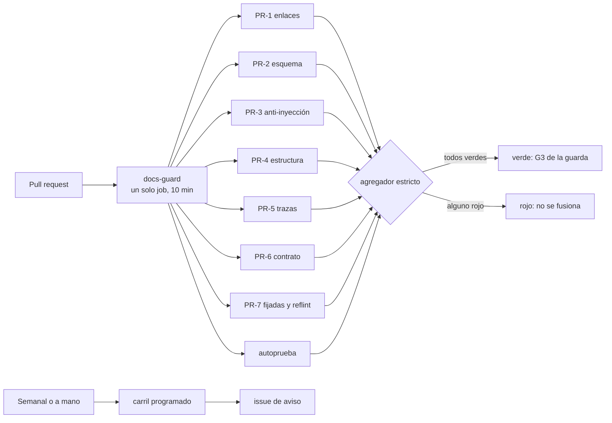
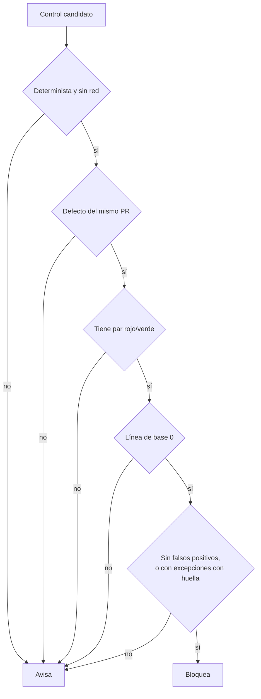

# TEM-06 Compuertas de calidad y CI

Una documentación que se escribe como código se verifica como código: en cada pull request corre un conjunto de
controles que termina con un código de salida, y si alguno da rojo, el cambio no entra. Este tema explica qué
controles tiene el sistema documentador, cómo se decide si un control **bloquea** o sólo **avisa**, cómo se prueba
que la compuerta misma funciona y qué cuida la seguridad del runner. Al terminarlo podés decidir, para un control
nuevo, si tiene que bloquear, y leer el resultado de una corrida para saber qué arreglar.

## Índice

1. [Definición](#definición)
2. [Aplicación por escenario](#aplicación-por-escenario)
3. [Ejemplos concretos](#ejemplos-concretos)
4. [Preguntas guía](#preguntas-guía)
5. [Criterios de calidad](#criterios-de-calidad)
6. [Anexo](#anexo)

## Definición

Una **compuerta** es un control que corre en la integración continua (CI) y termina con un código de salida: 0 si
está en orden, 1 si bloquea. Las compuertas del carril PR viven en un solo workflow reutilizable de Lab-Documentos,
`docs-guard`, que otros repositorios de la misma organización llaman; el carril programado es otro workflow del mismo
repositorio, `docs-enlaces-semanal`. Los controles propios están en un script de Python con biblioteca estándar,
`tools/docs-guard/dg.py`.

| Término | Definición |
| --- | --- |
| Carril PR | Los controles que corren en cada pull request y **bloquean** el merge si dan rojo. Grupos `PR-1` a `PR-7` |
| Carril programado | El workflow `docs-enlaces-semanal`: corre los lunes, o a mano desde la pestaña de Actions, sobre el árbol de repositorios, y **sólo avisa**, abriendo o actualizando un único issue en Lab-Documentos, que prioriza una persona |
| Regla de bloqueo | Las cinco condiciones que un control tiene que cumplir para bloquear; si falla una, avisa |
| Par rojo/verde | Dos fixtures por control: uno con el defecto (tiene que dar rojo) y otro sin él (tiene que dar verde). Es la prueba negativa de la compuerta |
| Línea de base | Cantidad de hallazgos de un control sobre el corpus que vigila, medida antes de que empiece a bloquear |
| Guarda de merge (G1–G4) | Lo que se comprueba antes de fusionar un pull request sin intervención humana: G1 abierto con la misma cabeza, G2 sin conflictos, G3 al menos una corrida de controles y todas en éxito, G4 sin reserva. No confundir con los grupos `PR-n` |
| Cuerpo nuevo y heredado | Un cuerpo nuevo es una carpeta cuyo `README.md` declara `corpus_id`, como esta guía. Lo heredado son las demás guías del repositorio, escritas antes del contrato de frontmatter: ahí los mismos defectos avisan |

**Qué problema resuelve.** La práctica *docs as code* trata la documentación con las mismas herramientas que el
código, pruebas automáticas incluidas, y señala que se puede bloquear el merge de una función que no trae su
documentación ([Write the Docs, s. f.](99-Anexos/Referencias.md#ref-writethedocs-sf)). La experiencia de Google es que
la documentación tiene que estar bajo control de versiones, tener dueño claro y pasar revisión, porque la que no
tiene dueño se vuelve obsoleta ([Winters et al., 2020](99-Anexos/Referencias.md#ref-winters-2020)). La compuerta
convierte esas buenas intenciones en algo que se comprueba en cada cambio.

**Qué no es.**

- No es un juicio de calidad completo. La compuerta automatiza lo que se puede contar (enlaces, esquema, trazas,
  referencias); la claridad se mide con una prueba de lectura y la corrección, con revisión.
- No es un lugar para controles que «casi siempre» aciertan. Un control con falsos positivos que bloquea enseña a
  ignorar la compuerta; por eso existe la regla de bloqueo.
- No es un agente. El job no tiene secretos ni invoca modelos de lenguaje: es determinista.

### 1.1 Los dos carriles



*Diagrama: el carril PR corre todos los grupos aunque uno falle (uno detrás de otro, dentro del mismo job), para que
el pull request vea todos sus defectos en una corrida, y un agregador decide. El carril programado no bloquea:
escribe un issue.*

Las herramientas son medios de un control, no tema: lychee verifica enlaces, markdownlint verifica la estructura del
Markdown y un parser de mermaid verifica los diagramas. El runner es **efímero**: cada job arranca de cero, salvo una
caché de herramientas.

| Grupo | Controles | Bloquea |
| --- | --- | --- |
| `PR-1` | Enlaces internos y anclas (lychee sin red, con fragmentos); enlaces relativos que salen del repositorio | Sí |
| `PR-2` | Frontmatter contra su esquema, registro cerrado de prefijos, esquema del registro de requerimientos | Sí; un archivo sin frontmatter sólo bloquea dentro de un cuerpo nuevo |
| `PR-3` | Anti-inyección AI-1 a AI-5 (detalle en `TEM-04`) | Sí, salvo AI-3, que avisa en todo el cuerpo, y AI-4, que avisa sólo dentro del anexo de referencias |
| `PR-4` | Markdown estructural (sin la regla de largo de línea) y mermaid que parsea | Sí |
| `PR-5` | `traces-resolve`: cada `ID@versión` contra el registro generado de los encabezados (detalle en `TEM-05`) | Sí |
| `PR-6` | Diff del contrato OpenAPI, si la carpeta tiene un `contracts/openapi.json`: el contrato versionado contra el que emitió el código, `contracts/.generado/openapi.json`. Como `docs-guard` no compila, ese archivo llega de una de dos formas: está en el árbol del pull request (lo escribió el build y se versionó en el mismo cambio), o el `source.lock` de la carpeta tiene una línea `workflow:` que nombra otro workflow del repositorio, que compila, extrae y compara; su resultado es otro check del pull request y la guarda G3 lo exige en verde como a `docs-guard`. Sin ninguna de las dos, `PR-6` da rojo por falta de extracción. Es el caso de la mini demo, cuyo `source.lock` nombra `mini-demo-movilidad`. Cualquier operación nueva, quitada o cambiada da rojo, rompa o no la compatibilidad: un cambio legítimo de la API actualiza el contrato versionado en el mismo pull request, y el diff queda a la vista de quien revisa | Sí |
| `PR-7` | Piezas fijadas con su SHA-256; `reflint` sobre las entradas del anexo de referencias (año, título en cursiva, fecha de consulta) | Sí; `reflint` avisa en lo heredado |
| `avisos` | `url-fecha` (toda URL de la prosa sin fecha de consulta, fuera de un anexo) y `cita-linea` (ruta del workspace sin línea) | No: avisa siempre y no entra al agregador |

| Control del carril programado | Qué detecta |
| --- | --- |
| Enlaces con red sobre el árbol armado (los repositorios públicos de la organización, clonados juntos según una tabla versionada) | Enlaces entre repositorios y externos rotos |
| Atraso de `base_commit` y de `source.lock` | Índices o demos que quedaron atrás de `main` del código (un commit ya cuenta: el informe da cuántos) |
| Deriva de copias fijadas | Conocimiento copiado que cambió en su fuente |
| Frescura | `last_review` de más de 365 días |
| Línea de base de AI-3 | Cuántos avisos AI-3 quedan con las excepciones vigentes: cuándo AI-3 puede pasar a bloquear |

### 1.2 La regla de bloqueo

Un control bloquea sólo si cumple **las cinco** condiciones; si falla una, avisa:

1. es determinista y no usa red;
2. el defecto lo introduce el mismo pull request;
3. tiene prueba negativa (par rojo/verde);
4. su línea de base sobre el corpus que vigila es 0;
5. no tiene falsos positivos conocidos, o los canaliza por excepciones con huella que aprueba una persona (una línea
   `sha256 ruta control` en `tools/docs-guard/excepciones.txt`; agregarla es de clase H, así que un agente no la agrega
   en su propio pull request).

Un repositorio que adopta la compuerta por primera vez mide primero su línea de base: si da hallazgos, los sanea antes
de llamar al workflow, o lo llama sólo sobre una carpeta ya limpia (el parámetro `ruta`).



*Diagrama: la regla como árbol de decisión. Basta un «no» para que el control sólo avise.*

La regla explica cada excepción de la tabla de grupos. Los enlaces externos usan red (falla 1): van al carril
programado. AI-3 busca frases dirigidas al agente y tiene falsos positivos en textos que explican cómo se arma un
agente. Esos falsos positivos se podrían canalizar con excepciones con huella, pero todavía no se aprobaron todas, así
que su línea de base con excepciones no es 0 (falla la 4): avisa hasta que lo sea. AI-4 avisa en el anexo de
referencias porque ahí citar dominios fuera de la lista es su función (falla la 5: todo hallazgo sería un falso
positivo). `reflint` sobre guías viejas tiene línea de
base alta (falla 4): bloquea sólo en un cuerpo nuevo. Un archivo está en un cuerpo nuevo si su carpeta, o una carpeta
superior dentro del repositorio, tiene un `README.md` con `corpus_id` en el frontmatter. La frescura no depende
del pull request (falla 2): avisa.

## Aplicación por escenario

Los escenarios y los contextos son los del [Marco](00-Marco.md#2-escenarios). El tronco es el mismo en los cuatro: el
carril PR con su agregador y el carril programado. Lo que cambia es qué grupos tienen material sobre el que actuar y
dónde corre la compuerta.

| Escenario | Grupos con más peso | Lo particular |
| --- | --- | --- |
| `ESC-SDEI-1` Corpus de guías | `PR-1`, `PR-2`, `PR-3`, `PR-4`, `PR-7` (`reflint`) | El cuerpo nuevo endurece la compuerta: todo archivo exige frontmatter y `reflint` bloquea |
| `ESC-SDEI-2` App sin roles | `PR-5`, `PR-6` | `PR-5` resuelve las trazas de nivel 1 (`ID@versión`) contra el registro. Las anclas de nivel 2 de las fichas (`ruta#Símbolo@SHA`) necesitan el código: las verifica, y bloquea, el workflow de la mini demo (`mini-demo-movilidad`), que baja el código en el SHA de `source.lock`; `docs-guard` no baja código |
| `ESC-SDEI-3` Panel con roles | `PR-5` contra el registro del SDD; las pruebas de acceso por rol | El cruce de rol y el «404 para el rol que no corresponde» son pruebas del producto, no de `docs-guard` |
| `ESC-SDEI-4` Servicio con paquetes | `PR-6` (y comparación de contratos entre líneas de versión), `PR-7` (copias fijadas) | Corre en otra organización: una copia del workflow con huella en su propio runner |

| Contexto | Qué cambia en la compuerta |
| --- | --- |
| `CTX-SDEI-1` con sitio | Se suma el build del sitio con avisos como error y la reproducibilidad de los canales derivados |
| `CTX-SDEI-3` pieza en otro repositorio | El defecto ya no lo introduce el mismo pull request (falla la condición 2): el desfase se avisa en el carril programado |
| `CTX-SDEI-4` dentro de la organización del runner | El repositorio llama `uses: <dueño>/Lab-Documentos/.github/workflows/docs-guard.yml@<SHA>` y pasa `ruta` (la carpeta a verificar) y `herramientas-ref`. El workflow baja los scripts de Lab-Documentos en `herramientas-ref`; por eso va el mismo SHA que en `uses:`, para que el workflow y sus scripts sean de la misma versión |
| `CTX-SDEI-4` fuera de ella | Copia sólo el `.yml` (los scripts los sigue bajando de Lab-Documentos, que es público, por SHA) y anota su SHA-256 como pieza fijada; `PR-7` comprueba en ese repositorio que la copia no cambió, y el carril programado de su organización avisa si el original avanzó |

**Seguridad del runner.** El runner es propio (`self-hosted`) y efímero. El workflow declara permisos de sólo lectura;
no usa `pull_request_target`, el disparador que corre con los permisos y secretos del repositorio destino aunque el
código venga de un fork; fija cada action por SHA, para que una etiqueta movida no cambie lo que corre; y tiene una
guarda `if:` que no corre pull requests que vienen de un fork. Un job salteado no es una corrida en éxito para la
guarda de merge (G3 exige al menos una), así que un cambio que llega desde un fork no se fusiona solo: alguien con
permiso lo lleva a una rama del repositorio y abre el pull request desde ahí **[criterio propio]**. Para un merge que
hace una persona, el bloqueo lo impone la protección de rama del alojamiento, si existe, con `docs-guard` como check
obligatorio (acto H); si no existe, lo cumple la persona. Esa guarda es higiene, no barrera: el archivo del workflow que corre en un pull request desde un fork viene
del propio pull request, y puede no tenerla. La barrera es de la organización: aprobación obligatoria de las corridas
de forks y un grupo de runners limitado a los repositorios elegidos, dos actos de una persona (clase H).

## Ejemplos concretos

### 3.1 La compuerta de un proyecto grande

GitLab corre en cada merge request que toca Markdown un conjunto de controles de documentación: lint de prosa y de
Markdown, mermaid, enlaces relativos y redirecciones de páginas movidas, y falla cuando la documentación generada
quedó desincronizada de su fuente ([GitLab, s. f., «Documentation testing»](99-Anexos/Referencias.md#ref-gitlab-testing-sf)). Su flujo pide,
cuando se puede, que la documentación viaje en el mismo merge request que el código y la cuenta en la definición de
«terminado» ([GitLab, s. f., «Documentation workflow»](99-Anexos/Referencias.md#ref-gitlab-sf)). El lint de estilo de prosa, en cambio, es
informativo y no bloquea: la misma separación entre bloquear y avisar que formaliza la regla de este tema.

### 3.2 La compuerta de este repositorio

`docs-guard` es un solo job con un paso por grupo. Cada paso lleva `continue-on-error: true` y un `id`, y el último
paso, el agregador, mira el resultado de cada `id` y da rojo si alguno falló. El encabezado del job fija los permisos,
la concurrencia (una corrida nueva del mismo pull request cancela la anterior), la guarda contra forks, el runner y el
tiempo máximo:

```yaml
# [Compilado: .github/workflows/docs-guard.yml, l. 40-51]
permissions:
  contents: read

concurrency:
  group: docs-${{ github.workflow }}-${{ github.ref }}
  cancel-in-progress: ${{ github.event_name == 'pull_request' }}

jobs:
  docs-guard:
    if: github.event_name != 'pull_request' || github.event.pull_request.head.repo.full_name == github.repository
    runs-on: [self-hosted, i7infra-dev]
    timeout-minutes: 10
```

En local, `scripts/ci-local.sh` da los mismos pasos en el mismo orden. El script recibe el paso y la carpeta (`scripts/ci-local.sh todo <carpeta>`, por defecto la de esta guía) y su paso
`herramientas` baja lychee, markdownlint y el parser de mermaid con las mismas versiones y SHA-256 que la CI. Esa
equivalencia es lo que permite que el paso «validar» del documento de proceso del cuerpo («Cómo intervenir», en
redacción) use el mismo comando que la CI: si da verde en local, da verde en el pull request.

### 3.3 Ensayo reproducible: un defecto, una línea roja

El ensayo corre la compuerta entera sobre la carpeta del cuerpo, planta un defecto (un enlace a un ancla que no
existe en este mismo tema) y la vuelve a correr.

```text
[Salida registrada: corrida del 2026-10-27 en la rama de este tema; recortada]
$ scripts/ci-local.sh todo
== agregador docs-guard
  enlaces      verde
  esquema      verde
  ai           verde
  estructura   verde
  trazas       verde
  contrato     verde
  fijadas      verde
  autoprueba   verde
== docs-guard: verde
$ scripts/ci-local.sh enlaces      # con un enlace a #9-no-existe al final de TEM-06
[ERROR] file:///…/TEM-06-Compuertas-Y-CI.md#9-no-existe | Cannot find fragment
543 Total (in 0s)  489 OK  1 Error  53 Excluded
$ echo $?
1
```

El paso `autoprueba` es la prueba de la prueba: corre cada control sobre su par rojo/verde y sobre un fixture
permanente con las cinco formas de inyección, que **tiene** que dar rojo en cada corrida. Si alguna vez da verde, el
control anti-inyección dejó de funcionar, y la compuerta lo dice.

### 3.4 Qué hacer con un control que no cumple la regla

En este cuerpo, `reflint` exige año, título en cursiva y fecha de consulta en cada referencia. Sobre las guías viejas
del repositorio, que no seguían esa norma, la línea de base no era 0. En lugar de bloquear todo el repositorio o
apagar el control, se lo hizo bloquear sólo donde la línea de base es 0 (el cuerpo nuevo) y avisar en el resto. El
carril programado mide la línea de base de AI-3 cada semana, para saber cuándo puede pasar a bloquear.

## Preguntas guía

Para **diseñar** un control nuevo:

1. ¿El defecto que detecta lo introduce el mismo pull request, o aparece solo con el tiempo?
2. ¿Corre sin red y da siempre el mismo resultado sobre el mismo árbol?
3. ¿Cuál es su par rojo/verde? ¿Lo agregué a `autoprueba`?
4. ¿Cuántos hallazgos da hoy sobre el corpus que va a vigilar? Si no son 0, ¿saneo primero o lo dejo como aviso?
5. ¿Tiene falsos positivos conocidos? ¿Hay un mecanismo de excepciones con huella que apruebe una persona?
6. ¿Está en `ci-local.sh` y en el workflow, en el mismo orden?

Para **leer** una corrida:

1. ¿Qué grupo dio rojo, en qué archivo y en qué línea? Los controles de `dg.py` escriben `ruta:línea: ERROR regla:
   detalle`; lychee da la ruta y el ancla, sin línea.
2. ¿Es un error o un aviso? Un aviso se escribe `ruta:línea: aviso regla: detalle`, se cuenta en `avisos=n` del
   resumen del grupo y no cambia su resultado: un grupo con avisos y sin errores sigue en verde. Los «excluidos» de
   lychee son enlaces externos, que el carril PR no verifica porque usan red. Los avisos del carril PR quedan en la
   salida del job y los revisa quien abre el pull request; sólo la línea de base de AI-3 llega, además, al issue
   semanal. Es un límite conocido de esta compuerta.
3. Si es de `autoprueba`, ¿qué control dejó de detectar su defecto?

## Criterios de calidad

Los criterios del [anexo de criterios](99-Anexos/Criterios-De-Calidad.md) que la compuerta automatiza son `CQ-03`,
`CQ-05`, `CQ-11`, `CQ-13` y `CQ-14`; la [lista de verificación](99-Anexos/Lista-De-Verificacion.md) dice qué ítem
`VER-*` cubre cada uno.

| Aspecto | Compuerta pobre | Compuerta buena |
| --- | --- | --- |
| Qué bloquea | Todo lo que encuentra, incluidos controles con red o con falsos positivos | Sólo lo que cumple las cinco condiciones; el resto avisa |
| Prueba de la compuerta | Ninguna: nadie sabe si un control sigue detectando | Par rojo/verde por control y un fixture permanente en rojo |
| Resultado | Se corta en el primer error | Corre todos los grupos y un agregador decide |
| Local y CI | Comandos distintos | `ci-local.sh` con los mismos pasos y el mismo orden |
| Herramientas | Versiones flotantes | Versión y SHA-256 fijos; actions fijadas por SHA |
| Seguridad | Permisos amplios, secretos en el job, corre forks | Sólo lectura, sin secretos, sin forks; la barrera real en la organización |
| Aviso | Un aviso en la salida que nadie lee | El carril programado abre o actualiza un único issue |

## Anexo

Plantilla comentada para dar de alta un control nuevo. Cada fila es una pregunta que el pull request del control
tiene que responder.

| Campo | Pregunta que lo guía | Ejemplo |
| --- | --- | --- |
| Nombre y grupo | ¿Qué detecta, en una frase, y en qué grupo `PR-n` entra? | `url-fecha`: URL sin fecha de consulta; hoy corre en el paso `avisos`, fuera de los grupos |
| Condición 1 | ¿Es determinista y corre sin red? | Sí: expresión regular sobre el texto |
| Condición 2 | ¿El defecto lo introduce el mismo pull request? | Sí, si la URL es nueva |
| Condición 3 | ¿Dónde están sus fixtures `rojo/` y `verde/`? | `tools/docs-guard/fixtures/<control>/` |
| Condición 4 | ¿Cuál es su línea de base sobre la carpeta que vigila? | Alta: las guías viejas tienen URL sin fecha en la prosa |
| Condición 5 | ¿Tiene falsos positivos conocidos? ¿Cómo se exceptúan? | Citas por dominio en code spans; excepción con huella |
| Decisión | ¿Bloquea o avisa? ¿Dónde? | Avisa, porque falla la condición 4. Para que bloquee en el cuerpo nuevo habría que restringirlo a él, medir ahí su línea de base y, si es 0, sumarlo al agregador |
| Pasos | ¿Está en `ci-local.sh`, en el workflow y, si bloquea, en el agregador? | Paso `avisos`, que no entra al agregador |

---

Anterior: [Tema 05 — Ayuda al usuario final](TEM-05-Ayuda-Al-Usuario-Final.md) · Siguiente:
[Tema 07 — Integración con un marco SDD](TEM-07-Marco-SDD.md) · Volver al [Mapa](01-Mapa.md#4-por-artefacto)
