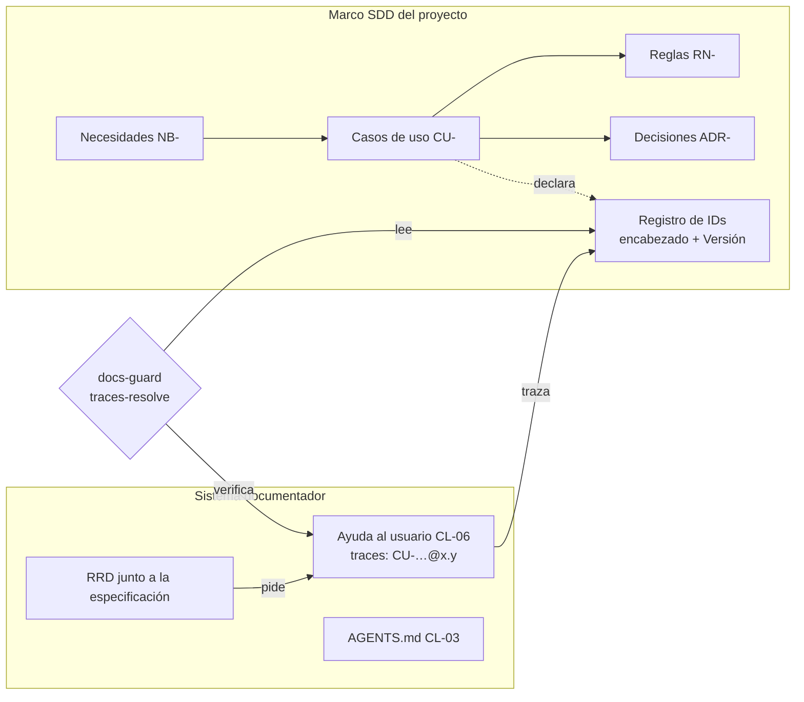

# Tema 07 — Integración con un marco SDD

Cuando un proyecto se desarrolla con un marco de **desarrollo guiado por especificación** (SDD, *spec-driven
development*), la especificación ya tiene dónde vivir, con qué identificadores y con qué reglas. Este tema enseña a
encajar el sistema documentador dentro de ese marco: qué piezas toma del SDD, cuáles agrega y qué controles las
mantienen de acuerdo, sin escribir dos veces lo mismo. Sirve a quien estudia, que termina con criterio para decidir
qué pertenece al SDD y qué al sistema documentador, y a un agente, que encuentra las reglas de traza y de resolución
en tablas y en un ensayo que puede repetir.

**Estado.** El sistema documentador se pone a prueba en tres **escalones**: el 1 es esta guía con su mini demo; el 2,
una piloto sobre Lab-Geometria, el primer proyecto con SDD que adopta la compuerta en su propia CI; el 3, el SDD-B. Este
tema queda en `borrador` hasta que el escalón 2 cierre con la compuerta corriendo en la CI de Lab-Geometria: sus reglas
salen del diseño y de un ensayo sobre el SDD real de ese proyecto, pero todavía no corrieron en una CI de proyecto. Lo
que cambie cuando corran se corrige acá.

Los repositorios que se citan (Lab-Geometria, IA.SDD y este, Lab-Documentos) son públicos; el SDD-B es privado y se
nombra por su alias.

## Índice

1. [Definición](#definición)
2. [Aplicación por escenario](#aplicación-por-escenario)
3. [Ejemplos concretos](#ejemplos-concretos)
4. [Preguntas guía](#preguntas-guía)
5. [Criterios de calidad](#criterios-de-calidad)
6. [Anexo](#anexo)

## Definición

### Qué es

Un **marco SDD** es un método y un conjunto de reglas donde la especificación (necesidades, casos de uso, reglas de
negocio, decisiones de arquitectura) se escribe antes que el código y es el referente contra el que se contrasta lo
que se construye. La industria todavía no fijó el término: Böckeler distingue tres grados —la especificación que guía
una tarea y se descarta (*spec-first*), la que se conserva para mantener la funcionalidad (*spec-anchored*) y la que
es la única fuente que una persona edita (*spec-as-source*)— y advierte que la mayoría de las herramientas sólo cubre
el primero ([Böckeler, 2025](99-Anexos/Referencias.md#ref-bockeler-2025)). Thoughtworks la ubica en el anillo
«evaluar» de su radar, no en «adoptar» ([Thoughtworks, 2025](99-Anexos/Referencias.md#ref-thoughtworks-2025)).

**Integrar el sistema documentador con un marco SDD** quiere decir tres cosas, y sólo tres:

1. Las piezas documentales **trazan** a los identificadores que el SDD ya declara, en lugar de inventar los suyos.
2. El **registro de requerimientos documentales** (RRD) vive junto a la especificación, no en un archivo aparte.
3. La compuerta `docs-guard` **resuelve** esas trazas contra el registro de IDs del SDD tomado en una versión fija:
   un SHA, o una etiqueta, que en Git apunta a un SHA (cuál de los dos usa cada escenario lo dice la [aplicación por escenario](#aplicación-por-escenario)).

Lo que el SDD no cubre lo agrega el sistema documentador como clases de pieza propias, con el mismo frontmatter y la
misma compuerta.

### Qué problema resuelve

Sin integración, un proyecto con SDD termina con dos fuentes que dicen lo mismo: el caso de uso en la especificación y
una página de ayuda que lo repite con otras palabras. Cuando el caso de uso cambia, la página no se entera. La
investigación sobre documentación lo mide desde hace años: las referencias desactualizadas al código son uno de los
defectos más comunes de la documentación de repositorios ([Tan et al., 2024](99-Anexos/Referencias.md#ref-tan-2024)).
Con la traza `traces: [CU-08002@1.11]`, la página declara de qué versión del caso de uso depende, y la compuerta da
rojo cuando esa versión deja de existir.

### Qué no es

| No es… | Por qué |
| --- | --- |
| Un reemplazo de la norma del SDD | El sistema documentador no redefine las categorías del SDD ni sus reglas: las cita. Si una regla del cuerpo choca con la del SDD, rige la del SDD dentro de su repositorio y la diferencia se declara en la hoja de integración del proyecto ([anexo](#anexo), campo «Norma que no se toca») y en el pull request que la aplica |
| Un generador de especificaciones | No escribe casos de uso ni decisiones de arquitectura; documenta para audiencias que el SDD no atiende |
| Una sola herramienta | Spec Kit ([GitHub, 2026](99-Anexos/Referencias.md#ref-github-2026)) y Kiro ([Kiro, s. f.](99-Anexos/Referencias.md#ref-kiro-sf)) son marcos SDD con flujos de comandos; el laboratorio tiene dos marcos propios. Las reglas de este tema valen para cualquiera que tenga un registro de IDs estable |
| Obligatorio | Un proyecto sin SDD usa la rama «sin SDD» de `CTX-SDEI-2`: RRD en `docs/_requisitos.md` y fichas propias (lo muestra la mini demo de `Examples/`) |

### Definiciones

| Término | Definición |
| --- | --- |
| Escalón | Etapa de prueba del sistema documentador con su propia compuerta de cierre: 1, esta guía y la mini demo; 2, la piloto en Lab-Geometria; 3, el SDD-B |
| Marco SDD y proyecto destino | El marco es un repositorio con las reglas y los orquestadores (IA.SDD); el proyecto destino es el que aplica el marco y guarda su especificación generada (Lab-Geometria, en `SDD/Docs/`). Las trazas resuelven contra el proyecto destino, no contra el marco |
| Categoría (IA.SDD) | Cada una de las doce carpetas numeradas de la especificación generada: 01 necesidades, 02 especificación funcional, 05 arquitectura, 10 ejemplos, 11 documentación de entrega, entre otras |
| Unidad de entrega (IA.SDD) | Parte del producto que se construye y se entrega por separado, con su propia especificación (en Lab-Geometria, la API y el front web). Una pantalla pertenece a la unidad del front que la dibuja |
| Cuerpos de la categoría 11 | La documentación de entrega de IA.SDD se arma por rol de intervención: integrador (usa la unidad desde otro sistema), mantenedor (cambia su código), operador (la despliega y la sostiene) |
| Especificación | Conjunto de documentos del SDD que dicen qué tiene que hacer el sistema y por qué: necesidades (`NB-`), casos de uso (`CU-`), reglas (`RN-`), decisiones de arquitectura (`ADR-`) |
| Registro de IDs del SDD | Lista de identificadores que la especificación declara, cada uno una sola vez y con su versión. En los marcos del laboratorio, el ID abre el encabezado del documento (`# CU-08002 — …`) y la versión va en una línea `**Versión:** 1.11` |
| Versión congelada | Copia de un documento tal como estaba en una versión anterior, guardada para reconstruir la historia (en los marcos del laboratorio, carpetas `_legacy/`). Repite el ID del documento vigente |
| Decisión de arquitectura (ADR) | Registro corto de una decisión con contexto, decisión, estado y consecuencias. Se numera, no se borra, y cuando otra decisión la reemplaza queda marcada como reemplazada ([Nygard, 2011](99-Anexos/Referencias.md#ref-nygard-2011)) |
| Conocimiento compartido (`CL-11`) | Documento de una base de conocimiento común que varios proyectos copian. La copia se fija con su SHA-256 (su **huella**) para comprobar que no cambió. Hoy el Marco la activa sólo en `ESC-SDEI-1` y `ESC-SDEI-4`; en `ESC-SDEI-3` se activa cuando Lab-Geometria reciba la copia de la capa A de [Las lecciones de decisión, dentro del marco](#las-lecciones-de-decisión-dentro-del-marco) |
| Lección de decisión | Registro de una decisión que un agente resolvió sin que la persona responsable tuviera que decidirla, con el nivel donde se resolvió (N1, análisis previo de un agente; N2, mesa de agentes que deliberan) o donde se elevó (N3, consulta a la persona con una sugerencia), la regla aplicada, la evidencia y el resultado. Sólo cubre lo que no es de clase H: lo de clase H siempre lo decide una persona. Sirve para que la próxima vez un agente resuelva igual sin preguntar |
| Prefijo externo | Prefijo del registro cerrado del cuerpo (`CU`, `RN`, `ADR`, `NB`, `RF`…) pensado para IDs que declara el sistema que se documenta. Si la traza resuelve contra el registro (el del repositorio más la carpeta que se pasa en `--fuente`), da verde como cualquier otra. Si no resuelve, `dg.py` mira si la página tiene un `source.lock` en su carpeta o más arriba, o si se le pasó `--fuente`: sin ninguno de los dos, la traza es «no verificable» y sólo avisa; con alguno, da rojo. Las fichas `RN-LOC-nn` de la mini demo usan un prefijo externo pero se declaran en este repositorio, así que resuelven contra el registro propio ([Esquema](99-Anexos/Esquema-Frontmatter-Y-Prefijos.md#5-registro-de-prefijos)) |
| Orquestador | El agente o la persona que conduce las fases del SDD, despacha el trabajo y decide cuándo se pasa de una fase a la siguiente |



*Diagrama: la especificación declara los IDs; el sistema documentador traza a ellos y `docs-guard` comprueba cada
traza contra el registro. Las flechas punteadas son declaraciones; las llenas, dependencias.*

## Aplicación por escenario

Los cuatro escenarios son los del [Marco](00-Marco.md#2-escenarios). Lo que cambia entre ellos es si hay SDD, de quién
es la norma y dónde corre la compuerta.

| Escenario | ¿Hay SDD? | Qué toma del SDD | Qué agrega el sistema documentador | Contra qué resuelve la traza |
| --- | --- | --- | --- | --- |
| `ESC-SDEI-1` Corpus de guías | No | Nada | Todo el cuerpo (CL-10) y el proceso «Cómo intervenir» (CL-12). Una guía que cita un SDD de otro proyecto lo hace con un enlace permanente al SHA (como la cita a IA.SDD de esta sección), no con una traza | El registro del propio repositorio (`doc_id` y encabezados) |
| `ESC-SDEI-2` App sin roles | No | — | RRD en `docs/_requisitos.md`, fichas provisionales `RN-LOC-nn`, ayuda, técnica y contrato | Las trazas de nivel 1 (`RN-LOC-01@1.0`), contra las fichas del propio repositorio; las anclas de nivel 2 de cada ficha (`ruta#Símbolo@SHA`), contra el código en el SHA de `source.lock` |
| `ESC-SDEI-3` Panel con roles | Sí: Lab-Geometria usa el marco IA.SDD | Casos de uso de cada unidad de entrega, reglas, ADR, la categoría 11 de documentación de entrega | Ayuda al usuario final por rol (CL-06): el marco la declara fuera de su alcance. RRD junto a la especificación | El SHA del proyecto (la etiqueta, cuando la hay, sólo nombra ese SHA), **sin** las versiones congeladas |
| `ESC-SDEI-4` Servicio con paquetes | Sí: el SDD-B, que lleva su norma y su especificación en el mismo repositorio (marco y proyecto destino a la vez) | Su registro de IDs y su vía para cambiar la norma | Contrato de los paquetes, README y CHANGELOG por línea, conocimiento compartido copiado con huella (CL-11) | La etiqueta de cada línea de versión |

**Por contexto.** Tres contextos del Marco cambian la respuesta dentro de un escenario con SDD:

| Contexto | Cambia | Regla |
| --- | --- | --- |
| `CTX-SDEI-2` con SDD | Dónde vive el RRD y qué prefijos usan las trazas | El RRD va con la especificación, como un archivo `doc_type: rrd` del proyecto destino; agregarlo es contenido del proyecto (clase P, por pull request), no un cambio a la norma del marco. La carpeta exacta en Lab-Geometria la fija el escalón 2. Las trazas usan `CU-`, `RN-`, `ADR-` del SDD, que son prefijos externos |
| `CTX-SDEI-3` documentación en otro repositorio | El ancla | Si la página vive fuera del repositorio del SDD, la traza resuelve contra un SHA fijado y el desfase lo avisa el carril programado |
| `CTX-SDEI-4` fuera de la organización del runner | De dónde sale la compuerta | El SDD-B vive en otra organización de GitHub, con su propio runner, y no puede llamar al workflow reutilizable: copia `docs-guard.yml` con su huella y lo corre en el runner de su organización |

**Una regla que no cambia en ningún escenario.** Un escenario sólo activa, quita o sustituye clases de pieza y
controles; nunca agrega fases al ciclo documental (1a captura y 1b evaluación de requerimientos, 2 análisis, 3 diseño,
4 implementación, 5 integración). Si un SDD tiene una fase que el ciclo no tiene, la documentación se engancha en la
fase del ciclo donde se escribe el código o el texto: el plan de sprint de IA.SDD no agrega una fase, porque la
documentación de cada incremento se actualiza en la fase 4, dentro del mismo pull request.

**La frontera, en una línea por clase [criterio propio].** Si la clase ya existe en el SDD, el sistema documentador
la **cita**; si el SDD la declara fuera de alcance, el sistema documentador la **agrega**; si las dos existen y dicen
cosas distintas, decide una persona (clase H; cuál, lo dice la tabla de actores del [Marco](00-Marco.md#4-actores): una divergencia
entre especificación e intención, la analista; un cambio de norma, la persona responsable del producto) y la diferencia
se declara en la hoja de integración del proyecto (el [anexo](#anexo)) y en el pull request. La tabla nombra sólo las clases donde la
frontera se discute; las demás clases activas de `ESC-SDEI-3` (CL-02, CL-04, CL-05, CL-08) no tienen par en el SDD o
salen del build, y las trata el sistema documentador como en cualquier escenario.

| Clase | En IA.SDD (`ESC-SDEI-3`) | Sistema documentador |
| --- | --- | --- |
| CL-01 Especificación | Categorías 01, 02 y 05 | Cita y traza |
| CL-03 `AGENTS.md` | Lo emite la consolidación de cierre de la categoría 11 | Exige que exista y que sus enlaces resuelvan |
| CL-06 Ayuda al usuario final | Fuera de alcance («esta categoría no documenta al usuario final no técnico») | Agrega, con `traces` al caso de uso de la unidad |
| CL-07 Documentación técnica | Categoría 11, cuerpos integrador, mantenedor y operador | Cita; no reescribe esos archivos ni los pasa por la compuerta: los gobierna la norma del SDD, con su propia auditoría (al final de [Resolver una traza contra el SDD real de Lab-Geometria](#resolver-una-traza-contra-el-sdd-real-de-lab-geometria)). Si el escalón 2 decide que entren a la compuerta, el frontmatter lo agrega el propio proyecto en su pull request, como contenido suyo |

La cita de la categoría 11 sale de sus reglas, en la tabla de fronteras
([IA.SDD@bac7e48, `Rules-Documentacion.md`, l. 102](https://github.com/hdcm-dev/IA.SDD/blob/bac7e48409786396cecd36e180a06419b96cfef4/SDD/Devs/Rules/Rules-Documentacion.md#L102)).

### Las lecciones de decisión, dentro del marco

Un SDD operado por agentes toma decisiones a cada paso: qué prefijo usar, si una divergencia es de forma o de fondo,
si un cambio necesita a la persona responsable. El diseño del sistema documentador separa esas decisiones en dos
capas **[criterio propio del diseño del sistema documentador, en borrador hasta el escalón 2]**. Ninguna de las dos
existe todavía: se escriben en el escalón 2.

| Capa | Qué es | Clase | Dónde |
| --- | --- | --- | --- |
| A | Un conocimiento compartido (CL-11) que registra y destila lecciones de decisión (decisión, nivel, regla, evidencia, resultado, lección). No redefine qué se puede decidir sin la persona: cita las reglas de cada marco que ya lo dicen | P | La base de conocimiento común del laboratorio, copiada con huella a la carpeta de conocimiento de cada SDD |
| B | Una línea en la norma de cada orquestador que manda a consultar la capa A antes de preguntar | H | La norma de cada SDD, por su propia vía de cambio |

La capa B cambia una norma ajena; por eso es de clase H y la decide la persona responsable de cada SDD, no este cuerpo.

## Ejemplos concretos

### Resolver una traza contra el SDD real de Lab-Geometria

Una página de ayuda de Lab-Geometria traza al contrato de administración de cuentas: `traces: [CU-08002@1.11]`. El
ensayo comprueba qué hace `traces-resolve` con esa traza según qué parte del SDD se le dé como registro. Se corrió el
2026-10-27 sobre Lab-Geometria en el SHA `5f07b12`, con el `dg.py` de Lab-Documentos en el SHA `080f158`. La página
de ensayo vive fuera del repositorio del SDD (como la mini demo vive fuera del de MovilidadUrbana): por eso el SDD se
baja en un SHA fijado y entra por `--fuente`.

La herramienta es `tools/docs-guard/dg.py`, el programa en Python (sólo biblioteca estándar, Python 3) que implementa
los controles de `docs-guard`; su subcomando `trazas` es el control `traces-resolve` del grupo PR-5. Recibe la carpeta
con las páginas que se verifican, `--raiz` (la raíz contra la que arma su propio registro) y `--fuente` (una carpeta
más cuyos IDs suma al registro: acá, el SDD del proyecto). El guion completo, para correr desde la raíz de un clon de
Lab-Documentos descartable (`https://github.com/hdcm-dev/Lab-Documentos.git`):

```bash
# [Compilado: guion del ensayo del 2026-10-27; sólo cambian las carpetas de trabajo, acá bajo /tmp/ensayo]
set -u
git checkout --quiet 080f158                                            # el dg.py con el que se corrió
E=/tmp/ensayo; rm -rf "$E"; mkdir -p "$E/geo"
git clone --quiet --filter=blob:none https://github.com/hdcm-dev/Lab-Geometria.git "$E/clon"
git -C "$E/clon" archive 5f07b12 SDD/Docs | tar -x -C "$E/geo"          # el SDD entero, en el SHA fijado
cp -r "$E/geo" "$E/geo-vigente"
find "$E/geo-vigente" -type d -name _legacy -prune -exec rm -rf {} +    # el mismo SDD sin versiones congeladas
pagina() {  # pagina CASO TRAZA: una carpeta con una sola página de ayuda que lleva esa traza
  mkdir -p "$E/p-$1"
  printf -- '---\ndoc_id: GP-ENSAYO-%s\ndoc_type: guia-practica\ntitle: Página de ayuda de ensayo\ndescription: Página mínima que traza a un caso de uso del SDD de Lab-Geometria.\nstatus: borrador\norigin: ia-assisted\nconfidence: media\nowner: ensayo\nlast_review: 2026-10-27\naudience: [humano]\ntraces: [%s]\n---\n# Ensayo\n' "$1" "$2" > "$E/p-$1/ayuda.md"
}
caso() {    # caso CASO TRAZA FUENTE
  pagina "$1" "$2"
  python3 -I tools/docs-guard/dg.py trazas "$E/p-$1" --raiz "$E/p-$1" --fuente "$E/$3"; echo "caso $1: exit=$?"
}
caso A CU-08002@1.11 geo
caso B CU-08002@1.11 geo-vigente
caso C CU-08002@1.10 geo-vigente
caso D CU-03         geo-vigente
```

| Caso | Traza | Registro | Resultado | Por qué |
| --- | --- | --- | --- | --- |
| A | `CU-08002@1.11` | Todo `SDD/Docs` | Rojo, `traza-ambigua` | El ID está declarado 3 veces: el vigente y dos versiones congeladas en `_legacy/` |
| B | `CU-08002@1.11` | `SDD/Docs` sin `_legacy/` | Verde | Una sola declaración, con `**Versión:** 1.11` |
| C | `CU-08002@1.10` | `SDD/Docs` sin `_legacy/` | Rojo, `traza-version-desfasada` | La página quedó atrás de la especificación: hay que revisarla |
| D | `CU-03` | `SDD/Docs` sin `_legacy/` | Rojo, `traza-no-resuelve` | `CU-03` sólo existe en versiones congeladas: el SDD renumeró sus casos de uso |

Sobre el árbol completo, el registro tiene 829 IDs y 355 de ellos están declarados más de una vez. Sin `_legacy/`
quedan 715 IDs y 52 repetidos, ninguno con prefijo `CU`, `RN`, `ADR`, `NB` o `RF`: los repetidos son rótulos locales de
listas (`H-01`, `N-01`, `BT-01`) que una página no traza. **La lección del ensayo:** al integrar con un SDD que guarda
versiones congeladas, la fuente del registro excluye esas carpetas; si no, toda traza a un documento con historia da
rojo por ambigüedad.

**Cómo pasa esto a la CI [criterio propio; se diseña y se confirma en el escalón 2].** Hay dos casos, y ninguno tiene
todavía un workflow escrito:

| Dónde vive la página | Ancla | Qué falta |
| --- | --- | --- |
| En otro repositorio que el SDD (como este ensayo) | El SHA del SDD, guardado en un `source.lock` junto a las páginas | Un paso del workflow que, como el guion, baja el SDD con `git archive`, borra `_legacy/` y pasa la carpeta en `--fuente`. La mini demo de `Examples/` ya hace lo mismo con el código de MovilidadUrbana en su propio workflow, `mini-demo-movilidad.yml` |
| En el mismo repositorio que el SDD (lo previsto para Lab-Geometria) | El commit del pull request: no hace falta `source.lock` ni `git archive` | Dos cambios a `dg.py`. Primero, una opción para excluir carpetas: hoy arma el registro con todo el repositorio, `_legacy/` incluido. Segundo, una forma de declarar que los prefijos externos se resuelven contra el propio repositorio: sin `source.lock` ni `--fuente`, una traza `CU-` que no resuelve hoy sólo **avisa**, y pasar el propio `SDD/Docs` en `--fuente` no sirve, porque lo leería dos veces y volvería ambiguo cada ID. Hasta que estén los dos cambios, la compuerta no cumple en ese proyecto la promesa de [Qué problema resuelve](#qué-problema-resuelve): una traza a un documento con versiones congeladas da ambigua, y una a un ID que desapareció sólo avisa |

```text
[Compilado: salida del ensayo del 2026-10-27, recortada a una línea por caso]
caso A  ERROR traza-ambigua: CU-08002@1.11: declarado 3 veces    PR-5 traces-resolve: ROJO
caso B  PR-5 traces-resolve: verde (errores=0 avisos=0) trazas=1 resueltas=1
caso C  ERROR traza-version-desfasada: CU-08002@1.10: la declaración está en 1.11
caso D  ERROR traza-no-resuelve: CU-03: el ID no está declarado en el registro
```

Qué revisa la compuerta en ese proyecto: `docs-guard` verifica las carpetas que el workflow le pasa, no el repositorio
entero. En Lab-Geometria se le pasan sólo las carpetas del sistema documentador (la ayuda, el RRD); los documentos del
SDD sirven de registro para las trazas, pero su frontmatter no se controla, y un documento sin frontmatter fuera de un
cuerpo nuevo sólo avisa.

### Lo que el SDD no cubre: la ayuda al usuario final

Las reglas de documentación de IA.SDD organizan su cuerpo de entrega por rol de intervención (integrador, mantenedor,
operador) y declaran fuera de alcance al usuario final no técnico. Lab-Geometria, que usa ese marco, tiene alumnos y
docentes que usan el panel. El hueco lo cubre el sistema documentador con la ayuda por rol (CL-06, `TEM-05`): una
página por tarea, con `traces` al caso de uso de la unidad que contiene la pantalla. La regla es una sola: la pantalla
traza al caso de uso de su unidad (el front); si ese caso usa una operación de otra unidad (la API), es el caso de uso
del front el que cita a la API, no la página de ayuda. La prueba de concepto de
`Examples/Prueba-Ayuda-Por-Rol/` muestra cómo se sirve esa ayuda según el rol.

### Las fases de Spec Kit y de Kiro

Los dos marcos SDD públicos más citados separan la especificación en fases con un artefacto por fase. Kiro genera
`requirements.md` (historias y criterios de aceptación), `design.md` (arquitectura, flujos, manejo de errores) y
`tasks.md` (tareas discretas con estado) ([Kiro, s. f.](99-Anexos/Referencias.md#ref-kiro-sf)). Spec Kit encadena
comandos para los principios del proyecto, la especificación, el plan técnico, las tareas, la implementación y una
verificación final que se repite hasta que converge ([GitHub, 2026](99-Anexos/Referencias.md#ref-github-2026)).
Ninguno de los dos trae un registro de IDs versionados como el de los marcos del laboratorio. Para integrarlos con este
sistema documentador, el proyecto tiene que elegir antes qué encabezado declara el ID y dónde va la versión; sin eso,
`traces-resolve` no tiene contra qué resolver. `dg.py` acepta cualquier nivel de encabezado que empiece con el ID
(`# RF-01 — …` o `### RF-01 — …`), así que un `requirements.md` con varios requisitos los declara con un encabezado
cada uno. Esa elección es de clase H y la toma la persona responsable del
proyecto: es una convención del proyecto sobre sus propios artefactos, no un cambio a la herramienta, que no trae una
norma propia que respetar.

## Preguntas guía

1. ¿El proyecto tiene un marco SDD? Si lo tiene, ¿qué encabezado declara un ID y dónde va su versión?
2. ¿El SDD guarda versiones congeladas? ¿Qué carpetas hay que excluir de la fuente del registro?
3. Para la pieza que vas a escribir, ¿el SDD ya la tiene (la citás), la declara fuera de alcance (la agregás) o dicen
   cosas distintas (decide una persona)?
4. ¿A qué caso de uso traza la página, y es el de la unidad que contiene la pantalla o el de otra?
5. ¿Dónde vive el RRD del proyecto y quién acepta cada fila?
6. ¿La compuerta corre en el runner de la organización del proyecto o hay que copiar el workflow con su huella?
7. Si el cambio toca la norma del SDD, ¿quién lo decide y por qué vía se propone?

## Criterios de calidad

| Criterio | Versión buena | Versión pobre |
| --- | --- | --- |
| Una sola fuente | La página traza a `CU-08002@1.11` y no repite el caso de uso | La página copia los pasos del caso de uso con otras palabras |
| Registro resoluble | La fuente del registro excluye las versiones congeladas y toda traza da verde o un rojo que se explica | La compuerta da `traza-ambigua` en cada página y alguien apaga el control |
| Frontera declarada | Cada clase de pieza dice si la cita del SDD, la agrega o la decide una persona | Hay ayuda al usuario en la categoría técnica del SDD y técnica en la ayuda |
| Norma respetada | Un cambio a la norma del SDD va por la vía de ese SDD, como clase H | El cuerpo «corrige» una regla del SDD en su propio texto |
| Ancla explícita | La traza a una pieza que cambia de contenido (un caso de uso, una regla) lleva versión (`@MAYOR.MENOR`) y la fuente está fijada a un SHA; la traza a un documento de estructura, como el Marco, puede ir sin versión | La traza apunta a la rama principal del SDD y cambia sin aviso |
| Decisiones registradas | Lo que un agente resolvió sin preguntar queda como lección con regla y evidencia | La misma duda vuelve a la persona responsable en cada pull request |

Los criterios generales de una guía están en el [anexo de criterios](99-Anexos/Criterios-De-Calidad.md); los de este
tema los concretan para la integración con un SDD.

## Anexo

**Hoja de integración con un SDD.** Plantilla comentada: se completa una por proyecto, antes de la primera página que
trace a la especificación. No es un archivo aparte: es una sección más de la **instancia** de «Cómo intervenir» del
proyecto, la página de cada proyecto que completa esa plantilla con sus datos (la de este repositorio es
[Cómo intervenir en Lab-Documentos](Examples/Como-Intervenir-Lab-Documentos.md)).

[Fragmento ilustrativo: plantilla; la columna del medio es la pregunta que guía cada campo y la última se completa]

| Campo | Pregunta que guía el campo | Valor |
| --- | --- | --- |
| Marco SDD | ¿Qué marco y en qué versión? Si no hay, se usa la rama «sin SDD» de `CTX-SDEI-2` y esta ficha no hace falta | |
| Repositorio y ancla | ¿En qué repositorio vive la especificación y contra qué SHA o etiqueta se resuelve? | |
| Declaración del ID | ¿Qué encabezado declara un ID (por ejemplo, `# CU-08002 — …`) y dónde va la versión (`**Versión:** 1.11`)? | |
| Prefijos que se trazan | ¿Qué prefijos de la especificación usan las páginas (`CU`, `RN`, `ADR`)? ¿Están como externos en el registro de prefijos? | |
| Carpetas excluidas del registro | ¿Qué carpetas guardan versiones congeladas (`_legacy/`) y quedan fuera de la fuente? | |
| Clases que se citan | ¿Qué clases ya produce el SDD, de modo que el sistema documentador sólo las cita? | |
| Clases que se agregan | ¿Qué declara el SDD fuera de alcance y agrega el sistema documentador (por ejemplo, CL-06)? | |
| Dónde vive el RRD | ¿En qué carpeta de la especificación y quién acepta cada fila? | |
| Runner y workflow | ¿Llama a `docs-guard.yml` por `uses:` o lo copia con su huella? ¿Con qué etiqueta de runner? | |
| Norma que no se toca | ¿Qué reglas del SDD mandan sobre este cuerpo y por qué vía se propone un cambio? | |

El paso a paso para intervenir la documentación de un proyecto, con entradas, salidas y validaciones, está en la
plantilla [Cómo intervenir](Examples/Como-Intervenir.md).

Documento anterior: [Tema 06 — Compuertas de calidad y CI](TEM-06-Compuertas-Y-CI.md). Siguiente documento: el
[tutorial de la mini demo](Examples/MovilidadUrbana-Mini-Demo/README.md), que cierra la ruta «aprender» antes de los
[Ejercicios](99-Anexos/Ejercicios.md).
