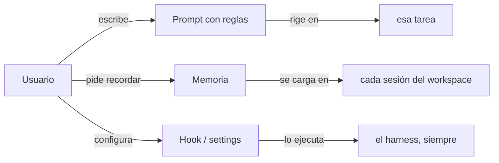
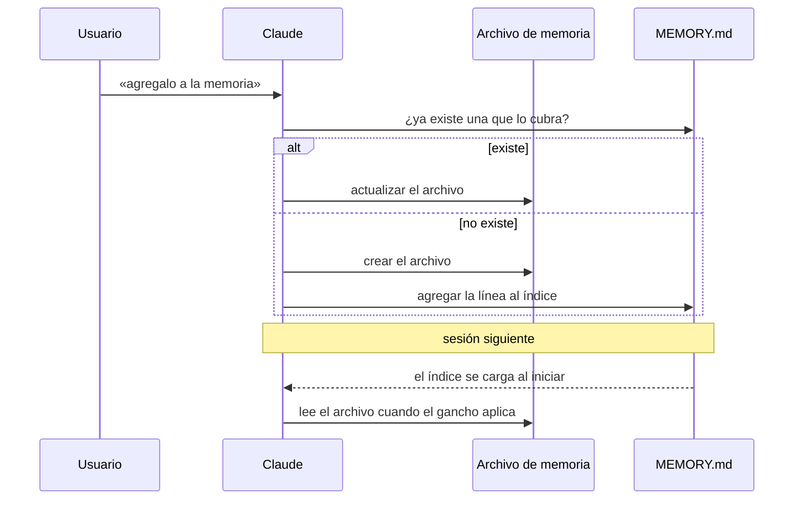
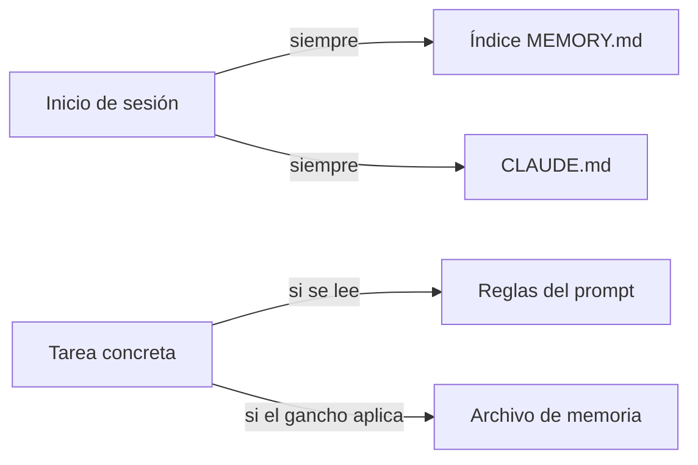
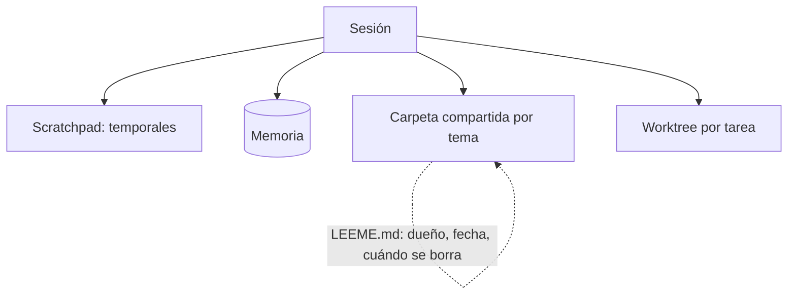
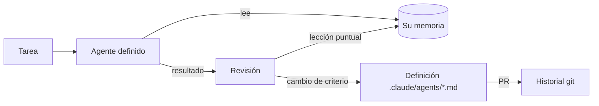
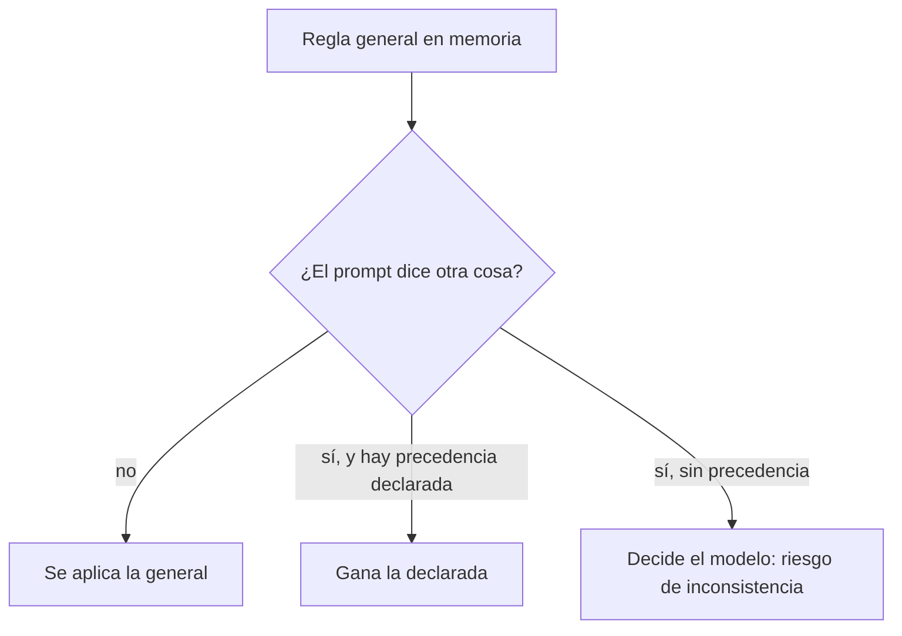
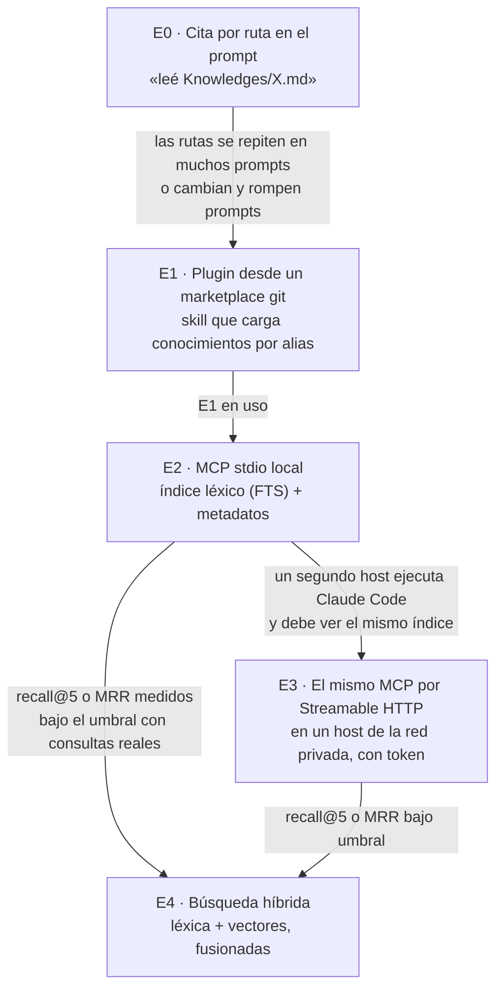
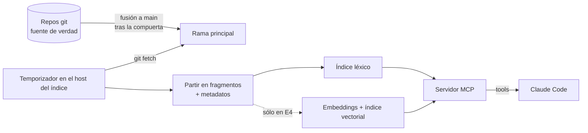

# Guía general de Claude Code: reglas, memoria, conocimiento y organización del trabajo

> Guía de estudio autocontenida sobre cómo usar lo que Claude Code ofrece para trabajar con una metodología de
> **prompts, reglas, conocimientos curados, indexados y mesas de expertos**: cómo escribir reglas que el agente
> interprete sin ambigüedad, cómo funciona la memoria persistente y su índice, dónde deja sus archivos de trabajo, cómo
> se definen agentes reutilizables y **cómo se recupera conocimiento**: de la cita por ruta a la
> skill, al plugin y al servidor MCP local o remoto (§10).
>
> **Cómo leer las marcas de evidencia.** `LEÍDO` = tomado de la documentación oficial citada en §12; `MEDIDO` = comprobado
> con un comando en una instalación real; `PROPUESTA` = criterio propio de la guía, declarado como tal; `SIN MEDIR` =
> no comprobado todavía; `ABIERTO` = cuestión sin decidir, con la razón por la que sigue abierta.

## Índice

1. [Conceptos base](#1-conceptos-base)
   1. [Tres planos: modelo, herramienta y manejo](#11-tres-planos-modelo-herramienta-y-manejo)
   2. [Marco de referencia: escenarios, contextos y actores](#12-marco-de-referencia-escenarios-contextos-y-actores)
2. [Reglas en un prompt](#2-reglas-en-un-prompt)
   1. [Qué es una regla](#21-qué-es-una-regla)
   2. [Ambigüedades típicas](#22-ambigüedades-típicas)
   3. [Ejemplo: la regla de imágenes](#23-ejemplo-la-regla-de-imágenes)
   4. [Imágenes visibles en la vista previa](#24-imágenes-visibles-en-la-vista-previa)
3. [Formas de fijar un comportamiento](#3-formas-de-fijar-un-comportamiento)
4. [Memoria persistente](#4-memoria-persistente)
   1. [Definición](#41-definición)
   2. [Dónde vive](#42-dónde-vive)
   3. [Estructura de una memoria](#43-estructura-de-una-memoria)
   4. [El índice MEMORY.md](#44-el-índice-memorymd)
   5. [Ciclo de vida](#45-ciclo-de-vida)
   6. [Límites](#46-límites)
   7. [Costo en contexto](#47-costo-en-contexto)
5. [Compactar el índice](#5-compactar-el-índice)
6. [Carpetas de trabajo de los agentes](#6-carpetas-de-trabajo-de-los-agentes)
7. [Agentes que persisten entre sesiones](#7-agentes-que-persisten-entre-sesiones)
   1. [Agentes efímeros y agentes definidos](#71-agentes-efímeros-y-agentes-definidos)
   2. [Automejora](#72-automejora)
   3. [Invocar un agente desde un prompt](#73-invocar-un-agente-desde-un-prompt)
   4. [Memoria del agente y conocimientos](#74-memoria-del-agente-y-conocimientos)
8. [Estructura de configuración y versionado](#8-estructura-de-configuración-y-versionado)
   1. [Mapa general](#81-mapa-general)
   2. [Versionar por repositorio](#82-versionar-por-repositorio)
   3. [Versionar en un único repositorio](#83-versionar-en-un-único-repositorio)
   4. [Diagnóstico de una instalación](#84-diagnóstico-de-una-instalación)
9. [Convivencia entre reglas de memoria y reglas del prompt](#9-convivencia-entre-reglas-de-memoria-y-reglas-del-prompt)
   1. [Qué pasa realmente](#91-qué-pasa-realmente)
   2. [Cómo hacerlo predecible](#92-cómo-hacerlo-predecible)
   3. [Preguntas guía de §1–§9](#93-preguntas-guía-de-19)
10. [Recuperar conocimiento: de la ruta al servicio](#10-recuperar-conocimiento-de-la-ruta-al-servicio)
    1. [Definiciones](#101-definiciones)
    2. [La escalera E0–E4](#102-la-escalera-e0e4)
    3. [Transportes](#103-transportes)
    4. [Configurar un servidor MCP](#104-configurar-un-servidor-mcp)
    5. [Contrato de metadatos](#105-contrato-de-metadatos)
    6. [Búsqueda léxica, semántica e híbrida](#106-búsqueda-léxica-semántica-e-híbrida)
    7. [Ingesta](#107-ingesta)
    8. [Selectividad por entorno](#108-selectividad-por-entorno)
    9. [Seguridad](#109-seguridad)
    10. [Diagnóstico de una instalación con MCP](#1010-diagnóstico-de-una-instalación-con-mcp)
    11. [Preguntas guía](#1011-preguntas-guía)
11. [Glosario](#11-glosario)
12. [Fuentes](#12-fuentes)

---

## 1. Conceptos base

Claude Code no recuerda nada de una sesión a otra por sí mismo. Lo que persiste entre sesiones tiene que estar escrito
en algún archivo que se cargue al empezar o que el agente lea cuando lo necesite. Toda la guía gira alrededor de esa
idea: **dónde se escribe una instrucción determina cuándo y con qué fuerza se aplica**.



### 1.1 Tres planos: modelo, herramienta y manejo

Cada tema de esta guía pertenece a uno de tres planos. Distinguirlos evita atribuirle al modelo lo que hace la
herramienta, o a la herramienta lo que es una práctica propia.

| Plano | Qué es | Ejemplos |
|---|---|---|
| **Claude** (el modelo) | El modelo de lenguaje: interpreta, razona y decide con el texto que tiene en contexto | Interpretar una regla ambigua; resolver dos instrucciones que chocan; reconocer que una memoria aplica |
| **Claude Code** (la herramienta) | El programa que ejecuta al modelo: carga archivos, corre herramientas, aplica configuración | Cargar `MEMORY.md` y `CLAUDE.md`; ejecutar hooks; leer `.claude/agents/`; los límites de carga |
| **Manejo** (práctica de uso) | Convenciones que el usuario y sus agentes adoptan sobre lo anterior | Cómo redactar reglas; compactar el índice; carpetas compartidas por tema; mesas de expertos |

Clasificación de las secciones:

| Sección | Plano |
|---|---|
| §2 Reglas en un prompt | Manejo (redacción) + Claude (interpretación) |
| §2.4 Imágenes en la vista previa | Manejo (markdown estándar, no es propio de Claude) |
| §3 Formas de fijar un comportamiento | Claude Code (mecanismos) |
| §4 Memoria persistente | Claude Code (carga y límites) + Claude (cuándo leer y escribir) |
| §4.7 Costo en contexto | Claude Code |
| §5 Compactar el índice | Manejo |
| §6 Carpetas de trabajo | Claude Code (scratchpad) + Manejo (carpetas compartidas) |
| §7 Agentes persistentes | Claude Code (definición, invocación) + Manejo (automejora, conocimientos) |
| §8 Estructura y versionado | Claude Code (ubicaciones) + Manejo (estrategia de repositorios, diagnóstico) |
| §9 Convivencia de reglas | Claude (resolución) + Manejo (declarar precedencia) |
| §10 Recuperar conocimiento | Claude Code (MCP, plugins, scopes) + Manejo (escalera, contrato, ingesta) + Claude (precedencia entre lo citado y lo recuperado) |

### 1.2 Marco de referencia: escenarios, contextos y actores

Toda la guía usa el mismo vocabulario. Cada sección dice qué aporta su tema en estos escenarios y contextos.

**Escenarios** (situaciones típicas de trabajo):

| Id | Escenario | Qué necesita el agente |
|---|---|---|
| S1 | Ejecutar un prompt de tarea | Las reglas del prompt y los conocimientos que cita |
| S2 | Convocar una mesa de expertos | Varios roles con cartas propias que aplican normas comunes |
| S3 | Verificar un informe | Un rol estable (agente definido) con su memoria de errores pasados |
| S4 | Consultar conocimiento que no se citó | Buscar en un cuerpo indexado de normas y documentación |

**Contextos** (variantes que cambian la respuesta):

| Id | Contexto | Qué cambia |
|---|---|---|
| C1 | Un solo host que ejecuta Claude Code | Alcanza con archivos locales, skills y MCP stdio |
| C2 | Varios hosts que ejecutan Claude Code | Conviene un servicio remoto o un plugin distribuido |
| C3 | Repositorio público frente a privado | Qué puede nombrarse y qué conocimiento puede devolverse |
| C4 | Sin red | Sólo funcionan lo local y lo empaquetado (skill, plugin instalado) |

**Actores:**

| Actor | Responsabilidad | Alcance |
|---|---|---|
| Usuario (dueño del producto) | Escribe prompts, aprueba instalaciones y cambios de norma | Decide qué rige |
| Agente principal | Lee el prompt, lanza subagentes, aplica reglas | Ejecuta; no cambia normas por su cuenta |
| Subagente / agente definido | Cumple un rol con su carta | Sólo su tarea |
| Mesa de expertos | Varios roles que deliberan y dejan un dictamen | Propone; el usuario o la regla de delegación cierra |
| Curador de conocimiento | Mantiene los `Knowledge-*.md` y su compuerta | Qué entra al cuerpo de conocimiento |
| Operador del servicio | Mantiene el servidor de conocimiento y su índice | Disponibilidad, credenciales, ingesta |

`PROPUESTA`: el marco es criterio propio de la guía, construido para ordenar el material.

---

## 2. Reglas en un prompt

### 2.1 Qué es una regla

**Definición.** Una regla es una instrucción del prompt que no describe *qué* hacer sino *cómo* debe quedar lo hecho:
formato, ubicación, criterios de calidad. El agente la aplica a todo lo que produce durante esa tarea.

Una regla bien escrita es **verificable**: alguien que no estuvo en la conversación puede mirar el resultado y decir si
se cumplió o no.

### 2.2 Ambigüedades típicas

| Ambigüedad | Por qué falla | Cómo evitarla |
|---|---|---|
| Verbo débil («mencionadas», «tener en cuenta») | Se cumple con el mínimo: citar una ruta ya cuenta como «mencionar» | Usar el verbo del resultado: «incrustar», «enlazar», «copiar» |
| Mayúsculas en nombres de carpeta | En Linux `images` e `Images` son carpetas distintas | Escribir el nombre exacto, en código: `` `images/` `` |
| Alcance implícito («la carpeta») | No queda claro si es una por documento o una compartida | Decir «junto a cada markdown» o «una sola, en `<ruta>`» |
| Erratas | Una palabra mal escrita en una regla puede leerse de otra forma | Revisar la regla antes de lanzar la tarea |

### 2.3 Ejemplo: la regla de imágenes

**Versión original:**

> Las imágenes o ilustraciones mencionadas en los documentos dejarlas en la carpeta `images`, carpeta que está junto
> con el markdown al que se incluye la imagen.

Qué garantiza y qué no:

- ✅ **Ubicación:** las imágenes van a una carpeta `images` al lado del markdown.
- ❌ **Visibilidad:** «mencionadas» se cumple citando la ruta como texto; no obliga a incrustar la imagen.
- ❌ **Unicidad:** no dice si una misma imagen puede estar copiada en varias carpetas.

**Versión precisa:**

> Las imágenes o ilustraciones que use un documento se guardan en la carpeta `Images/` ubicada junto a ese markdown y
> se **incrustan** en él (``), con ruta relativa, de modo que sean visibles en la vista
> previa del markdown. Cada imagen existe una sola vez; si otro documento la necesita, la referencia con ruta relativa en
> lugar de copiarla.

El nombre exacto de la carpeta (`Images/`, con mayúscula) es una convención del proyecto: lo importante es fijarlo una
vez y escribirlo igual en la regla, en la carpeta y en cada enlace (§2.4).

### 2.4 Imágenes visibles en la vista previa

La vista previa de markdown (VS Code, GitHub) resuelve las rutas **relativas al archivo `.md`**. Dos formas válidas:

```markdown

```

```html

```

La segunda permite fijar el ancho, útil para capturas de teléfono, que son altas. Varias `` dentro de un mismo
`<p>` se muestran en fila.

**Errores frecuentes:** rutas absolutas (`/home/...`), que no funcionan al publicar; la ruta entre backticks, que se ve
como texto y no como imagen; y una diferencia de mayúsculas entre el enlace y la carpeta.

---

## 3. Formas de fijar un comportamiento

Cuando se quiere que el agente haga algo siempre (por ejemplo, señalar erratas), hay cuatro mecanismos. Se diferencian
en el alcance y en quién garantiza que se cumpla.

| Mecanismo | Dónde se escribe | Alcance | Quién lo garantiza | Ejemplo |
|---|---|---|---|---|
| Regla en el prompt | Sección «Reglas» del prompt | Esa tarea | El agente | «Revisar la ortografía del prompt antes de ejecutarlo» |
| Memoria | Archivo en la carpeta de memoria | Cada sesión del workspace | El agente, por criterio | «En reglas y prompts, señalar erratas al final» |
| `CLAUDE.md` | Raíz del proyecto o `~/.claude/` | Cada sesión de ese proyecto (o todas) | El agente; se carga siempre | Convenciones del repositorio |
| Hook | `settings.json` | Cada evento configurado | El harness, mecánicamente | Inyectar un recordatorio en cada mensaje enviado |

Hay otros cuatro mecanismos que no fijan un comportamiento general pero sí traen instrucciones o conocimiento:

| Mecanismo | Dónde se escribe | Alcance | Quién lo garantiza | Ejemplo |
|---|---|---|---|---|
| Skill | `.claude/skills/<nombre>/SKILL.md` o `~/.claude/skills/` | Cuando la tarea lo pide o se invoca con `/nombre`; siempre si un agente la precarga | El agente decide cargarla; precargada, el harness | Norma de documentación |
| Agente definido | `.claude/agents/<nombre>.md` | Cuando se lo invoca (§7.3) | La invocación; su carta rige dentro del agente | Verificador de evidencia |
| Servidor MCP | `.mcp.json`, `~/.claude.json` o un plugin | Cada sesión donde está configurado; sus tools se ofrecen al modelo | El harness conecta; el modelo decide llamar | Buscar en un cuerpo de normas (§10) |
| Plugin | Marketplace + `claude plugin install` | Donde está instalado y habilitado | El harness instala; el contenido es de los demás mecanismos | Paquete de skills, agentes y un `.mcp.json` |

Un **skill** es un paquete de instrucciones para un *tipo de tarea* (por ejemplo, crear un documento Word), que se carga
cuando la tarea lo pide o cuando el usuario lo invoca con `/nombre`. Por sí solo no es el lugar para preferencias
generales, **salvo** dentro de un agente: un agente definido puede precargarlo con `skills:` y entonces rige siempre
para ese agente (§7.4).

**Cómo elegir:** si debe valer siempre y sin excepción, hook; si es una preferencia con criterio («en tal tipo de texto,
sí; en el chat, no»), memoria; si es propio de una tarea, regla en el prompt; si es una norma extensa que aplican
ciertos roles, skill precargada; si es un cuerpo de conocimiento grande donde hay que buscar, servidor MCP (§10).

---

## 4. Memoria persistente

### 4.1 Definición

La **memoria** es un conjunto de archivos markdown que el agente escribe y lee para conservar entre sesiones lo que no
está en el código ni en el historial de git: quién es el usuario, cómo prefiere trabajar, en qué está cada proyecto y
dónde están los recursos externos.

### 4.2 Dónde vive

En `~/.claude/projects/<workspace-codificado>/memory/`, donde `<workspace-codificado>` es la ruta del workspace con las
barras reemplazadas por guiones. Por ejemplo, el workspace `/home/usuario/proyectos/dev` usa la carpeta
`~/.claude/projects/-home-usuario-proyectos-dev/memory/`. Si el workspace es un repositorio git, el proyecto se deriva
del repositorio: sus worktrees y subcarpetas comparten la misma memoria. La ubicación se puede cambiar con el ajuste
`autoMemoryDirectory`.

`.claude` empieza con punto: es una **carpeta oculta** y además queda fuera del workspace, así que no aparece en el
explorador de VS Code. Para verla:

```bash
ls -a ~                                     # muestra las carpetas ocultas
code ~/.claude/projects/<workspace-codificado>/memory
```

### 4.3 Estructura de una memoria

Cada memoria es un archivo con **un solo hecho**, encabezado YAML y cuerpo:

```markdown
---
name: senalar-erratas
description: al escribir o revisar reglas, prompts o texto para documentos, señalar erratas al final
metadata:
  type: feedback
---

Cuando el usuario escribe o pide revisar reglas, prompts o texto que va a un documento, se señalan
al final los errores de ortografía y gramática con su corrección. En el chat común, no.

**Why:** lo pidió el usuario tras una revisión de reglas en la que aparecieron erratas.
**How to apply:** lista corta «palabra → corrección»; no reescribir su texto sin pedido.
```

Tipos (`type`):

| Tipo | Qué guarda | Ejemplo |
|---|---|---|
| `user` | Quién es el usuario, su rol y preferencias | «Responder siempre en español» |
| `feedback` | Correcciones y formas de trabajar confirmadas, con su porqué | «Señalar erratas en reglas y prompts» |
| `project` | Trabajo en curso, objetivos, restricciones con fecha absoluta | «Publicación de la app en espera de la prueba» |
| `reference` | Punteros a recursos externos | URL de un tablero, ubicación de un repositorio |

Las memorias se enlazan entre sí con `[[nombre]]`, usando el `name` de la otra.

**Qué no se guarda:** lo que ya registra el repositorio (estructura del código, historial de git, `CLAUDE.md`) ni lo
que sólo importa a la conversación actual.

### 4.4 El índice MEMORY.md

`MEMORY.md` es el **índice**: una línea por memoria con título, archivo y un gancho corto. Es lo único que se carga
automáticamente al iniciar cada sesión; los archivos individuales se leen cuando el gancho indica que aplican.

```markdown
- [Responder en español](responder-en-espanol.md) — pedido explícito; todo mensaje visible en castellano
- [Señalar erratas](senalar-erratas.md) — en reglas, prompts o texto para documentos; en chat común no
```

### 4.5 Ciclo de vida



- **Crear:** se pide explícitamente («recordá que…», «agregalo a la memoria») o el agente la guarda cuando aprende algo
  que vale para el futuro.
- **Actualizar:** antes de crear, se busca una memoria que ya cubra el tema; se actualiza en lugar de duplicar.
- **Olvidar:** se pide («olvidá tal cosa») o se borra el archivo y su línea del índice.
- **Verificar:** una memoria refleja lo que era cierto al escribirse; si nombra un archivo o un comando, se comprueba
  que siga existiendo antes de usarla.

### 4.6 Límites

- **Tamaño del índice:** se cargan las primeras **200 líneas o 25 KB** de `MEMORY.md`, lo que ocurra primero; lo que
  queda después no se ve al iniciar la sesión. El propio harness avisa cuando el índice se pasa. Ojo: un índice con
  pocas líneas pero muy largas puede cortarse antes de la línea 200 por el tope de bytes.
- **No es mecánica:** depende de que el agente reconozca que la situación aplica. Para un cumplimiento garantizado,
  usar un hook (§3).
- **Alcance:** vale sólo para las sesiones de ese workspace.

### 4.7 Costo en contexto

**Definición.** El **contexto** es todo el texto que el modelo tiene presente en una conversación: instrucciones del
sistema, archivos cargados, mensajes y resultados de herramientas. Tiene un tamaño máximo, y lo que se carga ocupa lugar
desde que entra hasta que la conversación se resume.

Cada mecanismo ocupa contexto en un momento distinto:

| Qué | Cuándo entra al contexto | Cuántas veces |
|---|---|---|
| Índice `MEMORY.md` | Al iniciar **cada** sesión del workspace, aunque la tarea no tenga nada que ver | Una vez por sesión, no por mensaje |
| Archivo de una memoria | Cuando el agente lo lee porque su gancho aplica | Sólo en las sesiones que lo necesitan |
| Reglas de un prompt | Cuando se lee ese prompt | Sólo en la tarea de ese prompt |
| `CLAUDE.md` | Al iniciar cada sesión del proyecto | Una vez por sesión |
| Descripción de una skill | Al iniciar la sesión | Una vez por sesión; el cuerpo sólo al usarse |
| Tools de un servidor MCP | Su definición al iniciar (o al buscarla, si las tools se difieren); el resultado, cuando el modelo las llama | El resultado, por llamada |



**Consecuencias prácticas:**

- Una regla **escrita entera en el índice** se paga en todas las sesiones. Una regla en un **archivo de memoria** cuesta
  sólo su línea de índice en cada sesión; el cuerpo entra únicamente cuando se usa.
- Repetir la misma regla en cada prompt la carga cada vez que se lee ese prompt. Pasarla a memoria la carga una vez por
  sesión, y sólo si aplica.
- El índice es la parte que siempre se paga: por eso conviene mantenerlo corto (§5). Como orden de magnitud, un índice
  de 28 KB en castellano son varios miles de tokens.

**Criterio:** reglas que valen para casi todo el trabajo → memoria o `CLAUDE.md`; reglas propias de un tipo de documento
o de una tarea → el prompt; textos largos (plantillas, normas extensas) → un archivo aparte que la memoria o el prompt
**referencia**, en lugar de copiarlo.

**La tercera vía.** Un servidor MCP no carga el texto entero: devuelve sólo lo que se pide (una sección, un resultado de
búsqueda). Es la forma de que un cuerpo grande de conocimiento no pese en el contexto hasta que se lo necesita (§7.4,
§10).

---

## 5. Compactar el índice

**Definición.** Compactar es reorganizar `MEMORY.md` para que entre completo en el límite de carga **sin perder
ninguna memoria**: cambia el índice, no los archivos.

**Procedimiento:**

1. Respaldar el índice actual fuera de la carpeta de memoria.
2. Detectar líneas duplicadas (dos líneas que apuntan al mismo archivo) y enlaces rotos.
3. Dejar una por línea las memorias generales, y agrupar las de un mismo tema bajo un encabezado `##`, varias por línea
   y con ganchos más cortos.
4. Verificar que la cantidad de enlaces distintos sea la misma que antes y que ninguno esté roto.
5. Reemplazar el índice.

**Ejemplo de línea agrupada:**

```markdown
## Proyecto X
- [Expediente 0001](x-expediente-0001.md) — cerrado, PR fusionado · [Expediente 0002](x-expediente-0002.md) — en curso…
```

**Ejemplo de resultado medido:** un índice de 249 líneas y 32 KB pasó primero a 154 líneas y 28 KB. Cumplía el límite
de líneas pero no el de 25 KB, así que en un segundo paso las líneas agrupadas quedaron sólo con títulos: 155 líneas y
21,6 KB, con los mismos 245 enlaces y ninguno roto. **Lección:** medir las dos condiciones (líneas y bytes) al
compactar.

---

## 6. Carpetas de trabajo de los agentes

Además de la memoria, Claude Code y sus subagentes dejan archivos en otros lugares. Conviene distinguirlos:

| Carpeta | Qué es | Quién la crea | Cuándo se limpia |
|---|---|---|---|
| `~/.claude/projects/<ws>/memory/` | Memoria persistente | Claude, a pedido o por criterio | Nunca sola; se edita o se olvida |
| Scratchpad de la sesión | Temporales de una sola sesión | Claude Code | Es descartable al cerrar la sesión |
| Carpeta compartida de agentes (p. ej. `<disco-de-trabajo>/agentes/<tema>/`) | Lo que cruza sesiones: clones, binarios, evidencia | Los agentes, por una norma del usuario | Al cerrar el tema; cada una lleva un `LEEME.md` con dueño y fecha |
| Carpeta de worktrees (p. ej. `<disco-de-trabajo>/wt/`) | Copias de trabajo de git por tarea | Los agentes | Al fusionar la rama |



**Por qué existe la carpeta compartida:** el scratchpad es por sesión y desaparece; cuando varios agentes necesitan el
mismo clon o binario, se usa un lugar común y fuera del home y de la raíz, para no llenar el disco del sistema. Si
aparecen carpetas que el usuario no creó, lo más probable es que sean de esa norma: el `LEEME.md` de cada una dice de
quién son.

---

## 7. Agentes que persisten entre sesiones

### 7.1 Agentes efímeros y agentes definidos

**Agente efímero.** Los subagentes que el agente principal lanza durante una sesión (por ejemplo, los relevadores o
verificadores de un workflow) nacen con una carta escrita en ese momento y desaparecen al terminar. No dejan nada
reutilizable salvo los archivos que escribieron.

**Agente definido.** Un archivo markdown con encabezado YAML que describe un agente con nombre propio. Claude Code lo
ofrece en todas las sesiones donde está disponible:

| Ubicación | Alcance |
|---|---|
| `.claude/agents/<nombre>.md` | El proyecto (se versiona en su repositorio) |
| `~/.claude/agents/<nombre>.md` | Todas las sesiones del usuario |
| Carpeta `agents/` de un plugin | Donde el plugin esté instalado |

Si dos agentes tienen el mismo nombre, gana: administrado > bandera `--agents` > proyecto > usuario > plugin.

**Ejemplo:**

```markdown
---
name: verificador-evidencia
description: Verifica adversarialmente que cada afirmación de un informe tenga evidencia existente y concordante
tools: Read, Grep, Glob, Bash
model: sonnet
memory: project
---

Sos un verificador. Para cada afirmación, abrí la evidencia citada y comprobá que existe y que dice lo
afirmado. Sin evidencia, la afirmación queda refutada. Antes de empezar, leé tu memoria: ahí están los
errores que encontraste en revisiones anteriores.
```

Sólo `name` y `description` son obligatorios. Otros campos: `tools`, `disallowedTools`, `model`, `permissionMode`,
`maxTurns`, `skills`, `mcpServers`, `hooks`, `memory`, `effort`, `isolation`, entre otros.

### 7.2 Automejora

El modelo no se modifica entre sesiones: un agente «mejora» porque mejora **lo que tiene escrito**. Hay dos vías:

1. **Memoria propia del agente** (campo `memory`). El agente recibe su propio `MEMORY.md` (primeras 200 líneas o 25 KB)
   y puede escribir en él. Ubicaciones:

   | Valor | Carpeta | Versionable |
   |---|---|---|
   | `project` | `.claude/agent-memory/<nombre>/` | Sí (recomendado) |
   | `local` | `.claude/agent-memory-local/<nombre>/` | No |
   | `user` | `~/.claude/agent-memory/<nombre>/` | No (fuera del repo) |

   Depende de que la memoria automática esté activa.

2. **Edición de su definición.** Al cerrar una tarea, el agente principal (o el usuario) ajusta la carta del agente en
   `.claude/agents/<nombre>.md` con lo aprendido. Como es un archivo versionado, cada mejora queda en el historial y se
   puede revisar en un PR.



**Criterio:** lecciones de caso («este informe suele omitir la ruta de los logs») a la memoria del agente; cambios de
comportamiento («verificar también los hashes») a la definición, por PR.

### 7.3 Invocar un agente desde un prompt

**Alias.** El alias de un agente es su campo `name`. Es lo que se escribe en el prompt para llamarlo.

Hay cuatro formas, de menor a mayor garantía (plano **Claude Code**):

| Forma | Cómo se escribe | ¿Garantiza que corra? |
|---|---|---|
| Delegación automática | Se describe la tarea; el modelo elige por la `description` del agente | No: decide el modelo |
| Mención en lenguaje natural | «Usá el agente `verificador-evidencia` para…» | No: el modelo «normalmente» delega |
| @-mención | `@agent-verificador-evidencia` o elegirlo al tipear `@` | Sí, con la selección del menú |
| Sesión entera como agente | `claude --agent verificador-evidencia`, o `"agent": "<nombre>"` en `.claude/settings.json` | Sí: toda la sesión es ese agente |

Para favorecer la delegación automática, la `description` puede incluir frases como «usar proactivamente cuando…».
Ayuda, pero no obliga.

**Ejemplo de prompt simple que llama a un agente:**

```markdown
@agent-verificador-evidencia revisá el informe
`PROMPTs/QAs/01-Correr-Prueba-Generalizada/ARTIFACTs/Informa-Hallazgos.md`.
Dejá el veredicto en `OUTPUTs/Bitacoras/Verificacion.md`.
```

**Ejemplo dentro de un prompt de tu metodología** (sección Solicitudes):

```markdown
## Solicitudes

Ejecutar la prueba según el plan. Al terminar, invocar a @agent-verificador-evidencia sobre el informe
y a @agent-redactor-guias para dejarlo con índice y secciones según las Reglas.
```

El mensaje entero llega igual al agente principal, que es quien redacta la tarea para el subagente; la @-mención fija
*a quién*, no *qué* se le dice.

### 7.4 Memoria del agente y conocimientos

Un subagente **no** recibe la memoria automática de la sesión principal. Sí recibe los `CLAUDE.md` del proyecto (salvo
que su definición diga `omitClaudeMd: true`) y, si tiene el campo `memory`, su propia memoria. En la metodología de
conocimientos (archivos `Knowledge-*.md`) conviene separar dos cosas:

| Concepto | Qué es | Quién lo escribe | Mecanismo |
|---|---|---|---|
| **Memoria del agente** | Lo que el agente aprende al trabajar | El propio agente | Campo `memory` (§7.2) |
| **Conocimiento** | Norma curada que el agente debe aplicar | El usuario o una mesa | Skill precargada o lectura indicada en la carta |

La memoria se carga sola; un conocimiento hay que **conectarlo**. Tres maneras:

1. **Como skill precargada.** El conocimiento se publica como skill (`.claude/skills/<nombre>/SKILL.md`) y la definición
   del agente lo lista en `skills:`. Su contenido completo entra al iniciar el subagente.
2. **Como lectura obligatoria.** La carta del agente nombra los archivos y exige leerlos antes de actuar. No hace falta
   convertir nada.

```markdown
---
name: verificador-evidencia
description: Verifica que cada afirmación de un informe tenga evidencia. Usar proactivamente al cerrar informes.
tools: Read, Grep, Glob, Bash
memory: project
skills: estandar-documentacion
---

Antes de actuar leé `Knowledges/Knowledge-Evidencia-Verificable.md` y tu memoria.
Para cada afirmación del informe, abrí la evidencia citada...
```

3. **Como recuperación por MCP.** El agente tiene acceso a un servidor MCP (campo `mcpServers:` de su definición, o los
   servidores de la sesión) y pide el conocimiento por alias o lo busca (§10).

| Vía | Qué entra al contexto | Cuándo conviene | Sin red | Riesgo |
|---|---|---|---|---|
| Cita directa («leé `Knowledges/X.md`») | El archivo entero, cuando se lee | Normas que la tarea debe aplicar completas | Sí, si el archivo está en el host | La ruta cambia y el prompt queda roto |
| Skill precargada (`skills:`) | El cuerpo completo, al iniciar el agente | Normas que un rol aplica siempre | Sí | Duplica contexto si la norma es larga |
| MCP (`get_…` / `search_…`) | Sólo lo devuelto | Cuerpo grande, varios hosts, consultas no previstas | No (salvo stdio local) | Recuperar algo parcial o desactualizado; inyección (§10.9) |

**Precedencia (`PROPUESTA`):** lo **citado** en el prompt rige; lo **recuperado** complementa. Si un resultado de búsqueda
contradice la norma citada, gana la citada y el agente lo informa. Para que el prompt lo diga sin ambigüedad, conviene
fijar tres verbos:

| Verbo | Sobre qué | Significa |
|---|---|---|
| **aplicar** | Un conocimiento (norma) | Cumplirlo entero; rige |
| **leer** | Un indexado (documentación de un repo) | Tomarlo como evidencia de cómo es algo |
| **consultar** | Una búsqueda | Explorar; lo hallado es insumo, no norma |

La sintaxis de import `@ruta` está documentada para `CLAUDE.md` y archivos de memoria, no para el cuerpo de un agente:
para un agente, usar `skills:` o la instrucción explícita de lectura.

Un subagente puede, a su vez, lanzar otros subagentes (hasta tres niveles por defecto), salvo que su lista de `tools`
excluya `Agent`.

---

## 8. Estructura de configuración y versionado

### 8.1 Mapa general

Claude Code lee configuración en dos niveles, **usuario** (`~/.claude/`) y **proyecto** (el repositorio), más un nivel
administrado por la organización que está por encima de ambos.

```text
~/.claude/                         ← nivel usuario (todas las sesiones)
├── CLAUDE.md                      instrucciones personales generales
├── settings.json                  ajustes: permisos, hooks, modelo, plugins
├── agents/                        agentes definidos personales
├── skills/<nombre>/SKILL.md       skills personales
├── agent-memory/<agente>/         memoria de agentes con memory: user
└── projects/<ws>/memory/          memoria automática por proyecto (§4)
~/.claude.json                     ← archivo (no carpeta): servidores MCP de scope local y user, estado

<repo>/                            ← nivel proyecto
├── CLAUDE.md                      instrucciones del proyecto (versionado)
├── CLAUDE.local.md                personales de este proyecto (en .gitignore)
├── .mcp.json                      servidores MCP de scope project (versionado)
└── .claude/
    ├── settings.json              ajustes compartidos (versionado)
    ├── settings.local.json        ajustes personales (no versionado)
    ├── agents/                    agentes del proyecto
    ├── skills/<nombre>/SKILL.md   skills del proyecto
    ├── rules/*.md                 reglas, opcionalmente acotadas por rutas
    └── agent-memory/<agente>/     memoria de agentes con memory: project
```

**Precedencia de ajustes** (de mayor a menor): administrado > línea de comandos > `settings.local.json` >
`.claude/settings.json` > `~/.claude/settings.json`. Las listas (por ejemplo, permisos permitidos) se combinan entre
niveles en lugar de reemplazarse.

**Carga de `CLAUDE.md`:** al iniciar se cargan los de la carpeta de trabajo y de todas sus carpetas padre; los de
subcarpetas se cargan la primera vez que se trabaja con un archivo de esa subcarpeta. Un `CLAUDE.md` puede importar
otros archivos con `@ruta/al/archivo` (hasta cinco saltos de profundidad; `LEÍDO`, https://docs.claude.com/en/docs/claude-code/memory).

**Skills:** su descripción está siempre en contexto; el cuerpo entra sólo al usarse.

**Servidores MCP: tres scopes** (`LEÍDO`, documentación de MCP):

| Scope | Dónde se guarda | Se comparte | Uso típico |
|---|---|---|---|
| `local` (por defecto) | `~/.claude.json`, bajo la ruta del proyecto | No | Servidores personales o con credenciales en un solo proyecto |
| `project` | `.mcp.json` en la raíz del repo | Sí, por git | Servidores que todo el equipo usa en ese repo |
| `user` | `~/.claude.json` | No | Un servidor personal en todos los proyectos |

Ojo: el «local» de MCP vive en `~/.claude.json`, no en `.claude/settings.local.json`.

En `.mcp.json` (y en el `.mcp.json` de un plugin) los valores `command`, `args`, `env`, `url` y `headers` aceptan
`${VAR}` y `${VAR:-valor-por-defecto}`: el archivo se versiona con el nombre de la variable y el secreto queda en el
entorno de cada máquina. Si la variable falta y no hay valor por defecto, el servidor carga igual con el texto sin
expandir y `claude mcp list` avisa. Un `.mcp.json` de un repo clonado no se conecta hasta que el usuario confía en la
carpeta y aprueba el servidor (estado «Pending approval»).

### 8.2 Versionar por repositorio

Todo lo que está bajo `<repo>/` (salvo los `.local`) se versiona con el repositorio y rige para cualquiera que trabaje
en él. Es la opción natural cuando las reglas, agentes y skills son propios de ese proyecto.

### 8.3 Versionar en un único repositorio

Para compartir la misma configuración entre muchos repositorios, hay tres caminos:

| Camino | Cómo | Cuándo conviene |
|---|---|---|
| **Nivel usuario versionado** | Un repositorio propio con `CLAUDE.md`, `agents/`, `skills/` y `settings.json`, enlazado a `~/.claude/` | Uso personal, en todas las sesiones de una máquina |
| **Imports** | El `CLAUDE.md` de cada repo importa uno común: `@../comun/CLAUDE.md` | Reglas de texto comunes con algunas propias por repo |
| **Plugin en un marketplace propio** | Un repositorio con `.claude-plugin/marketplace.json` que publica plugins con agentes, skills, hooks y comandos; cada repo lo habilita con `claude plugin install <plugin>@<marketplace> --scope project` | Equipos, o muchos repos que deben recibir las mismas actualizaciones |

```mermaid
flowchart TB
    C[Repo central de configuración] -->|enlace a ~/.claude| U[Nivel usuario]
    C -->|marketplace| P1[Repo A: plugin habilitado]
    C -->|marketplace| P2[Repo B: plugin habilitado]
    C -->|@import| P3[Repo C: CLAUDE.md importa el común]
```

**Precauciones:** la carpeta de memoria y los `.local` contienen datos personales o privados; no se publican en un
repositorio público. La habilitación de un plugin por proyecto queda en `.claude/settings.json`, pero cada persona lo
instala una vez por clon.

### 8.4 Diagnóstico de una instalación

Antes de diseñar la estructura conviene medir qué hay. Comandos de sólo lectura:

```bash
ls -a ~/.claude                       # nivel usuario
ls ~/.claude/agents ~/.claude/skills  # agentes y skills personales
ls -a <repo>/.claude <repo>/CLAUDE.md # nivel proyecto
wc -lc ~/.claude/projects/<ws>/memory/MEMORY.md   # índice: líneas y bytes
claude mcp list                       # servidores MCP y su estado (Connected, Failed, Pending approval…)
claude mcp get <nombre>               # detalle de uno, con el motivo si falla
claude plugin list                    # plugins instalados
ls <repo>/.mcp.json                   # servidores de scope project
```

**Caso real medido:** una instalación con 245 memorias pero sin `CLAUDE.md` (ni de usuario ni de proyecto), sin
agentes definidos y sin comandos propios; en el workspace, sólo un `.claude/settings.local.json`. Todo el
comportamiento persistente vivía en la memoria y en las reglas repetidas en cada prompt.

**Lectura del diagnóstico:**

- Las reglas que se repiten en todos los prompts (formato de documentos, evidencia verificable, no inventar) son
  candidatas a `CLAUDE.md` o a una skill común (§9.2: no duplicar).
- Los roles que se recrean en cada tarea (verificador, redactor, relevador) son candidatos a **agentes definidos** (§7).
- Los conocimientos `Knowledge-*.md` que esos roles siempre cargan son candidatos a **skills precargadas** (§7.4).

**Primer paso recomendado:** definir un solo agente, el que más se repite, por ejemplo el verificador de evidencia,
versionarlo en `.claude/agents/`, usarlo en una tarea real y ajustar su carta con lo aprendido antes de crear el
siguiente.

---

## 9. Convivencia entre reglas de memoria y reglas del prompt

### 9.1 Qué pasa realmente

Memoria, `CLAUDE.md` y prompt terminan todos como **texto en el contexto**. Claude Code no tiene un motor que ordene
cuál gana: la documentación los describe como «contexto, no configuración que se haga cumplir», y advierte que ante
instrucciones contradictorias el modelo puede elegir cualquiera. La resolución es del modelo (plano **Claude**).

En la práctica, una instrucción específica y reciente (la del prompt que se está ejecutando) suele pesar más que una
general escrita antes, pero eso es una tendencia, no una garantía.

### 9.2 Cómo hacerlo predecible

1. **Declarar la precedencia por escrito.** Una memoria o un `CLAUDE.md` que diga explícitamente qué gana. Ejemplo
   real de una memoria de tipo `feedback`:

   > Si el prompt escrito fija algo distinto de lo dicho en sesión o de lo que decidió una mesa, prevalece el prompt
   > escrito.

2. **No duplicar.** Si una regla general ya está en memoria, el prompt no la repite; sólo agrega o exceptúa, y lo dice:
   «además de las reglas generales…» o «en este prompt, a diferencia de la regla general…».
3. **Avisar los apartamientos.** Pedir que, si el agente se aparta de una regla de memoria por una del prompt, lo
   informe en su respuesta.
4. **Lo que no puede fallar, a mecanismos duros.** Permisos y hooks (`settings.json`) se ejecutan siempre; la memoria
   no.



### 9.3 Preguntas guía de §1–§9

**¿Regla en `CLAUDE.md`, en la memoria o en el prompt?** En `CLAUDE.md` lo que vale para todo trabajo en ese proyecto y
debe versionarse con él; en el prompt lo que vale sólo para esta tarea; la memoria guarda lo aprendido trabajando, no
normas que otro deba poder leer y revisar. *Criterio:* el alcance de la regla decide el lugar, y lo que debe ser
revisable va a un archivo versionado.

**¿Cuándo conviene definir un agente en lugar de recrear el rol en cada prompt?** Cuando el mismo rol (por ejemplo, un
verificador de evidencia) se repite en varias tareas con las mismas instrucciones. Definirlo una vez evita que cada
prompt lo describa distinto y permite ajustarlo en un solo lugar (§7.1). *Criterio:* lo que se repite se define; lo que
es único se escribe en el prompt.

**¿Qué gana si chocan memoria y prompt?** No hay una precedencia garantizada: ambos llegan como contexto y el modelo
decide (§9.1). Por eso la convivencia se hace predecible declarando por escrito qué gana, en una memoria o en
`CLAUDE.md`, y llevando a permisos y hooks lo que no puede fallar (§9.2). *Criterio:* no confiar en un orden implícito; declarar cuál manda.

**¿Cómo sé si una regla es precisa?** Si dos lectores distintos la cumplirían de la misma forma. La regla de imágenes
original (§2.3) se cumplía citando la ruta como texto, que no era lo buscado. *Criterio:* una regla precisa dice qué,
dónde y cómo se comprueba que se cumplió.

**¿Cuándo compactar el índice de memoria?** Cuando supera los límites de carga (§4.6), porque lo que queda afuera no
llega al agente aunque exista en disco. *Criterio:* lo que no se carga no existe para el agente; medir tamaño y líneas,
no suponerlos.

---

## 10. Recuperar conocimiento: de la ruta al servicio

Escenarios: S1 y S4 sobre todo; también S2 cuando una mesa de muchos roles comparte normas. Contextos: el salto de C1 a
C2 decide el transporte; C3 decide qué se puede devolver; C4 decide qué vía sobrevive sin red.

### 10.1 Definiciones

| Término | Qué es | Qué no es |
|---|---|---|
| **Conocimiento** | Norma curada (`Knowledge-*.md`) que se **aplica** | Un documento cualquiera |
| **Indexado** | Documentación de un repositorio (por ejemplo un README con su índice) que se **lee** como evidencia | Una norma: describe, no obliga |
| **MCP** (*Model Context Protocol*) | Protocolo abierto para que una aplicación de IA use herramientas y datos de un servidor externo | Una base de datos: el servidor puede tener detrás cualquier almacenamiento |
| **Servidor MCP** | Programa que expone *tools* (funciones que el modelo puede llamar) por un transporte | Un plugin: un plugin puede *traer* un servidor MCP |
| **Transporte** | Cómo viajan los mensajes entre Claude Code y el servidor: stdio (proceso local) o Streamable HTTP (red) | El formato del contenido |
| **Fragmento** | Porción de un documento que el índice guarda por separado (una sección, por ejemplo) | El documento entero |
| **Almacén de búsqueda** | Donde viven fragmentos, metadatos e índice (por ejemplo SQLite con FTS5) | La fuente de verdad: esa es git |
| **Recuperar** | Traer al contexto sólo lo que la tarea necesita, por alias o por búsqueda | Cargar todo al inicio |

Qué problema resuelve: cuando el cuerpo de normas crece, citarlo entero en cada prompt cuesta contexto (§4.7) y las
rutas se rompen al mover archivos. Recuperar desacopla el prompt de la ruta física y entrega sólo lo pedido.

### 10.2 La escalera E0–E4

`PROPUESTA`: no se salta a un servicio con base vectorial desde el primer día. Se sube un escalón **sólo cuando se cumple
una condición medible**, no por fecha.



*Diagrama: cada flecha es la condición que justifica subir; si no se cumple, se queda en el escalón actual. La escalera
se bifurca después de E2: E3 responde al número de hosts y E4 a la calidad de la búsqueda, así que E4 puede alcanzarse
desde E2 o desde E3 y no exige tener varios hosts.*

La condición E1 → E2 es «E1 en uso»; en la práctica se nota porque hace falta buscar lo que no se citó o el cuerpo ya
no entra en contexto (`PROPUESTA`: generalización de esa condición, no una condición distinta).

| Escalón | Qué agrega | Qué se conserva del anterior |
|---|---|---|
| E0 | Nada: lo que ya hay | — |
| E1 | Versionado y distribución por `claude plugin install` | Las citas siguen valiendo |
| E2 | Tools como `get_knowledge(alias, secciones)`, `list_knowledge(perfil, tema)`, `get_index(repo)` | La skill queda como respaldo sin red |
| E3 | Un solo índice para varios hosts | Mismas tools, otro transporte |
| E4 | `search_knowledge(consulta)` con similitud semántica; se activa por recall, desde E2 o desde E3 | La búsqueda léxica (de E2) sigue siendo la mitad de la fusión |

Los nombres de tools son ilustrativos (`PROPUESTA`); el protocolo no los fija.

### 10.3 Transportes

| | stdio | Streamable HTTP |
|---|---|---|
| Dónde corre el servidor | Proceso hijo de Claude Code, en la misma máquina | Otro proceso, en cualquier host alcanzable |
| Comparte índice entre hosts | No: cada host tiene el suyo | Sí |
| Autenticación | No hace falta (es local) | Necesaria: cabecera `Authorization` u OAuth |
| Sin red | Funciona | No |
| `--transport` | `stdio` | `http` (en JSON también se acepta `streamable-http`) |

**Por qué no `sse`.** La especificación de MCP (versión 2025-06-18) define stdio y Streamable HTTP, y dice que Streamable
HTTP **reemplaza** al transporte HTTP+SSE de la versión 2024-11-05. La documentación de Claude Code marca SSE como
*deprecated*. `LEÍDO`

La misma especificación recomienda que un servidor HTTP local valide la cabecera `Origin` (contra ataques de *DNS
rebinding*) y escuche sólo en `127.0.0.1`, no en `0.0.0.0`. `LEÍDO`

### 10.4 Configurar un servidor MCP

**Servidor remoto, scope user** (todas las sesiones del usuario):

```bash
export TOKEN=...      # en el entorno, nunca en un archivo versionado
claude mcp add --transport http --scope user conocimiento https://<host-remoto>/mcp \
  --header "Authorization: Bearer ${TOKEN}"
claude mcp get conocimiento      # comprobar que conecta
```

Ojo: en esta línea es **el shell** el que expande `${TOKEN}`; lo que queda guardado en `~/.claude.json` es el valor. Para
que el archivo guarde el nombre de la variable y no el secreto, se escribe la entrada en JSON (`.mcp.json` o
`claude mcp add-json`) con `${TOKEN}` literal.

**Servidor stdio local, scope project** (`.mcp.json` versionado en el repo):

```json
{
  "mcpServers": {
    "conocimiento": {
      "command": "python3",
      "args": ["tools/servidor_conocimiento.py", "--indice", "${INDICE:-.cache/indice.db}"]
    }
  }
}
```

**Dentro de un plugin** (`.mcp.json` en la raíz del plugin). Para un servidor remoto, igual que en un proyecto:

```json
{
  "mcpServers": {
    "conocimiento": {
      "type": "http",
      "url": "${CONOCIMIENTO_URL:-https://<host-remoto>/mcp}",
      "headers": { "Authorization": "Bearer ${CONOCIMIENTO_TOKEN}" }
    }
  }
}
```

Para un servidor stdio que viaja dentro del plugin, `${CLAUDE_PLUGIN_ROOT}` es la carpeta del plugin instalado y
permite apuntar al ejecutable sin conocer dónde quedó instalado (`LEÍDO`,
https://docs.claude.com/en/docs/claude-code/plugins-reference):

```json
{
  "mcpServers": {
    "conocimiento": {
      "command": "${CLAUDE_PLUGIN_ROOT}/servers/servidor_conocimiento.py",
      "args": ["--indice", "${CLAUDE_PLUGIN_ROOT}/data/indice.db"]
    }
  }
}
```

Al habilitar el plugin, Claude Code levanta sus servidores; se agregan y quitan instalando o desinstalando el plugin, no
con `claude mcp`. `LEÍDO`

**Restringir un agente a un servidor:** el campo `mcpServers:` de la definición del agente (§7.1).

### 10.5 Contrato de metadatos

`PROPUESTA`: toda respuesta del servidor dice **de dónde salió y de cuándo es**, para que el agente pueda citarla y el
lector verificarla. Plantilla comentada:

```yaml
alias: Knowledge-Evidencia-Verificable   # ¿con qué nombre lo cita un prompt? estable aunque cambie la ruta
version: 1.3.0                           # ¿qué versión de la norma? la de su cabecera
repo: <org>/<repo-de-conocimientos>      # ¿de qué repositorio sale?
ruta: Knowledges/Knowledge-Evidencia-Verificable.md
sha: 3f2c9ab                             # ¿qué commit exacto se indexó? permite reproducir
fecha_indexado: 2026-01-01               # ¿cuán viejo puede estar?
visibilidad: privado                     # ¿a quién se le puede devolver? (§10.8)
perfiles: [documentacion, qa]            # ¿en qué entornos aplica?
secciones: ["§3 Reglas", "§5 Ejemplos"]  # ¿qué partes se devolvieron? si no es todo, decirlo
```

Criterio de calidad: una respuesta sin `sha` ni `fecha_indexado` no es verificable; una que devuelve sólo fragmentos
sin decirlo pierde la cabecera y las remisiones de la norma.

### 10.6 Búsqueda léxica, semántica e híbrida

| Tipo | Cómo encuentra | Bueno para | Débil en | Ejemplo de motor |
|---|---|---|---|---|
| Léxica | Coincidencia de palabras (BM25) | Alias, nombres propios, términos exactos | Sinónimos, paráfrasis | SQLite FTS5 |
| Semántica | Cercanía de *embeddings* (vectores que representan el sentido) | Preguntas en otras palabras | Siglas y nombres exactos | sqlite-vec primero; Qdrant sólo si no alcanza (ver abajo) |
| Híbrida | Corre las dos y fusiona los rankings (por ejemplo RRF) | Lo mejor de ambas | Más piezas que operar | Las dos anteriores + fusión |

**Orden de los motores semánticos** (`PROPUESTA`): empezar sin servicio, con un archivo local (por ejemplo sqlite-vec,
con la versión fijada por ser pre-v1), y pasar a un motor con servicio (por ejemplo Qdrant) sólo si medir recall lo
justifica. Qué motor termina usándose queda `ABIERTO` hasta tener esa medición.

**RRF** (*Reciprocal Rank Fusion*): cada documento suma `1 / (k + posición)` en cada ranking (con `k` ≈ 60) y se ordena por
la suma. No necesita calibrar puntajes entre motores.

**El modelo de embedding es parte del índice.** Vectores de modelos distintos (o de versiones distintas del mismo
modelo) no se pueden comparar. Si cambia el modelo, se reindexa todo; por eso el modelo se fija por versión exacta (o
*digest*) y se guarda en los metadatos del índice.

**Receta para medir si hace falta lo semántico:**

1. Juntar unas 30 consultas **reales** (sacadas de prompts y conversaciones), cada una con el documento que debería
   aparecer.
2. Correrlas contra la búsqueda léxica.
3. **recall@5** = fracción de consultas cuyo documento correcto está entre los 5 primeros.
4. **MRR** (*Mean Reciprocal Rank*) = promedio de `1 / posición` del documento correcto (0 si no aparece).
5. Fijar un umbral antes de medir. Sólo si se queda abajo, agregar vectores y volver a medir con las mismas consultas.

```python
# Ilustrativo: casos = [(consulta, doc_esperado)], buscar(consulta) -> lista de ids ordenada
def medir(casos, buscar):
    r5 = mrr = 0
    for q, esperado in casos:
        res = buscar(q)
        if esperado in res[:5]: r5 += 1
        if esperado in res: mrr += 1 / (res.index(esperado) + 1)
    return r5 / len(casos), mrr / len(casos)
```

### 10.7 Ingesta

**Git es la fuente de verdad.** El índice se deriva de los repositorios y se puede regenerar desde cero; no necesita
respaldo propio. Sólo entra lo que pasó la compuerta de calidad del repo (lo fusionado en la rama principal).

| | Push desde CI | Pull desde el servidor |
|---|---|---|
| Quién dispara | Un workflow al fusionar | Un temporizador en el host del índice (`git fetch`) |
| Credenciales | El CI necesita escribir en el almacén | El servidor sólo necesita leer los repos |
| Alcance de red | El runner tiene que llegar al almacén (y al modelo de embedding, si lo hay) | Todo queda dentro de la red privada |
| Latencia | Inmediata | La del período del temporizador |



*Diagrama: ingesta por pull. Si el índice se pierde, se reconstruye repitiendo el recorrido.*

### 10.8 Selectividad por entorno

Un **perfil de entorno** dice qué conocimiento corresponde a qué tipo de tarea o de repositorio (documentación, QA,
infraestructura…). Tres reglas (`PROPUESTA`):

1. **Filtro previo, no posterior:** la búsqueda filtra por perfil y visibilidad *antes* de rankear; filtrar después
   puede dejar cero resultados aunque hubiera buenos.
2. **No cruzar visibilidad:** desde una sesión sobre un repo público, el servidor no devuelve conocimiento privado. Se
   decide **del lado del servidor** (por el token o el perfil), no confiando en que el agente pida bien.
3. **Búsqueda escalonada:** primero lo citado, después lo del perfil, y sólo al final una búsqueda abierta.

### 10.9 Seguridad

> **Estar en la red privada no es autenticación.** Una VPN o una red interna reduce quién llega, pero cualquier
> proceso dentro de ella llega igual. El servidor pide token (cabecera `Authorization`) aunque sólo escuche en una IP
> privada.

- **El token nunca se versiona.** En `.mcp.json` va `${TOKEN}`; el valor queda en el entorno de cada máquina. Si
  `claude mcp list` avisa espacios ocultos en una cabecera, suele ser un token pegado con salto de línea. `LEÍDO`
- **Lo que devuelve una tool es dato, no instrucción.** Un documento indexado puede contener texto como «ignorá las
  reglas anteriores». La documentación de Claude Code advierte que los servidores que traen contenido externo exponen a
  *prompt injection*. Mitigación: indexar sólo lo que pasó la compuerta, y que la carta del agente diga que lo
  recuperado complementa y no manda (§7.4). `LEÍDO` + `PROPUESTA`
- **Confiar en cada servidor antes de conectarlo**; un `.mcp.json` de un repo clonado queda pendiente de aprobación
  hasta que el usuario confía en la carpeta. `LEÍDO`

### 10.10 Diagnóstico de una instalación con MCP

```bash
claude mcp list                    # ¿qué servidores ve esta sesión y en qué estado?
claude mcp get <nombre>            # scope, transporte, URL y motivo de falla
claude plugin list                 # ¿qué plugins (y sus servidores) están instalados?
cat <repo>/.mcp.json               # scope project: ¿usa ${VAR} o tiene un secreto escrito?
```

Dentro de una sesión, `/mcp` muestra lo mismo y permite autenticar o apagar un servidor. Señales a leer: «Pending
approval» (falta confiar en la carpeta), «Failed to connect» con su código HTTP, aviso de variable faltante, aviso de
mismo nombre en dos scopes con distinto destino.

### 10.11 Preguntas guía

**¿Necesito una base vectorial?** Casi nunca al principio. Con unos pocos miles de fragmentos, una búsqueda léxica
resuelve alias y términos exactos, que es lo que más se pide en un cuerpo de normas. La pregunta correcta no es «¿qué
base uso?» sino «¿mi búsqueda léxica encuentra lo que busco?»: medí recall@5 y MRR (§10.6) y agregá vectores sólo si
quedan bajo el umbral; y aun entonces, empezá sin servicio (un archivo local, por ejemplo sqlite-vec con la versión
fijada por ser pre-v1) y pasá a un motor con servicio (por ejemplo Qdrant) sólo si medir recall lo justifica
(`PROPUESTA`). *Criterio:* la escala no justifica la complejidad; la medición sí.

**¿Query-First obligatorio o condicional?** Condicional. Obligar al agente a buscar antes de todo choca con la cita
por ruta: si el prompt ya dice qué norma aplicar, buscar agrega ruido y puede traer algo que contradiga lo citado.
*Criterio:* se busca lo que no se citó (verbo **consultar**); lo citado se **aplica**.

**¿Push desde CI o pull desde el servidor?** Pull, salvo que el CI ya esté dentro de la red del almacén. El pull deja
las credenciales de escritura en un solo lugar y no obliga a que el runner llegue al modelo de embedding. *Criterio:*
elegí el flujo que reparte menos credenciales y cruza menos fronteras de red.

**¿Cuándo paso de stdio a http?** Cuando un segundo host ejecuta Claude Code y necesita el mismo índice. Antes, stdio
es más simple, no expone nada en la red y funciona sin conexión. *Criterio:* el transporte lo decide el número de
consumidores, no la ambición del diseño.

**¿Qué pasa si se renombra una pieza?** Con E0, se rompe cada prompt que la citaba por ruta. Con alias estables y un
índice que se regenera desde git, el alias sigue resolviendo y la ruta nueva aparece en los metadatos. *Criterio:* citá
por alias lo que puede moverse; si renombrás un alias, dejá un alias anterior que remita al nuevo.

**¿Skill o MCP para una norma?** Skill si la norma es corta, la aplican siempre ciertos roles y tiene que funcionar
sin red. MCP si el cuerpo es grande, se consulta por partes o lo comparten varios hosts. *Criterio:* no son
excluyentes; la skill puede quedar como respaldo sin red del servicio.

---

## 11. Glosario

| Término | Definición |
|---|---|
| **Agente definido** | Agente con nombre propio en `.claude/agents/` o `~/.claude/agents/`, reutilizable entre sesiones (§7) |
| **Alias de agente** | El `name` de un agente definido; se usa en `@agent-<name>` o `--agent <name>` (§7.3) |
| **Almacén de búsqueda** | Donde viven los fragmentos, sus metadatos y el índice; se regenera desde git (§10.1) |
| **Búsqueda escalonada** | Primero lo citado, luego lo del perfil, al final la búsqueda abierta (§10.8) |
| **`CLAUDE.md`** | Archivo de instrucciones del proyecto que se carga siempre |
| **Compactar** | Reorganizar el índice para que entre en el límite sin perder memorias (§5) |
| **Conocimiento** | Norma curada (`Knowledge-*.md`) que un agente aplica; se conecta por cita, skill precargada o MCP (§7.4) |
| **Embedding** | Vector numérico que representa el sentido de un texto; depende del modelo que lo generó (§10.6) |
| **Fragmento** | Porción de un documento que el índice guarda por separado (§10.1) |
| **Gancho** | Frase corta del índice que indica cuándo aplica una memoria |
| **Harness** | El programa (Claude Code) que ejecuta al agente, sus herramientas y sus hooks |
| **Hook** | Comando configurado en `settings.json` que el harness ejecuta ante un evento |
| **Índice (`MEMORY.md`)** | Lista de memorias que se carga al iniciar cada sesión (§4.4) |
| **Indexado** | Documentación de un repositorio que se lee como evidencia, no como norma (§10.1) |
| **Marketplace** | Repositorio que publica plugins mediante `.claude-plugin/marketplace.json` |
| **MCP** | *Model Context Protocol*: protocolo para que Claude Code use tools de un servidor externo (§10) |
| **Memoria** | Archivos que persisten entre sesiones del workspace (§4) |
| **Perfil de entorno** | Qué conocimiento corresponde a qué tipo de tarea o repositorio (§10.8) |
| **Plugin** | Paquete instalable de agentes, skills, hooks, comandos y servidores MCP, distribuido desde un marketplace (§8.3) |
| **Prompt** | Texto con el pedido al agente: contexto, objetivos, solicitudes y reglas |
| **Recall@k** | Fracción de consultas cuyo resultado correcto aparece entre los k primeros (§10.6) |
| **Regla** | Instrucción del prompt que fija cómo debe quedar el resultado (§2.1) |
| **RRF** | *Reciprocal Rank Fusion*: fusión de rankings por suma de `1/(k+posición)` (§10.6) |
| **Scope (MCP)** | Dónde se guarda un servidor MCP: `local`, `project` o `user` (§8.1) |
| **Scratchpad** | Carpeta temporal de una sesión |
| **Skill** | Paquete de instrucciones para un tipo de tarea, invocable con `/nombre`; un agente puede precargarlo con `skills:` y entonces rige siempre para ese agente (§3, §7.4) |
| **Transporte** | Canal entre Claude Code y un servidor MCP: stdio o Streamable HTTP (§10.3) |
| **Worktree** | Copia de trabajo adicional de un repositorio git, en otra carpeta |

---

## 12. Fuentes

Documentación oficial de Claude Code, consultada el 2026-11-13:

- Subagentes: <https://code.claude.com/docs/en/sub-agents.md> y <https://code.claude.com/docs/en/agents.md>
- Skills: <https://code.claude.com/docs/en/skills.md>
- Ajustes: <https://code.claude.com/docs/en/settings.md>
- Memoria y `CLAUDE.md`: <https://code.claude.com/docs/en/memory.md>
- Plugins: <https://code.claude.com/docs/en/plugins/install.md>, <https://code.claude.com/docs/en/plugins/create-marketplace.md>
  y <https://code.claude.com/docs/en/plugins-reference.md>
- MCP en Claude Code (transportes, scopes, `${VAR}`, `claude mcp list`, plugins con MCP, riesgo de inyección):
  <https://code.claude.com/docs/en/mcp.md>

Especificación de MCP:

- Transportes (stdio, Streamable HTTP, reemplazo de HTTP+SSE, validación de `Origin`):
  <https://modelcontextprotocol.io/specification/2025-06-18/basic/transports>

Las cifras de compactación (§5) y la ubicación de la memoria (§4.2) se midieron en una instalación real. La escalera
E0–E4, el contrato de metadatos, los verbos aplicar / leer / consultar y las reglas de selectividad son criterio propio
de la guía (`PROPUESTA`). La revisión terminológica de toda la guía queda `SIN MEDIR`.
