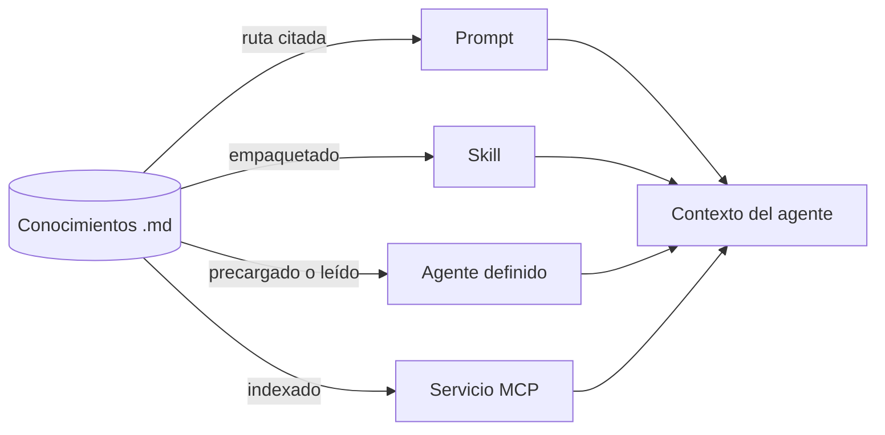
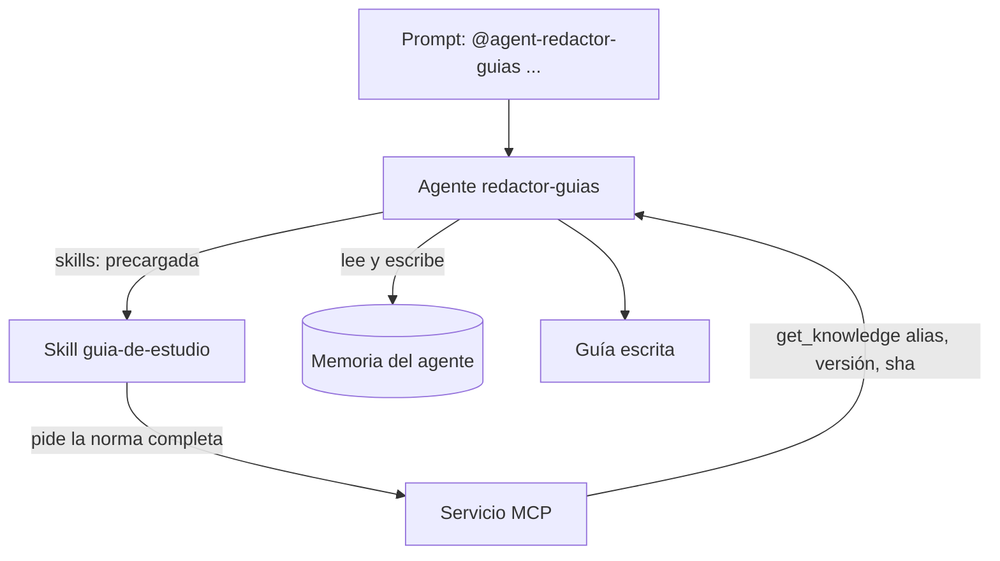
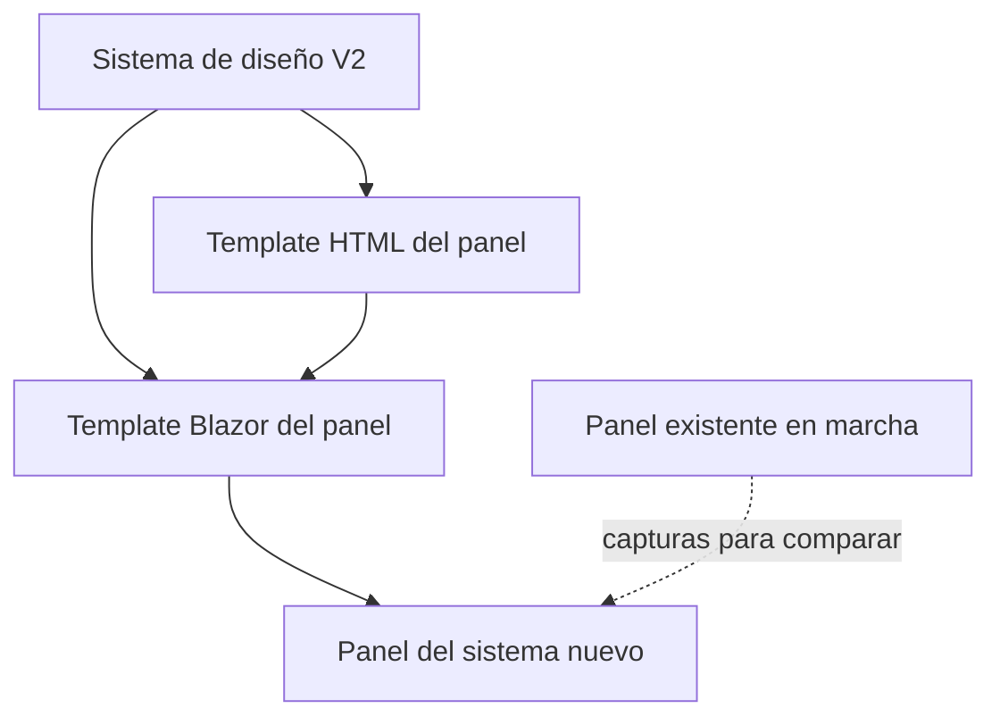

# Metodologías para llevar conocimiento a los prompts de Claude Code

> Guía de estudio autocontenida. Compara cuatro maneras de lograr que un agente trabaje **siguiendo una norma propia**
> (un perfil de documentación, un procedimiento de mesa de expertos, un sistema de diseño): citar rutas, skills, agentes
> definidos y un servicio MCP de conocimiento. Cierra con dos casos de aplicación que muestran el mismo pedido resuelto
> con cada metodología.
>
> Complementa a [General-Guide.md](General-Guide.md), que explica la memoria, la estructura `.claude/` y la
> invocación de agentes.

## Índice

1. [Conceptos previos](#1-conceptos-previos)
2. [Metodología 1: citar rutas en el prompt](#2-metodología-1-citar-rutas-en-el-prompt)
3. [Metodología 2: skills](#3-metodología-2-skills)
4. [Metodología 3: agentes definidos](#4-metodología-3-agentes-definidos)
5. [Metodología 4: servicio MCP de conocimiento](#5-metodología-4-servicio-mcp-de-conocimiento)
6. [Comparación](#6-comparación)
7. [Caso 1: guía de estudio con mesa de expertos](#7-caso-1-guía-de-estudio-con-mesa-de-expertos)
8. [Caso 2: un sistema .NET con el estilo de un panel de control existente](#8-caso-2-un-sistema-net-con-el-estilo-de-un-panel-de-control-existente)
9. [Preguntas guía](#9-preguntas-guía)
10. [Glosario](#10-glosario)

---

## 1. Conceptos previos

**Conocimiento.** Un archivo markdown que fija *cómo se hacen las cosas*: reglas, procedimientos, plantillas. Ejemplos:
un perfil de documentación («guía de estudio»), el procedimiento de una mesa de expertos, la descripción de un sistema
de diseño. No es memoria (lo que el agente aprende solo): lo escribe y lo cura una persona.

**Aplicar un conocimiento.** Que el agente lo tenga en contexto en el momento de trabajar y lo siga. Toda metodología
de esta guía resuelve la misma pregunta: **¿cómo llega ese texto al contexto, y quién decide cuándo?**

Cada metodología responde a una de tres preguntas:

| Pregunta | Metodología que la responde mejor |
|---|---|
| **¿Cómo** se hace? (la norma) | Skill |
| **¿Quién** lo hace? (un rol con criterio propio) | Agente definido |
| **¿De dónde** sale el conocimiento? (esté donde esté) | Servicio MCP |

Citar rutas responde a las tres a mano, en cada prompt.



---

## 2. Metodología 1: citar rutas en el prompt

### 2.1 Definición

El prompt nombra los archivos de conocimiento por su ruta y ordena aplicarlos. El agente los lee con sus herramientas
de lectura. No requiere ninguna configuración.

### 2.2 Ejemplo

```markdown
Hacé una guía de estudio sobre Docker Compose en Guides/Docker/Compose-Guide.md.
Aplicar `<conocimientos>/Profiles/Study-Guide-Documentation.md`.
Antes, armá una mesa según `<conocimientos>/Knowledge-Mesa-De-Expertos-A-Pedido.md`
con especialistas en devops, documentación técnica y redacción.
```

### 2.3 Ventajas y límites

| Ventajas | Límites |
|---|---|
| Explícito: el prompt dice exactamente qué se aplica | Cada prompt repite las rutas |
| Cero infraestructura | Si un archivo se mueve, hay que corregir todos los prompts que lo citan |
| Trazable: la ruta queda escrita | Sólo funciona donde el archivo existe (mismo host y mismo clon) |

**Cuándo conviene:** prompts únicos, normas que cambian seguido, o cuando se quiere dejar constancia exacta de qué
versión se aplicó.

---

## 3. Metodología 2: skills

### 3.1 Definición

Una **skill** es una carpeta con un `SKILL.md` (encabezado YAML con `name` y `description`, más instrucciones) que
Claude Code ofrece en todas las sesiones donde está disponible. Su **descripción** está siempre en contexto; el
**cuerpo** entra sólo cuando se usa: al invocarla con `/nombre` o cuando el modelo decide que aplica.

Ubicaciones: `.claude/skills/<nombre>/SKILL.md` (proyecto, versionable) o `~/.claude/skills/<nombre>/SKILL.md`
(personal).

### 3.2 Ejemplo de definición

```markdown
---
name: guia-de-estudio
description: Redactar o revisar una guía de estudio con índice, definiciones, ejemplos, mermaid y preguntas guía.
---

Aplicá el perfil de guía de estudio:
- Secciones jerárquicas con índice; autocontenida, no delta.
- Cada concepto: definición, explicación, ejemplo y, si ayuda, un diagrama mermaid.
- Preguntas guía con respuesta que forme criterio.
- Imágenes en Images/ junto al markdown, incrustadas con ruta relativa.

Norma completa: leé `<conocimientos>/Profiles/Study-Guide-Documentation.md` antes de escribir.
```

### 3.3 Ejemplo de uso

```markdown
/guia-de-estudio Docker Compose → Guides/Docker/Compose-Guide.md
```

### 3.4 Ventajas y límites

| Ventajas | Límites |
|---|---|
| Prompt corto: un comando reemplaza las rutas | Hay que mantener la skill sincronizada con el conocimiento que resume |
| Cuesta poco contexto hasta que se usa (sólo la descripción) | Se recomienda mantener `SKILL.md` breve (menos de unas 500 líneas) y mover el detalle a archivos aparte |
| Versionable con el repositorio | Sigue dependiendo de que los archivos referenciados estén en el host |

**Cuándo conviene:** procedimientos que se repiten (redactar una guía, convocar una mesa, conformar un PR).

---

## 4. Metodología 3: agentes definidos

### 4.1 Definición

Un **agente definido** es un archivo `.claude/agents/<nombre>.md` que describe un rol: qué herramientas usa, qué skills
trae precargadas, si tiene memoria propia y cuáles son sus instrucciones. Se lo llama por su alias (`name`). Trabaja en
un contexto propio, separado de la conversación principal, y devuelve su resultado.

### 4.2 Ejemplo de definición

```markdown
---
name: redactor-guias
description: Redacta guías de estudio. Usar proactivamente cuando se pida una guía.
tools: Read, Write, Edit, Grep, Glob, Bash
skills: guia-de-estudio
memory: project
---

Sos el redactor de guías de estudio. Aplicás la skill guia-de-estudio al pie de la letra.
Antes de escribir, leé tu memoria: ahí están las correcciones de revisiones anteriores.
```

- `skills:` inyecta el contenido completo de esas skills al iniciar el agente.
- `memory: project` le da un `MEMORY.md` propio en `.claude/agent-memory/redactor-guias/`, donde acumula lo aprendido.

### 4.3 Ejemplo de uso

```markdown
@agent-redactor-guias guía de Docker Compose en Guides/Docker/Compose-Guide.md
```

La @-mención asegura que corra ese agente. Nombrarlo en lenguaje natural («usá el redactor de guías») o sólo describir
la tarea deja la elección al modelo.

### 4.4 Ventajas y límites

| Ventajas | Límites |
|---|---|
| Rol estable: mismo criterio en cada uso | Un archivo más que mantener por rol |
| Contexto propio: no satura la conversación principal | No recibe la memoria de la sesión principal; sólo la suya y los `CLAUDE.md` |
| Mejora con el uso (memoria propia o ajustes por PR a su definición) | Lo que aprende depende de que alguien revise y consolide |

**Cuándo conviene:** roles que se recrean en cada tarea (redactor, verificador de evidencia, moderador de mesa,
revisor de UI).

---

## 5. Metodología 4: servicio MCP de conocimiento

### 5.1 Definición

Un **servidor MCP** (Model Context Protocol) expone herramientas que Claude Code puede llamar. Un servidor de
conocimiento indexa los archivos de conocimiento de todos los repositorios y responde por **alias**: el prompt ya no
necesita saber dónde vive el archivo. Puede correr en la misma máquina (transporte `stdio`) o en un host remoto
(transporte HTTP), y así servir a varios hosts y workspaces.

### 5.2 Ejemplo de configuración (propuesta)

```bash
# Registrar un servidor remoto por HTTP en el proyecto
claude mcp add --transport http conocimiento https://<host-remoto>/mcp \
  --header "Authorization: Bearer ${TOKEN_CONOCIMIENTO}"
```

Herramientas que expondría, por ejemplo:

| Herramienta | Qué hace |
|---|---|
| `get_knowledge(alias)` | Devuelve el conocimiento completo, con versión y sha del commit |
| `list_knowledge(filtro)` | Lista los conocimientos disponibles para el entorno actual |
| `search_knowledge(consulta)` | Búsqueda por texto (y, más adelante, semántica) |

### 5.3 Ejemplo de uso

```markdown
Aplicar conocimiento «Mesa-De-Expertos-A-Pedido» y perfil «Study-Guide-Documentation».
Guía de Docker Compose en Guides/Docker/Compose-Guide.md.
```

El agente llama a `get_knowledge` con cada alias. El servicio puede además **filtrar por entorno** (host, repositorio,
visibilidad pública o privada) y devolver sólo lo que corresponde.

### 5.4 Ventajas y límites

| Ventajas | Límites |
|---|---|
| Se cita por alias: mover un archivo no rompe los prompts | Requiere un servicio, su ingesta y su operación |
| Sirve a varios hosts y workspaces desde un solo lugar | Una respuesta grande también consume contexto (hay topes de salida) |
| Puede seleccionar según el entorno | Si es remoto, hay que asegurar el acceso (token, red privada) |
| Devuelve versión y sha: trazabilidad | La búsqueda semántica agrega embeddings, que hay que medir antes de adoptar |

**Cuándo conviene:** muchos conocimientos, varios hosts o workspaces, y necesidad de elegir según el entorno.

---

## 6. Comparación

| Criterio | Citar rutas | Skill | Agente definido | Servicio MCP |
|---|---|---|---|---|
| Responde a | Todo, a mano | **Cómo** | **Quién** | **De dónde** |
| Cómo se invoca | Ruta en el prompt | `/nombre` o automática | `@agent-nombre` o automática | Alias en el prompt |
| Configuración | Ninguna | `SKILL.md` | `.claude/agents/*.md` | Servidor + `claude mcp add` |
| Costo de contexto | El archivo, cada vez | Descripción siempre; cuerpo al usar | Va al contexto del agente, no al principal | Lo que devuelve cada consulta |
| Funciona en otro host | Sólo si el archivo está | Si la skill está instalada | Si el agente está instalado | Sí, si el servicio es remoto |
| Aprende | No | No | Sí (memoria propia) | No (se actualiza por ingesta) |
| Se versiona | Con el prompt | Con el repo | Con el repo | El servicio sirve lo que está en git |

**No son excluyentes:** se combinan. El agente es el *quién*, la skill el *cómo* y el MCP el *de dónde*.



---

## 7. Caso 1: guía de estudio con mesa de expertos

**Pedido:** «Quiero una guía de estudio sobre Docker Compose, debatida antes por una mesa de devops, documentación
técnica y redacción».

| Metodología | Prompt |
|---|---|
| Citar rutas | `Guía de Docker Compose en Guides/Docker/Compose-Guide.md. Aplicar <conocimientos>/Profiles/Study-Guide-Documentation.md. Antes, mesa según <conocimientos>/Knowledge-Mesa-De-Expertos-A-Pedido.md con devops, documentación técnica y redacción.` |
| Skills | `/mesa-de-expertos devops, documentación técnica y redacción sobre la guía de Docker Compose; después /guia-de-estudio → Guides/Docker/Compose-Guide.md` |
| Agentes definidos | `@agent-moderador-mesa convocá devops, documentación técnica y redacción para la guía de Docker Compose; después @agent-redactor-guias la escribe en Guides/Docker/Compose-Guide.md` |
| Servicio MCP | `Aplicar «Mesa-De-Expertos-A-Pedido» (devops, documentación técnica, redacción) y «Study-Guide-Documentation». Guía de Docker Compose en Guides/Docker/Compose-Guide.md.` |

**Lectura:** con rutas, el prompt carga con todo el conocimiento de *dónde está cada cosa*. Con skills y agentes, ese
conocimiento pasa a la configuración versionada y el prompt sólo dice *qué* se quiere. Con MCP, además, deja de
importar en qué host se escribe el prompt.

---

## 8. Caso 2: un sistema .NET con el estilo de un panel de control existente

### 8.1 El pedido

«Quiero diseñar un sistema .NET nuevo cuyo panel de administración cumpla el estilo del panel de control de un
producto que ya hice: sus estilos visuales, la estructura de páginas, los diálogos, los filtros y los listados».

Este caso es más exigente que el anterior porque el conocimiento tiene **capas**:

| Capa | Qué fija | Ejemplo de conocimiento |
|---|---|---|
| Sistema de diseño | Tokens de color y tipografía, escala, componentes base | «Sistema de diseño V2» |
| Panel HTML | Estructura de página, diálogos, filtros, listados, recorridos | «Template HTML del panel de control» |
| Realización .NET | Cómo se construye cada página en Blazor (render, estado en la URL, acción → acuse, pruebas) | «Template Blazor del panel de control» |
| Referencia viva | El producto existente, para comparar capturas | El panel real, corriendo |

Los conocimientos se encadenan: el de Blazor *hereda* del sistema de diseño y *cita* el HTML. Cargar sólo uno deja
huecos.



### 8.2 Con cada metodología

**Citar rutas:**

```markdown
Diseñá el panel de administración de Inventario.Web (.NET 10, Blazor Interactive Server).
Aplicar, en este orden:
- `<conocimientos>/Knowledge-Template-Blazor-Interactive-Server-Sistema-De-Diseno-V2.md`
- `<conocimientos>/Knowledge-Template-HTML-Panel-De-Control.md`
- `<conocimientos>/Knowledge-Template-HTML-Panel-De-Control-Recorridos.md`
- `<conocimientos>/Knowledge-Template-Blazor-Interactive-Server-Panel-De-Control.md`
Páginas: listado de artículos con filtros, ABM con diálogo de confirmación, tablero.
Comparar contra capturas del panel de referencia.
```

Funciona, pero el orden de carga y la lista de cuatro rutas quedan a cargo de quien escribe el prompt.

**Skill:** una skill `panel-de-control` resume las reglas que no se pueden olvidar y fija el orden de carga:

```markdown
---
name: panel-de-control
description: Diseñar o revisar páginas de un panel de administración .NET con el estilo del panel de control propio.
---

Orden de carga obligatorio: sistema de diseño V2 → template HTML del panel → recorridos → template Blazor del panel.
Reglas que no se negocian: tokens del sistema de diseño (nunca colores sueltos), estado de filtros y página en la URL,
toda acción con acuse visible, diálogos de confirmación para acciones destructivas.
Juicio visual: comparar capturas en un navegador real contra el panel de referencia.
```

```markdown
/panel-de-control panel de Inventario.Web: listado de artículos con filtros, ABM y tablero.
```

**Agentes definidos:** el trabajo se reparte en dos roles, uno que construye y otro que juzga, para que el que construye
no se evalúe a sí mismo:

```markdown
---
name: disenador-panel
description: Construye páginas de un panel .NET con el estilo del panel de control propio.
tools: Read, Write, Edit, Grep, Glob, Bash
skills: panel-de-control
memory: project
---
Construís páginas siguiendo la skill panel-de-control. Al terminar cada página, pedí juicio a revisor-ui.
```

```markdown
---
name: revisor-ui
description: Juzga páginas de un panel contra el sistema de diseño y el panel de referencia, con capturas reales.
tools: Read, Grep, Glob, Bash
skills: panel-de-control
memory: project
---
Comparás capturas en navegador real contra la referencia. Cada diferencia: ubicación, captura y regla incumplida.
```

```markdown
@agent-disenador-panel panel de Inventario.Web: listado de artículos con filtros, ABM y tablero.
```

Con el tiempo, la memoria de `revisor-ui` acumula los desvíos típicos («los filtros pierden el estado al paginar») y
los revisa primero.

**Servicio MCP:**

```markdown
Aplicar conocimiento «Template-Blazor-Interactive-Server-Panel-De-Control» con su cadena de herencia.
Panel de Inventario.Web: listado de artículos con filtros, ABM y tablero.
```

El servicio resuelve la cadena de herencia (`Hereda-de`) y devuelve los cuatro conocimientos en orden, con su versión.
Si el sistema nuevo se desarrolla en otro host, el prompt es el mismo.

### 8.3 Comparación en este caso

| Aspecto | Citar rutas | Skill | Agentes definidos | Servicio MCP |
|---|---|---|---|---|
| Orden de carga | Lo recuerda quien escribe | Lo fija la skill | Lo hereda de la skill | Lo resuelve la herencia |
| Juicio visual separado | Hay que pedirlo | Hay que pedirlo | Rol propio (`revisor-ui`) | Hay que pedirlo |
| Aprende de los desvíos | No | No | Sí | No |
| Otro host | Sólo con los archivos | Con la skill instalada | Con los agentes instalados | Sí |

**Recomendación para este caso:** agentes definidos (constructor y revisor) apoyados en una skill que fija el orden y
las reglas no negociables. El servicio MCP suma cuando el mismo estilo se aplica en varios sistemas y hosts.

---

## 9. Preguntas guía

**¿Tengo que elegir una sola metodología?**
No. Son capas que se combinan. Una pauta: empezar citando rutas; cuando un pedido se repite, pasarlo a skill; cuando
un rol se repite, a agente definido; cuando los conocimientos se usan desde varios hosts, a un servicio.

**¿Una skill reemplaza al conocimiento original?**
No conviene. La skill es la puerta de entrada (resumen y orden de carga) y remite a la norma completa. Si la skill
copia la norma, hay dos versiones que divergen.

**¿Cuándo un agente definido es mejor que una skill?**
Cuando importa *quién* hace el trabajo: un contexto separado, herramientas acotadas (un revisor que no puede escribir)
o memoria propia que mejora con el uso. Si sólo importa *cómo* se hace, alcanza con la skill.

**¿El servicio MCP hace que el agente aplique el conocimiento solo?**
No. El servicio entrega el texto cuando se lo piden. Que se aplique sigue dependiendo del prompt, de una skill o de un
agente que lo pida. El servicio resuelve *de dónde sale*, no *cuándo se usa*.

**Si el prompt cita una ruta y el servicio devuelve otra versión, ¿cuál gana?**
Conviene declararlo por escrito. Un criterio razonable: lo que el prompt cita explícitamente gana sobre lo recuperado,
porque es lo que la persona eligió para esa tarea.

**¿Por qué separar constructor y revisor en el caso 2?**
Porque quien construye tiende a dar por bueno lo que hizo. Un revisor con herramientas de sólo lectura y criterio
propio encuentra diferencias que el constructor no ve.

---

## 10. Glosario

| Término | Definición |
|---|---|
| **Conocimiento** | Archivo markdown curado que fija cómo se hace algo (§1) |
| **Alias** | Nombre estable de un conocimiento o de un agente, independiente de su ruta |
| **Skill** | Carpeta con `SKILL.md`; su descripción está siempre en contexto y su cuerpo entra al usarla (§3) |
| **Agente definido** | Rol descripto en `.claude/agents/<nombre>.md`, invocable con `@agent-<nombre>` (§4) |
| **MCP** | Model Context Protocol: protocolo para que Claude Code use herramientas de un servidor externo (§5) |
| **Transporte** | Cómo se conecta Claude Code al servidor MCP: `stdio` (local) o HTTP (local o remoto) |
| **Cadena de herencia** | Relación `Hereda-de` entre conocimientos: el hijo agrega lo propio y cita al padre |
| **Juicio visual** | Comparar capturas de la interfaz real contra la referencia, en un navegador real |
