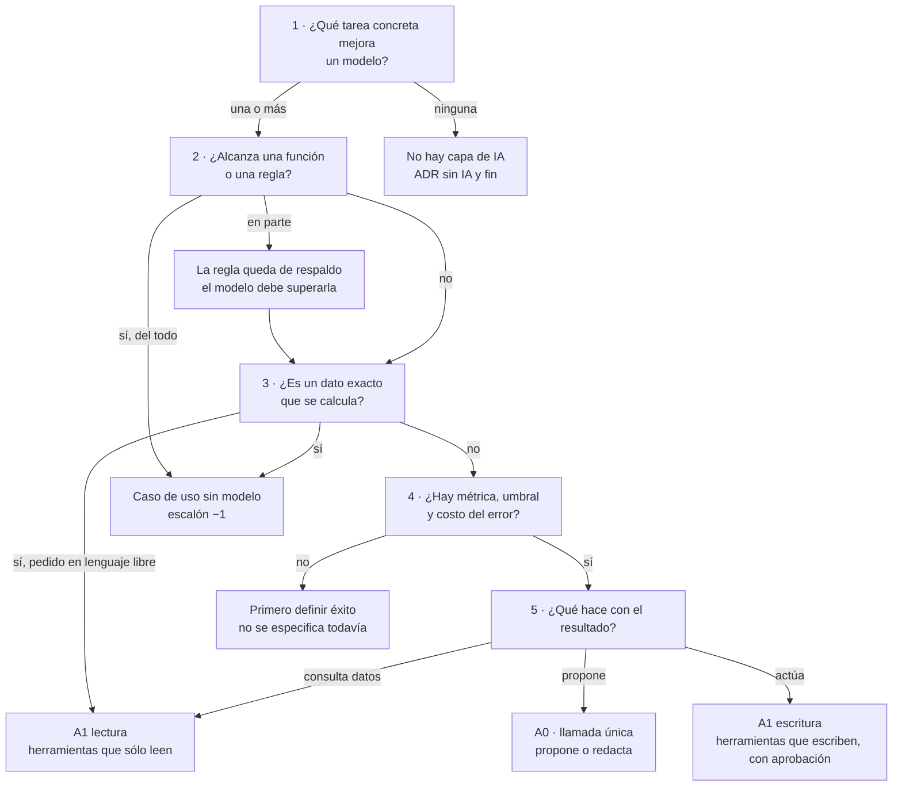
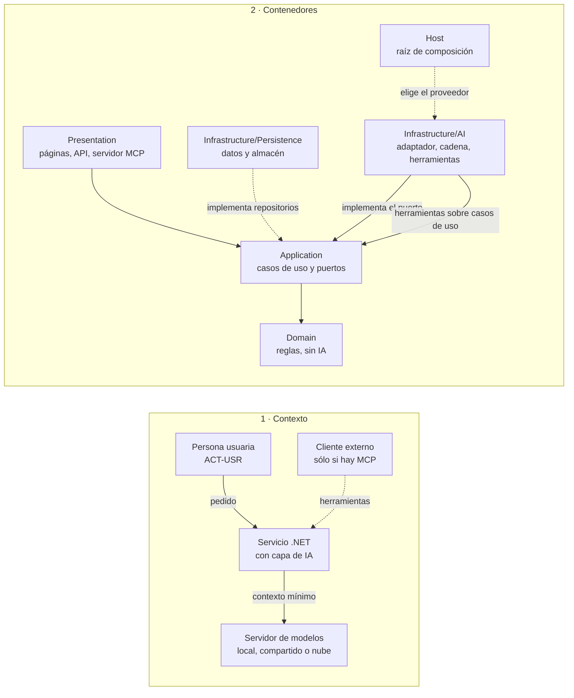

# Capa de IA integrada en .NET: cómo se especifica su diseño en un proyecto nuevo o existente

**Alias:** AI-Layer-Integration-Designing-Specification
**Naturaleza:** propio
**Tema:** Cómo decidir si un servicio .NET necesita una capa de IA y, si la necesita, cómo especificarla con arc42 reducido, C4 en mermaid, ADR, requisitos `REQ-IA-nn` con prueba y una matriz de riesgos OWASP filtrada por nivel de agencia; destilado de la guía de la capa de IA y probado en dos casos de uso
**Consumidor:** un agente IA o una persona que especifica la capa de IA de un servicio .NET, nuevo o existente; quien preside una mesa de diseño sobre ella
**Condicion-de-carga:** al decidir si un servicio necesita capa de IA; al escribir o revisar su especificación; al armar el checklist de completitud; se carga por secciones según el «Mapa de carga» de §0
**Hereda-de:** —
**Sustituye:** la versión 1.0 de este mismo archivo (2026-11-01)
**Compatible-con:** `Dot-Net-Integration-AI-Layer-Guide.md` (libro de esta misma carpeta, edición 1.2.0; las remisiones `[Guía §x]` usan su numeración y sus anclas estables `cN-k` [Guía §0.7]: el capítulo 1 es «Fundamentos del framework», la frontera de competencia es §3.7 y la autoevaluación es el capítulo 17); `Conversational-Design-Framework-Guide.md` (libro hermano en preparación: este conocimiento no lo cita por sección hasta que se publique); los conocimientos hermanos de esta carpeta: [K2](knowledge-AI-Layer-Console-Assistant-Building.md) (construir la consola), [K3](knowledge-AI-Layer-Verification-And-Acceptance.md) (verificar y aceptar), [K4](knowledge-AI-Layer-Integration-Working-Method.md) (forma de trabajo de la mesa) y [K5](knowledge-AI-Layer-Conversational-Design.md) (formas de respuesta, borrador provisorio)
**Versión:** 1.1
**Estado:** Vigente (falta la revisión humana del checklist en los casos y en la prueba; las reglas nuevas de 1.1 están probadas en un caso, PushDispatch)
**Fecha:** 2026-11-11

**Cambios en 1.1** (respecto de 1.0; nada de 1.0 se quitó ni cambió de sentido):

| # | Cambio | Dónde |
|---|---|---|
| 1 | Frontera de competencia: la especificación la escribe como cuatro anillos decididos por el código | [§3.1](#k1-3-1-frontera) → [Guía §3.7](../Dot-Net-Integration-AI-Layer-Guide.md#c3-7) |
| 2 | Reglas de arquitectura ARQ-1 a ARQ-6 (el código elige herramienta, alcance y destino; el filtro de rol va antes de la búsqueda; el corpus va antes que la búsqueda; el permiso se revalida; ver no es hacer). El diseño las llamaba A1–A6; se renombran para no chocar con la escalera de agencia (A0–A3) | [§4.1](#k1-4-1-reglas-arq) |
| 3 | Grupo C de requisitos, REQ-IA-22 a REQ-IA-33, con su prueba: validador de cifras, alcance, ruteo, cobertura del corpus, filtro de rol, destino revalidado, ver ≠ hacer, motivo exacto de habilitación, huella del voto sin texto, modelo por variable de entorno con una sola clave, consola por rol, «No está en la ayuda». Los requisitos propios del proyecto pasan a empezar en REQ-IA-40 | [§9](#k1-9) |
| 4 | LLM08 deja de estar «a definir»: lo cubre REQ-IA-26 | [§10](#k1-10) |
| 5 | Pasos 3a y 8a del procedimiento y criterios de parada | [§11](#k1-11), [§11.1](#k1-11-1-parada) |
| 6 | Ocho ítems más del checklist, C-20 a C-27 | [§12](#k1-12) |
| 7 | Antipatrones de especificación con su control | [§12.1](#k1-12-1-antipatrones) |
| 8 | PushDispatch como caso aplicado ([Caso P]) y la demo de Movilidad Urbana como [Caso M] | [§13](#k1-13) |
| 9 | Reglas provisorias F-7 (dominio de riesgo profesional) y F-8 (categorías especiales de datos), en espera del libro | [§3.1](#k1-3-1-frontera) |
| 10 | Anclas estables `k1-N` en todas las secciones; enlaces a los conocimientos hermanos, que ya existen | todo el documento |

---

## Índice

- [0. Propósito y alcance](#k1-0)
- [1. Cuándo usarlo y cuándo no](#k1-1)
- [2. Principios y reglas que no se negocian](#k1-2)
- [3. Marco: escenarios, contextos, actores y escaleras](#k1-3)
  - [3.1 Frontera de competencia](#k1-3-1-frontera)
- [4. Arquitectura de referencia](#k1-4)
  - [4.1 Reglas de arquitectura ARQ-1 a ARQ-6](#k1-4-1-reglas-arq)
- [5. Contrato del puerto y patrones de salida](#k1-5)
- [6. Clientes y fronteras](#k1-6)
- [7. Plantilla de especificación (arc42 reducido)](#k1-7)
- [8. Decisiones (ADR)](#k1-8)
- [9. Requisitos `REQ-IA-nn`](#k1-9)
- [10. Seguridad: matriz OWASP por nivel de agencia](#k1-10)
- [11. Procedimiento de aplicación](#k1-11)
  - [11.1 Criterios de parada](#k1-11-1-parada)
- [12. Checklist binario de completitud](#k1-12)
  - [12.1 Antipatrones de especificación con su control](#k1-12-1-antipatrones)
- [13. Casos de uso y referencias](#k1-13)
- [14. Límites de este conocimiento](#k1-14)
- [Glosario](#k1-glosario)

<a id="k1-0"></a>
## 0. Propósito y alcance

Este conocimiento dice **qué decidir, en qué orden y con qué criterio** para especificar la capa de IA de un
servicio .NET nuevo (CTX-NUEVA) o existente (CTX-EXISTENTE). Su producto es una **especificación**: un documento
que otra persona o un agente puede construir y probar sin preguntar. **Es autocontenido para especificar**: todo
lo que la especificación necesita nombrar (códigos, escaleras, campos de fichas, ADR, requisitos, riesgos) está
acá. La guía hace falta sólo para **implementar** y para ver la evidencia; por eso cada regla lleva su remisión.

**Divergencia de forma declarada.** La forma es la del Conocimiento del libro MAUI del laboratorio, no la de la
regla de forma del framework de prompts, que no rige en Lab-Documentos: los dos libros se citan entre sí (§6).

**Regla de evidencia.** Cada afirmación lleva una de estas marcas:

| Marca | Qué es | Dónde se resuelve |
|---|---|---|
| `[Guía §x]`, `[Guía A.n]`, `[Guía B.n]` | sección o anexo de la guía | `Dot-Net-Integration-AI-Layer-Guide.md`, en esta carpeta |
| `[REF-n]` | referencia del Anexo D de la guía | Anexo D de la guía |
| `[P-n]` | principio de §2 | ADR de origen en la guía §13 |
| `[MAUI cap. n]` | capítulo del libro MAUI | `Concepts/Framework-Concept/MAUI-Framework-Developer-Guide.md`, desde la raíz de Lab-Documentos |
| `[Ind-n]` | estándar de la industria con URL en §13 | §13 de este documento |
| `[Caso G]`, `[Caso N]`, `[Caso P]`, `[Caso M]`, `[Prueba]` | regla que nació de aplicar este conocimiento a un caso o a su prueba de autocontención | §13 de este documento |

Desde 1.1, las remisiones nuevas al libro llevan enlace con su ancla estable, por ejemplo
[Guía §3.7](../Dot-Net-Integration-AI-Layer-Guide.md#c3-7); las de 1.0 se resuelven por número de sección.
**Regla de coordinación con los libros.** Los libros son la fuente para personas; este conocimiento es su
destilación operativa. Si una regla de acá parece contradecir al libro, **rige el libro** y la contradicción se
informa a quien mantiene la guía; el agente no la resuelve por su cuenta.

Las cifras de la demo de la guía son **parámetros de la demo, no norma** [Guía §14.1]. **Niveles de exigencia (BCP 14).** «DEBE» es obligatorio, «DEBERÍA» es recomendado (se omite sólo con motivo
escrito) y «PUEDE» es opcional [Ind-4]. Las columnas PROTO y PROD de §9 y §12 aplican esos niveles según el
contexto CTX-PROTO o CTX-PROD del proyecto (§3).

**Mapa de carga.**

| Si vas a… | Cargá |
|---|---|
| decidir si el servicio necesita capa de IA | §1, §3 |
| fijar las reglas que no se negocian | §2 |
| especificar un asistente o consola de ayuda dentro del producto | §3.1, §4.1, grupo C de §9, C-20 a C-27, §12.1, [Caso P] |
| dibujar la arquitectura | §4, §4.1, §5, §6 |
| escribir la especificación | §7, §8, §9 |
| analizar la seguridad | §10 |
| aplicar el conocimiento de punta a punta | §11, §11.1 |
| decidir si la especificación está completa | §12, §12.1 |
| construir, verificar o desplegar lo especificado | **no es este conocimiento**: va a [K2](knowledge-AI-Layer-Console-Assistant-Building.md) y [K3](knowledge-AI-Layer-Verification-And-Acceptance.md), y al libro en [Guía cap. 11](../Dot-Net-Integration-AI-Layer-Guide.md#c11) y [Guía cap. 13](../Dot-Net-Integration-AI-Layer-Guide.md#c13) |

<a id="k1-1"></a>
## 1. Cuándo usarlo y cuándo no

**Definición.** La *capa de IA* es la parte de la solución que habla con un modelo de lenguaje: adaptador del
proveedor, cadena de opciones, herramientas, agentes y almacén de vectores [Guía §4.1]. Vive en
Infrastructure/AI; Application la ve sólo a través de puertos.

Antes de especificar se responden por escrito cuatro preguntas [Guía §3.4], [REF-03], [REF-117], [REF-05]:

1. ¿Qué hace hoy la persona y por qué un modelo lo mejoraría?
2. ¿Alcanza una regla?
3. ¿Qué cuesta un error, falso positivo o negativo, y quién lo absorbe?
4. ¿Con qué métrica y qué umbral se decide seguir, y quién fija el umbral?

El árbol ordena esas preguntas. **La rama «no» es un resultado válido**: termina con una ADR «sin IA». **La rama
«en parte» es la más común**: la regla existente queda como respaldo y el modelo tiene que superarla en la
métrica; si el respaldo es el trabajo manual de una persona, la línea base es esa persona medida sobre el mismo
conjunto [Caso G], [Prueba]. **Un dato exacto pedido en lenguaje libre** (combinaciones que no caben en una
pantalla de filtros) sigue saliendo de un caso de uso: el modelo sólo elige herramienta y argumentos (A1 lectura,
carril aparte); si una pantalla de filtros alcanza, es escalón −1 aunque todavía no exista (construirla es deuda del producto); se decide con las preguntas reales, no con un ejemplo [Caso N], [Prueba].



Figura 1.1. Árbol «¿necesita capa de IA?». Fuentes: [Guía §3.4], [Guía §7.1], [Guía §9.1], [P-4], [P-7]; rama «en parte» [Caso G]; A1 lectura [Caso N].

**Conviene** especificar una capa de IA cuando, a la vez: una tarea recibe texto libre o pide una respuesta
fundada que una regla no resuelve del todo; hay métrica, umbral y error caro, y el umbral lo fija ACT-ARQ; y el
código puede validar lo que el modelo propone antes de que tenga efecto [Guía §3.4], [P-8].

**No conviene** cuando la tarea es un dato exacto (va por un caso de uso, nunca por recuperación por parecido)
[P-4]; cuando una función la resuelve [REF-117]; o cuando nadie puede decir qué cuenta como éxito [REF-04].

<a id="k1-2"></a>
## 2. Principios y reglas que no se negocian

Diez principios, condensados como **regla · razón · fuente**. Ninguno nombra un tipo de .NET.

| Id | Regla | Razón | Fuente |
|---|---|---|---|
| P-1 | El núcleo depende de contratos que define; el modelo queda detrás de un adaptador; ninguna dependencia va del modelo al dominio ni a los datos | se prueba el núcleo sin modelo y se cambia el modelo sin tocarlo | [REF-182], [REF-183]; [Guía §14.2], [Guía §4.1] |
| P-2 | El proveedor se elige en un solo lugar, la raíz de composición, detrás de un contrato común | las capas no dependen de quién sirve el modelo | [REF-44], [REF-45]; [Guía §14.3] |
| P-3 | Dónde corre el modelo se decide por los datos que salen, la concurrencia, el costo y la capacidad | la ubicación cambia poco el código y mucho el análisis de datos | [REF-55]; [Guía §14.4] |
| P-4 | El dato exacto se consulta por un caso de uso; para el resto, el escalón más bajo de conocimiento que alcance | recuperar por parecido trae lo parecido, no lo exacto | [REF-86], [REF-87]; [Guía §14.5], [Guía §7.1] |
| P-5 | Usar el conocimiento es de la capa de IA; almacenarlo, de la capa de datos; cambiar el modelo de embeddings obliga a reindexar | se cambia el almacén sin tocar la capa de IA | [REF-89], [REF-102]; [Guía §14.6] |
| P-6 | El modelo actúa sólo por casos de uso, con mínimo privilegio; desde el escalón 1 toda escritura pide aprobación sobre argumentos que arma el código; con texto que no escribió la aplicación no se ofrecen escrituras | una herramienta sobre el repositorio saltea las reglas; la inyección indirecta llega por ese texto | [REF-122], [REF-160], [REF-162]; [Guía §14.7] |
| P-7 | Se sube un escalón de agencia sólo cuando el de abajo no alcanza | cada escalón suma llamadas, latencia, fallas y pruebas | [REF-115], [REF-117]; [Guía §14.8] |
| P-8 | La salida del modelo es una propuesta; las reglas viven en el código; una salida inválida es un camino normal | el sistema sigue correcto cuando el modelo se equivoca | [REF-01], [REF-160]; [Guía §14.9], [Guía §3.5] |
| P-9 | Las mismas opciones valen para toda llamada y se aplican en un solo lugar, en orden declarado; el contenido sensible se registra sólo por ambiente | una traza con datos personales es una fuga | [REF-173], [REF-192]; [Guía §14.10] |
| P-10 | Una garantía del código se prueba en cada build, sin modelo; una conducta del modelo se informa como k de M con rótulo, como tendencia y no como compuerta | reintentar no corrige la variación | [REF-75], [REF-152]; [Guía §14.11], [Guía §11.1] |

**Prioridad cuando chocan.** P-6 y P-8 prevalecen; romper una exige una ADR que nombre el principio y el motivo.

**Reglas derivadas de los casos.** Cada una aplica un principio a una situación que la guía no trata:

| Id | Regla | Principio | Origen |
|---|---|---|---|
| R-01 | **Inquilino por código.** En un servicio con varios inquilinos (organización, sede, cliente), el código resuelve el inquilino desde la identidad o un contexto validado antes de llamar al modelo; ninguna firma de herramienta ni del puerto lo recibe; un recurso de otro inquilino responde «no encontrado». Con un rol global, el inquilino lo elige la persona en un paso validado por el código, nunca el modelo. En segundo plano, sale del registro guardado, validado al crearlo | P-6 | [Caso N] |
| R-02 | **Minimización del pedido.** Al modelo viaja lo mínimo que la capacidad necesita; lo que el código usa para detectar una fuga (por ejemplo, el valor que no debe revelarse) se queda en el adaptador y no viaja. Si el texto libre de entrada puede traer datos personales, es CTX-SENS y ACT-SEC decide si se enmascara antes de viajar | P-3, P-9 | [Caso G] |
| R-03 | **Anclaje de valores afirmados.** Si una respuesta en texto libre afirma datos (cifras, nombres, fechas), un validador determinista comprueba que cada valor afirmado aparece en un resultado de herramienta de esa misma conversación; si no, el resultado es *rechazado* | P-8 | [Caso N] |
| R-04 | **Un filtro garantiza sólo lo que mide.** Un filtro de texto (numérico, por patrón) es garantía del código para lo que detecta; lo que dice lo mismo en palabras se le escapa y va a una métrica con revisión humana | P-10 | [Caso G] |
| R-05 | **Texto de terceros en datos internos.** La proyección de cada herramienta, también las de lectura, excluye el texto libre escrito por terceros (comentarios, nombres cargados por usuarios) o lo marca no confiable; los datos propios también traen inyección indirecta | P-6 | [Caso N] |
| R-06 | **La capa usa lo que existe.** Si el caso de uso existente (de una herramienta o del código de una capacidad A0) no trae el filtro que la pregunta necesita, la brecha se registra como deuda del producto; la capa de IA no crea una consulta nueva por su cuenta. Proyectar o agregar el resultado acotado del caso de uso sí vale; traer todo para filtrar en la capa, no | P-1, P-6 | [Caso N] |
| R-07 | **Lo irreversible y masivo nunca lo dispara el modelo.** Una acción irreversible de alcance masivo (envío a muchos, borrado en lote) queda en borrador con confirmación humana, aunque el resto de la capacidad sea A1 | P-6 | [Caso N] |
| R-08 | **Nace apagada.** En CTX-EXISTENTE con producción, cada capacidad nueva tiene un parámetro que la apaga; apagada, el comportamiento previo no cambia | P-8 | [Caso N] |

<a id="k1-3"></a>
## 3. Marco: escenarios, contextos, actores y escaleras

Catálogo mínimo para especificar sin la guía [Guía §3.1]–[Guía §3.3], [Guía §4.2]. Un caso que no encaja **no
inventa códigos**: usa el más cercano y lo anota [Caso G].

**Escenarios (ESC-).**

| Id | Entra → sale | El modelo puede | Riesgo dominante |
|---|---|---|---|
| ESC-01 Asistente sobre datos propios (sin datos propios: generar texto libre) | pregunta → respuesta fundada | leer | respuesta inventada o de otra sesión |
| ESC-02 Búsqueda semántica | consulta → lista por parecido | nada: sólo embeddings | recuperación irrelevante que parece buena |
| ESC-03 Extracción estructurada | texto libre → objeto tipado | proponer; la aplicación decide | salida que viola las reglas |
| ESC-04 Herramientas y agentes | objetivo → acciones | elegir herramienta y argumentos; escribir | agencia excesiva |
| ESC-05 Exposición por MCP | cliente externo → herramientas propias | decide el modelo del cliente | exposición sin control de acceso |


**Contextos de uso (CTX-).** Se elige uno de cada par: LOCAL o NUBE; PROTO o PROD; PUB o SENS; EXISTENTE o NUEVA.
PROTO o PROD se dice **de la capacidad**, no del servicio: un piloto sobre un servicio en producción es CTX-PROTO
con R-08 y, si hay datos de personas, CTX-SENS [Prueba].

| Id | Qué cambia |
|---|---|
| CTX-LOCAL | modelo en la organización: sin costo por token; si el servidor lo comparten varias aplicaciones, los datos llegan a un servidor que opera otro |
| CTX-NUBE | más calidad y escala; costo por token, latencia, datos que salen, cuotas |
| CTX-PROTO | se tolera no determinismo; el objetivo es saber si el escenario vale la pena |
| CTX-PROD | evaluación, observabilidad, límites de costo, seguridad, plan ante fallas y cambios de versión |
| CTX-PUB | datos no sensibles |
| CTX-SENS | datos personales: minimizar lo que entra, aislar por sesión, registrar sin datos personales |
| CTX-EXISTENTE | aplicación que ya existe: la capa se suma a lo que hay (correspondencia de capas, §4) |
| CTX-NUEVA | aplicación nueva: las capas nacen con la regla de dependencia |

**Actores (ACT-).** Son roles, no puestos: una persona del negocio toma el rol cuyas decisiones ejerce (quien fija
el umbral actúa como ACT-ARQ en esa decisión) [Prueba].

| Id | Decide | No decide |
|---|---|---|
| ACT-DEV desarrollo | adaptador, cadena, herramientas, estrategia de conocimiento dentro de la ADR; las pruebas | escenarios habilitados, proveedor de producción, datos que entran, umbral |
| ACT-ARQ arquitectura | dónde vive la capa; abstracción y marco; escenarios y estrategia; el umbral de éxito | operación diaria; políticas de datos |
| ACT-OPS operación | cómo se sirve el modelo; configuración, secretos, observabilidad, costo | lógica de los casos de uso |
| ACT-SEC datos y seguridad | qué datos llegan a qué modelo; qué acciones van sin confirmación; registro y retención | cómo se implementa cada control |
| ACT-USR persona usuaria | qué pide y si confirma una acción | nada del diseño |

**Escalera de conocimiento** (¿qué sabe el modelo?) [Guía §4.2]. Se elige el escalón más bajo que alcance [P-4].

| Escalón | Qué es | Se sube cuando… |
|---|---|---|
| −1 | función sin modelo | — |
| K0 Contexto fijo | instrucciones y datos chicos en el pedido | los datos no entran o cambian por pedido |
| K1 Contexto completo | un conjunto entero con prefijo estable | el conjunto no entra en la ventana del modelo |
| K2 RAG | se recupera sólo lo relevante, por parecido | el modelo tiene que decidir cuándo y qué buscar |
| K3 RAG agéntico | recuperar es una herramienta | — |
| Carril aparte | dato exacto: herramienta sobre un caso de uso, nunca RAG | — |

**Escalera de agencia** (¿qué puede hacer el modelo?) [Guía §4.2], [Guía §9.1]. Es el **nivel de agencia** de
cada capacidad y activa filas de §9 y §10.

| Nivel | Qué es | Variante |
|---|---|---|
| A0 Llamada única | texto o salida estructurada; propone | **A0 con persona que firma**: borrador o propuesta que una persona confirma antes de que tenga efecto |
| A1 Llamada con herramientas | el modelo pide, la aplicación ejecuta | **A1 lectura** (sin aprobación) · **A1 escritura** (aprobación obligatoria) [Caso N] |
| A2 Workflow | camino fijo en código, con estado | hereda los controles de A1 |
| A3 Agente | el modelo dirige el bucle | hereda los de A1; no se especifica sin ADR propia (§14) |

<a id="k1-3-1-frontera"></a>
### 3.1 Frontera de competencia

**Definición.** La *frontera de competencia* de un asistente es el conjunto de pedidos que atiende con una
conducta definida y comprobable: dar pasos, explicar, derivar o rechazar. Se define por **lo que el asistente
hace con el pedido**, no por el tema [Guía §3.7.1](../Dot-Net-Integration-AI-Layer-Guide.md#c3-7-1). Toda
capacidad que reciba texto libre de ACT-USR (un ESC-01 con chat o consola) la DEBE especificar.

**Qué escribe la especificación.** Una tabla de cuatro anillos con criterio de pertenencia, conducta y pieza que
la sostiene [Guía §3.7.2](../Dot-Net-Integration-AI-Layer-Guide.md#c3-7-2):

| Anillo | Conducta | Pieza que la sostiene | Qué no puede pasar |
|---|---|---|---|
| 1 · Operar el producto | pasos, datos reales y enlace profundo a la acción | herramientas de lectura sobre casos de uso; dato exacto por el carril aparte; escritura sólo con aprobación | una cifra que no salió de una herramienta |
| 2 · Entender el dominio | explicación corta en lenguaje llano y después el paso del anillo 1 | glosario y sinónimos versionados como datos; sin herramientas | una explicación improvisada que no cita su entrada |
| 3 · Lo de al lado | orientar y derivar, y decir cómo se vuelve al producto | fragmentos de derivación con cita; sin herramientas | inventar pasos de un sistema ajeno |
| Afuera | rechazo amable con dos o tres preguntas de ejemplo | texto fijo del código, sin llamada al modelo | una respuesta del modelo |

**Reglas.**

| Id | Regla (imperativo) | Porqué | Prueba |
|---|---|---|---|
| F-1 | El código clasifica el pedido en un anillo; si el modelo lo propone, se valida contra un `enum` cerrado y la duda cae al anillo más seguro (2 o Afuera), nunca al 1 | el anillo decide qué viaja al modelo: es privilegio, no redacción [Guía §3.7.4](../Dot-Net-Integration-AI-Layer-Guide.md#c3-7-4) | pregunta no reconocida → `Afuera` sin llamada al modelo |
| F-2 | Sólo el anillo 1 lleva herramientas | reduce la superficie de inyección [Guía §12.2](../Dot-Net-Integration-AI-Layer-Guide.md#c12-2) | ningún anillo distinto de Operar arma una lista de herramientas no vacía |
| F-3 | Los sinónimos se aplican en código antes de clasificar y antes de buscar | la persona inexperta no conoce el término del producto [Guía §3.7.3](../Dot-Net-Integration-AI-Layer-Guide.md#c3-7-3) | «aviso», «mensaje» y «notificación» llevan a la misma intención |
| F-4 | Sin fragmento que alcance el umbral, la respuesta es el texto fijo «No está en la ayuda» | abstenerse cuesta menos que un dato inventado [Caso P] | con un corpus vacío para la intención, no hay llamada de redacción y se muestra el texto fijo (REQ-IA-33) |
| F-5 | La frontera se mide con un evento de campos cerrados, sin el texto de la persona | lo que no se guarda no se filtra [Guía §3.7.5](../Dot-Net-Integration-AI-Layer-Guide.md#c3-7-5) | el tipo del evento no tiene campos de texto libre (REQ-IA-30) |
| F-6 | La frontera no se amplía con el prompt; crece cuando el producto suma la capacidad o el conocimiento versionado | el prompt da permiso para improvisar, no capacidad [Guía §3.7.6](../Dot-Net-Integration-AI-Layer-Guide.md#c3-7-6) | revisión: ningún cambio de frontera toca sólo el prompt de sistema |
| F-7 | **(Provisoria, en espera del libro.)** Si el dominio es de riesgo profesional (clínico, legal, financiero o de seguridad de personas), las preguntas que piden criterio profesional (diagnóstico, indicación, interpretación de una norma para un caso) van a **Afuera** con texto fijo que deriva a quien corresponde, aunque parezcan del anillo 2 o 3; sólo una decisión escrita y firmada por ACT-ARQ o ACT-SEC puede pasar una intención concreta a otro anillo | una explicación del anillo 2 o una orientación del anillo 3 se lee como consejo profesional, y el error no se compensa con aciertos | un caso por rol en la batería con una pregunta de criterio profesional → `Afuera`, texto fijo, sin llamada al modelo; toda excepción tiene su firma en la especificación |
| F-8 | **(Provisoria, en espera del libro.)** Si el sistema trata categorías especiales de datos (salud, por ejemplo), es CTX-SENS: al modelo **no viaja** ningún dato que identifique a la persona ni texto libre cargado por terceros (observaciones, notas); el destino LOCAL o NUBE lo decide ACT-SEC por escrito (C-13) antes de construir | la minimización de R-02 no alcanza si el dato es de categoría especial: lo que no viaja no se filtra | la proyección que llega al modelo no tiene campos de identificación ni de texto libre de terceros (prueba con el doble de `IChatClient`); la decisión LOCAL/NUBE tiene firma |

F-7 y F-8 cubren un hueco que la Guía 16 hoy no trata; cuando el libro lo resuelva, rige el libro y estas
reglas se ajustan. **Texto de la abstención:** «No está en la ayuda» nombra una plantilla fija, no un texto
literal; cada proyecto elige el suyo ([K5 §2](knowledge-AI-Layer-Conversational-Design.md#k5-2)).

Las formas de la respuesta (chat o fichas, negativa útil, aclaración entre candidatas, visualizaciones) no se
especifican acá: son de [K5](knowledge-AI-Layer-Conversational-Design.md) y de su libro. La especificación sólo
fija que existan como texto o plantilla del código cuando llevan cifras o destinos (ARQ-1).

<a id="k1-4"></a>
## 4. Arquitectura de referencia

**Definición.** La arquitectura de referencia ubica la capa de IA entre Presentation, Application, Domain,
Infrastructure (Persistence y AI) y Host [Guía §4.1]. Invariante: ninguna flecha va del modelo al repositorio
ni al dominio; lo que sale del modelo pasa por un adaptador hasta un caso de uso [P-1].

La especificación dibuja dos niveles de C4 [Ind-2], **contexto** y **contenedores**, en mermaid `flowchart` y
validados con la herramienta de mermaid del proyecto. Componente y código los fija la implementación.



Figura 4.1. C4 de contexto y de contenedores. La flecha de Infrastructure/AI hacia Application es la
implementación del puerto y la llamada a casos de uso; Persistence también implementa contratos de Application
(repositorios); no hay flecha de Infrastructure/AI hacia Domain ni hacia Persistence. Fuente:
[Guía §4.1], [Guía §5.3], [Guía §14.2], [Guía §14.12].

**Reglas de ubicación.** Domain no referencia el SDK de IA; Application no referencia Infrastructure ni el SDK;
el SDK del proveedor sólo aparece en Infrastructure/AI y en la raíz de composición. Si las capas son carpetas
de un ensamblado, una prueba de arquitectura lo comprueba, porque el compilador no lo impide; si son proyectos,
lo impone el compilador [Guía §14.12]. **La prueba nombra el SDK de IA explícitamente**: una prueba previa de
«sin dependencias de terceros» suele admitir todo lo que empieza con `Microsoft` y deja pasar el SDK [Caso G].

**Correspondencia de capas en CTX-EXISTENTE.** Un servicio existente puede no tener estas capas con estos
nombres. Antes de escribir requisitos y C4, la especificación trae una tabla «capa de referencia → carpeta o
proyecto real · cómo se comprueba la regla», y los requisitos y diagramas usan los nombres reales [Caso N].

**No tomar la ubicación de los ejemplos didácticos.** Varios ejemplos de la guía ponen piezas de IA bajo
`Application/` por didáctica (excepción I-5, [Guía §5.8]). La especificación toma la ubicación de la demo y de
ADR-CAPA (§8).

<a id="k1-4-1-reglas-arq"></a>
### 4.1 Reglas de arquitectura ARQ-1 a ARQ-6

Para toda capacidad conversacional sobre datos propios (asistente, consola de ayuda). Nacieron en [Caso P] y
aplican [P-4], [P-6] y [P-8] a lo que el libro deja en manos del diseño. Cada una se cumple **en el código** y
se prueba **sin modelo**.

| Id | Regla (imperativo) | Porqué | Prueba (garantía) | Requisito | Fuente |
|---|---|---|---|---|---|
| ARQ-1 | **El código elige herramienta, alcance y destino; el modelo sólo redacta** sobre resultados ya calculados | un modelo chico elige mal herramienta y alcance; un ruteo determinista se prueba en cada build | tabla de preguntas → (intención, herramienta) con un doble del modelo que no recibe herramientas | REQ-IA-24 | [Caso P]; [Guía §3.7.4](../Dot-Net-Integration-AI-Layer-Guide.md#c3-7-4), [Guía §9.4](../Dot-Net-Integration-AI-Layer-Guide.md#c9-4) |
| ARQ-2 | **Resolver el alcance antes de responder**: cuenta, aplicación o global sale de la sesión y de la pantalla; si hay varias candidatas, el código ofrece elegir entre ellas con sus cifras, nunca «no encuentro» seco | en [Caso P] la falla de «¿cuántos suscriptores tengo?» no era de herramienta sino de alcance | con dos cuentas o dos aplicaciones de nombre parecido, la respuesta es una aclaración con candidatas, sin llamada de redacción | REQ-IA-23 | [Caso P]; [Guía §3.7.2](../Dot-Net-Integration-AI-Layer-Guide.md#c3-7-2) |
| ARQ-3 | **El permiso filtra la consulta de recuperación antes del top-k**, no después | filtrar después deja huecos y puede traer fragmentos ajenos al rol | un fragmento marcado para otro rol nunca está en los candidatos, aunque sea el más parecido | REQ-IA-26 | [Caso P]; [Guía §8.4](../Dot-Net-Integration-AI-Layer-Guide.md#c8-4), [Guía §12.1](../Dot-Net-Integration-AI-Layer-Guide.md#c12-1) |
| ARQ-4 | **El corpus va antes que la búsqueda**: se mide la cobertura pantalla → ayuda y es compuerta del RAG | en [Caso P] se diagnosticó como falla de búsqueda lo que era falta de documento (unas 7 de 38 pantallas con ayuda; páginas de una sección enteras en borrador) | un script lista las pantallas del producto y las que tienen ayuda publicada; bajo el umbral declarado, la capacidad no pasa a PROD | REQ-IA-25 | [Caso P]; [Guía §8.5](../Dot-Net-Integration-AI-Layer-Guide.md#c8-5) |
| ARQ-5 | **El destino sale de un catálogo por id y se revalida por permiso en el servidor**; toda URL libre en el texto del modelo se elimina | el modelo nunca arma rutas; una inyección «llevame a…» no debe producir enlace | con el doble que devuelve una URL, la respuesta sale sin ella; con un id de destino que el rol no ve, no hay destino | REQ-IA-27 | [Caso P]; [Guía §12.3](../Dot-Net-Integration-AI-Layer-Guide.md#c12-3) |
| ARQ-6 | **Ver no es hacer**: un destino que lleva a una acción se ofrece sólo si el permiso de **la acción** pasa, no el de la página; si se ofrece, abre la acción (no sólo la pantalla) | ofrecer un destino que termina en «prohibido» es una negativa disfrazada | un rol que ve la página pero no puede ejecutar la acción recibe la negativa útil, no el destino | REQ-IA-28 | [Caso P] |

**Prioridad.** ARQ-5 y ARQ-6 son formas de P-6; si chocan con una comodidad de diseño (por ejemplo, un enlace
más directo), prevalecen.

<a id="k1-5"></a>
## 5. Contrato del puerto y patrones de salida

**Definición.** El *puerto propio* es una interfaz de Application con la firma de la capacidad en palabras del
dominio; prompt, modelo y proveedor quedan en el adaptador. `IChatClient` es el *puerto técnico*: aísla del
proveedor, no de la decisión de usar un modelo [Guía §5.4], [REF-44]. Se especifica puerto propio cuando el
prompt es detalle de la capacidad; sesión de chat sobre `IChatClient` cuando la capacidad es la conversación y
toda escritura pasa por herramientas sobre casos de uso [Guía §14.2].

**Contrato de tres resultados.** La guía usa `Task<T?> XAsync(entrada, CancellationToken)` con `null` como
camino sin IA [Guía A.4]. Este conocimiento hace explícitos los tres resultados; se probó en los dos casos.

```csharp
// Forma, no implementación. Los nombres los fija cada proyecto.
public interface IExtractorDeX
{
    Task<Resultado<XPropuesta>> ExtraerAsync(string texto, CancellationToken cancellationToken = default);
}
// Resultado<T>: Ok(T) | Degradado(motivo) | Rechazado(motivo)
```

| Resultado | Cuándo | Capacidad que escribe | Capacidad que sólo genera texto |
|---|---|---|---|
| *ok* | hubo propuesta y pasó las reglas | sigue, todavía como propuesta [P-8] | muestra el texto |
| *degradado* | sin modelo, sin respuesta, fuera de tiempo o entrada sobre el tope (no viajó) | camino sin IA (formulario) [Guía §3.5] | respaldo: plantilla o regla previa |
| *rechazado* | hubo respuesta y violó el formato o un filtro (los verifica el adaptador) o una regla del dominio (la aplica el caso de uso) | informa la regla violada; no guarda [Guía §6.3] | **cae al respaldo**, igual que *degradado*; se cuenta aparte [Caso G] |

**Ficha del puerto** (una por capacidad con prompt propio) [Guía A.4]:

| Campo | Qué se escribe |
|---|---|
| Capacidad | qué hace, en palabras del dominio; nivel de conocimiento y de agencia |
| Contrato | la interfaz en Application y sus tres resultados |
| Firma | entrada mínima (R-02) y salida tipada o texto |
| Adaptador | dónde vive, en Infrastructure/AI; qué prompt usa |
| Caso de uso | qué caso de uso consume el puerto y qué hace con cada resultado |
| Registro | dónde se registra el adaptador (raíz de composición) |
| Regla de ubicación | qué prueba o el compilador la impone |
| Doble | el doble de prueba que permite probar sin modelo |

**Patrones de salida.** Cada capacidad declara cuál usa:

| Salida | Patrón | Requisito base |
|---|---|---|
| estructurada (objeto tipado) | consumo seguro sin excepción ante formato inválido; reglas del dominio antes de guardar [Guía §6.3] | REQ-IA-03 |
| texto libre que no debe revelar algo | **filtro determinista posterior + plantilla**: un validador del código rechaza la salida que contiene lo prohibido (valor, JSON, datos) y el caso de uso cae a una plantilla; el validador decide, el modelo no [Caso G] | REQ-IA-13 |
| texto libre que afirma datos | anclaje de valores afirmados (R-03) | REQ-IA-14 |
| (todo filtro) | declara **lo que mide** y **lo que no ve**; lo que no ve va a una métrica (R-04) | — |

**MCP y Agent Framework.** MCP es una opción de transporte, no un escalón [Guía §9.1], [Guía §9.9]: se
especifica sólo si un cliente externo consume herramientas del servicio (ESC-05) o si el servicio consume
herramientas de otro proceso. Microsoft Agent Framework entra desde A2 (workflow con estado): suma estado
serializable y composición, no decisión; criterio: Microsoft.Extensions.AI primero, Agent Framework por lo que
el bucle no trae [Guía §9.6], [Guía §9.7], [Guía B.2].

<a id="k1-6"></a>
## 6. Clientes y fronteras

**Definición.** Un *cliente* es una aplicación que consume el servicio con capa de IA; la *frontera* es lo que
cruza entre ellos. Los mecanismos de cliente se citan del libro MAUI, no se redefinen.

| Si el cliente es… | Lo que fija el libro MAUI | Qué decide la especificación |
|---|---|---|
| una app híbrida con contenido OTA | el contrato del puente entre el contenedor nativo (*native shell*; en la jerga del proyecto, «cascarón») y el contenido web [MAUI cap. 4] | qué capacidades expone el servicio; ninguna llamada al modelo desde el cliente |
| contenido web actualizable sin tienda | el contenido web, distribuido como paquete de actualización OTA firmado (*update bundle*), con rollback [MAUI cap. 3] | que un cambio de prompt del servicio no exige versión nueva del cliente |
| una app que trabaja sin red | base local y outbox [MAUI cap. 5] | qué devuelve el puerto en *degradado* cuando el pedido llega diferido |
| una aplicación web renderizada en el servidor | — | **no aplica** esta sección: la capa de IA y la página viven del mismo lado [Caso G] |

<a id="k1-7"></a>
## 7. Plantilla de especificación (arc42 reducido)

arc42 es una plantilla de documentación de arquitectura de doce secciones [Ind-1]. Se usan siete; las
omitidas (2, 4, 6, 7, 12) las cubre el proyecto anfitrión.

| § arc42 | Qué escribe la especificación | Insumo |
|---|---|---|
| 1 Introducción y metas | ESC-, CTX-, ACT-; las cuatro preguntas; resultado del árbol; **inventario de capacidades** | §1, §3 |
| 3 Contexto y alcance | C4 de contexto; qué datos mínimos salen hacia qué servidor (R-02); MCP sí o no; clientes | §4, §6 |
| 5 Vista de bloques | C4 de contenedores; correspondencia de capas (CTX-EXISTENTE); una ficha del puerto por capacidad; escalones | §4, §5 |
| 8 Conceptos transversales | cadena de opciones (P-9), telemetría por ambiente, aprobación, inquilino (R-01), procedencia, secretos, parámetro de apagado (R-08) | §2 |
| 9 Decisiones | las ADR de §8 | §8 |
| 10 Requisitos de calidad | los `REQ-IA-nn` de §9 | §9 |
| 11 Riesgos y deuda técnica | matriz de §10 con sus fichas; brechas de R-06; ADR con «deja de valer si» | §10 |

**Inventario de capacidades** [Caso N]. Una especificación puede cubrir una capacidad, pero lista todas las
que el servicio considera, ordenadas, con estado. **«Sólo diseño»** (lo que cae en R-07 o no tiene métrica) exige sólo su fila con nivel previsto y
motivo: ni ADR, ni requisitos, ni ítems del checklist, que se aplican a las «especificadas» [Prueba]:

| # | Capacidad | ESC | Nivel | Estado |
|---|---|---|---|---|
| 1 | (nombre) | ESC-0n | −1 / A0 / A1 lectura / A1 escritura | especificada · sin modelo (−1, con su ADR-SIN-IA) · sólo diseño |

<a id="k1-8"></a>
## 8. Decisiones (ADR)

**Definición.** Un ADR registra una decisión con su contexto, alternativas descartadas, consecuencias (también
las negativas), confianza y «deja de valer si»; el registro es de sólo agregado [Guía §14.1], [REF-184],
[REF-185]. Se escribe uno por decisión que cuesta revertir.

| Campo | Pregunta |
|---|---|
| Estado | propuesta, vigente o reemplazada (por cuál) |
| ASR que lo origina | ¿qué `REQ-IA-nn` o restricción obliga a decidir? [Ind-3] |
| Contexto | ¿qué obliga a decidir? |
| Alternativas | ¿cuáles se descartaron, cada una con su fuente? |
| Criterio | ¿con qué se eligió? |
| Decisión | ¿qué se eligió, en una oración? |
| Consecuencias | ¿qué se gana y qué se pierde? |
| Confianza | alta (fuente y prueba sin servidor) o media (conducta observada pocas veces o todavía no observada) |
| Deja de valer si | ¿qué cambio obliga a un ADR nuevo? |
| En el código | ¿qué archivo o prueba lo materializa? |
| Firma | quién la aprobó y cuándo; vacío = «pendiente de firma» [Caso N] |

**ADR mínimas, por tema.** Se nombran por tema; **cada proyecto les da el número de su propio registro**
(un proyecto existente ya tiene numeración) [Caso N]. Entre paréntesis, la ADR de la guía que sirve de modelo.

| Tema | Decide | Cuándo es obligatoria | Modelo |
|---|---|---|---|
| ADR-SIN-IA | por qué no hay modelo | el árbol sale por «no» o por −1, para el servicio o para una capacidad | — |
| ADR-LLAMADA | dónde vive la llamada al modelo; puerto propio o sesión de chat | siempre que haya capa | [Guía §14.2] |
| ADR-PROVEEDOR | contrato de acceso y adaptador del proveedor; dónde corre el modelo | siempre que haya capa | [Guía §14.3], [Guía §14.4] |
| ADR-CAPAS | capas como carpetas o proyectos, y cómo se comprueba la regla | siempre que haya capa | [Guía §14.12] |
| ADR-HERRAMIENTAS | herramientas sobre casos de uso; aprobación; inquilino | nivel A1 (lectura o escritura) | [Guía §14.7] |
| ADR-AGENCIA | escalón de agencia y criterio de salto | nivel A1 o más | [Guía §14.8] |
| ADR-APROBACION | estado del pedido de aprobación y su ciclo de vida | aprobación en dos peticiones | [Guía §14.13] |

Las demás decisiones de la guía (conocimiento, almacén, salida, cadena de opciones, pruebas) se escriben cuando
la especificación las toma; lo que la guía no decide (sincronía, A3, autorización real) no se decide acá [Guía §14.15].

<a id="k1-9"></a>
## 9. Requisitos `REQ-IA-nn`

**Definición.** Un *requisito de la capa de IA* es una condición verificable, con Id `REQ-IA-nn` (dos dígitos
o más, único), nivel BCP 14, criterio de aceptación y **prueba nombrada**. Un requisito sin criterio o sin
prueba está incompleto. El **verificador** (un script del proyecto, o a mano si no hay) comprueba por fila: Id
con dos dígitos o más y único, criterio y prueba no vacíos, NO APLICA con motivo; a mano, la especificación deja la tabla de esa comprobación con su resultado (eso es la «salida 0»). Los requisitos propios siguen desde REQ-IA-40 (22 a 33 son del grupo C; 34 a 39 quedan reservados); una segunda métrica es otro Id, nunca un sufijo («12b» no pasa). Columnas, en orden: Id · Requisito · PROTO ·
PROD · Criterio de aceptación · Prueba · Tipo · Estado de la prueba.

- **Tipo**: *garantía* (prueba sin servidor de modelos, en cada build) o *conducta* (corrida rotulada con
  modelo, servidor y fecha que informa k de M; no es compuerta) [P-10], [Guía §11.1].
- **Estado de la prueba**: *especificada* (sólo nombrada), *escrita* o *en verde*. Una especificación sin
  código está completa con todas en *especificada*; la implementación no se cierra hasta *en verde* [Caso G].
- Una fila que no aplica **conserva su criterio de aceptación** y lleva en Prueba «NO APLICA: motivo» y «—» en niveles, tipo y estado [Prueba].

**Requisitos base, por nivel.** Se toman los grupos que el nivel de agencia activa y se ajustan; los nombres de
prueba son modelo de forma, cada proyecto nombra los suyos. Las tablas base omiten Tipo y Estado: la
especificación los agrega (todas las base son *garantía*, salvo REQ-IA-12, que es *conducta*).

*Grupo 0, toda capa:*

| Id | Requisito | PROTO | PROD | Criterio de aceptación | Prueba |
|---|---|---|---|---|---|
| REQ-IA-01 | Domain no referencia el SDK de IA | DEBE | DEBE | la prueba de arquitectura nombra el SDK y falla si un tipo de Domain lo usa | `Domain_SinDependenciasDeIa` |
| REQ-IA-02 | El SDK del proveedor sólo aparece en Infrastructure/AI y en la raíz | DEBE | DEBE | una mutación que lo viola da rojo | `SdkDelProveedor_SoloEnInfrastructureAIyRaiz` |
| REQ-IA-09 | El contenido sensible sale en la telemetría sólo en desarrollo | DEBERÍA (DEBE con CTX-SENS) | DEBE | fuera de desarrollo los spans no traen mensajes | `ContenidoApagado_LosSpansNoTraenMensajes` |
| REQ-IA-11 | Cada corrida contra el modelo deja un registro cuyo oráculo se recalcula sin volver a llamar | DEBERÍA | DEBE | el recálculo sale con 0 | `RecalcularOraculos` |
| REQ-IA-12 | La métrica del escenario se informa como k de M con rótulo, contra el umbral y la línea base | DEBE | DEBE | el informe trae k, M, modelo, servidor, fecha y la comparación | corrida rotulada |
| REQ-IA-15 | Al modelo viaja sólo la entrada mínima declarada en la ficha | DEBE | DEBE | el doble del modelo registra el pedido y no contiene campos fuera de la lista | `Pedido_SoloCamposDeclarados` |
| REQ-IA-16 | Sin modelo o fuera de tiempo, el caso de uso devuelve *degradado* y sigue | DEBE | DEBE | con el doble que no responde, el flujo termina por el camino sin IA | `SinModelo_Degradado_CaminoSinIa` |
| REQ-IA-17 | En CTX-EXISTENTE con producción, la capacidad nace apagada por parámetro (R-08) | DEBE | DEBE | apagada, las pruebas previas del servicio siguen en verde sin cambios | `Apagada_ComportamientoPrevio` |
| REQ-IA-18 | Con varios inquilinos, el código resuelve el inquilino; ninguna firma lo recibe (R-01) | DEBE | DEBE | un recurso de otro inquilino responde «no encontrado»; con rol global, un inquilino no elegido en el paso validado también | `RecursoDeOtroInquilino_NoEncontrado`; rol global: `RolGlobal_SinPasoValidado_NoEncontrado` |
| REQ-IA-21 | Largo máximo de la entrada, concurrencia limitada y sin reintentos | DEBE | DEBE | un texto sobre el tope no viaja; con el doble que falla hay una sola llamada | `TextoSobreElTope_SinLlamada` |

*Grupo A0, según el patrón de salida (§5):*

| Id | Requisito | PROTO | PROD | Criterio de aceptación | Prueba |
|---|---|---|---|---|---|
| REQ-IA-03 | La salida estructurada se consume sin excepción ante formato inválido y pasa por las reglas antes de guardar | DEBE | DEBE | texto no JSON no produce propuesta ni escritura | `TextoNoJson_SinPropuesta_YNoSeEscribe` |
| REQ-IA-13 | El filtro posterior rechaza la salida con lo prohibido y el caso de uso cae a la plantilla | DEBE | DEBE | con el doble que devuelve el valor prohibido, se muestra la plantilla | `SalidaConProhibido_Rechazado_Plantilla` |
| REQ-IA-14 | Todo valor afirmado en texto libre aparece en un resultado de herramienta de la conversación (R-03) | DEBE | DEBE | con el doble que inventa una cifra, el resultado es *rechazado* | `ValorNoAnclado_Rechazado` |

*Grupo A1 lectura (además del 0):*

| Id | Requisito | PROTO | PROD | Criterio de aceptación | Prueba |
|---|---|---|---|---|---|
| REQ-IA-04 | Toda herramienta envuelve un caso de uso, nunca un repositorio | DEBE | DEBE | falla si una herramienta depende de un repositorio o del contexto de datos | `Herramientas_SinRepositorios` |
| REQ-IA-06 | La sesión la pone el código; ninguna firma recibe un id de sesión | DEBE | DEBE | dos sesiones en paralelo no se ven | `DosSesionesEnParalelo_NoSeVen` |
| REQ-IA-08 | El bucle de herramientas tiene tope de iteraciones | DEBE | DEBE | un guion repetido corta en el tope | `GuionRepetido_ElBucleSeCortaEnElTope` |
| REQ-IA-10 | Sobre datos de personas, las herramientas devuelven agregados sin datos personales | DEBE | DEBE | ningún tipo alcanzable desde el retorno tiene campos personales | `Herramientas_SinDatosPersonales` |
| REQ-IA-19 | La proyección de cada herramienta excluye o marca el texto libre de terceros (R-05) | DEBE | DEBE | ningún campo de texto de terceros sale sin marca | `Proyeccion_SinTextoDeTercerosSinMarca` |

*Grupo A1 escritura (además del A1 lectura):*

| Id | Requisito | PROTO | PROD | Criterio de aceptación | Prueba |
|---|---|---|---|---|---|
| REQ-IA-05 | Toda escritura del modelo es aprobable | DEBE | DEBE | cada herramienta de escritura está envuelta en aprobación | `TodaEscritura_EsAprobable` |
| REQ-IA-07 | Con texto no confiable al armar el pedido no se montan escrituras | DEBE | DEBE | con contexto no confiable, la lista de herramientas no tiene escrituras | `ContextoNoConfiable_SinHerramientasDeEscritura` |
| REQ-IA-20 | Ninguna herramienta ejecuta una acción irreversible y masiva (R-07) | DEBE | DEBE | la acción masiva sólo produce un borrador pendiente de confirmación | `AccionMasiva_SoloBorrador` |

*Grupo C, asistente o consola sobre datos propios (además del 0 y del A1 lectura; se activa con §3.1 y §4.1):*

| Id | Requisito | PROTO | PROD | Criterio de aceptación | Prueba |
|---|---|---|---|---|---|
| REQ-IA-22 | **Validador de cifras**: cada número de la respuesta aparece en un resultado de herramienta de esa llamada; si alguno no, se muestra un texto fijo armado por el código con las cifras calculadas | DEBE | DEBE | con el doble que inventa una cifra, se muestra el texto fijo con la cifra real y el evento cuenta un *rechazado* | `CifraSinOrigen_TextoFijoConCifrasDelCodigo` |
| REQ-IA-23 | El alcance (cuenta, aplicación, global) lo resuelve el código antes de redactar; con varias candidatas, aclaración con 2 a 4 opciones y sus cifras (ARQ-2) | DEBE | DEBE | dos aplicaciones de nombre parecido producen la aclaración, sin llamada de redacción | `NombreAmbiguo_AclaracionConCandidatas` |
| REQ-IA-24 | El ruteo pregunta → herramienta es determinista y el modelo de redacción no recibe herramientas (ARQ-1) | DEBE | DEBE | la tabla de preguntas de referencia da la herramienta esperada; las opciones del pedido de redacción no traen herramientas | `Ruteo_TablaDeReferencia`; `Redaccion_SinHerramientas` |
| REQ-IA-25 | La cobertura pantalla → ayuda se mide y es compuerta (ARQ-4) | DEBERÍA | DEBE | el script informa k de N pantallas con ayuda; bajo el umbral firmado por ACT-ARQ, falla | `CoberturaDelCorpus_SobreUmbral` |
| REQ-IA-26 | El filtro de rol se aplica en la consulta de recuperación, antes del top-k (ARQ-3) | DEBE | DEBE | un fragmento de otro rol nunca está entre los candidatos | `FragmentoDeOtroRol_NoEsCandidato` |
| REQ-IA-27 | El destino sale de un catálogo por id, revalidado por permiso en el servidor; las URL libres del texto se eliminan (ARQ-5) | DEBE | DEBE | URL inventada por el doble → no aparece; id sin permiso → sin destino | `UrlLibre_SeElimina`; `DestinoSinPermiso_NoSeOfrece` |
| REQ-IA-28 | El destino de una acción exige el permiso de la acción, no el de la página (ARQ-6) | DEBE | DEBE | rol que ve pero no hace → negativa útil sin destino | `VeLaPaginaPeroNoHace_SinDestinoDeAccion` |
| REQ-IA-29 | **Habilitación con motivo exacto**: si la IA queda apagada, el arranque registra una vez el motivo de un catálogo cerrado (falta endpoint, falta modelo, clave desconocida, apagada por parámetro) sin dirección ni nombre del modelo, y una pantalla o chequeo de salud lo muestra | DEBE | DEBE | con la variable del modelo ausente, el chequeo devuelve el motivo `FaltaModelo` y el registro no contiene la dirección | `SinModelo_MotivoExacto_SinDireccion` |
| REQ-IA-30 | **Huella del voto sin texto**: el voto (útil / no útil con motivo cerrado) se persiste con la huella del turno (intención, anillo, resultado, versión del conocimiento, día), nunca la pregunta, la respuesta ni la persona; no basta con un registro de log | DEBE | DEBE | el tipo persistido no tiene campos de texto libre ni de identidad; el voto se lee después desde el almacenamiento | `Voto_SinTextoNiPersona`; `Voto_SePersisteYSeLee` |
| REQ-IA-31 | **Modelo por variable de entorno con una sola clave**: modelo, endpoint y tiempos vienen del entorno, nunca del repositorio; hay un único nombre de clave por valor (por ejemplo `IA__Modelo`) y el arranque informa una clave parecida desconocida | DEBE | DEBE | sin la clave canónica y con una variante, REQ-IA-29 da `ClaveDesconocida` nombrando la clave, no su valor | `ClaveVariante_MotivoClaveDesconocida`; `Repo_SinModeloNiEndpoint` |
| REQ-IA-32 | Cada rol con acceso al panel tiene consola o un «no» explícito y probado; ningún rol queda sin ella por omisión (también el raíz) | DEBE | DEBE | una prueba por rol abre la consola y obtiene respuesta no vacía o el «no» declarado | `ConsolaPorRol_{Rol}` |
| REQ-IA-33 | Sin fragmento sobre el umbral, la respuesta es el texto fijo «No está en la ayuda», sin llamada de redacción (F-4) | DEBE | DEBE | intención sin corpus → texto fijo; el doble del modelo no recibe pedido | `SinFragmento_NoEstaEnLaAyuda` |

Todos los del grupo C son *garantía*; la calidad de la redacción que queda (claridad, tono) es *conducta* y va a
REQ-IA-12. Fuente de los criterios de REQ-IA-01 a 12: [Guía B.1]–[Guía B.5]. REQ-IA-13 a 21 son de este
conocimiento; REQ-IA-22 a 33 son de este conocimiento, nacidos en [Caso P], y REQ-IA-22, 30 y 33 bajan a
requisito lo que [Guía §3.7.5](../Dot-Net-Integration-AI-Layer-Guide.md#c3-7-5) y
[Guía §3.7.6](../Dot-Net-Integration-AI-Layer-Guide.md#c3-7-6) piden; REQ-IA-31 baja
[Guía §13.5](../Dot-Net-Integration-AI-Layer-Guide.md#c13-5).

<a id="k1-10"></a>
## 10. Seguridad: matriz OWASP por nivel de agencia

La matriz usa los nombres en inglés de OWASP para aplicaciones con modelos de lenguaje, 2025 [REF-161], y
agénticas, 2026 [REF-164]. **Una fila exige ficha de riesgo y prueba sólo si el nivel de agencia de la
capacidad la activa.** Las filas de la guía son criterio de la guía [Guía §12.1]; LLM09 y ASI09 en A0 son de
este conocimiento.

| Riesgo | Se activa desde | Control mínimo en código | Requisito |
|---|---|---|---|
| LLM01:2025 Prompt Injection | A0 | la procedencia decide qué es confiable; la salida no tiene efecto sin pasar reglas; en A1, sin escrituras con texto no confiable y texto de terceros marcado | A0: REQ-IA-03 o 13; A1: 07, 19 |
| LLM02:2025 Sensitive Information Disclosure | A0 con CTX-SENS | entrada mínima; agregados; contenido fuera de las trazas | REQ-IA-09, 10, 15 |
| LLM05:2025 Improper Output Handling | A0 | consumo seguro o filtro posterior antes de usar la salida | REQ-IA-03, REQ-IA-13 |
| LLM06:2025 Excessive Agency | A1 | casos de uso; toda escritura aprobable; nada masivo | REQ-IA-04, 05, 20 |
| LLM08:2025 Vector and Embedding Weaknesses | K2 o K3 | el permiso filtra la consulta de recuperación antes del top-k (ARQ-3) | REQ-IA-26 |
| LLM09:2025 Misinformation | A0 que explica, afirma datos o clasifica | anclaje (R-03), filtro con métrica (R-04) o validación contra catálogo; persona en el circuito | REQ-IA-03, 13 o 14 |
| LLM10:2025 Unbounded Consumption | A0 | largo máximo de entrada, concurrencia limitada, sin reintentos; en A1, tope del bucle | REQ-IA-21; A1: REQ-IA-08 |
| ASI02 Tool Misuse and Exploitation | A1 | lista permitida; argumentos resueltos en código; en el grupo C, ruteo determinista y destino por catálogo | REQ-IA-04; grupo C: 24, 27, 28 |
| ASI03 Identity and Privilege Abuse | A1 | sesión e inquilino los pone el código | REQ-IA-06, REQ-IA-18 |
| ASI09 Human-Agent Trust Exploitation | A0 con persona que firma; A1 escritura | el pedido de aprobación o el borrador lo arma el código y muestra qué propone el modelo | REQ-IA-05; en A0, uno propio |

**Riesgos no listados** (LLM03, LLM04, LLM07, resto de la lista agéntica: la guía no los asigna): se agregan con
ficha o se declaran excluidos con motivo; **nunca se omiten en silencio**. A1 lectura no activa ASI09.

**Reglas que no se negocian.** Las instrucciones no son un control, tampoco el marcado del contenido no
confiable: el control es lo que el código no deja ejecutar [Guía §12.2], [REF-166]. La aprobación no es
autorización: CTX-PROD pide identidad autenticada y permiso por operación antes del caso de uso [Guía §12.3].
Exponer por MCP sin autorización sólo con lecturas y en loopback; filtrar `Host` y validar `Origin` no son
control de acceso [Guía §12.5].

**Ficha de riesgo** (una por capacidad con filas activadas) [Guía A.11]:

| Campo | Pregunta |
|---|---|
| Escenario y capacidad | ¿qué escenario y qué herramientas montadas? |
| Riesgo OWASP | ¿qué filas activa el nivel? |
| Entrada no confiable | ¿qué texto que la aplicación no escribió llega al contexto, y cuándo (al armar el pedido o a mitad del bucle)? |
| Efecto | ¿qué daño podría causar el modelo si obedece? |
| Control en código | ¿qué lo impide aunque el modelo obedezca? ¿lee algo del modelo para decidir? |
| Prueba sin modelo | ¿qué prueba cubre cada rama? |
| Medición | ¿con cuántos textos de ataque y de quién? (k de M con rótulo) |
| Lo que no cubre | ¿qué queda sin control? (R-04) |
| Quién decide | ACT-SEC decide; ACT-DEV implementa |

<a id="k1-11"></a>
## 11. Procedimiento de aplicación

| Paso | Qué se hace | Entregable |
|---|---|---|
| 0 | **Leer las normas del repo anfitrión**: glosario o nomenclatura, numeración de ADR, decisiones vigentes, documentos que no se editan, dónde vive la especificación [Caso G] | lista de normas y términos nuevos que hay que proponer |
| 1 | Responder las cuatro preguntas y recorrer el árbol | arc42 §1; ADR-SIN-IA si sale por «no» |
| 2 | Fijar ESC-, CTX- y ACT- con el catálogo de §3; armar el inventario de capacidades | arc42 §1 |
| 3 | Por capacidad, fijar escalón de conocimiento, nivel de agencia y patrón de salida | arc42 §5 |
| 3a | Si la capacidad recibe texto libre de ACT-USR: escribir la frontera (§3.1), aplicar ARQ-1 a ARQ-6 (§4.1) y activar el grupo C; medir la cobertura del corpus antes de elegir K2 | arc42 §5 y §8 |
| 4 | En CTX-EXISTENTE, tabla de correspondencia de capas; dibujar C4 y validarlos | arc42 §3 y §5 |
| 5 | Una ficha del puerto por capacidad; entrada mínima (R-02) | arc42 §5 |
| 6 | ADR mínimas por tema, numeradas en el registro del proyecto | arc42 §9 |
| 7 | Requisitos de los grupos activados, con tipo y estado de la prueba | arc42 §10 |
| 8 | Filas de la matriz según el nivel; excluidos con motivo; una ficha de riesgo por capacidad | arc42 §11 |
| 8a | Despliegue mínimo que la especificación fija: claves de entorno con su nombre único, motivos de habilitación, chequeo posterior al despliegue en el sitio real con una sesión por rol (lo hace la verificación; acá se nombra) | arc42 §8 |
| 9 | Si hay clientes, la frontera (§6); si una herramienta no alcanza, la brecha a deuda (R-06) | arc42 §3 y §11 |
| 10 | Checklist de §12, por un agente y por una persona | checklist al 100 % |

**Ejemplo hipotético** (no sale de un caso real). Un modelo propone el texto de un aviso; una plantilla cubre parte
(«en parte»: respaldo). A0 con persona que firma, ESC-01, texto libre; ADR-LLAMADA, -PROVEEDOR, -CAPAS; grupo 0 y
REQ-IA-13; filas LLM01, LLM05, LLM09, LLM10 y ASI09; el envío a todos es R-07 y queda en la persona.

<a id="k1-11-1-parada"></a>
### 11.1 Criterios de parada

| Situación | Qué hace el agente |
|---|---|
| El checklist da 100 % en DEBE con la columna del contexto | **para**: la especificación está completa; lo que sigue es construir |
| Un ítem de decisión (C-02, C-08, C-13, C-17 y el umbral de cobertura de C-23) no tiene quién firme | **para y eleva** a quien preside la mesa con una propuesta y su motivo; no rotula «dado» |
| Una regla de este conocimiento parece contradecir al libro | **para esa regla**, aplica el libro e informa la contradicción; no la resuelve |
| La cobertura del corpus está bajo el umbral | **no especifica K2 en PROD**: especifica el corpus como deuda y la capacidad como PROTO |
| Una capacidad necesita A2 o A3 | **para**: fuera de alcance (§14) hasta una ADR propia |
| Se intenta ampliar la frontera con el prompt (F-6) | **para** y lo registra como antipatrón (§12.1) |

<a id="k1-12"></a>
## 12. Checklist binario de completitud

Una especificación está **completa** cuando cada ítem DEBE de su columna está en **SÍ** con fuente (sección de
la especificación) o en **NO APLICA** con motivo; un DEBERÍA o PUEDE omitido va en **NO con motivo** y no
bloquea; «parcial» cuenta como NO. Se aplica dos veces: un agente sin la guía y una persona de la
mesa. Cada SÍ se marca **firmado** o **pendiente de firma**; en PROD, los ítems de decisión (C-02, C-08, C-13,
C-17) exigen firmado [Caso N]. Si nadie ejerce todavía un rol que decide, el SÍ queda «pendiente de firma de
ACT-x»; en PROD eso es NO [Prueba].

| # | Ítem | PROTO | PROD |
|---|---|---|---|
| C-00 | Normas del repo anfitrión leídas (si existen y no están a la vista, NO con la lista de lo que falta); términos nuevos propuestos: **todo** término que la especificación usa y el glosario del repo no tiene, también los de este conocimiento (puerto, escalón, nivel de agencia, línea base…) | DEBE | DEBE |
| C-01 | Las cuatro preguntas de §1 tienen respuesta escrita | DEBE | DEBE |
| C-02 | El resultado del árbol está registrado; si es «no», hay ADR-SIN-IA; si es «en parte», el respaldo está nombrado | DEBE | DEBE |
| C-03 | ESC-, CTX- y ACT- fijados con el catálogo de §3; inventario de capacidades con estado | DEBE | DEBE |
| C-04 | Cada capacidad tiene escalón de conocimiento, nivel de agencia y patrón de salida | DEBE | DEBE |
| C-05 | C4 de contexto y contenedores en mermaid, validados; correspondencia de capas si es CTX-EXISTENTE | DEBERÍA | DEBE |
| C-06 | Ninguna flecha del C4 va del modelo al dominio ni a los datos | DEBE | DEBE |
| C-07 | Una ficha del puerto por capacidad con prompt propio, con sus tres resultados | DEBE | DEBE |
| C-08 | ADR-LLAMADA, ADR-PROVEEDOR y ADR-CAPAS, con ASR y número del registro del proyecto | DEBE | DEBE |
| C-09 | ADR-HERRAMIENTAS y ADR-AGENCIA si algún nivel es A1 o más | DEBE | DEBE |
| C-10 | Todo `REQ-IA-nn` con criterio y prueba (verificador con salida 0, o su tabla a mano con 0 filas incompletas) | DEBE | DEBE |
| C-11 | Cada requisito con tipo (garantía o conducta) y estado de la prueba | DEBERÍA | DEBE |
| C-12 | Matriz con filas activadas, excluidos con motivo y ficha de riesgo por capacidad | DEBERÍA | DEBE |
| C-13 | Qué datos mínimos salen hacia qué servidor: la especificación propone una opción y ACT-SEC la firma | DEBE | DEBE |
| C-14 | Ningún valor de infraestructura ni secreto en el repositorio | DEBE | DEBE |
| C-15 | Si hay MCP, quién consume, en qué dirección y con qué control | DEBE | DEBE |
| C-16 | Si hay clientes, la frontera de §6 | PUEDE | DEBERÍA |
| C-17 | **Por capacidad**: métrica con denominador, umbral **con su valor** y con el denominador de cada cifra (en «en parte», además no peor que la línea base, con cómo se mide; en «sí» no hay línea base) y error caro, con quien fija el umbral. Si el caso no trae el umbral o el error caro, o algún dato suyo (la cifra o su denominador), la especificación propone lo que falta con su motivo y queda «pendiente de firma» del rol que fija; completarlo y rotularlo «dado» es NO | DEBE | DEBE |
| C-18 | Si hay varios inquilinos, R-01 con REQ-IA-18 en cada capacidad especificada, también en segundo plano (el inquilino sale del registro guardado, validado al crearlo); con un rol global, el paso validado por el código que elige el inquilino, con su prueba; un recurso común a todos los inquilinos se declara con su motivo en la fila de REQ-IA-18 y no exime el resto | DEBE | DEBE |
| C-19 | Cada filtro declara lo que mide y lo que no ve (R-04) | DEBE | DEBE |
| C-20 | Si hay texto libre de ACT-USR: frontera escrita como cuatro anillos con criterio, conducta y pieza; el anillo lo elige el código (F-1, F-2) | DEBE | DEBE |
| C-21 | ARQ-1: el ruteo pregunta → herramienta es una tabla del código con prueba; el modelo de redacción no recibe herramientas (REQ-IA-24) | DEBE | DEBE |
| C-22 | ARQ-2: el alcance y la aclaración entre candidatas están especificados con su prueba (REQ-IA-23) | DEBE | DEBE |
| C-23 | ARQ-3 y ARQ-4: filtro de rol antes del top-k y cobertura del corpus medida con su umbral (REQ-IA-25, 26) | DEBERÍA | DEBE |
| C-24 | ARQ-5 y ARQ-6: destinos por catálogo revalidados por permiso y con el permiso de la acción (REQ-IA-27, 28) | DEBE | DEBE |
| C-25 | Validador de cifras con caída a texto fijo y «No está en la ayuda» como texto fijo (REQ-IA-22, 33) | DEBE | DEBE |
| C-26 | Habilitación con motivo exacto y modelo por variable de entorno con una sola clave (REQ-IA-29, 31); ningún nombre de modelo ni dirección en el repositorio | DEBE | DEBE |
| C-27 | Voto con motivo cerrado persistido sin texto ni persona, y una consola o un «no» probado por cada rol, raíz incluido (REQ-IA-30, 32) | DEBERÍA | DEBE |

C-20 a C-27 aplican sólo si la capacidad es conversacional (paso 3a); si no, van en NO APLICA con ese motivo.

<a id="k1-12-1-antipatrones"></a>
### 12.1 Antipatrones de especificación con su control

Errores que costaron en [Caso P]. Acá van los que se previenen al especificar; los de construcción y medición
(estilos sin enlazar, medir con el modelo ya cargado, un porcentaje informado sin repetir la corrida) son de los
conocimientos hermanos de construcción y verificación.

| Antipatrón | Qué pasó | Control en la especificación |
|---|---|---|
| Rol olvidado | la consola no existía para el rol raíz y el reclamo llegó del usuario | REQ-IA-32 con una prueba por rol; matriz rol × pantalla en arc42 §8 |
| IA apagada en silencio | el despliegue configuró una clave con otro nombre que la que el código leía | REQ-IA-29 y REQ-IA-31; paso 8a con chequeo en el sitio real |
| Secreto o dirección en un registro | volcar la configuración entera para diagnosticar | el motivo nombra la clave, nunca su valor (REQ-IA-29); C-14 |
| Gesto sin destino del dato | los votos sólo iban a un log y nadie los leía | REQ-IA-30: almacenamiento y lector definidos antes de construir el gesto |
| La ayuda como respuesta | la respuesta era un puntero a la guía y la búsqueda emparejaba por una palabra suelta | la ayuda es contexto para redactar, con umbral real de rechazo (REQ-IA-33) |
| Falla de búsqueda que era falta de corpus | se ajustaba la recuperación sobre páginas que no existían | ARQ-4 y REQ-IA-25 antes de elegir K2 |
| Destino que termina en «prohibido» | se validaba el permiso de la página, no el de la acción | ARQ-6 y REQ-IA-28 |
| Frontera ampliada con el prompt | «también podés ayudar con X» sin capacidad detrás | F-6 y §11.1 |

<a id="k1-13"></a>
## 13. Casos de uso y referencias

| Caso | Dónde | Qué aportó |
|---|---|---|
| **[Caso G]** Lab-Geometria: pistas sobre observaciones y borrador del comentario del docente, nivel A0 | carpeta `ai-layer/` y expediente 0002 del repositorio público Lab-Geometria; recorrido inverso en [Guía cap. 16](../Dot-Net-Integration-AI-Layer-Guide.md#c16) | rama «en parte», catálogo, escalera de conocimiento, patrón filtro + plantilla, LLM09, R-02, R-04, paso 0 |
| **[Caso N]** un servicio privado de notificaciones: consulta en lenguaje natural con herramientas de sólo lectura | sólo en abstracto | R-01, R-03, R-05 a R-08, A1 lectura, correspondencia de capas, ADR por tema, firma |
| **[Caso P]** PushDispatch, un servicio de notificaciones push diseñado desde cero: consola de ayuda con IA dentro de su panel de control, A1 lectura + K2 sobre la ayuda del producto | el repositorio de PushDispatch (expediente de la consola de IA) | frontera aplicada, ARQ-1 a ARQ-6, grupo C, C-20 a C-27, antipatrones de §12.1. Evidencia sin host: la redacción anclada dio 19 de 20 (95 %) en una sola corrida; repetida tres veces cayó al 64 % (21 de 33); con los arreglos de troceo, recorte y anclaje llegó a 27 de 30 en tres corridas, y se aceptó con 36 de 36 en cada una de tres corridas y 81 de 81 casos sin falla; cobertura inicial de unas 7 de 38 pantallas con ayuda; brecha tabulada contra un producto de referencia del mercado (totales con desglose, elección entre aplicaciones de nombre parecido, gráfico con las mayores y «Otras», nota de qué métrica se muestra) |
| **[Caso M]** la demo de Movilidad Urbana del libro | [Guía cap. 15](../Dot-Net-Integration-AI-Layer-Guide.md#c15) | ejemplos del anillo 1 y 2 de la frontera; arquitectura de referencia con componentes reales |
| **[Prueba]** caso ficticio público de una red de bibliotecas (prueba de autocontención) | registro de trabajo no publicado de la guía 16 (ver su Anexo H) | línea base manual, PROTO por capacidad, actores como roles, NO APLICA con criterio, Application y Persistence |

| Id | Estándar | Qué toma este conocimiento | Fuente |
|---|---|---|---|
| Ind-1 | arc42 (Starke, Hruschka) | siete de sus doce secciones | https://arc42.org/overview |
| Ind-2 | C4 model (Simon Brown) | niveles de contexto y contenedores | https://c4model.com/ |
| Ind-3 | ADR, organización adr.github.io | el ASR como origen de una decisión | https://adr.github.io/ |
| Ind-4 | BCP 14 (RFC 2119 y RFC 8174) | los niveles DEBE, DEBERÍA, PUEDE | https://www.rfc-editor.org/info/bcp14 |
| — | OWASP LLM Top 10 2025 y Agentic 2026 | nombres de riesgos | [REF-161], [REF-164] |
| — | Nygard; Azure Well-Architected | forma del ADR | [REF-184], [REF-185] |

<a id="k1-14"></a>
## 14. Límites de este conocimiento

- **Probado en dos casos (A0 y A1 lectura) y en tres rondas de autocontención** con un caso ficticio. A1 escritura,
  A2 y A3 no se ensayaron: sus requisitos vienen de la guía y de la demo. Los riesgos LLM03, LLM04, LLM07 no traen control.
- **No cubre** sincrónico frente a segundo plano, A3 ni la autorización real: la guía tampoco los decide
  [Guía §14.15].
- **Los filtros de texto son parciales** (R-04): ningún requisito de este documento promete que un modelo no
  diga algo; promete lo que el código no deja pasar.
- **Los niveles PROTO/PROD** son criterio de este conocimiento: se endurecen; se relajan sólo con motivo escrito.
- **Las reglas de 1.1 (§3.1, §4.1, grupo C) se probaron en un solo caso** ([Caso P], un panel web renderizado en
  el servidor). En un cliente móvil o en un asistente sin panel pueden necesitar ajuste; un segundo caso las
  pasa a firmes.
- **No especifica la forma de la conversación** (chat o fichas, negativa útil, visualizaciones, tono): eso es de
  [K5](knowledge-AI-Layer-Conversational-Design.md) y de su libro.
- **No dice cómo se construye ni cómo se acepta**: la batería, las capturas y la verificación en el sitio real
  son de [K2](knowledge-AI-Layer-Console-Assistant-Building.md) y [K3](knowledge-AI-Layer-Verification-And-Acceptance.md); acá sólo se nombran los requisitos que miden.
- **No resuelve** cómo medir sin sesgo cuando la persona que confirma ve la propuesta (el oráculo queda influido),
  ni consentimiento y retención de datos de terceros: son decisiones de ACT-SEC y del proyecto.

<a id="k1-glosario"></a>
## Glosario

Los términos de la capa de IA se definen en el glosario de la guía [Guía Anexo C]. Los propios se definen una vez,
donde se usan: especificación (§0), nivel de agencia (§3), respaldo y patrón de salida (§5), inventario de
capacidades (§7), ADR por tema y ASR (§8), `REQ-IA-nn` (§9), anclaje (R-03), completa (§12); desde 1.1, frontera de
competencia y anillo (§3.1), alcance, destino y cobertura del corpus (§4.1), huella del voto (REQ-IA-30), motivo de
habilitación (REQ-IA-29).
