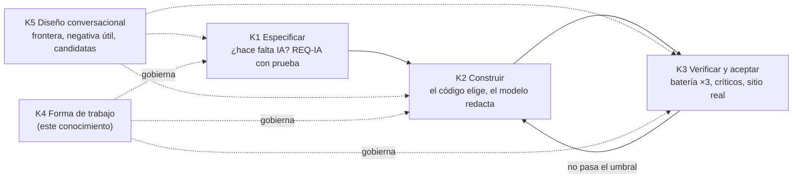

# Capa de IA integrada en .NET: forma de trabajo de la mesa que la integra

**Alias:** AI-Layer-Integration-Working-Method
**Naturaleza:** propio
**Tema:** Cómo organiza el trabajo quien integra una capa de IA en un sistema, tal como lo hizo el equipo que diseñó PushDispatch desde cero: secuencia especificar → construir → verificar con el diseño conversacional como eje transversal, mesa con especialistas y refutador, brecha contra un producto de referencia del mercado, PRs ordenados según los archivos que chocan, registro de frentes medido, coordinación entre sesiones, autocrítica y la tabla de los errores que costaron con su control
**Consumidor:** el agente gestor que preside la integración de IA en un sistema nuevo o existente; el agente que retoma una integración a mitad de camino
**Condicion-de-carga:** al iniciar una integración de IA en un sistema; al armar la mesa; al planificar fases y PRs; al declarar una fase cerrada; se carga por secciones según el «Mapa de carga» de §0
**Hereda-de:** —
**Sustituye:** —
**Compatible-con:** [K1](knowledge-AI-Layer-Integration-Designing-Specification.md), [K2](knowledge-AI-Layer-Console-Assistant-Building.md), [K3](knowledge-AI-Layer-Verification-And-Acceptance.md), [K5](knowledge-AI-Layer-Conversational-Design.md) (marco del turno y formas, vigente); `Dot-Net-Integration-AI-Layer-Guide.md` edición 1.2.0 (las remisiones `[Guía §x]` usan esa numeración y sus anclas `cN-k`). Opcionales, si el repo anfitrión los tiene (lo que este conocimiento necesita de ellos está resumido en §14 y basta para aplicarlo): Knowledge-Razonamiento-Del-Gestor, Knowledge-Mesa-De-Expertos-A-Pedido, Knowledge-Logica-De-Decision, Knowledge-Conformacion-Pull-Request-Automatico, Knowledge-Turnos-De-Recursos-Compartidos-En-Un-Host
**Versión:** 1.3
**Estado:** Vigente
**Fecha:** 2026-11-12

---

## Índice

- [0. Propósito, alcance y mapa de carga](#k4-0-proposito)
- [1. Secuencia de fases: K1 → K2 → K3, con K5 transversal](#k4-1-secuencia)
- [2. Composición de la mesa, con refutador](#k4-2-mesa)
- [3. La brecha con un producto de referencia, sin marca](#k4-3-brecha)
- [4. Plan en PRs ordenados según los archivos que chocan](#k4-4-prs)
- [5. Registro de frentes medido](#k4-5-frentes)
- [6. Coordinación entre sesiones](#k4-6-sesiones)
- [7. El reclamo del dueño del producto se mide y se aplica](#k4-7-reclamo)
- [8. Antipatrones E1–E9: tabla índice con su control](#k4-8-antipatrones)
- [9. Autocrítica y cierre de fase](#k4-9-cierre)
- [10. Procedimiento paso a paso](#k4-10-procedimiento)
- [11. Checklist binario de completitud](#k4-11-checklist)
- [12. Casos](#k4-12-casos)
- [13. Límites de este conocimiento](#k4-13-limites)
- [14. Reglas de trabajo tomadas de otros conocimientos (resumen autocontenido)](#k4-14-externas)
- [Glosario](#k4-glosario)
- [Control de cambios](#k4-cambios)

---

## 0. Propósito, alcance y mapa de carga

Este conocimiento dice **cómo se trabaja** para integrar IA en un sistema de modo que el resultado sea el que
habría obtenido el mismo equipo que hizo PushDispatch: no qué arquitectura usar (eso es K1 y la Guía 16), sino en
qué orden, con quién, con qué evidencia y con qué controles. Lo que funcionó en PushDispatch no fue una pieza de
código: fue un método. Las piezas de código se copian; el método, si no se escribe, se pierde.

**Fuente para personas.** Los libros mandan: la Guía 16 (`../Dot-Net-Integration-AI-Layer-Guide.md`) y la guía de
diseño conversacional (`../Conversational-Design-Framework-Guide.md` 1.4.0; su base «Criterio y juicio» se cita por
[K5 §M](knowledge-AI-Layer-Conversational-Design.md#k5-m)). Este conocimiento destila, remite por sección y **nunca los contradice**. Si un agente
encuentra una contradicción o un hueco del libro, lo anota para la mesa del libro y no lo resuelve acá (§13).

**Alcance.** Sí: organizar la mesa, ordenar fases y PRs, medir el estado, coordinar sesiones, declarar cerrado.
No: requisitos de la capa (K1), cómo se construye el asistente (K2), cómo se mide (K3), qué y cómo responde (K5).

### Mapa de carga

| Situación del agente | Cargar de este conocimiento | Y además |
|---|---|---|
| Arranco una integración nueva | §0–§5, §10, §11, §14 | K1 §0–§2 |
| Tengo que armar la mesa | §2, §3, §14 M-1 a M-3 | — |
| Tengo que partir el trabajo en PRs | §4, §14 P-1 a P-3 | — |
| Retomo una integración ajena | §5, §6, §8, §14 G-1 a G-3 | el registro de frentes vigente |
| Otra sesión trabaja en el mismo repo | §6, §14 T-1 | — |
| El dueño del producto reclamó algo | §7, §14 D-1 | — |
| Quiero declarar una fase cerrada | §8, §9, §11 | K3 §1–§3 |
| Hay que decidir si vale la pena la IA | — (no es de acá) | K1 §1; [Guía §3.4](../Dot-Net-Integration-AI-Layer-Guide.md#c3-4) |

Los conocimientos del workspace donde se hizo PushDispatch (registro de frentes, mesa, decisión, PR, turnos) **no
son obligatorios**: §14 resume lo que hace falta de cada uno. Si el repo anfitrión los tiene, se pueden cargar.

### Reglas que no se negocian (resumen; el detalle está en cada sección)

| # | Regla | Sección |
|---|---|---|
| R1 | No se construye antes de especificar ni se declara antes de verificar | §1 |
| R2 | Toda mesa tiene un refutador y al menos dos propuestas rivales | §2 |
| R3 | La brecha con el producto de referencia se tabula antes de diseñar, y sin marca | §3 |
| R4 | Los PRs se ordenan por choque de archivos, no por tema | §4 |
| R5 | Ningún estado se informa sin el comando que lo midió | §5 |
| R6 | En un clon compartido nunca checkout, stash ni clean; cada sesión, su worktree | §6 |
| R7 | El reclamo del dueño del producto no se repregunta: se mide y se aplica | §7 |
| R8 | Una fase cierra con evidencia de la app real servida, no de la demo | §9 |

---

## 1. Secuencia de fases: K1 → K2 → K3, con K5 transversal

**Imperativos.**

1. **Especificá primero (K1).** Respondé las cuatro preguntas de valor de
   [Guía §3.4](../Dot-Net-Integration-AI-Layer-Guide.md#c3-4) y fijá la frontera de competencia de
   [Guía §3.7](../Dot-Net-Integration-AI-Layer-Guide.md#c3-7) antes de abrir una rama de código.
   *Por qué:* en PushDispatch las primeras respuestas eran punteros a la ayuda en lugar de contexto para redactar,
   y la búsqueda emparejaba por una palabra suelta (E9); eso es un error de especificación, no de código.
   *Prueba:* existe una especificación con `REQ-IA-nn` y cada requisito tiene su prueba (K1 §9, §12).
2. **Construí con el código al mando (K2).** El código elige herramienta, alcance y destino; el modelo sólo redacta
   sobre lo que el código le dio. *Por qué:* es lo que hizo que las cifras fueran exactas y los deeplinks
   respetaran el permiso. *Prueba:* ninguna rama del enrutado depende de texto generado (K2 §3).
3. **Verificá contra el modelo real y el sitio real (K3).** *Por qué:* la verificación en el sitio con sesión por
   rol encontró lo que la demo no mostraba (consola ausente para el rol raíz, textos que confundían cuentas).
   *Prueba:* hay batería ×3 con mínimo y máximo, críticos con nota y capturas del sitio por rol (K3).
4. **Hacé pasar el diseño conversacional por las tres (K5).** Qué dice el asistente, cómo se niega, cómo aclara
   entre candidatas: se especifica en K1, se implementa en K2 y se mide en K3. *Por qué:* «No está en la ayuda»
   antes que inventar es un requisito, un comportamiento y una medida a la vez. *Prueba:* cada forma F1–F8 de
   [K5 §3](knowledge-AI-Layer-Conversational-Design.md#k5-3) que el sistema usa tiene un caso en la batería de K3.

**Criterio de parada.** Si K3 no alcanza el umbral (batería ≥ 90 % en las tres corridas, críticos ≥ 8), se vuelve a
K2 con la lista de fallas; nunca se baja el umbral para cerrar. Si la falla es de especificación, se vuelve a K1.

### 1.1 Fases tipo y su condición de salida

Una «fase» es una de estas, en este orden; el criterio de parada y el cierre de §9 se aplican por fase.

| Fase | Qué produce | Condición de salida (binaria) | Conocimiento |
|---|---|---|---|
| F0 Evidencia de lo existente | estado medido del sistema y de las ramas en vuelo | registro de frentes con comando por fila; PR de evidencia fusionado | §4.4, §5 |
| F1 Especificación | `REQ-IA-nn` con prueba, frontera en anillos, matriz de roles | checklist de K1 §12 sin «no»; brecha tabulada (§3) | K1, K5 |
| F2 Consola mínima | enrutado puro, herramientas de lectura, catálogo de destinos, formas F1, F2, F3, F7, F8 | pruebas sin modelo en verde; capturas de la app servida | K2 §3, §5, §6, §10 |
| F3 Ayuda (RAG) | cobertura del corpus, recuperación filtrada por rol, redacción anclada, formas F4 a F6 | cobertura sobre el umbral; batería ×3 ≥ 90 % en cada corrida; crítico ≥ 8 | K2 §4, K3 §2–§5 |
| F4 Destinos y señales | deeplinks que abren la acción, votos persistidos, gráficos | conformidad catálogo ↔ páginas; voto leído de la tabla | K2 §5, §7, §8 |
| F5 Despliegue y sitio real | versión etiquetada desplegada, habilitación visible | health con motivo `Habilitada`; recorrido por rol incluido el raíz; capturas del sitio | K2 §10, K3 §6, §7 |

*Por qué:* en PushDispatch la auditoría concluyó que ninguna fase cerrada estaba completa porque «cerrada» no
tenía salida escrita (E7). *Prueba:* el plan nombra cada fase con su condición de salida y la actuación de cierre
de cada una la cita.

---

## 2. Composición de la mesa, con refutador

El formato de la mesa (convocatoria, propuestas, refutación, dictamen) está resumido en [§14 M-1 a M-3](#k4-14-externas);
acá se fija qué especialistas hacen falta para IA, quién los encarna y qué umbral rige.

### 2.1 Especialistas mínimos

| Rol | Qué aporta | Qué pregunta que nadie más hace |
|---|---|---|
| Arquitectura .NET | Dónde vive la capa, contratos, ADR ([Guía §14](../Dot-Net-Integration-AI-Layer-Guide.md#c14)) | ¿Esto cambia de proveedor tocando sólo la composición? |
| Diseño conversacional | Frontera, negativa útil, candidatas (K5) | ¿Qué ve una persona inexperta cuando no hay respuesta? |
| Seguridad y datos | Agencia, permisos, secretos ([Guía §12.6](../Dot-Net-Integration-AI-Layer-Guide.md#c12-6)) | ¿El deeplink revalida el permiso de hacer, no sólo de ver? |
| QA y evaluación | Batería, oráculo, umbral ([Guía §11.4](../Dot-Net-Integration-AI-Layer-Guide.md#c11-4)) | ¿La medida paga las mismas condiciones que la app? |
| UX/UI del panel | Capturas 1280 y 390, coherencia con el sistema de diseño | ¿Se ve igual que el resto del panel en el sitio real? |
| Implementador ingenuo | Lee la especificación como la leería un agente nuevo | ¿Puedo construir esto sin preguntar? |
| **Refutador** | Ataca supuestos de todas las propuestas | ¿Qué tendría que ser falso para que esto falle? |

**Imperativos.**

1. **Convocá al menos dos propuestas rivales** (en PushDispatch fueron tres: diagnóstico determinista, agente con
   herramientas, ayuda y documentación primero) y **una refutación escrita** antes del dictamen.
   *Por qué:* el dictamen que salió no fue ninguna de las tres puras; fue la combinación que sobrevivió a la
   refutación. *Prueba:* la carpeta de la mesa tiene ≥ 2 propuestas y un archivo de refutación anterior al dictamen.
2. **Fijá el umbral de los críticos antes de leer el resultado:** nota ≥ 8 sobre 10 por crítico, batería ≥ 90 %.
   *Por qué:* un umbral fijado después se acomoda al resultado. *Prueba:* el umbral figura en la convocatoria.
3. **Trabajá por rondas ajuste → verificación independiente → crítica.** Quien verifica no es quien ajustó.
   *Por qué:* en PushDispatch hicieron falta varias rondas (r2 a r8) y la que exigió repetir la medición ×3 fue
   una verificación independiente (E6). *Prueba:* cada ronda deja su verificación firmada por otro rol.
4. **Pasale a la mesa la carta del gestor y lo conversado con el dueño del producto.** *Por qué:* una mesa sin el
   razonamiento del gestor rediscute lo ya decidido. *Prueba:* la convocatoria incluye ambos.

### 2.2 Quién encarna cada rol

1. **Cada especialista, el refutador, el verificador y el crítico es un subagente distinto**, lanzado con su
   propio contexto y su consigna; puede ser una persona si el equipo la tiene, pero nunca el mismo contexto que
   ajustó. *Por qué:* en PushDispatch la verificación que exigió repetir ×3 la hizo un agente que no había
   ajustado; quien ajustó tiende a medir lo que espera. *Prueba:* cada archivo de la ronda tiene un autor distinto
   y el del verificador no cita la intención del cambio.
2. **Mínimos por ronda:** un ajustador, un verificador independiente y **al menos un crítico**; en la mesa de
   diseño, además, **al menos un refutador**. Con riesgo alto (datos sensibles, escritura) sumá un segundo crítico
   de otra especialidad. *Prueba:* la convocatoria lista los roles y quién los encarna.
3. **Con un solo agente al mando**, «quien verifica no es quien ajustó» se cumple así: el gestor no ajusta ni
   verifica; lanza el ajuste a un subagente, la verificación a otro (sólo con el SHA y la batería) y la crítica a un
   tercero (sólo con la evidencia). *Prueba:* los tres archivos de la ronda existen y sus autores difieren.
4. **La carta de cada subagente lleva una cláusula fija sobre mensajes a mitad de turno:** si llega un mensaje
   del dueño del producto reenviado, lo atiende el gestor y el subagente termina su consigna. *Por qué:* en
   [Lab-Geometria](https://github.com/hdcm-dev/Lab-Geometria), mensajes del dueño que llegaron a mitad de turno desviaron agentes de un flujo automatizado de su
   tarea. *Prueba:* la cláusula figura en la plantilla de la carta.

---

## 3. La brecha con un producto de referencia, sin marca

**Imperativo.** Antes de diseñar, leé un producto de referencia del mercado que resuelva lo mismo y tabulá la
brecha: qué hace, qué hacemos, qué entendimos mal, qué adoptamos, qué rechazamos y por qué.

*Por qué:* en PushDispatch la tabla de brecha mostró que las respuestas tenían que ser totales agregados con el
desglose ofrecido, que había que elegir entre apps de nombre parecido mostrando sus cifras, que el destino se ofrece
como un chip que abre la acción, que una torta muestra las mayores más «Otras» y que la respuesta dice qué métrica
está mostrando. Nada de eso salía de la especificación sola.

*Prueba:* existe una tabla con las columnas anteriores y cada fila «adoptamos» tiene un `REQ-IA-nn` o una forma de
[K5](knowledge-AI-Layer-Conversational-Design.md).

**Cómo se elige el producto de referencia y qué hacer si no hay.** Elegí el que resuelve la misma tarea para el
mismo tipo de persona y tiene asistente o ayuda en contexto; si hay varios, el más usado en el rubro, y como mucho
dos. Si **no existe** ninguno con asistente, la brecha se hace contra un producto del rubro con buena ayuda en
contexto, o contra los patrones de [K5 §3](knowledge-AI-Layer-Conversational-Design.md#k5-3); y si tampoco
tiene sentido, la brecha es **optativa con motivo escrito** en el registro de frentes. *Por qué:* la brecha es
una fuente de patrones, no un trámite; inventar un competidor para llenarla no aporta. *Prueba:* hay tabla de
brecha, o una fila del registro con el motivo por el que no la hay.

**Reglas de publicación.**

- En un documento público el producto de referencia se nombra **«un producto de referencia del mercado»**: nunca su
  marca, su logo ni texto literal que lo identifique. *Prueba:* búsqueda del nombre comercial en el diff = 0.
- Las capturas del producto de referencia **no se publican** (llevan la marca en el encabezado); se describe el
  patrón. *Prueba:* ninguna imagen del producto de referencia en el diff.
- La tabla de brecha completa, si nombra el producto, vive en un documento privado y el público remite a ella sin
  nombrarla.

---

## 4. Plan en PRs ordenados según los archivos que chocan

**Imperativos.**

1. **Antes de partir el trabajo, medí el choque:** `git diff --stat origin/main..<rama-en-vuelo>` y listá los
   archivos compartidos con su peso. *Por qué:* en PushDispatch una rama en vuelo tocaba 23 archivos y unas 2.750
   líneas; abrir PRs que tocaran esos archivos generaba conflictos garantizados.
   *Prueba:* el plan tiene la lista de archivos de choque alto y bajo con su conteo.
2. **Marcá cada PR `[libre]` o `[<rama>]`.** `[libre]` = no toca archivos de choque, se abre ya. `[<rama>]` = se abre
   cuando esa rama esté fusionada o se rebasa sobre ella. *Por qué:* paraleliza sin pisarse.
   *Prueba:* ningún PR `[libre]` aparece en el diff de la rama en vuelo.
3. **PRs pequeños, cada uno con su «Salida» medible:** prueba verde, captura, tabla de medición o actuación.
   *Por qué:* un PR sin salida declarada no se puede dar por cumplido. *Prueba:* cada ítem del plan tiene «Salida».
4. **Primero los PRs de evidencia.** En PushDispatch el primer PR del plan fue sólo de evidencia de lo ya hecho.
   *Por qué:* lo que se daba por cumplido no lo estaba (E7). *Prueba:* el PR-A del plan es de evidencia.
5. **El ciclo del PR está resumido en [§14 P-1 a P-3](#k4-14-externas):** conformación automática, fusión sólo
   con checks en verde, la rama se borra sólo con `merged=true`.

---

## 5. Registro de frentes medido

El formato base está resumido en [§14 G-1 a G-3](#k4-14-externas). Para una integración de IA, las columnas son:

| Columna | Qué poner en una integración de IA |
|---|---|
| Frente | mesa en curso, PR, despliegue, decisión pendiente del dueño, frente de otra sesión |
| Estado medido | con fecha y hora; `FUSIONADO merged=true <sha>` o `sin medir` |
| Comando | el comando exacto que lo midió (`git log`, `curl /health`, batería, captura) |
| Condición de salida | lo que tiene que pasar para cerrarlo, medible |

**Imperativos.**

1. **Separá INFORME de MEDIDO.** Lo que otra sesión o un subagente te dice entra como `INFORME`; sólo pasa a medido
   cuando lo corriste vos. *Por qué:* en PushDispatch las actuaciones marcaban «INFORME (no medido en esta
   actuación)» y eso evitó cerrar sobre cifras ajenas. *Prueba:* toda fila sin comando dice `INFORME` o `sin medir`.
2. **Las decisiones del dueño del producto son frentes con dueño «PO» y default.** *Por qué:* no se pierden ni
   frenan lo que no depende de ellas. *Prueba:* cada decisión pendiente tiene fila.
3. **Antes de informar, volvé a medir.** *Prueba:* la fecha del estado es posterior a la última acción.

---

## 6. Coordinación entre sesiones

**Imperativos.**

1. **En un clon compartido, nunca `checkout`, `stash` ni `clean`.** Cada sesión trabaja en su propio worktree.
   *Por qué:* otra sesión tiene cambios sin commitear en el mismo clon. *Prueba:* `git worktree list` muestra el tuyo.
2. **Repartí zonas por archivos y escribilo en el registro:** qué carpetas son de quién. *Por qué:* en PushDispatch
   el montaje del asistente en el layout era zona de la sesión de usuarios y el asistente era zona propia; el reparto
   explícito evitó dos implementaciones del mismo botón. *Prueba:* cada zona tiene una fila con dueño.
3. **Avisá con SHA y `merged=true`.** «Está hecho» no es un aviso; «fusionado en `<sha>`, ancestro de `origin/main`»
   sí. *Por qué:* la otra sesión mide sobre ese SHA. *Prueba:* `git merge-base --is-ancestor <sha> origin/main`.
4. **Si otra sesión tocó tus archivos, aceptalo en el registro y revisalo en su PR**, no lo reviertas en silencio.
5. **Los recursos únicos (equipo de prueba, modelo cargado, emulador) van por turno** ([§14 T-1](#k4-14-externas)). *Por qué:* dos baterías contra el mismo modelo se miden mal
   entre sí (E4).

---

## 7. El reclamo del dueño del producto se mide y se aplica

**Imperativo.** Cuando el dueño del producto reclama algo («el raíz no tiene consola»), no lo repreguntes: medilo,
corregilo y avisá con evidencia. Si hay que decidir, filtrá con [§14 D-1](#k4-14-externas) y, si sigue abierto, mesa
con propuesta; al dueño sólo le llega lo que es de fondo.

*Por qué:* en PushDispatch el reclamo del rol raíz era exacto (el raíz estaba excluido en el layout, en Inicio, en
los adaptadores, en el buscador y en el controlador); repreguntar habría costado una vuelta.
*Prueba:* el reclamo tiene fila en «Reclamos» del registro con la medida que lo confirmó y el PR que lo cerró.

---

## 8. Antipatrones E1–E9: tabla índice con su control

Cada antipatrón vive en el conocimiento cuya fase lo previene (una sola fuente por regla); esta tabla los indexa.

| # | Antipatrón (lo que costó) | Control binario | Id en el conocimiento que lo previene |
|---|---|---|---|
| E1 | Estilos sin linkear: el componente se veía bien en la demo y sin estilo en la app | Captura de la app real servida y estilo computado del componente verificado antes de declarar | [K2-AP-1](knowledge-AI-Layer-Console-Assistant-Building.md#k2-ap-1), [K3-AP-2](knowledge-AI-Layer-Verification-And-Acceptance.md#k3-ap-2) |
| E2 | La consola del rol raíz olvidada | Matriz rol × pantalla: por cada rol, una prueba que abre el asistente y obtiene respuesta no vacía | [K2-AP-2](knowledge-AI-Layer-Console-Assistant-Building.md#k2-ap-2), [K3-AP-3](knowledge-AI-Layer-Verification-And-Acceptance.md#k3-ap-3) |
| E3 | Variable del modelo faltante en el despliegue (`IA__Modelo`): la IA quedó apagada en silencio | Motivo exacto de habilitación visible en `/health` o en pantalla; chequeo post-despliegue en el sitio real | [K2-AP-3](knowledge-AI-Layer-Console-Assistant-Building.md#k2-ap-3), [K3-AP-4](knowledge-AI-Layer-Verification-And-Acceptance.md#k3-ap-4) |
| E4 | Medir con el modelo ya cargado, o comparar cifras de servidores distintos: latencia optimista y un reporte no reproducible | Medir frío y caliente por separado; la batería paga el cambio de modelo igual que la app; cada cifra declara modelos en memoria y aceleración | [K2-AP-4](knowledge-AI-Layer-Console-Assistant-Building.md#k2-ap-4), [K3-AP-7](knowledge-AI-Layer-Verification-And-Acceptance.md#k3-ap-7), [K3-AP-8](knowledge-AI-Layer-Verification-And-Acceptance.md#k3-ap-8) |
| E5 | Claves impresas en un registro | Búsqueda de secretos (y de datos personales) sobre registros y evidencias antes de commitear; nunca volcar la configuración entera | [K2-AP-5](knowledge-AI-Layer-Console-Assistant-Building.md#k2-ap-5), [K3-AP-5](knowledge-AI-Layer-Verification-And-Acceptance.md#k3-ap-5) |
| E6 | Un 90 % reportado sin repetir: 19/20 en una corrida escondía un 64 % ×3 | Toda cifra de batería se reporta ×3 con mínimo y máximo; umbral sobre el mínimo | [K3-AP-6](knowledge-AI-Layer-Verification-And-Acceptance.md#k3-ap-6) |
| E7 | Fases dadas por cumplidas sin evidencia | Fases tipo con condición de salida (§1.1) y checklist con artefacto (§9, §11) | **K4 §9**, [K3-AP-1](knowledge-AI-Layer-Verification-And-Acceptance.md#k3-ap-1) |
| E8 | Diseñar el gesto sin el destino del dato (votos que se perdían) | Toda señal de UI tiene almacenamiento y lector definidos antes de implementarse | [K2-AP-6](knowledge-AI-Layer-Console-Assistant-Building.md#k2-ap-6) |
| E9 | Respuesta = puntero a la guía; búsqueda que emparejó por una palabra suelta | La ayuda es contexto para redactar, no la respuesta; umbral real de rechazo | [K2-AP-7](knowledge-AI-Layer-Console-Assistant-Building.md#k2-ap-7), [K5-AP-1](knowledge-AI-Layer-Conversational-Design.md#k5-ap-1) |

**Los demás antipatrones** (no son de método, pero se citan igual en un PR por su id con prefijo):
[K2-AP-8](knowledge-AI-Layer-Console-Assistant-Building.md#k2-ap-8) corpus faltante diagnosticado como búsqueda ·
[K2-AP-9](knowledge-AI-Layer-Console-Assistant-Building.md#k2-ap-9) destino que termina en 403 ·
[K2-AP-10](knowledge-AI-Layer-Console-Assistant-Building.md#k2-ap-10) preguntar el alcance con respuesta global ·
[K3-AP-9](knowledge-AI-Layer-Verification-And-Acceptance.md#k3-ap-9) creer la tasa sin leer ·
[K3-AP-10](knowledge-AI-Layer-Verification-And-Acceptance.md#k3-ap-10) ajustar la batería para que pase ·
[K3-AP-11](knowledge-AI-Layer-Verification-And-Acceptance.md#k3-ap-11) confiar en la demo ·
[K5-AP-2 a K5-AP-6](knowledge-AI-Layer-Conversational-Design.md#k5-10) formas de respuesta.

**Regla de ids.** Un antipatrón se cita siempre con el prefijo de su conocimiento (`K2-AP-n`, `K3-AP-n`,
`K5-AP-n`) o con su `En` de esta tabla; un `AP-n` sin prefijo es ambiguo y no vale en un PR.

**Imperativo.** Al planificar cada fase, recorré esta tabla y asigná cada control que aplique a un PR del plan.
*Prueba:* cada E aplicable tiene un PR o una prueba que lo cubre en el plan.

---

## 9. Autocrítica y cierre de fase

**Imperativos.**

1. **Una fase cierra con evidencia de la app real servida, no de la demo:** capturas lado a lado a 1280 y 390, en
   claro y oscuro (cuatro pares por pantalla, K3 R6.1), la
   verificación en el sitio con sesión por rol y la batería ×3. *Por qué:* «ninguna fase cerrada está completa de
   verdad» fue la conclusión de la auditoría de PushDispatch cuando se pidió la evidencia (E7).
   *Prueba:* la actuación de cierre enlaza cada artefacto.
2. **Escribí la autocrítica cuando un hueco era previsible** («la mesa debió preverlo») y llevala al dictamen
   siguiente. *Por qué:* en PushDispatch los votos que se perdían (E8) entraron así al método.
   *Prueba:* el dictamen siguiente cita la autocrítica.
3. **Avisá al dueño del producto con la app real**, no con la descripción. *Prueba:* el aviso trae capturas o URL
   del sitio medido.

---

## 10. Procedimiento paso a paso

1. Leé §14 y abrí el registro de frentes de la integración (§5).
2. Medí el estado: ramas en vuelo, PRs abiertos, otras sesiones en el repo (§6).
3. Especificá con K1: valor ([Guía §3.4](../Dot-Net-Integration-AI-Layer-Guide.md#c3-4)), frontera
   ([Guía §3.7](../Dot-Net-Integration-AI-Layer-Guide.md#c3-7)), `REQ-IA-nn` con prueba.
4. Tabulá la brecha con un producto de referencia del mercado (§3).
5. Convocá la mesa con los especialistas de §2.1, encarnados según §2.2, ≥ 2 propuestas rivales, refutación y
   umbral fijado.
6. Del dictamen, armá el plan por fases tipo (§1.1): archivos de choque, PRs `[libre]` / `[<rama>]`, salida de cada uno (§4), con los
   controles de §8 asignados.
7. Ejecutá por rondas ajuste → verificación independiente → crítica, con K2 para construir.
8. Verificá con K3: batería ×3 contra el modelo (M ≥ 20), críticos ≥ 8, capturas 1280 y 390 en claro y oscuro,
   sitio real por rol.
9. Si no pasa el umbral, volvé al paso 7 (o al 3 si la falla es de especificación). No bajes el umbral.
10. Cerrá la fase (§9): actuación con evidencia, autocrítica, aviso al dueño con la app real; actualizá el registro.

**Criterios de parada.** Detenete y elevá sólo si: (a) la decisión es de fondo del dueño del producto según
§14 D-1; (b) falta una credencial o un acceso; (c) el libro se contradice o tiene un hueco que la
decisión necesita (se anota para la mesa del libro, §13). En cualquier otro caso, seguí.

---

## 11. Checklist binario de completitud

- [ ] Hay registro de frentes con comando y fecha en cada fila medida.
- [ ] La especificación K1 existe y cada `REQ-IA-nn` tiene prueba.
- [ ] La frontera de competencia está fijada ([Guía §3.7](../Dot-Net-Integration-AI-Layer-Guide.md#c3-7)).
- [ ] Hay tabla de brecha con un producto de referencia, sin marca ni capturas con marca en lo público.
- [ ] La mesa tuvo ≥ 2 propuestas rivales y una refutación escrita anterior al dictamen.
- [ ] El umbral (críticos ≥ 8, batería ≥ 90 %) se fijó en la convocatoria.
- [ ] Cada ronda tiene verificación hecha por un rol distinto del que ajustó, encarnado por otro subagente (§2.2).
- [ ] El plan nombra cada fase tipo con su condición de salida (§1.1).
- [ ] Hay tabla de brecha, o el motivo escrito de por qué no la hay (§3).
- [ ] El plan lista los archivos de choque y marca cada PR `[libre]` o `[<rama>]` con su salida.
- [ ] Cada E1–E9 aplicable tiene su control asignado a un PR o prueba.
- [ ] La batería se corrió ×3 contra el modelo real y se reporta con mínimo y máximo.
- [ ] Hay capturas lado a lado a 1280 y 390, en claro y oscuro, de la app real servida.
- [ ] Se verificó en el sitio real con una sesión por rol, incluido el rol raíz.
- [ ] Ningún registro ni evidencia commiteada contiene claves, direcciones internas ni datos de personas reales.
- [ ] Los avisos entre sesiones llevan SHA verificado como ancestro de `origin/main`.
- [ ] Los PRs se fusionaron con checks en verde y `merged=true` antes de borrar ramas.
- [ ] La actuación de cierre enlaza la evidencia y, si hubo hueco previsible, la autocrítica.

---

## 12. Casos

### 12.1 PushDispatch (caso de origen)

Producto de notificaciones diseñado desde cero. La integración del asistente del panel se hizo con este método:
mesa de gestión con tres propuestas rivales y refutación; mesas sucesivas para diálogo y RAG, maqueta, datos con
herramientas, gráficos y deeplink, votos y actividad, y paradigma del asistente; plan en PRs `[libre]` / `[F3]`
según 23 archivos de choque; registro de frentes medido con reparto de zonas entre sesiones (asistente, usuarios,
documentación); verificación en el sitio real por rol, que encontró el rol raíz excluido y textos que confundían
cuentas. Los errores E1–E9 salieron de este caso.

### 12.2 Movilidad Urbana (demo de la Guía)

La demo de [Guía §15](../Dot-Net-Integration-AI-Layer-Guide.md#c15) parte de una tabla de delta: es la misma idea
que la brecha de §3, aplicada al propio sistema antes y después. Para extenderla con este método: la tabla de delta
es el insumo de la mesa, cada PD-n es un PR con salida, y la evidencia de cierre es la corrida registrada contra el
modelo ([Guía §11.4](../Dot-Net-Integration-AI-Layer-Guide.md#c11-4)), repetida ×3.

### 12.3 Geometría (caso aplicado de la Guía)

El caso de [Guía §16](../Dot-Net-Integration-AI-Layer-Guide.md#c16) muestra la mesa que decidió Docs as Code dentro
de la capa. Aplicado este método: el implementador ingenuo de §2.1 es el rol que comprueba que un agente nuevo
construye desde el libro sin preguntar; las puertas de Docs as Code son controles que se asignan a PRs como los de §8.

---

## 13. Límites de este conocimiento

- No define requisitos, construcción, medición ni diseño conversacional: remite a K1, K2, K3 y K5.
- Resume en §14 lo mínimo del formato de mesa, del registro, de la decisión, del PR y de los turnos; si el repo
  anfitrión tiene normas propias para eso, rigen las del anfitrión.
- Los umbrales (≥ 8, ≥ 90 %, ×3) son los que funcionaron en PushDispatch; un sistema puede endurecerlos, nunca
  relajarlos sin una decisión registrada.
- Una fase que toca la conversación no se cierra como «mejoró» sin R13 y R14 de
  [K5 §M.6](knowledge-AI-Layer-Conversational-Design.md#k5-m6): mejora percibida a ciegas y trazable a la captura.
- **Contradicciones o huecos del libro:** se anotan para la mesa del libro (en la bitácora de coordinación de los
  conocimientos) y no se resuelven en este conocimiento. Hoy la Guía 16 no trata la batería ×3 con umbral, el crítico
  con nota, las capturas 1280/390 ni la verificación en el sitio real por rol; este conocimiento los usa como método
  de trabajo y el libro decidirá si los incorpora.
- Es un repo público: PushDispatch se nombra; no se nombran el producto de referencia, clientes, organizaciones,
  servidores, direcciones, usuarios, claves ni el modelo de IA concreto.

---

## 14. Reglas de trabajo tomadas de otros conocimientos (resumen autocontenido)

Estas reglas vienen de conocimientos del workspace donde se hizo PushDispatch, que no están en este repositorio.
Se resumen para que un agente nuevo trabaje igual sin cargarlos.

| Id | Regla (imperativo) | Porqué | Prueba |
|---|---|---|---|
| G-1 | **Bucle medir → decidir → actuar → volver a medir.** Antes de cada decisión, medí el estado con un comando; después de actuar, medí otra vez | lo que se cree hecho y no se mide es la fuente de E7 | cada fila del registro tiene comando y fecha posterior a la última acción |
| G-2 | **Un registro de frentes único** por integración, con las columnas de §5 y una sección «Reclamos» del dueño del producto | sin registro, los frentes de otras sesiones y las decisiones pendientes se pierden | el registro existe y cada frente abierto tiene fila |
| G-3 | **Lo que no depende de vos no frena lo que sí**: una espera (decisión del dueño, otra sesión, un recurso) es una fila con default y fecha, y se sigue con lo demás | en PushDispatch se avanzó en PRs `[libre]` mientras otra rama estaba en vuelo | ninguna fila «esperando» sin default |
| M-1 | **Convocatoria escrita**: problema, restricciones, lo ya decidido (carta del gestor y lo conversado con el dueño), especialistas y umbral | sin lo ya decidido, la mesa lo rediscute | el archivo de convocatoria tiene esas cinco partes |
| M-2 | **Propuestas rivales independientes** (≥ 2), cada una con supuestos, costo y riesgo; **refutación escrita** contra todas antes del dictamen | el dictamen que sobrevive a la refutación es mejor que cualquier propuesta pura | ≥ 2 propuestas y una refutación con fecha anterior al dictamen |
| M-3 | **Dictamen** con: decisión, qué se descartó y por qué, plan por fases con salida, diferidos `D-n` con motivo, y autocrítica si hubo hueco previsible | un dictamen sin descartes ni diferidos no se puede auditar | el dictamen tiene esas cinco partes |
| D-1 | **Antes de elevar al dueño del producto, filtrá**: si la respuesta sale de lo que él ya escribió, de la especificación o de una regla de estos conocimientos, aplicala; si es reversible y de poco costo, decidí con mesa y avisá; sólo se eleva lo de fondo (alcance, dinero, riesgo legal, marca) | repreguntar lo ya dicho cuesta vueltas y confianza | cada elevación cita por qué no salía de lo ya escrito |
| P-1 | **Todo cambio entra por PR** con cuerpo que dice qué, por qué, cómo se probó y la evidencia; la conformación (revisión, checks) es automática | el PR es donde vive la evidencia de la fase | el PR tiene esas cuatro partes |
| P-2 | **Se fusiona sólo con checks en verde** y con merge atado al SHA revisado; si la rama está atrás, se actualiza y se vuelve a correr | un check en rojo fusionado es una regresión publicada | la fusión cita el SHA y los checks verdes |
| P-3 | **La rama se borra sólo con `merged=true`** verificado; un merge fallido deja la rama | borrar una rama no fusionada pierde trabajo | la API del PR dice `merged=true` antes del borrado |
| T-1 | **Un recurso único (modelo cargado, equipo, emulador) se toma por turno**: pedir, usar, liberar, con vencimiento; nunca dos baterías a la vez contra el mismo modelo | dos mediciones simultáneas se contaminan (E4) | el registro de la batería dice qué turno la cubrió |

## Glosario

- **Brecha:** tabla de lo que hace un producto de referencia frente a lo que hace el propio, con la decisión por fila.
- **Choque de archivos:** archivos tocados a la vez por una rama en vuelo y por un PR planificado.
- **INFORME / MEDIDO:** estado declarado por otro / estado corrido por quien lo informa.
- **Refutador:** especialista cuya única tarea es atacar los supuestos de las propuestas.
- **Sitio real:** la app desplegada y servida, con sesiones reales por rol; opuesto a la demo.
- **Umbral:** nota mínima de los críticos (≥ 8) y tasa mínima de la batería (≥ 90 % en las tres corridas).

---

## Control de cambios

| Versión | Fecha | Cambio |
|---|---|---|
| 1.3 | 2026-11-12 | La guía de diseño conversacional está publicada: K5 vigente con el marco del turno; cierre de fase con R13/R14 (§13). |
| 1.2 | 2026-11-11 | §2.2 punto 4: cláusula fija en la carta de los subagentes ante mensajes a mitad de turno (lección de [Lab-Geometria](https://github.com/hdcm-dev/Lab-Geometria)). |
| 1.1 | 2026-11-11 | Tras la prueba a ciegas: §14 resume las reglas tomadas de conocimientos externos, que dejan de ser herencia obligatoria; fases tipo con salida (§1.1); quién encarna cada rol (§2.2); brecha optativa con motivo (§3); tabla índice única de antipatrones con ids prefijados (§8); capturas en claro y oscuro; K5 enlazado. |
| 1.0 | 2026-11-11 | Creación: secuencia K1→K2→K3 con K5 transversal, mesa con refutador, brecha sin marca, PRs por choque, registro de frentes, coordinación entre sesiones, tabla E1–E9, casos y límites. |
