# Diseño conversacional de un asistente de producto — un método por competencia

> **Versión** 1.0.0 · **Fecha** 2026-11-11 · **Estado**: vigente. Acompaña a la guía de integración de una capa de IA en .NET ([Dot-Net-Integration-AI-Layer-Guide.md](./Dot-Net-Integration-AI-Layer-Guide.md)), que resuelve cómo se construye lo que acá se diseña. Índice general: [0.0](#c0-0).

<a id="prologo"></a>
## Prólogo

<a id="c0"></a>
## Capítulo 0 · Cómo usar este libro

Este libro es una guía académica de diseño conversacional para asistentes de producto. Está escrita para estudiantes, docentes y profesionales que nunca diseñaron una conversación ni integraron un modelo de lenguaje, y que quieren un marco para hacerlo en cualquier sistema. Quien lo lea de punta a punta sale con un criterio (la frontera por competencia), un método de ocho etapas (E0 a E7) con entregables en forma de plantillas y tres casos ilustrativos para contrastar: Movilidad Urbana, Geometría y PushDispatch, un servicio de notificaciones push con panel de administración, presentado como un producto diseñado desde cero. Los casos ejemplifican; el objetivo es el método. Este capítulo no enseña diseño conversacional: dice qué vas a poder hacer, por dónde entrar según la situación del sistema, cómo leer las marcas de evidencia y dónde está cada plantilla.

<a id="c0-0"></a>
### 0.0 Índice

La figura muestra el orden del libro, de lo general a lo particular. Las flechas punteadas marcan de qué capítulo sale cada plantilla del Anexo A.

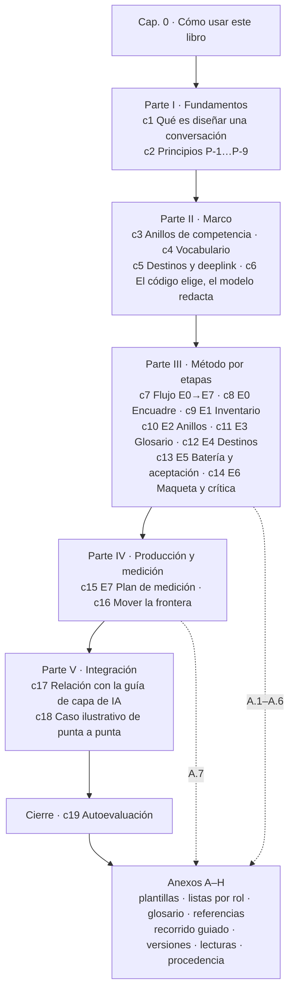

*Figura 0.1. Mapa del libro. Cada caja enlaza con la parte o el capítulo del mismo nombre.*

| Parte | Capítulos | Pregunta que responde |
|---|---|---|
| [Parte I](#parte-i) | [c1](#c1), [c2](#c2) | ¿Qué es esto y con qué criterio decido? |
| [Parte II](#parte-ii) | [c3](#c3)–[c6](#c6) | ¿Dónde termina lo que el asistente sabe hacer y cómo responde? |
| [Parte III](#parte-iii) | [c7](#c7)–[c14](#c14) | ¿Por dónde empiezo y qué entrego en cada etapa? |
| [Parte IV](#parte-iv) | [c15](#c15), [c16](#c16) | ¿Cómo sé si funciona y cuándo cambio la frontera? |
| [Parte V](#parte-v) | [c17](#c17), [c18](#c18) | ¿Cómo lo llevo al código y cómo se ve aplicado a un caso completo? |
| [Cierre](#c19) y [Anexos](#anexo-a) | c19, A–H | ¿Aprendí? ¿Dónde está la plantilla? |

*Tabla 0.1. Partes del libro y la pregunta que responde cada una.*

<a id="c0-1"></a>
### 0.1 Qué vas a poder hacer al terminar

Esta tabla es la única fuente de los objetivos de aprendizaje (OA). De ella salen las rutas de [§0.2](#c0-2) y la autoevaluación de [§19](#c19). Ninguna pregunta guía existe sin un OA. Diseñar una conversación es trabajo de varios perfiles; el prefijo dice qué perfil ejerce cada objetivo. En un curso o en un equipo chico una misma persona puede ejercer varios, y conviene leerlos todos:

- **EQ:** tronco común, para cualquier lector.
- **PO:** dueño del producto; decide la frontera y la firma.
- **DIS:** diseño de experiencia y contenido.
- **DEV:** desarrollo.
- **QA:** verificación.
- **SOP:** soporte y operación, quienes hoy contestan las preguntas que el asistente va a recibir.

| OA | Al terminar, vas a poder… | Dónde se enseña | Plantilla o paso |
|---|---|---|---|
| <a id="oa-eq1"></a>OA-EQ1 | Explicar con un ejemplo propio qué es un asistente de producto y en qué se diferencia de un buscador o de un chat general | [§1](#c1) | — |
| <a id="oa-eq2"></a>OA-EQ2 | Citar por Id el principio que justifica una decisión de diseño (P-1 a P-9) | [§2](#c2) | — |
| <a id="oa-eq3"></a>OA-EQ3 | Ubicar una pregunta de usuario en un anillo (operar, dominio, lo de al lado o afuera) y decir qué respuesta le toca | [§3](#c3) | A.2 |
| <a id="oa-eq4"></a>OA-EQ4 | Recorrer el flujo E0→E7, nombrar el entregable y la compuerta de cada etapa y decir quién la firma | [§7](#c7) | A.1–A.7 |
| <a id="oa-eq5"></a>OA-EQ5 | Distinguir conducta (pasó una vez) de tasa (k de M) y rotular bien una afirmación | [§0.4](#c0-4), [§2](#c2) (P-7) | — |
| <a id="oa-po1"></a>OA-PO1 | Decidir en E0 si una conversación conviene al producto o si es mejor arreglar la pantalla, con el umbral de la guía | [§8](#c8) | paso E0 |
| <a id="oa-po2"></a>OA-PO2 | Firmar el mapa de anillos y la lista de lo que el asistente no promete | [§10](#c10), [§2](#c2) (P-4) | A.2 |
| <a id="oa-po3"></a>OA-PO3 | Mover la frontera con datos de medición o decidir abandonar el asistente | [§16](#c16) | A.7 |
| <a id="oa-dis1"></a>OA-DIS1 | Armar el glosario y los sinónimos desde el vocabulario real de los usuarios y decidir cuándo explicar un término | [§4](#c4), [§11](#c11) | A.3 |
| <a id="oa-dis2"></a>OA-DIS2 | Elegir cómo se presenta un dato (total con desglose ofrecido, torta o barras, nota de métrica) | [§6](#c6) | — |
| <a id="oa-dis3"></a>OA-DIS3 | Conducir una ronda de crítica con capturas lado a lado y separar en un producto de referencia la forma de la promesa | [§14](#c14) | paso E6 |
| <a id="oa-dev1"></a>OA-DEV1 | Armar el catálogo cerrado de destinos y herramientas, con el destino elegido por código y revalidado por permiso | [§5](#c5), [§12](#c12) | A.4 |
| <a id="oa-dev2"></a>OA-DEV2 | Decidir para cada intención si responde una herramienta (dato) o la recuperación con cita (ayuda) | [§6](#c6), [§17](#c17) | A.4 |
| <a id="oa-dev3"></a>OA-DEV3 | Llevar cada entregable a su pieza en la guía de capa de IA | [§17](#c17) | — |
| <a id="oa-qa1"></a>OA-QA1 | Escribir la batería con su respuesta esperada y correrla tres veces, midiendo por separado la herramienta correcta y la redacción fiel | [§13](#c13) | A.5 |
| <a id="oa-qa2"></a>OA-QA2 | Redactar criterios de aceptación que incluyan no invención, permisos y prueba en el sitio real | [§13](#c13), [§2](#c2) (P-8) | A.6 |
| <a id="oa-sop1"></a>OA-SOP1 | Aportar las preguntas reales del soporte al inventario y a la batería, y leer los indicadores de medición | [§9](#c9), [§15](#c15) | A.1, A.7 |

*Tabla 0.2. Objetivos de aprendizaje por rol.*

<a id="c0-2"></a>
### 0.2 Rutas de lectura

Las tres rutas comparten un tronco: [§0](#c0), [§2](#c2) y [§7](#c7). Los principios dan el criterio y el flujo da el orden. Sin ellos, cualquier etapa se lee como una receta suelta. Después, cada ruta se separa según la situación del sistema, no según el rol. Cada rol suma los capítulos de sus OA en [§0.1](#c0-1).

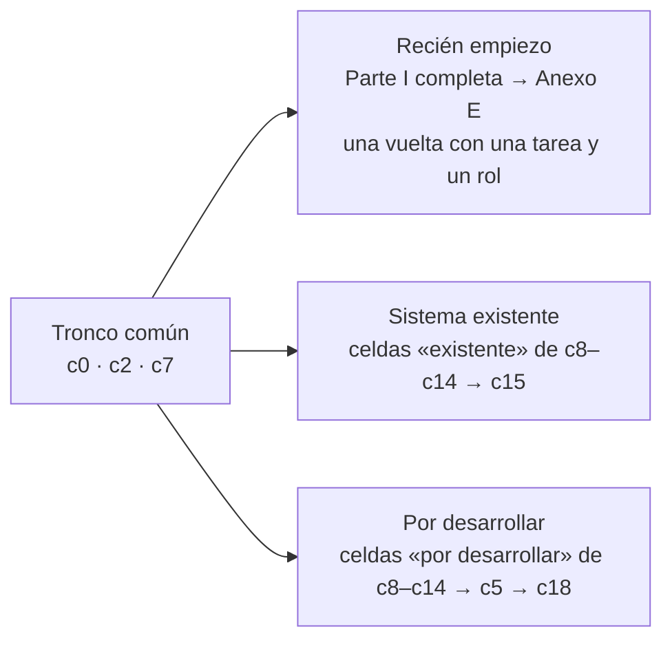

*Figura 0.2. Tres rutas con tronco común.*

<a id="c0-2-novato"></a>**Recién empiezo.** Leé la Parte I completa, después [§7](#c7) y hacé el recorrido guiado del [Anexo E](#anexo-e) con una sola tarea de un sistema que conozcas y un solo rol de usuario. La primera vuelta tiene que ser chica a propósito: sirve para ver el método entero una vez, con todas las plantillas en una fila, antes de ensancharlo. Funciona bien como trabajo práctico. Recién entonces volvé a [§8](#c8) para hacerlo en serio.

<a id="c0-2-existente"></a>**Tengo un sistema existente.** El producto ya tiene pantallas, usuarios y soporte. Después del tronco, leé en [§8](#c8)–[§14](#c14) las celdas *sistema existente* de cada sección de escenarios. Ahí el inventario sale de lo que ya hay (pantallas, tickets, búsquedas fallidas). Terminá en [§15](#c15), porque en un sistema con uso real la medición arranca enseguida y es la que va a mover la frontera.

<a id="c0-2-nuevo"></a>**Estoy por desarrollar.** Todavía no hay pantallas o se están diseñando. Después del tronco, leé las celdas *por desarrollar* de [§8](#c8)–[§14](#c14). Después leé [§5](#c5): el catálogo de destinos se puede pensar junto con la navegación, y eso conviene hacerlo antes de que exista el código. Terminá en [§18](#c18), que recorre un caso completo como producto diseñado desde cero.

<a id="c0-3"></a>
### 0.3 Qué necesitás

| Tema | Se da por sabido | Se explica acá |
|---|---|---|
| Producto | Saber usar como usuario el sistema que se va a estudiar | Cómo convertir su uso en inventario de tareas ([§9](#c9)) |
| Diseño | Haber visto un formulario y una navegación | Conversación, intención, turno, frontera, anillo ([§1](#c1), [§3](#c3), [Anexo C](#anexo-c)) |
| IA | Nada | Modelo, recuperación con cita, herramienta, anclaje, en el nivel que el diseño necesita ([§6](#c6)) |
| Desarrollo | Para DEV: un lenguaje de servidor y una API | El cableado .NET vive en la guía de capa de IA ([§17](#c17)) |
| Verificación | Para QA: casos de prueba con resultado esperado | Batería ×3, tasa y conducta ([§13](#c13)) |

*Tabla 0.3. Lo que se da por sabido y lo que se explica.*

Los casos se usan como ejemplos ilustrativos, no como objeto de estudio. Movilidad Urbana y Geometría vienen de la guía de capa de IA ([§17](#c17)). PushDispatch es un servicio de notificaciones push presentado como diseñado desde cero: un panel de administración con aplicaciones, suscripciones, mensajes, credenciales y roles, más una consola del asistente; [§18](#c18) lo recorre entero. No hace falta conocer ninguno de antes: el libro los presenta. Los ejemplos de los capítulos temáticos son neutros a propósito, para que el método no parezca atado a un dominio.

<a id="c0-4"></a>
### 0.4 Patrón de capítulo y rótulos de evidencia

Los capítulos temáticos (de [§3](#c3) a [§16](#c16)) siguen siempre el mismo patrón, con anclas fijas. Así cualquiera sabe dónde buscar.

| Sección | Ancla | Qué trae |
|---|---|---|
| Definición | `cN-k` | El concepto, con un solo sentido (el del [Anexo C](#anexo-c)) |
| Escenarios | `cN-escenarios` | Sólo las celdas que cambian entre *sistema existente* y *por desarrollar* |
| Ejemplo | `cN-ejemplos` | Un caso neutro trabajado y, cuando ayuda, su contraste en uno de los casos ilustrativos |
| Decisión | `cN-decision` | Qué se decide, quién lo decide y con qué criterio |
| Preguntas guía | `cN-preguntas` | Hasta cinco, en negrita, cada una con su OA y una respuesta que forma criterio |
| Calidad | `cN-calidad` | Criterios de terminado y antipatrones |

*Tabla 0.4. Patrón de los capítulos temáticos.*

Cada afirmación lleva uno de estos rótulos:

| Rótulo | Significa | Ejemplo de uso |
|---|---|---|
| `[REF-nnn]` | Fuente externa verificada, con fecha de consulta, en el [Anexo D](#anexo-d) | «Antes de diseñar, preguntá si la conversación es la forma adecuada» [REF-003] |
| *criterio de la guía* | Una decisión de este libro, razonada pero no medida | El umbral de un tercio de tareas en E0 |
| *experiencia propia medida, conducta* | Pasó y se observó, al menos una vez | «En el sitio real apareció un fallo que la demo no mostraba» |
| *experiencia propia medida, tasa k de M* | Se contó: k casos de M corridas | «18 de 20 preguntas, en tres corridas» |
| **NO VERIFICADO** | Se cree, pero no hay fuente ni medición | Se usa para dejar planteada una hipótesis, nunca para sostener una decisión |
| **NO EJECUTADO** | El paso está descrito pero no se corrió | Una prueba propuesta que todavía no tiene resultado |

*Tabla 0.5. Rótulos de evidencia.*

Una conducta no es una tasa. Que el asistente haya contestado bien una vez demuestra que puede hacerlo, no que lo haga siempre. Por eso la aceptación se firma por tasa ([§2](#c2), P-7). Las citas en inglés van con su glosa en castellano.

<a id="c0-5"></a>
### 0.5 Mapa de plantillas y del caso

| Plantilla | Etapa | Se enseña en | Caso completo en | Perfil que la llena / que la firma |
|---|---|---|---|---|
| [A.1](#anexo-a-1) Inventario de tareas y pantallas | E1 | [§9](#c9) | [§18](#c18) | DIS + SOP / PO |
| [A.2](#anexo-a-2) Mapa de anillos | E2 | [§3](#c3), [§10](#c10) | [§18](#c18) | DIS / PO |
| [A.3](#anexo-a-3) Glosario y sinónimos | E3 | [§4](#c4), [§11](#c11) | [§18](#c18) | DIS + SOP / PO |
| [A.4](#anexo-a-4) Catálogo de destinos y herramientas | E4 | [§5](#c5), [§12](#c12) | [§18](#c18) | DEV / PO |
| [A.5](#anexo-a-5) Batería de preguntas | E5 | [§13](#c13) | [§18](#c18) | QA + SOP / QA |
| [A.6](#anexo-a-6) Criterios de aceptación | E5 | [§13](#c13) | [§18](#c18) | QA / PO |
| [A.7](#anexo-a-7) Plan de medición | E7 | [§15](#c15) | [§18](#c18) | DEV + SOP / PO |

*Tabla 0.6. Plantillas, etapa, capítulo y responsables.*

E0 (encuadre, [§8](#c8)) y E6 (maqueta y crítica, [§14](#c14)) no tienen plantilla propia. Su entregable es una decisión escrita y una ronda de capturas comentadas. Cada plantilla del [Anexo A](#anexo-a) trae una fila de ejemplo tomada de uno de los casos ilustrativos, una fila vacía y su criterio de terminado.

<a id="c0-6"></a>
### 0.6 De la guía a tu propio sistema

El libro es autocontenido: todo lo necesario para aprender y aplicar el método está acá. Al aplicarlo a un sistema concreto, el resultado natural es un documento de aplicación propio, con las plantillas llenas, los nombres de sus pantallas y las decisiones firmadas. Ese documento es del proyecto que lo produce y no forma parte de la guía; en un curso, es el entregable del trabajo práctico.

<a id="c0-7"></a>
### 0.7 Anclas estables

Las partes, capítulos, secciones, principios y OA llevan un ancla HTML explícita que no cambia entre versiones:

- **Partes:** `parte-i` a `parte-v`.
- **Capítulos:** `cN`.
- **Secciones:** `cN-k` y las del patrón de [§0.4](#c0-4).
- **Principios:** `p-1` a `p-9`.
- **Objetivos:** `oa-…`.
- **Anexos:** `anexo-a` a `anexo-h`, y `anexo-a-1` a `anexo-a-7` para las plantillas.

Si una sección se reescribe, conserva su ancla. Si desaparece, su ancla queda apuntando a la sección que la reemplaza. Enlacen siempre al ancla, nunca al número de la sección, porque los números pueden correrse.

<a id="c0-preguntas"></a>
### 0.8 Preguntas guía

**¿Tengo que leer todo antes de empezar a diseñar? (OA-EQ4)** No. El tronco común ([§0](#c0), [§2](#c2), [§7](#c7)) sí es obligatorio, porque sin los principios cada etapa se vuelve una receta. Lo que conviene es una primera vuelta chica, con una tarea y un rol ([Anexo E](#anexo-e)), y después leer las etapas a medida que llegan. Esto aplica siempre que el lector sea nuevo en el tema. Quien ya tiene experiencia puede ir directo a la plantilla de la etapa en la que está.

**Mi producto ya existe, pero la parte que quiero cubrir con el asistente todavía no está hecha. ¿Qué ruta sigo? (OA-EQ4)** Seguí la de *por desarrollar* para esa parte y la de *existente* para el resto. Las rutas responden al estado de lo que el asistente va a cubrir, no al producto entero. En la práctica, el inventario ([§9](#c9)) mezcla filas de las dos clases, y cada fila toma la celda de escenario que le corresponde.

**¿Puedo citar como evidencia algo que vimos funcionar en una demostración? (OA-EQ5)** Sí, pero como *conducta*, no como tasa. Sirve para decir «es posible». No sirve para firmar la aceptación, que pide k de M en la batería ([§13](#c13)) y prueba en el sitio real ([§2](#c2), P-8). Si nadie lo corrió, va **NO EJECUTADO**. Si sólo se cree, va **NO VERIFICADO**, y no sostiene ninguna decisión.

**¿Por qué cada plantilla tiene un firmante distinto de quien la llena? (OA-EQ4)** Porque quien llena ve el detalle y quien firma responde por la frontera. Aunque una sola persona haga las dos cosas, como en un trabajo práctico, conviene separar los dos momentos. La frontera es una decisión de producto, no técnica ([§10](#c10), [§16](#c16)). La única excepción es la batería: la firma QA, porque su calidad se juzga por cobertura y respuesta esperada. Los criterios de aceptación ([A.6](#anexo-a-6)), en cambio, vuelven al PO.

<a id="c0-calidad"></a>
### 0.9 Criterios de calidad de este capítulo

- Cada OA de [§0.1](#c0-1) aparece en por lo menos una pregunta guía y en [§19](#c19).
- Cada plantilla de [§0.5](#c0-5) existe en el [Anexo A](#anexo-a) con una fila del caso y una fila vacía.
- Antipatrón: una ruta de lectura que se salta [§2](#c2). Sin principios, el lector copia pantallas de otro producto en lugar de razonar desde la competencia.
- Antipatrón: enlazar por número de sección en lugar de ancla.

<a id="parte-i"></a>
# Parte I · Fundamentos

<a id="c1"></a>
## Capítulo 1 · Qué es diseñar una conversación de producto

Este capítulo fija el vocabulario mínimo con el que trabaja el resto del libro. Quien estudia diseño conversacional se encuentra con cinco palabras (*asistente de producto*, *intención*, *turno*, *corpus* y *anclaje*) que la literatura y la práctica usan con sentidos distintos; si no se fijan desde el principio, cada etapa del método ([Parte III](#c8)) se discute dos veces: una por la decisión y otra por lo que cada uno entendió. Las definiciones de acá son las mismas del [glosario del Anexo C](#anexo-c) y tienen un solo sentido en todo el libro.

<a id="c1-1"></a>
### 1.1 Diseñar una conversación: de qué se trata

Google define el diseño conversacional como una disciplina que toma principios de la conversación humana para diseñar experiencias que se usan conversando, y lo plantea como trabajo de diseño, no de programación: primero se escribe cómo va a ser el diálogo y después se construye [REF-002]. Su material de método (personas, diálogos de ejemplo, flujos, manejo de errores) sigue publicado y vale como método aunque la plataforma para la que se escribió se discontinuó el 2023-06-13 [REF-001] (ver [Anexo F](#anexo-f)).

> «Conversation design is a design language based on human conversation» [REF-002].
> *Glosa:* el diseño conversacional es un lenguaje de diseño que toma como modelo la conversación entre personas.

En un **producto** (un panel de administración, una aplicación de gestión, una herramienta educativa) el asistente no conversa por conversar: existe para que alguien haga una tarea del producto o entienda lo necesario para hacerla. Por eso, en este libro, *diseñar la conversación* significa decidir, antes de escribir un prompt o una línea de código:

1. qué tareas del producto va a atender el asistente y cuáles no (la frontera, [c3](#c3));
2. con qué palabras las piden los usuarios reales ([c4](#c4));
3. de dónde sale cada dato o cada paso que el asistente dice (el corpus y las herramientas, [c6](#c6));
4. cómo se comprueba que lo dice bien ([c13](#c13)) y cómo se mide en uso ([c15](#c15)).

*Criterio de la guía:* el resultado del diseño son los documentos de las plantillas del [Anexo A](#anexo-a), no el prompt. El prompt es una consecuencia de ellos.

<a id="c1-2"></a>
### 1.2 Definiciones de base

<a id="c1-def-asistente"></a>
**Asistente de producto.** Interfaz conversacional embebida en un producto que responde preguntas sobre ese producto y ayuda a operarlo, con los permisos de quien lo usa. Se distingue de un chat general en que su frontera la fija el producto, no el conocimiento del mundo. *Criterio de la guía.*

<a id="c1-def-intencion"></a>
**Intención.** Lo que el usuario quiere lograr con un mensaje, con independencia de las palabras que usa. En un servicio de notificaciones push, «¿cuántos suscriptores tengo?» y «¿a cuánta gente le llega?» son la misma intención (*consultar el total de suscripciones*). La intención es la unidad con la que se diseña, se prueba y se mide: la batería se arma por intención y la medición cuenta por intención, nunca por texto ([P-9](#p-9)). *Criterio de la guía:* en sentido estricto, este libro no exige que la implementación tenga un clasificador de intenciones: la intención es una categoría de diseño.

<a id="c1-def-turno"></a>
**Turno.** Una intervención completa de una de las partes: el usuario escribe (turno del usuario) y el asistente responde (turno del asistente). Una conversación es una secuencia de turnos. Google construye sus diálogos de ejemplo turno por turno, alternando usuario y sistema [REF-001]; este libro escribe así las respuestas esperadas de la batería ([A.5](#anexo-a-5)). Un turno del asistente puede incluir texto, una cifra, un gráfico, una pregunta de aclaración o un enlace a una pantalla.

<a id="c1-def-corpus"></a>
**Corpus.** El conjunto cerrado de fuentes de las que el asistente puede sacar lo que dice sobre el producto: la ayuda, las descripciones de pantallas, el glosario y, para los datos de la cuenta, las respuestas de las herramientas del código. Lo que no está en el corpus no se afirma: se responde «No está en la ayuda» y se registra como no-encontrado ([P-5](#p-5)). El corpus se escribe y se versiona como cualquier entregable.

<a id="c1-def-anclaje"></a>
**Anclaje.** La propiedad de una respuesta cuyo contenido está sostenido por el corpus o por un dato que devolvió el código en ese turno, de modo que cada afirmación se puede rastrear a su fuente. Una respuesta anclada repite la cifra que entregó la herramienta, no una que el modelo estimó; una respuesta no anclada «suena bien» pero no tiene de dónde salir. El anclaje es lo que separa al asistente de producto de un generador de texto plausible ([P-3](#p-3), [c6](#c6)).

Tabla 1.1. Las cinco definiciones y qué pregunta responden en el diseño.

| Término | Pregunta de diseño que responde | Dónde se trabaja |
|---|---|---|
| Asistente de producto | ¿Para qué existe y para quién? | [c3](#c3), [c8](#c8) |
| Intención | ¿Qué quiere lograr el usuario? | [c9](#c9), [c13](#c13) |
| Turno | ¿Cómo se ve cada intercambio? | [c13](#c13), [c14](#c14) |
| Corpus | ¿De dónde sale lo que dice? | [c6](#c6), [c11](#c11) |
| Anclaje | ¿Se puede rastrear lo que dijo? | [c6](#c6), [c13](#c13) |

Figura 1.1. Un turno, de la intención al anclaje.

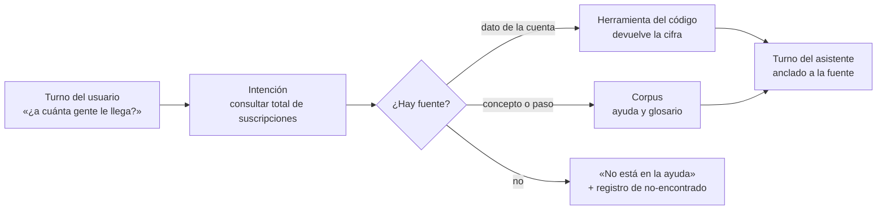

<a id="c1-escenarios"></a>
### 1.3 Según el escenario

Sólo cambian estas celdas; las definiciones valen igual en los dos.

Tabla 1.2. Qué cambia en las definiciones según el escenario.

| Término | Sistema existente | Sistema por desarrollar |
|---|---|---|
| Intención | Se descubre: sale de tickets de soporte, búsquedas y preguntas reales | Se supone: sale del inventario de tareas ([A.1](#anexo-a-1)) y se valida con usuarios antes de construir |
| Corpus | Existe disperso (ayuda, pantallas); hay que juntarlo y limpiarlo | Se escribe junto con las pantallas; conviene que nazca como parte del producto |
| Anclaje | Las herramientas se montan sobre servicios que ya existen | Las herramientas se diseñan como parte del contrato del servicio |

<a id="c1-ejemplos"></a>
### 1.4 Ejemplos

Los ejemplos de este capítulo son ilustrativos: muestran cómo se leen las cinco definiciones en sistemas distintos. Los tres casos que recorren la guía (Movilidad Urbana, Geometría y PushDispatch, un servicio de notificaciones push que se toma como producto diseñado desde cero) se presentan en [c2](#c2).

Primero, un sistema de reservas de salas (ejemplo neutro), con un usuario que escribe: «¿cuántas reservas tuve el mes pasado?».

- **Respuesta anclada.** La intención es *consultar total de reservas por período*; el código consulta y devuelve 42; el turno del asistente dice «Tuviste 42 reservas en octubre» y ofrece ver el desglose por sala. El 42 se rastrea a la herramienta.
- **Respuesta no anclada.** El modelo, sin herramienta, contesta «Tuviste alrededor de 40 reservas». Suena razonable y es inverificable: es exactamente lo que NN/g describe como el riesgo de la alucinación, una respuesta segura de sí misma y falsa [REF-009] (tratado en [c6](#c6)).
- **Fuera del corpus.** «¿Cómo exporto a la planilla del área contable?» y el producto no tiene esa exportación: el turno correcto es «No está en la ayuda» y, si existe, ofrecer lo cercano (exportar a CSV), sin prometer lo que el software no hace ([P-4](#p-4)).

Tabla 1.3. Las mismas definiciones en los tres casos de la guía.

| Término | Movilidad Urbana | Geometría | PushDispatch |
|---|---|---|---|
| Intención | «¿dónde estaciono cerca?» = *buscar lugar disponible* | «¿qué es una mediatriz?» = *entender un concepto* | «¿a cuánta gente le llega?» = *consultar total de suscripciones* |
| Turno | respuesta con mapa y enlace a la zona | explicación con figura de ejemplo | cifra, gráfico y enlace a la pantalla de suscripciones |
| Corpus | reglas de estacionamiento y ayuda de la app | definiciones y ejercicios del curso | ayuda del panel y descripción de sus pantallas |
| Anclaje | la disponibilidad la da el servicio, no el modelo | la definición sale del material del curso | el total lo calcula el código; el modelo lo redacta |

*Experiencia propia medida (caso PushDispatch):* en las pruebas con preguntas reales, la regla que más errores evitó fue que la cifra la elija y la calcule el código y el modelo sólo la redacte; cuando el dato no estaba en la ayuda, responder «No está en la ayuda» fue preferible a una respuesta plausible.

<a id="c1-decision"></a>
### 1.5 Decisión que deja este capítulo

Quien aplique el marco a un sistema adopta estas cinco palabras con este sentido y anota cualquier término propio del producto en el glosario ([A.3](#anexo-a-3)). *Criterio de la guía:* si en un trabajo práctico o en una reunión dos personas usan «intención» o «corpus» en sentidos distintos, conviene parar y volver a la Tabla 1.1.

<a id="c1-preguntas"></a>
### 1.6 Preguntas guía

**¿El asistente de producto es un chat con un modelo de IA conectado a la aplicación? (OA-EQ-1)**
No. Lo que lo define es la frontera y el anclaje, no la tecnología: responde sobre el producto, con los permisos del usuario y desde un corpus cerrado. Un modelo conectado sin corpus ni herramientas es un chat general dentro de una pantalla. Aplica a los dos escenarios; la frontera se diseña en [c3](#c3).

**¿Por qué diseñar por intención y no por pregunta? (OA-EQ-1)**
Porque las mismas ganas se escriben de muchas formas, y lo que hay que garantizar es la respuesta a la intención, no a una frase. Si la batería prueba frases sueltas, pasa con las frases de quien diseña y falla con las del usuario. Las frases distintas de una intención son justamente el insumo de los sinónimos ([c4](#c4)).

**¿El corpus es «toda la documentación que tengamos»? (OA-EQ-2)**
No: es lo que el equipo decidió que el asistente puede afirmar, revisado y versionado. Documentación vieja o ajena al producto dentro del corpus produce respuestas ancladas pero falsas. En un sistema existente es el trabajo principal de [c11](#c11); en uno por desarrollar, se escribe con cada pantalla.

**¿Cómo sé si una respuesta está anclada? (OA-EQ-2)**
Señalando, para cada afirmación, la fuente: un párrafo del corpus o un dato que devolvió el código en ese turno. Si alguna cifra o paso no se puede señalar, no está anclada aunque sea correcta por casualidad. La prueba formal está en los criterios de aceptación ([c13](#c13)).

**¿Un turno es un mensaje? (OA-EQ-1)**
Es la intervención completa de una parte, que puede tener texto, cifra, gráfico y enlace. Importa al escribir la respuesta esperada: se especifica el turno entero (qué dice, qué muestra, a dónde lleva), no sólo el texto.

<a id="c1-calidad"></a>
### 1.7 Criterios de calidad y antipatrones

- **Calidad:** cada término de la Tabla 1.1 aparece en el glosario del proyecto con un solo sentido; cada fila de la batería nombra su intención; cada respuesta esperada dice su fuente.
- **Antipatrón «el prompt es el diseño»:** empezar escribiendo instrucciones al modelo sin inventario ni corpus. Resultado: nadie puede decir qué debería responder.
- **Antipatrón «corpus = internet»:** dejar que el modelo complete con conocimiento general lo que falta en la ayuda; viola [P-5](#p-5).
- **Antipatrón «medir frases»:** contar o guardar textos de usuarios en lugar de intenciones; viola [P-9](#p-9).

<a id="c2"></a>
## Capítulo 2. Principios

Este capítulo responde la primera pregunta de quien diseña una conversación por primera vez: **¿con qué criterio creo el diseño?** La respuesta son nueve principios, P-1 a P-9. No son consejos sueltos: son las reglas con que se decide cada vez que dos opciones parecen igual de razonables, en cualquier sistema. Se ilustran con los tres casos de la guía —Movilidad Urbana (una encuesta de transporte con su ABM de localidades), Geometría (un laboratorio donde el alumno arma a mano la descripción de sus figuras) y PushDispatch (el panel de administración de un servicio de notificaciones push)—, que son ejemplos para fijar ideas, no el objetivo del capítulo. Los capítulos siguientes los citan por su Id (por ejemplo, «por P-3») y no los vuelven a enunciar. Si una decisión de diseño no se puede justificar con alguno, falta un principio o la decisión está mal tomada.

<a id="c2-1"></a>
### 2.1 Qué es un principio en esta guía

Un **principio** es una regla de decisión con tres partes: el enunciado (qué se hace), la *Razón:* (por qué, con su fuente o con el rótulo de criterio de la guía o experiencia propia medida) y la consecuencia práctica (qué cambia en los entregables). Un principio no es una buena intención («el asistente debe ser útil») ni la descripción de un producto («el asistente usa tal modelo»): si no descarta ninguna opción, no es un principio.

Los nueve se agrupan en tres familias, que siguen el orden en que aparecen al diseñar:

| Familia | Principios | Pregunta que contestan |
|---|---|---|
| Qué abarca el asistente | P-1, P-2, P-6 | ¿De qué se ocupa y de qué no? |
| Cómo responde | P-3, P-4, P-5 | ¿De dónde sale cada cosa que dice? |
| Cómo se acepta y evoluciona | P-7, P-8, P-9 | ¿Cuándo está listo y cómo se corrige? |

Tabla 2.1. Familias de principios y la pregunta que contesta cada una.

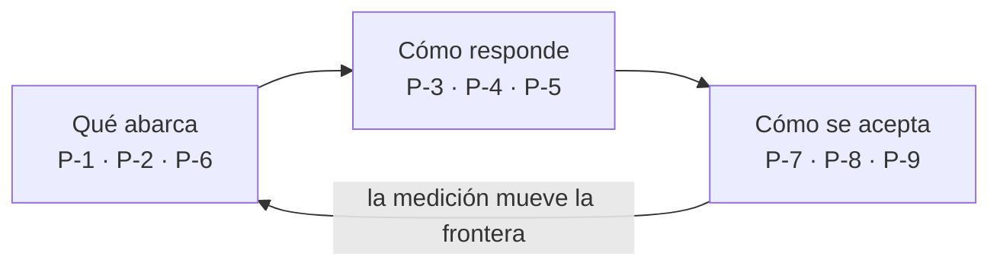

Figura 2.1. Las tres familias forman un ciclo: lo que se mide en producción vuelve a cambiar qué abarca el asistente.

<a id="c2-2"></a>
### 2.2 Los nueve principios

<a id="p-1"></a>
#### P-1. La frontera se define por competencia, no por temas

El asistente se diseña a partir de **lo que el usuario necesita poder hacer** con el producto, no de una lista de temas sobre los que «sabe hablar». La competencia se ordena en anillos: operar el producto, entender el dominio, lo de al lado y afuera ([§3](#c3)). Una pregunta entra o no según qué anillo toca, no según de qué tema trata.

*Razón:* un mismo tema atraviesa varios anillos. En un panel de notificaciones push, «credenciales» puede ser «¿dónde cargo la clave?» (operar), «¿qué es un certificado de envío?» (dominio) o «¿cómo genero ese certificado en la consola del fabricante?» (lo de al lado). En Geometría, «área» puede ser «¿dónde veo la advertencia de área?» (operar), «¿qué diferencia hay entre área declarada y derivada?» (dominio) o «calculame el área» (afuera: el asistente no debe resolver el trabajo del alumno). Una lista de temas los mete en la misma bolsa y el asistente termina inventando sobre lo que no le toca. La práctica publicada de diseño conversacional organiza el trabajo alrededor de las tareas e intenciones del usuario y de un tema de respaldo para lo que no reconoce [REF-004] [REF-005]; los anillos son la forma que esta guía le da a esa idea (criterio de la guía).

Consecuencia práctica: el primer entregable no es un temario sino el inventario de tareas ([§9](#c9)) y su mapa de anillos ([§10](#c10)).

<a id="p-2"></a>
#### P-2. Primero se pregunta por qué no alcanza una pantalla

Antes de diseñar una conversación hay que demostrar que la tarea **gana** algo al pasar por el asistente frente a una pantalla bien hecha. Si un botón, un filtro o un texto de ayuda en el lugar resuelven lo mismo, se mejora la pantalla.

*Razón:* Google plantea como paso previo preguntarse si la conversación es la forma adecuada para el caso de uso [REF-003]. Nielsen Norman Group observó que los usuarios de chatbots se frustran cuando la conversación los obliga a hacer en varios turnos lo que una interfaz gráfica resuelve en un clic [REF-007] (cita original: los bots funcionan mejor en tareas acotadas y simples; glosa de la guía). Un asistente que reemplaza pantallas que funcionaban agrega costo y quita velocidad. Ejemplo: en Movilidad Urbana, dar de alta una localidad se resuelve mejor en su formulario; en cambio, «¿qué medio se usa más para ir al laburo?» no tiene pantalla y justifica la conversación.

Consecuencia práctica: la compuerta E0 ([§8](#c8)) pide, para las tareas más frecuentes, una razón concreta para la conversación (buscar sin saber el nombre del lugar, cruzar datos de dos pantallas, entender un término) y deja documentado «cuándo no» ([§8](#c8-cuando-no)).

<a id="p-3"></a>
#### P-3. El código elige, el modelo redacta

Todo lo que tiene una respuesta exacta en el sistema —una cifra, un registro, el destino de un enlace, lo que el usuario tiene permitido hacer— lo **elige el código**: consulta, filtra, cuenta y valida. El modelo de lenguaje sólo **redacta** a partir de lo que el código le entrega, y no agrega datos que no estén ahí.

*Razón:* un modelo de lenguaje genera texto plausible, no texto verificado; por eso puede afirmar con seguridad cosas falsas [REF-009]. Las dos técnicas establecidas para atar el modelo a la realidad son recuperar documentos antes de generar [REF-010] y dejar que el modelo invoque herramientas que devuelven datos exactos [REF-011]. En la experiencia propia medida (caso PushDispatch), cuando la cifra salía del modelo aparecían totales que no coincidían con el panel; cuando salió de una consulta, dejó de pasar en la batería (experiencia propia medida, conducta; la tasa se mide en [§13](#c13)).

Consecuencia práctica: cada tarea del inventario se etiqueta como «herramienta» (dato exacto), «ayuda con cita» (explicación del corpus) o «derivar» ([§6](#c6), [§12](#c12)).

<a id="p-4"></a>
#### P-4. No se promete lo que el software no hace

El asistente nunca ofrece, sugiere ni describe una función que el producto no tiene, aunque el usuario la pida y aunque sea razonable que exista. Si algo no se puede, se dice que no se puede y, si corresponde, qué se puede en su lugar.

*Razón:* la respuesta conversacional se lee como palabra del producto; una promesa falsa le cuesta al usuario el tiempo de buscarla y al equipo la confianza en todo lo demás. La heurística de correspondencia entre el sistema y el mundo real pide que la interfaz hable de lo que efectivamente hay [REF-006], y las alucinaciones más dañinas son justamente las que suenan a función plausible [REF-009]. Es además el único punto donde **la frontera no se mueve midiendo** ([P-9](#p-9)): que muchos usuarios pidan algo justifica construirlo, no prometerlo (criterio de la guía).

Ejemplo (caso PushDispatch): el usuario escribe «programame el envío para todos los martes». Si el producto sólo permite programar envíos de una vez, la respuesta correcta es «Hoy se puede programar un envío por vez; para repetirlo hay que crear uno nuevo», no un paso a paso de una repetición que no existe.

<a id="p-5"></a>
#### P-5. «No está en la ayuda» antes que inventar

Cuando el corpus no contiene la respuesta, el asistente lo dice con una fórmula fija y reconocible —en esta guía, «No está en la ayuda»— y ofrece un camino (reformular, una pregunta sugerida, el canal humano). No completa el hueco con conocimiento general.

*Razón:* Nielsen Norman Group recomienda mostrar la incertidumbre en el punto donde el error es riesgoso en lugar de responder siempre con el mismo aplomo [REF-009]. Microsoft documenta un tema de respaldo del sistema para lo que el agente no reconoce, en vez de forzar una coincidencia [REF-012]. Una fórmula fija tiene una ventaja adicional: se puede **contar**, y ese conteo es la señal principal para mover la frontera ([P-9](#p-9), [§15](#c15)).

Consecuencia práctica: cada caso de la batería ([§13](#c13)) incluye preguntas cuya respuesta correcta es «No está en la ayuda»; si el asistente las contesta, el caso falla aunque la respuesta parezca buena.

<a id="p-6"></a>
#### P-6. El vocabulario del usuario marca su frontera

Lo que un usuario puede pedir está limitado por las palabras que conoce. Al inexperto no lo frena el producto sino el vocabulario: no pregunta por «segmentos» si no sabe que existen. Por eso el diseño incluye un glosario, los sinónimos con que la gente nombra cada cosa, la explicación del término la primera vez que aparece y preguntas sugeridas que enseñan qué se puede pedir ([§4](#c4)).

*Razón:* la heurística de reconocer antes que recordar pide hacer visibles las opciones en lugar de exigir que el usuario las recuerde [REF-006]; las sugerencias de consulta cumplen ese papel en las interfaces conversacionales y ayudan a quien no sabe qué escribir [REF-008]. Un asistente que sólo entiende el vocabulario del equipo atiende a quien menos lo necesita.

Ejemplo (caso PushDispatch): «¿cuánta gente tengo?» y «¿cuántos suscriptos hay?» son la misma intención; el glosario registra «gente», «usuarios» y «dispositivos» como sinónimos de «suscripciones» y la primera respuesta explica el término en una línea. En Movilidad Urbana pasa lo mismo con «bondi», «a pata» o «facu», que el glosario lleva a colectivo, caminata y estudio.

<a id="p-7"></a>
#### P-7. Se acepta por tasa, no por conducta

Que una respuesta salió bien **una vez** es una conducta; que sale bien **k de M veces** sobre una batería fija es una tasa. El asistente se acepta por tasa: cada pregunta de la batería se corre al menos tres veces y el criterio de aceptación se expresa como proporción ([§13](#c13)).

*Razón:* la salida de un modelo de lenguaje varía entre corridas con la misma entrada; una prueba única confunde suerte con calidad. En la experiencia propia medida, preguntas que pasaban en la primera corrida fallaban en la segunda o tercera, y sólo la batería repetida ×3 lo mostró (experiencia propia medida, conducta observada en varias preguntas). En Geometría pasó lo mismo con una regla didáctica: el filtro dejaba pasar 0 de 30 cifras, pero 24 de 30 respuestas decían la operación en palabras (experiencia propia medida, tasa). La guía distingue siempre ambos rótulos ([§0.4](#c0-4)).

Consecuencia práctica: un informe de prueba que dice «funciona» sin «k de M» no alcanza para aprobar una etapa.

<a id="p-8"></a>
#### P-8. Se acepta en el sitio real

La aceptación final se hace en el producto desplegado, con su autenticación, sus permisos, sus datos y su navegador, no en una demo ni en un entorno de juguete.

*Razón:* los fallos que importan dependen del contexto: un enlace que la demo abría y el sitio real rechaza por permiso, una cuenta con varias organizaciones que la demo no tenía, un estilo que en el sitio tapaba el chip de acción. En la experiencia propia medida, hubo fallos vistos en el sitio real que la demo no mostraba, y por eso la batería se repite allí (experiencia propia medida, conducta). Las rondas de crítica se hacen con capturas del sitio real lado a lado con la maqueta ([§14](#c14)).

<a id="p-9"></a>
#### P-9. Se mide sin guardar el texto, y la frontera se mueve midiendo

En producción se registra **qué pasó**, no **qué escribió** el usuario: cuántas veces hubo «No está en la ayuda», votos con motivos de una lista cerrada, preguntas fuera de alcance, todo agrupado por intención y rol. Con esos números, y sólo con ellos, se decide ampliar, achicar o mover un anillo ([§15](#c15), [§16](#c16)).

*Razón:* el texto libre puede contener datos personales o secretos que el usuario pegó sin pensar; guardarlo convierte al asistente en un depósito de información sensible que nadie pidió. Los conteos por intención y motivo alcanzan para decidir, y Microsoft propone medir los agentes por resultados y temas en lugar de por conversaciones leídas una a una [REF-005]. La única excepción a mover la frontera por números es [P-4](#p-4): ninguna medición autoriza prometer lo que no existe (criterio de la guía).

<a id="c2-escenarios"></a>
### 2.3 Aplicación por escenario

Los principios valen igual en los dos escenarios; cambia dónde muerden primero (Movilidad Urbana y Geometría ilustran la columna izquierda; un producto que recién se especifica, la derecha). Sólo se listan las celdas que cambian.

| Principio | Sistema existente | Sistema por desarrollar |
|---|---|---|
| [P-2](#p-2) | Se compara contra pantallas reales; a menudo el hallazgo es mejorar una pantalla. | Se decide qué tarea nace conversacional y cuál nace con pantalla, antes de diseñar ambas. |
| [P-3](#p-3) | Las herramientas envuelven consultas que ya existen; el riesgo es que no respeten permisos. | Las consultas para el asistente se diseñan junto con el modelo de datos. |
| [P-4](#p-4) | Hay usuarios con expectativas formadas; el inventario evita prometer lo que «debería» estar. | El riesgo es describir funciones planificadas como si ya existieran. |
| [P-8](#p-8) | Existe un sitio real desde el día uno. | Hasta el primer despliegue, se acepta sólo en preproducción con datos realistas; la aceptación final queda pendiente y rotulada NO EJECUTADO. |

Tabla 2.2. Celdas que cambian entre sistema existente y por desarrollar.

<a id="c2-ejemplos"></a>
### 2.4 Ejemplo: una sola pregunta, nueve decisiones

Para ver los principios trabajando juntos, tomemos el caso PushDispatch. Un usuario del panel escribe: «¿cuántos me abrieron lo del viernes y cómo hago para que no se vaya a los de prueba?». El diseño resuelve:

1. Son dos tareas en distintos anillos: un dato (operar) y una configuración (operar, con un concepto de dominio: segmento) — [P-1](#p-1).
2. El dato gana con conversación (el usuario no recuerda el nombre del mensaje); la configuración termina en una pantalla, con un enlace profundo — [P-2](#p-2).
3. El código busca el mensaje por fecha y nombre aproximado, cuenta las aperturas y elige el destino del enlace; el modelo redacta — [P-3](#p-3).
4. Si el producto no excluye segmentos por mensaje, no se describe como si lo hiciera — [P-4](#p-4).
5. Si la ayuda no explica la exclusión, se responde «No está en la ayuda» para esa parte — [P-5](#p-5).
6. «Los de prueba» se reconoce como sinónimo de un segmento de pruebas y se explica el término — [P-6](#p-6).
7. La pregunta entra en la batería y se corre ×3 — [P-7](#p-7); también en el sitio real con una cuenta de rol limitado — [P-8](#p-8).
8. En producción se cuenta su intención y su voto, no su texto — [P-9](#p-9).

<a id="c2-decision"></a>
### 2.5 Cómo decidir cuando dos principios tiran para lados opuestos

Hay un orden de precedencia (criterio de la guía): **P-4 y P-5 ganan siempre** —no inventar está por encima de ser útil; en un caso didáctico como Geometría pesa igual «no resolver por el alumno»—; después **P-3** —la exactitud está por encima de la fluidez de la redacción—; después **P-1, P-2 y P-6**, que definen el alcance; **P-7, P-8 y P-9** no compiten con los demás: dicen cómo comprobar que se cumplieron.

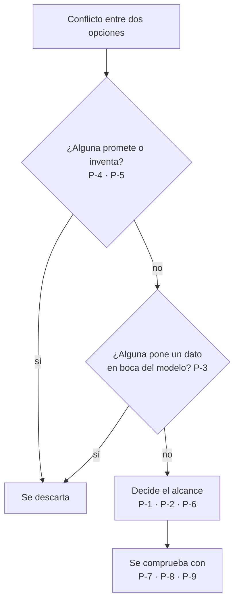

Figura 2.2. Precedencia entre principios.

<a id="c2-preguntas"></a>
### 2.6 Preguntas guía

**¿Con qué criterio creo el diseño, si nunca diseñé una conversación?**
Con estos nueve principios aplicados en orden: primero qué abarca el asistente (P-1, P-2, P-6), después de dónde sale cada respuesta (P-3, P-4, P-5) y, al final, cómo se prueba (P-7, P-8, P-9). Aplica siempre, en cualquier producto; lo que cambia por producto son los entregables que se llenan con ellos, empezando por el inventario de tareas ([§9](#c9)) y el mapa de anillos ([§3](#c3-preguntas)). Si después de leer esto no sabés por dónde empezar, el flujo está en [§7](#c7).

**¿Por qué no alcanza con darle al modelo el manual y dejarlo responder?**
Porque eso resuelve sólo la mitad «explicar» y deja sin control la mitad «dato exacto». El manual sirve como corpus de ayuda con cita [REF-010], pero las cifras, los registros y los permisos cambian a cada minuto y no están en ningún manual: por P-3 se obtienen con herramientas. Aplica en cuanto el asistente tenga que responder algo sobre los datos del usuario; si sólo explica conceptos, el corpus puede alcanzar.

**Un usuario pide una función que no existe pero que tiene sentido. ¿La frontera no se mueve midiendo?**
Se mueve para quienes construyen el producto, no para el asistente. P-9 dice que la demanda medida informa qué construir; P-4 dice que hasta que esté construida no se ofrece. La respuesta correcta es explicar lo que hoy se puede y registrar la intención como fuera de alcance para que el responsable del producto la evalúe ([§16](#c16)). Aplica a toda pregunta del anillo «afuera» que sea en realidad un pedido de función.

**¿Cuántas veces tengo que probar una pregunta para decir que anda?**
Al menos tres corridas por pregunta sobre una batería fija, y el resultado se informa como k de M (P-7), primero en preproducción y después en el sitio real (P-8). Una sola corrida exitosa es una conducta, útil para descubrir problemas pero no para aprobar. Los umbrales concretos de aceptación se fijan en [§13](#c13).

**Si no guardo el texto, ¿cómo sé qué se preguntó mal?**
Por la intención detectada, la respuesta tipo («No está en la ayuda», fuera de alcance, respondida) y el motivo cerrado del voto, todo por rol (P-9). Eso dice *dónde* falla sin exponer *qué* escribió nadie; para reproducir un caso se escribe una pregunta equivalente y se suma a la batería. Aplica en producción; durante el diseño, con usuarios de prueba que consienten, sí se trabaja con texto ([§14](#c14)).

<a id="c2-calidad"></a>
### 2.7 Criterios de calidad y antipatrones

Criterios de calidad:

- Cada decisión de diseño en los entregables cita al menos un principio por Id.
- Toda cifra o destino de enlace que muestra el asistente se puede rastrear a una herramienta (P-3).
- La batería tiene preguntas cuya respuesta correcta es «No está en la ayuda» y preguntas de funciones inexistentes (P-4, P-5).
- Todo resultado de prueba se informa como k de M y dice dónde se corrió (P-7, P-8).
- El registro de producción no contiene texto libre del usuario (P-9).

Antipatrones:

- **El temario:** definir el asistente como «sabe de envíos, de estadísticas y de cuentas» (contradice P-1).
- **El asistente para todo:** pasar por conversación tareas que una pantalla resuelve mejor (P-2).
- **La cifra redactada:** dejar que el modelo calcule o recuerde un número (P-3).
- **El «sí, podés»:** describir pasos de una función inexistente porque suena razonable (P-4).
- **El relleno:** completar con conocimiento general lo que el corpus no cubre (P-5).
- **La jerga del equipo:** sinónimos sólo técnicos y ninguna pregunta sugerida (P-6).
- **La captura única:** aprobar con una captura de una corrida buena en la demo (P-7, P-8).
- **El registro de chats:** guardar conversaciones enteras «por si acaso» (P-9).

<a id="parte-ii"></a>
# Parte II · Marco

<a id="c3"></a>
## Capítulo 3 · Anillos de competencia

Este capítulo da la herramienta central del marco: el **mapa de anillos**, que dice qué tiene que poder hacer el asistente, qué tiene que saber explicar, hasta dónde orienta y dónde dice amablemente que no. Es la respuesta operativa a «¿con qué criterio creo el diseño?»: el criterio no es una lista de temas, es una escala de competencia ([P-1](#p-1)). La plantilla que lo materializa es la A.2 y la etapa que la llena es E2 ([c10](#c10)).

<a id="c3-1"></a>
### 3.1 Definición: anillo, frontera y mapa

- **Anillo.** Franja de competencia del asistente, definida por *lo que el usuario logra* con la respuesta, no por el tema de la pregunta. Una misma palabra («suscripción») puede caer en el anillo 1 («¿cuántas suscripciones activas tiene mi aplicación?») o en el 2 («¿qué es una suscripción?»).
- **Frontera.** El borde entre lo que el asistente responde y lo que deriva o rechaza. Se fija por anillo y se mueve sólo midiendo ([P-9](#p-9), [c16](#c16)).
- **Mapa de anillos.** La tabla que asigna cada intención de la batería a un anillo único, con su riesgo, el rol que puede pedirla y la salida esperada (Anexo A.2). Funciona como un **contrato** entre quienes definen, diseñan, construyen y prueban el asistente: lo que no está en el mapa no se construye ni se acepta.

Los cuatro anillos, de adentro hacia afuera:

| Anillo | Qué logra el usuario | Qué hace el asistente | Fuente de la respuesta | Falla típica si se diseña mal |
|---|---|---|---|---|
| **1 · Operar el producto** | Hacer una tarea o conocer un dato suyo | Da pasos, cifras reales del usuario y un enlace profundo a la pantalla de la acción | Código y herramientas ([c6](#c6)), destinos del catálogo ([c5](#c5)) | Cifras inventadas; enlace a una pantalla que el rol no puede abrir |
| **2 · Entender el dominio** | Comprender el concepto sin el cual no puede operar | Define el término, lo ata a la pantalla donde aparece, sugiere la próxima pregunta | Corpus de ayuda con cita | Usar jerga para explicar jerga |
| **3 · Lo de al lado** | Saber a dónde ir con algo vecino al producto | Orienta y deriva, sin inventar el procedimiento ajeno | Lista cerrada de derivaciones | Responder con conocimiento general como si fuera del producto |
| **Afuera** | Saber que esto no se responde acá | Rechazo amable con dos o tres ejemplos de lo que sí | Texto fijo | Silencio, o una respuesta «útil» inventada |

*Tabla 3.1. Los cuatro anillos de competencia. Criterio de la guía.*

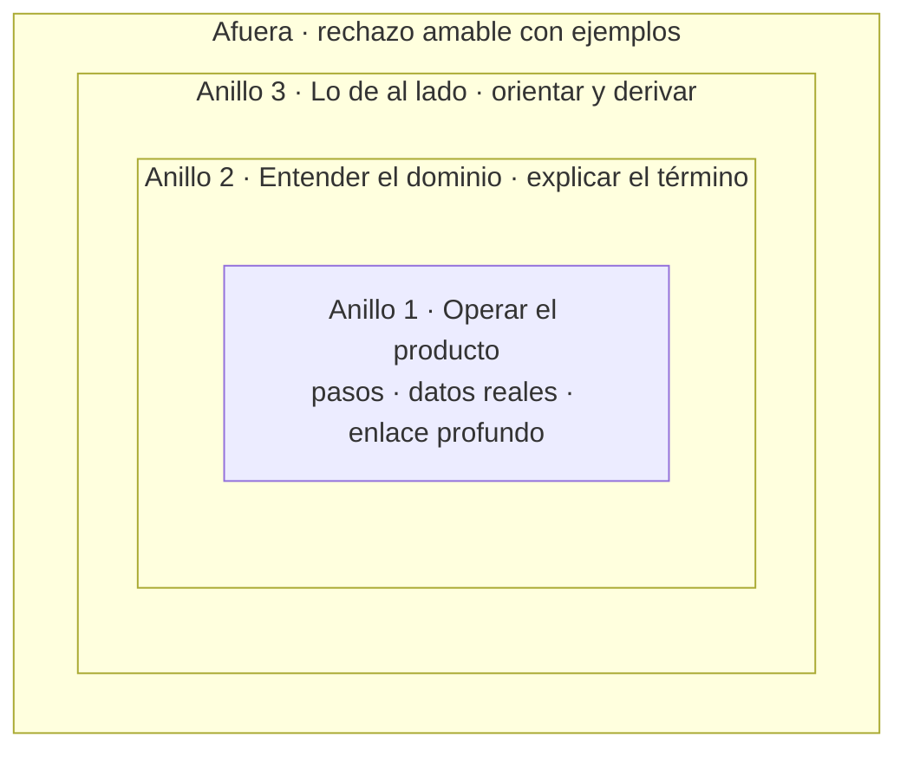

*Figura 3.1. Anillos concéntricos: cuanto más adentro, más compromiso con datos y acciones del usuario.*

La razón de que sean concéntricos y no una lista es que cada anillo exige lo del anterior: no se puede operar (1) sin entender el concepto (2), y la derivación (3) sólo es honesta si el asistente sabe dónde termina el producto. El inexperto vive en el anillo 2: su frontera la marca su vocabulario, no el producto ([P-6](#p-6), [c4](#c4)). Ofrecer preguntas sugeridas es una manera de mostrarle qué cae adentro sin obligarlo a adivinar [REF-008].

Dos reglas valen en todos los anillos y no se negocian: no se promete lo que el software no hace ([P-4](#p-4)) y, ante la duda, «No está en la ayuda» antes que inventar ([P-5](#p-5)) [REF-009].

<a id="c3-2"></a>
### 3.2 Superposición con riesgo y rol

El anillo dice *qué tipo* de respuesta corresponde; no alcanza para decidir *si* se puede dar. Cada intención del anillo 1 se cruza con dos ejes más:

- **Riesgo de la acción**, en tres niveles: **leer** (consultar un dato), **actuar** (cambiar algo reversible), **irreversible** (enviar, borrar, revocar).
- **Rol** de quien pregunta: el asistente nunca ve ni ofrece más de lo que el rol ve en el panel.

| Riesgo | Qué puede hacer el asistente | Qué nunca hace | Ejemplo neutro |
|---|---|---|---|
| Leer | Dar la cifra filtrada por permiso y el enlace a la vista | Mostrar datos de una cuenta que el rol no ve | «¿Cuántos pedidos tuve ayer?» |
| Actuar | Explicar los pasos y llevar a la pantalla con el enlace | Ejecutar el cambio por su cuenta | «Quiero cambiar el horario de atención» |
| Irreversible | Explicar consecuencias y llevar a la pantalla; la confirmación ocurre en la interfaz | Ejecutar, o sugerir que «ya está hecho» | «Borrá esta lista de clientes» |

*Tabla 3.2. Superposición del anillo 1 con el riesgo. Criterio de la guía.*

La regla que se deriva: **el asistente lleva a la acción, la interfaz la ejecuta**. Así la confirmación, la validación y el permiso siguen donde ya estaban probados, y el diseño conversacional no abre un segundo camino de escritura. El rol se aplica dos veces: al elegir el destino y al revalidarlo justo antes de mostrarlo ([c5](#c5)). En la experiencia propia con el asistente de un panel de notificaciones, elegir el enlace por código y revalidarlo por permiso evitó ofrecer pantallas que el rol no podía abrir (experiencia propia medida, conducta observada en rondas de crítica; la tasa se mide con la batería, [c13](#c13)).

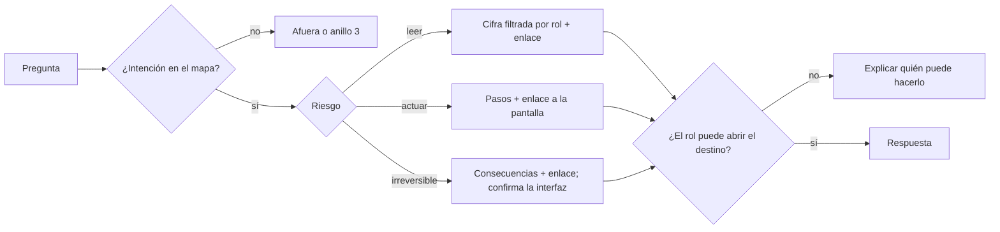

*Figura 3.2. De la intención a la respuesta: anillo, riesgo y rol en ese orden.*

<a id="c3-3"></a>
### 3.3 Alternativa: frontera por intenciones con tema de respaldo

La práctica más difundida en plataformas de bots define la frontera como **un conjunto de intenciones o temas** explícitos, más un **tema de respaldo** (*fallback*) que se dispara cuando nada coincide. Microsoft documenta ese respaldo como un tema de sistema configurable: *«The Fallback system topic is triggered when the agent can't understand the user's message»* (se dispara cuando el agente no entiende el mensaje del usuario) [REF-012]. Su guía de experiencia conversacional pide además que el bot deje claro qué puede hacer y cómo salir de un callejón sin salida [REF-004], y la guía de Copilot Studio trata el diseño de temas y la medición como trabajo continuo [REF-005].

| Aspecto | Frontera por intenciones + respaldo | Frontera por anillos de competencia |
|---|---|---|
| Unidad de diseño | La intención o tema | La competencia que la respuesta entrega |
| Qué pasa con lo no previsto | Cae en el respaldo, uniforme | Se distingue: ¿es dominio (explicar), vecino (derivar) o afuera (rechazar)? |
| Fortaleza | Simple, medible por tema, soportada por las herramientas | Trata distinto al inexperto que pregunta un concepto y al que pregunta algo ajeno |
| Debilidad | El respaldo mezcla «no entendí» con «no es de acá» | Exige asignar anillo a cada pregunta; más trabajo inicial |
| Cuándo conviene | Pocas tareas, usuarios expertos, vocabulario estable | Producto con dominio propio y usuarios nuevos |

*Tabla 3.3. Las dos maneras de trazar la frontera. Hechos de la columna izquierda: [REF-012], [REF-004]; comparación: criterio de la guía.*

No son excluyentes. En la implementación, los anillos se expresan **como** intenciones: cada fila del mapa es una intención con su anillo, y el respaldo existe igual, pero se divide en tres salidas (explicar, derivar, rechazar) en lugar de una. Lo que el marco agrega es el criterio para decidir a cuál va cada caso.

<a id="c3-4"></a>
### 3.4 Condición de falsación

Un marco que nunca puede fallar no sirve para decidir. El mapa de anillos se declara **no apto como contrato** cuando, al asignar la batería de preguntas (E5, [c13](#c13)):

> **más del 20 % de las preguntas no se pueden asignar a un anillo único** sin discusión.

Criterio de la guía (umbral elegido, no derivado de una fuente). Si se supera, no se fuerza: se revisa primero el glosario ([c11](#c11)), porque la ambigüedad suele ser de vocabulario; si persiste, se pasa a la frontera por intenciones con respaldo (§3.3) para esa parte del producto. Una pregunta que cae en dos anillos con la misma intención es síntoma de que el anillo 1 no tiene destino para ella o de que el 2 no tiene el término definido.

<a id="c3-escenarios"></a>
### 3.5 Aplicación por escenario

| Celda que cambia | Sistema existente | Por desarrollar |
|---|---|---|
| De dónde salen las intenciones del anillo 1 | Del inventario de pantallas y del uso real ([c9](#c9)) | De las historias de usuario; se marcan como hipótesis |
| Anillo 2 | Del soporte: qué conceptos se preguntan una y otra vez | Del glosario del dominio que escribe el producto |
| Riesgo y rol | Se copian de los permisos que ya aplica el panel | Se definen junto con los permisos; el asistente no puede adelantarse |
| Falsación | Se mide con preguntas reales | Se mide con batería escrita; repetir al tener usuarios |

*Tabla 3.4. Sólo las celdas que cambian entre escenarios.*

<a id="c3-ejemplos"></a>
### 3.6 Ejemplos

Un panel de reservas de un consultorio, como primer ejemplo neutro:

| Pregunta | Anillo | Riesgo | Salida |
|---|---|---|---|
| «¿Cuántos turnos cancelados tuve esta semana?» | 1 | Leer | Cifra real, desglose ofrecido, enlace a la vista filtrada |
| «Quiero bloquear el viernes» | 1 | Actuar | Pasos y enlace a la agenda |
| «¿Qué es un sobreturno?» | 2 | — | Definición, dónde aparece, pregunta sugerida |
| «¿Cómo facturo a la obra social?» | 3 | — | «Eso se gestiona en el sistema de facturación; acá podés ver los turnos atendidos» |
| «Recomendame un antibiótico» | Afuera | — | Rechazo amable y dos ejemplos de lo que sí responde |

*Tabla 3.5. Ejemplo neutro de mapa de anillos.*

El mismo mapa, en los tres casos ilustrativos de la guía:

| Caso | Anillo 1 | Anillo 2 | Anillo 3 / afuera |
|---|---|---|---|
| Movilidad Urbana | «¿Cuánto saldo me queda?» (leer) | «¿Qué es una zona tarifaria?» | «¿Cómo pago una multa?» → derivar al organismo que la gestiona |
| Geometría | «¿Cómo cargo un triángulo por sus vértices?» (actuar) | «¿Qué es la mediatriz?» | «Resolveme la tarea de física» → afuera |
| PushDispatch ([c18](#c18)) | «¿Cuántas suscripciones activas tiene mi aplicación?» (leer); «enviá el mensaje ahora» (irreversible: explica y lleva a la pantalla de envío, donde confirma la interfaz) | «¿Qué es un segmento?» | «¿Cómo publico mi app en la tienda?» → derivar a la documentación de la tienda |

*Tabla 3.6. Ejemplos ilustrativos; PushDispatch se presenta como producto diseñado desde cero.*

<a id="c3-decision"></a>
### 3.7 Decisión

1. Para cada pregunta de la batería, asigná el anillo por **lo que el usuario logra**, no por la palabra.
2. Si es anillo 1, fijá riesgo y rol; si es irreversible, la ejecución queda en la interfaz.
3. Si no podés asignar un único anillo, anotala; al final contá: más del 20 % ⇒ revisá glosario o pasá a intenciones con respaldo (§3.4).
4. Lo que quede afuera lleva un texto fijo con ejemplos de lo que sí.

<a id="c3-preguntas"></a>
### 3.8 Preguntas guía

**¿Por qué no alcanza con una lista de temas permitidos? (OA-EQ-2)**
Porque el tema no dice qué respuesta corresponde. «Suscripciones» como tema habilita tanto dar una cifra del usuario como definir el concepto, y son dos respuestas con fuentes y riesgos distintos: la primera sale del código, la segunda del corpus. El anillo separa esos casos desde el diseño. Aplica siempre que el producto tenga un dominio propio que los usuarios nuevos no conocen; si el producto es trivial y los usuarios expertos, la lista de intenciones con respaldo puede bastar (§3.3).

**¿Dónde pongo una pregunta que mezcla operar y entender, como «¿por qué bajaron mis entregas?»? (OA-DIS-2)**
En el anillo 1 si hay un dato que la responda (cifras por período y causa registrada) y el concepto se explica de paso la primera vez ([c4](#c4)). Si el sistema no registra la causa, no se inventa una explicación: se da la cifra, se dice qué no se sabe y se ofrece el enlace ([P-4](#p-4)). Si muchas preguntas se comportan así, es señal de que el anillo 1 necesita una herramienta nueva, no de que el mapa falla.

**¿Qué hago con una acción irreversible que el usuario pide explícitamente? (OA-DEV-1)**
Llevarlo a la pantalla donde se ejecuta con la confirmación de la interfaz, explicando la consecuencia. El asistente no ejecuta: así la validación y el permiso siguen en un solo lugar. Aplica aunque el rol tenga permiso; el permiso decide si el enlace se muestra, no quién confirma ([c5](#c5)).

**¿Cuándo dejo de usar anillos y paso a intenciones con respaldo? (OA-PO-1)**
Cuando la condición de falsación se cumple después de haber revisado el glosario: más del 20 % de la batería sin anillo único. También cuando el producto es pequeño y el costo de mantener el mapa supera lo que aporta distinguir dominio, vecino y afuera. La decisión la toma quien es responsable del producto y queda registrada en el plan de medición ([c15](#c15)).

**¿Cómo pruebo que el mapa se respeta? (OA-QA-1)**
Con la batería: cada pregunta trae su anillo esperado y su salida esperada, y se mide por separado si el asistente eligió bien (anillo y destino) y si redactó fiel. Una sola pasada muestra conducta; la aceptación pide tasa sobre corridas repetidas ([P-7](#p-7), [c13](#c13)). Las preguntas de afuera y del anillo 3 son parte de la batería, no un extra.

<a id="c3-calidad"></a>
### 3.9 Criterios de calidad y antipatrones

Criterios:
- Cada intención de la batería tiene un único anillo, riesgo (si es anillo 1) y rol.
- Las respuestas del anillo 1 traen cifras del código y un destino del catálogo; nunca cifras redactadas por el modelo ([P-3](#p-3)).
- El rechazo de afuera incluye ejemplos concretos de lo que sí se responde.
- La tasa de preguntas sin anillo único está medida y por debajo del 20 %.

Antipatrones:
- **El respaldo único**: todo lo no previsto recibe el mismo «no entendí», mezclando al inexperto con el que pregunta algo ajeno.
- **El anillo 3 generoso**: responder lo vecino con conocimiento general como si fuera del producto.
- **El asistente ejecutor**: acciones irreversibles disparadas desde la conversación.
- **El mapa por pantallas**: copiar el menú en lugar de partir de lo que el usuario necesita lograr ([P-2](#p-2)).

<a id="c4"></a>
## Capítulo 4 · El vocabulario del inexperto

> **Qué vas a poder hacer al terminar.** Entender por qué el vocabulario marca la frontera del usuario inexperto y saber armar el glosario de un asistente de producto con sus sinónimos, decidir cuándo explicar un término y cuándo no, y escribir preguntas sugeridas que le muestren al usuario qué puede preguntar (OA-DIS-2, OA-EQ-3, OA-DEV-2, OA-QA-3).

El capítulo 3 ([c3](#c3)) dibujó los anillos de competencia. Este capítulo se mete en el anillo 2, *entender el dominio*, que es donde vive el usuario que recién llega. Lo que sigue aplica el principio P-6 ([p-6](#p-6)). La etapa que produce el entregable es E3 ([c11](#c11)), con la plantilla A.3 ([anexo-a3](#anexo-a-3)).

<a id="c4-1"></a>
### 4.1 Definiciones

<a id="c4-1-1"></a>
**Vocabulario del usuario.** Las palabras con las que el usuario nombra lo que quiere hacer. No coinciden con las del producto. Alguien que recién llega a un servicio de notificaciones push dice «los usuarios que tengo» y el panel dice «suscripciones»; un pasajero dice «el bondi» y el sistema de movilidad dice «línea»; un alumno dice «el dibujito» y la herramienta de geometría dice «figura». El asistente tiene que entender la primera forma y contestar con la segunda.

<a id="c4-1-2"></a>
**Frontera por vocabulario.** Para el usuario inexperto, el límite de lo que puede pedir no lo fija el producto: lo fija lo que sabe nombrar. Si no conoce la palabra «segmento», nunca va a preguntar cómo crear uno, aunque sea justo lo que necesita. Por eso el anillo 2 se diseña desde el vocabulario y no desde el menú (criterio de la guía, derivado de P-6).

<a id="c4-1-3"></a>
**Glosario.** La lista cerrada de términos del dominio que el asistente usa. Cada entrada tiene un único sentido (la misma regla que el Anexo C, [anexo-c](#anexo-c)), una definición de una o dos oraciones en lenguaje llano, y la pantalla donde el término aparece. El glosario no es un apéndice para el usuario: funciona como un acuerdo de diseño, porque el corpus, las herramientas, los destinos y la batería dependen de él.

<a id="c4-1-4"></a>
**Sinónimo.** Una forma del usuario que apunta a una entrada del glosario. Hay tres clases, y conviene anotarlas por separado porque se tratan distinto:

- **Equivalente:** significa lo mismo («mandar un aviso» por «enviar un mensaje»). Se resuelve en silencio.
- **Cercano:** se parece pero no es igual («dispositivo» por «suscripción», cuando una persona puede tener varias). Se resuelve explicando la diferencia.
- **Falso amigo:** una palabra que en el producto significa otra cosa («usuario» como persona que manda notificaciones, frente a «usuario» como persona que las recibe). Exige aclarar antes de contestar.

<a id="c4-1-5"></a>
**Explicar el término la primera vez.** La regla de redacción por la que, la primera vez que la respuesta usa un término del glosario en una conversación, lo acompaña con su definición breve; las siguientes veces lo usa solo. Es la versión conversacional de la heurística de hablar el idioma del usuario: *«The design should speak the users' language»* («el diseño debe hablar el idioma de los usuarios») [REF-006].

<a id="c4-1-6"></a>
**Pregunta sugerida.** Una pregunta lista para tocar que la consola le ofrece al usuario. Resuelve el problema de la página en blanco: quien no sabe qué puede preguntar no pregunta. Nielsen Norman Group describe estas sugerencias como un apoyo para que el usuario descubra qué puede hacer el sistema y para arrancar la conversación [REF-008]. En esta guía cumplen además una función de diseño: enseñan el vocabulario del producto sin pedirle al usuario que lo sepa.

<a id="c4-2"></a>
### 4.2 Cómo encajan las cuatro piezas

Las cuatro piezas forman una cadena: el usuario habla con sus palabras, el sinónimo las lleva al término, el término se explica la primera vez, y la pregunta sugerida le enseña la palabra siguiente.

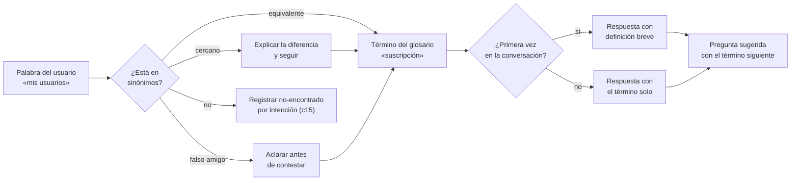

*Figura 4.1. Recorrido de una palabra del usuario hasta la respuesta. La rama «no» alimenta la medición del capítulo 15.*

Dos detalles de la figura importan. Primero, el «no» no se resuelve adivinando: se registra como no-encontrado, sin guardar el texto, y alimenta la medición que mueve la frontera (P-9, [p-9](#p-9); [c15](#c15)). Segundo, la resolución del sinónimo la puede hacer el código, con una tabla, antes de que el modelo redacte. Eso es P-3 ([p-3](#p-3)) aplicado al vocabulario: un sinónimo mal resuelto lleva a la herramienta equivocada, y la herramienta la elige el código ([c6](#c6)).

<a id="c4-3"></a>
### 4.3 Dónde se consigue el vocabulario

El vocabulario no se inventa en una reunión. Se junta de fuentes donde el usuario ya escribió o habló:

| Fuente | Qué aporta | Riesgo |
|---|---|---|
| Recorrido del producto por alguien nuevo, anotando cada palabra que no entiende | Los términos del anillo 2 | Que lo haga alguien del equipo, que ya sabe |
| Consultas de soporte y búsquedas internas | Los sinónimos reales y su frecuencia | Datos personales en el texto: se extraen palabras, no se copian consultas |
| Historias de usuario y entrevistas | El vocabulario de un producto que todavía no existe | Que el equipo escriba las historias con su propia jerga |
| Mediciones del asistente en producción | Los sinónimos que faltaron | Llegan tarde: sirven para la segunda vuelta |

*Tabla 4.1. Fuentes de vocabulario (criterio de la guía).*

<a id="c4-escenarios"></a>
### 4.4 Aplicación por escenario

Sólo se listan las celdas que cambian entre un sistema que ya existe y uno que está por desarrollar.

| Aspecto | Sistema existente | Sistema por desarrollar |
|---|---|---|
| Origen de los términos | Las etiquetas de las pantallas tal como están | Las historias de usuario y el modelo de dominio |
| Origen de los sinónimos | Soporte, búsquedas y el recorrido de alguien nuevo | Entrevistas y pruebas con prototipos |
| Conflictos | Pantallas que nombran lo mismo de dos maneras: se elige un término y se anota el otro como sinónimo, y se avisa al equipo de producto | Se evitan antes: el glosario entra en la definición de terminado de cada pantalla nueva |
| Preguntas sugeridas | Salen de las tareas más frecuentes medidas | Salen del inventario de tareas (A.1) y se corrigen con la primera medición |

*Tabla 4.2. Vocabulario por escenario.*

En el sistema existente, el glosario documenta un idioma que ya está en uso, con sus defectos. En el que está por desarrollar, el glosario puede corregir el idioma antes de que llegue a la pantalla. En los dos casos el glosario manda sobre el prompt: el prompt usa los términos del glosario, nunca al revés.

<a id="c4-ejemplos"></a>
### 4.5 Ejemplos

Los ejemplos son ilustrativos y salen de los tres casos de la guía: PushDispatch (un servicio de notificaciones push, presentado como producto diseñado desde cero), Movilidad Urbana y Geometría. Sirven para ver el mecanismo; el método vale para cualquier sistema.

<a id="c4-ejemplo-1"></a>
**Ejemplo 4.1. Una entrada de glosario con sus sinónimos.**

| Término | Definición breve (primera vez) | Sinónimos equivalentes | Sinónimos cercanos | Falsos amigos | Pantalla |
|---|---|---|---|---|---|
| Suscripción | Un dispositivo o navegador que aceptó recibir notificaciones de una aplicación. | suscriptor, alta | dispositivo, usuario registrado, contacto | usuario (quien administra el panel) | Suscripciones |

| Línea (Movilidad Urbana) | Un recorrido con número fijo que hacen los colectivos de una empresa. | colectivo, bondi | ramal, recorrido | parada (lugar, no recorrido) | Líneas |
| Figura (Geometría) | Un objeto geométrico construido con puntos y sus relaciones. | dibujo, forma | polígono, construcción | punto (es parte de la figura, no la figura) | Lienzo |

*Tabla 4.3. Entradas de ejemplo de los tres casos. La plantilla vacía está en A.3.*

<a id="c4-ejemplo-2"></a>
**Ejemplo 4.2. Explicar la primera vez y no repetir.** El usuario pregunta «¿cuántos usuarios tengo?». La primera respuesta dice: «Tenés 1.240 suscripciones activas. Una *suscripción* es un dispositivo o navegador que aceptó recibir tus notificaciones; una misma persona puede tener varias». Si después pregunta «¿y cuántas se dieron de baja este mes?», la respuesta ya no repite la definición. La cifra la trae una herramienta, no el modelo ([c6](#c6)); el ejemplo sólo muestra la redacción.

<a id="c4-ejemplo-3"></a>
**Ejemplo 4.3. Falso amigo.** El usuario pregunta «¿cómo agrego un usuario?». En el producto eso puede ser invitar a alguien al panel o sumar una suscripción. El asistente no elige: «¿Querés invitar a una persona a administrar el panel con vos, o querés que más dispositivos reciban tus notificaciones?». Cada opción lleva a su destino del catálogo ([c5](#c5)). El mismo patrón aparece en Movilidad Urbana con «¿cuándo pasa el 60?»: si la línea tiene dos ramales, se pregunta cuál antes de dar un horario.

<a id="c4-ejemplo-4"></a>
**Ejemplo 4.4. Preguntas sugeridas que enseñan vocabulario.** Al abrir la consola por primera vez, en lugar de una caja vacía:

- «¿Cuántas suscripciones activas tengo?»
- «¿Qué es un segmento y para qué me sirve?»
- «¿Cómo envío mi primer mensaje?»

Cada una usa un término del glosario. El usuario que toca la segunda aprende que existe la palabra «segmento» y, con ella, toda una tarea que antes no sabía pedir. Después de una respuesta, las sugerencias cambian y apuntan a la tarea siguiente («¿Querés ver el desglose por aplicación?»). En Geometría, la sugerencia «¿Qué es una mediatriz?» cumple la misma función con un alumno.

<a id="c4-ejemplo-5"></a>
**Ejemplo 4.5. Tabla de sinónimos resuelta por código.** Un recorte representativo de cómo el código normaliza la palabra antes de elegir la herramienta:

```csharp
// Asistente/Vocabulario/Sinonimos.cs
public enum Clase { Equivalente, Cercano, FalsoAmigo }

public sealed record Sinonimo(string Forma, string Termino, Clase Clase);

public static class Sinonimos
{
    static readonly Sinonimo[] Tabla =
    [
        new("suscriptor", "suscripcion", Clase.Equivalente),
        new("dispositivo", "suscripcion", Clase.Cercano),
        new("usuario", "suscripcion|miembro", Clase.FalsoAmigo),
        // …
    ];

    public static Sinonimo? Resolver(string palabraNormalizada) =>
        Tabla.FirstOrDefault(s => s.Forma == palabraNormalizada);
}
```

El falso amigo trae dos términos: el código no elige entre ellos y le pide al modelo una pregunta de aclaración con las dos opciones. La tabla vive en el repositorio, versionada, y la batería la prueba ([c13](#c13)). La guía de capa de IA trata cómo esta pieza se conecta con las herramientas ([§9 de esa guía](./Dot-Net-Integration-AI-Layer-Guide.md#c9)).

<a id="c4-decision"></a>
### 4.6 Decisión y alternativas

| Opción | Cuándo conviene | Costo |
|---|---|---|
| Glosario y sinónimos explícitos, resueltos por código | Producto con dominio propio y usuarios inexpertos; cuando el término decide la herramienta o el destino | Mantener la tabla; se paga con la batería |
| Dejar que el modelo entienda los sinónimos solo | Prototipo o asistente de sólo consulta sobre la ayuda, sin datos ni destinos | Errores silenciosos: el modelo resuelve «usuario» a su manera y no queda rastro |
| Frases de entrenamiento por intención | Plataformas de bots por intenciones, donde cada intención lleva ejemplos de cómo la dice el usuario [REF-004, REF-005] | Mismo trabajo de recolección, organizado por intención y no por término |

*Tabla 4.4. Formas de tratar el vocabulario.*

Las tres opciones comparten la tarea de fondo: juntar cómo habla el usuario. Cambia dónde se guarda. Esta guía recomienda la primera cuando hay datos o destinos en juego (criterio de la guía), porque un término mal resuelto termina en una cifra o un enlace equivocados.

Para las preguntas sugeridas la alternativa es no ponerlas y confiar en el mensaje de bienvenida. Sirve sólo para usuarios que ya conocen el producto; con el inexperto, la caja vacía es una barrera [REF-008].

<a id="c4-preguntas"></a>
### 4.7 Preguntas guía

**¿Por qué el glosario va antes que el prompt? (OA-EQ-3)** Porque el prompt, el corpus, las herramientas y la batería usan las mismas palabras, y si cada pieza nombra distinto, el asistente contesta bien a medias. El glosario fija el idioma una vez y las piezas lo heredan. Por eso la regla del capítulo 7 es que no se escribe ningún prompt antes de E3 ([c7](#c7)). Aplica a los dos escenarios; en el existente pesa más, porque las pantallas ya tienen inconsistencias.

**¿Cómo sé si una palabra es un término del anillo 2 o sólo una etiqueta de pantalla? (OA-DIS-2)** Preguntá si el usuario puede operar sin entenderla. «Segmento» sí es anillo 2: sin el concepto no puede elegir a quién enviar. «Guardar» no: es una acción del anillo 1 que se entiende sola. Aplica cuando armás A.3; si dudás, mirá si la palabra aparece en las consultas de soporte, y si aparece, va al glosario ([c3](#c3)).

**¿Cuándo explico un término y cuándo no? (OA-DIS-2)** La primera vez que aparece en la conversación, siempre que sea del anillo 2; después, no. Repetir la definición cansa al que ya entendió; omitirla deja afuera al que recién llega. La excepción es el sinónimo cercano: si el usuario dijo «dispositivo», explicás la diferencia aunque no sea la primera vez que aparece «suscripción», porque su palabra muestra que la distinción todavía no está clara.

**¿Qué hago con un falso amigo? (OA-DEV-2)** Preguntar antes de contestar, con las opciones redactadas en el vocabulario del usuario y cada una atada a su destino. No se adivina por contexto cuando la respuesta lleva a datos o a una acción, porque un error ahí es una cifra de otra cosa o un enlace a otra pantalla. Es el mismo mecanismo de aclaración que se usa entre cuentas en el capítulo 5 ([c5](#c5)).

**¿Cómo pruebo que el vocabulario funciona? (OA-QA-3)** Con la batería: por cada entrada del glosario, al menos una pregunta con el término, una con un sinónimo equivalente y, si los tiene, una con un cercano y una con un falso amigo. Se corre ×3 y se reporta tasa, no conducta (P-7, [p-7](#p-7); [c13](#c13)). En producción, el no-encontrado por intención te dice qué sinónimos faltan ([c15](#c15)).

<a id="c4-calidad"></a>
### 4.8 Criterios de calidad y antipatrones

**Criterios de calidad.**

- Cada concepto del anillo 2 tiene entrada en A.3, con un único sentido y su pantalla.
- Cada entrada tiene al menos un sinónimo tomado de una fuente real de la Tabla 4.1, no imaginado por el equipo.
- Los falsos amigos están marcados y resueltos con aclaración, no por adivinanza.
- Las respuestas explican el término la primera vez y no lo repiten después.
- Las preguntas sugeridas iniciales cubren las tareas más frecuentes y usan términos del glosario.
- La batería tiene preguntas con sinónimos, no sólo con los términos oficiales.

**Antipatrones.**

- **El glosario de los diseñadores.** Escribir el glosario con las palabras que usan quienes construyen el producto y llamar sinónimo a lo que dice el código. El usuario no habla así.
- **Explicar todo, siempre.** Cada respuesta abre con tres definiciones; el usuario que ya sabe deja de leer.
- **La caja vacía.** La consola abre sin sugerencias y espera que el inexperto sepa qué preguntar.
- **Sugerencias que prometen.** Una pregunta sugerida sobre algo que el producto no hace. Viola P-4 ([p-4](#p-4)): la sugerencia es una promesa del producto, no una invitación a probar.
- **Sinónimo en el prompt.** Resolver el vocabulario sólo con instrucciones al modelo cuando el término decide una herramienta o un destino. No queda rastro de por qué eligió lo que eligió.

<a id="c5"></a>
## Capítulo 5 · Destinos y enlace profundo

Una respuesta del asistente que explica bien pero deja al usuario buscando la pantalla resolvió la mitad del problema. En el anillo 1 ([c3](#c3)) la conversación termina, casi siempre, en una acción que se hace en el producto. Este capítulo presenta cómo se diseña ese puente en cualquier sistema: **qué destinos existen, quién los elige, cómo se revalidan y qué pasa cuando la pregunta no alcanza para saber a qué cuenta o aplicación se refiere el usuario**. Aplica los principios [P-3](#p-3) (el código elige, el modelo redacta) y [P-4](#p-4) (no prometer lo que el software no hace).

<a id="c5-1"></a>
### 5.1 Definiciones

- **Destino.** Un par *pantalla + acción* del producto con identificador estable, permiso requerido y etiqueta para el usuario. Ejemplos: en un servicio de notificaciones push, «crear un mensaje» (pide permiso de enviar); en una encuesta de movilidad, «dar de alta una localidad»; en un laboratorio de geometría, «reeditar una entrega». Un destino no es una URL: la URL se arma a partir de él.
- **Catálogo de destinos.** La lista cerrada y versionada de todos los destinos a los que el asistente puede llevar. Lo que no está en el catálogo no existe para el asistente. Su forma se describe en la plantilla [A.4](#anexo-a-4) y su lugar en el método, en la etapa E4 ([c12](#c12)).
- **Enlace profundo (deeplink).** El enlace concreto a un destino, con sus parámetros resueltos (qué aplicación, qué localidad, qué entrega), que la interfaz muestra como un botón o *chip* debajo de la respuesta. En esta guía, un enlace profundo es siempre **un destino del catálogo resuelto por código y revalidado por permiso**.
- **Revalidación doble.** El permiso se controla dos veces: (1) al **resolver** el enlace, antes de mostrar el chip; (2) al **abrir** la pantalla destino, con la autorización normal del producto. La primera evita ofrecer lo que no se puede; la segunda es la barrera real.
- **Desambiguación entre cuentas.** Cuando una pregunta admite más de un objeto visible para el usuario (dos aplicaciones con nombre parecido, una palabra que nombra una ciudad y una provincia, dos comisiones de un mismo docente), el asistente **pregunta** mostrando las candidatas con un dato distintivo, en lugar de elegir. Las candidatas y sus cifras salen del código, ya filtradas por permiso.

Tabla 5.1. Quién hace qué en un enlace profundo (criterio de la guía).

| Pieza | La decide el código | La redacta el modelo |
|---|---|---|
| Si hay destino y cuál | sí (intención → Id del catálogo) | puede *proponer* un Id; el código lo valida |
| URL y parámetros | sí | nunca |
| Si el usuario puede abrirlo | sí, dos veces | nunca |
| Candidatas ante ambigüedad y su cifra | sí, filtradas por permiso | la pregunta de aclaración |
| Etiqueta del chip | sí (del catálogo) | — |
| Frase que introduce el chip | — | sí, anclada a lo que el código devolvió |

<a id="c5-2"></a>
### 5.2 Por qué un catálogo cerrado

Un modelo de lenguaje produce texto plausible, y una URL plausible no es una URL válida. Si se le deja armar rutas, el peor caso es un enlace a una pantalla que no existe, a otra aplicación o a una acción que el rol no permite; la literatura de diseño sobre IA generativa insiste en que las respuestas fabricadas suenan igual de seguras que las correctas [REF-009]. Con un catálogo cerrado, el peor caso se reduce a **«no hay chip»**, y eso es una degradación aceptable: la respuesta sigue explicando el camino en texto.

El catálogo también hace visible el alcance del anillo 1. Si una tarea del inventario ([c9](#c9), plantilla A.1) no tiene destino, o la pantalla no existe o falta diseñarla; en ambos casos el asistente no debe insinuar que puede llevar ahí ([P-4](#p-4)).

<a id="c5-3"></a>
### 5.3 El flujo de un enlace profundo

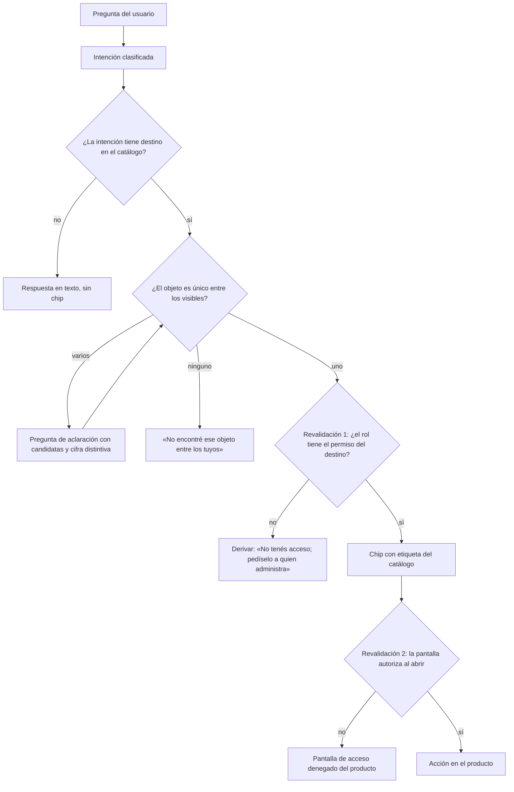

Figura 5.1. Del texto a la acción: el modelo no aparece en ninguna decisión del diagrama; sólo redacta los textos de las hojas.

La revalidación 2 no es redundante. Entre que el chip se dibujó y el usuario lo toca pueden pasar minutos, y en ese tiempo su rol puede cambiar o el objeto puede borrarse. El chip es una **comodidad**, no un **permiso**: quien protege la acción es la pantalla, igual que si el usuario hubiera llegado por el menú.

<a id="c5-4"></a>
### 5.4 Desambiguación entre cuentas

Las personas nombran las cosas por aproximación («la app de prueba», «Corrientes», «la comisión de la tarde»). Cuando hay más de una candidata, hay tres salidas malas y una buena:

- *Mala:* elegir la primera. La respuesta parece correcta y es de otro objeto.
- *Mala:* sumar todo sin decirlo. La cifra mezcla objetos distintos.
- *Mala:* preguntar sin datos («¿cuál?»). El usuario tampoco sabe distinguirlas por nombre.
- *Buena:* preguntar mostrando las candidatas con **un dato que las distinga** (actividad reciente, provincia, cantidad de entregas) y dejar elegir.

El dato distintivo es una cifra, así que sale de una herramienta ([c6](#c6)) y respeta el mismo filtro de permiso: **el código filtra las candidatas antes de que el modelo las vea**. Si el filtro se aplicara después, el modelo podría mencionar en su redacción una aplicación de una cuenta ajena. Esta regla es la que separa una aclaración útil de una filtración de datos (criterio de la guía).

La heurística de visibilidad del estado del sistema [REF-006] da la razón de diseño: el usuario tiene que ver *sobre qué objeto* se está respondiendo. Por eso, aun cuando la candidata es única, la respuesta nombra el objeto («En la aplicación *Tienda — producción*, …», «En la localidad de Corrientes, …») y el chip lleva a ese y no a otro.

<a id="c5-escenarios"></a>
### 5.5 Aplicación por escenario

Tabla 5.2. Sólo cambian las celdas de origen del catálogo y de riesgo.

| Aspecto | Sistema existente | Sistema por desarrollar |
|---|---|---|
| De dónde sale el catálogo | Del recorrido de rutas y permisos reales; se genera un borrador y se revisa a mano. | Nace con el mapa de navegación; cada pantalla nueva declara Id, permiso y etiqueta como parte de su definición de terminado. |
| Identificadores | Hay que inventarlos estables aunque las URL actuales sean feas; el Id no cambia si la URL cambia. | Se definen junto con las rutas. |
| Permisos | Se toman los del producto tal como están; si son inconsistentes, el catálogo lo expone (y es un hallazgo). | Se diseñan por rol desde el principio. |
| Riesgo típico | Pantallas que la demo muestra y el sitio real protege distinto; cuentas múltiples que en datos de prueba no existían. | Catálogo de lo planeado, no de lo construido: un destino entra sólo cuando la pantalla existe. |

<a id="c5-ejemplos"></a>
### 5.6 Ejemplos

**Ejemplo 5.1 — Destino único y permitido (servicio de notificaciones push).** En PushDispatch, una usuaria con rol de miembro pregunta «¿cómo mando un mensaje a todos los suscriptores de la tienda?». La intención es *crear mensaje*; el catálogo tiene ese destino; hay una sola aplicación visible con ese nombre; su rol permite enviar. Respuesta: dos o tres pasos en texto y el chip «Crear un mensaje», que abre la pantalla de esa aplicación.

**Ejemplo 5.2 — Destino sin permiso (laboratorio de geometría).** Un alumno pregunta «¿cómo veo las entregas de toda la comisión?». El destino existe, pero pide el permiso de docente. La revalidación 1 falla: no hay chip. El asistente explica y deriva: «Esa vista es del docente. Vos podés ver y reeditar tus propias entregas», y ofrece, si corresponde, el chip a *sus* entregas. No promete «te llevo» ni ofrece un enlace que terminaría en acceso denegado.

**Ejemplo 5.3 — Ambigüedad (encuesta de movilidad y notificaciones push).** En una encuesta de movilidad, «¿cuántas encuestas hay de Corrientes?» admite dos lecturas: la localidad o la provincia. En un servicio de notificaciones, un usuario que pertenece a dos cuentas pregunta «¿cuántos mensajes mandó la app de prueba este mes?». En los dos casos la herramienta devuelve candidatas, no un total:

```text
Encontré dos aplicaciones que coinciden con «prueba»:
  • Prueba — cuenta A          · 1 240 envíos en 30 días
  • Prueba interna — cuenta B  · 18 envíos en 30 días
¿De cuál querés el detalle?
```

Las cifras (ilustrativas) salen de la herramienta; el modelo sólo redacta la pregunta. Elegida una, sigue el flujo de la Figura 5.1.

**Ejemplo 5.4 — Snippet representativo del resolvedor.** Ver la arquitectura en la [guía 16](./Dot-Net-Integration-AI-Layer-Guide.md#c5); acá basta la forma.

```csharp
// Asistente/Destinos/ResolvedorDeDestinos.cs
public EnlaceProfundo? Resolver(string destinoId, Guid appId, ClaimsPrincipal usuario)
{
    if (!CatalogoDeDestinos.Todos.TryGetValue(destinoId, out var d)) return null; // fuera de catálogo
    if (!_autorizacion.Puede(usuario, d.Permiso, appId)) return null;             // revalidación 1
    return new(d.Etiqueta, d.Plantilla.Replace("{appId}", appId.ToString()));
}
// …la página destino lleva su propia [Authorize(Policy = …)]: revalidación 2
```

```csharp
// Asistente/Herramientas/HerramientaDeResumen.cs
var candidatas = await _objetos.BuscarPorNombreAproximado(_usuario.Id, nombre); // sólo los visibles
if (candidatas.Count != 1)
    return Resumen.Ambiguo(candidatas.Select(c => (c.Nombre, c.Contexto, c.CifraDistintiva)));
// …
```

**Experiencia propia medida (conducta, no tasa).** En el desarrollo del asistente de PushDispatch que acompaña esta guía ([c18](#c18)), cuando el enlace pasó a elegirlo el código dejaron de aparecer, en las corridas de la batería, chips hacia pantallas que el rol no podía abrir; y la necesidad de aclarar entre cuentas apareció recién en el sitio real, con un usuario de dos cuentas, situación que los datos de demostración no tenían. Son observaciones de conducta; una tasa se acepta sólo con la batería ×3 ([c13](#c13), [P-7](#p-7), [P-8](#p-8)).

<a id="c5-decision"></a>
### 5.7 Decisión

Tabla 5.3. Qué hacer según lo que se sabe al responder.

| Situación | Salida |
|---|---|
| Intención sin destino en el catálogo | Texto sin chip; si la tarea debería existir, anotarla en el inventario. |
| Objeto único, permiso sí | Texto breve + chip del catálogo. |
| Objeto único, permiso no | Derivar a quien puede habilitarlo; sin chip. |
| Varios objetos visibles | Aclaración con candidatas y cifra distintiva; nunca elegir ni sumar en silencio. |
| Ningún objeto visible | Decir que no se encontró *entre los suyos*; no confirmar ni negar que exista en otra cuenta. |
| Acción irreversible (borrar, revocar credenciales) | Chip a la pantalla, nunca ejecución desde la consola; la confirmación la pide el producto ([c3](#c3), superposición de riesgo). |

**Alternativa considerada.** Dejar que el modelo genere la URL y validarla después con una lista blanca. Funciona para rutas, pero no resuelve parámetros (qué aplicación) ni la ambigüedad, y desplaza al modelo una decisión que el código ya sabe tomar. Se descarta salvo para prototipos sin datos reales (criterio de la guía).

<a id="c5-preguntas"></a>
### 5.8 Preguntas guía

**1. ¿Por qué no dejar que el modelo arme el enlace si casi siempre acierta?**
Porque «casi siempre» es una tasa y lo que se rompe en el caso restante es un permiso o un dato ajeno. Con catálogo cerrado, el error posible es la ausencia de chip, que no daña a nadie. Aplica siempre que la respuesta lleve a una pantalla con datos o acciones; para un enlace a una página pública de ayuda alcanza con la cita de RAG ([c6](#c6)).

**2. Si la interfaz ya oculta el chip a quien no tiene permiso, ¿para qué revalidar al abrir?**
Porque la interfaz decide en un momento y la acción ocurre en otro: el rol puede cambiar en el medio y un enlace se puede copiar y pegar. La revalidación 1 es diseño (no ofrecer lo imposible); la 2 es seguridad. Si sólo hubiera presupuesto para una, es la 2, pero el diseño correcto lleva las dos.

**3. ¿Qué cifra muestro para distinguir candidatas?**
La que el usuario reconoce sin pensar y que ya puede ver en el panel: actividad reciente, cantidad de elementos, nombre de la cuenta o del contexto. Nunca un dato que su rol no ve en pantalla, porque la aclaración no puede revelar más que el producto. Aplica a toda búsqueda por nombre aproximado; si los nombres son únicos por diseño, la aclaración no hace falta.

**4. ¿Cómo sé que el catálogo está completo?**
Cruzándolo con el inventario de tareas ([c9](#c9)): cada tarea del anillo 1 tiene destino o una nota explícita de «sin pantalla». Y con la medición ([c15](#c15)): respuestas del anillo 1 sin chip son la señal de que falta un destino. En un sistema existente, el primer cruce suele mostrar pantallas que nadie había listado.

**5. ¿Cómo pruebo esto antes de publicar?**
Con la batería ([c13](#c13)): la misma pregunta por cada rol, comparando chip esperado contra chip obtenido; preguntas con nombres ambiguos hechas por un usuario de varias cuentas; y un enlace abierto después de quitarle el permiso al usuario. Se corre ×3 y en el sitio real ([P-8](#p-8)), porque las cuentas múltiples casi nunca están en los datos de prueba.

<a id="c5-calidad"></a>
### 5.9 Criterios de calidad y antipatrones

Criterios (cada uno verificable en la batería):

- Cero enlaces fuera del catálogo y cero chips hacia pantallas que el rol no puede abrir.
- Toda pantalla destino autoriza por su cuenta, con o sin asistente.
- Ante más de una candidata visible, siempre aclaración; nunca una cifra de otra cuenta en el texto.
- Cada respuesta con chip nombra el objeto sobre el que actúa.
- Los Id del catálogo son estables entre versiones; cambiar una URL no cambia el Id.

Antipatrones:

- **El modelo de cerrajero:** URLs armadas por el modelo «porque las conoce».
- **El chip como llave:** pantalla destino que confía en que, si llegaste por el asistente, tenés permiso.
- **Sumar en silencio:** totales de varias aplicaciones presentados como de una.
- **Filtrar tarde:** pasarle al modelo todas las coincidencias y pedirle que «muestre sólo las del usuario».
- **Prometer el viaje:** «te llevo a la pantalla de configuración» cuando no hay chip o no hay permiso.

<a id="c6"></a>
## Capítulo 6 · El código elige, el modelo redacta

Este capítulo baja a reglas de trabajo el principio [P-3](#p-3): en un asistente de producto, **qué** se dice (la cifra, la lista, el destino, el paso) lo decide el código o el corpus; el modelo de lenguaje sólo decide **cómo** se dice. Ordena tres decisiones que aparecen en el diseño de cualquier asistente: cuándo una pregunta se responde con una herramienta y cuándo con la ayuda recuperada y citada; cómo se presenta un dato para que se entienda sin engañar, y qué hace el asistente cuando no está seguro. Al final hay cinco snippets representativos (S-1 a S-5) que muestran cómo se ve la regla en código .NET; la arquitectura completa de la capa de IA está en la guía de integración ([guía 16, §6 y §9](./Dot-Net-Integration-AI-Layer-Guide.md#c6)).

<a id="c6-1"></a>
### 6.1 Definiciones

<a id="c6-def-herramienta"></a>
**Herramienta.** Función del código del producto que el modelo puede pedir que se ejecute durante un turno, con parámetros declarados, y cuyo resultado vuelve al modelo para que lo redacte. La herramienta consulta con los permisos del usuario y devuelve datos ya calculados: totales, estados, listas. La idea de que un modelo de lenguaje aprenda a decidir cuándo llamar a una herramienta externa y a incorporar su resultado al texto está descripta en la literatura como *Toolformer* [REF-011]. *Criterio de la guía:* en este libro, la herramienta es la única fuente legítima de cualquier dato de la cuenta del usuario.

<a id="c6-def-rag"></a>
**Recuperación con cita (RAG).** Técnica por la cual, antes de redactar, el sistema busca pasajes en un corpus y se los entrega al modelo para que responda apoyado en ellos [REF-010]. En un asistente de producto el corpus es la ayuda, las descripciones de pantallas y el glosario ([c1](#c1-def-corpus), [c11](#c11)); la respuesta indica de qué pasaje salió.

> «…models which combine pre-trained parametric and non-parametric memory for language generation» [REF-010].
> *Glosa:* el modelo combina lo que «sabe» por entrenamiento con una memoria externa que se consulta; en este libro, la memoria externa es lo único que vale para hablar del producto.

<a id="c6-def-nota-metrica"></a>
**Nota de métrica.** Línea breve que acompaña a toda cifra y dice qué se contó, en qué período y con qué filtro («envíos confirmados, últimos 30 días, sólo la aplicación elegida»). Sin nota, dos personas leen la misma cifra de dos maneras. *Criterio de la guía.*

<a id="c6-def-desglose"></a>
**Desglose ofrecido.** Patrón de respuesta en el que el asistente da primero el total agregado y **ofrece**, sin imponerlo, abrirlo por una dimensión (por aplicación, por plataforma, por día). *Experiencia propia medida (conducta):* se observó en un producto de referencia del mercado de notificaciones y se adoptó en el caso ilustrativo de PushDispatch ([c18](#c18)) porque la primera respuesta queda corta y el usuario elige la profundidad.

<a id="c6-2"></a>
### 6.2 Cuándo herramienta y cuándo RAG con cita

La pregunta de diseño no es «¿qué sabe el modelo?» sino «¿de dónde sale esto que va a decir?». Hay tres fuentes y cada intención del inventario ([A.1](#anexo-a-1)) se asigna a una sola en el catálogo ([A.4](#anexo-a-4)):

Tabla 6.1. Fuente de la respuesta según el tipo de contenido.

| El usuario pregunta por… | Fuente | Ejemplo neutro | Qué hace el modelo |
|---|---|---|---|
| Un dato de **su** cuenta: cifra, estado, lista, fecha | Herramienta | «¿Cuántos mensajes mandé esta semana?» | Redacta el resultado sin alterarlo |
| Cómo se hace algo o qué significa un término | RAG con cita sobre la ayuda | «¿Qué es un segmento?» | Resume el pasaje y lo cita |
| Ir a hacer algo | Catálogo de destinos ([c5](#c5)) | «Quiero crear un mensaje» | Propone un Id; el código arma el enlace |
| Nada de lo anterior | Ninguna | «¿Cuál es la mejor hora para publicar en redes?» | «No está en la ayuda» o derivar ([c3](#c3)) |

El mismo reparto vale en los otros casos del libro. En Movilidad Urbana, «¿cuántos viajes hice este mes?» es herramienta, «¿qué es una tarifa combinada?» es ayuda con cita y «quiero recargar la tarjeta» es destino. En Geometría, «¿qué figuras tengo guardadas?» es herramienta y «¿qué es un punto medio?» es ayuda con cita; «resolveme el ejercicio» queda fuera del anillo 1 y se responde orientando ([c3](#c3)).

Reglas que salen de la tabla (*criterio de la guía*):

1. **Si la respuesta depende de quién pregunta, es herramienta.** La ayuda es igual para todos; los datos no. Un pasaje de ayuda nunca contiene «tus» cifras.
2. **Si la pregunta mezcla dato y concepto, primero herramienta, después explicación.** «¿Por qué tengo tan pocas suscripciones activas?» se responde con la cifra (herramienta) y con el pasaje que explica qué cuenta como activa (RAG), cada parte con su fuente.
3. **Ninguna cifra sale del modelo.** Ni siquiera una suma o un porcentaje de cifras que el modelo ya tiene en el turno: si el usuario necesita el porcentaje, la herramienta lo devuelve calculado. Los modelos se equivocan en aritmética y lo hacen con tono seguro [REF-009].
4. **El modelo no elige qué consultar más allá de los parámetros declarados.** Elige la herramienta y sus argumentos dentro de un rango que el código acota (por ejemplo, días entre 1 y 90, ver [S-2](#c6-s-2)); no arma consultas libres.

Figura 6.1. Decisión de fuente en un turno.

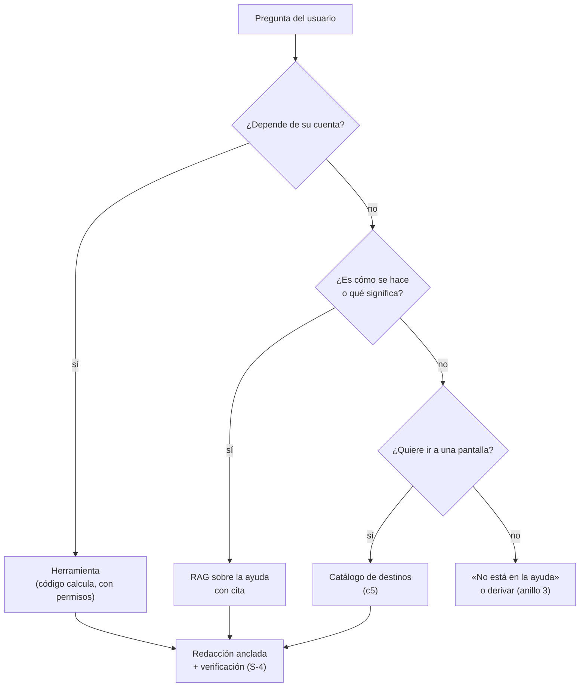

<a id="c6-3"></a>
### 6.3 Presentación de datos

Una cifra correcta mal presentada es una respuesta mala. Las reglas siguientes son *criterio de la guía*, salvo donde se indica la referencia.

<a id="c6-3-total"></a>
**Total con desglose ofrecido.** La primera respuesta da el agregado y la nota de métrica, y ofrece abrirlo: «Mandaste 1.240 mensajes en los últimos 7 días (envíos confirmados, todas tus aplicaciones). ¿Querés verlo por aplicación?». No se vuelca la tabla completa de entrada: el usuario de anillo 2 ([c4](#c4)) se pierde, y el experto pide el detalle con una palabra.

<a id="c6-3-ambiguo"></a>
**Nombre aproximado, con cifras para desambiguar.** Cuando el usuario nombra algo por aproximación («la app de prueba») y hay más de una candidata visible para él, la herramienta devuelve las candidatas con una cifra distintiva y el asistente pregunta: «Encontré dos: *Prueba Android* (310 envíos en 30 días) y *Prueba web* (12). ¿Cuál?». Nunca elige por el usuario. La cifra distintiva sale filtrada por los permisos del usuario, igual que el resto ([c5](#c5)).

<a id="c6-3-grafico"></a>
**Torta o barras.** La torta sólo sirve para partes de un todo y con pocas partes; si no, barras.

Tabla 6.2. Regla de forma del gráfico.

| Situación | Forma | Por qué |
|---|---|---|
| Partes de un total, de 2 a 6 categorías | Torta con las primeras N y una porción «Otras» | Se lee la proporción de un vistazo |
| Más de 6 categorías, o partes que no suman un todo | Barras ordenadas de mayor a menor | Las porciones finas no se distinguen |
| Evolución en el tiempo | Barras por período (o línea si hay muchos puntos) | La torta no tiene eje de tiempo |
| Una sola cifra | Texto, sin gráfico | Un gráfico de una barra no agrega nada |

La elección de forma la hace el código, por regla, a partir de la cantidad de categorías y del tipo de dato: el modelo no decide «hagamos una torta». *Experiencia propia medida (conducta):* el patrón torta top N + «Otras» con nota de métrica debajo se observó en otro software de notificaciones y funcionó en las rondas de crítica del caso ilustrativo ([c14](#c14)). En Geometría, la misma regla daría barras para «ejercicios resueltos por semana» y texto para «¿cuántas figuras guardé?».

<a id="c6-3-nota"></a>
**Nota de métrica siempre.** Debajo de toda cifra o gráfico: qué se contó, período, filtro y, si aplica, la hora de corte («datos hasta las 14:00»). Si la herramienta no puede dar la nota, la cifra no se muestra.

<a id="c6-3-vacio"></a>
**Cero no es error.** «No enviaste mensajes en los últimos 7 días» es una respuesta válida y distinta de «No pude consultar los envíos». La herramienta distingue los dos casos en su resultado; el modelo no los adivina.

<a id="c6-4"></a>
### 6.4 Incertidumbre

Los modelos generan texto plausible aunque no tengan fundamento, y el riesgo de diseño es que el usuario no pueda distinguir una respuesta fundada de una inventada [REF-009]. La regla de este libro es **declarar la incertidumbre en el punto de riesgo, no en todas partes**:

- **Sin fuente, se dice.** Si la recuperación no trae pasaje o la herramienta no aplica, la respuesta es «No está en la ayuda» más un camino (pregunta sugerida, destino, derivación), y se registra como no-encontrado ([P-5](#p-5), [c15](#c15)).
- **Ambigüedad, se pregunta.** Antes de consultar con un supuesto, se aclara (§6.3, nombre aproximado).
- **Dato parcial, se avisa en la nota.** «Faltan datos de las últimas 2 horas» va en la nota de métrica, no como descargo genérico.
- **Nada de descargos de rutina.** Un «puede contener errores» en cada respuesta se deja de leer y no ubica el riesgo. *Criterio de la guía.*

<a id="c6-escenarios"></a>
### 6.5 Aplicación por escenario

Tabla 6.3. Lo que cambia entre un sistema existente y uno por desarrollar.

| Aspecto | Sistema existente | Por desarrollar |
|---|---|---|
| Herramientas | Se escriben sobre los servicios de aplicación que ya usa la pantalla, nunca con consultas directas a la base; si la pantalla muestra la cifra, la herramienta llama al mismo servicio | Cada caso de uso que muestra datos declara también su herramienta de lectura como parte de «terminado» |
| Nota de métrica | Se toma de la definición que ya usa la pantalla; si la pantalla no la tiene, se escribe y se agrega también a la pantalla | Nace con la métrica, en el mismo documento |
| Corpus para RAG | Se reescribe la ayuda existente en pasajes cortos, uno por concepto | Se escribe a la par de la pantalla |

<a id="c6-ejemplos"></a>
### 6.6 Ejemplo

Un turno completo del caso PushDispatch, en el estilo de la batería ([A.5](#anexo-a-5)), con datos ficticios. El mismo esquema (desambiguar, total, nota, desglose ofrecido, destino) se traslada a «¿cuánto gasté en viajes este mes?» en Movilidad Urbana:

> **Usuario:** ¿cuánto mandé este mes con la app de la tienda?
> **Asistente:** Encontré dos aplicaciones con ese nombre: *Tienda* (2.100 envíos en 30 días) y *Tienda pruebas* (40). ¿Cuál?
> **Usuario:** la primera
> **Asistente:** *Tienda* mandó 2.100 mensajes en los últimos 30 días. Por plataforma: Android 62 %, iOS 30 %, Web 8 %. [torta de 3 porciones]
> *Envíos confirmados, últimos 30 días hasta hoy 14:00, sólo la aplicación Tienda.*
> ¿Querés verlo por día? · [Ver mensajes]

Qué hizo el código: buscó por nombre aproximado entre las aplicaciones visibles (dos candidatas, devolvió ambas con su cifra), calculó total y porcentajes, eligió torta porque son 3 partes de un todo, armó la nota y resolvió el chip «Ver mensajes» desde el catálogo revalidando el permiso. Qué hizo el modelo: redactar.

<a id="c6-snippets"></a>
### 6.7 Snippets representativos

Los snippets usan las abstracciones de *Microsoft.Extensions.AI* que la guía 16 explica y fecha ([guía 16, §9](./Dot-Net-Integration-AI-Layer-Guide.md#c9)); acá sólo se muestra la parte que encarna la regla del capítulo. Son representativos, no un proyecto compilable: los nombres de clases, rutas y permisos son ilustrativos y cada sistema los adapta a su dominio.

<a id="c6-s-1"></a>
**S-1 · Catálogo de destinos cerrado.** El modelo nunca arma una URL: a lo sumo propone un Id que el código busca en un diccionario versionado.

```csharp
// Ejemplo ilustrativo: catálogo de destinos
public sealed record Destino(string Id, string Plantilla, string Permiso, string Etiqueta);

public static class CatalogoDeDestinos
{
    public static readonly IReadOnlyDictionary<string, Destino> Todos = new Dictionary<string, Destino>
    {
        ["mensajes.lista"] = new("mensajes.lista", "/apps/{appId}/mensajes",       "Mensajes.Ver",    "Ver mensajes"),
        ["mensajes.nuevo"] = new("mensajes.nuevo", "/apps/{appId}/mensajes/nuevo", "Mensajes.Enviar", "Crear un mensaje"),
        // …
    };
}
```

<a id="c6-s-2"></a>
**S-2 · Herramienta de datos: el código calcula.** Parámetros acotados, búsqueda sólo entre lo visible para el usuario, ambigüedad devuelta como candidatas con cifra, total con desglose y nota.

```csharp
// Ejemplo ilustrativo: herramienta de lectura
[Description("Totales de envíos de una aplicación en un período. Devuelve agregados calculados; no estimes cifras.")]
public async Task<ResumenEnvios> ResumirEnvios(
    [Description("Nombre aproximado de la aplicación")] string aplicacion,
    [Description("Días hacia atrás, de 1 a 90")] int dias)
{
    var candidatas = await _apps.BuscarPorNombreAproximado(_usuario.Id, aplicacion); // sólo las visibles
    if (candidatas.Count == 0) return ResumenEnvios.SinCoincidencias();
    if (candidatas.Count > 1)
        return ResumenEnvios.Ambiguo(candidatas.Select(c => (c.Nombre, c.EnviosUltimos30)));

    dias = Math.Clamp(dias, 1, 90);
    var r = await _metricas.Totales(candidatas[0].Id, dias);      // total, desglose, porcentajes
    return r with { Nota = NotaDeMetrica.Envios(dias, r.Corte, candidatas[0].Nombre),
                    Grafico = FormaDeGrafico.Elegir(r.Desglose) }; // torta 2–6 partes, si no barras
}
// …
var opciones = new ChatOptions { Tools = [AIFunctionFactory.Create(herramientas.ResumirEnvios)] };
```

<a id="c6-s-3"></a>
**S-3 · Destino resuelto y revalidado por permiso.** El chip es comodidad, no permiso: la pantalla destino vuelve a autorizar.

```csharp
// Ejemplo ilustrativo: resolución de destino
public EnlaceProfundo? Resolver(string destinoId, Guid appId, ClaimsPrincipal usuario)
{
    if (!CatalogoDeDestinos.Todos.TryGetValue(destinoId, out var d)) return null; // fuera de catálogo
    if (!_autorizacion.Puede(usuario, d.Permiso, appId)) return null;              // revalida por rol
    return new(d.Etiqueta, d.Plantilla.Replace("{appId}", appId.ToString()));
}
```

<a id="c6-s-4"></a>
**S-4 · Anclaje de la redacción, verificado en código.** La instrucción pide usar sólo cifras de herramientas; después, el código comprueba que toda cifra del texto esté en el resultado. Si no, se descarta la redacción y se muestra el resultado crudo con su nota.

```csharp
// Ejemplo ilustrativo: verificación de anclaje
public string Asegurar(string redaccion, ResultadoDeHerramienta resultado)
{
    var permitidas = resultado.CifrasFormateadas();               // "2.100", "62 %", …
    var halladas   = Regex.Matches(redaccion, @"\d[\d.,]*\s?%?").Select(m => m.Value.Trim());
    return halladas.All(permitidas.Contains)
        ? redaccion
        : resultado.ComoTablaConNota();                           // nunca una cifra sin origen
}
```

<a id="c6-s-5"></a>
**S-5 · Medición sin guardar el texto.** Se registra intención, anillo, resultado y motivo cerrado; nunca la pregunta ni la respuesta ([P-9](#p-9), [c15](#c15)).

```csharp
// Ejemplo ilustrativo: evento de medición
public sealed record EventoConsola(
    string Intencion, string Anillo,
    string Resultado,          // respondida | no_encontrado | fuera_de_alcance | ambigua
    string? Voto, string? MotivoCerrado, DateOnly Dia);
```

<a id="c6-decision"></a>
### 6.8 Decisión

Tabla 6.4. Decisiones del capítulo y qué perfil suele tomarlas.

| Decisión | Opción por defecto | Alternativa aceptable | Perfil que decide |
|---|---|---|---|
| Fuente de cada intención | Una sola: herramienta, RAG o destino | Mixta (herramienta + RAG) con dos citas | Diseño + desarrollo |
| Forma del dato | Total + desglose ofrecido + nota | Tabla directa para roles técnicos que la pidan | Diseño |
| Forma del gráfico | Por regla en código (Tabla 6.2) | Sólo texto si la consola no dibuja gráficos | Desarrollo |
| Redacción que no ancla | Reemplazar por resultado crudo | Reintentar una vez y, si falla, crudo | Desarrollo + QA |

<a id="c6-preguntas"></a>
### 6.9 Preguntas guía

**¿Puede el modelo calcular un porcentaje con cifras que ya tiene en el turno?** No. Aunque tenga las dos cifras, la división la hace la herramienta y la devuelve formateada. La razón no es sólo que el modelo pueda equivocarse: es que la verificación de anclaje ([S-4](#c6-s-4)) sólo puede comprobar cifras que existen en el resultado. Aplica a todo total, conteo, porcentaje o promedio; si una pregunta nueva necesita una cuenta que la herramienta no hace, se agrega a la herramienta, no a la instrucción.

**¿Cómo sé si una intención va por herramienta o por RAG?** Preguntate si la respuesta cambia según quién pregunta. Si cambia, es herramienta; si es igual para todos, es ayuda recuperada con cita. Aplica al llenar la columna de fuente del catálogo ([A.4](#anexo-a-4), [c12](#c12)); si una intención no entra en ninguna, probablemente sea de anillo 3 o de afuera ([c10](#c10)).

**¿Por qué ofrecer el desglose en vez de mostrarlo?** Porque la primera respuesta tiene que poder leerla el inexperto, y el total con su nota alcanza para la mayoría de las preguntas. El desglose de entrada convierte una respuesta en un informe. Aplica a toda consulta agregada; la excepción es cuando la pregunta ya pide la dimensión («por plataforma»), y entonces se responde directo con ella.

**¿Cuándo una torta y cuándo barras?** Torta sólo si son partes de un todo y entre 2 y 6 categorías, con «Otras» para el resto; en cualquier otro caso, barras ordenadas. La regla vive en el código ([S-2](#c6-s-2)) para que dos preguntas iguales den el mismo gráfico. Aplica a toda salida gráfica; ante la duda, que gane la barra, que nunca engaña sobre proporciones.

**¿Qué hago cuando el asistente no tiene con qué responder?** Decir «No está en la ayuda», ofrecer un camino y registrar el no-encontrado. En la batería ([c13](#c13)) esto se prueba a propósito con preguntas sin fuente: pasa si el asistente no inventa, aunque el texto sea corto. Aplica siempre; el no-encontrado medido es justamente lo que permite mover la frontera ([c16](#c16)).

<a id="c6-calidad"></a>
### 6.10 Criterios de calidad y antipatrones

Criterios (cada uno verificable en la batería, [c13](#c13)):

- Toda cifra del texto aparece en el resultado de una herramienta del mismo turno.
- Toda cifra o gráfico lleva nota de métrica.
- Toda respuesta de concepto cita su pasaje de ayuda.
- La herramienta correcta y la redacción fiel se miden por separado: puede elegir bien y redactar mal, o al revés.
- Un nombre ambiguo produce una pregunta con candidatas, nunca una elección silenciosa.
- Cero y error se distinguen en el texto.

Antipatrones:

- **El modelo como calculadora.** Pasarle filas crudas y pedirle que sume.
- **Consulta libre.** Una herramienta que acepta texto SQL o filtros arbitrarios del modelo.
- **Gráfico por ocurrencia.** Que la forma la decida la redacción en cada turno.
- **Cifra huérfana.** Un número sin período ni filtro.
- **Descargo de rutina.** «Puede contener errores» al pie de todo, en lugar de señalar la duda donde está [REF-009].
- **Demo como prueba.** Validar con datos de juguete y no con datos reales del sistema ([P-8](#p-8)).

<a id="parte-iii"></a>
# Parte III · Método por etapas

<a id="c7"></a>
## Capítulo 7 · Por dónde empiezo y el flujo de diseño

> **Qué vas a poder hacer al terminar.** Recorrer el flujo E0→E7, nombrar el entregable y la compuerta de cada etapa, decir quién la firma, elegir el camino según el sistema ya exista o esté por desarrollar, y organizar el día 0 de un proyecto conversacional, lo encare una persona sola, un grupo de estudiantes o un equipo de trabajo (OA-EQ4, OA-PO1, OA-EQ3).

Las Partes I y II dieron el criterio: los principios ([c2](#c2)), los anillos ([c3](#c3)), el vocabulario ([c4](#c4)), los destinos ([c5](#c5)) y la regla de que el código elige y el modelo redacta ([c6](#c6)). Este capítulo convierte ese criterio en un orden de trabajo. Contesta cinco preguntas que se hace cualquiera que encara su primer diseño conversacional: por dónde empiezo, cuál es el flujo, qué hace el que recién llega, qué cambia si el sistema ya existe y qué cambia si está por desarrollar. Cada etapa tiene después su propio capítulo ([c8](#c8)–[c15](#c15)); acá se ve el mapa entero.

<a id="c7-1"></a>
### 7.1 Definiciones

<a id="c7-1-1"></a>
**Etapa.** Un tramo del trabajo que termina en un entregable concreto, casi siempre una plantilla del Anexo A llena. Hay ocho, de E0 a E7. Una etapa no es una reunión ni una semana: termina cuando el entregable cumple su criterio de terminado, no cuando se acaba el tiempo.

<a id="c7-1-2"></a>
**Compuerta.** La condición que hay que cumplir para pasar a la etapa siguiente, con una persona que la firma. Firmar quiere decir decir «sí, con esto seguimos» y hacerse cargo. La compuerta existe porque los errores del diseño conversacional se pagan caros cuando aparecen tarde: un término mal definido en E3 aparece como respuesta inventada en E5 y como voto negativo en E7.

<a id="c7-1-3"></a>
**Ciclo de la frontera.** El regreso de E7 a E2. Lo que la medición muestra (preguntas sin respuesta, votos con motivo, pedidos fuera de alcance) vuelve al mapa de anillos y la frontera se corre. Es el principio P-9 ([p-9](#p-9)) puesto en el flujo.

<a id="c7-1-4"></a>
**Día 0.** La primera jornada de trabajo con el método: se reparten los roles (o, si trabajás solo, se decide qué sombrero te ponés en cada compuerta), se elige una tarea y un rol de usuario para la primera vuelta, y se decide quién firma cada compuerta. Es la respuesta concreta a «por dónde empiezo».

<a id="c7-1-5"></a>
**Primera vuelta.** Un recorrido completo E0→E7 con una sola tarea del producto y un solo rol de usuario, con una fila por plantilla. Es chica a propósito: enseña el método entero antes de ensancharlo ([Anexo E](#anexo-e)).

<a id="c7-2"></a>
### 7.2 El flujo E0→E7

La idea de diseñar una conversación por etapas, desde quién usa el sistema y para qué hasta probar con usuarios, está en la guía de diseño conversacional de Google, que sigue publicada como método aunque la plataforma de acciones para la que se escribió se discontinuó en 2023 [REF-001]. Google propone además, antes de nada, preguntarse si la conversación es la herramienta adecuada [REF-003]. Las ocho etapas de esta guía y sus compuertas son criterio de la guía, armado sobre ese método y sobre la experiencia propia medida en los casos que acompañan la guía ([c18](#c18)).

<a id="c7-figura-1"></a>
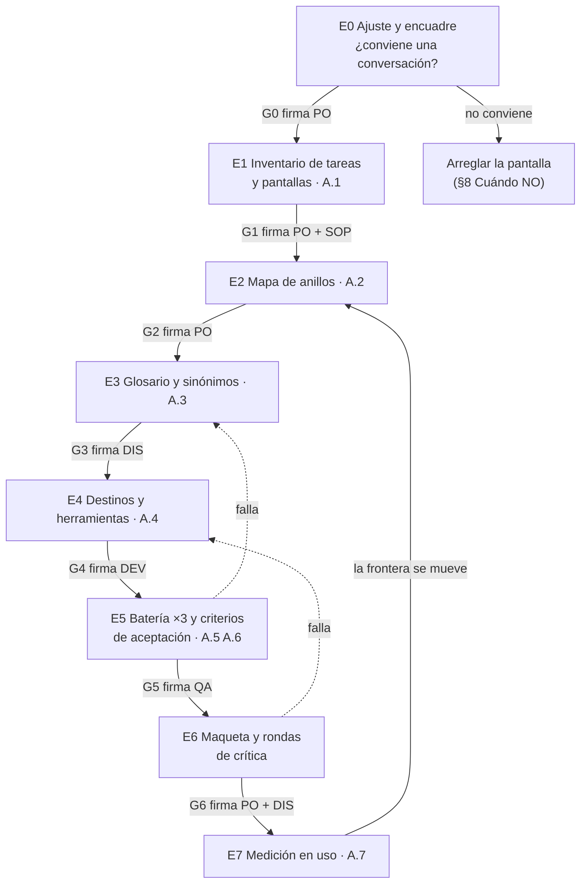
*Figura 7.1. El flujo de diseño con sus compuertas (G0–G6) y el ciclo de la frontera E7→E2. Las flechas punteadas son los retrocesos más comunes.*

La Tabla 7.1 es el resumen que conviene tener impreso. La columna *Compuerta* es lo mínimo para pasar; el detalle de cada una está en su capítulo.

<a id="c7-tabla-1"></a>

| Etapa | Pregunta que contesta | Entregable | Compuerta (para pasar) | Firma | Capítulo |
|---|---|---|---|---|---|
| E0 Ajuste y encuadre | ¿Una conversación resuelve algo que la pantalla no? | Ficha: roles, las 10 tareas más frecuentes, decisión sí/no | Una parte suficiente de las tareas se beneficia de preguntar (umbral en [c8](#c8)) | PO | [c8](#c8) |
| E1 Inventario | ¿Qué hace la gente, en qué pantalla, con qué palabras? | A.1 | Cada tarea con pantalla, rol y al menos una pregunta real | PO + SOP | [c9](#c9) |
| E2 Mapa de anillos | ¿Qué responde el asistente y qué no? | A.2 y la lista de lo que no promete | Cada pregunta del inventario en un solo anillo | PO | [c10](#c10) |
| E3 Glosario | ¿Con qué palabras se entiende con el usuario? | A.3 | Cada término con un sentido, sinónimos clasificados | DIS | [c11](#c11) |
| E4 Destinos y herramientas | ¿De dónde sale cada dato y adónde lleva cada enlace? | A.4 | Catálogo cerrado; cada intención de dato con su herramienta | DEV | [c12](#c12) |
| E5 Batería y aceptación | ¿Cómo sabemos que funciona? | A.5, A.6 | Batería corrida tres veces, medida por tasa y no por conducta | QA | [c13](#c13) |
| E6 Maqueta y crítica | ¿Se entiende, se ve bien, en el sitio real? | Capturas lado a lado y lista de cambios | Rondas de crítica cerradas sobre el sitio real (P-8) | PO + DIS | [c14](#c14) |
| E7 Medición | ¿Qué falla en uso y dónde se mueve la frontera? | A.7 | Indicadores vivos sin guardar el texto (P-9) | PO | [c15](#c15) |

*Tabla 7.1. Etapas, entregables, compuertas y firmas. Roles: PO (dueño del producto), DIS (diseño UX y contenido), DEV (desarrollo), QA (verificación), SOP (soporte).*

<a id="c7-2-regla"></a>
**Regla: ningún prompt antes de E3.** Nadie escribe instrucciones para el modelo hasta que el glosario esté firmado. La razón es práctica: el prompt es el lugar más fácil para tapar con redacción lo que no se decidió en el diseño. Si no está claro qué anillo cubre una pregunta (E2) ni qué significa cada palabra (E3), el prompt termina inventando la frontera y el vocabulario, y eso no se puede medir ni revisar (criterio de la guía, derivado de P-3 [p-3](#p-3) y P-4 [p-4](#p-4)). En la práctica el prompt recién toma forma en E4, cuando ya se sabe qué herramienta contesta cada intención.

<a id="c7-2-orden"></a>
**Por qué en este orden.** El orden va de lo que decide el negocio a lo que decide la técnica. E0 a E2 son decisiones de producto: si conviene, qué se responde, qué no. E3 y E4 son decisiones de lenguaje y de datos que dependen de las anteriores. E5 a E7 prueban y miden. Invertirlo, por ejemplo empezar por la maqueta, es la tentación más común: una consola linda convence al equipo antes de saber si contesta lo que importa.

<a id="c7-3"></a>
### 7.3 Por dónde empiezo: el día 0

El día 0 no se diseña nada todavía. Se arma el trabajo y la primera vuelta. Este es el orden, con el rol que lo hace; en un trabajo práctico o un proyecto individual los roles se concentran en pocas personas, pero la regla de que QA no firma lo que diseñó se mantiene (otra persona, el docente o un par revisa).

<a id="c7-tabla-2"></a>

| Paso | Qué se hace | Quién | Sale con |
|---|---|---|---|
| 1 | Leer juntos el tronco común: [c0](#c0), Parte I, este capítulo | Todos los que participan | Vocabulario común (anillo, frontera, compuerta) |
| 2 | Asignar los cinco roles; una persona puede tener dos, pero QA no firma lo que diseñó | PO | Tabla de roles con nombres |
| 3 | Decidir quién firma cada compuerta (Tabla 7.1) | PO | Firmas asignadas |
| 4 | Juntar diez preguntas reales de usuarios (soporte, correos, búsquedas) | SOP | Lista cruda, sin editar |
| 5 | Elegir **una** tarea y **un** rol de usuario para la primera vuelta | PO + DIS | La tarea de la primera vuelta |
| 6 | Hacer E0 sobre el producto entero (¿conviene?) | PO | Decisión sí/no, con la ficha |
| 7 | Fijar fecha para la revisión de la primera vuelta | PO | Fecha |

*Tabla 7.2. El día 0, en orden.*

Dos aclaraciones. La primera: E0 se hace sobre todo el producto aunque la primera vuelta sea de una sola tarea, porque si la conversación no conviene no tiene sentido ninguna vuelta. La segunda: las diez preguntas del paso 4 se juntan tal como las escribió la gente, con errores y todo. Editarlas borra justamente el vocabulario que E3 necesita ([c4](#c4)).

<a id="c7-4"></a>
### 7.4 Pasos para el que recién empieza

Para quien nunca diseñó una conversación, el método entero puede parecer mucho. La primera vuelta lo achica a esto:

1. **Elegí una tarea que hoy genere consultas al soporte.** Si nadie pregunta por ella, el asistente no aporta.
2. **Escribí cinco preguntas reales sobre esa tarea** y ubicá cada una en un anillo ([c3](#c3)). Si alguna no tiene anillo claro, ya encontraste tu primer problema de diseño.
3. **Subrayá las palabras de las preguntas que el producto no usa.** Esas son tus primeras entradas de glosario.
4. **Para cada pregunta, decí de dónde sale la respuesta:** un dato del sistema (herramienta), la ayuda (recuperación con cita) o nada («No está en la ayuda», P-5 [p-5](#p-5)).
5. **Escribí la respuesta esperada de cada una** antes de probar nada. Sin respuesta esperada no hay prueba.
6. **Probá con tres usuarios** y anotá qué preguntaron que no estaba en tu lista.
7. **Llená una fila de cada plantilla A.1–A.7** con lo que salió. Recién ahí ensanchá a la segunda tarea.

El [Anexo E](#anexo-e) tiene este recorrido con un ejemplo completo. La primera vuelta no se publica: es un ensayo para ver las ocho etapas juntas antes de ensanchar.

<a id="c7-escenarios"></a>
### 7.5 Aplicación por escenario

El flujo es el mismo en los dos escenarios; cambia de dónde sale el material y qué etapa pesa más. La tabla muestra sólo lo que cambia.

<a id="c7-tabla-3"></a>

| Etapa | Sistema existente | Por desarrollar |
|---|---|---|
| E0 | Se decide con datos: tickets, búsquedas fallidas, tareas abandonadas | Se decide con hipótesis; se marca NO VERIFICADO y se revisa en E7 |
| E1 | El inventario sale de las pantallas que hay y del soporte | El inventario sale de los casos de uso del diseño; las pantallas pueden no existir |
| E2 | Pesa la lista de lo que no se promete: hay usuarios que ya esperan cosas | Se puede dibujar la frontera junto con el producto |
| E3 | El vocabulario del usuario ya existe y hay que recogerlo | Se inventa el vocabulario del producto: conviene hacerlo con el glosario a la vista |
| E4 | Los destinos son las pantallas actuales; puede faltar una ruta enlazable | Los destinos se diseñan junto con la navegación ([c5](#c5)), antes del código |
| E5 | La batería sale de preguntas reales | La batería sale de las preguntas del diseño más las de una prueba con usuarios |
| E6 | Se critica sobre el sitio real desde la primera ronda | Se critica sobre la maqueta, y se repite en el sitio real antes de publicar (P-8) |
| E7 | La medición arranca enseguida y es la que más enseña | La medición es la primera evidencia real: espera que la frontera se mueva mucho |

*Tabla 7.3. Lo que cambia según el sistema exista o esté por desarrollar.*

La diferencia de fondo: en un sistema existente el riesgo es prometer de menos lo que ya se sabe y de más lo que la gente espera; en uno por desarrollar el riesgo es diseñar una frontera de escritorio que nadie validó. Por eso el sistema existente arranca por los datos y el nuevo arranca por la hipótesis y la mide pronto.

<a id="c7-ejemplos"></a>
### 7.6 Ejemplos

<a id="c7-ejemplo-1"></a>
**Ejemplo 1: sistema existente, un servicio de turnos.** Un sistema de turnos médicos con años de uso decide sumar un asistente. En E0 el soporte trae las diez consultas más frecuentes: seis son «cómo cambio mi turno», que el sistema ya permite en tres pantallas. La conversación conviene: la tarea existe pero cuesta encontrarla. La primera vuelta toma esa tarea y el rol paciente. En E1 aparece que la gente dice «pasar el turno» y el sistema dice «reprogramar»: entrada para el glosario. En E4 el destino es la pantalla de reprogramación, que ya existe pero no se puede abrir con un enlace directo; el equipo agrega la ruta antes de seguir.

<a id="c7-ejemplo-2"></a>
**Ejemplo 2: por desarrollar, una agenda de aulas.** Una facultad diseña desde cero un sistema para reservar aulas. No hay usuarios ni tickets. E0 se hace con entrevistas a cinco docentes y la decisión queda como hipótesis. Como las pantallas todavía son bocetos, en E4 el equipo define el catálogo de destinos al mismo tiempo que la navegación, y descubre que «ver mis reservas de la semana» necesita una pantalla que nadie había dibujado. Ganan algo que el sistema existente no podía: la pantalla nace enlazable.

<a id="c7-ejemplo-pd"></a>
**Ejemplo 3: por desarrollar, la consola de un servicio de notificaciones.** PushDispatch, un servicio de notificaciones push diseñado desde cero, suma una consola de asistente a su panel de administración. Como el panel nace junto con el asistente, E0 se decide con hipótesis sobre las tareas de quien administra aplicaciones, suscripciones y mensajes. La primera vuelta toma una sola tarea («¿cuántos suscriptores tiene mi aplicación?») y un solo rol. En E4 aparece la decisión que ordena todo lo demás: la cifra sale de una herramienta que consulta el sistema y el modelo sólo la redacta ([c6](#c6)), y el enlace a la pantalla lo elige el código y se revalida contra los permisos del rol. En E6 la crítica con capturas lado a lado sobre el sitio real muestra fallos que la maqueta no mostraba (P-8). Es experiencia propia medida, contada en detalle en [c18](#c18).

<a id="c7-ejemplo-mu"></a>
**Ejemplo 4: el mismo flujo en los otros casos de la guía.** En Movilidad Urbana, un sistema con uso, el E1 sale de las consultas que ya llegan y E2 pesa por la lista de lo que no se promete. En Geometría, una herramienta didáctica, el anillo 2 domina: el alumno vive en el vocabulario del dominio y E3 (glosario, explicar el término la primera vez) es la etapa más larga.

<a id="c7-ejemplo-3"></a>
**Ejemplo 5: el atajo que no conviene.** Un grupo con apuro escribe el prompt el primer día y lo prueba con diez preguntas inventadas. Las respuestas suenan bien. Cuando llega a usuarios reales, preguntan con otras palabras, el asistente contesta cifras que no salen del sistema y nadie sabe si eso estaba dentro de la frontera, porque la frontera nunca se escribió. Tienen que volver a E1. Es la regla de [c7-2-regla](#c7-2-regla) vista desde el costo.

<a id="c7-decision"></a>
### 7.7 Decisión y alternativas

- **Flujo lineal con compuertas (el de esta guía).** Elegilo cuando es el primer diseño conversacional de quien lo encara. Las compuertas obligan a decidir en el momento justo y dejan registro de quién decidió.
- **Etapas en paralelo.** Con experiencia se puede hacer E3 y E4 a la vez, porque glosario y catálogo se alimentan entre sí. No conviene antes de la primera vuelta: sin haber visto el flujo entero, el paralelo esconde las dependencias.
- **Empezar por la maqueta.** Sirve sólo para conseguir apoyo interno (mostrar la idea a quien decide el presupuesto). No reemplaza E0–E5; la maqueta de ese momento se descarta.
- **Iteración por tarea, no por etapa.** Es la forma de ensanchar después de la primera vuelta: cada nueva tarea recorre E1→E5 y se suma a las plantillas existentes. E0 no se repite salvo que cambie el producto.

Que una conversación no siempre sea la respuesta, y que un asistente mal planteado frustre más de lo que ayuda, es una advertencia que tanto Google [REF-003] como Nielsen Norman Group [REF-007] ponen al principio. Por eso E0 tiene salida «no».

<a id="c7-preguntas"></a>
### 7.8 Preguntas guía

**¿Por dónde empiezo si nunca hice esto? (OA-EQ4)** Por el día 0 ([c7-3](#c7-3)), no por el modelo. Primero roles y firmas, después diez preguntas reales, después E0 y una primera vuelta con una tarea y un rol. Aplica siempre que sea tu primer diseño conversacional; quien ya hizo una vuelta puede saltar el día 0 y empezar por E1 de la tarea siguiente.

**¿Cuál es el flujo y por qué tiene compuertas? (OA-EQ4)** E0→E7 con regreso de E7 a E2 ([Figura 7.1](#c7-figura-1)). Las compuertas existen porque cada entregable es insumo del siguiente y un error temprano se multiplica: el glosario alimenta el catálogo, el catálogo alimenta la batería. Si una compuerta no se puede firmar, la etapa no terminó, aunque se haya acabado el tiempo previsto.

**¿Qué cambia si el sistema ya existe? (OA-PO1)** El material: sale de datos reales (pantallas, tickets, búsquedas) y la medición de E7 arranca enseguida. El cuidado mayor está en E2, en la lista de lo que no se promete, porque los usuarios ya tienen expectativas ([c7-escenarios](#c7-escenarios)). Aplica a cualquier producto con uso, aunque sea poco.

**¿Y si está por desarrollar? (OA-PO1)** Las decisiones de E0 y E2 son hipótesis y se rotulan así. La ventaja es E4: los destinos se diseñan con la navegación ([c5](#c5)) y las pantallas nacen enlazables. El riesgo es creerse la frontera de escritorio; por eso la primera medición ([c15](#c15)) se lee con más atención y se espera mover la frontera varias veces.

**¿Puedo escribir el prompt antes para ir probando? (OA-EQ3)** No antes de E3. Probar con un prompt temprano da conducta («una vez contestó bien»), no tasa, y el prompt termina definiendo la frontera por omisión. Si hace falta mostrar algo a quien decide, usá una maqueta descartable ([c7-decision](#c7-decision)) y dejala fuera de la batería.

<a id="c7-calidad"></a>
### 7.9 Criterios de calidad y antipatrones

**Criterios de calidad.**
- Cada compuerta tiene un nombre que la firma, escrito antes de empezar la etapa.
- La primera vuelta se hizo con una tarea y un rol, y dejó una fila en cada plantilla A.1–A.7.
- Ningún prompt existe antes de que A.3 esté firmado.
- Las decisiones tomadas sin datos (típicas del sistema por desarrollar) están rotuladas como NO VERIFICADO y tienen fecha de revisión en E7.
- Hay un ciclo E7→E2 agendado, no sólo dibujado.

**Antipatrones.**
- **Empezar por la maqueta.** Convence antes de saber si contesta lo que importa.
- **Compuerta de cortesía.** Se firma porque se acabó la semana. Si no se cumple la condición, se retrocede.
- **QA que firma su propio diseño.** La persona que escribió la batería no la aprueba.
- **Primera vuelta ancha.** Tres tareas y dos roles en la primera vuelta esconden el método detrás del volumen.
- **E7 sin regreso.** Se mide y nadie mueve la frontera. Ver [c16](#c16) para decidir moverla o abandonar el asistente.

<a id="c8"></a>
## Capítulo 8 · E0 Compuerta de ajuste y cuándo NO

Antes de dibujar anillos, escribir un glosario o pensar en un modelo de lenguaje, quien diseña tiene que responder una pregunta incómoda: **¿conversar le gana a la pantalla en las tareas que la gente hace de verdad?** Esta etapa, E0, es la primera compuerta del flujo ([c7](#c7)). Si no se pasa, el método no sigue: se arregla primero la pantalla. El capítulo sirve igual para un trabajo práctico de curso, un producto en marcha o uno que recién se especifica. Aplica el principio [P-2](#p-2) (primero, por qué no una pantalla) y prepara [P-4](#p-4) (no prometer lo que el software no hace). El objetivo de aprendizaje que se enseña acá es [OA-PO1](#oa-po1).

<a id="c8-1"></a>
### 8.1 Definiciones

- **Compuerta de ajuste.** Una decisión documentada, con evidencia, que dice si una interfaz conversacional conviene al producto y para qué tareas. Tiene tres salidas posibles: *construir el asistente*, *construir un asistente acotado a algunas tareas* o *no construirlo y mejorar la pantalla*. Las tres son resultados válidos de E0.
- **Tarea frecuente.** Algo que un usuario quiere lograr en el producto, dicho con sus palabras y con un resultado observable («saber cuántos avisos se abrieron ayer», «dar de alta una aplicación»). No es una pantalla ni una función: una tarea puede recorrer varias pantallas y una pantalla puede servir a varias tareas.
- **Las diez tareas.** La muestra de trabajo de E0: las diez tareas más frecuentes según la evidencia disponible, ordenadas por frecuencia. Diez es un número de *criterio de la guía*: alcanza para ver un patrón y se puede analizar en una tarde.
- **Gana la conversación.** Para una tarea, la conversación gana cuando, frente al mejor camino actual en la pantalla, ahorra pasos o tiempo de manera clara, o evita que el usuario tenga que saber dónde está la función o cómo se llama. Si la pantalla ya lo resuelve en uno o dos clics visibles, la conversación no gana, aunque sea simpática.
- **Umbral de un tercio.** Si menos de un tercio de las diez tareas (es decir, menos de 4) gana con la conversación, la compuerta no se pasa. Es *criterio de la guía, umbral a calibrar*: no viene de una fuente de la industria y se puede mover si se deja escrito por qué.
- **Alternativa no conversacional.** Toda mejora de la pantalla que podría resolver la misma fricción sin conversación: búsqueda de comandos (paleta tipo Ctrl+K), ayuda contextual en la pantalla, asistentes paso a paso, estados vacíos que enseñan, preguntas frecuentes buscables, mejores nombres en el menú.

<a id="c8-2"></a>
### 8.2 Por qué una compuerta antes de diseñar

La guía de Google para diseño conversacional dedica una página entera a preguntarse si la conversación es la opción correcta, y propone una lista de verificación: que la tarea sea algo que la gente ya resuelve hablando con otra persona, que se haga en pocos turnos, que la pantalla imponga fricción, que la función sea difícil de encontrar, que el usuario esté haciendo otra cosa a la vez y que el tema no sea sensible [REF-003]. Nielsen Norman Group, a partir de estudios con usuarios, documenta que los asistentes conversacionales fallan apenas el usuario se sale del guion previsto, y que muchas veces lo que conviene es mejorar el sitio o la aplicación [REF-007].

Las dos fuentes coinciden en algo que quien empieza suele pasar por alto: un asistente no arregla una navegación mala, la tapa. Si la tarea más frecuente cuesta siete clics porque el menú está mal organizado, el asistente la vuelve más rápida para quien lo usa y deja el problema intacto para todos los demás. Además, cada tarea que se le asigna al asistente después hay que diseñarla, probarla tres veces y medirla ([c13](#c13), [c15](#c15)). La compuerta evita pagar ese costo donde no rinde.

Cita de [REF-003] (en inglés, sin traducir el título): *«Is conversation the right fit?»*. Glosa: antes de diseñar el diálogo, comprobá que el diálogo le sirva al usuario mejor que otra interfaz.

<a id="c8-3"></a>
### 8.3 El procedimiento, paso a paso

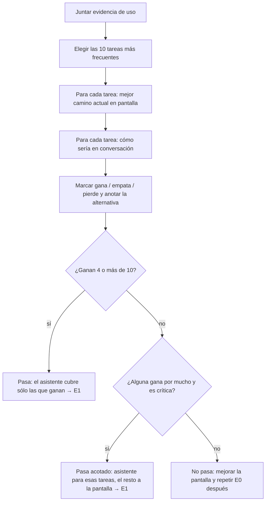

Figura 8.1. La compuerta E0. La salida «pasa acotado» es la más común en productos con un panel ya ordenado.

1. **Juntar evidencia.** Se usa lo que haya, en este orden de preferencia: analítica del producto (pantallas más visitadas, búsquedas internas sin resultado), consultas al soporte, entrevistas cortas con usuarios reales y, en último lugar, la opinión de quienes diseñan. Lo que salga de la opinión se rotula *supuesto*.
2. **Elegir las diez tareas.** Se escriben en lenguaje de usuario y con resultado observable. Si dos tareas son la misma con distinto objeto, se juntan.
3. **Medir el mejor camino en la pantalla.** Pasos (clics, pantallas, campos) y, si se puede, tiempo con un usuario real. «Mejor camino» es el que sigue alguien que sabe usar el producto; se anota aparte si el inexperto no lo encuentra.
4. **Esbozar la conversación.** Una o dos frases del usuario y la respuesta esperada. No hace falta modelo: alcanza con escribirlo, como en una maqueta ([c14](#c14)).
5. **Marcar y anotar.** Cada tarea queda en *gana*, *empata* o *pierde*, con una línea de motivo y la alternativa no conversacional que podría resolverla.
6. **Decidir y firmar.** La persona responsable del producto firma la decisión, con la hoja de compuerta (tabla 8.2) adjunta. Las tareas que ganan son la semilla del inventario de E1 ([c9](#c9)).

Tabla 8.1. Señales para marcar una tarea (criterio de la guía, a partir de [REF-003] y [REF-007]).

| Señal | Inclina a *gana* | Inclina a *pierde* |
|---|---|---|
| Hay que cruzar varias pantallas para responder | sí | — |
| El usuario no sabe cómo se llama lo que busca | sí (anillo 2, [c4](#c4)) | — |
| La respuesta es una cifra que ya está visible en el tablero | — | sí |
| La tarea es cargar muchos campos estructurados | — | sí (un formulario es mejor) |
| La tarea es irreversible o sensible | — | sí, salvo que la conversación sólo lleve a la pantalla |
| El usuario pregunta «¿por qué pasó esto?» | sí | — |
| La tarea se hace todos los días, siempre igual | — | sí (un atajo es mejor) |

<a id="c8-cuando-no"></a>
### 8.4 Cuándo NO construir un asistente

Un análisis de E0 termina en «no» más seguido de lo que se espera, y ese «no» es un buen resultado: ahorró meses. Los casos típicos (criterio de la guía):

- **Menos de un tercio de las tareas gana y ninguna es crítica.** El problema es de navegación o de nombres. Se arreglan la búsqueda, el menú y la ayuda contextual, y se repite E0 cuando haya datos nuevos.
- **No hay evidencia de uso ni usuarios a quienes preguntar.** Sin evidencia, la lista de tareas es una opinión y el umbral no significa nada. Primero se instrumenta el producto o se hacen entrevistas.
- **Lo que se quiere es cargar datos.** Un formulario bien hecho valida, muestra el estado y se puede revisar antes de enviar. La conversación agrega turnos y errores.
- **Las tareas frecuentes son irreversibles o sensibles y la conversación ejecutaría la acción.** El asistente puede, como mucho, explicar y llevar a la pantalla ([c5](#c5)); si eso no ahorra nada, no hay caso.
- **Nadie va a medir después.** Sin plan de medición ([c15](#c15)) la frontera no se puede mover ([P-9](#p-9)) y el asistente se degrada sin que nadie lo note.
- **El asistente sería la manera de no rediseñar una pantalla mala.** Es el antipatrón principal de este capítulo.

Decir que no hoy no es decir que no para siempre. La hoja de compuerta queda versionada y se revisa cuando cambian las tareas, el público o el producto.

<a id="c8-escenarios"></a>
### 8.5 Aplicación por escenario

Sólo las celdas que cambian entre los dos escenarios.

| Aspecto | Sistema existente | Sistema por desarrollar |
|---|---|---|
| De dónde salen las diez tareas | Analítica, búsquedas internas sin resultado y consultas al soporte | Historias de usuario, entrevistas y la maqueta; todo rotulado *supuesto* hasta tener uso real |
| Cómo se mide la pantalla | Contando pasos sobre el panel real, con un usuario experto y uno nuevo | Contando pasos sobre la maqueta; se rehace cuando exista el producto |
| Riesgo principal | Que el asistente tape una navegación mala que nadie quiere tocar | Diseñar la conversación sin la pantalla, o la pantalla sin la conversación |
| Qué hacer si no pasa | Mejorar la pantalla y volver a E0 en el próximo ciclo | Rediseñar la pantalla ahora, que es barato, y repetir E0 con la maqueta nueva |
| Cuándo se repite E0 | Cuando cambian las tareas frecuentes o el público | Al salir el primer uso real, porque las diez tareas eran supuestos |

En el escenario *por desarrollar* conviene diseñar la pantalla y la conversación juntas: cada tarea que la conversación pierde es una exigencia para la pantalla, y cada tarea que gana es un candidato al anillo 1 ([c3](#c3)).

<a id="c8-ejemplos"></a>
### 8.6 Ejemplos

**Ejemplo neutro: un sistema de turnos de un consultorio.** Se juntan las consultas al soporte y la analítica del panel de recepción y se arma la tabla:

Tabla 8.2. Hoja de compuerta del ejemplo (los pasos son ilustrativos).

| # | Tarea (palabras del usuario) | Mejor camino en pantalla | En conversación | Marca | Motivo o alternativa |
|---|---|---|---|---|---|
| 1 | Ver los turnos de hoy | 1 clic, es la pantalla inicial | «¿qué turnos tengo hoy?» | pierde | Ya está visible |
| 2 | Dar un turno nuevo | Formulario de 6 campos | 5 a 8 turnos de diálogo | pierde | Formulario |
| 3 | Saber por qué un paciente no recibió el recordatorio | 4 pantallas: paciente, turno, envíos, configuración | «¿por qué no le llegó el recordatorio a…?» | gana | Cruza pantallas |
| 4 | Cancelar un turno | 2 clics | «cancelá el turno de…» | pierde | Irreversible; la pantalla confirma |
| 5 | Cambiar el horario de atención | Menú poco visible, 3 niveles | «¿dónde cambio el horario?» | gana | O mejorar el menú |
| 6 | Saber cuántos pacientes faltaron este mes | Reporte con filtros | «¿cuántos faltaron en marzo?» | gana | Cifra que sale de una herramienta ([c6](#c6)) |
| 7 | Imprimir la agenda | 1 clic | — | pierde | Ya resuelto |
| 8 | Entender qué es «sobreturno» | No hay ayuda | «¿qué es un sobreturno?» | gana | Anillo 2; o ayuda contextual |
| 9 | Reprogramar varios turnos | Pantalla de agenda, arrastrar | Diálogo largo | pierde | La pantalla es mejor |
| 10 | Buscar un paciente | Buscador arriba | «buscá a…» | empata | Sin ganancia clara |

Ganan 4 de 10 (3, 5, 6 y 8): la compuerta pasa por poco. Dos de esas tareas (5 y 8) también se podrían resolver mejorando el menú y agregando ayuda contextual. Una decisión razonable es *pasar acotado*: asistente para el diagnóstico (3) y las cifras (6), y mejorar el menú y la ayuda en paralelo. Las tareas 5 y 8 quedan para el asistente sólo si la medición muestra que la pantalla mejorada no alcanzó.

Los tres casos ilustrativos de la guía muestran la misma compuerta con resultados distintos:

- **Movilidad Urbana.** «¿Cuánto me queda de estacionamiento?» pierde: la pantalla principal ya lo muestra. «¿Por qué me llegó esta multa si pagué?» gana: cruza el pago, la zona, el horario y la infracción.
- **Geometría.** «Dibujá un triángulo» empata o pierde: la herramienta de construcción es más directa. «¿Por qué mi figura no se valida?» gana: el alumno no sabe cómo se llama lo que le falta (anillo 2, [c4](#c4)).
- **PushDispatch** (un servicio de notificaciones push, tomado como producto diseñado desde cero). «¿Cuántos suscriptores tengo?» pierde: ya lo resuelve una tarjeta del tablero. «¿Por qué no llegó este mensaje?» gana: hay que cruzar el mensaje, la aplicación, sus credenciales y las suscripciones. El recorrido completo está en [c18](#c18).

En los tres, la decisión razonable fue *pasar acotado*.

<a id="c8-decision"></a>
### 8.7 Decisión

Tabla 8.3. Alternativas a la compuerta de las diez tareas.

| Opción | Cuándo conviene | Qué se pierde |
|---|---|---|
| Diez tareas con umbral de un tercio (esta guía) | Equipo nuevo, producto con uso medible | Un umbral fijo puede no calzar con el producto; se calibra |
| Lista de verificación cualitativa de [REF-003] sola | Exploración temprana, sin datos | Sin número, la decisión depende de quién la argumenta mejor |
| Prueba con usuarios de una maqueta de cinco preguntas | Cuando la evidencia de uso es pobre ([Anexo E](#anexo-e)) | Muestra chica; da conducta, no tasa ([P-7](#p-7)) |
| Construir directamente y medir | Casi nunca; sólo si el costo es mínimo y reversible | Se paga diseño, batería y medición antes de saber si sirve |

La guía recomienda combinar las dos primeras: la lista de [REF-003] ayuda a marcar cada tarea y el umbral obliga a decidir. Cuando no hay datos, se agrega la tercera antes de firmar.

<a id="c8-preguntas"></a>
### 8.8 Preguntas guía

**1. ¿Por qué no empiezo directamente por los anillos, si son el corazón del método? (OA-PO1)**
Porque los anillos dicen *qué* cubre el asistente, y E0 dice *si* conviene que exista. Dibujar anillos para un asistente que no gana en ninguna tarea es diseñar con cuidado algo que nadie necesita. Aplica siempre; en un sistema por desarrollar, E0 es más rápida, pero no se saltea. El flujo completo está en [c7](#c7).

**2. ¿Un tercio no es un número arbitrario? (OA-PO1)**
Sí, y la guía lo dice: es criterio de la guía, no de la industria. Lo que importa es que haya un umbral escrito *antes* de mirar los resultados, para que la decisión no se acomode a las ganas de quien decide. Se puede mover si el producto lo justifica (por ejemplo, si una sola tarea crítica explica la mitad de las consultas al soporte) y el motivo queda en la hoja de compuerta.

**3. Si una tarea gana con la conversación pero también se resolvería mejorando el menú, ¿qué hago? (OA-PO1, OA-DIS3)**
Primero la mejora de la pantalla, porque sirve a todos los usuarios y no sólo a quienes abren el asistente. La tarea entra al asistente si, después de la mejora, la medición sigue mostrando fricción ([c15](#c15)). Aplica sobre todo a tareas del tipo «¿dónde está…?», que en un sistema existente suelen ser síntomas de navegación.

**4. ¿Puedo decidir E0 con opiniones si no tengo datos? (OA-PO1, OA-SOP1)**
Se puede empezar, pero no firmar. Lo que sale de la opinión se rotula *supuesto* y la compuerta queda abierta hasta tener evidencia: consultas al soporte, analítica o una maqueta probada con tres usuarios ([Anexo E](#anexo-e)). Es el caso típico de un sistema por desarrollar; ahí E0 se repite al primer uso real.

**5. ¿Qué pasa si E0 dice que no y la dirección igual quiere el asistente? (OA-PO1)**
La hoja de compuerta es el argumento: muestra qué tareas pierden y qué alternativa las resuelve. Si igual se decide construir, que sea *acotado* a las tareas que ganan, con plan de medición desde el día uno y con la condición de abandono escrita ([c16](#c16)). Lo que no se negocia es [P-4](#p-4): el asistente no promete lo que el software no hace.

<a id="c8-calidad"></a>
### 8.9 Criterios de calidad y antipatrones

Criterios de terminado de E0:

- Hay exactamente diez tareas, escritas en palabras del usuario y con resultado observable.
- Cada tarea indica su fuente de evidencia o el rótulo *supuesto*.
- Cada tarea tiene el mejor camino en pantalla medido (pasos, y tiempo si se pudo) y la alternativa no conversacional anotada.
- El umbral se escribió antes de marcar las tareas.
- La decisión es una de las tres salidas, está firmada por la persona responsable del producto y nombra las tareas que pasan a E1.

Antipatrones:

- **El asistente como parche.** Construirlo para no rediseñar una pantalla mala.
- **Tareas elegidas para que gane.** Armar la lista con las preguntas que lucen bien en una demo, no con las frecuentes.
- **Comparar contra el peor camino.** Medir la pantalla como la usaría alguien que nunca la vio, sin anotarlo aparte.
- **Decidir sin alternativa.** Firmar «construir» sin haber escrito qué mejora de la pantalla se descartó y por qué.
- **E0 de una sola vez.** No volver a abrir la compuerta cuando cambian las tareas o llega el uso real.

<a id="c9"></a>
## Capítulo 9 · E1 Inventario de tareas y pantallas

El inventario es la primera etapa de diseño propiamente dicha. Viene después de la compuerta E0 ([§8](#c8)), que decidió que conversar conviene, y antes del mapa de anillos ([§10](#c10)), que lo va a clasificar. Su pregunta es sencilla y se suele saltear: **¿qué hace el producto, pantalla por pantalla, y qué preguntan los usuarios sobre eso?** Sin esta lista, la frontera del asistente se dibuja por temas y no por competencia ([P-1](#p-1)). Y el asistente termina prometiendo lo que el software no hace ([P-4](#p-4)). El entregable es la plantilla [A.1](#anexo-a-1).

<a id="c9-1"></a>
### 9.1 Definiciones

- **Tarea.** Algo que un usuario quiere lograr en el producto, dicho con un verbo y un objeto: «enviar un mensaje a un segmento», «ver cuántos suscriptores tiene una aplicación». Una tarea no es una pantalla: puede pasar por varias, y una pantalla puede servir a varias tareas.
- **Pantalla.** Una vista del producto con identidad propia (una ruta, un título) donde el usuario lee datos o ejecuta acciones. En el inventario se anota con el nombre que el usuario ve, no con el nombre interno.
- **Acción.** Lo que la pantalla deja hacer: leer, crear, modificar, borrar o ejecutar. Se anota el **riesgo** de cada acción (leer, actuar, irreversible), porque el mapa de anillos lo superpone a la frontera ([§3](#c3)).
- **Rol requerido.** Qué roles pueden hacer la tarea. La misma pregunta tiene respuestas distintas según quién la hace. Por eso el rol entra desde la primera tabla y no recién en el catálogo de destinos ([§5](#c5)).
- **Pregunta real.** Cómo pregunta un usuario por esa tarea, con sus palabras, tomada de una fuente identificable (soporte, búsqueda interna, entrevista, recorrido). Las preguntas reales son la semilla del glosario ([§11](#c11)) y de la batería ([§13](#c13)).
- **Estado de la tarea.** *Existe* (se puede hacer hoy en el sitio real), *planificada* (está en una historia aprobada, con fecha) o *no se hace* (alguien la pide y el producto no la hace). La última columna es la que más protege: lista lo que el asistente **no** puede prometer ([P-4](#p-4)).
- **Inventario.** La tabla que une las seis piezas: una fila por tarea, con sus pantallas, acciones, riesgo, roles, preguntas reales y estado. Es el **corpus** de diseño: lo que el asistente puede saber del producto sale de acá o no sale.

Tabla 9.1. Qué es y qué no es el inventario (criterio de la guía).

| Es | No es |
|---|---|
| Lo que el producto hace hoy o hará con fecha | Lo que el producto debería hacer |
| Tareas en palabras del usuario | Endpoints, tablas o clases |
| Una fila por tarea, con estado | Un mapa de navegación sin preguntas |
| La lista de lo que no se hace | Un pedido de funciones nuevas |

<a id="c9-2"></a>
### 9.2 Por qué empezar por acá

Google propone abrir el diseño conversacional con dos preguntas: a quién se le habla y qué quiere lograr esa persona. Recién después se escriben diálogos de ejemplo [REF-001] [REF-002]. El inventario es la versión de esas dos preguntas para un asistente que vive **dentro** de un producto. El «qué quiere lograr» se acota a lo que el producto hace, y el «a quién» se vuelve el rol. NN/g documenta que los chatbots fallan apenas el usuario se sale del guion previsto [REF-007]. Un inventario con preguntas reales es la forma barata de saber cuál es ese guion antes de construir nada.

Hay un segundo motivo, más práctico: **todas las plantillas siguientes leen de esta**. El mapa de anillos ([A.2](#anexo-a-2)) clasifica sus filas. El glosario ([A.3](#anexo-a-3)) sale de sus preguntas reales. El catálogo de destinos ([A.4](#anexo-a-4)) sale de sus pantallas y acciones, y la batería ([A.5](#anexo-a-5)), de sus preguntas. Un error en el inventario se copia cuatro veces.

Figura 9.1. De dónde sale el inventario y a qué alimenta.

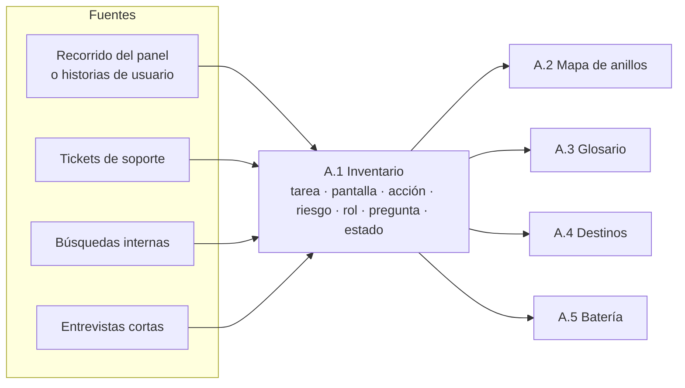

<a id="c9-3"></a>
### 9.3 Cómo se arma, paso a paso

1. **Fijar el alcance.** Partir de las diez tareas más frecuentes que dejó E0 ([§8](#c8)). No se inventaría el producto entero en la primera vuelta: se inventaría lo que el asistente va a cubrir, y se agranda en cada ciclo de medición ([§15](#c15)).
2. **Recorrer como un usuario nuevo.** Alguien que no conozca el producto lo recorre con cada rol y anota cada pantalla, cada acción y **cada palabra que no entiende**. Esas palabras van a una columna aparte, porque son el anillo 2 ([§4](#c4)).
3. **Pegar las preguntas reales.** Se juntan de tres a cinco preguntas por tarea (de soporte, de la búsqueda interna o de entrevistas), textuales y sin datos personales. Si una tarea no tiene ninguna pregunta real, se anota «sin evidencia». No se rellena con preguntas imaginadas.
4. **Marcar riesgo y rol.** Por cada acción: leer, actuar o irreversible, y qué roles la pueden hacer. Si dos roles ven cifras distintas para la misma pregunta, se anota, porque ahí va a hacer falta desambiguar ([§5](#c5-4)).
5. **Marcar el estado.** *Existe* se verifica en el sitio real, no en la demo ([P-8](#p-8)). *Planificada* lleva la historia y la fecha. *No se hace* lleva quién lo pidió y cuántas veces.
6. **Revisar y validar.** Quien diseña llena la tabla; quien atiende a los usuarios la revisa; y la valida quien decide sobre el producto, porque el estado *no se hace* es una decisión de producto ([§0](#c0)).

<a id="c9-escenarios"></a>
### 9.4 Aplicación por escenario

Sólo cambian las celdas de la tabla; el resto del capítulo vale igual para los dos escenarios.

Tabla 9.2. Inventario según el estado del sistema (criterio de la guía).

| Aspecto | Sistema existente | Sistema por desarrollar |
|---|---|---|
| Fuente de tareas | El panel recorrido: lo que se ve es el corpus | Las historias de usuario aprobadas y la maqueta |
| Fuente de preguntas reales | Tickets, búsquedas internas, analítica del panel | Entrevistas y pruebas con la maqueta; soporte de un producto vecino si existe |
| Verificación de *existe* | En el sitio real, con cada rol | No hay: todo arranca *planificada* |
| Riesgo principal | Prometer lo que el software no hace porque «se supone» | Que la ayuda no coincida con la pantalla cuando se construya |
| Remedio | Anclar cada fila en una captura o una ruta real | La fila del inventario es parte de la definición de terminado de la historia |
| Cuándo se actualiza | En cada ciclo de medición ([§15](#c15)) | En cada historia que se cierra |

Un producto existente al que se le suma un módulo nuevo mezcla los dos escenarios: cada fila toma la celda que le corresponde ([§0](#c0-2)).

<a id="c9-ejemplos"></a>
### 9.5 Ejemplos

Ejemplo neutro, un sistema de turnos para una clínica (ilustrativo, NO EJECUTADO):

Tabla 9.3. Tres filas de un inventario de turnos.

| Tarea | Pantallas | Acción · riesgo | Roles | Pregunta real (fuente) | Estado |
|---|---|---|---|---|---|
| Reprogramar un turno | Agenda › Turno | modificar · actuar | recepción | «¿cómo paso un turno al jueves?» (soporte) | existe |
| Ver ausencias del mes | Reportes › Asistencia | leer · leer | coordinación | «¿cuántos faltaron en marzo?» (búsqueda) | existe |
| Recordatorio por mensaje | — | — | — | «¿le avisa al paciente el día antes?» (soporte, 14 veces) | no se hace |

La tercera fila es la que más vale. Sin ella, ante «¿le avisa al paciente?», un modelo tiende a contestar que sí, porque es lo que hacen muchos sistemas parecidos ([REF-009]). Con ella, el asistente responde que el sistema no lo hace y el PO tiene un dato de demanda.

Los tres casos ilustrativos de la guía muestran filas de distinto tipo (ilustrativo, NO EJECUTADO).

Movilidad Urbana, una encuesta de uso del transporte sobre un alta, baja y modificación (ABM) de localidades:

Tabla 9.4. Dos filas de un inventario de Movilidad Urbana.

| Tarea | Pantallas | Acción · riesgo | Roles | Pregunta real | Estado |
|---|---|---|---|---|---|
| Dar de alta una localidad | Localidades | crear · actuar | operador | «¿cómo agrego Resistencia si ya está Corrientes?» | existe |
| Ver qué medios se usan más | — (no hay pantalla de resultados) | leer · leer | analista | «¿cuántos van en bondi?» | no se hace hoy en pantalla |

La segunda fila es una tarea sin pantalla: el analista no tiene dónde mirarla. Es el hueco que un asistente puede llenar con cifras calculadas por código, y la pregunta trae una palabra (bondi) que va al glosario.

Geometría, un laboratorio donde el alumno arma a mano la descripción de sus figuras y un validador la contrasta:

Tabla 9.5. Dos filas de un inventario de Geometría.

| Tarea | Pantallas | Acción · riesgo | Roles | Pregunta real | Estado |
|---|---|---|---|---|---|
| Cargar una versión nueva de la entrega | Entrega › Editar | modificar · actuar | alumno | «¿dónde pego el JSON otra vez?» | existe |
| Que me corrijan el JSON | — | — | — | «¿me lo arreglás?» | no se hace (por decisión didáctica) |

La segunda fila muestra que *no se hace* no siempre es una carencia: a veces es una regla del dominio. El asistente tiene que conocerla para no romperla.

PushDispatch, un servicio de notificaciones push con panel de administración (las filas completas están en [§18](#c18)):

Tabla 9.6. Dos filas de un inventario de PushDispatch.

| Tarea | Pantallas | Acción · riesgo | Roles | Pregunta real | Estado |
|---|---|---|---|---|---|
| Enviar un mensaje a un segmento | Mensajes › Nuevo | crear · irreversible (se envía) | titular, owner, member | «¿cómo mando una notificación sólo a Android?» | existe |
| Saber por qué no llegó un mensaje | Mensajes › Detalle; Suscripciones | leer · leer | titular, owner, member, desarrollador | «mandé y no le llegó a nadie» | existe |

La segunda fila cruza dos pantallas. Es el tipo de tarea en que la conversación le gana a la pantalla ([§8](#c8)), y conviene marcarla para la batería.

<a id="c9-decision"></a>
### 9.6 Decisión

- **¿Una fila o dos?** Si dos preguntas llevan a la misma pantalla y a la misma acción, es una tarea con dos preguntas. Si cambia la acción o el riesgo, son dos tareas.
- **¿Entra al inventario algo planificado?** Sí, con historia y fecha. Sin fecha, va como *no se hace*.
- **¿Hasta qué granularidad bajo?** Hasta donde cambia el rol, el riesgo o el destino. Un campo de formulario no es una tarea; una pantalla con dos acciones de distinto riesgo, sí son dos.
- **¿Cuándo está terminado?** Cuando cada fila tiene pantalla (o «—» si no se hace), riesgo, rol, al menos una pregunta real o la marca «sin evidencia», y estado verificado. Ver el criterio de terminado de [A.1](#anexo-a-1).

<a id="c9-preguntas"></a>
### 9.7 Preguntas guía

**¿Por qué no arrancar directamente escribiendo el prompt del asistente?** Porque el prompt describe una frontera que todavía no se conoce. Sin inventario, el prompt dice «ayudás con notificaciones», que es un tema, y el modelo completa el tema con lo que sabe de otros productos ([P-1](#p-1), [REF-009]). Con inventario, la frontera es una lista verificable. La regla de la guía es que ningún prompt se escribe antes de E3 ([§7](#c7)). Aplica siempre que el asistente vive dentro de un producto.

**¿Para qué anotar lo que el producto no hace, si el asistente no lo va a responder?** Porque sí lo va a responder: le van a preguntar. Si la fila no existe, la pregunta cae en el vacío y el modelo improvisa. Si existe, el asistente dice que no se hace y, si corresponde, deriva ([§3](#c3), anillo 3). Además, el conteo de pedidos es evidencia para el PO cuando decida mover la frontera ([§16](#c16)). Aplica sobre todo en productos con competidores conocidos, donde el usuario trae expectativas de afuera.

**Soporte no tiene registro de preguntas. ¿Invento unas razonables?** No. Se marca «sin evidencia» y se consiguen en la primera vuelta: cinco entrevistas cortas o una semana de anotar consultas alcanzan para arrancar. Una pregunta inventada por quien diseña usa el vocabulario de quien diseña, no el del inexperto. Ese es justamente el vocabulario que el glosario tiene que capturar ([P-6](#p-6), [§4](#c4)). Aplica a los dos escenarios; en el *por desarrollar* las preguntas salen de las pruebas con la maqueta.

**¿Hace falta el rol en el inventario, si después está en el catálogo de destinos?** Sí. El rol cambia la respuesta antes que el destino: un desarrollador y un titular que preguntan «¿cuántos suscriptores tengo?» pueden ver cifras distintas, o una de ellas no corresponder. Si el rol aparece recién en E4, la batería ya se escribió sin él y no prueba permisos ([§13](#c13)). Aplica cuando el producto tiene más de un rol con permisos distintos.

**¿Cómo sé que una tarea marcada *existe* existe de verdad?** Porque alguien la hizo en el sitio real, con ese rol, y dejó la captura o la ruta. Que funcione en la demo es una conducta en otro entorno, no una verificación ([P-8](#p-8)). Si nadie la ejecutó, la fila va **NO EJECUTADO** hasta que alguien la ejecute. Aplica sobre todo al sistema existente, donde «se supone que anda» es la fuente más común de promesas falsas.

<a id="c9-calidad"></a>
### 9.8 Criterios de calidad y antipatrones

Criterios de calidad (criterio de la guía):

- Cada tarea empieza con un verbo y la entiende alguien que no conoce el producto.
- Cada fila *existe* tiene su verificación en el sitio real, con el rol anotado.
- Hay al menos una fila *no se hace* por cada pedido recurrente de soporte.
- Las preguntas reales son textuales, con fuente y sin datos personales ([P-9](#p-9)).
- Las palabras que el recorrido no entendió están en su columna, listas para [A.3](#anexo-a-3).

Antipatrones:

- **Inventario de endpoints.** Lista lo que expone la API, no lo que quiere lograr el usuario. Sirve para [A.4](#anexo-a-4), no acá.
- **Inventario aspiracional.** Incluye funciones «que vamos a tener» sin historia ni fecha. Es la puerta directa a romper [P-4](#p-4).
- **Preguntas de quien diseña.** Todas suenan bien y ninguna usa una palabra mal. Señal de que no las hizo un usuario.
- **Un solo rol.** El recorrido se hizo con la cuenta de administración y todas las filas dicen «todos».
- **Inventario congelado.** Se llenó una vez y no se toca en los ciclos de medición; la frontera deja de moverse ([P-9](#p-9), [§15](#c15)).

<a id="c10"></a>
## Capítulo 10 · E2 Mapa de anillos

El inventario de E1 ([c9](#c9)) dice **qué hace la gente** con el producto y en qué pantallas. Esta etapa convierte esa lista en una decisión: **qué responde el asistente, cómo lo responde y qué no responde**. El entregable es el mapa de anillos, que se llena con la plantilla [A.2](#anexo-a-2) y lo firma el responsable de producto (PO). El capítulo no vuelve a explicar los anillos: eso está en [c3](#c3). Acá se enseña a *construir* el mapa, fila por fila, y a dejarlo listo para que E3 ([c11](#c11)), E4 ([c12](#c12)) y E5 ([c13](#c13)) trabajen sobre él. Los principios que se aplican son [P-1](#p-1) (competencia, no temas), [P-4](#p-4) (no prometer lo que el software no hace) y [P-6](#p-6) (el vocabulario del usuario marca su frontera).

<a id="c10-1"></a>
### 10.1 Definiciones de la etapa

- **Fila del mapa.** Una intención con un único anillo, un nivel de riesgo, los roles que pueden pedirla, la salida esperada y la fuente de la respuesta. Una fila es la unidad que después se prueba: cada pregunta de la batería apunta a una fila.
- **Intención.** Lo que el usuario quiere lograr, dicho en una frase con verbo: «saber cuántas suscripciones activas tengo», no «suscripciones». El mismo tema da varias intenciones, y cada una puede caer en un anillo distinto ([c3-1](#c3-1)).
- **Salida esperada.** La forma de la respuesta, no su texto: «cifra + enlace a la vista», «definición + pantalla donde aparece + pregunta sugerida», «derivación a X», «rechazo con ejemplos». El texto lo redacta el modelo; la forma la fija este mapa ([P-3](#p-3)).
- **Lista de no promesas.** La parte del mapa que enumera lo que el producto **no** hace y que el asistente nunca debe dar a entender que hace. Es la traducción operativa de [P-4](#p-4) y se firma junto con el mapa ([OA-PO2](#oa-po2)).
- **Fila huérfana.** Una intención del anillo 1 sin destino posible o sin fuente de dato, o una del anillo 2 sin término en el glosario. No se borra: se marca, y se resuelve en E3 o E4, o baja de anillo.

<a id="c10-2"></a>
### 10.2 Cómo se construye, paso a paso

Entrada: el inventario [A.1](#anexo-a-1) con tareas, pantallas y las preguntas reales que aportó soporte, si las hay. Salida: [A.2](#anexo-a-2) firmada. Tiempo de referencia para un producto mediano: una o dos sesiones de trabajo del equipo (criterio de la guía, no medido).

1. **Reescribir cada tarea como intenciones.** Por cada tarea del inventario, escribir las preguntas que hace alguien que la quiere hacer, que quiere un dato de ella o que no entiende un término de ella. Cada una es una candidata a fila.
2. **Asignar el anillo con una sola pregunta:** *¿qué logra el usuario con la respuesta?* Hacer o saber un dato suyo → 1. Entender un concepto para poder operar → 2. Saber a dónde ir con algo vecino → 3. Nada de eso dentro del producto → afuera ([Tabla 3.1](#c3-1)).
3. **Cruzar con riesgo y rol** sólo en el anillo 1: leer, actuar o irreversible, y qué roles pueden pedirla ([c3-2](#c3-2)). Si un rol no ve la pantalla, la fila dice qué se le responde a ese rol («quién puede hacerlo»), no se omite.
4. **Fijar salida y fuente.** Anillo 1: herramienta o dato del código y destino del catálogo ([c5](#c5), [c6](#c6)). Anillo 2: corpus de ayuda con cita. Anillo 3: derivación de una lista cerrada. Afuera: texto fijo con dos o tres ejemplos de lo que sí.
5. **Escribir la lista de no promesas.** Recorrer el anillo 1 y anotar las preguntas que *suenan* a una función que el producto no tiene. Cada una va a la lista con su respuesta: qué hace el producto en su lugar, si algo.
6. **Marcar las huérfanas** y anotar a qué etapa van: término faltante → E3; destino o herramienta faltante → E4; ninguna de las dos se puede resolver → la fila baja al anillo 2 (se explica) o a la lista de no promesas.
7. **Firmar.** El PO firma el mapa y la lista de no promesas. Desde ese momento, lo que no está en el mapa no se construye ni se acepta ([c3-1](#c3-1)).

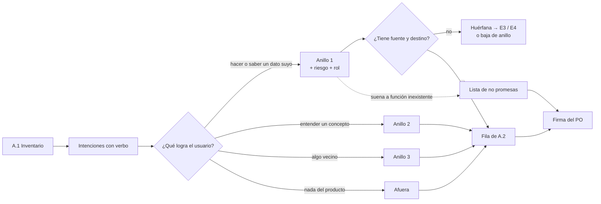

*Figura 10.1. Construcción del mapa de anillos en E2. Criterio de la guía.*

El mapa de E2 es un **borrador firmado**, no definitivo. En E5 cada pregunta de la batería se asigna a una fila; si más del 20 % no cae en una fila única, el mapa no sirve como contrato y se revisa ([c3-4](#c3-4)). Después, en producción, la frontera se mueve con la medición de E7 y vuelve a esta etapa ([c15](#c15), [c16](#c16)).

<a id="c10-escenarios"></a>
### 10.3 Aplicación por escenario

Sólo cambian estas celdas; el resto del procedimiento es igual.

| Aspecto | Sistema existente | Sistema por desarrollar |
|---|---|---|
| De dónde salen las intenciones | Preguntas reales de soporte, búsquedas internas, tickets; el vocabulario ya existe y hay que copiarlo | Del diseño de tareas y de entrevistas; el vocabulario se está inventando: anotar las palabras que usan los usuarios, no las del equipo |
| Lista de no promesas | Se llena con lo que los usuarios ya piden y el producto no hace: es la parte más rica | Se llena con lo que quedó fuera del alcance de la versión: cuidado con prometer lo que «va a venir» |
| Huérfanas | Destinos que existen pero no tienen identificador estable: se resuelve en E4 sin tocar pantallas | La fila puede pedir una pantalla o una consulta nueva: se anota como requisito del producto, no del asistente |
| Riesgo de error principal | Copiar el menú de la aplicación como mapa (temas, no competencias) | Mapear funciones planificadas que después no se construyen |

*Tabla 10.1. E2 según el estado del sistema. Criterio de la guía.*

<a id="c10-ejemplos"></a>
### 10.4 Ejemplos

Ejemplo neutro, un sistema de turnos para consultorios:

| Intención | Anillo | Riesgo | Roles | Salida esperada | Fuente |
|---|---|---|---|---|---|
| Saber cuántos turnos tengo mañana | 1 | leer | profesional, recepción | Cifra filtrada por agenda + enlace a la agenda del día | Herramienta de conteo |
| Cancelar todos los turnos del viernes | 1 | irreversible | recepción | Consecuencias (avisos a pacientes) + enlace a la pantalla; confirma la interfaz | Destino del catálogo |
| Qué es un «sobreturno» | 2 | — | todos | Definición + pantalla donde aparece + pregunta sugerida | Ayuda con cita |
| Cómo facturar a una obra social | 3 | — | todos | Derivación al sistema de facturación | Lista de derivaciones |
| Recomendame un antibiótico | afuera | — | todos | Rechazo amable + dos ejemplos de lo que sí | Texto fijo |

*Tabla 10.2. Cinco filas de un mapa de anillos de ejemplo.*

Lista de no promesas del mismo sistema: «mandar recordatorios por otro canal que el configurado», «reprogramar turnos automáticamente». Si alguien pregunta «¿podés reprogramarme los turnos del viernes?», la respuesta no es «sí» ni silencio: es qué hace el producto (cancelar con aviso) y dónde.

Los tres casos de la guía muestran el mismo corte con dominios distintos:

- **Movilidad Urbana** (app de estacionamiento medido): «¿cuánto me queda de estacionamiento?» es anillo 1 (dato suyo, sale del sistema); «¿qué es una zona tarifada?» es anillo 2; «¿cómo pago una multa de tránsito?» es anillo 3 si existe el sitio oficial al que derivar.
- **Geometría** (laboratorio para alumnos): «construí un triángulo con estos vértices» es anillo 1; «¿qué es una mediatriz?» es anillo 2, y es donde vive el alumno que recién empieza; «resolveme el práctico de física» queda afuera.
- **PushDispatch** (servicio de notificaciones push con panel de administración, tomado como producto diseñado desde cero): «¿cuántos mensajes envié la semana pasada?» es anillo 1, con la cifra calculada por el código y no por el modelo; «¿qué es una suscripción?» es anillo 2; las preguntas sobre la tienda de aplicaciones del sistema operativo del teléfono son anillo 3, para derivar. La fila completa está en [c18](#c18) y en el ejemplo de [A.2](#anexo-a-2).

Experiencia propia medida (conducta, caso PushDispatch): cuando las preguntas de prueba producían respuestas inventadas, la mayoría eran intenciones que no tenían fila. Lo que las corrigió fue agregar la fila con su salida esperada o pasarla a la lista de no promesas.

<a id="c10-decision"></a>
### 10.5 Decisión

- **Una intención dudosa entre anillo 1 y 2** va al 1 si existe un dato o destino del usuario que la responde; si no, al 2. Ante la duda, se escriben dos filas con dos intenciones distintas, no una fila con dos anillos.
- **Una intención dudosa entre anillo 3 y afuera** va al 3 sólo si hay un lugar concreto y estable al que derivar; sin ese lugar, es afuera. Derivar a «buscá en internet» no es derivar.
- **Una función pedida que no existe** va a la lista de no promesas, nunca al anillo 1 con salida vaga.
- **Si el mapa crece sin control** (más filas que preguntas reales), se recorta a las intenciones que aparecen en el inventario; el resto espera a la medición ([P-9](#p-9)).

<a id="c10-preguntas"></a>
### 10.6 Preguntas guía

**¿Por qué el mapa se arma por intenciones y no copiando el menú de la aplicación? (OA-EQ3)** Porque el menú agrupa por tema y el anillo depende de lo que el usuario logra ([P-1](#p-1)). Una sola entrada del menú, «Suscripciones», contiene intenciones del anillo 1 (contar las activas), del 2 (qué es una) y hasta del 3. Copiar el menú da un mapa que parece completo y no le dice al desarrollador qué salida construir ni a QA qué esperar. Aplica siempre, y con más fuerza en un sistema existente, donde el menú está a mano y tienta.

**¿Quién firma el mapa y por qué no lo firma quien lo llena? (OA-PO2)** Lo llenan diseño y desarrollo; lo firma el PO, porque cada fila es una promesa de producto: decir que algo está en el anillo 1 compromete datos reales y acciones ([P-4](#p-4)). La lista de no promesas también la firma el PO, porque decir «esto no lo hacemos» es una decisión comercial, no técnica. Aplica en cada versión del mapa, incluidas las que vuelven de E7 ([c16](#c16)).

**¿Qué hago con una pregunta frecuente que el producto no puede responder? (OA-PO2)** Va a la lista de no promesas con una respuesta que diga qué hace el producto en su lugar y dónde. No se deja sin fila: sin fila, el modelo la contesta con lo que encuentre, y ahí aparece la invención ([P-5](#p-5)) [REF-009]. Si la pregunta es muy frecuente, además es un dato para el producto: la medición de [c15](#c15) lo muestra y el PO decide si se construye la función.

**¿Cuándo una fila del anillo 1 está lista para pasar a E4? (OA-DEV1)** Cuando tiene intención con verbo, riesgo, roles, salida esperada y una fuente nombrada (una herramienta que devuelve el dato o un destino del catálogo). Si le falta la fuente, es huérfana y E4 ([c12](#c12)) tiene que crear el destino o la herramienta, o la fila baja de anillo. Aplica sobre todo en sistemas por desarrollar, donde la pantalla todavía no existe.

**¿Cómo sé que el mapa está mal antes de construir nada? (OA-QA1)** Asignando a filas un puñado de preguntas reales del inventario: si más de una de cada cinco no cae en una fila única, el mapa no es contrato todavía ([c3-4](#c3-4)). Primero se sospecha del vocabulario y se revisa el glosario ([c11](#c11)); si sigue, esa parte del producto se diseña por intenciones con respaldo ([c3-3](#c3-3)) [REF-012]. Aplica al cerrar E2 y otra vez en E5 con la batería completa.

<a id="c10-calidad"></a>
### 10.7 Criterios de calidad y antipatrones

Criterio de terminado de E2 (se repite en [A.2](#anexo-a-2)):

- Toda tarea del inventario tiene al menos una fila.
- Toda fila tiene un único anillo; las del anillo 1, riesgo, roles y fuente.
- Ninguna fila del anillo 1 tiene como salida «explicar cómo se haría» algo que el producto no hace: eso está en la lista de no promesas.
- Toda derivación del anillo 3 apunta a un lugar concreto.
- El rechazo de «afuera» trae ejemplos de lo que sí se responde [REF-004].
- Las huérfanas tienen etapa de destino anotada.
- Firma del PO con fecha.

Antipatrones:

| Antipatrón | Por qué falla | Corrección |
|---|---|---|
| Mapa por temas (copia del menú) | No dice qué salida construir ni qué probar | Reescribir como intenciones con verbo |
| Fila con dos anillos | QA no sabe qué esperar; el modelo elige | Partir en dos intenciones |
| Anillo 1 «optimista» con funciones planificadas | El asistente promete lo que no existe ([P-4](#p-4)) | Lista de no promesas hasta que la función salga |
| Anillo 3 sin lugar de derivación | Es conocimiento general disfrazado de producto | Bajar a afuera o nombrar el lugar |
| Afuera vacío | Se responde todo «por las dudas» y la frontera desaparece | Escribir el rechazo y sus ejemplos |
| Mapa que no vuelve a abrirse | La frontera queda fija aunque la medición diga otra cosa | Revisión en cada ciclo de E7 ([c16](#c16)) |

*Tabla 10.3. Antipatrones del mapa de anillos. Criterio de la guía.*

<a id="c11"></a>
## Capítulo 11 · E3 Glosario y sinónimos

> **Qué vas a poder hacer al terminar.** Llenar la plantilla A.3 ([anexo-a-3](#anexo-a-3)) a partir del inventario y del mapa de anillos, clasificar cada sinónimo, decidir qué término se explica la primera vez y reconocer cuándo el glosario está listo para pasar a la etapa siguiente (OA-DIS1, OA-EQ3, OA-EQ4).

El capítulo 4 ([c4](#c4)) explicó *por qué* el vocabulario del inexperto marca su frontera y *qué* son el glosario, los sinónimos, la explicación de primera vez y las preguntas sugeridas. Este capítulo muestra cómo se produce ese entregable en cualquier sistema: entradas, pasos, plantilla y compuerta. No reenuncia los conceptos: los usa. El principio que gobierna la etapa es P-6 ([p-6](#p-6)); la regla del flujo que la vuelve obligatoria es que ningún prompt se escribe antes de E3 ([c7](#c7)).

<a id="c11-1"></a>
### 11.1 Definición de la etapa

<a id="c11-1-1"></a>
**E3.** La tercera etapa del método. Toma el inventario de tareas y pantallas de E1 ([c9](#c9), A.1) y el mapa de anillos de E2 ([c10](#c10), A.2) y devuelve el glosario con sus sinónimos (A.3). Lo llena quien diseña la conversación (rol DIS), con quien atiende a los usuarios (rol SOP) como fuente de vocabulario, y lo aprueba quien decide sobre el producto (PO). En un proyecto chico, o en un trabajo práctico, una misma persona puede cubrir los tres roles; lo que no cambia es que alguien distinto del redactor revise las clases.

<a id="c11-1-2"></a>
**Entrada de glosario.** Una fila de A.3. Tiene un término del producto, una definición llana de una o dos oraciones, la pantalla donde aparece, el anillo al que pertenece, sus sinónimos clasificados (equivalente, cercano, falso amigo; ver [c4-1-4](#c4-1-4)), si se explica la primera vez y la fuente de la que salió cada sinónimo.

<a id="c11-1-3"></a>
**Compuerta de E3.** La condición para pasar a E4: *cada concepto del anillo 2 del mapa tiene su entrada, y cada entrada tiene al menos un sinónimo con fuente* (criterio de la guía). La compuerta no mide la cantidad de palabras: mide que no quede un concepto necesario para operar sin nombre del lado del usuario.

<a id="c11-1-4"></a>
**Fuente del sinónimo.** De dónde salió la palabra: recorrido de un usuario nuevo, consulta de soporte, entrevista o historia, medición en producción ([c4-3](#c4-3)). Un sinónimo sin fuente es una suposición del equipo y se rotula **NO VERIFICADO** hasta que alguna fuente lo confirme.

<a id="c11-2"></a>
### 11.2 Entradas, pasos y salida

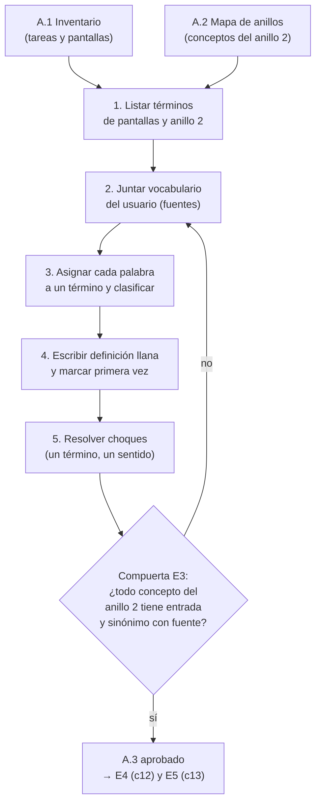

*Figura 11.1. Flujo de E3. El regreso desde la compuerta va a juntar vocabulario, no a inventarlo.*

Los cinco pasos, con lo que cada uno produce:

1. **Listar los términos.** Se recorren las columnas «pantalla» y «concepto» de A.1 y los conceptos que A.2 ubicó en el anillo 2. Cada etiqueta visible del producto que el usuario tiene que entender para operar es un candidato. Las etiquetas puramente decorativas no entran.
2. **Juntar el vocabulario.** Con las fuentes de la Tabla 4.1 ([c4-3](#c4-3)). Lo mínimo para una primera vuelta es un recorrido del producto hecho por alguien que no lo conoce, anotando en voz alta cada palabra que usa para pedir algo. De las consultas de soporte se extraen palabras, nunca se copian consultas enteras (P-9, [p-9](#p-9)).
3. **Asignar y clasificar.** Cada palabra del usuario va a un único término y recibe su clase. Una palabra que no cae en ningún término es una señal: o falta una entrada, o pertenece al anillo 3 o afuera, y vuelve a A.2 ([c10](#c10)).
4. **Definir y marcar primera vez.** La definición se escribe para el que recién llega, sin usar otro término del glosario que no esté definido antes. Se marca «explicar la primera vez» en los términos del anillo 2; en los del anillo 1 que el usuario ya ve en pantalla con contexto suficiente, no hace falta.
5. **Resolver choques.** Si una misma palabra del usuario apunta a dos términos, es un falso amigo o un cercano, y se anota la pregunta de aclaración. Si un mismo término tiene dos sentidos en el producto, el problema no es del glosario sino del producto: se eleva al PO (ver [c11-decision](#c11-decision)).

La salida alimenta dos etapas. En E4 ([c12](#c12)), los términos nombran los destinos y los parámetros de las herramientas. En E5 ([c13](#c13)), cada sinónimo cercano o falso amigo se convierte en al menos una pregunta de la batería, porque es exactamente donde el asistente puede equivocarse.

<a id="c11-3"></a>
### 11.3 La plantilla A.3

La plantilla completa, comentada, está en el Anexo A ([anexo-a-3](#anexo-a-3)). Su forma:

| Término | Definición llana | Pantalla | Anillo | Sinónimos (clase · fuente) | Primera vez | Aclaración si es ambiguo |
|---|---|---|---|---|---|---|
| Suscripción | Un dispositivo o navegador que aceptó recibir notificaciones de una aplicación. Una persona puede tener varias. | Suscripciones | 2 | «mis usuarios» (cercano · soporte); «dispositivos» (equivalente · recorrido); «contactos» (cercano · entrevista) | Sí | «¿Querés contar dispositivos o personas? El panel cuenta dispositivos.» |
| Medio de transporte | Cómo viaja la persona encuestada; puede marcar más de uno. | Encuesta, paso 2 | 2 | «bondi» (equivalente de *colectivo* · recorrido); «a pata» (equivalente de *caminata* · recorrido); «subte» (sin término: fuera del catálogo) | Sí | — |
| Valor derivado | El que el validador calcula a partir de las piezas, para compararlo con el que declaró el alumno. | Resultado de la validación | 2 | «el resultado correcto» (falso amigo · entrevista) | Sí | «¿Te referís a lo que calculó el validador o a lo que escribiste vos?» |
| | | | | | | |

*Tabla 11.1. Forma de la plantilla A.3, con una fila de ejemplo de cada caso de la guía (PushDispatch, Movilidad Urbana, Geometría) y una vacía. Las filas son ilustrativas.*

Tres columnas merecen un comentario. *Anillo* se copia de A.2 y no se decide acá: si la etapa descubre que un término está mal ubicado, se corrige A.2 y se vuelve a aprobar. *Primera vez* es una decisión de redacción, no de contenido: el texto de la explicación es la misma definición llana. *Aclaración* sólo se llena para cercanos y falsos amigos, y se escribe como pregunta corta con las opciones a la vista (criterio de la guía).

Un snippet representativo de cómo el código puede consumir la tabla antes de llamar al modelo (la resolución de sinónimos equivalentes no necesita al modelo, P-3, [p-3](#p-3)):

```json
// glosario/suscripcion.json (forma ilustrativa de una fila de A.3)
{
  "termino": "suscripcion",
  "definicion": "Un dispositivo o navegador que aceptó recibir notificaciones de una aplicación.",
  "anillo": 2,
  "explicarPrimeraVez": true,
  "sinonimos": [
    { "forma": "dispositivos", "clase": "equivalente", "fuente": "recorrido" },
    { "forma": "mis usuarios", "clase": "cercano", "fuente": "soporte",
      "aclaracion": "¿Querés contar dispositivos o personas? El panel cuenta dispositivos." }
  ]
  // …
}
```

<a id="c11-escenarios"></a>
### 11.4 Sistema existente y por desarrollar

Sólo cambian estas celdas:

| Aspecto | Sistema existente | Sistema por desarrollar |
|---|---|---|
| De dónde salen los términos | De las etiquetas reales de las pantallas y de la ayuda publicada | De las historias de usuario y del modelo de dominio; el glosario se fija antes que la interfaz y le pone nombre a las pantallas |
| De dónde salen los sinónimos | De consultas de soporte, búsquedas y el recorrido de un usuario nuevo sobre el producto en marcha | De entrevistas y de un recorrido sobre la maqueta (E6, [c14](#c14)); quedan **NO VERIFICADO** hasta la primera medición |
| Choque término-producto | Si la pantalla dice algo que confunde, se anota y se propone el cambio de etiqueta, pero el glosario sigue la pantalla mientras no cambie | Se corrige en el diseño: es el momento más barato para elegir la palabra del usuario como etiqueta |
| Segunda vuelta | Llega desde el plan de medición (E7, [c15](#c15)) con los no-encontrados por intención | Igual, y además cuando la interfaz real reemplaza a la maqueta |

*Tabla 11.2. Diferencias de E3 por escenario (criterio de la guía).*

<a id="c11-ejemplos"></a>
### 11.5 Ejemplo trabajado

El ejemplo central es PushDispatch, el servicio de notificaciones push que la guía usa como caso, y su asistente de consola. El mapa de anillos (A.2) ubica en el anillo 2 cuatro conceptos: *suscripción*, *segmento*, *mensaje programado* y *credencial*. Una persona del área comercial, que nunca usó el panel, lo recorre en voz alta durante veinte minutos; el soporte aporta las palabras de las últimas consultas.

- **«Mis usuarios»** aparece en el recorrido y en soporte. Se asigna a *suscripción* como **cercano**, porque el panel cuenta dispositivos y una persona puede tener varios. Se escribe la aclaración y entra a la batería como pregunta: «¿cuántos usuarios tengo?».
- **«Grupo»** y **«lista»** se asignan a *segmento* como **equivalentes**: se resuelven en silencio.
- **«Usuario»** también lo usa la persona para referirse a sí misma y a sus compañeros que entran al panel. Es un **falso amigo** entre *suscripción* y *miembro del equipo*. Falta la entrada *miembro del equipo*: el paso 3 la descubre y la agrega, y como pertenece a la gestión de accesos se confirma su anillo en A.2.
- **«La clave»** aparece en soporte. Puede ser la contraseña personal o la *credencial* de la aplicación. Falso amigo; la aclaración nombra las dos opciones.
- **«Campaña»** no cae en ningún término. El equipo no la asigna a *mensaje programado* por parecido: la devuelve a A.2, que decide si el producto tiene ese concepto o si es una pregunta del anillo 3 que se orienta sin inventar (P-4, [p-4](#p-4); P-5, [p-5](#p-5)).

La compuerta pasa cuando los cuatro conceptos, más el agregado, tienen entrada y sinónimo con fuente.

Los otros dos casos muestran variantes del mismo paso. En **Movilidad Urbana** (una encuesta de uso del transporte), el vocabulario coloquial es casi todo **equivalente**: «bondi», «bici», «a pata», «laburo», «facu» se traducen en silencio al catálogo. Lo interesante son las palabras que no tienen término, como «subte», «taxi» o «avión»: no se fuerzan a «otro medio», vuelven a A.2 y terminan en una aclaración o en un rechazo amable. Y hay una ambigüedad del dominio que ningún sinónimo resuelve: *Corrientes* es una localidad y también una provincia, así que la entrada lleva su pregunta de aclaración. En **Geometría** (un laboratorio donde el alumno describe figuras y un validador las compara), el choque fuerte es «el resultado correcto», que el alumno usa tanto para lo que declaró como para lo que calculó el validador: un **falso amigo** entre *valor declarado* y *valor derivado*. Ahí la explicación de primera vez no es opcional, porque confundir los dos términos lleva al alumno a «corregir» lo que estaba bien.

Los tres recorridos son ejemplos construidos para la guía, no mediciones.

<a id="c11-decision"></a>
### 11.6 Qué se decide y quién

| Decisión | Quién | Criterio |
|---|---|---|
| Qué términos entran | DIS propone, PO aprueba | Todo concepto del anillo 2; del anillo 1, sólo los que el usuario nombra distinto que la pantalla |
| Clase de cada sinónimo | DIS, con SOP | Equivalente si nunca cambia la respuesta; si alguna vez la cambia, cercano o falso amigo |
| Explicar la primera vez | DIS | Sí en el anillo 2; no cuando la pantalla ya muestra el contexto |
| Un término con dos sentidos en el producto | PO | Se elige uno para el glosario y se abre el cambio de producto; el asistente no tapa una ambigüedad de la interfaz |
| Palabra sin término | DIS devuelve a E2 | No se fuerza: se ubica en el mapa de anillos |

*Tabla 11.3. Decisiones de E3 (criterio de la guía).*

<a id="c11-preguntas"></a>
### 11.7 Preguntas guía

**¿Por qué no puedo dejar que el modelo entienda los sinónimos solo, si los modelos de lenguaje ya los manejan? (OA-DIS1)** Porque los equivalentes los resuelve bien, pero los cercanos y los falsos amigos no son un problema de lenguaje sino de producto: «mis usuarios» es sinónimo de «suscripciones» sólo si se aclara que el panel cuenta dispositivos. Esa diferencia la conoce quien diseña el producto, no el modelo. Además, sin la tabla no hay forma de probarlo en la batería ([c13](#c13)) ni de medirlo después ([c15](#c15)). Aplica siempre que el sinónimo pueda cambiar una cifra o una acción.

**¿Cuántas entradas tiene que tener el glosario para pasar la compuerta? (OA-EQ4)** No hay número. La compuerta pregunta otra cosa: que ningún concepto del anillo 2 quede sin entrada y que cada entrada tenga al menos un sinónimo con fuente ([c11-1-3](#c11-1-3)). Un glosario de seis entradas bien cosechadas vale más que uno de cuarenta copiado del menú. Si el número crece mucho, conviene revisar el mapa: puede que el asistente esté cubriendo demasiado ([c10](#c10)).

**Encontramos una palabra del usuario que no corresponde a ningún término. ¿La agrego como sinónimo del más parecido? (OA-EQ3)** No. Es la señal de que falta una entrada o de que la pregunta está en otro anillo. Vuelve a E2 y se ubica ([c10](#c10)). Forzarla al término más parecido es la forma silenciosa de prometer lo que el software no hace (P-4, [p-4](#p-4)). Aplica sobre todo en sistemas por desarrollar, donde el usuario nombra cosas que todavía no existen.

**El producto usa una palabra que los usuarios no entienden. ¿Lo arregla el glosario? (OA-DIS1)** Lo mitiga: el sinónimo y la explicación de primera vez hacen que el asistente traduzca. Pero el arreglo de fondo es cambiar la etiqueta, y esa decisión es del PO (Tabla 11.3). En un sistema por desarrollar, conviene cambiarla ahora; en uno existente, se anota el pedido y el glosario se mantiene fiel a la pantalla hasta que cambie, porque el asistente tiene que hablar de lo que el usuario ve ([c11-escenarios](#c11-escenarios)).

**¿Puedo escribir el prompt del asistente mientras termino el glosario? (OA-EQ4)** No conviene. El prompt y las descripciones de herramientas usan los términos; si el glosario cambia después, quedan dos vocabularios y la batería mide uno distinto del que el asistente usa. Por eso la regla del flujo es que ningún prompt se escribe antes de E3 ([c7](#c7)). Lo que sí se puede adelantar en paralelo es juntar preguntas para la batería.

<a id="c11-calidad"></a>
### 11.8 Criterios de calidad y antipatrones

Criterios de terminado:

- Cada concepto del anillo 2 de A.2 tiene su fila en A.3.
- Cada fila tiene definición llana, pantalla, anillo y al menos un sinónimo con fuente.
- Cada cercano y cada falso amigo tiene su aclaración escrita y está en la lista de preguntas para E5 ([c13](#c13)).
- Ninguna palabra del usuario apunta a dos términos sin aclaración, y ningún término tiene dos sentidos (Anexo C, [anexo-c](#anexo-c)).
- Los sinónimos sin fuente están rotulados **NO VERIFICADO**.
- Quien decide sobre el producto lo aprobó.

Antipatrones:

- Glosario escrito en una reunión de quienes ya conocen el producto, sin un solo usuario nuevo de por medio: reproduce la jerga interna.
- Copiar el menú del producto como glosario: tiene todos los términos y ningún sinónimo.
- Guardar consultas de soporte enteras como «fuente»: se extraen palabras, no textos (P-9, [p-9](#p-9)).
- Marcar todo como equivalente para no escribir aclaraciones.
- Usar el glosario para esconder una etiqueta confusa en lugar de pedir el cambio.

<a id="c12"></a>
## Capítulo 12 · E4 Catálogo de destinos y herramientas

El mapa de anillos de E2 ([c10](#c10)) dice, fila por fila, qué salida espera cada intención y de qué fuente sale. El glosario de E3 ([c11](#c11)) asegura que el asistente entienda cómo pregunta el usuario. Esta etapa construye **las únicas dos cosas del anillo 1 que el modelo no puede inventar**: los destinos a los que el asistente puede llevar y las herramientas que le entregan datos de la cuenta. El entregable es el catálogo, que se llena con la plantilla [A.4](#anexo-a-4); lo arman, en cualquier proyecto, quienes desarrollan junto con quienes diseñan, y lo revisa quien responde por el producto (el PO). El capítulo no vuelve a explicar qué es un destino ni por qué el catálogo es cerrado ([c5](#c5)), ni cuándo responde una herramienta y cuándo la ayuda con cita ([c6](#c6)): acá se enseña a *producir* el catálogo y a dejarlo listo para la batería de E5 ([c13](#c13)). Se aplican [P-3](#p-3) (el código elige, el modelo redacta), [P-4](#p-4) (no prometer lo que el software no hace) y [P-5](#p-5) («No está en la ayuda» antes que inventar).

<a id="c12-1"></a>
### 12.1 Definiciones de la etapa

- **Entrada de destino.** Una fila de A.4 con Id estable, plantilla de ruta, parámetros, permiso requerido, etiqueta del chip y filas del mapa que lo usan. El Id es lo que se versiona; la ruta puede cambiar sin que cambie el Id.
- **Entrada de herramienta.** Una fila de A.4 con nombre, intención o intenciones que responde, parámetros con su rango, qué devuelve (total, desglose, candidatas, nota de métrica), permiso con el que consulta y comportamiento ante vacío y ante ambigüedad ([c6-3](#c6-3)).
- **Contrato de herramienta.** La parte de la entrada que el modelo ve: nombre, descripción en una frase y parámetros. El resto (cómo calcula, qué filtra) es del código y el modelo no lo necesita. La idea de un modelo que decide cuándo llamar a una función externa e incorpora su resultado está descripta como *Toolformer* [REF-011]; el diseño del contrato es criterio de la guía.
- **Cobertura del anillo 1.** La proporción de filas del anillo 1 de A.2 que tienen al menos una fuente en A.4 (destino, herramienta o ambos). La meta de cierre es el 100 %: las que no la tienen son huérfanas y no pasan a E5.
- **Destino pendiente.** Una entrada que el mapa necesita pero el producto todavía no ofrece (no hay pantalla, o la pantalla no admite parámetros estables). Se anota con estado *pendiente* y **no se publica**: el asistente responde en texto, sin chip, y nunca dice que «pronto» podrá llevar ahí ([P-4](#p-4)).

<a id="c12-2"></a>
### 12.2 Cómo se construye, paso a paso

Entrada: el mapa firmado [A.2](#anexo-a-2), el glosario [A.3](#anexo-a-3) y el inventario de pantallas [A.1](#anexo-a-1). Salida: [A.4](#anexo-a-4) revisada. Como orden de magnitud para un producto mediano: una sesión de diseño más el desarrollo de las herramientas (criterio de la guía, no medido).

1. **Listar las fuentes que pide el mapa.** Recorrer el anillo 1 de A.2 y anotar, por fila, si su salida esperada necesita un destino («enlace a la vista»), un dato («cifra filtrada») o los dos. Las filas del anillo 2 no piden herramienta: su fuente es la ayuda con cita; a lo sumo piden un destino («pantalla donde aparece el término»).
2. **Agrupar destinos por pantalla + acción.** Varias intenciones suelen terminar en la misma pantalla («crear un mensaje», «mandar una prueba»). Un destino por par pantalla-acción, no por intención: el catálogo chico es más fácil de revalidar y de probar.
3. **Fijar Id, ruta, parámetros y permiso.** El Id se escribe en el idioma del dominio y no depende de la URL (`mensajes.nuevo`, no `/apps/{id}/messages/new`). El permiso es **el mismo** que exige la pantalla al abrirse: si difieren, la revalidación 1 dice sí y la 2 dice no, y el usuario ve un chip que lo lleva a un «acceso denegado» ([c5-3](#c5-3)).
4. **Agrupar datos en pocas herramientas.** Una herramienta por familia de consultas (conteos de suscripciones, actividad de mensajes), con parámetros acotados, no una por pregunta. Cada herramienta devuelve el total, el desglose ofrecido y la nota de métrica ([c6](#c6-def-nota-metrica)), y devuelve **candidatas con cifra** cuando el nombre es ambiguo, ya filtradas por permiso ([c5-4](#c5-4)).
5. **Escribir el contrato que ve el modelo.** Una frase por herramienta que diga qué responde y qué no («Cuenta suscripciones de una aplicación; no informa entregas»), y parámetros con rango. La frase de exclusión es la que evita que el modelo use la herramienta para una pregunta vecina y redacte una cifra que no corresponde.
6. **Marcar pendientes y cerrar la cobertura.** Toda fila del anillo 1 sin fuente vuelve a E2: baja de anillo, va a la lista de no promesas o queda como requisito de producto con su destino *pendiente*.
7. **Versionar y revisar.** A.4 lleva número de versión y fecha. Quien responde por el producto revisa que ninguna entrada prometa una acción que la lista de no promesas excluye; desarrollo confirma que cada permiso coincide con el de la pantalla.

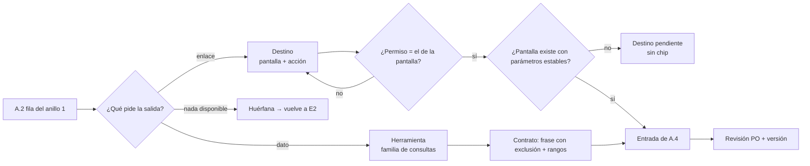

*Figura 12.1. Construcción del catálogo en E4. Criterio de la guía.*

La forma en código del catálogo cerrado, de la herramienta que calcula y de la revalidación está en los snippets [S-1](#c6-s-1), [S-2](#c6-s-2) y [S-3](#c6-s-3) del capítulo 6; la integración con el registro de herramientas de la capa de IA, en [c17](#c17).

<a id="c12-escenarios"></a>
### 12.3 Aplicación por escenario

Sólo cambian estas celdas.

| Aspecto | Sistema existente | Sistema por desarrollar |
|---|---|---|
| De dónde salen los destinos | De las rutas que ya existen: se catalogan | Se diseñan las rutas pensando en que sean direccionables desde el día uno |
| Problema típico | Rutas sin parámetros estables o que dependen del estado de la sesión: el enlace es frágil | Destinos para pantallas que se postergan: quedan *pendientes* y no se publican |
| Herramientas | Se envuelven servicios de consulta existentes, de sólo lectura, sin tocar el dominio | Se piden como consultas agregadas con permiso en el diseño de los servicios |
| Permiso | Se copia del que ya exige la pantalla; si no está claro, es un hallazgo del producto | Se define una vez en el modelo de autorización y lo usan la pantalla y el catálogo |
| Riesgo de error principal | Catalogar todo el menú en vez de lo que pide el mapa | Catalogar destinos de funciones que después no se construyen ([P-4](#p-4)) |

*Tabla 12.1. E4 según el estado del sistema. Criterio de la guía.*

<a id="c12-ejemplos"></a>
### 12.4 Ejemplos

Ejemplo neutro, el mismo sistema de turnos para consultorios de [c10-ejemplos](#c10-ejemplos):

| Tipo | Id / nombre | Ruta o parámetros | Permiso | Responde / etiqueta | Filas de A.2 |
|---|---|---|---|---|---|
| Destino | `agenda.dia` | `/agenda/{profesional}/{fecha}` | ver agenda | «Ver la agenda del día» | Saber cuántos turnos tengo mañana |
| Destino | `turnos.cancelar-lote` | `/turnos/cancelar?fecha={fecha}` | cancelar turnos | «Ir a cancelar turnos» | Cancelar todos los turnos del viernes |
| Herramienta | `contar_turnos` | profesional (de los visibles), fecha (hoy a +60 días) | ver agenda | Total + desglose por estado ofrecido; nota «cuenta turnos confirmados y pendientes, no cancelados»; candidatas si el profesional es ambiguo | Saber cuántos turnos tengo mañana |
| Destino pendiente | `turnos.reprogramar` | — | — | — (sin chip) | Lista de no promesas |

*Tabla 12.2. Entradas de un catálogo de ejemplo.*

Notar dos cosas. La acción irreversible (cancelar en lote) tiene destino pero no herramienta: el asistente lleva a la pantalla y explica las consecuencias, y **confirma la interfaz**, no la conversación. Y la reprogramación figura como pendiente para que nadie la catalogue por error en la próxima versión.

Los tres casos ilustrativos de la guía muestran el mismo método con catálogos de forma distinta:

- **Movilidad Urbana** (consulta ciudadana): pocos destinos públicos («ver el estado de mi trámite», «ir a pagar») y una herramienta de consulta acotada al propio usuario. El permiso es casi siempre «el titular del trámite»; el cuidado está en que la herramienta nunca devuelva candidatas de otra persona.
- **Geometría** (ejercicios para alumnos): casi no hay datos de cuenta; el catálogo es sobre todo de destinos («abrir el ejercicio», «ver la construcción paso a paso») y la herramienta, cuando existe, valida o describe lo que el alumno armó, sin resolverlo por él.
- **PushDispatch** (panel de administración de notificaciones push, presentado como producto diseñado desde cero): pocos destinos por pantalla y acción (aplicaciones, suscripciones, mensajes, credenciales), cada uno con el permiso que la pantalla ya exige según el rol, y pocas herramientas de conteo y actividad que devuelven total, desglose ofrecido y nota de métrica.

Experiencia propia medida (conducta, caso PushDispatch): en una ronda temprana el modelo proponía rutas plausibles que no existían; con el catálogo cerrado el peor caso pasó a ser «no hay chip». También se observó que revalidar el destino sólo al dibujar el chip no alcanza: el permiso tiene que coincidir con el de la pantalla, o el usuario termina en un acceso denegado.

Los asistentes de productos comerciales muestran el mismo patrón visible: una cifra agregada, un chip que lleva a la vista correspondiente y, ante un nombre aproximado, las coincidencias con su cifra. Se toma la forma como práctica observable; el catálogo y los permisos son de cada sistema ([c14](#c14)).

<a id="c12-decision"></a>
### 12.5 Decisión

- **¿Destino, herramienta o los dos?** Si la salida esperada lleva a hacer algo, destino. Si da un dato de la cuenta, herramienta. Si da un dato que invita a actuar («tenés 3 credenciales por vencer»), los dos, y el destino se elige por código a partir del resultado de la herramienta.
- **¿Una herramienta nueva o un parámetro más?** Parámetro, si la consulta es la misma familia y el permiso es el mismo; herramienta nueva, si cambia el permiso o la nota de métrica.
- **¿Acción por herramienta?** No en esta guía: las herramientas son de lectura. Las acciones se hacen en la pantalla, con su confirmación. Si el producto decide algún día que el asistente actúe, es una decisión de riesgo del responsable del producto y vuelve a E2 ([c3-2](#c3-2)).
- **¿Ruta frágil?** Si la pantalla no admite parámetros estables, el destino lleva a la pantalla padre con etiqueta honesta («Ir a mensajes») o queda pendiente; nunca se arma la ruta con datos que el modelo trae.

<a id="c12-preguntas"></a>
### 12.6 Preguntas guía

**¿Por qué el permiso del destino tiene que ser el mismo que el de la pantalla? (OA-DEV1)** Porque la revalidación 1 decide si se dibuja el chip y la 2 la hace la pantalla ([c5-3](#c5-3)). Si el catálogo es más permisivo, el usuario recibe un chip que lo lleva a un rechazo; si es más estricto, se le niega un atajo a algo que puede hacer y se lo deriva sin motivo. Aplica a todo destino; en un sistema por desarrollar se resuelve definiendo el permiso una sola vez en el modelo de autorización.

**¿Qué ve el modelo de una herramienta y por qué tan poco? (OA-DEV2)** Ve el nombre, una frase con lo que responde y lo que no, y los parámetros con rango. No ve cómo calcula ni qué filtra, porque eso no lo decide él ([P-3](#p-3)). La frase de exclusión es la que más rinde: sin ella el modelo usa una herramienta vecina para una pregunta que no le corresponde y redacta una cifra con aspecto correcto [REF-009]. Aplica al escribir cada contrato y cada vez que la batería muestra una herramienta equivocada.

**¿Qué hago con una fila del anillo 1 que no tiene pantalla todavía? (OA-PO2)** Se cataloga como destino *pendiente*, sin publicar, y el asistente responde en texto sin chip. No se escribe «próximamente» ni se insinúa la función ([P-4](#p-4)). Si la fila tampoco tiene dato, vuelve a E2 ([c10-decision](#c10-decision)). Aplica sobre todo en sistemas por desarrollar, donde el mapa corre por delante de las pantallas.

**¿Cómo sé que el catálogo está completo? (OA-DEV1)** Por cobertura, no por tamaño: toda fila del anillo 1 de A.2 tiene una fuente en A.4, y toda entrada de A.4 la usa al menos una fila. Una entrada que no usa nadie es un destino o una herramienta sin intención: se borra o se pregunta al mapa por qué no está. La prueba fina llega en E5, donde cada pregunta de la batería registra qué herramienta y qué destino esperaba ([c13](#c13)). Aplica al cerrar E4 y en cada vuelta desde la medición ([c15](#c15)).

**¿Por qué las herramientas devuelven candidatas en lugar de elegir? (OA-DIS2)** Porque elegir la primera coincidencia da una cifra de otra aplicación con total seguridad, y el usuario no tiene cómo notarlo [REF-006]. Devolver candidatas con una cifra distintiva, ya filtradas por permiso, permite que el modelo redacte una aclaración útil sin ver nada ajeno ([c5-4](#c5-4)). Aplica a toda herramienta cuyo parámetro sea un nombre que el usuario escribe a mano.

<a id="c12-calidad"></a>
### 12.7 Criterios de calidad y antipatrones

Criterio de terminado de E4 (se repite en [A.4](#anexo-a-4)):

- Cobertura del anillo 1 al 100 %: toda fila tiene destino, herramienta o los dos, o volvió a E2.
- Todo destino tiene Id independiente de la ruta, permiso igual al de la pantalla y etiqueta del catálogo.
- Toda herramienta es de lectura, tiene parámetros con rango, frase de exclusión, nota de métrica y comportamiento ante vacío y ambigüedad.
- Los destinos pendientes están marcados y no se publican.
- Ninguna entrada contradice la lista de no promesas.
- Versión, fecha y revisión de quien responde por el producto.

| Antipatrón | Por qué falla | Corrección |
|---|---|---|
| Catalogar el menú completo | Destinos sin intención que nadie prueba | Catalogar sólo lo que pide A.2 |
| Una herramienta por pregunta | Catálogo enorme, contratos que se pisan | Familias de consultas con parámetros |
| El modelo arma la ruta | Enlaces plausibles a pantallas inexistentes o ajenas | Id del catálogo resuelto por código ([S-1](#c6-s-1)) |
| Permiso del catálogo distinto del de la pantalla | Chip que lleva a acceso denegado, o atajo negado | Un único permiso por destino |
| Contrato sin exclusión | Herramienta vecina usada para la pregunta equivocada | Frase «responde… ; no informa…» |
| Destino de función futura publicado | Promesa de lo que el software no hace ([P-4](#p-4)) | Estado *pendiente*, sin chip |

*Tabla 12.3. Antipatrones del catálogo de destinos y herramientas. Criterio de la guía.*

<a id="c13"></a>
## Capítulo 13 · E5 Batería y criterios de aceptación

Hasta acá el diseño produjo promesas: el mapa de anillos ([c10](#c10)) dice qué responde el asistente, el glosario ([c11](#c11)) con qué palabras lo van a preguntar y el catálogo ([c12](#c12)) a dónde lleva cada respuesta y de qué herramienta sale cada dato. Esta etapa convierte esas promesas en **pruebas que se pueden fallar**. Tiene dos entregables: la batería de preguntas con su respuesta esperada, que se llena con la plantilla [A.5](#anexo-a-5), y los criterios de aceptación, que se llenan con [A.6](#anexo-a-6) y firma el responsable de producto (PO). Los principios que se aplican son [P-5](#p-5) («No está en la ayuda» antes que inventar), [P-7](#p-7) (se acepta por tasa, no por conducta) y [P-8](#p-8) (se acepta en el sitio real). Lo que se mide después en producción no es de esta etapa: es de E7 ([c15](#c15)).

<a id="c13-1"></a>
### 13.1 Definiciones de la etapa

- **Batería.** La lista cerrada de preguntas con las que se acepta el asistente. Cada pregunta apunta a **una fila** del mapa de anillos y trae su respuesta esperada. Es una prueba de regresión: se corre igual cada vez que cambia algo (el modelo, el corpus, una herramienta, una pantalla).
- **Respuesta esperada.** No es un texto a comparar palabra por palabra; es la **forma y los hechos** que la respuesta tiene que traer: qué herramienta se invoca, qué cifra (o de dónde sale), qué destino, qué término se explica, o qué derivación o rechazo. El modelo redacta distinto cada vez; lo que no puede cambiar es eso ([P-3](#p-3)).
- **Corrida.** Una pasada completa de la batería contra un entorno, con su fecha, la versión de cada pieza y el resultado por pregunta.
- **Corrida ×3.** Tres pasadas completas en las mismas condiciones. Existe porque la redacción del modelo varía entre ejecuciones: una pregunta que salió bien una vez es **conducta**, no **tasa** ([c0-4](#c0-4)). Con tres pasadas se reporta «k de 3» por pregunta y «k de M» por la batería.
- **Herramienta correcta.** Primera medida, que se puede verificar en el registro técnico sin leer la respuesta: ¿se invocó la herramienta o el destino que la fila manda, con los parámetros correctos (cuenta, rango, rol)?
- **Redacción fiel.** Segunda medida, que exige leer la respuesta: ¿lo que el texto dice coincide con lo que devolvió la herramienta o el corpus, sin cifras agregadas, sin funciones inventadas, sin cambiar el sentido?
- **Prueba de no invención.** Preguntas cuya respuesta correcta es **no saber**: piden algo que no está en el corpus ni en las herramientas, o una función de la lista de no promesas ([c10-1](#c10-1)). Pasa si la respuesta lo dice («No está en la ayuda», o qué hace el producto en su lugar) y falla si completa con algo plausible [REF-009].
- **Prueba de permisos.** La misma pregunta corrida con roles distintos. Pasa si cada rol recibe sólo lo que puede ver y si el destino ofrecido fue revalidado contra su permiso ([c12](#c12)).
- **Prueba de sitio real.** La batería, o un subconjunto declarado, corrida en el entorno que va a usar la gente (datos reales, volúmenes reales, permisos reales, despliegue real), no en la demo ([P-8](#p-8)).
- **Criterio de aceptación.** Una condición con umbral, medible sobre una corrida, que el PO firma antes de mirar los resultados: «herramienta correcta en al menos k de M», «cero invenciones en la prueba de no invención», etcétera.

<a id="c13-2"></a>
### 13.2 Cómo se construye la batería, paso a paso

Entrada: el mapa [A.2](#anexo-a-2) firmado, el glosario [A.3](#anexo-a-3) y el catálogo [A.4](#anexo-a-4). Salida: [A.5](#anexo-a-5) con la corrida ×3 registrada y [A.6](#anexo-a-6) firmada.

1. **Una pregunta por fila, como mínimo.** Recorrer el mapa y escribir para cada fila la pregunta como la diría un usuario real. Las del inventario ([A.1](#anexo-a-1)) que aportó soporte valen más que las que imagina quien diseña.
2. **Variantes de vocabulario.** Para las filas de los anillos 1 y 2, sumar una variante con un sinónimo del glosario y otra con la palabra «equivocada» que usa el inexperto ([P-6](#p-6)). Si la variante falla y la original pasa, el problema está en el glosario, no en el modelo.
3. **Respuesta esperada por pregunta.** Completar las columnas de [A.5](#anexo-a-5): fila del mapa, anillo, herramienta o fuente esperada, hechos que debe contener, destino esperado, y qué no debe aparecer. Para las cifras, la respuesta esperada no es el número sino **de dónde sale** («conteo de la herramienta X para la cuenta y el rango pedidos»): el número cambia con los datos, la fuente no.
4. **Sumar los bloques especiales** (ver 13.3): no invención, permisos, aclaración entre cuentas o entidades ambiguas, afuera.
5. **Fijar los criterios antes de correr.** El PO firma [A.6](#anexo-a-6) con sus umbrales. Fijarlos después de ver los resultados es acomodar la vara.
6. **Correr ×3** en el entorno de prueba, con el mismo usuario de prueba y las mismas versiones, registrando por pregunta las dos medidas por separado.
7. **Correr en el sitio real** el subconjunto que el criterio exija (13.3.3).
8. **Clasificar cada fallo** por pieza: mapa (no había fila), glosario (no se entendió la palabra), catálogo/herramienta (dato o destino equivocado), redacción (el texto dijo otra cosa que el dato), permisos, entorno. Cada clase vuelve a su etapa; ninguna se arregla «ajustando el prompt» sin saber cuál es.

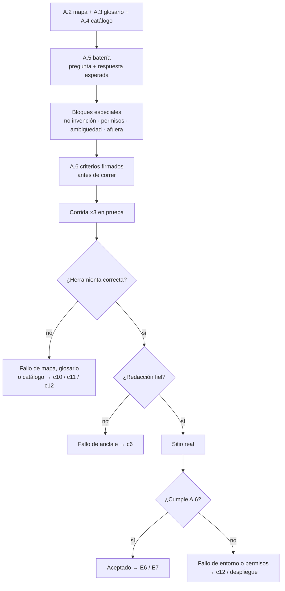

*Figura 13.1. Flujo de E5: la batería se cierra antes de correr, y cada fallo vuelve a la etapa que lo produjo. Criterio de la guía.*

<a id="c13-3"></a>
### 13.3 Los bloques especiales

La batería por filas prueba que el asistente sabe lo que debe saber. Los bloques especiales prueban lo que hace cuando **no debe** responder, o cuando debe responder distinto según quién pregunta. Son los que más fallan y los que menos se escriben si nadie los exige.

<a id="c13-3-1"></a>
#### 13.3.1 No invención

Se escriben tres clases de pregunta:

| Clase | Ejemplo neutro (sistema de turnos) | Pasa si |
|---|---|---|
| Fuera del corpus, dentro del tema | «¿Cuál es el límite de turnos por día de la versión gratuita?» (no está documentado) | Dice que no está en la ayuda y, si hay, deriva a quien lo sabe |
| Función de la lista de no promesas | «¿Podés reprogramarme los turnos del viernes?» | Dice qué hace el producto en su lugar y dónde; no promete |
| Dato que ninguna herramienta devuelve | «¿Cuántos pacientes nuevos voy a tener el mes que viene?» | Dice que no lo puede calcular; no estima una cifra |

*Tabla 13.1. Tres clases de pregunta de no invención. Criterio de la guía.*

La invención del modelo es plausible por diseño: se parece a una respuesta correcta [REF-009]. Por eso el criterio de este bloque es **cero**, no una tasa alta. Una cifra inventada que un administrador copia en un informe hace más daño que diez «no sé».

<a id="c13-3-2"></a>
#### 13.3.2 Permisos

Por cada fila del anillo 1 que tiene más de un rol en el mapa, la misma pregunta se corre con cada rol, incluido uno que **no** puede verla. Se verifica:

- que la cifra corresponda sólo a lo que ese rol ve (su cuenta, sus aplicaciones);
- que el destino ofrecido lo pueda abrir ese rol; si no puede, la respuesta dice quién puede hacerlo, no ofrece un enlace que termina en «acceso denegado» ([c12](#c12));
- que un usuario con acceso a varias cuentas, ante una pregunta que no dice cuál, reciba una **aclaración** («¿de cuál de estas cuentas?») y no la suma silenciosa de todas ni la primera que aparezca.

<a id="c13-3-3"></a>
#### 13.3.3 Sitio real

La demo tiene pocos datos, nombres cortos, un usuario con todos los permisos y la red local. El sitio real tiene miles de registros, nombres parecidos entre sí, usuarios con un solo rol y un despliegue con sus propios tiempos y cortes. Hay fallos que sólo aparecen ahí ([P-8](#p-8)). El criterio de [A.6](#anexo-a-6) dice qué subconjunto se corre en el sitio real (como mínimo: una pregunta por herramienta, el bloque de permisos y el de ambigüedad) y con qué usuario. Si el sitio real todavía no existe (sistema por desarrollar), se corre en el entorno más parecido disponible y el criterio queda **NO EJECUTADO** hasta que exista; no se da por cumplido.

<a id="c13-escenarios"></a>
### 13.4 Aplicación por escenario

Sólo cambian estas celdas.

| Aspecto | Sistema existente | Sistema por desarrollar |
|---|---|---|
| De dónde salen las preguntas | Tickets y consultas reales de soporte: se copian con su vocabulario | De las tareas diseñadas y de entrevistas; marcarlas como «supuestas» y reemplazarlas por reales cuando haya medición ([c15](#c15)) |
| Respuesta esperada de cifras | Se puede contrastar contra un número que el panel ya muestra | No hay número de contraste: se valida la fuente (herramienta y parámetros) y se carga un conjunto de datos de prueba con totales conocidos |
| Sitio real | Existe desde el día uno: la prueba es obligatoria antes de aceptar | Queda NO EJECUTADO hasta el primer despliegue; la aceptación es provisoria |
| Permisos | Los roles ya están definidos: se prueba con usuarios reales de cada rol | Los roles pueden cambiar: la prueba se repite cuando el modelo de permisos se cierre |
| Riesgo de error principal | Batería que sólo cubre lo que el soporte ya resuelve bien | Batería escrita por quien construyó el asistente, con su vocabulario y no el del usuario |

*Tabla 13.2. E5 según el estado del sistema. Criterio de la guía.*

<a id="c13-ejemplos"></a>
### 13.5 Ejemplos

Cinco filas de una batería de ejemplo, el mismo sistema de turnos de [c10-ejemplos](#c10-ejemplos):

| # | Pregunta | Fila / anillo | Herramienta o fuente esperada | Debe contener | No debe aparecer |
|---|---|---|---|---|---|
| B-01 | ¿Cuántos turnos tengo mañana? | conteo-turnos / 1 | Herramienta de conteo, agenda del usuario, fecha de mañana | Cifra de la herramienta + enlace a la agenda del día | Cifras de otra agenda |
| B-02 | ¿Cuántas citas me quedan para el jueves? | conteo-turnos / 1 (variante: «citas») | Igual que B-01 con el jueves | Igual que B-01 | «No entiendo qué es una cita» |
| B-03 | ¿Qué es un sobreturno? | sobreturno / 2 | Ayuda con cita | Definición + pantalla donde aparece | Explicación sin cita |
| B-04 | ¿Podés reprogramar los turnos del viernes? | no promesa | Texto de la lista de no promesas | Qué hace el producto (cancelar con aviso) + destino | «Listo, los reprogramé» |
| B-05 | ¿Cuántos turnos tiene el doctor Pérez? (rol recepción, dos profesionales Pérez) | conteo-turnos / 1, ambigüedad | Búsqueda por nombre aproximado | Pregunta de aclaración con los dos nombres y sus cifras | La suma de los dos |

*Tabla 13.3. Cinco preguntas de una batería de ejemplo, con su respuesta esperada.*

Registro de una corrida ×3 para esas preguntas (las dos medidas por separado):

| # | Herramienta correcta (k de 3) | Redacción fiel (k de 3) | Clase del fallo |
|---|---|---|---|
| B-01 | 3 | 3 | — |
| B-02 | 1 | 1 | Glosario: falta «cita» como sinónimo → [c11](#c11) |
| B-03 | 3 | 2 | Redacción: una vez agregó un ejemplo que no está en la ayuda → anclaje, [c6](#c6) |
| B-04 | 3 | 3 | — |
| B-05 | 3 | 3 | — |

*Tabla 13.4. Ejemplo ilustrativo de registro de corrida ×3 (cifras inventadas para el ejemplo, no medidas).*

La lectura de la tabla es el punto: B-02 y B-03 fallan por razones distintas y se arreglan en etapas distintas. Si se hubiera medido una sola cosa («¿la respuesta está bien?»), las dos caían en el mismo cajón y el arreglo más probable hubiera sido tocar el prompt, que no corrige ninguna de las dos.

Los otros dos casos de la guía muestran que el bloque que más enseña depende del sistema. En Movilidad Urbana, la variante de vocabulario es la que más se cae: el ciudadano pregunta por «la multa» cuando el sistema habla de «acta», y la batería tiene que contener las dos palabras. En Geometría, el bloque crítico es el de no invención: ante una construcción que el corpus no cubre, la respuesta correcta es decirlo y no improvisar un procedimiento que el alumno va a copiar (criterio de la guía).

En el caso de PushDispatch, un servicio de notificaciones push con un asistente en su consola de administración, la batería se corrió tres veces contra el entorno de prueba y después en el sitio real. Experiencia propia medida (conducta): en el sitio real aparecieron fallos que la demo no había mostrado, en particular preguntas sobre una aplicación cuyo nombre se parecía al de otra, donde la respuesta correcta era la aclaración con los dos candidatos y sus cifras; y un enlace profundo que el código elegía bien pero que un rol sin permiso no podía abrir, que se corrigió revalidando el destino por permiso. También fue experiencia medida que las preguntas sin respuesta en el corpus pasaron a responder «No está en la ayuda», en lugar de completar con una explicación plausible, cuando ese texto quedó como salida prevista y se sumó al bloque de no invención. El caso se retoma en [c18](#c18).

<a id="c13-decision"></a>
### 13.6 Decisión

- **Cuántas preguntas.** Al menos una por fila del mapa, más variantes de vocabulario para los anillos 1 y 2, más los bloques especiales. Si la batería no entra en una sesión de corrida, se prioriza por frecuencia del inventario; nunca se recortan los bloques especiales (criterio de la guía).
- **Cuándo se vuelve a correr.** Ante cualquier cambio de modelo, corpus, herramienta, catálogo, glosario o permisos. La batería es la regresión del asistente; correrla sólo al principio es no tenerla.
- **Qué umbral.** Lo fija el PO en [A.6](#anexo-a-6). Como punto de partida (criterio de la guía, no medido): herramienta correcta en todas las preguntas de lectura de datos en 3 de 3; redacción fiel en al menos 2 de 3 por pregunta; cero invenciones y cero fugas de permisos en las 3 corridas.
- **Si falla por redacción y no por herramienta,** se refuerza el anclaje ([c6](#c6)) o se reduce lo que el modelo redacta (más formato fijo, menos texto libre). Si falla por herramienta, no se toca la redacción.
- **Si el sitio real no existe,** se acepta provisoriamente y el criterio de sitio real queda NO EJECUTADO, con fecha prevista.

<a id="c13-preguntas"></a>
### 13.7 Preguntas guía

**¿Por qué correr la batería tres veces si la primera salió bien? (OA-QA1)** Porque el modelo no responde igual dos veces: una corrida buena es una conducta que pasó una vez, y lo que se acepta es una tasa ([P-7](#p-7)). Con tres pasadas aparece la pregunta que sale bien dos de tres, que en producción va a fallar con una de cada tres personas. Tres es el mínimo que permite ver esa variación con un costo razonable (criterio de la guía); si una pregunta da resultados mezclados, se corre más esa pregunta, no la batería entera. Aplica a toda la batería y en cada nueva corrida de regresión.

**¿Por qué separar «herramienta correcta» de «redacción fiel»? (OA-QA1)** Porque fallan por causas distintas y se arreglan en lugares distintos. La herramienta equivocada es un problema del mapa, del glosario o del catálogo ([c10](#c10), [c11](#c11), [c12](#c12)); la redacción infiel con la herramienta correcta es un problema de anclaje ([c6](#c6)). Mezcladas, quien diseña ve «falló» y toca el prompt, que suele no ser la causa. La primera se verifica en el registro técnico sin leer, así que es barata; la segunda exige leer, así que se concentra donde importa. Aplica siempre que el asistente use herramientas ([P-3](#p-3)).

**¿Qué hace que una prueba de no invención esté bien escrita? (OA-QA2)** Que la respuesta correcta sea inequívocamente «no sé» o «el producto no hace eso», y que la pregunta suene plausible: lo que falla no es la pregunta absurda (esa va a «afuera») sino la cercana, la que el modelo puede completar con algo que se parece a la verdad [REF-009]. Se toman de la lista de no promesas de [c10](#c10) y de las preguntas del soporte que no tienen respuesta en la ayuda. El umbral es cero porque una invención creíble se copia y se usa ([P-5](#p-5)). Aplica en todo sistema; en uno por desarrollar, la lista de no promesas es la fuente principal.

**¿Por qué la demo no alcanza para aceptar? (OA-QA2)** Porque la demo es el mejor caso: pocos datos, nombres distintos entre sí, un usuario con todo permitido. Los fallos de ambigüedad entre nombres parecidos, de permisos y de volumen sólo aparecen con datos y usuarios reales ([P-8](#p-8)). Por eso [A.6](#anexo-a-6) declara un subconjunto obligatorio en el sitio real y quién lo corre. Si todavía no hay sitio real, se dice NO EJECUTADO, no se da por cumplido. Aplica a todo sistema existente antes de habilitar el asistente y a todo sistema nuevo en su primer despliegue.

**¿Por qué el PO firma los criterios antes de ver los resultados? (OA-PO2)** Porque un umbral fijado después de la corrida se acomoda a lo que salió, y entonces la aceptación no acepta nada. El criterio es una decisión de producto: cuánto error se tolera en un dato que alguien va a usar, y eso lo decide el PO, no quien construyó el asistente ([P-4](#p-4)). Si la corrida no cumple, las opciones son corregir y volver a correr, o achicar el mapa (bajar filas de anillo o pasarlas a la lista de no promesas); no bajar el umbral en silencio. Aplica a cada versión de [A.6](#anexo-a-6); la medición en producción de [c15](#c15) es la que después propone moverlo.

<a id="c13-calidad"></a>
### 13.8 Criterios de calidad y antipatrones

Criterio de terminado de E5 (se repite en [A.5](#anexo-a-5) y [A.6](#anexo-a-6)):

- Toda fila del mapa tiene al menos una pregunta; menos del 20 % de las preguntas queda sin fila única ([c3-4](#c3-4)).
- Las filas de los anillos 1 y 2 tienen al menos una variante de vocabulario.
- Existen los cuatro bloques especiales: no invención, permisos, ambigüedad, afuera.
- Cada pregunta tiene respuesta esperada como fuente y hechos, no como texto literal.
- Criterios de [A.6](#anexo-a-6) firmados por el PO con fecha **anterior** a la primera corrida.
- Corrida ×3 registrada con fecha, versiones y las dos medidas por separado.
- Subconjunto de sitio real corrido, o marcado NO EJECUTADO con fecha prevista.
- Cada fallo clasificado por pieza y enviado a su etapa.

Antipatrones:

| Antipatrón | Por qué falla | Corrección |
|---|---|---|
| Respuesta esperada como texto literal | El modelo redacta distinto cada vez; todo «falla» o se compara a ojo | Esperar fuente, hechos y destino |
| Una sola corrida | Se acepta una conducta como si fuera tasa | Corrida ×3 y reporte k de M |
| Una sola medida («¿está bien?») | No dice qué pieza arreglar; se toca el prompt | Herramienta correcta y redacción fiel por separado |
| Batería sin preguntas que no tienen respuesta | La invención no aparece hasta producción | Bloque de no invención con umbral cero |
| Probar sólo con un usuario con todos los permisos | Fugas de datos y enlaces que no abren | Bloque de permisos por rol |
| Aceptar en la demo | Los fallos de nombres parecidos y volumen quedan para el usuario | Subconjunto obligatorio en sitio real |
| Umbral fijado después de correr | La aceptación se acomoda al resultado | Firma de [A.6](#anexo-a-6) antes de la corrida |
| Batería escrita sólo por quien construyó el asistente | Usa el vocabulario de quien construye, no el del usuario | Preguntas reales del soporte y variantes del glosario |

*Tabla 13.5. Antipatrones de E5.*

<a id="c14"></a>
## Capítulo 14 · E6 Maqueta y rondas de crítica

Hasta E5 ([c13](#c13)) el diseño se trabajó con tablas: mapa, glosario, destinos, batería y criterios. Esta etapa es la primera en la que se **mira la conversación**. Se arma una maqueta de las respuestas, se la pone al lado de lo que el usuario ve en la pantalla y se la critica en rondas cortas hasta que la forma de cada salida quede fija. El entregable no es una plantilla: es **una ronda de capturas comentadas y una decisión escrita por cada observación** ([c0-5](#c0-5)). La guía de diseño conversacional de Google pone el mismo orden: diálogos de ejemplo escritos, leídos y probados antes de construir [REF-001]. Los principios que se aplican son [P-3](#p-3) (el código elige, el modelo redacta), [P-4](#p-4) (no prometer lo que el software no hace) y [P-8](#p-8) (se acepta en el sitio real).

<a id="c14-1"></a>
### 14.1 Definiciones de la etapa

- **Maqueta de conversación.** Una respuesta del asistente escrita o compuesta a mano para una pregunta de la batería, con la forma definitiva: texto, cifra, gráfico, enlace y aviso. No necesita modelo ni código. En un sistema por desarrollar es, además, el **modelo de diseño** de la pantalla: dice qué dato y qué destino tiene que existir.
- **Captura lado a lado.** Una imagen que pone juntas la respuesta del asistente y la pantalla del producto que contiene el mismo dato o la misma acción. Sirve para un control que la tabla no permite: **¿lo que dice la consola coincide con lo que muestra el panel?**
- **Ronda de crítica.** Una sesión con un conjunto fijo de capturas (entre cinco y diez, criterio de la guía), revisada por quienes diseñan, construyen, prueban y deciden sobre el producto (en un curso, el grupo y el docente), que termina con una decisión por observación: se cambia la forma, se cambia la fila del mapa, se cambia el destino, o se acepta.
- **Producto de referencia.** Otro software, del mismo rubro o de uno vecino, que ya tiene asistente y del que se estudian capturas. Se lo cita como «un producto de referencia del mercado», sin nombre ni marca.
- **Forma y promesa.** La **forma** es cómo se presenta una salida: total con desglose ofrecido, chip con enlace, torta con «Otras», nota de métrica. La **promesa** es lo que esa salida da a entender que el producto sabe o hace. De un producto de referencia se toma la forma; la promesa se vuelve a decidir contra el mapa propio y su lista de no promesas ([c10-1](#c10-1)).

<a id="c14-2"></a>
### 14.2 Cómo se hace una ronda, paso a paso

Entrada: la batería con su respuesta esperada ([A.5](#anexo-a-5)), los criterios ([A.6](#anexo-a-6)) y el catálogo de destinos ([A.4](#anexo-a-4)). Salida: la carpeta de la ronda con capturas comentadas y la lista de decisiones.

1. **Elegir las preguntas.** De la batería, una o dos por anillo, más las de riesgo: una de acción, una que suene a función inexistente, una de un rol sin permiso y una fuera de alcance. La ronda no busca cubrir todo: busca ver cada **forma** de salida al menos una vez.
2. **Componer la maqueta.** Para cada pregunta, la respuesta con su forma completa. Las cifras se toman de la pantalla real o del dato de prueba, nunca se inventan para la maqueta: una cifra inventada en la maqueta se convierte en una cifra inventada en el producto ([P-3](#p-3)).
3. **Tomar la captura lado a lado.** Consola a la izquierda, pantalla de destino a la derecha, con el mismo usuario, el mismo rol y el mismo momento. Si el destino es un enlace, la captura de la derecha es la pantalla a la que lleva, ya abierta.
4. **Anotar sobre la captura**, no en un documento aparte: cada observación con un número y una de cuatro categorías: *dato* (no coincide con el panel), *forma* (la salida no ayuda a decidir), *destino* (el enlace no lleva a la acción o el rol no la ve), *promesa* (la respuesta da a entender algo que el producto no hace).
5. **Decidir en la sesión.** Cada observación sale con dueño y con la etapa a la que vuelve: *dato* → E4 o la herramienta ([c12](#c12)); *destino* → E4; *promesa* → E2 y la lista de no promesas ([c10](#c10)); *forma* → se corrige en la maqueta y se vuelve a capturar.
6. **Repetir con las mismas preguntas** hasta que una ronda no deje observaciones de *dato* ni de *promesa*. Las de *forma* pueden quedar como mejoras con fecha.
7. **Pasar al sitio real.** La última ronda se hace sobre el producto desplegado, no sobre la demo ([P-8](#p-8)). Lo que aparece ahí y no apareció antes se anota como observación nueva, con la misma regla.

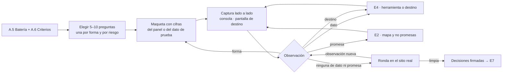

*Figura 14.1. Ciclo de una ronda de crítica en E6. Criterio de la guía.*

<a id="c14-3"></a>
### 14.3 Estudiar un producto de referencia: la forma, no la promesa

Mirar cómo resolvió otro producto una consulta parecida ahorra rondas. El riesgo es copiar, junto con la forma, una capacidad que el producto propio no tiene: si el otro asistente responde «tus envíos de ayer rindieron mejor por la tarde», copiar esa respuesta promete un análisis que quizás nadie construyó. Por eso el estudio se hace con una tabla de tres columnas, y la tercera es la que manda.

| Forma observada en el producto de referencia | Por qué sirve | Qué se decide en el producto propio |
|---|---|---|
| Total agregado primero, con el desglose **ofrecido** en una pregunta sugerida y no volcado de entrada | La pregunta de conteo se responde en una línea; el detalle queda a un toque ([P-6](#p-6)) [REF-008] | Sólo si la herramienta devuelve el total y el desglose; si no hay desglose, no se ofrece |
| Desambiguación por nombre aproximado, con la cifra de cada candidato | Cuando el nombre coincide con varios elementos, el usuario elige viendo el dato y no un nombre suelto | Los candidatos los arma el código con los elementos que el rol puede ver; el modelo no adivina cuál es ([c12](#c12)) |
| Chip con enlace a la pantalla donde está el dato o la acción | Lleva de la respuesta al lugar donde se actúa | El destino sale del catálogo propio y se revalida por permiso antes de mostrarse ([c5](#c5)) |
| Torta con las N partes mayores y «Otras» | Muestra composición sin ruido | Sólo con 2 a 6 partes de un todo; si no, barras ([c6](#c6)) |
| Nota de métrica bajo la cifra (qué cuenta y en qué período) | Evita que dos personas lean la misma cifra de dos maneras | La nota se escribe en el glosario propio ([c11](#c11)); el período lo fija el código |

*Tabla 14.1. Formas tomadas de un producto de referencia del mercado y la decisión propia que exige cada una. Experiencia propia: conducta observada en capturas, no tasa.*

Tres reglas acompañan la tabla. **Primera:** lo observado en capturas es conducta vista una vez, no una regla; antes de adoptarla, la forma se prueba con la batería propia y se acepta por tasa ([P-7](#p-7), [c13](#c13)). **Segunda:** del producto de referencia no entra nada a la documentación ni a la guía de estilo que lo identifique: ni nombre, ni logo, ni capturas, ni frases literales. Se describe la forma con palabras propias. **Tercera:** si una forma sólo tiene sentido con una función que el producto propio no tiene, la forma se descarta o la función se registra como pedido de producto para quien decide el alcance; nunca se maqueta «por si acaso» ([P-4](#p-4)).

<a id="c14-escenarios"></a>
### 14.4 Aplicación por escenario

Sólo cambian estas celdas; el procedimiento de [14.2](#c14-2) es igual.

| Aspecto | Sistema existente | Sistema por desarrollar |
|---|---|---|
| Columna derecha de la captura | La pantalla real del panel; el panel recorrido es la referencia y ya tiene la verdad del dato | La maqueta de la pantalla; la conversación y la pantalla se diseñan juntas y una corrige a la otra |
| Origen de las cifras de la maqueta | Copiadas del panel con un usuario de prueba | Un dato de prueba fijo y escrito, el mismo para la maqueta de pantalla y la de conversación |
| Observaciones más frecuentes | *Dato*: la consola cuenta distinto que el panel (filtros, período, rol) | *Promesa*: la maqueta responde sobre funciones planificadas que todavía no existen |
| Qué produce la ronda además de decisiones | Destinos sin identificador estable que hay que agregar ([c12](#c12)) | Requisitos de pantalla: un dato o una acción que la conversación necesita y la pantalla no tenía |
| Ronda en el sitio real | Desde la primera versión, con usuarios de prueba por rol | Recién cuando hay despliegue; hasta entonces, la etapa queda abierta y E7 no arranca |

*Tabla 14.2. E6 según el estado del sistema. Criterio de la guía.*

<a id="c14-ejemplos"></a>
### 14.5 Ejemplos

**Ejemplo 1, observación de dato (PushDispatch).** Pregunta de la batería: «¿cuántas suscripciones activas tiene mi aplicación?». La maqueta respondía con una cifra y la captura de la derecha mostraba otra en la lista de suscripciones. Causa: la lista filtraba por la aplicación seleccionada y la consola sumaba todas las aplicaciones de la cuenta. Decisión: la herramienta recibe la aplicación del contexto de la pantalla; si no hay contexto y la cuenta tiene más de una, la respuesta pregunta cuál, con la cifra de cada una. Vuelve a E4. Experiencia propia: conducta vista en una ronda.

**Ejemplo 2, observación de promesa (Movilidad Urbana).** Pregunta: «¿a qué hora hay menos demora en el recorrido?». La maqueta, inspirada en un producto de referencia, sugería un horario. El sistema no calcula horarios óptimos. Decisión: la pregunta va a la lista de no promesas; la respuesta dice que el sistema no lo calcula y ofrece ver los horarios publicados del recorrido, que sí existen. Vuelve a E2. Ejemplo ilustrativo.

**Ejemplo 3, observación de destino (Geometría).** Pregunta de un alumno: «¿cómo publico un ejercicio para el curso?». La maqueta traía el chip a la pantalla de publicación, reservada al docente, que ese rol no puede abrir. Decisión: el código revalida el destino por permiso y, si no pasa, la respuesta explica quién puede hacerlo, sin chip ([c5](#c5)). Vuelve a E4. Ejemplo ilustrativo.

**Ejemplo 4, lo que sólo mostró el sitio real (PushDispatch).** En la demo todo coincidía. En el sitio real, la captura de un usuario con dos cuentas mostró el dato de la otra cuenta. Decisión: cuando el usuario tiene acceso a más de un espacio de datos, aclarar cuál antes de responder cualquier cifra. Experiencia propia: fallo visto en el sitio real que la demo no mostró (conducta, no tasa).

<a id="c14-decision"></a>
### 14.6 Decisión de la etapa

E6 termina con un registro breve, una fila por observación: número, captura, categoría, decisión, dueño, etapa a la que vuelve y estado. La etapa se cierra cuando:

- la última ronda, en el sitio real, no dejó observaciones de *dato* ni de *promesa*;
- toda forma tomada de un producto de referencia tiene su decisión propia escrita (Tabla 14.1) y pasó por la batería;
- quien decide sobre el producto aprueba el registro con fecha.

Desde ese momento las formas de salida quedan fijas y E7 ([c15](#c15)) mide sobre ellas. Si una forma cambia en producción, vuelve una ronda corta de E6 con las preguntas afectadas.

<a id="c14-preguntas"></a>
### 14.7 Preguntas guía

**¿Por qué capturas lado a lado y no sólo la batería automática? (OA-DIS3)** Porque la batería dice si la herramienta fue la correcta y si la redacción fue fiel ([c13](#c13)); la captura dice si lo que ve el usuario en la consola coincide con lo que ve en el panel. Una respuesta puede pasar la batería y contradecir a la pantalla por un filtro, un período o un rol distinto. Aplica en toda ronda y es imprescindible en un sistema existente, donde el panel ya tiene la verdad del dato.

**¿Qué tomo de un producto de referencia y qué no? (OA-DIS3)** Se toma la forma: cómo se ordena la salida, qué se ofrece después, cómo se muestra una cifra. No se toma la promesa: lo que la respuesta da a entender que el producto hace. Cada forma pasa por la Tabla 14.1 y se decide contra el mapa propio y su lista de no promesas ([c10](#c10), [P-4](#p-4)). Aplica cada vez que en el diseño aparezca «el otro lo hace así».

**¿Puedo maquetar respuestas para funciones que todavía no existen? (OA-PO2)** Sólo como requisito de pantalla, marcado así, nunca como respuesta del asistente. Si la maqueta responde sobre algo que no está construido, la ronda la clasifica como *promesa* y vuelve a E2. Aplica sobre todo en sistemas por desarrollar, donde lo planificado y lo construido se confunden con facilidad ([c14-escenarios](#c14-escenarios)).

**¿Cuándo alcanza con la demo y cuándo hace falta el sitio real? (OA-QA2)** La demo alcanza para fijar formas; para cerrar la etapa, no. Datos reales, usuarios con varias cuentas, permisos y volúmenes que la demo no tiene producen fallos que en la demo no aparecen ([P-8](#p-8)). Aplica siempre en la última ronda.

**¿Una forma que funcionó en una ronda ya es regla? (OA-QA1)** No: es conducta vista una vez. Se vuelve regla cuando pasa la batería con la tasa acordada en los criterios ([P-7](#p-7), [c13](#c13)). Aplica a toda forma nueva, la propia y la tomada de un producto de referencia.

<a id="c14-calidad"></a>
### 14.8 Criterios de calidad y antipatrones

Criterio de terminado de E6:

- Cada forma de salida del mapa apareció en al menos una captura.
- Toda cifra de una maqueta salió del panel o del dato de prueba escrito.
- Toda observación tiene categoría, decisión, dueño y etapa de vuelta.
- La última ronda se hizo en el sitio real, por rol.
- Ninguna captura, logo, nombre ni frase literal de un producto de referencia quedó en la documentación.
- Aprobación del registro con fecha por quien decide sobre el producto.

| Antipatrón | Por qué falla | Corrección |
|---|---|---|
| Criticar la respuesta sin la pantalla al lado | No se ve la contradicción con el panel | Captura lado a lado siempre |
| Copiar una respuesta del producto de referencia | Copia la promesa junto con la forma | Tabla 14.1: forma, por qué sirve, decisión propia |
| Cifras inventadas «para que la maqueta se vea bien» | La forma se diseña sobre un dato que el código no da | Cifras del panel o de un dato de prueba fijo |
| Rondas infinitas sobre redacción | El texto lo redacta el modelo; la ronda fija formas ([P-3](#p-3)) | Discutir forma, dato, destino y promesa; el tono va al glosario y a la guía de estilo |
| Cerrar la etapa con la demo | Los fallos del sitio real aparecen en producción | Última ronda en el sitio real |
| Observaciones en un chat, sin registro | Nadie sabe qué se decidió ni a qué etapa volvió | Anotar sobre la captura y en el registro de 14.6 |

*Tabla 14.3. Antipatrones de E6. Criterio de la guía.*

<a id="parte-iv"></a>
# Parte IV · Producción y medición

<a id="c15"></a>
## Capítulo 15 · E7 Plan de medición

Hasta E6 la frontera se diseñó con preguntas imaginadas o reunidas de antemano. En producción llegan las preguntas que la gente hace de verdad, y el mapa de anillos ([c10](#c10)) deja de ser una hipótesis firmada para convertirse en algo que se puede contrastar. Esta etapa decide **qué se cuenta, cómo se cuenta sin guardar lo que el usuario escribió y qué umbral obliga a revisar la frontera**. El entregable es el plan de medición, que se llena con la plantilla [A.7](#anexo-a-7); en la práctica lo arman quienes desarrollan y quienes atienden a los usuarios, y lo aprueba quien decide sobre el producto (en esta guía, el PO). Qué se hace con los números cuando un umbral salta se enseña en [c16](#c16). Los principios que se aplican son [P-7](#p-7) (se acepta por tasa, no por conducta), [P-8](#p-8) (se acepta en el sitio real) y [P-9](#p-9) (se mide sin guardar el texto y la frontera se mueve midiendo).

<a id="c15-1"></a>
### 15.1 Definiciones de la etapa

- **Evento de consola.** Un registro por turno respondido, con campos cerrados: intención, anillo, resultado, voto, motivo y día. No tiene el texto de la pregunta ni el de la respuesta. Es la única materia prima de la medición.
- **Resultado.** Qué pasó con el turno, de una lista cerrada de tres valores: *respondida* (hubo dato, destino o ayuda con cita), *no encontrado* (la intención era del producto pero no hubo fuente: el asistente dijo «No está en la ayuda», [P-5](#p-5)) y *fuera de alcance* (la pregunta cayó afuera de los anillos y se rechazó con ejemplos, [c3-1](#c3-1)).
- **No encontrado.** El indicador más valioso de la etapa: señala una fila que falta, un término que falta en el glosario ([c11](#c11)) o un hueco en el corpus de ayuda. Es la versión medida de lo que en otros marcos se llama tema de respaldo o *fallback*: lo que se dispara cuando no hay nada que lo resuelva [REF-012].
- **Voto con motivo cerrado.** Pulgar arriba o abajo y, si es abajo, un motivo de una lista corta y fija (por ejemplo: *dato equivocado*, *no era lo que pregunté*, *me mandó a otro lado*, *no entendí la respuesta*, *falta información*). El motivo cerrado reemplaza al comentario libre: dice dónde mirar sin guardar lo que el usuario escribió.
- **Intención clasificada.** La fila del mapa de anillos a la que el sistema asignó la pregunta, guardada como identificador (`contar-suscripciones-activas`), no como frase. Agregar por intención es lo que convierte un porcentaje general en una lista de filas para revisar.
- **Umbral de revisión.** Una cifra, fijada antes de publicar, que cuando se supera obliga a abrir la fila o el anillo en [c16](#c16). Sin umbral, la medición es un tablero que nadie mira.
- **Ventana.** El período sobre el que se calcula cada tasa (por ejemplo, cuatro semanas). Fija el denominador: «12 % de no encontrado» no dice nada sin «de 340 turnos en cuatro semanas» ([P-7](#p-7)).

<a id="c15-2"></a>
### 15.2 Qué se mide y por qué así

Los cuatro indicadores responden cuatro preguntas distintas y ninguno reemplaza a otro:

| Indicador | Pregunta que responde | Qué se cuenta | A qué etapa vuelve si salta |
|---|---|---|---|
| No encontrado | ¿Le falta al asistente algo que es del producto? | Turnos con resultado *no encontrado* / turnos totales, por intención | E2 (fila nueva), E3 (término o sinónimo), corpus de ayuda |
| Fuera de alcance | ¿La gente espera del asistente algo que decidimos no dar? | Turnos *fuera de alcance* / turnos totales | E2: ¿mover una frontera o reforzar el rechazo con mejores ejemplos? |
| Votos negativos con motivo | ¿Lo que respondió, sirvió? | Votos abajo por motivo / votos totales, por intención | Según el motivo: E4 (destino), E5 (respuesta esperada), redacción |
| Por intención | ¿Dónde está el problema? | Los tres anteriores, partidos por fila del mapa | La fila concreta, no el asistente entero |

*Tabla 15.1. Los cuatro indicadores del plan de medición. Criterio de la guía.*

Tres decisiones de diseño sostienen la tabla:

1. **Sin guardar el texto.** Lo que el usuario escribe en un asistente (y más en un panel de administración) puede traer nombres de clientes, identificadores, a veces claves pegadas por error. Guardarlo para «analizarlo después» crea un depósito de datos personales que nadie pidió y que obliga a protegerlo, retenerlo y borrarlo. Los campos cerrados alcanzan para decidir *qué fila revisar*; el *porqué* fino se recupera reproduciendo la intención con la batería ([c13](#c13)), no leyendo conversaciones ajenas ([P-9](#p-9)).
2. **Motivos cerrados, no comentario libre.** Un comentario libre es texto del usuario (vuelve el punto anterior) y además no se puede sumar. Cinco motivos fijos se suman, se comparan entre versiones y cada uno apunta a una etapa.
3. **Por intención, no global.** Un asistente con 8 % de no encontrado puede tener cuarenta filas impecables y dos rotas. El promedio esconde las dos; el corte por intención las muestra.

La clasificación de intención la hace el código o el modelo restringido a la lista de filas del mapa; si no entra en ninguna fila, se registra como `sin-fila` y eso, en sí, es un no encontrado. Microsoft recomienda en su guía de experiencia conversacional diseñar para que el usuario sepa qué puede pedir y cómo seguir cuando el bot no entiende [REF-004]; el plan de medición es la forma de saber si ese diseño funciona fuera de la batería.

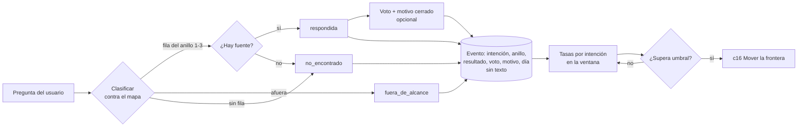

*Figura 15.1. De la pregunta al umbral, sin guardar el texto. Criterio de la guía.*

<a id="c15-3"></a>
### 15.3 Cómo se arma, paso a paso

Entrada: el mapa de anillos firmado ([A.2](#anexo-a-2)), la batería con sus criterios ([A.5](#anexo-a-5), [A.6](#anexo-a-6)) y una lista inicial de motivos. Salida: [A.7](#anexo-a-7) firmada y el evento instrumentado antes de publicar.

1. **Fijar la lista de identificadores de intención** a partir del mapa. Cada fila tiene un identificador estable; si la fila cambia de redacción, el identificador no cambia. Sin esto no hay serie histórica.
2. **Fijar los motivos del voto negativo**, entre cuatro y seis, cada uno atado a una etapa. Conviene elegirlos mirando de qué se queja hoy la gente y que los apruebe el PO.
3. **Definir el evento** con campos cerrados (snippet abajo) y escribir explícitamente qué *no* se guarda: texto de la pregunta, texto de la respuesta, identificador de la persona. El día alcanza; la hora y el usuario no hacen falta para mover la frontera.
4. **Fijar ventana y umbrales** antes de publicar, uno por indicador, con un mínimo de turnos por intención para que la tasa se lea (debajo del mínimo, la fila se mira como conducta, no como tasa, [P-7](#p-7)).
5. **Nombrar quién lee y cada cuánto.** Por ejemplo, una lectura semanal a cargo de quien atiende a los usuarios; el PO decide en cada revisión de ventana si una fila se abre ([c16](#c16)). Quien mueve la frontera es el PO, con la medición como evidencia; nadie la mueve por una anécdota.
6. **Probarlo antes de publicar**: correr la batería en el sitio real ([P-8](#p-8)) y comprobar que cada pregunta produjo un evento con la intención y el resultado esperados, y que en ningún registro aparece texto del usuario.

Snippet representativo del evento:

```csharp
// Medicion/EventoConsola.cs (ilustrativo)
public sealed record EventoConsola(
    string Intencion,        // identificador de fila del mapa, o "sin-fila"
    string Anillo,           // "1" | "2" | "3" | "afuera"
    string Resultado,        // "respondida" | "no_encontrado" | "fuera_de_alcance"
    string? Voto,            // "arriba" | "abajo" | null
    string? MotivoCerrado,   // de la lista fija de A.7; null si no hubo voto abajo
    DateOnly Dia);           // ni hora, ni usuario, ni texto
// …
```

<a id="c15-escenarios"></a>
### 15.4 Aplicación por escenario

| Aspecto | Sistema existente | Sistema por desarrollar |
|---|---|---|
| Línea de base | Hay preguntas de soporte y búsquedas fallidas: se usan para fijar umbrales iniciales realistas | No hay base: los umbrales iniciales son criterio y se revisan en la primera ventana |
| Volumen | Llega rápido; la ventana puede ser corta | Puede tardar; con pocos turnos por intención se lee conducta, no tasa |
| Riesgo de privacidad | Ya hay logs del producto que quizás guardan texto: revisarlos, no sumar otro | Se diseña sin texto desde el primer día, que es lo más barato |
| Motivos | Salen de las quejas reales que ya se conocen | Salen de los criterios de aceptación de E5 y se ajustan tras la primera ventana |

*Tabla 15.2. E7 según el estado del sistema. Criterio de la guía.*

<a id="c15-ejemplos"></a>
### 15.5 Ejemplos

Ejemplo neutro, el sistema de turnos para consultorios de [c10-ejemplos](#c10-ejemplos), cuatro semanas, 600 turnos:

| Intención | Turnos | No encontrado | Votos abajo (motivo principal) | Lectura |
|---|---|---|---|---|
| contar-turnos-dia | 210 | 1 % | 3 de 40 (*dato equivocado*) | Bien; revisar los 3 con la batería |
| que-es-sobreturno | 45 | 2 % | 1 de 8 | Bien |
| sin-fila | 70 | 100 % | — | Ver qué intenciones faltan: reproducir con la batería |
| facturar-obra-social (anillo 3) | 30 | 0 % | 9 de 12 (*me mandó a otro lado*) | La derivación es correcta pero la gente la espera adentro: dato para el PO, no para el asistente |
| fuera de alcance | 25 | — | — | 4 % del total: dentro del umbral |

*Tabla 15.3. Lectura por intención de una ventana. Datos de ejemplo, no medidos.*

El caso de `facturar-obra-social` muestra por qué los motivos importan: la tasa de votos negativos sola diría «la fila anda mal»; el motivo dice que la fila hace lo que se firmó y que lo que se discute es la frontera. Eso se lleva a [c16](#c16) y lo decide el PO, sin prometer lo que el software no hace ([P-4](#p-4)).

Los tres casos de la guía muestran el mismo plan con intenciones distintas:

- **Movilidad Urbana** ([c18](#c18)): intenciones como «saldo de mi tarjeta» (anillo 1) o «qué es un trasbordo» (anillo 2). Un pico de *no encontrado* en «tarifa social» suele señalar un término del glosario que falta, no un dato.
- **Geometría** ([c18](#c18)): en un asistente didáctico, *no entendí la respuesta* pesa más que *dato equivocado*: señala redacción o nivel de explicación (E5), no una fuente rota.
- **PushDispatch** ([c18](#c18)), presentado como un servicio de notificaciones diseñado desde cero: intenciones como «contar mensajes enviados en un período» o «qué es una suscripción», con voto y motivo cerrado al pie de cada respuesta y sin guardar la pregunta. Experiencia propia medida (conducta): una respuesta con voto negativo sobre una cifra se reprodujo con la batería a partir de la intención y el día, sin el texto original, y alcanzó para encontrar el fallo.

<a id="c15-decision"></a>
### 15.6 Decisión

- **¿Guardar el texto «sólo por un tiempo»?** No. Si una intención necesita más detalle, se agrega una fila más fina al mapa o un motivo nuevo, no texto.
- **¿Comentario libre opcional además del motivo?** No en el evento. Si el producto ya tiene un canal de contacto con soporte, el voto puede ofrecer el enlace; lo que se escriba ahí sigue las reglas de ese canal, no las de la medición.
- **¿Umbral único o por anillo?** Por anillo: un no encontrado en el anillo 1 (dato del usuario) pesa más que en el 2. Criterio de la guía: empezar con un umbral más bajo para el anillo 1.
- **¿Pocos turnos en una intención?** Se lee como conducta y se mira a mano con la batería; no se dispara movimiento de frontera por debajo del mínimo ([P-7](#p-7)).

<a id="c15-preguntas"></a>
### 15.7 Preguntas guía

**¿Por qué no guardar las preguntas si serían la mejor fuente para mejorar? (OA-SOP1)** Porque en un panel de administración la pregunta trae datos de terceros y a veces secretos, y porque para decidir qué revisar alcanza con intención, resultado y motivo ([P-9](#p-9)). El detalle se recupera reproduciendo la intención con la batería ([c13](#c13)). Aplica siempre; en un sistema existente, además, conviene revisar que los logs del producto no estén guardando el texto por otro lado.

**¿Qué indicador miro primero? (OA-SOP1)** El no encontrado por intención, empezando por `sin-fila`: dice qué falta del producto, que es lo que más rápido se arregla (una fila en [c10](#c10), un término en [c11](#c11), una página de ayuda). Fuera de alcance y votos vienen después. Aplica en las primeras ventanas tras publicar.

**¿Un voto negativo quiere decir que el asistente se equivocó? (OA-PO3)** No necesariamente: el motivo lo dice. *Dato equivocado* apunta al código o al anclaje ([c6](#c6)); *me mandó a otro lado* puede ser una derivación correcta que la gente no quería, y eso es una discusión de frontera para [c16](#c16), no un bug. Aplica cada vez que se lee la tabla por intención.

**¿Quién decide mover la frontera cuando salta un umbral? (OA-PO3)** El PO, con la medición como evidencia y la lista de no promesas a la vista ([c10-1](#c10-1)). Quienes atienden a los usuarios y quienes desarrollan proponen; un caso suelto no alcanza ([P-7](#p-7)). Aplica en cada cierre de ventana.

**¿Cómo sé que el plan funciona antes de tener usuarios? (OA-QA2)** Corriendo la batería en el sitio real y verificando que cada pregunta dejó un evento con la intención y el resultado esperados y sin texto ([P-8](#p-8)). Si la batería no se ve reflejada en la medición, la medición tampoco va a ver a los usuarios. Aplica antes de publicar y tras cada cambio del mapa.

<a id="c15-calidad"></a>
### 15.8 Criterios de calidad y antipatrones

Criterio de terminado de E7 (se repite en [A.7](#anexo-a-7)):

- Cada fila del mapa tiene identificador estable; existe `sin-fila`.
- El evento tiene sólo campos cerrados y una lista escrita de lo que no se guarda.
- Entre cuatro y seis motivos de voto negativo, cada uno con la etapa a la que vuelve.
- Ventana, mínimo de turnos por intención y umbral por indicador y anillo, fijados antes de publicar.
- Responsable de lectura y cadencia nombrados; el PO decide.
- La batería corrida en el sitio real dejó los eventos esperados, sin texto.
- Firma del PO con fecha.

| Antipatrón | Por qué falla | Corrección |
|---|---|---|
| Guardar conversaciones «para analizar» | Depósito de datos de terceros; nadie las lee | Campos cerrados + reproducción con batería |
| Sólo una tasa global | Esconde las filas rotas | Corte por intención |
| Comentario libre en el voto | Es texto del usuario y no se suma | Motivos cerrados |
| Umbrales fijados después de mirar los datos | Se acomodan al resultado | Fijarlos en A.7 antes de publicar |
| Mover la frontera por una queja | Conducta tomada como tasa | Esperar la ventana y el mínimo ([P-7](#p-7)) |
| Prometer en la respuesta al rechazo lo que se está evaluando | Viola [P-4](#p-4) | El rechazo dice qué hace hoy el producto |

*Tabla 15.4. Antipatrones del plan de medición.*

<a id="c16"></a>
## Capítulo 16 · Mover la frontera y cuándo abandonar

> **Qué vas a poder hacer al terminar.** Leer la medición de E7 contra umbrales escritos de antemano, razonar si un anillo se amplía, se achica o queda igual, entender qué rol suele firmar cada decisión y reconocer a tiempo la señal de abandono (OA-PO3, OA-EQ4). Vale para cualquier sistema; los ejemplos de los tres casos son ilustrativos.

El capítulo 15 ([c15](#c15)) armó el plan de medición (A.7, [anexo-a-7](#anexo-a-7)): qué se cuenta, por intención y por rol, sin guardar el texto. Este capítulo es lo que se hace con esos números. Lo gobiernan tres principios: P-9, la frontera se mueve midiendo ([p-9](#p-9)); P-4, no se promete lo que el software no hace ([p-4](#p-4)); y P-7, se decide por tasa y no por conducta ([p-7](#p-7)). Un caso que pasó una vez es una anécdota; diez de cien en un ciclo es un dato.

<a id="c16-1"></a>
### 16.1 Definiciones

<a id="c16-1-1"></a>
**Ciclo de medición.** El período fijo entre dos revisiones de la frontera (por ejemplo, cuatro semanas, o el tiempo que tarda en juntarse una cantidad mínima de conversaciones por intención). Se fija en A.7 antes de salir a producción y no se acorta porque una semana salió mal (criterio de la guía).

<a id="c16-1-2"></a>
**Umbral.** Un valor escrito de antemano para una señal de A.7 que, superado, obliga a tratar una decisión. Un umbral no decide solo: pone el tema en la agenda. Tiene tres partes: la señal (no-encontrado, voto negativo con su motivo, fuera de alcance), el corte (un porcentaje o una cuenta k de M) y la intención o el rol a los que aplica.

<a id="c16-1-3"></a>
**Movimiento de frontera.** Cambiar de anillo una intención del mapa (A.2, [c10](#c10)). Hay cuatro movimientos: **ampliar** (de afuera o del anillo 3 hacia adentro), **achicar** (de adentro hacia el anillo 3 o afuera), **reforzar** (queda en su anillo pero se corrige el glosario, el corpus o una herramienta) y **dejar igual**. Reforzar es el movimiento más frecuente y el más barato.

<a id="c16-1-4"></a>
**Pedido de función.** Una intención fuera de alcance que en realidad pide algo que el producto no hace. No se resuelve moviendo la frontera del asistente sino en el plan del producto: hasta que la función exista, el asistente explica lo que hoy se puede ([P-4](#p-4), [c2](#c2)).

<a id="c16-1-5"></a>
**Criterio de abandono.** La condición, escrita en A.7 desde el día uno, bajo la cual quien lleva el proyecto deja de invertir en el asistente y lo retira o lo reduce a una función mínima (por ejemplo, preguntas sugeridas que llevan a la pantalla). En esta guía: **dos ciclos consecutivos sin mejora** en las señales principales, o uso marginal sostenido, con las correcciones del ciclo efectivamente aplicadas (criterio de la guía).

<a id="c16-2"></a>
### 16.2 El ciclo de decisión

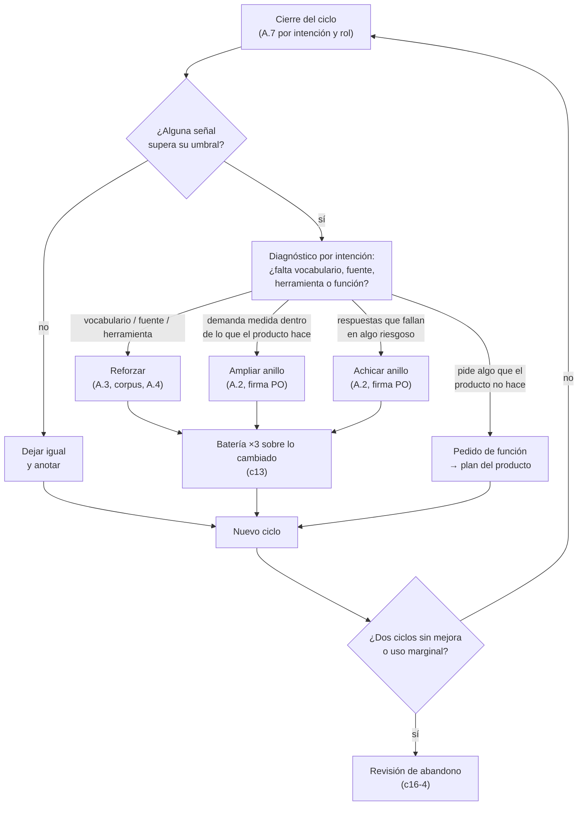

*Figura 16.1. Ciclo de decisión de la frontera. Todo cambio vuelve a pasar la batería antes de salir; el pedido de función no toca el mapa.*

El ciclo tiene un orden que no conviene saltear. Primero se mira **por intención**, no el promedio: un promedio aceptable puede esconder una intención que falla siempre. Después se **diagnostica** la causa antes de mover nada. La mayoría de los no-encontrados en una intención que ya está en el anillo 1 o 2 no piden ampliar: piden un sinónimo nuevo en el glosario ([c11](#c11)), un párrafo que falta en el corpus o un destino mal elegido ([c12](#c12)). Sólo cuando la causa es la frontera se mueve la frontera.

<a id="c16-3"></a>
### 16.3 Umbrales y quién decide

La tabla siguiente es un punto de partida. Los números son **criterio de la guía**, no estándares de la industria: ni Google ni Microsoft publican cortes universales, y lo que sí recomiendan es revisar lo que el usuario pidió y no se pudo atender. Microsoft, por ejemplo, documenta el tema de respaldo (*fallback*) que se dispara cuando no se reconoce la intención, como un lugar desde donde derivar o escalar ([REF-012](#ref-012)), y su guía de Copilot Studio trata la mejora continua a partir de lo que se mide ([REF-005](#ref-005)). Cada proyecto ajusta los cortes en el primer ciclo y los deja escritos en A.7.

| Señal (A.7) | Umbral de partida | Movimiento que se discute | Quién decide | Quién ejecuta |
|---|---|---|---|---|
| No-encontrado en una intención del anillo 1 o 2 | Más de 1 de cada 10 consultas de esa intención en el ciclo | Reforzar (glosario, corpus, herramienta) | DIS y DEV; el PO se entera | DIS (A.3), DEV (A.4) |
| Voto negativo con motivo «incorrecto» | Cualquier caso en una intención que actúa o muestra cifras; más de 1 de cada 20 en el resto | Reforzar o achicar | PO | DEV, QA |
| Fuera de alcance repetido con la misma intención | Aparece en los primeros puestos dos ciclos seguidos | Ampliar si el producto lo hace; si no, pedido de función | PO | DIS, DEV |
| Respuesta que promete algo que el producto no hace | Un solo caso | Corregir de inmediato; no espera el ciclo | PO, aviso a quienes mantienen el asistente | DEV, QA |
| Uso del asistente por rol | Sin crecimiento o por debajo de lo previsto en A.7 dos ciclos | Revisión de encuadre ([c8](#c8)) | PO | Todo el equipo |

*Tabla 16.1. Umbrales de partida por señal, con quién decide y quién ejecuta. Criterio de la guía.*

Dos filas no esperan el cierre del ciclo: la promesa falsa y el error en una intención que actúa o muestra cifras. Ahí el riesgo es para el usuario y para el producto, y vale P-4 ([p-4](#p-4)). Todo lo demás se trata en la revisión, con el número del ciclo completo delante.

**Quién decide.** En un reparto de roles habitual (no es el único posible), el responsable del producto (PO) decide todo movimiento que cambia el mapa (ampliar, achicar), porque cada fila del mapa es una promesa de producto ([c10](#c10)). Diseño y desarrollo deciden los refuerzos, que no cambian qué responde el asistente sino cómo lo encuentra y lo dice. QA no decide la frontera, pero tiene veto sobre la salida: ningún cambio sale sin pasar la batería ([c13](#c13)). Soporte aporta el vocabulario nuevo y los casos que la medición no ve, porque P-9 impide guardar el texto ([p-9](#p-9)).

<a id="c16-4"></a>
### 16.4 Criterio de abandono

Abandonar no es un fracaso: es una de las salidas previstas del método. La guía de Google pregunta explícitamente si la conversación es la forma correcta para la tarea antes de construir ([REF-003](#ref-003)), y Nielsen Norman Group documentó que los asistentes conversacionales rinden mal cuando reemplazan una interfaz que ya resolvía bien la tarea ([REF-007](#ref-007)). Este capítulo retoma esa pregunta después de construir, ahora con datos.

Se abre la revisión de abandono cuando se cumple alguna de estas condiciones (criterio de la guía):

1. **Dos ciclos consecutivos sin mejora** en las señales principales (no-encontrado y voto negativo por intención), habiendo aplicado de verdad los refuerzos que el ciclo anterior decidió. Si los refuerzos no se aplicaron, el problema es de proceso, no del asistente, y el contador no corre.
2. **Uso marginal sostenido:** el asistente se abre poco y, cuando se abre, el usuario sale a la pantalla sin terminar la conversación.
3. **Costo de mantener la frontera mayor que lo que ahorra:** cada cambio del producto obliga a rehacer glosario, corpus y batería, y el soporte no baja.

La revisión de abandono tiene tres salidas posibles; en el reparto habitual las firma el PO:

| Salida | Cuándo | Qué queda |
|---|---|---|
| Achicar a lo que funciona | Algunas intenciones rinden y otras no | El asistente sólo para esas intenciones; el resto, rechazo amable que lleva a la pantalla |
| Reducir a ayuda guiada | La conversación no rinde, pero las preguntas sugeridas y los destinos sí | Preguntas sugeridas con enlace a la acción, sin diálogo libre |
| Retirar | Ninguna intención rinde | La inversión pasa al producto y a la ayuda escrita |

*Tabla 16.2. Salidas de la revisión de abandono. Criterio de la guía.*

En las tres se conservan los entregables de las etapas: el inventario, el glosario y la batería sirven igual para la ayuda escrita, el soporte y las pruebas del producto. Lo que se descarta es el diálogo, no el trabajo.

<a id="c16-escenarios"></a>
### 16.5 Aplicación por escenario

Sólo cambian estas celdas:

| Aspecto | Sistema existente | Sistema por desarrollar |
|---|---|---|
| Primer ciclo | Se compara contra una línea de base previa (consultas de soporte, búsquedas fallidas) | No hay línea de base: el primer ciclo *es* la línea de base, rotulado NO VERIFICADO hasta el segundo |
| Pedidos de función | Muchos y conocidos: el usuario trae expectativas de cómo funciona hoy | Pocos al principio; aparecen cuando el producto madura |
| Criterio de abandono | El contador corre desde el primer ciclo | El contador corre desde el segundo ciclo, cuando hay con qué comparar |
| Quién aporta casos | Soporte, con historia de consultas | Quienes construyen el producto y los primeros usuarios piloto |

*Tabla 16.3. Diferencias por escenario al mover la frontera.*

<a id="c16-ejemplos"></a>
### 16.6 Ejemplos

**Reforzar, no ampliar (PushDispatch, panel de notificaciones push).** En el panel de administración, la intención «cuántos dispositivos recibieron el último mensaje» está en el anillo 1 y cierra el ciclo con 14 no-encontrados de 90 consultas, por encima del umbral. El diagnóstico muestra que los usuarios escriben «cuántos lo vieron», que el glosario no tenía como sinónimo cercano de *entregados* (y que no es lo mismo que *abiertos*). El movimiento es reforzar: entrada nueva en A.3 con la aclaración «¿Querés saber cuántos se entregaron o cuántos se abrieron?», una pregunta nueva en la batería y salida tras pasar ×3. La frontera no se tocó.

**Pedido de función (PushDispatch).** La intención «programar un mensaje que se repita todos los lunes» aparece entre las tres primeras fuera de alcance dos ciclos seguidos. El producto no tiene envíos recurrentes. No se amplía el anillo: el asistente sigue explicando cómo se programa un envío único, y el número va al plan del producto. Si la función se construye, la intención entra al anillo 1 en el ciclo siguiente, con su destino y su batería.

**Achicar (PushDispatch).** Una intención que explica cómo rotar credenciales recibe dos votos «incorrecto» en un ciclo. Es una acción riesgosa: no espera el cierre. El PO la pasa al anillo 3 (orientar y derivar a la documentación técnica) hasta que el corpus tenga una fuente revisada.

**Reforzar en un dominio didáctico (Geometría).** En un laboratorio donde el alumno arma a mano la descripción de sus figuras y un validador marca la diferencia entre lo declarado y lo derivado, la intención «por qué me da mal el área» acumula no-encontrados: los alumnos escriben «superficie» o «lo de afuera» y el glosario sólo tenía *área total* y *área de una cara*. Se refuerza con sinónimos y con la aclaración del término la primera vez; la frontera (el asistente señala, no corrige la tarea) no se mueve, porque ampliarla resolvería el ejercicio por el alumno.

**Ampliar con demanda medida (Movilidad Urbana).** En una encuesta de uso del transporte, el analista no tiene pantalla de resultados y pregunta «qué medio usan más en Corrientes» fuera de alcance dos ciclos seguidos. El producto ya calcula esos agregados por código: se amplía al anillo 1 con una herramienta que devuelve la cifra agregada (barras, porque la pregunta es multirrespuesta y no suma 100 %) y su batería.

**Abandono parcial.** Después de dos ciclos, en cualquiera de estos sistemas, las consultas de datos del panel rinden, pero las de configuración avanzada siguen con no-encontrados altos pese a los refuerzos. Salida: achicar a lo que funciona; configuración avanzada queda como rechazo amable con enlace a la pantalla.

<a id="c16-decision"></a>
### 16.7 Decisión

| Si la medición dice… | Entonces… | No… |
|---|---|---|
| No-encontrado alto en una intención de adentro | Reforzar glosario, corpus o herramienta | Ampliar la frontera |
| Demanda medida de algo que el producto hace y está afuera | Ampliar, con destino y batería | Ampliar sin pasar la batería |
| Demanda de algo que el producto no hace | Pedido de función al plan | Dejar que el asistente lo prometa |
| Error en una intención que actúa o muestra cifras | Achicar o corregir ya | Esperar el cierre del ciclo |
| Dos ciclos sin mejora con refuerzos aplicados | Revisión de abandono | Seguir agregando reglas al prompt |

*Tabla 16.4. Decisiones ante cada lectura de la medición.*

<a id="c16-preguntas"></a>
### 16.8 Preguntas guía

**¿Por qué no muevo la frontera apenas un usuario se queja? (OA-PO3)** Porque una queja es conducta, no tasa ([P-7](#p-7)). Mover la frontera por un caso hace que el mapa cambie con cada voz fuerte y que la batería deje de servir como contrato. La excepción es la promesa falsa o el error en algo riesgoso: ahí un solo caso alcanza, porque el costo de esperar lo paga el usuario ([P-4](#p-4)). Para el resto, el caso se anota y se mira con el número del ciclo.

**Si hay muchos no-encontrados, ¿no es señal de que el asistente sabe poco y hay que ampliarlo? (OA-PO3)** Casi nunca. Primero hay que preguntar *en qué intención* y *por qué*. Si la intención ya está adentro, el asistente no la encuentra por vocabulario, fuente o herramienta, y se refuerza ([c11](#c11), [c12](#c12)). Ampliar sólo tiene sentido cuando la intención está afuera, el producto la resuelve y la demanda se sostiene más de un ciclo. Aplica sobre todo en el primer ciclo de un sistema existente, cuando el glosario todavía tiene huecos.

**¿Quién decide abandonar, y por qué se escribe el criterio antes de salir? (OA-PO3, OA-EQ4)** Decide el PO, en la revisión de abandono, con la medición de dos ciclos delante. Se escribe antes porque después de meses de trabajo cualquier grupo tiende a seguir invirtiendo para no perder lo hecho; un criterio escrito de antemano saca esa discusión del terreno de la opinión. Aplica en todo proyecto, incluso en los que el encuadre de E0 pasó con holgura ([c8](#c8)).

**¿Qué hago con un pedido que el producto no hace pero el asistente podría «resolver» redactando? (OA-PO3)** No dejarlo redactar. El asistente explica lo que hoy se puede, registra la intención como fuera de alcance y el PO la evalúa como pedido de función. Si el modelo arma una respuesta plausible sobre algo que no existe, el usuario actúa sobre una promesa falsa ([P-4](#p-4), [REF-009](#ref-009)). Aplica a toda intención del anillo «afuera» que en realidad es una función faltante ([c3](#c3)).

**¿Abandonar significa tirar el trabajo de las etapas? (OA-EQ4)** No. El inventario, el glosario, el catálogo de destinos y la batería valen igual para la ayuda escrita, el soporte y las pruebas del producto. Lo que se retira es el diálogo libre. Muchas veces la salida correcta es intermedia: preguntas sugeridas con enlace a la acción ([c4](#c4), [c5](#c5)), que conservan la ganancia sin el costo de mantener una frontera abierta.

<a id="c16-calidad"></a>
### 16.9 Criterios de calidad y antipatrones

Un ciclo de decisión está bien hecho cuando:

- cada umbral de A.7 tiene señal, corte e intención, y está escrito antes del primer ciclo;
- la revisión lee por intención y por rol, no un promedio general;
- cada movimiento tiene diagnóstico, firma (PO para ampliar o achicar) y batería ×3 pasada antes de salir;
- los pedidos de función salen del mapa y van al plan del producto;
- el criterio de abandono está escrito y el contador se lleva ciclo a ciclo.

| Antipatrón | Qué pasa | Remedio |
|---|---|---|
| Mover por anécdota | El mapa cambia con cada queja y la batería pierde valor | Decidir por tasa en la revisión ([P-7](#p-7)) |
| Ampliar para tapar no-encontrados | La frontera crece y los huecos siguen | Diagnosticar y reforzar primero |
| Umbrales después de mirar los números | Se elige el corte que le conviene | Fijarlos en A.7 antes de salir |
| Prompt que crece en cada ciclo | Cada falla se tapa con una regla más y nadie sabe qué hace el asistente | Corregir el entregable de la etapa (A.3, A.4, corpus) |
| Abandono sin criterio | Se sigue invirtiendo por inercia o se retira por una mala semana | Criterio escrito: dos ciclos sin mejora, con refuerzos aplicados |
| Pedido de función dentro del mapa | El asistente termina insinuando que el producto hace algo que no hace | Sacarlo del mapa y llevarlo al plan ([P-4](#p-4)) |

*Tabla 16.5. Antipatrones al mover la frontera.*

<a id="parte-v"></a>
# Parte V · Integración

<a id="c17"></a>
## Capítulo 17 · Relación con la guía de capa de IA

> **Qué vas a poder hacer al terminar.** Tomar cada entregable del método (A.1 a A.7) y saber en qué capítulo de la guía de integración de la capa de IA en .NET se convierte en código, prueba, control o decisión registrada; y reconocer cuándo una pieza técnica está trabajando sin el entregable de diseño que la justifica (OA-DEV3, OA-DEV2).

Este libro termina donde empieza el código. Las etapas E0 a E7 ([c7](#c7)) producen documentos de diseño: inventario, mapa de anillos, glosario, catálogo de destinos, batería, criterios de aceptación y plan de medición. La guía de integración de la capa de IA en .NET (en adelante, *la guía de capa de IA*, [./Dot-Net-Integration-AI-Layer-Guide.md](./Dot-Net-Integration-AI-Layer-Guide.md)) explica cómo se construye la pieza que los consume. Este capítulo es el puente entre las dos: no repite nada de la otra guía, sólo dice qué entregable entra en qué capítulo y qué se pierde si llega vacío. Las anclas de destino se verificaron en la guía de capa de IA el 2026-11-11 y son estables entre versiones de ese documento.

<a id="c17-1"></a>
### 17.1 Definiciones

<a id="c17-1-1"></a>
**Puente.** Un par «entregable de diseño → pieza técnica» con tres datos: qué entrega el diseño, qué capítulo de la guía de capa de IA lo consume y qué controla el desarrollo para saber que lo recibió completo. Un puente no es una dependencia de lectura: es un contrato de traspaso entre quien diseña, quien construye y quien verifica, cualquiera sea el tamaño o la organización del equipo.

<a id="c17-1-2"></a>
**Pieza huérfana.** Una pieza técnica (un índice de recuperación, una herramienta, un filtro de permisos, un tablero de telemetría) que existe sin el entregable de diseño que dice para qué sirve. Es el antipatrón que este capítulo previene: el equipo construye bien algo que nadie decidió (criterio de la guía).

<a id="c17-1-3"></a>
**Entregable huérfano.** Lo inverso: un entregable firmado que ninguna pieza consume. El caso típico es un glosario que vive en una planilla y nunca llega al corpus ni a la detección de intención; el diseño se hizo y el asistente no lo sabe.

<a id="c17-2"></a>
### 17.2 El mapa de puentes

```mermaid
flowchart LR
    subgraph D["Este libro (diseño)"]
      A1["A.1 Inventario<br/>A.2 Mapa de anillos"]
      A3["A.3 Glosario y sinónimos"]
      A4["A.4 Catálogo de destinos<br/>y herramientas"]
      A56["A.5 Batería<br/>A.6 Criterios de aceptación"]
      A7["A.7 Plan de medición"]
      DEC["Decisiones de compuerta<br/>(E0, E6, c16)"]
    end
    subgraph G["Guía de capa de IA (construcción)"]
      G5["§5 Arquitectura"]
      G78["§7 Estrategias de conocimiento<br/>§8 RAG en .NET"]
      G9["§9 Herramientas y orquestación"]
      G11["§11 Probar y evaluar"]
      G12["§12 Asegurar"]
      G13["§13 Operar y desplegar"]
      G14["§14 Decisiones (ADR)"]
    end
    A1 --> G5
    A3 --> G78
    A1 --> G78
    A4 --> G9
    A4 --> G12
    A56 --> G11
    A7 --> G13
    DEC --> G14
    G13 -. "la medición mueve la frontera" .-> A1
```

*Figura 17.1. Cada entregable entra en uno o dos capítulos de la guía de capa de IA. La flecha punteada es el ciclo E7 → E2 de [c7](#c7): lo que la operación mide vuelve al mapa de anillos.*

<a id="c17-tabla"></a>
| Entregable (este libro) | Capítulo que lo consume | Qué recibe la pieza | Control de recepción |
|---|---|---|---|
| A.1 inventario y A.2 mapa de anillos ([c9](#c9), [c10](#c10)) | [§5 Arquitectura](./Dot-Net-Integration-AI-Layer-Guide.md#c5) | Qué tareas atiende el asistente, en qué anillo y con qué riesgo; de ahí sale qué parte es herramienta, qué parte es ayuda y qué se rechaza | Cada fila del anillo 1 tiene una pieza asignada; ninguna pieza atiende algo que no esté en el mapa |
| A.3 glosario y sinónimos, más las pantallas de A.1 ([c11](#c11)) | [§7 Estrategias de conocimiento](./Dot-Net-Integration-AI-Layer-Guide.md#c7) y [§8 RAG en .NET](./Dot-Net-Integration-AI-Layer-Guide.md#c8) | El corpus (las pantallas del sistema y su ayuda) y el vocabulario del usuario que la recuperación tiene que encontrar | Cada término del anillo 2 recupera su entrada por el término y por al menos un sinónimo con fuente |
| A.4 catálogo de destinos y herramientas ([c12](#c12), snippets [S-1](#c6-s-1) y [S-2](#c6-s-2)) | [§9 Herramientas, agentes y orquestación](./Dot-Net-Integration-AI-Layer-Guide.md#c9) | La lista cerrada de herramientas y destinos, con sus parámetros y qué dato devuelve cada una | El modelo no puede llamar nada que no esté en A.4; cada herramienta devuelve la cifra calculada, no un texto para que el modelo la deduzca |
| A.5 batería y A.6 criterios de aceptación ([c13](#c13)) | [§11 Probar y evaluar](./Dot-Net-Integration-AI-Layer-Guide.md#c11) | Preguntas reales con respuesta esperada; criterios separados para herramienta correcta y redacción fiel | La batería corre ×3 contra la pieza; se informa tasa (k de M), no conducta |
| Columna de permiso de A.4 y revalidación ([c5](#c5), [S-3](#c6-s-3)) | [§12 Asegurar la capa de IA](./Dot-Net-Integration-AI-Layer-Guide.md#c12) | Qué rol puede ver cada destino y cada cifra, y el punto donde se revalida antes de mostrar | Una prueba por rol en la batería; un destino sin permiso no aparece ni como sugerencia |
| A.7 plan de medición ([c15](#c15), [S-5](#c6-s-5)) | [§13 Operar y desplegar](./Dot-Net-Integration-AI-Layer-Guide.md#c13) | Los eventos a registrar (intención, anillo, resultado, motivo cerrado) y los umbrales | La telemetría no guarda la pregunta ni la respuesta; cada umbral de A.7 tiene su consulta |
| Decisiones de compuerta: E0 ([c8](#c8)), rondas de E6 ([c14](#c14)), mover o abandonar ([c16](#c16)) | [§14 Decisiones de arquitectura](./Dot-Net-Integration-AI-Layer-Guide.md#c14) | El porqué de cada elección de diseño que condiciona la arquitectura | Toda decisión de diseño que cambia una pieza tiene su registro con lo descartado |

*Tabla 17.1. Puentes entre los entregables de este libro y los capítulos de la guía de capa de IA (anclas verificadas el 2026-11-11).*

<a id="c17-3"></a>
### 17.3 Cada puente, explicado

<a id="c17-3-1"></a>
**Inventario y anillos → arquitectura.** El mapa de anillos ([c3](#c3), [c10](#c10)) es la especificación funcional de la capa: el anillo 1 se resuelve con datos del sistema y herramientas; el anillo 2 con ayuda recuperada y citada; el anillo 3 con orientación y derivación; lo de afuera con un rechazo amable. La guía de capa de IA ubica esas responsabilidades en capas de la aplicación ([§5](./Dot-Net-Integration-AI-Layer-Guide.md#c5)); sin el mapa, esa ubicación se decide por gusto técnico. Aplica siempre; en un sistema existente el mapa además dice qué servicios actuales hay que exponer.

<a id="c17-3-2"></a>
**Glosario y corpus → conocimiento y RAG.** El principio [P-6](#p-6) dice que el inexperto pregunta con sus palabras, no con las del producto. La guía de capa de IA explica cómo elegir entre contexto fijo y recuperación ([§7](./Dot-Net-Integration-AI-Layer-Guide.md#c7)) y cómo se arman la ingesta y la búsqueda ([§8](./Dot-Net-Integration-AI-Layer-Guide.md#c8)); el glosario es lo que decide si la búsqueda encuentra algo cuando el usuario dice la palabra cercana y no el término. Por eso el sinónimo entra al corpus o a la expansión de la consulta, no sólo a una planilla. Si la ayuda es corta y estable, §7 puede justificar contexto fijo; el glosario sigue haciendo falta igual.

<a id="c17-3-3"></a>
**Catálogo → herramientas.** [P-3](#p-3) (el código elige, el modelo redacta) se vuelve código en [§9](./Dot-Net-Integration-AI-Layer-Guide.md#c9): las herramientas que el modelo puede invocar son exactamente las de A.4, cada una calcula su cifra y la devuelve como dato. El catálogo cerrado de destinos ([c5](#c5)) también vive ahí: el modelo propone una intención, el código elige el destino de la lista. Un catálogo abierto, donde el modelo arma enlaces, es una pieza huérfana con riesgo de prometer lo que el software no hace ([P-4](#p-4)).

<a id="c17-3-4"></a>
**Batería → pruebas.** La batería ×3 y los criterios de aceptación ([c13](#c13)) son el insumo de evaluación de [§11](./Dot-Net-Integration-AI-Layer-Guide.md#c11). Lo que este libro agrega es *qué* se pregunta y *qué* se espera; §11 dice *cómo* se corre y se juzga. Se miden por separado dos cosas: si se eligió la herramienta correcta (verificable por código) y si la redacción es fiel a la cifra (anclaje, [S-4](#c6-s-4)). Se acepta por tasa ([P-7](#p-7)) y en el sitio real ([P-8](#p-8)), no en la demo.

<a id="c17-3-5"></a>
**Permisos → seguridad.** La columna de permiso del catálogo y la regla de revalidar dos veces ([c5](#c5)) llegan a [§12](./Dot-Net-Integration-AI-Layer-Guide.md#c12): el permiso se resuelve en el servidor, al elegir el destino y otra vez antes de mostrarlo, y las cifras que se ofrecen para desambiguar entre opciones parecidas se filtran por lo que el rol puede ver. El diseño decide *qué ve cada rol*; la seguridad decide *dónde se impone*. Ningún permiso vive en el prompt.

<a id="c17-3-6"></a>
**Medición → operación.** El plan de medición ([c15](#c15)) se implementa como telemetría en [§13](./Dot-Net-Integration-AI-Layer-Guide.md#c13): eventos por intención con motivo cerrado y sin texto ([P-9](#p-9)). Es el único puente de ida y vuelta: lo que se mide en operación vuelve al mapa de anillos y mueve la frontera ([c16](#c16)).

<a id="c17-3-7"></a>
**Decisiones → registro.** Las decisiones de diseño que condicionan piezas (dar al asistente un lugar central en la interfaz, abandonar una intención, no ofrecer una acción irreversible) se registran con el formato de [§14](./Dot-Net-Integration-AI-Layer-Guide.md#c14): contexto, alternativas descartadas, consecuencias y cuándo dejan de valer. Así una decisión de diseño no se pierde cuando cambia el equipo.

<a id="c17-escenarios"></a>
### 17.4 Aplicación por escenario

Sólo las celdas que cambian entre los dos escenarios de [c7](#c7).

| Puente | Sistema existente | Sistema por desarrollar |
|---|---|---|
| Mapa → §5 | Se exponen servicios que ya existen; el mapa marca cuáles faltan y no se prometen | El mapa entra al diseño de la arquitectura desde el inicio; las tareas del anillo 1 piden su servicio |
| Glosario → §7/§8 | El corpus son las pantallas y la ayuda que ya existen; el vocabulario sale de soporte y de consultas reales | No hay vocabulario medido: sinónimos de entrevistas y recorridos, rotulados **NO VERIFICADO** hasta producción |
| Catálogo → §9 | Las herramientas envuelven consultas existentes; se verifica que la cifra coincida con la pantalla | Herramienta y pantalla se diseñan con la misma definición de métrica |
| Batería → §11 | Preguntas de soporte reales; se prueba contra el sitio con datos reales | Preguntas de recorridos sobre la maqueta; la prueba en sitio real queda como compuerta antes de abrir |

*Tabla 17.2. Diferencias por escenario en los puentes; permisos, medición y decisiones no cambian.*

<a id="c17-ejemplos"></a>
### 17.5 Ejemplos ilustrativos

Los tres casos que acompañan este libro ([c1](#c1)) muestran el mismo traspaso en dominios distintos; se presentan como ilustración del marco, no como receta de un producto.

- *Movilidad Urbana.* «¿Cuánto me queda de estacionamiento?» es anillo 1: herramienta que devuelve el saldo calculado (§9), con permiso limitado a la cuenta del usuario (§12). «¿Qué es una zona tarifada?» es anillo 2: entrada de glosario con sinónimos como «zona paga» (§7, §8).
- *Geometría.* «¿Cuál es el área de este triángulo?» pide una cifra que calcula el código, no el modelo (§9); «¿qué es la altura?» es explicación recuperada y citada (§8). La batería separa ambas (§11).
- *PushDispatch, presentado como un servicio de notificaciones push diseñado desde cero.* «¿Cuántos suscriptores tiene esta aplicación?» es una herramienta con total agregado y destino elegido por código (§9), revalidado según el rol de quien pregunta (§12); «¿qué es un segmento?» es anillo 2; la medición de preguntas sin respuesta (§13) es lo que mueve la frontera.

El ejemplo siguiente desarrolla una fila completa con un dominio neutro.


Un panel de reservas de salas incorpora un asistente. El mapa de anillos pone «¿cuántas reservas canceladas hubo este mes?» en el anillo 1. El traspaso queda así: A.4 define la herramienta `contar_reservas(estado, periodo)` con su destino «listado de reservas filtrado» y el permiso «sólo salas de tu sede» (→ §9 y §12); A.3 agrega «anuladas» y «dadas de baja» como sinónimos de *canceladas* (→ §8); A.5 trae la pregunta con su respuesta esperada y una variante con el sinónimo (→ §11); A.7 registra la intención `contar_reservas` con resultado y motivo cerrado (→ §13). Si quien construye recibe sólo la herramienta y no el sinónimo, la batería lo detecta: la variante con «anuladas» falla en la recuperación aunque la herramienta funcione.

```text
// Traspaso de una fila (representativo; columnas de A.4)
intención:   contar_reservas
herramienta: contar_reservas(estado, periodo)   → guía de capa de IA §9
destino:     listado_reservas?estado={estado}    → elegido por código
permiso:     sede del usuario, revalidado        → guía de capa de IA §12
// …
```

<a id="c17-decision"></a>
### 17.6 Decisión

Antes de abrir un capítulo de la guía de capa de IA conviene hacerse una pregunta: *¿está completo el entregable que esta pieza consume?* Si no lo está, se vuelve a la etapa que lo produce ([c7](#c7)) en lugar de construir con un supuesto. La excepción es la exploración técnica descartable (probar una librería, medir un tiempo de respuesta): vale, siempre que no se use como base del producto (criterio de la guía).

<a id="c17-preguntas"></a>
### 17.7 Preguntas guía

**¿Por qué no conviene empezar por la guía de capa de IA si quien lee viene del desarrollo? (OA-DEV3)** Porque esa guía responde *cómo* construir, y sin los entregables no sabés *qué*: qué herramientas, qué corpus, qué permisos. Empezar por ahí produce piezas huérfanas ([c17-1-2](#c17-1-2)). Aplica cuando el objetivo es un asistente de producto; para una prueba técnica descartable, sí podés ([c17-decision](#c17-decision)).

**¿Una pregunta del dominio va a RAG o a una herramienta? (OA-DEV2)** Si la respuesta es un dato del sistema (una cifra, un estado, una lista), herramienta, §9; si es una explicación que está en la ayuda, recuperación con cita, §7 y §8. El criterio de detalle está en [c6](#c6). El anillo no alcanza para decidir: una pregunta del anillo 2 puede necesitar un dato para ejemplificar.

**¿Cómo se verifica que el puente se cruzó completo? (OA-DEV3)** Con la batería: cada columna de la Tabla 17.1 tiene un control que se convierte en una o más preguntas de A.5. Si un control no tiene pregunta, el puente no se verifica; se agrega la pregunta en [c13](#c13).

**¿Qué pasa si la guía de capa de IA cambia un capítulo? (OA-DEV3)** Las anclas (#c5 … #c14) son estables, así que el puente no se rompe; lo que se revisa es si cambió lo que el capítulo espera recibir. Se vuelve a correr la batería y se anota la versión consultada en el Anexo F ([anexo-f](#anexo-f)).

**¿Un permiso puede quedar resuelto en la redacción del modelo? (OA-DEV1)** No. El diseño dice qué ve cada rol ([c5](#c5)); el código lo impone en el servidor (§12). Un permiso en el prompt es una pieza que se puede convencer de no aplicarse.

<a id="c17-calidad"></a>
### 17.8 Criterios de calidad y antipatrones

**Criterios.**
- Cada fila de la Tabla 17.1 tiene un entregable completo y un control de recepción con su pregunta en A.5.
- Ninguna herramienta, destino o fuente del corpus existe fuera de A.3 y A.4.
- La telemetría registra exactamente los eventos de A.7, sin texto de usuario.
- Cada decisión de diseño que cambia una pieza tiene su registro con alternativas descartadas.

**Antipatrones.**
- *Pieza huérfana:* el índice vectorial está, el glosario no.
- *Entregable huérfano:* el glosario está, pero en una planilla que el corpus no lee.
- *Puente de una sola vía:* se mide en producción y la frontera nunca se mueve.
- *Permiso en el prompt:* «no muestres datos de otras cuentas» como instrucción al modelo en lugar de filtro en el servidor.

<a id="c18"></a>
## Capítulo 18 · Caso aplicado: PushDispatch diseñado desde cero

Este capítulo junta todo el método en un solo ejemplo, para que el lector vea el marco funcionando de punta a punta en un sistema cualquiera. El ejemplo es **PushDispatch**, un servicio de notificaciones push con panel de administración, presentado como un producto diseñado desde cero al que se le suma un asistente de consola. No es un manual de ese producto: es un caso ilustrativo, y en cada etapa se indica cómo cambiaría la decisión en los otros dos casos de la guía, Movilidad Urbana y Geometría. El recorrido pasa por las ocho etapas de [c7](#c7), de E0 a E7, y deja **una fila llena de cada plantilla** ([A.1](#anexo-a-1) a [A.7](#anexo-a-7)), para que el lector vea cómo se encadenan. Al final van las lecciones medidas al construir el asistente. Están rotuladas como *experiencia propia medida* y separan conducta de tasa ([P-7](#p-7), [c0-4](#c0-4)).

El caso no repite la teoría. Cada paso remite al capítulo que lo enseña, y lo que se ve acá es **qué decisión se tomó y por qué**. Los detalles de implementación de un sistema concreto (código, pantallas exactas, historial de cambios) no forman parte de esta guía: lo que interesa es el razonamiento, que se transfiere a cualquier producto.

<a id="c18-1"></a>
### 18.1 El producto, en una página

<a id="c18-1-1"></a>
**Qué hace.** PushDispatch les permite a sus usuarios registrar *aplicaciones* (una app móvil o un sitio web), juntar *suscripciones* (cada dispositivo o navegador que aceptó recibir notificaciones), redactar y enviar *mensajes*, segmentar a quién le llegan y ver la actividad de esos mensajes. Para que la plataforma de envío acepte los mensajes, cada aplicación necesita *credenciales*: la configuración que el sistema operativo o el navegador exige.

<a id="c18-1-2"></a>
**Quién lo usa.** El panel tiene cinco roles. Los roles definen qué ve cada uno, y por eso definen también qué puede responder el asistente ([c5](#c5), [c12](#c12)):

| Rol | Qué hace en el panel | Qué le importa preguntar |
|---|---|---|
| Titular | Es dueño de la cuenta y responde por ella | Cuántas suscripciones tiene, cuánto se envió, quién tiene acceso |
| Owner | Administra las aplicaciones de la cuenta | Cómo configurar una aplicación, por qué no llega un mensaje |
| Member | Redacta y envía mensajes | Cómo segmentar, cómo programar, qué pasó con un envío |
| Desarrollador | Integra el SDK y configura credenciales | Qué credencial falta, dónde está una clave de la API |
| Raíz | Opera la plataforma entera | Agregados del sistema, nunca datos de una cuenta en particular |

*Tabla 18.1. Roles del panel y la pregunta típica de cada uno. Criterio de la guía, a partir del caso.*

<a id="c18-1-3"></a>
**Consola del asistente.** El asistente vive en una consola del panel. Una apuesta de diseño posible, y la que se tomó en el caso, es ponerla **en primer plano**: la consola es lo primero que se ve al entrar, con preguntas sugeridas según el rol, y el panel tradicional queda a un clic. La apuesta se declaró **reversible** desde el principio. Si la medición de E7 ([c15](#c15)) muestra que la gente la saltea, la consola vuelve a un costado sin tocar el resto. Así se respeta [P-2](#p-2): primero se demuestra que la conversación gana, y recién entonces se le da la pantalla.

<a id="c18-1-4"></a>
**Por qué es un buen caso para estudiar.** El dominio tiene términos que el inexperto no conoce: suscripción frente a persona, credencial, segmento, entrega frente a apertura. Por eso el anillo 2 trabaja mucho ([c4](#c4)). Además, casi toda pregunta de operación termina en una cifra o en una pantalla, así que [P-3](#p-3) (el código elige, el modelo redacta) se pone a prueba en cada respuesta.

<a id="c18-2"></a>
### 18.2 El recorrido E0→E7

```mermaid
flowchart LR
  E0[E0 Encuadre<br/>¿gana la conversación?] --> E1[E1 Inventario<br/>A.1]
  E1 --> E2[E2 Anillos<br/>A.2]
  E2 --> E3[E3 Glosario<br/>A.3]
  E3 --> E4[E4 Destinos y<br/>herramientas A.4]
  E4 --> E5[E5 Batería ×3<br/>A.5 · A.6]
  E5 --> E6[E6 Maqueta y<br/>crítica lado a lado]
  E6 --> E7[E7 Medición<br/>A.7]
  E7 -. umbral superado .-> E2
```

*Figura 18.1. El recorrido del caso. La flecha punteada es el ciclo de [c16](#c16). Criterio de la guía.*

En cada etapa se muestra la pregunta que hay que hacerse, la decisión y **la fila de plantilla que quedó**. Para que se lea como una sola historia, todas las filas siguen la misma intención: *cuántas suscripciones activas tiene una aplicación*. Es la intención más frecuente del titular.

<a id="c18-e0"></a>
#### 18.2.1 E0 · Encuadre ([c8](#c8))

**Pregunta.** ¿Una conversación le gana a mejorar el panel? Se juntaron las diez tareas más frecuentes de los cinco roles y se pasaron por las señales de la tabla de [c8](#c8). Siete tareas inclinaban a *gana*, porque pedían cruzar pantallas («qué aplicación tiene más suscripciones y le falta una credencial») o porque el usuario no sabía cómo se llamaba lo que buscaba («los usuarios que me dieron permiso»). Tres inclinaban a *pierde*: la cifra ya estaba en la tarjeta principal del tablero.

**Decisión.** Siete de diez superan el umbral de un tercio (criterio de la guía), así que se sigue (criterio de la guía, no una regla de la industria). Las tres tareas que pierden **no se tapan con el asistente**: quedan anotadas como mejoras del panel. Sin esa disciplina, el asistente se vuelve un parche de pantallas mal hechas.

<a id="c18-e1"></a>
#### 18.2.2 E1 · Inventario de tareas y pantallas ([c9](#c9), [A.1](#anexo-a-1))

**Pregunta.** ¿Qué hace el producto hoy, dicho como lo diría el usuario? Al ser un producto por desarrollar, las tareas salieron del diseño de las historias de usuario y de entrevistas con los cinco roles, no de tickets de soporte ([c9-escenarios](#c9-escenarios)).

| Id | Tarea (en palabras del usuario) | Rol | Pantalla | Frecuencia | Estado |
|---|---|---|---|---|---|
| T-03 | «¿Cuánta gente tengo anotada en mi app?» | Titular, Owner | Aplicación › Suscripciones | Alta (diaria) | Existe |

*Tabla 18.2. Fila de A.1 del caso.*

Conviene notar dos cosas. La tarea está en palabras del usuario («gente anotada»), no en las del sistema. Y el estado es *existe*: el asistente no puede prometer tareas que todavía no tienen pantalla ([P-4](#p-4)).

<a id="c18-e2"></a>
#### 18.2.3 E2 · Mapa de anillos ([c10](#c10), [A.2](#anexo-a-2))

**Pregunta.** ¿En qué anillo cae cada intención y qué salida le toca ([c3](#c3))? La tarea T-03 da lugar a varias intenciones en distintos anillos:

| Intención | Anillo | Salida esperada | Fuente | No promete |
|---|---|---|---|---|
| `contar-suscripciones-activas` | 1 · operar | Total de la aplicación, desglose por plataforma **ofrecido**, nota de métrica y enlace a la pantalla | Herramienta + destino | Contar *personas*: una persona puede tener varias suscripciones |

*Tabla 18.3. Fila de A.2 del caso, firmada por quien decide el producto.*

En Movilidad Urbana la misma columna diría, por ejemplo, «no promete horarios en tiempo real si el sistema sólo tiene horarios programados»; en Geometría, «no resuelve el ejercicio por el alumno».

En la misma sesión quedaron, sin fila propia acá, otras dos intenciones que salen de la misma tarea. «¿Qué es una suscripción?» va al anillo 2 y se responde con la ayuda con cita. «¿Cómo hago para que más gente acepte las notificaciones?» va al anillo 3: el asistente orienta hacia la documentación de buenas prácticas y no inventa tácticas. Una pregunta como «escribime el texto de la campaña de Navidad» quedó **afuera**: se rechaza con amabilidad y se dan ejemplos de lo que sí se puede preguntar.

La columna *No promete* es la que más se discutió. La tentación era sumar suscripciones y llamarlas «usuarios». Quien decide el producto firmó que no ([P-4](#p-4)).

<a id="c18-e3"></a>
#### 18.2.4 E3 · Glosario y sinónimos ([c11](#c11), [A.3](#anexo-a-3))

**Pregunta.** ¿Con qué palabras pregunta el inexperto, y qué término del producto le corresponde ([c4](#c4))?

| Término | Definición llana | Pantalla | Anillo | Sinónimos (clase · fuente) | Primera vez | Aclaración si es ambiguo |
|---|---|---|---|---|---|---|
| Suscripción | Un dispositivo o navegador que aceptó recibir notificaciones de una aplicación. Una persona puede tener varias. | Suscripciones | 2 | «gente anotada» (cercano · entrevista); «mis usuarios» (cercano · entrevista); «dispositivos» (equivalente · recorrido) | Se explica en una línea la primera vez que aparece en la sesión | Si dice «usuarios», se responde en suscripciones y se aclara la diferencia |

*Tabla 18.4. Fila de A.3 del caso.*

Como el producto se estaba diseñando, el glosario se fijó **antes** que las etiquetas de la interfaz, y la pantalla tomó su nombre del glosario ([c11-escenarios](#c11-escenarios)). Así, lo que dice el asistente y lo que dice el panel coinciden desde el primer día.

<a id="c18-e4"></a>
#### 18.2.5 E4 · Catálogo de destinos y herramientas ([c12](#c12), [A.4](#anexo-a-4))

**Pregunta.** ¿Qué cifra y qué pantalla necesita la intención, y quién las elige ([c5](#c5), [c6](#c6))?

| Tipo | Id | Parámetros | Devuelve / lleva a | Permiso | Ante vacío o ambigüedad | Filas que lo usan |
|---|---|---|---|---|---|---|
| Herramienta | `suscripciones.contar` | aplicación (una de las visibles por el rol), plataforma (opcional) | Total, desglose por plataforma, nota de métrica | Ver aplicación | Vacío: «Esta aplicación todavía no tiene suscripciones». Ambigua: candidatas con su cifra | `contar-suscripciones-activas` |
| Destino | `aplicacion.suscripciones` | aplicación | Pantalla de suscripciones de esa aplicación | Ver aplicación (el mismo de la pantalla) | Sin permiso: no se muestra el chip | `contar-suscripciones-activas` |

*Tabla 18.5. Filas de A.4 del caso.*

El contrato que ve el modelo es una frase con exclusión: «Cuenta suscripciones activas de una aplicación; no cuenta personas ni informa entregas». El destino lo **elige el código** a partir de la intención y lo **revalida** con el permiso del usuario antes de mostrar el chip. El modelo no escribe rutas.

<a id="c18-snippet"></a>
Un recorte representativo de cómo queda armada la respuesta. Las cifras y el destino los arma el código, y el modelo sólo recibe esto para redactar:

```csharp
// Representativo: armado de una respuesta de datos
var datos = await suscripciones.ContarAsync(appId, rol, ct);   // herramienta, con el permiso del rol
var destino = catalogo.Resolver("aplicacion.suscripciones", appId);
if (!await permisos.PuedeAbrirAsync(usuario, destino, ct))      // revalidación por permiso
    destino = null;                                             // sin chip, nunca un enlace roto
return new Respuesta(
    Cifras: datos.Total, Desglose: datos.PorPlataforma,         // desglose ofrecido, no volcado
    Nota: "Cuenta suscripciones, no personas.",
    Destino: destino);
// … el modelo redacta con Cifras y Nota; la redacción se ancla contra Cifras
```

<a id="c18-e5"></a>
#### 18.2.6 E5 · Batería ×3 y criterios de aceptación ([c13](#c13), [A.5](#anexo-a-5), [A.6](#anexo-a-6))

**Pregunta.** ¿Cómo sabemos que responde bien, y no que respondió bien una vez?

| Id | Pregunta | Rol | Respuesta esperada | Herramienta correcta | Redacción fiel | Corridas |
|---|---|---|---|---|---|---|
| B-07 | «¿cuánta gente tengo en la app de pedidos?» (hay dos aplicaciones con «pedidos» en el nombre) | Titular | Aclaración: dos candidatas, cada una con su cifra; ninguna cifra sumada | `suscripciones.contar` con aclaración | Las cifras del texto coinciden con las de la herramienta | ×3 |

*Tabla 18.6. Fila de A.5 del caso.*

| Criterio | Cómo se prueba | Umbral | Firma |
|---|---|---|---|
| No inventa cifras | Toda cifra del texto existe en `Cifras` (anclaje automático) | 3 de 3 corridas en cada pregunta de datos | Responsable del producto |

*Tabla 18.7. Fila de A.6 del caso.*

Herramienta correcta y redacción fiel **se miden por separado**. La herramienta puede elegirse bien y el texto, igual, redondear o inventar un porcentaje. La batería también incluye las pruebas de no invención, de permisos (un member pregunta por una aplicación que no ve) y de sitio real ([P-8](#p-8)).

<a id="c18-e6"></a>
#### 18.2.7 E6 · Maqueta y rondas de crítica ([c14](#c14))

**Pregunta.** ¿Cómo se ve y se lee la respuesta, comparada con otras? Se arma la maqueta de la consola y se la critica en rondas, **con capturas lado a lado**: la maqueta propia, el panel real y productos de referencia del mercado con asistente. De ellos conviene tomar la **forma**: el total agregado primero con el desglose ofrecido, la desambiguación por nombre aproximado mostrando la cifra de cada candidata, el chip que lleva a la pantalla, la torta de las N mayores más «Otras» y la nota que dice qué mide la cifra. La **promesa** no se toma: cada forma entra sólo si las herramientas propias podían sostenerla ([c14-2](#c14-2)). La regla de presentación del caso quedó así ([c6](#c6)): torta sólo con 2 a 6 partes; con más, barras.

<a id="c18-e7"></a>
#### 18.2.8 E7 · Plan de medición ([c15](#c15), [A.7](#anexo-a-7))

| Indicador | Corte | Ventana | Umbral de revisión | Si salta, vuelve a |
|---|---|---|---|---|
| No encontrado | Por intención | 4 semanas | Más de 10 % en una intención con 30 turnos o más (criterio de la guía) | E2 (fila) o E3 (sinónimo) |

*Tabla 18.8. Fila de A.7 del caso.*

El evento guarda intención, anillo, resultado, voto, motivo cerrado y día. **No guarda el texto** ([P-9](#p-9)). En un panel de administración, lo que el usuario escribe puede traer datos personales o claves pegadas por error; en Geometría, el texto de un alumno menor de edad. La regla vale para cualquier sistema.

<a id="c18-escenarios"></a>
### 18.3 Si PushDispatch ya hubiera existido

El caso se contó *por desarrollar*. Estas son las celdas que cambiarían con un sistema existente ([c7-escenarios](#c7-escenarios)):

| Etapa | Por desarrollar (lo que se hizo) | Sistema existente (lo que cambiaría) |
|---|---|---|
| E1 | Tareas de historias y entrevistas | Tareas de tickets, búsquedas fallidas y uso real de pantallas |
| E3 | El glosario nombra las pantallas | El glosario copia las etiquetas que ya hay y suma los sinónimos de soporte |
| E4 | Rutas pensadas para ser direccionables | Rutas catalogadas tal como están; las frágiles quedan *pendientes* |
| E7 | La medición arranca al publicar, sin línea base | Hay línea base (tickets por tema) para comparar |

*Tabla 18.9. Celdas que cambian con el escenario.*

<a id="c18-lecciones"></a>
### 18.4 Lecciones medidas en el caso

Estas lecciones son **experiencia propia medida**. Salvo que se diga otra cosa, son *conducta*: pasó, se vio y se corrigió. No son una tasa ([c0-4](#c0-4)). Valen como «esto puede pasar y conviene prevenirlo», no como frecuencia.

<a id="c18-l1"></a>
1. **Anclar la redacción contra las cifras.** Con la herramienta correcta y los datos bien devueltos, el texto del modelo igual llegó a mostrar porcentajes o totales que la herramienta no había devuelto, por ejemplo al redondear o al «completar» una concentración. La corrección fue doble: los porcentajes y la concentración pasaron a calcularse en el código y a viajar dentro de `Cifras`, y una verificación automática compara cada número del texto con esas cifras. Cuando un número no coincide, el texto se descarta y se responde con la plantilla fija. Principio: [P-3](#p-3).
<a id="c18-l2"></a>
2. **El enlace lo elige el código y se revalida por permiso.** Mientras el modelo propuso enlaces, apareció la conducta esperable: rutas plausibles que no existían. Con el catálogo cerrado ([c12](#c12)) el modelo ya no escribe rutas. La revalidación por permiso evitó otro error: mostrarle a un member un chip hacia una pantalla que después no podía abrir.
<a id="c18-l3"></a>
3. **Aclarar entre cuentas, no adivinar.** Un usuario con acceso a más de una cuenta preguntó por una aplicación cuyo nombre se repetía en dos de ellas. La primera versión sumó las dos. La respuesta correcta es una aclaración con una candidata por cuenta, cada una rotulada con el nombre de la cuenta y su cifra ([c6-3](#c6-3)). Desde entonces, la batería tiene una pregunta fija para este caso.
<a id="c18-l4"></a>
4. **«No está en la ayuda» antes que inventar.** Ante preguntas sobre límites o precios que no están documentados, la respuesta acordada es decir que no está en la ayuda y derivar ([P-5](#p-5)) [REF-009]. La batería lo prueba con preguntas armadas a propósito fuera del corpus.
<a id="c18-l5"></a>
5. **El sitio real mostró fallos que la demo no mostró.** La consola pasaba la batería en el entorno de demostración y, en el sitio real, apareció lo que la demo no tenía: un volumen de datos que hacía lenta una consulta repetida, lecturas que fallaban en parte (y que tuvieron que rotularse como «k de N aplicaciones leídas» en lugar de dar un total falso), y ajustes de diseño visibles sólo a cierto ancho de pantalla. Por eso [P-8](#p-8) es un principio y no una recomendación.
<a id="c18-l6"></a>
6. **Rondas de crítica con capturas lado a lado, y batería ×3.** Cada ronda puso la captura propia junto a las de referencia y la del panel real, y cada cambio se volvió a correr tres veces en la batería. Las diferencias de una sola corrida no se tomaron como mejora ([P-7](#p-7)).

<a id="c18-decision"></a>
### 18.5 Decisión: qué llevarse del caso a otro sistema

Si el sistema que se diseña se parece a PushDispatch (panel con roles, cifras en casi cada pregunta, vocabulario técnico), lo que se transfiere es la **secuencia** y las **reglas**: la intención más frecuente primero, la columna *No promete* firmada, el glosario antes que las etiquetas, el catálogo cerrado con revalidación y el anclaje de cifras desde la primera versión. No se transfiere la **apuesta de la consola en primer plano** sin antes medirla: fue una decisión reversible de este caso y no es parte del método. Si las preguntas son sobre todo de procedimiento y no de datos, como en Movilidad Urbana, el peso pasa de las herramientas a la ayuda con cita; si son de aprendizaje, como en Geometría, pasa al anillo 2 y a la explicación del término ([c6](#c6), [c17](#c17)).

<a id="c18-preguntas"></a>
### 18.6 Preguntas guía

**¿Por qué el caso sigue una sola intención en todas las plantillas? (OA-EQ4)** Porque así se ve cómo una decisión de una etapa limita a la siguiente. La palabra «gente» de A.1 obliga al sinónimo de A.3. El «no cuenta personas» de A.2 se convierte en la nota de A.4 y en el criterio de A.6. En el trabajo real cada plantilla tiene decenas de filas, pero conviene hacer la primera vuelta con una sola intención, como pide el [Anexo E](#anexo-e). Esto sirve siempre que quien aplica el método lo hace por primera vez.

**Si el usuario dice «usuarios», ¿no sería más amable contestar en usuarios? (OA-DIS1)** No, porque sería contestar con una cifra falsa. El asistente acepta la palabra del usuario (para eso está el sinónimo) y responde con el término correcto, aclarando la diferencia la primera vez ([c4](#c4)). La amabilidad está en entender la pregunta, no en cambiar lo que se mide. Esto aplica siempre que la palabra del usuario y el término del producto cuenten cosas distintas.

**¿Cuándo una forma vista en un producto de referencia entra en el propio? (OA-DIS3)** Cuando una herramienta propia puede sostenerla con datos reales y con el permiso del rol. La torta con «Otras» entró porque la herramienta devuelve las partes. Una forma que exigiera un dato que no tenemos se queda en la captura ([c14](#c14)). La pregunta que hay que hacerse siempre es «¿lo promete nuestro software?», no «¿queda lindo?».

**¿Alcanza con que la batería pase en la demostración? (OA-QA2)** No. Las lecciones [5](#c18-l5) y [3](#c18-l3) aparecieron con volumen y con cuentas reales. Pasar la batería en la demo es conducta, y lo que se firma es la tasa en el sitio real ([P-7](#p-7), [P-8](#p-8)). Si el sitio real no está disponible, el criterio queda **NO EJECUTADO** y no se publica.

**¿El raíz puede preguntar por una cuenta concreta? (OA-DEV1)** No. Su herramienta devuelve sólo agregados del sistema, y el catálogo no le ofrece destinos dentro de una cuenta. La frontera por rol se define en A.4, no en la redacción ([c12](#c12)). Esto aplica a todo rol que vea más que los demás.

<a id="c18-calidad"></a>
### 18.7 Criterios de calidad y antipatrones

**El caso está bien aplicado si:** cada fila de plantilla se puede rastrear hasta la anterior; ninguna cifra del texto falta en `Cifras`; cada chip tiene un Id del catálogo y pasó la revalidación; la batería tiene preguntas de ambigüedad, permisos y no invención; la medición no guarda texto.

**Antipatrones observados:** sumar suscripciones y llamarlas personas; dejar que el modelo arme rutas; tomar una forma de un producto de referencia sin tener la herramienta que la sostenga; aceptar con una corrida en la demo; usar el asistente para tapar una tarjeta del tablero mal diseñada (E0).

<a id="cierre"></a>
# Cierre

<a id="c19"></a>
## Capítulo 19 · Autoevaluación

> **Qué vas a poder hacer al terminar.** Comprobar, por perfil y sin ayuda del texto, si alcanzaste cada objetivo de aprendizaje de la tabla [§0.1](#c0-1). Si no lo alcanzaste, vas a saber qué capítulo releer y qué plantilla practicar (todos los OA).

Este capítulo no enseña nada nuevo. Cada pregunta está atada a un OA y su respuesta remite al capítulo donde se enseña. Conviene responder por escrito antes de leer la respuesta, porque la autoevaluación sirve si comparás lo que pensabas con lo que la guía dice, no si sólo reconocés la respuesta.

<a id="c19-1"></a>
### 19.1 Cómo usar este capítulo

**Autoevaluación.** Un conjunto de preguntas de criterio, una o dos por OA, que se responden con una decisión y su razón, no con una definición recitada. Una respuesta es correcta cuando nombra la decisión, el principio que la sostiene por Id (P-n) y el caso en que *no* aplicaría (criterio de la guía).

**Cómo se usa.**

1. Hacé primero el tronco común (OA-EQ1 a OA-EQ5). Lo necesita cualquier lector ([§0.2](#c0-2)).
2. Después hacé las preguntas del perfil que te interese: producto, diseño, desarrollo, calidad o soporte. Si estudiás el tema sin un rol fijo, conviene hacerlas todas.
3. Marcá cada OA como **logrado** (respondiste la decisión, la razón y la excepción), **parcial** (te faltó la razón o la excepción) o **no logrado**.
4. Para cada OA parcial o no logrado, releé el capítulo indicado y hacé una fila de la plantilla que corresponde ([Anexo A](#anexo-a)).
5. Si trabajás en grupo (un curso, un taller, un equipo), intercambien las respuestas y corrijan las de otro perfil. Así se ve si el criterio es compartido o si cada uno entendió la frontera a su manera.

```mermaid
flowchart LR
  T["Tronco común<br/>OA-EQ1..5"] --> R["Preguntas por perfil"]
  R --> M{"¿Logrado?"}
  M -- "sí" --> F["Marcás el OA en la lista del Anexo B"]
  M -- "parcial / no" --> L["Releer el capítulo<br/>+ una fila de plantilla"]
  L --> R
```

*Figura 19.1. Recorrido de la autoevaluación.*

Una advertencia: aprobar la autoevaluación es una *conducta*, es decir, pasó una vez. No reemplaza aplicar el método a un sistema concreto, aunque sea con una sola tarea y un solo rol ([Anexo E](#anexo-e)), que es donde el criterio se pone a prueba ([P-7](#p-7)).

<a id="c19-escenarios"></a>
### 19.2 Por escenario

Elegí un sistema de referencia: uno que conozcas, uno de los casos ilustrativos de la guía (Movilidad Urbana, Geometría o PushDispatch) o un trabajo práctico. Si el sistema **existe**, respondé con sus pantallas y con las preguntas que hacen sus usuarios. Si está **por desarrollar**, usá las tareas previstas en su plan. Las preguntas son las mismas y lo que cambia es el material con el que las respondés. Si no podés poner un ejemplo del sistema que elegiste, el OA queda **parcial** aunque la respuesta conceptual sea correcta (criterio de la guía).

<a id="c19-2"></a>
### 19.3 Tronco común

**1. Un colega dice: «el asistente es un buscador con mejor redacción». ¿Qué le contestás? ([OA-EQ1](#oa-eq1))**
Que un buscador devuelve documentos y que un asistente de producto resuelve una tarea dentro del producto: usa los datos de la cuenta, respeta el rol y lleva a la acción con un enlace profundo. Tampoco es un chat general, porque tiene una frontera de competencia. Si tu respuesta no menciona la tarea ni la frontera, releé [§1](#c1).

**2. En un servicio de notificaciones push, alguien propone que el asistente pueda «hablar de notificaciones push en general». ¿Qué principio lo zanja? ([OA-EQ2](#oa-eq2))**
P-1, competencia y no temas ([p-1](#p-1)). Lo que importa no es de qué tema trata la pregunta, sino si el asistente es competente para resolverla en este producto. Una explicación general del dominio entra si hace falta para operar (anillo 2). Una opinión sobre la industria queda en el anillo 3 o afuera. Si respondiste «sí o no» sin nombrar el anillo, releé [§2](#c2) y [§3](#c3).

**3. Tomando como ejemplo un panel de notificaciones push, ubicá en un anillo estas cuatro preguntas y decí qué respuesta les toca: «¿cuántos mensajes envié ayer?», «¿qué es una suscripción?», «¿cómo configuro el certificado en la consola del fabricante del teléfono?» y «¿me recomendás una película?». ([OA-EQ3](#oa-eq3))**
La primera va al anillo 1: la cifra sale de una herramienta, con enlace a la pantalla ([P-3](#p-3)). La segunda va al anillo 2: se explica el término la primera vez y se sugiere la siguiente pregunta ([§4](#c4)). La tercera va al anillo 3: se orienta y se deriva a la documentación de ese tercero, sin inventar los pasos. La cuarta queda afuera y lleva un rechazo amable con ejemplos de lo que sí se puede preguntar. Si dudaste entre dos anillos para la misma pregunta, anotalo: más de un 20 % de dudas en una batería indica que el mapa no sirve como contrato ([§3](#c3)).

**4. Vas a empezar a diseñar un asistente. ¿Cuál es el primer entregable y quién lo aprueba? ¿Cuándo se escribe el primer prompt? ([OA-EQ4](#oa-eq4))**
El primero es la compuerta E0 de ajuste y encuadre ([§8](#c8)), con las diez tareas más frecuentes, y lo aprueba quien decide sobre el producto. Después siguen E1 a E7 con sus plantillas A.1 a A.7 ([§7](#c7)). Ningún prompt se escribe antes de cerrar E3, el glosario, porque antes no está fijado el vocabulario con el que el modelo tiene que redactar. Si pusiste la maqueta o el prompt primero, releé [§7](#c7).

**5. «Lo probamos y respondió bien la cifra de entregas.» ¿Cómo se rotula esa afirmación y alcanza para aceptar? ([OA-EQ5](#oa-eq5))**
Se rotula como conducta: pasó una vez. No alcanza, porque la aceptación pide una tasa k de M en la batería corrida tres veces y la prueba en el sitio real ([P-7](#p-7), [P-8](#p-8), [§13](#c13)). Si nadie la corrió, va **NO EJECUTADO** ([§0.4](#c0-4)).

<a id="c19-3"></a>
### 19.4 Perfil de producto

**6. El 40 % de las tareas frecuentes se resuelven en una pantalla de un solo paso. ¿Conviene el asistente? ([OA-PO1](#oa-po1))**
Probablemente no para esas tareas. El umbral de la guía es un tercio de tareas que ganan con la conversación ([§8](#c8), criterio de la guía), y la fuente pide preguntarse primero si la conversación es la forma adecuada [REF-003]. Si la pantalla confunde, conviene arreglarla antes ([P-2](#p-2)). El asistente se justifica cuando el usuario no sabe *dónde* está la tarea o *cómo se llama*.

**7. Alguien del área comercial pide que el asistente diga «podemos programar envíos por zona horaria» y el producto todavía no lo hace. ¿Qué decidís? ([OA-PO2](#oa-po2))**
Una línea en la lista de lo que el asistente no promete, dentro del mapa A.2 ([§10](#c10), [Anexo A](#anexo-a)). El asistente explica lo que hoy se puede hacer ([P-4](#p-4)). Cuando la función exista, se mueve la frontera.

**8. En dos ciclos seguidos el no-encontrado de una intención no bajó, aunque se reforzó el glosario. ¿Qué decidís? ([OA-PO3](#oa-po3))**
Primero comprobá que las correcciones se aplicaron de verdad. Si se aplicaron, se cumple el criterio de abandono para esa intención: se achica a orientación o se retira ([§16](#c16), criterio de la guía). Si es un pedido de función, va al plan del producto y no a la frontera.

<a id="c19-4"></a>
### 19.5 Perfil de diseño

**9. En el caso de notificaciones, los usuarios escriben «avisos» y el producto dice «mensajes». ¿Qué hacés y cuándo explicás el término? ([OA-DIS1](#oa-dis1))**
Cargás «avisos» como sinónimo de «mensaje» en el glosario A.3 ([§11](#c11)) y el asistente responde con el término del producto, explicándolo la primera vez que aparece ([§4](#c4), [P-6](#p-6)). Si el glosario sale de los documentos internos y no de las preguntas reales, el OA queda parcial.

**10. Hay que mostrar entregas por plataforma: nueve plataformas, dos de ellas con el 85 %. ¿Cómo lo presentás? ([OA-DIS2](#oa-dis2))**
Mostrás el total con el desglose ofrecido ([§6](#c6)). La torta va con las dos o tres principales más «Otras» si quedan entre dos y seis partes. Si el usuario pide las nueve, van en barras. Siempre se agrega la nota de métrica que dice qué se cuenta y en qué período.

**11. En la ronda de crítica, otro producto del mercado muestra un chip de enlace muy claro y además promete «optimización automática». ¿Qué tomás? ([OA-DIS3](#oa-dis3))**
Tomás la forma, es decir, el chip, y no la promesa ([§14](#c14), [REF-001]). La comparación se hace con capturas lado a lado de la misma pregunta.

<a id="c19-5"></a>
### 19.6 Perfil de desarrollo

**12. En un panel con roles, el modelo propone un enlace a una pantalla de administración (por ejemplo, «Credenciales») para un usuario cuyo rol no puede verla. ¿Qué está mal en el diseño? ([OA-DEV1](#oa-dev1))**
Que el destino lo propuso el modelo. El destino lo elige el código desde un catálogo cerrado y se revalida por permiso dos veces: al elegirlo y al abrirlo ([§5](#c5), [§12](#c12), [P-3](#p-3)).

**13. «¿Cuántos suscriptores activos tengo?» y «¿cómo se crea un segmento?» (caso de notificaciones). ¿Herramienta o recuperación con cita? ([OA-DEV2](#oa-dev2))**
La primera es un dato y sale de una herramienta, porque la cifra viene del código [REF-011]. La segunda es ayuda y se responde con recuperación y cita [REF-010]. Si la ayuda no lo cubre, la respuesta es «No está en la ayuda» ([P-5](#p-5), [§6](#c6)).

**14. ¿A qué pieza de una capa de IA va el catálogo A.4? ([OA-DEV3](#oa-dev3))**
A la definición de herramientas y destinos, según el mapa de [§17](#c17), que relaciona cada entregable con la pieza de la guía de capa de IA. Si no podés nombrar la pieza, releé ese capítulo.

<a id="c19-6"></a>
### 19.7 Perfil de calidad

**15. La herramienta correcta se eligió 30 de 30 veces, pero en 4 casos la redacción cambió la cifra. ¿Pasa? ([OA-QA1](#oa-qa1))**
No pasa. Las dos cosas se miden por separado: la elección es 30 de 30 y la redacción fiel es 26 de 30. La falla está en el anclaje de la redacción ([§13](#c13)).

**16. Escribí un criterio de aceptación que la demo no pueda pasar por casualidad. ([OA-QA2](#oa-qa2))**
Por ejemplo: «En el sitio real, con un usuario sin permiso de administración, la pregunta sobre una pantalla restringida no ofrece el enlace a esa pantalla en 3 de 3 corridas, y una pregunta sin cobertura responde "No está en la ayuda" en 3 de 3». El criterio cubre no invención, permisos y sitio real ([§13](#c13), [P-8](#p-8)).

<a id="c19-7"></a>
### 19.8 Perfil de soporte

**17. ¿Qué aportás en E1 y qué mirás en E7? ([OA-SOP1](#oa-sop1))**
En E1 se aportan las preguntas reales que recibe el soporte, con su frecuencia, para el inventario A.1 ([§9](#c9)) y la batería. En E7 se lee el no-encontrado, los votos con su motivo y el fuera de alcance por intención, sin el texto de las conversaciones ([§15](#c15), [P-9](#p-9)).

<a id="c19-calidad"></a>
### 19.9 Criterios de calidad y antipatrones

| Criterio | Antipatrón |
|---|---|
| Cada respuesta nombra la decisión, el principio y la excepción. | Recitar la definición. |
| Hay un ejemplo del sistema elegido. | Responder sólo repitiendo el caso de la guía. |
| Los OA no logrados terminan en una fila de plantilla. | Releer sin practicar. |
| En grupo, las respuestas se cruzan entre perfiles. | Que cada uno se evalúe solo. |
| Se rotula como conducta. | Tomar la autoevaluación aprobada como aceptación del asistente. |

*Tabla 19.1. Calidad de la autoevaluación (criterio de la guía).*

<a id="anexos"></a>
# Anexos

Los anexos son las herramientas de trabajo del libro, pensadas para cualquier sistema: un producto en marcha, uno por desarrollar o un trabajo práctico. Los capítulos enseñan; acá está lo que se llena, se tilda, se consulta y se verifica. Ningún anexo introduce un concepto nuevo: si una palabra no se entiende, su definición está en el Anexo C ([anexo-c](#anexo-c)) y su explicación en el capítulo que se indica.

| Anexo | Qué es | Se usa en |
|---|---|---|
| [A](#anexo-a) | Plantillas A.1–A.7 comentadas, listas para llenar | E1–E7 ([c7](#c7)) |
| [B](#anexo-b) | Listas de verificación por rol | Al cerrar cada etapa |
| [C](#anexo-c) | Glosario unívoco | Siempre |
| [D](#anexo-d) | Referencias REF-001 a REF-013 | Para verificar una afirmación |
| [E](#anexo-e) | Recorrido guiado del novato | Primera vuelta, en clase o en un proyecto |
| [F](#anexo-f) | Versiones, fechas y señales de obsolescencia | En cada revisión del libro |
| [G](#anexo-g) | Lecturas para seguir | Después del libro |
| [H](#anexo-h) | Procedencia y rótulos | Para auditar el libro |

*Tabla 20.1. Mapa de los anexos.*

---

<a id="anexo-a"></a>
## Anexo A · Plantillas

Cada plantilla tiene la misma forma: **para qué sirve**, **columnas** (con qué va en cada una), **una o más filas de ejemplo tomadas de los casos ilustrativos** (PushDispatch, Movilidad Urbana y Geometría, [c18](#c18)); son ejemplos para entender la plantilla, no un modelo a copiar, **una fila vacía** para copiar y el **criterio de terminado**: la condición que tiene que cumplir para que quien firma la acepte. Las plantillas son tablas de Markdown a propósito: se versionan junto al producto, se revisan como cualquier cambio y no dependen de una herramienta (criterio de la guía).

Los roles que aparecen como *Llena* y *Aprueba* (PO, DIS, DEV, QA, SOP) son funciones, no puestos: en un proyecto chico o en un trabajo práctico una misma persona puede cubrir varias; lo que conviene sostener es que quien aprueba no sea quien redactó.

Regla común a las siete: **una fila es una unidad de decisión**. Si en una celda hay que escribir «depende», la fila son dos.

```mermaid
flowchart LR
  A1["A.1 Inventario<br/>(E1)"] --> A2["A.2 Anillos<br/>(E2)"]
  A2 --> A3["A.3 Glosario<br/>(E3)"]
  A2 --> A4["A.4 Destinos y herramientas<br/>(E4)"]
  A3 --> A5["A.5 Batería<br/>(E5)"]
  A4 --> A5
  A5 --> A6["A.6 Aceptación<br/>(E5)"]
  A6 --> A7["A.7 Medición<br/>(E7)"]
  A7 -. "mueve la frontera" .-> A2
```

*Figura 20.1. De qué plantilla se alimenta cada una. La flecha punteada es el ciclo de [c16](#c16).*

<a id="anexo-a-1"></a>
### A.1 Inventario de tareas y pantallas (E1, [c9](#c9))

**Para qué.** Listar lo que el usuario hace con el producto, en sus palabras, y dónde lo hace. Es la materia prima del mapa de anillos. **Llena:** DIS + SOP. **Aprueba:** PO.

| Columna | Qué va |
|---|---|
| Id | T-nn, estable |
| Tarea (en palabras del usuario) | Verbo + objeto, como lo diría quien la hace; nunca un endpoint ni una clase |
| Rol | Quién la hace (los roles del producto) |
| Pantalla o ruta | Dónde se hace hoy; *pendiente* si todavía no existe |
| Frecuencia | Alta / media / baja, o la cuenta si hay datos |
| Fuente | Soporte, entrevista, recorrido del panel, diseño |
| Estado | Hoy / con fecha / no se hará |

| Id | Tarea | Rol | Pantalla | Frecuencia | Fuente | Estado |
|---|---|---|---|---|---|---|
| T-03 | «Ver cuántos dispositivos tengo suscritos a mi app» | owner, member | Suscripciones | Alta | recorrido del panel | Hoy |
| T-07 | «Saber qué medio de transporte usa más la gente encuestada» | analista | *pendiente* (no hay pantalla) | Media | diseño | Con fecha |
| T-__ | | | | | | |

**Terminado cuando:** están las diez tareas más frecuentes de E0 ([c8](#c8)), cada fila tiene fuente, ninguna tarea está redactada con vocabulario interno y las que el producto no hace están marcadas *no se hará* (alimentan la lista de no promesas de A.2).

<a id="anexo-a-2"></a>
### A.2 Mapa de anillos (E2, [c3](#c3), [c10](#c10))

**Para qué.** Decidir, intención por intención, qué le toca al asistente: operar, explicar, orientar o rechazar. Es el contrato del asistente. **Llena:** DIS. **Aprueba:** PO.

| Columna | Qué va |
|---|---|
| Intención | Lo que el usuario quiere lograr, en una frase |
| Anillo | 1 operar · 2 dominio · 3 lo de al lado · afuera |
| Riesgo | leer / actuar / irreversible |
| Roles | Para quién vale la fila |
| Respuesta que le toca | Pasos + dato + destino (1), explicación del término (2), derivación (3), rechazo con ejemplo (afuera) |
| Tareas de A.1 | T-nn de donde sale |
| No promete | Qué no se dice aunque se pida |

| Intención | Anillo | Riesgo | Roles | Respuesta | Tareas | No promete |
|---|---|---|---|---|---|---|
| Saber cuántas suscripciones tiene una aplicación | 1 | leer | owner, member | Total con desglose ofrecido + enlace a Suscripciones | T-03 | Cifras de aplicaciones de otra cuenta |
| | | | | | | |

**Lista de no promesas** (al pie de la tabla): una línea por cosa que el producto no hace y que alguien va a pedir. Ejemplo: «Programar envíos recurrentes: el producto no lo hace; el asistente explica cómo enviar uno por vez».

**Terminado cuando:** toda tarea de A.1 tiene al menos una fila; menos del 20 % de la batería de prueba queda sin anillo único (la falsación de [c3](#c3)); la lista de no promesas existe y el PO la firmó ([P-4](#p-4)).

<a id="anexo-a-3"></a>
### A.3 Glosario y sinónimos (E3, [c4](#c4), [c11](#c11))

**Para qué.** Que el asistente entienda las palabras del inexperto y le enseñe las del producto. **Llena:** DIS + SOP. **Aprueba:** PO.

| Término | Definición llana | Pantalla | Anillo | Sinónimos (clase · fuente) | Primera vez | Aclaración si es ambiguo |
|---|---|---|---|---|---|---|
| Suscripción | Un dispositivo o navegador que aceptó recibir notificaciones de una aplicación | Suscripciones | 2 | «dispositivos» (equivalente · recorrido); «mis usuarios» (cercano · soporte) | Sí | «¿Querés contar dispositivos o personas? El panel cuenta dispositivos.» |
| Arista | Cada segmento donde se juntan dos caras de una figura | Validador | 2 | «borde» (equivalente · consultas de alumnos); «lado» (engañoso · consultas de alumnos) | Sí | «¿Hablás del lado de una cara o de la arista del cuerpo?» |
| | | | | | | |

*Clase del sinónimo:* **equivalente** (se trata igual), **cercano** (se acepta pero se aclara), **engañoso** (se corrige siempre). *Primera vez:* si el asistente explica el término la primera vez que lo usa con ese usuario.

**Terminado cuando:** cada término de las respuestas de A.2 está acá; cada sinónimo tiene clase y fuente real (no inventada por quien diseña); los términos con dos sentidos tienen su pregunta de aclaración ([P-6](#p-6)).

<a id="anexo-a-4"></a>
### A.4 Catálogo de destinos y herramientas (E4, [c5](#c5), [c6](#c6), [c12](#c12))

**Para qué.** El catálogo cerrado de lugares a los que el asistente puede llevar y de datos que puede traer. El modelo no inventa rutas ni cifras: elige de esta lista el código ([P-3](#p-3)). **Llena:** DEV. **Aprueba:** PO.

| Columna | Qué va |
|---|---|
| Id | D-nn (destino) o H-nn (herramienta) |
| Qué resuelve | Intención de A.2 |
| Ruta o firma | Ruta con parámetros, o nombre y parámetros de la herramienta |
| Permiso requerido | Rol o permiso; se revalida al armar el enlace y al abrirlo |
| Qué devuelve | Para H: campos, unidad y nota de métrica |
| Si falta | Qué dice el asistente cuando no hay dato o no hay permiso |
| Estado | publicado / pendiente |

| Id | Qué resuelve | Ruta o firma | Permiso | Devuelve | Si falta | Estado |
|---|---|---|---|---|---|---|
| H-02 | Cuántas suscripciones | `contar_suscripciones(aplicacion)` | lectura de la aplicación | total, desglose por plataforma, «cuenta dispositivos» | «No tenés acceso a esa aplicación» | publicado |
| D-05 | Ir a Suscripciones | `/apps/{id}/suscripciones` | lectura de la aplicación | — | No se ofrece el enlace | publicado |
| | | | | | | |

**Terminado cuando:** cada intención de anillo 1 tiene su herramienta o su destino; ningún destino *pendiente* aparece en una respuesta; el permiso de cada fila está probado en A.6.

<a id="anexo-a-5"></a>
### A.5 Batería de preguntas (E5, [c13](#c13))

**Para qué.** El examen del asistente, escrito antes de construirlo. **Llena:** QA + SOP. **Aprueba:** QA.

| Id | Pregunta (literal, como la escribe el usuario) | Rol | Clase | Anillo | Respuesta esperada | Herramienta o destino esperado | Corrida 1 / 2 / 3 |
|---|---|---|---|---|---|---|---|
| B-07 | «cuantos usuarios tengo» | member | sinónimo cercano | 1 | Aclara que cuenta dispositivos; da el total de su aplicación; ofrece desglose; enlace a Suscripciones | H-02, D-05 | ✓ / ✓ / ✗ |
| B-__ | | | | | | | |

*Clases mínimas:* dentro del anillo 1, vocabulario del inexperto, fuera del corpus dentro del tema, lista de no promesas, otro rol o cuenta sin permiso, afuera, ambigua entre cuentas.

**Terminado cuando:** hay al menos una pregunta por intención de A.2 y por clase; cada una tiene respuesta esperada antes de correrla; se corrió tres veces y se registró el resultado de cada corrida, con herramienta correcta y redacción fiel por separado.

<a id="anexo-a-6"></a>
### A.6 Criterios de aceptación (E5, [c13](#c13))

**Para qué.** Decir con números cuándo el asistente sale. **Llena:** QA. **Aprueba:** PO.

| Criterio | Cómo se mide | Umbral | Dónde |
|---|---|---|---|
| Herramienta correcta | k de M preguntas de anillo 1 con la herramienta esperada, en las tres corridas | (lo fija quien aprueba, por escrito, antes de correr) | demo y sitio real |
| Redacción fiel | La cifra dicha coincide con la que devolvió la herramienta | sin excepciones | demo y sitio real |
| No invención | Preguntas fuera del corpus responden «No está en la ayuda» | sin excepciones | sitio real |
| Permisos | Ninguna cifra ni enlace de otra cuenta o rol | sin excepciones | sitio real, con cada rol |
| | | | |

**Terminado cuando:** los umbrales están escritos antes de la primera corrida ([P-7](#p-7)) y al menos una pasada se hizo en el sitio real, no sólo en la demo ([P-8](#p-8)).

<a id="anexo-a-7"></a>
### A.7 Plan de medición (E7, [c15](#c15), [c16](#c16))

**Para qué.** Saber, después de salir, si la frontera está bien puesta, sin guardar lo que la gente escribe ([P-9](#p-9)). **Llena:** DEV + SOP. **Aprueba:** PO.

| Indicador | Qué se cuenta | Por | Umbral | Si salta, vuelve a |
|---|---|---|---|---|
| No encontrado | turnos *no encontrado* / turnos | intención, rol | | E2, E3, corpus |
| Fuera de alcance | turnos *fuera de alcance* / turnos | intención | | E2 o plan del producto |
| Voto negativo | votos negativos por motivo cerrado | intención, motivo | | E3, E4, E5 |
| | | | | |

Campos fijos del plan: **ciclo** (duración), **mínimo de conversaciones** para decidir, **quién decide** (PO) y **criterio de abandono** (en esta guía, dos ciclos sin mejora, [c16](#c16)).

**Terminado cuando:** cada indicador tiene umbral y etapa de vuelta, ningún campo guarda el texto del usuario, y el criterio de abandono está escrito desde el día uno.

---

<a id="anexo-b"></a>
## Anexo B · Listas de verificación por rol

Se tildan al cerrar cada etapa. Una casilla sin tildar no frena sola la etapa, pero tiene que quedar explicada por escrito junto al entregable (criterio de la guía). En un trabajo práctico, quien hace varios roles tilda varias listas.

<a id="anexo-b-po"></a>
**PO (dueño del producto)**
- [ ] E0: decidí con las diez tareas más frecuentes si conviene una conversación ([c8](#c8)).
- [ ] E2: firmé el mapa de anillos y la lista de no promesas ([anexo-a-2](#anexo-a-2)).
- [ ] E5: los umbrales de A.6 estaban escritos antes de la primera corrida.
- [ ] E7: está escrito el criterio de abandono y quién decide.
- [ ] Cada movimiento de frontera tiene su medición detrás ([c16](#c16)).

<a id="anexo-b-dis"></a>
**DIS (diseño de experiencia y contenido)**
- [ ] Las tareas de A.1 están en palabras del usuario.
- [ ] Todo término de las respuestas está en A.3, con definición llana.
- [ ] Cada sinónimo tiene clase y fuente real.
- [ ] Hice al menos una ronda de crítica con capturas lado a lado ([c14](#c14)).
- [ ] Si miré un producto de referencia, copié la forma y no la promesa.

<a id="anexo-b-dev"></a>
**DEV (desarrollo)**
- [ ] El destino y la herramienta los elige el código, del catálogo A.4 ([P-3](#p-3)).
- [ ] El permiso se revalida al armar el enlace y al abrirlo.
- [ ] Las cifras de la respuesta salen de la herramienta, no del modelo.
- [ ] La telemetría cuenta por intención sin guardar el texto.
- [ ] Cada entregable tiene su pieza en la guía de capa de IA ([c17](#c17)).

<a id="anexo-b-qa"></a>
**QA (calidad)**
- [ ] Cada pregunta de A.5 tenía respuesta esperada antes de correrla.
- [ ] La batería se corrió tres veces y se reporta como k de M.
- [ ] Herramienta correcta y redacción fiel se midieron por separado.
- [ ] Probé cada rol y una cuenta sin permiso.
- [ ] Hubo una pasada en el sitio real.

<a id="anexo-b-sop"></a>
**SOP (soporte)**
- [ ] Aporté preguntas reales, literales, sin datos personales.
- [ ] Marqué las palabras que los usuarios usan y el producto no.
- [ ] Sé leer los indicadores de A.7 y a quién avisar si saltan.

---

<a id="anexo-c"></a>
## Anexo C · Glosario

Cada término tiene **un solo sentido** en todo el libro. Si un capítulo lo usa de otro modo, el error es del capítulo.

| Término | Definición | Se explica en |
|---|---|---|
| <a id="gl-anillo"></a>Anillo | Cada nivel de competencia del asistente: 1 operar el producto, 2 entender el dominio, 3 lo de al lado; más afuera, el rechazo amable | [c3](#c3) |
| <a id="gl-frontera"></a>Frontera | El límite entre lo que el asistente responde y lo que deriva o rechaza; se define por competencia, no por temas | [c3](#c3), [c16](#c16) |
| <a id="gl-intencion"></a>Intención | Lo que el usuario quiere lograr con un turno, independiente de las palabras que use | [c1](#c1-def-intencion) |
| <a id="gl-turno"></a>Turno | Un mensaje del usuario y la respuesta que le sigue | [c1](#c1-def-turno) |
| <a id="gl-destino"></a>Destino | Una pantalla o acción del producto, catalogada en A.4, a la que el asistente puede llevar | [c5](#c5) |
| <a id="gl-deeplink"></a>Deeplink (enlace profundo) | El enlace a un destino con sus parámetros, elegido por código y revalidado por permiso | [c5](#c5) |
| <a id="gl-anclaje"></a>Anclaje | Atar la redacción del modelo a lo que devolvió una fuente o herramienta, de modo que no agregue datos propios | [c1](#c1-def-anclaje), [c6](#c6) |
| <a id="gl-corpus"></a>Corpus | El conjunto de textos de ayuda del que el asistente puede recuperar y citar | [c1](#c1-def-corpus) |
| <a id="gl-herramienta"></a>Herramienta | Una función del producto que el asistente invoca para obtener un dato real | [c6](#c6-def-herramienta) |
| <a id="gl-rag"></a>RAG (recuperación con cita) | Responder recuperando pasajes del corpus y citándolos [REF-010] | [c6](#c6-def-rag) |
| <a id="gl-desglose"></a>Desglose ofrecido | Dar primero el total y ofrecer la división por partes, en lugar de volcarla | [c6](#c6-def-desglose) |
| <a id="gl-nota-metrica"></a>Nota de métrica | La línea que dice qué cuenta una cifra (por ejemplo, dispositivos y no personas) | [c6](#c6-def-nota-metrica) |
| <a id="gl-bateria"></a>Batería | El conjunto de preguntas con respuesta esperada con el que se acepta el asistente | [c13](#c13) |
| <a id="gl-no-encontrado"></a>No encontrado | Resultado de un turno cuando lo pedido es del producto pero no está en el corpus ni en las herramientas; el asistente dice «No está en la ayuda» | [c15](#c15) |
| <a id="gl-fuera-alcance"></a>Fuera de alcance | Resultado de un turno cuyo pedido quedó afuera de los anillos | [c15](#c15) |
| <a id="gl-no-promesa"></a>No promesa | Algo que el producto no hace y el asistente no dice que hace | [c10](#c10) |
| <a id="gl-conducta"></a>Conducta | Algo que pasó al menos una vez; prueba que es posible, no cuán seguido | [c0-4](#c0-4) |
| <a id="gl-tasa"></a>Tasa | Cuántas veces pasó sobre cuántas se probó (k de M) | [c0-4](#c0-4), [P-7](#p-7) |
| <a id="gl-compuerta"></a>Compuerta | La condición firmada que cierra una etapa E0–E7 | [c7](#c7) |

*Tabla 20.2. Glosario.*

---

<a id="anexo-d"></a>
## Anexo D · Referencias

Todas fueron consultadas el **2026-11-11**. Se citan en el texto como [REF-nnn]. Las que no pudieron verificarse se excluyeron y no se citan (ver [anexo-h](#anexo-h)).

| Id | Autor u organización | Título | URL | Versión o fecha |
|---|---|---|---|---|
| <a id="ref-001"></a>REF-001 | Google for Developers | Conversation Design | https://developers.google.com/assistant/conversation-design/welcome | Método vigente; la plataforma Conversational Actions se discontinuó el 2023-06-13 |
| <a id="ref-002"></a>REF-002 | Google for Developers | What is conversation design? | https://developers.google.com/assistant/conversation-design/what-is-conversation-design | consultado 2026-11-11 |
| <a id="ref-003"></a>REF-003 | Google for Developers | Is conversation the right fit? | https://developers.google.com/assistant/conversation-design/is-conversation-the-right-fit | consultado 2026-11-11 |
| <a id="ref-004"></a>REF-004 | Microsoft Learn | Conversational user experience in the Bot Framework SDK | https://learn.microsoft.com/en-us/azure/bot-service/bot-service-design-principles | ms.date 2024-10-09 |
| <a id="ref-005"></a>REF-005 | Microsoft Learn | Copilot Studio guidance | https://learn.microsoft.com/en-us/microsoft-copilot-studio/guidance/ | ms.date 2026-11-06 |
| <a id="ref-006"></a>REF-006 | Jakob Nielsen, NN/g | 10 Usability Heuristics for User Interface Design | https://www.nngroup.com/articles/ten-usability-heuristics/ | rev. 2024-01-30 |
| <a id="ref-007"></a>REF-007 | Raluca Budiu, NN/g | The User Experience of Chatbots | https://www.nngroup.com/articles/chatbots/ | 2018-11-25 |
| <a id="ref-008"></a>REF-008 | Kate Moran y Tanner Neusesser, NN/g | Prompt Suggestions | https://www.nngroup.com/articles/prompt-suggestions/ | 2025-04-25 |
| <a id="ref-009"></a>REF-009 | Page Laubheimer, NN/g | AI Hallucinations: What Designers Need to Know | https://www.nngroup.com/articles/ai-hallucinations/ | 2025-02-07 |
| <a id="ref-010"></a>REF-010 | Patrick Lewis et al. | Retrieval-Augmented Generation for Knowledge-Intensive NLP Tasks | https://arxiv.org/abs/2005.11401 | arXiv 2005.11401 |
| <a id="ref-011"></a>REF-011 | Timo Schick et al. | Toolformer: Language Models Can Teach Themselves to Use Tools | https://arxiv.org/abs/2302.04761 | arXiv 2302.04761 |
| <a id="ref-012"></a>REF-012 | Microsoft Learn | Configure the system fallback topic | https://learn.microsoft.com/en-us/microsoft-copilot-studio/authoring-system-fallback-topic | ms.date 2024-10-11 |
| <a id="ref-013"></a>REF-013 | Microsoft | Guidelines for Human-AI Interaction (HAX Toolkit) | https://www.microsoft.com/en-us/haxtoolkit/ai-guidelines/ | consultado 2026-11-11; se cita sólo como conjunto |

*Tabla 20.3. Referencias.*

---

<a id="anexo-e"></a>
## Anexo E · Recorrido guiado del novato

**Para qué.** Que alguien que nunca hizo esto (un grupo de alumnos, un equipo que recién empieza) dé una vuelta completa, chica, en una o dos jornadas, antes de encarar el producto entero. Se elige **una tarea, un rol, cinco preguntas y tres usuarios**. El objetivo no es un asistente: es haber llenado una fila de cada plantilla y entender por qué cada una existe (OA-EQ4, [oa-eq4](#oa-eq4)).

```mermaid
flowchart TD
  P1["1 · Elegir una tarea frecuente<br/>y un rol (A.1)"] --> P2["2 · Escribir 5 preguntas<br/>como las diría un usuario"]
  P2 --> P3["3 · Ubicar cada una<br/>en un anillo (A.2)"]
  P3 --> P4["4 · Sacar los términos<br/>y sus sinónimos (A.3)"]
  P4 --> P5["5 · Nombrar destino y<br/>herramienta (A.4)"]
  P5 --> P6["6 · Escribir la respuesta<br/>esperada (A.5)"]
  P6 --> P7["7 · Probar con 3 usuarios<br/>(a mano, sin modelo)"]
  P7 --> P8["8 · Anotar qué falló<br/>y en qué plantilla se arregla"]
```

*Figura 20.2. La vuelta del novato.*

1. **Elegir.** Una tarea de las diez de E0 y un rol. En PushDispatch, por ejemplo: «ver cuántos dispositivos tengo suscritos», rol member; en Movilidad Urbana serviría «qué medio usa más la gente», rol analista.
2. **Cinco preguntas.** Una de cada tipo: la directa («¿cuántas suscripciones tiene mi app?»), la del inexperto («cuántos usuarios tengo»), la de otra cuenta («¿y la app de Ventas?», sin permiso), la de no promesa («¿me avisás cuando pase los mil?») y la de afuera («¿qué tiempo hace?»).
3. **Anillos.** Ubicar cada una y escribir qué respuesta le toca ([c3](#c3)). Si dos personas ubican la misma pregunta en anillos distintos, esa discusión es la parte más valiosa de la vuelta.
4. **Glosario.** «Suscripción» y «usuario» salen solos; decidir la aclaración ([c4](#c4)).
5. **Catálogo.** Un destino y una herramienta, con su permiso ([c5](#c5)).
6. **Respuesta esperada.** Escrita antes de probar.
7. **Tres usuarios, a mano.** Una persona hace de asistente siguiendo sólo las plantillas, sin improvisar; tres usuarios preguntan. Se trata de un ensayo «de mago detrás de la cortina»: no hace falta un modelo para descubrir que falta un sinónimo (criterio de la guía).
8. **Anotar.** Cada falla se asigna a una plantilla. Si no cabe en ninguna, es una pregunta para quien decide sobre el producto (PO; en clase, el docente).

**Terminado cuando:** hay una fila de A.1 a A.5, cinco respuestas esperadas, tres sesiones anotadas y una lista de arreglos asignados a plantillas. Recién ahí se sigue con [c8](#c8) para el producto entero.

---

<a id="anexo-f"></a>
## Anexo F · Versiones, fechas y señales de obsolescencia

Este libro cita fuentes que cambian. La tabla dice qué se verificó, cuándo, y qué mirar para saber si quedó viejo.

| Fuente | Estado verificado (2026-11-11) | Señal de obsolescencia | Qué hacer |
|---|---|---|---|
| REF-001 a REF-003 (Google) | Páginas en línea; la plataforma Conversational Actions está discontinuada desde 2023-06-13; el método se cita como método, no como plataforma | Las páginas se retiran o redirigen | Mantener la cita con la fecha de consulta; buscar copia archivada o reemplazo |
| REF-004 (Bot Framework) | ms.date 2024-10-09 | Cambia ms.date o la página pasa a «retirada» | Releer y ajustar las secciones que la citan ([c3](#c3), [c15](#c15)) |
| REF-005, REF-012 (Copilot Studio) | ms.date 2026-11-06 y 2024-10-11 | ms.date nuevo; cambia el nombre del producto | Releer; el libro cita el criterio, no las pantallas |
| REF-006 a REF-009 (NN/g) | Fechas de publicación o revisión de la tabla D | Revisión nueva del artículo | Releer la parte citada |
| REF-010, REF-011 (arXiv) | Versiones de arXiv | No envejecen; puede haber trabajos que las superen | Sumar en G, no reemplazar |
| REF-013 (HAX) | En línea | Cambia la URL o el conjunto de pautas | Se cita sólo como conjunto: verificar que siga existiendo |

*Tabla 20.4. Versiones y señales.*

**Regla de revisión.** En cada versión del libro se vuelven a abrir todas las URL de la tabla D; la fecha de consulta se actualiza sólo si se releyó lo citado (criterio de la guía).

---

<a id="anexo-g"></a>
## Anexo G · Lecturas para seguir

Para profundizar, en este orden:

1. **El método completo de Google** (REF-001, REF-002, REF-003): el origen del vocabulario de diseño conversacional y la pregunta de si conviene conversar. Leer como método: la plataforma ya no existe.
2. **Microsoft, Bot Framework y Copilot Studio** (REF-004, REF-005, REF-012): cómo un fabricante piensa los temas, el respaldo cuando no se entiende y la medición.
3. **NN/g** (REF-007, REF-008, REF-009, REF-006): la mirada de usabilidad: qué esperan los usuarios de un chatbot, cómo sugerir preguntas, cómo diseñar alrededor de las alucinaciones.
4. **Los dos artículos técnicos** (REF-010, REF-011): para quien desarrolla, el fundamento de la recuperación con cita y del uso de herramientas.
5. **HAX** (REF-013): un conjunto de pautas para la interacción entre personas e IA, útil como lista de control complementaria.
6. **La guía de capa de IA** ([Dot-Net-Integration-AI-Layer-Guide.md](./Dot-Net-Integration-AI-Layer-Guide.md)): cómo se construye en .NET lo que este libro diseña ([c17](#c17)).

---

<a id="anexo-h"></a>
## Anexo H · Procedencia

**De dónde sale cada afirmación.** Cada afirmación del libro lleva uno de estos rótulos ([c0-4](#c0-4)):

| Rótulo | Significa | Cómo se audita |
|---|---|---|
| [REF-nnn] | Lo dice una fuente de la tabla D | Abrir la URL |
| *criterio de la guía* | Una decisión del libro, razonada pero no medida (por ejemplo, el umbral de un tercio de E0 o los dos ciclos de abandono) | Leer la razón; se puede cambiar con datos |
| *experiencia propia medida* | Algo observado al construir el caso; se aclara si es conducta o tasa | Repetir la prueba |
| NO VERIFICADO | Algo que no se pudo comprobar | No se usa para decidir |
| NO EJECUTADO | Un paso descrito pero no corrido | Correrlo antes de confiar |

*Tabla 20.5. Rótulos de procedencia.*

**Los casos.** Los tres casos son ilustrativos. Movilidad Urbana y Geometría son laboratorios públicos. PushDispatch se presenta como un producto de notificaciones push diseñado desde cero, y sus observaciones son experiencia propia de construir su asistente de consola: rondas de crítica con capturas lado a lado, batería corrida tres veces, anclaje de cifras, destino elegido por código y revalidado por permiso, aclaración entre cuentas, «No está en la ayuda» antes que inventar, y fallas vistas en el sitio real que la demo no mostraba. Son **conductas**, salvo donde se indica k de M. Cuando el libro menciona «un producto de referencia del mercado», es un software de notificaciones observado como estudio de forma; no se lo nombra ni se reproducen sus textos ni sus imágenes.

**Lo excluido.** Se descartaron tres fuentes que no pudieron verificarse el 2026-11-11 (una guía de práctica de un producto con asistente, un artículo de NN/g que devolvía 404 y una guía en PDF sin acceso estable). Las referencias de API de .NET se remiten a la guía de capa de IA, que las verificó con su propia fecha.

**Autocontenida.** El libro no remite a bitácoras, actas ni expedientes: todo lo que hace falta para aplicarlo está en sus capítulos y anexos.

---

<a id="anexo-preguntas"></a>
## Preguntas guía

**¿Puedo llenar las plantillas en otro orden que el de la figura 20.1? (OA-EQ4)** Sí para revisar, no para empezar. A.3 y A.4 se alimentan de las respuestas de A.2: un glosario armado antes del mapa termina definiendo palabras que el asistente nunca va a usar, y faltan las que sí. En un sistema existente es tentador arrancar por A.4 porque las rutas ya están; catalogalas, pero no las des por destinos hasta que una intención de A.2 las pida ([c7](#c7), [c12](#c12)).

**¿Qué hago si una pregunta de la batería no tiene fila en A.2? (OA-QA1)** Es la señal más útil de E5: el mapa tiene un hueco. No la saques de la batería; llevala al DIS y al PO para ubicarla. Si la discusión no cierra, la pregunta es ambigua y su respuesta esperada es una aclaración ([c10](#c10), [c13](#c13)).

**¿Una casilla sin tildar en el Anexo B frena la salida? (OA-PO2)** No automáticamente; obliga a escribir por qué. Las que sí frenan son las de A.6 con umbral «sin excepciones»: invención, permisos y redacción fiel. Ahí no hay explicación que alcance ([P-4](#p-4), [P-8](#p-8)).

**¿Para qué sirve el recorrido del Anexo E si igual vamos a hacer todo? (OA-EQ4)** Para equivocarse barato. En una vuelta de cinco preguntas aparecen los desacuerdos de anillo, los sinónimos que nadie anotó y los permisos que nadie pensó, con una fracción del costo. Aplica sobre todo cuando el sistema está por desarrollar: no hay soporte que traiga preguntas reales y los tres usuarios son la primera fuente de vocabulario.

**¿Cuándo actualizo las fechas del Anexo D? (OA-EQ5)** Cuando releíste lo citado, no cuando abriste la URL. Una página que sigue en línea pero cambió puede dejar de decir lo que el libro le atribuye; la señal está en la columna de F ([anexo-f](#anexo-f)).

<a id="anexo-calidad"></a>
## Criterios de calidad y antipatrones

- Cada plantilla tiene fila de ejemplo, fila vacía y criterio de terminado.
- Cada término del glosario tiene un solo sentido y remite a su capítulo.
- Cada referencia tiene URL y fecha o versión; ninguna sin verificar.
- **Antipatrón: la plantilla como trámite.** Filas llenadas para tildar, sin fuente. Se detecta porque los sinónimos «suenan bien» pero nadie sabe de dónde salieron.
- **Antipatrón: la batería escrita después.** Respuestas esperadas copiadas de lo que el asistente contestó. Se detecta porque la primera corrida da todo verde.
- **Antipatrón: glosario de la casa.** Definiciones con el vocabulario de quien construye en lugar del del usuario.
